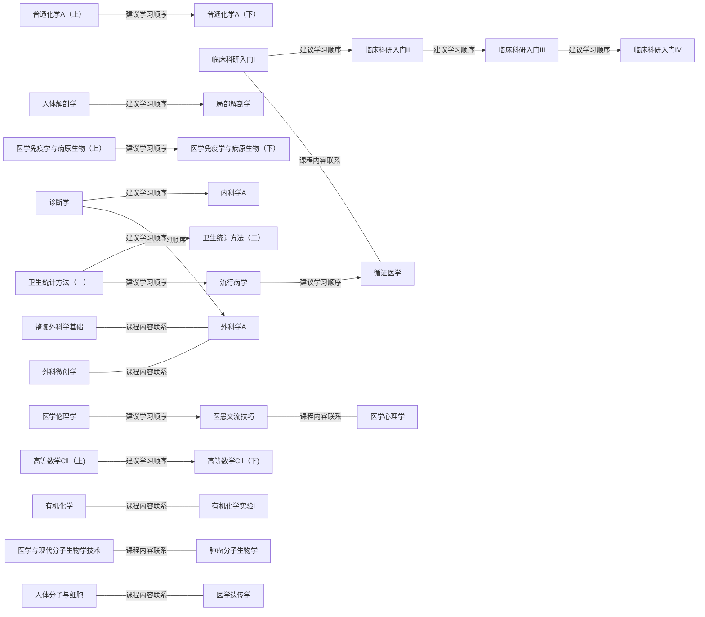

# 临床医学（八年制）专业教学培养方案

2024 年汇编印刷页 950–959。原表记录 149 个可配对的课程代码。

[本节原页](plan-950.pdf#page=1) · [逐行数据](plan-950.json) · [院系目录](README.md)

## 课程导读

想了解临床医学的课程安排，可以在原表中找到《诊断学》（`MED130522`）、《内科学A》（`MED130526`）、《外科学A》（`MED130527`）。 [原书 PDF 第 965 页](plan-950.pdf#page=2)

图中连接《整复外科学基础》（`MED130341`）和《外科学A》（`MED130527`），两门课都从课程题名标出的“外科”切入，可沿这一主题对照阅读。 [原书 PDF 第 965 页](plan-950.pdf#page=2) · [原书 PDF 第 968 页](plan-950.pdf#page=5)

## 课程关系图

图中展示最多 20 条关系。下表列出本节全部关系。建议学习顺序供规划课程使用，正式选课资格以教务规定为准。

| 课程 | 关联课程 | 关系 | 依据 |
| --- | --- | --- | --- |
| 普通化学A（上）（CHEM120005） | 普通化学A（下）（CHEM120006） | 建议学习顺序 | 同节课程题名标明连续分册或序号。 |
| 临床科研入门I（MED130502） | 临床科研入门II（MED130557） | 建议学习顺序 | 同节课程题名标明连续分册或序号。 |
| 人体解剖学（MED130506） | 局部解剖学（MED130518） | 建议学习顺序 | 系统结构与位置关系可用于区域解剖学习。 |
| 医学免疫学与病原生物（上）（MED130508） | 医学免疫学与病原生物（下）（MED130509） | 建议学习顺序 | 同节课程题名标明连续分册或序号。 |
| 医学伦理学（MED130521） | 医患交流技巧（MED130185） | 建议学习顺序 | 伦理原则和患者自主权为沟通情境提供背景。 |
| 诊断学（MED130522） | 内科学A（MED130526） | 建议学习顺序 | 病史、体格检查与诊断推理可用于内科课程的病例分析。 |
| 诊断学（MED130522） | 外科学A（MED130527） | 建议学习顺序 | 临床检查和诊断推理有助于外科病例学习。 |
| 临床科研入门II（MED130557） | 临床科研入门III（MED130558） | 建议学习顺序 | 同节课程题名标明连续分册或序号。 |
| 临床科研入门III（MED130558） | 临床科研入门IV（MED130559） | 建议学习顺序 | 同节课程题名标明连续分册或序号。 |
| 卫生统计方法（一）（PHPM130117） | 卫生统计方法（二）（PHPM130059） | 建议学习顺序 | 同节课程题名标明连续分册或序号。 |
| 卫生统计方法（一）（PHPM130117） | 流行病学（PHPM130119） | 建议学习顺序 | 数据描述和群体比较的统计知识可为流行病学研究作准备。 |
| 流行病学（PHPM130119） | 循证医学（MED130538） | 建议学习顺序 | 研究设计和偏倚的知识有助于评价临床研究证据。 |
| 高等数学CⅡ（上)（XHXT120001） | 高等数学CⅡ（下)（XHXT120002） | 建议学习顺序 | 同节课程题名标明连续分册或序号。 |
| 有机化学（CHEM120003） | 有机化学实验I（CHEM120011） | 课程内容联系 | 本方案两门课程的题名均含“有机化学”，可据此对照这一主题。 |
| 医学与现代分子生物学技术（MED130102） | 肿瘤分子生物学（MED130265） | 课程内容联系 | 本方案两门课程的题名均含“分子生物学”，可据此对照这一主题。 |
| 医患交流技巧（MED130185） | 医学心理学（MED130523） | 课程内容联系 | 患者体验与诊疗沟通共享临床情境。 |
| 整复外科学基础（MED130341） | 外科学A（MED130527） | 课程内容联系 | 本方案两门课程的题名均含“外科”，可据此对照这一主题。 |
| 外科微创学（MED130357） | 外科学A（MED130527） | 课程内容联系 | 本方案两门课程的题名均含“外科”，可据此对照这一主题。 |
| 临床科研入门I（MED130502） | 循证医学（MED130538） | 课程内容联系 | 两课均涉及临床研究问题与证据评价。 |
| 人体分子与细胞（MED130505） | 医学遗传学（MED130517） | 课程内容联系 | 基因、细胞与人体性状是共同知识背景。 |
| 人体解剖学（MED130506） | 局部解剖学（MED130518） | 课程内容联系 | 本方案两门课程的题名均含“解剖”，可据此对照这一主题。 |
| 内科学A（MED130526） | 内科实习（MED130542） | 课程内容联系 | 本方案两门课程的题名均含“内科”，可据此对照这一主题。 |
| 外科学A（MED130527） | 外科实习（MED130543） | 课程内容联系 | 本方案两门课程的题名均含“外科”，可据此对照这一主题。 |
| 外科学A（MED130527） | 肿瘤外科实习（MED130549） | 课程内容联系 | 本方案两门课程的题名均含“外科”，可据此对照这一主题。 |
| 儿科学A（MED130529） | 儿科实习（MED130545） | 课程内容联系 | 本方案两门课程的题名均含“儿科”，可据此对照这一主题。 |
| 卫生统计方法（二）（PHPM130059） | 卫生统计方法（一）（PHPM130117） | 课程内容联系 | 本方案两门课程的题名均含“卫生统计”，可据此对照这一主题。 |
| 流行病学（PHPM130119） | 预防医学（PHPM130121） | 课程内容联系 | 群体疾病分布与预防决策具有共同问题。 |
| 预防医学（PHPM130121） | 预防医学实习（PHPM130122） | 课程内容联系 | 同节同题名的课程与实验、实习或实践。 |

## 课程

| 课程代码 | 名称 | 开课学期原文 | 来源（PDF 页） |
| --- | --- | --- | --- |
| BIOL120004 | 现代生物科学导论C |  | 970, 972 |
| CHEM120003 | 有机化学 |  | 970, 972 |
| CHEM120005 | 普通化学A（上） |  | 970, 972 |
| CHEM120006 | 普通化学A（下） |  | 970, 972 |
| CHEM120009 | 普通化学实验I |  | 970, 972 |
| CHEM120011 | 有机化学实验I |  | 970, 972 |
| MATH120045 | 高等数学CI |  | 970, 972 |
| MED130036 | 法医学 | 春 | 967 |
| MED130077 | 细胞超微结构与电镜技术 | 春，秋 | 967 |
| MED130085 | 针灸与推拿学 | 春，秋 | 967 |
| MED130089 | 医学昆虫学 | 春，秋 | 967 |
| MED130097 | 中西医结合基础概论 | 春，秋 | 967 |
| MED130099 | 免疫工程 | 春，秋 | 967 |
| MED130102 | 医学与现代分子生物学技术 | 春，秋 | 967 |
| MED130107 | 临床免疫学 | 春，秋 | 967 |
| MED130136 | 中西医结合临床 | 春，秋 | 967 |
| MED130137 | 新发传染病 | 春，秋 | 967 |
| MED130138 | 高级病原生物学 | 春，秋 | 967 |
| MED130161 | 医学神经生物学 | 春或秋 | 967 |
| MED130168 | 生物安全导论 | 秋 | 967 |
| MED130170 | 基本生命支持技能培训 | 春或秋 | 967 |
| MED130177 | 整形美容外科学 | 春或秋 | 967 |
| MED130180 | 临床营养学 | 春，秋 | 967 |
| MED130185 | 医患交流技巧 | 春或秋 | 967 |
| MED130187 | 老年医学概论 | 春 | 967 |
| MED130190 | 基础医学研究入门 | 春 | 967 |
| MED130191 | 医疗保险经济学 | 秋 | 967 |
| MED130196 | 急诊医学 | 春或秋 | 967 |
| MED130197 | 医学与生物安全 | 春或秋 | 967 |
| MED130200 | 临床病理讨论课程 | 秋 | 967 |
| MED130246 | 动物疾病和人类健康 | 秋 | 967 |
| MED130264 | 艾滋病基础和临床 | 春，秋 | 967 |
| MED130265 | 肿瘤分子生物学 | 春，秋 | 967 |
| MED130270 | 生物医学科研论文的撰写 | 春 | 967 |
| MED130283 | 人体的社交网络：共生微生物 | 春，秋 | 967 |
| MED130284 | 医学影像信息学概论 | 春，秋 | 967 |
| MED130287 | 医疗纠纷防范与应对 | 春，秋 | 968 |
| MED130288 | 中医骨伤科学概论 | 春，秋 | 968 |
| MED130290 | 流行-传染病的动态分析 | 春，秋 | 968 |
| MED130298 | 老年基础医学进展 | 春，秋 | 968 |
| MED130299 | 老年医学临床实践 | 春，秋 | 967 |
| MED130322 | 走近临床Ⅱ—医护初体验 | 暑期 | 968 |
| MED130323 | 走进重症医学—从基础到临床 | 暑期 | 968 |
| MED130325 | 颅颈交界外科学—机遇和挑战 | 秋 | 968 |
| MED130326 | 中医老年病学概论 | 春 | 968 |
| MED130327 | 实验诊断学与临床沟通 | 春 | 968 |
| MED130328 | 急危重症医学概论 | 春 | 968 |
| MED130335 | 临床思维建立与提高 | 春或秋 | 968 |
| MED130337 | 现代医院质量评价及管理工具应用 | 春或秋 | 968 |
| MED130340 | 耳鼻咽喉头颈微创外科学 | 春或秋 | 968 |
| MED130341 | 整复外科学基础 | 春或秋 | 968 |
| MED130355 | 老年医学临床决策及案例解析 | 春或秋 | 968 |
| MED130356 | 从医之道—医患沟通情景模拟 | 春或秋 | 968 |
| MED130357 | 外科微创学 | 春或秋 | 968 |
| MED130359 | 医学人工智能导论 | 春或秋 | 968 |
| MED130360 | 麻醉学新进展 | 春或秋 | 968 |
| MED130361 | 临床肿瘤学进展 | 春或秋 | 968 |
| MED130417 | 生殖医学概论 | 春或秋 | 967 |
| MED130463 | 临床肿瘤免疫学基础 | 春或秋 | 968 |
| MED130465 | 心理社会肿瘤学实践与进展 | 春或秋 | 968 |
| MED130466 | 医学科技创新与转化 | 春或秋 | 968 |
| MED130467 | 肥胖医学 | 春 | 968 |
| MED130469 | 育龄期女性乳腺疾病诊疗学 | 春或秋 | 968 |
| MED130470 | 安宁关怀 | 春或秋 | 967 |
| MED130471 | 精准医学时代的肿瘤影像学 | 春或秋 | 968 |
| MED130472 | 重症医学 | 春或秋 | 968 |
| MED130473 | 健康科普——从选题到多样化传播 | 春或秋 | 968 |
| MED130474 | 临床运动医学 | 春或秋 | 968 |
| MED130476 | 眼耳鼻整形与美容 | 春或秋 | 968 |
| MED130500 | 走近生物医学 | 1 | 964, 970, 972 |
| MED130501 | 走近临床 | 2 | 964, 970, 972 |
| MED130502 | 临床科研入门I | 3 | 964, 970, 972 |
| MED130503 | 科创实践 | 7,8,9,10 | 965, 970, 972 |
| MED130504 | 医学形态学基础 | 2 | 965, 970, 972 |
| MED130505 | 人体分子与细胞 | 3 | 965, 970, 972 |
| MED130506 | 人体解剖学 | 3 | 965, 970, 972 |
| MED130507 | 基础医学概论 | 3 | 965, 970, 972 |
| MED130508 | 医学免疫学与病原生物（上） | 3 | 965, 970, 972 |
| MED130509 | 医学免疫学与病原生物（下） | 4 | 965, 970, 972 |
| MED130510 | 生物化学实验 | 4 | 965, 970, 972 |
| MED130511 | 神经系统疾病基础 | 4 | 965, 970, 972 |
| MED130512 | 消化系统疾病基础 | 4 | 965, 970, 972 |
| MED130513 | 内分泌生殖系统疾病基础 | 5 | 965, 970, 972 |
| MED130514 | 循环系统疾病基础 | 5 | 965, 970, 972 |
| MED130515 | 呼吸系统疾病基础 | 5 | 965, 970, 972 |
| MED130516 | 泌尿系统疾病基础 | 5 | 965, 970, 972 |
| MED130517 | 医学遗传学 | 5 | 965, 970, 972 |
| MED130518 | 局部解剖学 | 6 | 965, 971, 973 |
| MED130519 | 医学英语 | 5 | 965, 970, 972 |
| MED130520 | 医学文献检索与利用 | 3 | 964, 970, 972 |
| MED130521 | 医学伦理学 | 5 | 965, 970, 972 |
| MED130522 | 诊断学 | 5 | 965, 971, 972 |
| MED130523 | 医学心理学 | 7 | 966, 971, 973 |
| MED130524 | 影像诊断学B | 6 | 965, 971, 973 |
| MED130525 | 传染病学B | 8 | 966, 971, 973 |
| MED130526 | 内科学A | 6 | 965, 971, 973 |
| MED130527 | 外科学A | 7 | 965, 971, 973 |
| MED130528 | 妇产科学A | 7 | 965, 971, 973 |
| MED130529 | 儿科学A | 7 | 965, 971, 973 |
| MED130530 | 肿瘤学概论B | 8 | 966, 971, 973 |
| MED130531 | 全科医学 | 8 | 966, 971, 973 |
| MED130532 | 走进临床—从医之道 | 6 | 965, 971, 973 |
| MED130533 | 中医学概论 | 6 | 965, 971, 972 |
| MED130534 | 口腔科学B | 6 | 965, 971, 973 |
| MED130535 | 精神医学 | 8 | 966, 971, 973 |
| MED130536 | 神经病学 | 8 | 966, 971, 973 |
| MED130537 | 康复医学 | 8 | 966, 971, 973 |
| MED130538 | 循证医学 | 8 | 966, 971, 973 |
| MED130539 | 眼科学 | 8 | 966, 971, 973 |
| MED130540 | 耳鼻喉科学 | 8 | 966, 971, 973 |
| MED130541 | 皮肤病学A | 8 | 966, 971, 973 |
| MED130542 | 内科实习 | 9,10 | 966, 971, 973 |
| MED130543 | 外科实习 | 9,10 | 966, 971, 973 |
| MED130544 | 妇产科实习 | 9,10 | 966, 971, 973 |
| MED130545 | 儿科实习 | 9,10 | 966, 971, 973 |
| MED130546 | 神经科实习 | 9,10 | 966, 971, 973 |
| MED130547 | 精神科实习 | 9,10 | 966, 971, 973 |
| MED130548 | 传染科实习 | 9,10 | 966, 971, 973 |
| MED130549 | 肿瘤外科实习 | 9,10 | 966, 971, 973 |
| MED130550 | 肿瘤放疗科实习 | 9,10 | 966, 971, 973 |
| MED130551 | 眼科实习 | 9,10 | 966, 971, 973 |
| MED130552 | 耳鼻喉科实习 | 9,10 | 966, 971, 973 |
| MED130553 | 基础阶段理论综合考核 | 6 | 965, 971, 973 |
| MED130554 | 临床医学专业水平测试 | 8 | 966, 971, 973 |
| MED130555 | 临床阶段理论综合考核 | 10 | 966, 971, 973 |
| MED130556 | 临床阶段实践综合考核 | 10 | 966, 971, 973 |
| MED130557 | 临床科研入门II | 4 | 964, 970, 972 |
| MED130558 | 临床科研入门III | 5 | 964, 970, 972 |
| MED130559 | 临床科研入门IV | 6 | 964, 970, 972 |
| MED130560 | 出生缺陷 | 暑期 | 968 |
| MED130561 | 感染性疾病与抗微生物治疗 | 春或秋 | 969 |
| MED130562 | 患者安全 | 春或秋 | 969 |
| MED130563 | 神经外科与神经科学前沿 | 暑期 | 969 |
| MED130564 | 输血医学 | 春或秋 | 969 |
| MED130565 | 眼视光学 | 春或秋 | 969 |
| MED130566 | 遗传罕见病学 | 暑期 | 969 |
| PHPM130059 | 卫生统计方法（二） | 春 | 969 |
| PHPM130064 | 全球卫生导论 | 春 | 967 |
| PHPM130117 | 卫生统计方法（一） | 4 | 965, 970, 972 |
| PHPM130118 | 家庭、社区与健康 | 3 | 965, 970, 972 |
| PHPM130119 | 流行病学 | 4 | 965, 970, 972 |
| PHPM130120 | 卫生法 | 6 | 965, 971, 973 |
| PHPM130121 | 预防医学 | 7 | 965, 971, 973 |
| PHPM130122 | 预防医学实习 | 9,10 | 966, 971, 973 |
| PHYS120003 | 普通物理B |  | 970, 972 |
| PHYS120015 | 基础物理实验 |  | 970, 972 |
| PHYS130088 | 医学物理实验 | 春，秋 | 969 |
| XHXT120001 | 高等数学CⅡ（上) |  | 970, 972 |
| XHXT120002 | 高等数学CⅡ（下) |  | 970, 972 |
