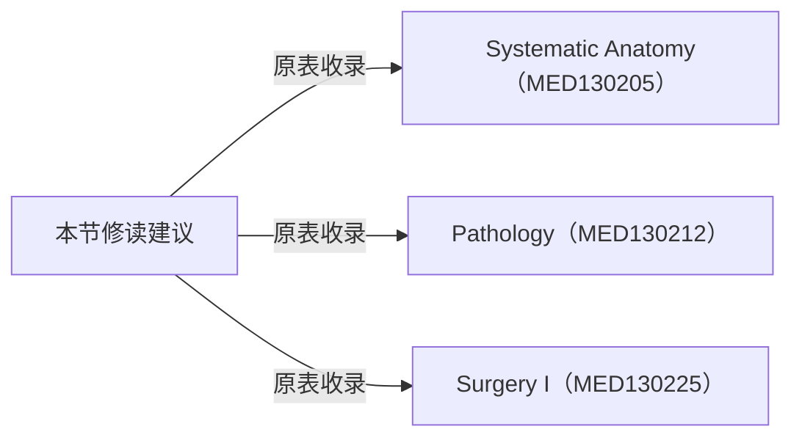

# Teaching Plan of Bachelor of Medicine & Bachelor of Surgery (MBBS)

2024 年汇编印刷页 964–965。原表记录 74 个可配对的课程代码。

[本节原页](plan-960.pdf#page=5) · [逐行数据](plan-960.json) · [院系目录](README.md)

## 课程导读

想了解医学基础与临床课程的课程安排，可以在原表中找到《Systematic Anatomy》（`MED130205`）、《Pathology》（`MED130212`）、《Surgery I》（`MED130225`）。 [原书 PDF 第 978 页](plan-960.pdf#page=5)

配套教学表按 Semester 横列十二个学期，可按课号向右查阅各学期安排。图中箭头表示本节原表收录该课，图上各课之间没有先修连线。

本节未核实可定位到课程对的关系。

## 课程

| 课程代码 | 名称 | 开课学期原文 | 来源（PDF 页） |
| --- | --- | --- | --- |
| BIOL120004 | IntroductiontoModernBiologicalScienceCSelectiveCourse |  | 978 |
| CHEM120003 | OrganicChemistry |  | 978 |
| CHEM120005 | GeneralChemistryI |  | 978 |
| CHEM120006 | GeneralChemistryII |  | 978 |
| CHEM120009 | ExperimentsinGeneralChemistryI |  | 978 |
| CHEM120011 | ExperimentsinOrganicChemistryI |  | 978 |
| COMP110029 | Computers:ToolsforanInformationAge |  | 978 |
| ICES110012 | China:AGeneralSurveyI |  | 978 |
| ICES110013 | China:AGeneralSurveyII |  | 978 |
| ICES110014 | ChineseI |  | 978 |
| ICES110015 | ChineseII |  | 978 |
| MATH120012 | CalculusI |  | 978 |
| MATH120013 | CalculusII |  | 978 |
| MED130119 | InternalMedicineInternship |  | 979 |
| MED130120 | SurgeryInternship |  | 979 |
| MED130121 | ObstetricsandGynecologyInternship |  | 979 |
| MED130122 | PediatricsInternship |  | 979 |
| MED130123 | NeurologyInternship |  | 979 |
| MED130124 | PsychiatryInternship |  | 979 |
| MED130125 | InfectionDiseasesInternship |  | 979 |
| MED130199 | TraditionalChineseMedicineInternship |  | 979 |
| MED130201 | MedicalChineseI |  | 978 |
| MED130202 | MedicalChineseII |  | 978 |
| MED130203 | MedicalCellBiology |  | 978 |
| MED130204 | MedicalGenetics |  | 978 |
| MED130205 | SystematicAnatomy |  | 978 |
| MED130206 | Histoembryology |  | 978 |
| MED130207 | Physiology |  | 978 |
| MED130209 | Immunology |  | 978 |
| MED130210 | RegionalAnatomy |  | 978 |
| MED130211 | MedicalMicrobiology |  | 978 |
| MED130212 | Pathology |  | 978 |
| MED130213 | HumanParasitology |  | 978 |
| MED130214 | Pathophysiology |  | 978 |
| MED130216 | Pharmacology |  | 978 |
| MED130217 | ExperimentsofFunctionalScience |  | 978 |
| MED130218 | Diagnostic |  | 978 |
| MED130219 | MedicalPsychology |  | 978 |
| MED130220 | DiagnosticImaging |  | 978 |
| MED130221 | BasicsofClinicalOncology |  | 979 |
| MED130222 | TraditionalChineseMedicine |  | 978 |
| MED130223 | InternalMedicineI |  | 978 |
| MED130224 | InternalMedicineII |  | 979 |
| MED130225 | SurgeryI |  | 978 |
| MED130226 | SurgeryII |  | 979 |
| MED130230 | ObstetricsandGynecology |  | 979 |
| MED130231 | Pediatrics |  | 979 |
| MED130232 | InfectionDiseases |  | 979 |
| MED130233 | Dermatology |  | 979 |
| MED130234 | Ophthalmology |  | 979 |
| MED130235 | Otorhinolaryngology |  | 979 |
| MED130236 | Stomatology |  | 979 |
| MED130237 | Psychiatry |  | 979 |
| MED130238 | Neurology |  | 979 |
| MED130243 | ExperimentofBiochemistry |  | 978 |
| MED130248 | Biochemistry |  | 978 |
| MED130252 | SurgicalOncologyInternship |  | 979 |
| MED130254 | OphthalmologyInternship |  | 979 |
| MED130255 | OtorhinolaryngologyInternship |  | 979 |
| MED130256 | DermatologyInternship |  | 979 |
| MED130257 | RadiologyInternship |  | 979 |
| MED130268 | ForensicMedicine |  | 979 |
| MED130278 | RadiationOncologyInternship |  | 979 |
| MED130291 | GeneralPracticeInternship |  | 979 |
| MED130292 | NeurosurgeryInternship |  | 979 |
| MED130293 | CardiacSurgeryInternship |  | 979 |
| MED130294 | PlasticSurgeryInternship |  | 979 |
| MED130308 | ProblemBasedLearningⅠ |  | 978 |
| MED130309 | ProblemBasedLearningⅡ |  | 978 |
| PHPM130083 | PreventiveMedicineI |  | 979 |
| PHPM130088 | PreventiveMedicineII |  | 979 |
| PHPM130093 | HygienicalStatistics |  | 978 |
| PHYS120003 | GeneralPhysicsB |  | 978 |
| PHYS120015 | FundamentalPhysicsExperiments |  | 978 |
