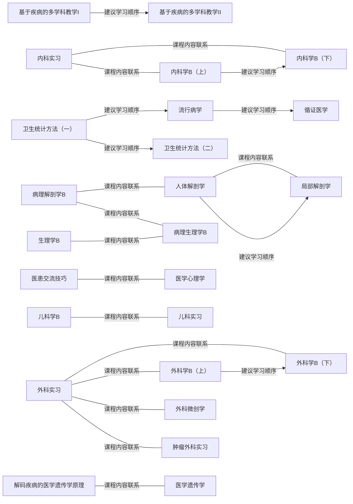

# 临床医学（五年制）专业“2+X”教学培养方案

2024 年汇编印刷页 966–970。原表记录 84 个可配对的课程代码。

[本节原页](plan-966.pdf#page=1) · [逐行数据](plan-966.json) · [院系目录](README.md)

## 课程关系图

图中展示最多 20 条关系。下表列出本节全部关系。建议学习顺序供规划课程使用，正式选课资格以教务规定为准。

| 课程 | 关联课程 | 关系 | 依据 |
| --- | --- | --- | --- |
| 基于疾病的多学科教学I（MED130143） | 基于疾病的多学科教学II（MED130144） | 建议学习顺序 | 同节课程题名标明连续分册或序号。 |
| 内科学B（上）（MED130380） | 内科学B（下）（MED130381） | 建议学习顺序 | 同节课程题名标明连续分册或序号。 |
| 外科学B（上）（MED130382） | 外科学B（下）（MED130383） | 建议学习顺序 | 同节课程题名标明连续分册或序号。 |
| 人体解剖学（MED130398） | 局部解剖学（MED130446） | 建议学习顺序 | 系统结构与位置关系可用于区域解剖学习。 |
| 卫生统计方法（一）（PHPM130111） | 卫生统计方法（二）（PHPM130059） | 建议学习顺序 | 同节课程题名标明连续分册或序号。 |
| 卫生统计方法（一）（PHPM130111） | 流行病学（PHPM130112） | 建议学习顺序 | 数据描述和群体比较的统计知识可为流行病学研究作准备。 |
| 流行病学（PHPM130112） | 循证医学（MED130449） | 建议学习顺序 | 研究设计和偏倚的知识有助于评价临床研究证据。 |
| 生理学B（MED130005） | 病理生理学B（MED130013） | 课程内容联系 | 本方案两门课程的题名均含“生理学”，可据此对照这一主题。 |
| 病理解剖学B（MED130010） | 病理生理学B（MED130013） | 课程内容联系 | 本方案两门课程的题名均含“病理”，可据此对照这一主题。 |
| 病理解剖学B（MED130010） | 人体解剖学（MED130398） | 课程内容联系 | 本方案两门课程的题名均含“解剖”，可据此对照这一主题。 |
| 内科实习（MED130119） | 内科学B（上）（MED130380） | 课程内容联系 | 本方案两门课程的题名均含“内科”，可据此对照这一主题。 |
| 内科实习（MED130119） | 内科学B（下）（MED130381） | 课程内容联系 | 本方案两门课程的题名均含“内科”，可据此对照这一主题。 |
| 外科实习（MED130120） | 肿瘤外科实习（MED130252） | 课程内容联系 | 本方案两门课程的题名均含“外科”，可据此对照这一主题。 |
| 外科实习（MED130120） | 外科微创学（MED130357） | 课程内容联系 | 本方案两门课程的题名均含“外科”，可据此对照这一主题。 |
| 外科实习（MED130120） | 外科学B（上）（MED130382） | 课程内容联系 | 本方案两门课程的题名均含“外科”，可据此对照这一主题。 |
| 外科实习（MED130120） | 外科学B（下）（MED130383） | 课程内容联系 | 本方案两门课程的题名均含“外科”，可据此对照这一主题。 |
| 医患交流技巧（MED130185） | 医学心理学（MED130448） | 课程内容联系 | 患者体验与诊疗沟通共享临床情境。 |
| 儿科学B（MED130384） | 儿科实习（MED130391） | 课程内容联系 | 本方案两门课程的题名均含“儿科”，可据此对照这一主题。 |
| 人体解剖学（MED130398） | 局部解剖学（MED130446） | 课程内容联系 | 本方案两门课程的题名均含“解剖”，可据此对照这一主题。 |
| 解码疾病的医学遗传学原理（MED130433） | 医学遗传学（MED130480） | 课程内容联系 | 本方案两门课程的题名均含“遗传学”，可据此对照这一主题。 |
| 人体分子与细胞（MED130479） | 医学遗传学（MED130480） | 课程内容联系 | 基因、细胞与人体性状是共同知识背景。 |
| 卫生统计方法（二）（PHPM130059） | 卫生统计方法（一）（PHPM130111） | 课程内容联系 | 本方案两门课程的题名均含“卫生统计”，可据此对照这一主题。 |
| 预防医学（PHPM130103） | 预防医学实习（PHPM130109） | 课程内容联系 | 同节同题名的课程与实验、实习或实践。 |
| 预防医学（PHPM130103） | 流行病学（PHPM130112） | 课程内容联系 | 群体疾病分布与预防决策具有共同问题。 |
| 基于疾病的多学科教学I（MED130143） | 基于疾病的多学科教学II（MED130144） | 方案排课先后 | 本节原表所列全部明确学期均早于后者。 |
| 内科学B（上）（MED130380） | 内科学B（下）（MED130381） | 方案排课先后 | 本节原表所列全部明确学期均早于后者。 |
| 外科学B（上）（MED130382） | 外科学B（下）（MED130383） | 方案排课先后 | 本节原表所列全部明确学期均早于后者。 |
| 人体解剖学（MED130398） | 局部解剖学（MED130446） | 方案排课先后 | 本节原表所列全部明确学期均早于后者。 |
| 卫生统计方法（一）（PHPM130111） | 卫生统计方法（二）（PHPM130059） | 方案排课先后 | 本节原表所列全部明确学期均早于后者。 |
| 卫生统计方法（一）（PHPM130111） | 流行病学（PHPM130112） | 方案排课先后 | 本节原表所列全部明确学期均早于后者。 |
| 流行病学（PHPM130112） | 循证医学（MED130449） | 方案排课先后 | 本节原表所列全部明确学期均早于后者。 |

## 课程

| 课程代码 | 名称 | 开课学期原文 | 来源（PDF 页） |
| --- | --- | --- | --- |
| MED130003 | 组织胚胎学B | 3 | 980 |
| MED130005 | 生理学B | 4 | 980 |
| MED130010 | 病理解剖学B | 4 | 981 |
| MED130012 | 寄生虫学C | 5 | 981 |
| MED130013 | 病理生理学B | 5 | 981 |
| MED130014 | 药理学C | 5 | 981 |
| MED130028 | 妇产科学B | 7 | 981 |
| MED130031 | 皮肤病学B | 8 | 982 |
| MED130033 | 口腔科学B | 6 | 982 |
| MED130034 | 精神医学 | 8 | 981 |
| MED130035 | 神经病学 | 8 | 981 |
| MED130036 | 法医学 | 8 | 982 |
| MED130109 | 传染病学B | 7 | 981 |
| MED130119 | 内科实习 | 9,10 | 981 |
| MED130120 | 外科实习 | 9,10 | 981 |
| MED130123 | 神经科实习 | 9,10 | 982 |
| MED130124 | 精神科实习 | 9,10 | 982 |
| MED130125 | 传染科实习 | 9,10 | 982 |
| MED130137 | 新发传染病 | 春或秋 | 983 |
| MED130143 | 基于疾病的多学科教学I | 4 | 982 |
| MED130144 | 基于疾病的多学科教学II | 5 | 982 |
| MED130156 | 眼科学 | 6 | 981 |
| MED130157 | 耳鼻喉科学 | 6 | 981 |
| MED130180 | 临床营养学 | 春或秋 | 983 |
| MED130185 | 医患交流技巧 | 春或秋 | 983 |
| MED130196 | 急诊医学 | 春或秋 | 983 |
| MED130252 | 肿瘤外科实习 | 9,10 | 982 |
| MED130254 | 眼科实习 | 9,10 | 982 |
| MED130255 | 耳鼻喉科实习 | 9,10 | 982 |
| MED130278 | 肿瘤放疗科实习 | 9,10 | 982 |
| MED130290 | 流行-传染病的动态分析 | 春，秋 | 983 |
| MED130299 | 老年医学临床实践 | 春或秋 | 983 |
| MED130310 | 生物医学信息学概论 | 5 | 982 |
| MED130335 | 临床思维建立与提高 | 春或秋 | 983 |
| MED130342 | 康复医学导论 | 春或秋 | 983 |
| MED130357 | 外科微创学 | 春或秋 | 983 |
| MED130359 | 医学人工智能导论 | 春或秋 | 983 |
| MED130360 | 麻醉学新进展 | 春或秋 | 983 |
| MED130361 | 临床肿瘤学进展 | 春或秋 | 983 |
| MED130375 | 临床诊断基本技术操作 | 8 | 983 |
| MED130376 | 肿瘤学概论B | 7 | 981 |
| MED130380 | 内科学B（上） | 6 | 981 |
| MED130381 | 内科学B（下） | 7 | 981 |
| MED130382 | 外科学B（上） | 6 | 981 |
| MED130383 | 外科学B（下） | 7 | 981 |
| MED130384 | 儿科学B | 7 | 981 |
| MED130389 | 走近临床I | 1,2 | 982 |
| MED130391 | 儿科实习 | 9,10 | 982 |
| MED130392 | 妇产科实习 | 9,10 | 981 |
| MED130394 | 生物化学实验 | 3 | 980 |
| MED130398 | 人体解剖学 | 3 | 980 |
| MED130406 | 脑科学前沿 | 5 | 983 |
| MED130407 | 医学伦理与法规 | 5 | 981 |
| MED130417 | 生殖医学概论 | 春或秋 | 983 |
| MED130431 | 代谢分子医学和疾病 | 6 | 983 |
| MED130432 | 免疫学进阶 | 6 | 983 |
| MED130433 | 解码疾病的医学遗传学原理 | 6 | 983 |
| MED130439 | 走进临床—从医之道 | 4,7 | 982 |
| MED130442 | 免疫学B | 4 | 981 |
| MED130443 | 医学微生物学C | 4 | 981 |
| MED130444 | 功能学科综合实验 | 5 | 981 |
| MED130445 | 中医学概论 | 5 | 981 |
| MED130446 | 局部解剖学 | 4 | 981 |
| MED130447 | 诊断学 | 5 | 981 |
| MED130448 | 医学心理学 | 6 | 981 |
| MED130449 | 循证医学 | 8 | 981 |
| MED130450 | 全科医学 | 8 | 981 |
| MED130452 | 影像诊断学 | 6 | 981 |
| MED130453 | 中西医结合临床 | 8 | 982 |
| MED130458 | 高级医学微生物学 | 4 | 982 |
| MED130470 | 安宁关怀 | 春或秋 | 983 |
| MED130472 | 重症医学 | 春或秋 | 983 |
| MED130474 | 临床运动医学 | 春或秋 | 983 |
| MED130479 | 人体分子与细胞 | 3 | 980 |
| MED130480 | 医学遗传学 | 5 | 981 |
| MED130481 | 医学信息检索 | 6 | 982 |
| MED130560 | 出生缺陷 | 暑期 | 983 |
| MED130565 | 眼视光学 | 春或秋 | 983 |
| PHPM130059 | 卫生统计方法（二） | 8 | 983 |
| PHPM130103 | 预防医学 | 8 | 981 |
| PHPM130108 | 家庭、社区与健康 | 6 | 982 |
| PHPM130109 | 预防医学实习 | 9,10 | 982 |
| PHPM130111 | 卫生统计方法（一） | 6 | 981 |
| PHPM130112 | 流行病学 | 7 | 982 |
