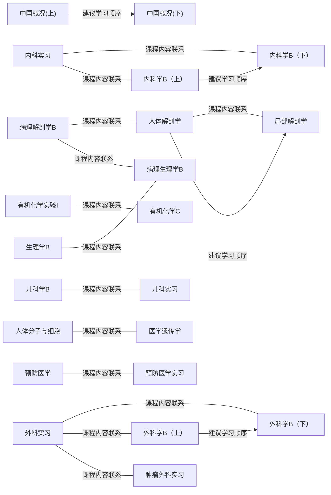

# 临床医学（五年制）专业“2+X”修读建议（留学生适用）

2024 年汇编印刷页 974–975。原表记录 56 个可配对的课程代码。

[本节原页](plan-966.pdf#page=9) · [逐行数据](plan-966.json) · [院系目录](README.md)

## 课程导读

想了解临床医学的课程安排，可以在原表中找到《诊断学》（`MED130447`）、《内科学B（上）》（`MED130380`）、《外科学B（上）》（`MED130382`）。 [原书 PDF 第 988 页](plan-966.pdf#page=9) · [原书 PDF 第 989 页](plan-966.pdf#page=10)

《内科学B（上）》（`MED130380`）和《内科学B（下）》（`MED130381`）是同一系列，图中的箭头按题名标出的分册顺序排列。 [原书 PDF 第 988 页](plan-966.pdf#page=9) · [原书 PDF 第 989 页](plan-966.pdf#page=10)

## 课程关系图

图中展示最多 20 条关系。下表列出本节全部关系。建议学习顺序供规划课程使用，正式选课资格以教务规定为准。

| 课程 | 关联课程 | 关系 | 依据 |
| --- | --- | --- | --- |
| 中国概况(上)（ICES110012） | 中国概况(下)（ICES110013） | 建议学习顺序 | 同节课程题名标明连续分册或序号。 |
| 内科学B（上）（MED130380） | 内科学B（下）（MED130381） | 建议学习顺序 | 同节课程题名标明连续分册或序号。 |
| 外科学B（上）（MED130382） | 外科学B（下）（MED130383） | 建议学习顺序 | 同节课程题名标明连续分册或序号。 |
| 人体解剖学（MED130398） | 局部解剖学（MED130446） | 建议学习顺序 | 系统结构与位置关系可用于区域解剖学习。 |
| 有机化学实验I（CHEM120011） | 有机化学C（CHEM120012） | 课程内容联系 | 本方案两门课程的题名均含“有机化学”，可据此对照这一主题。 |
| 生理学B（MED130005） | 病理生理学B（MED130013） | 课程内容联系 | 本方案两门课程的题名均含“生理学”，可据此对照这一主题。 |
| 病理解剖学B（MED130010） | 病理生理学B（MED130013） | 课程内容联系 | 本方案两门课程的题名均含“病理”，可据此对照这一主题。 |
| 病理解剖学B（MED130010） | 人体解剖学（MED130398） | 课程内容联系 | 本方案两门课程的题名均含“解剖”，可据此对照这一主题。 |
| 内科实习（MED130119） | 内科学B（上）（MED130380） | 课程内容联系 | 本方案两门课程的题名均含“内科”，可据此对照这一主题。 |
| 内科实习（MED130119） | 内科学B（下）（MED130381） | 课程内容联系 | 本方案两门课程的题名均含“内科”，可据此对照这一主题。 |
| 外科实习（MED130120） | 肿瘤外科实习（MED130252） | 课程内容联系 | 本方案两门课程的题名均含“外科”，可据此对照这一主题。 |
| 外科实习（MED130120） | 外科学B（上）（MED130382） | 课程内容联系 | 本方案两门课程的题名均含“外科”，可据此对照这一主题。 |
| 外科实习（MED130120） | 外科学B（下）（MED130383） | 课程内容联系 | 本方案两门课程的题名均含“外科”，可据此对照这一主题。 |
| 儿科学B（MED130384） | 儿科实习（MED130391） | 课程内容联系 | 本方案两门课程的题名均含“儿科”，可据此对照这一主题。 |
| 人体解剖学（MED130398） | 局部解剖学（MED130446） | 课程内容联系 | 本方案两门课程的题名均含“解剖”，可据此对照这一主题。 |
| 人体分子与细胞（MED130479） | 医学遗传学（MED130480） | 课程内容联系 | 基因、细胞与人体性状是共同知识背景。 |
| 预防医学（PHPM130103） | 预防医学实习（PHPM130109） | 课程内容联系 | 同节同题名的课程与实验、实习或实践。 |

## 课程

| 课程代码 | 名称 | 开课学期原文 | 来源（PDF 页） |
| --- | --- | --- | --- |
| CHEM120009 | 普通化学实验I |  | 988 |
| CHEM120011 | 有机化学实验I |  | 988 |
| CHEM120012 | 有机化学C |  | 988 |
| CHEM120013 | 普通化学C |  | 988 |
| ICES110012 | 中国概况(上) |  | 988 |
| ICES110013 | 中国概况(下) |  | 988 |
| MATH120045 | 高等数学CI |  | 988 |
| MED130003 | 组织胚胎学B |  | 988 |
| MED130005 | 生理学B |  | 988 |
| MED130010 | 病理解剖学B |  | 988 |
| MED130012 | 寄生虫学C |  | 988 |
| MED130013 | 病理生理学B |  | 988 |
| MED130014 | 药理学C |  | 988 |
| MED130028 | 妇产科学B |  | 989 |
| MED130034 | 精神医学 |  | 989 |
| MED130035 | 神经病学 |  | 989 |
| MED130109 | 传染病学B |  | 989 |
| MED130119 | 内科实习 |  | 989 |
| MED130120 | 外科实习 |  | 989 |
| MED130123 | 神经科实习 |  | 989 |
| MED130124 | 精神科实习 |  | 989 |
| MED130125 | 传染科实习 |  | 989 |
| MED130156 | 眼科学 |  | 989 |
| MED130157 | 耳鼻喉科学 |  | 989 |
| MED130252 | 肿瘤外科实习 |  | 989 |
| MED130254 | 眼科实习 |  | 989 |
| MED130255 | 耳鼻喉科实习 |  | 989 |
| MED130278 | 肿瘤放疗科实习 |  | 989 |
| MED130376 | 肿瘤学概论B |  | 989 |
| MED130380 | 内科学B（上） |  | 988 |
| MED130381 | 内科学B（下） |  | 989 |
| MED130382 | 外科学B（上） |  | 989 |
| MED130383 | 外科学B（下） |  | 989 |
| MED130384 | 儿科学B |  | 989 |
| MED130391 | 儿科实习 |  | 989 |
| MED130392 | 妇产科实习 |  | 989 |
| MED130394 | 生物化学实验 |  | 988 |
| MED130398 | 人体解剖学 |  | 988 |
| MED130407 | 医学伦理与法规 |  | 988 |
| MED130442 | 免疫学B |  | 988 |
| MED130443 | 医学微生物学C |  | 988 |
| MED130444 | 功能学科综合实验 |  | 988 |
| MED130445 | 中医学概论 |  | 988 |
| MED130446 | 局部解剖学 |  | 988 |
| MED130447 | 诊断学 |  | 988 |
| MED130448 | 医学心理学 |  | 989 |
| MED130449 | 循证医学 |  | 989 |
| MED130450 | 全科医学 |  | 989 |
| MED130452 | 影像诊断学 |  | 988 |
| MED130479 | 人体分子与细胞 |  | 988 |
| MED130480 | 医学遗传学 |  | 988 |
| PHPM130103 | 预防医学 |  | 989 |
| PHPM130109 | 预防医学实习 |  | 989 |
| PHPM130111 | 卫生统计方法（一） |  | 989 |
| PHYS120003 | 普通物理B |  | 988 |
| PHYS120015 | 基础物理实验 |  | 988 |
