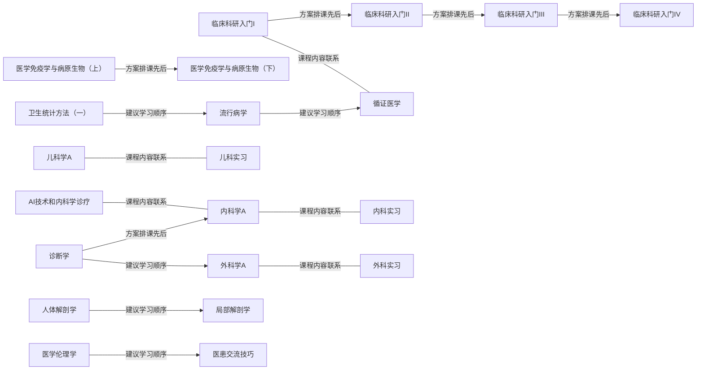

# 2025临床医学（八年制）专业本博融通培养方案（正谊明道班）-留学生适用

临床医学院 · 临床医学(八年制) · 方案 131813 · 139 个不同课程或科研条目。

[官方 Word](../originals/plan-131813.docx) · [教务详情](https://fdjwgl.fudan.edu.cn/manager/bizType/2/major-program-search/info/131813?skipAuth=1) · [方案快照](../raw/plan-131813.json.gz) · [年级目录](../README.md)

## 课程关系图

图中展示部分关系。下表保留全部已建立的课程对，来源位置使用本方案 JSON Pointer。

## 先修与内容联系

| 类型 | 起点 | 终点 | 依据 | 原表定位 |
| --- | --- | --- | --- | --- |
| 建议学习顺序 | 普通化学A（上） (CHEM10003) | 普通化学A（下） (CHEM10004) | 同方案的课程题名具有连续分册或序号。  | `/courseModules/5/planCourses/5`、`/courseModules/5/planCourses/7` |
| 建议学习顺序 | 高等数学CII（上） (MATH10023) | 高等数学CII（下） (MATH10024) | 同方案的课程题名具有连续分册或序号。  | `/courseModules/5/planCourses/1`、`/courseModules/5/planCourses/2` |
| 建议学习顺序 | 临床科研入门I (MED20097) | 临床科研入门II (MED20108) | 同方案的课程题名具有连续分册或序号。  | `/courseModules/13/planCourses/6`、`/courseModules/13/planCourses/7` |
| 建议学习顺序 | 人体解剖学 (MED20100) | 局部解剖学 (MED20087) | 系统结构与位置关系可用于区域解剖学习。  | `/courseModules/7/planCourses/2`、`/courseModules/7/planCourses/14` |
| 建议学习顺序 | 医学免疫学与病原生物（上） (MED20102) | 医学免疫学与病原生物（下） (MED20103) | 同方案的课程题名具有连续分册或序号。  | `/courseModules/7/planCourses/4`、`/courseModules/7/planCourses/5` |
| 建议学习顺序 | 临床科研入门II (MED20108) | 临床科研入门III (MED30139) | 同方案的课程题名具有连续分册或序号。  | `/courseModules/13/planCourses/7`、`/courseModules/13/planCourses/8` |
| 建议学习顺序 | 医学伦理学 (MED30046) | 医患交流技巧 (MED30040) | 伦理原则和患者自主权为沟通情境提供背景。  | `/courseModules/7/planCourses/16`、`/courseModules/10/planCourses/10` |
| 建议学习顺序 | 诊断学 (MED30124) | 内科学A (MED30127) | 病史、体格检查与诊断推理可用于内科课程的病例分析。  | `/courseModules/7/planCourses/23`、`/courseModules/7/planCourses/25` |
| 建议学习顺序 | 诊断学 (MED30124) | 外科学A (MED30128) | 临床检查和诊断推理有助于外科病例学习。  | `/courseModules/7/planCourses/23`、`/courseModules/7/planCourses/26` |
| 建议学习顺序 | 临床科研入门III (MED30139) | 临床科研入门IV (MED30140) | 同方案的课程题名具有连续分册或序号。  | `/courseModules/13/planCourses/8`、`/courseModules/13/planCourses/9` |
| 建议学习顺序 | 卫生统计方法（一） (PHPM30026) | 流行病学 (PHPM30027) | 数据描述和群体比较的统计知识可为流行病学研究作准备。  | `/courseModules/7/planCourses/19`、`/courseModules/7/planCourses/20` |
| 建议学习顺序 | 流行病学 (PHPM30027) | 循证医学 (MED30135) | 研究设计和偏倚的知识有助于评价临床研究证据。  | `/courseModules/7/planCourses/20`、`/courseModules/7/planCourses/34` |
| 方案排课先后 | 普通化学A（上） (CHEM10003) | 普通化学A（下） (CHEM10004) | 同方案该课程全部明确数字学期均早于后者。  | `/courseModules/5/planCourses/5`、`/courseModules/5/planCourses/7` |
| 方案排课先后 | 高等数学CII（上） (MATH10023) | 高等数学CII（下） (MATH10024) | 同方案该课程全部明确数字学期均早于后者。  | `/courseModules/5/planCourses/1`、`/courseModules/5/planCourses/2` |
| 方案排课先后 | 临床科研入门I (MED20097) | 临床科研入门II (MED20108) | 同方案该课程全部明确数字学期均早于后者。  | `/courseModules/13/planCourses/6`、`/courseModules/13/planCourses/7` |
| 方案排课先后 | 人体解剖学 (MED20100) | 局部解剖学 (MED20087) | 同方案该课程全部明确数字学期均早于后者。  | `/courseModules/7/planCourses/2`、`/courseModules/7/planCourses/14` |
| 方案排课先后 | 医学免疫学与病原生物（上） (MED20102) | 医学免疫学与病原生物（下） (MED20103) | 同方案该课程全部明确数字学期均早于后者。  | `/courseModules/7/planCourses/4`、`/courseModules/7/planCourses/5` |
| 方案排课先后 | 临床科研入门II (MED20108) | 临床科研入门III (MED30139) | 同方案该课程全部明确数字学期均早于后者。  | `/courseModules/13/planCourses/7`、`/courseModules/13/planCourses/8` |
| 方案排课先后 | 诊断学 (MED30124) | 内科学A (MED30127) | 同方案该课程全部明确数字学期均早于后者。  | `/courseModules/7/planCourses/23`、`/courseModules/7/planCourses/25` |
| 方案排课先后 | 诊断学 (MED30124) | 外科学A (MED30128) | 同方案该课程全部明确数字学期均早于后者。  | `/courseModules/7/planCourses/23`、`/courseModules/7/planCourses/26` |
| 方案排课先后 | 临床科研入门III (MED30139) | 临床科研入门IV (MED30140) | 同方案该课程全部明确数字学期均早于后者。  | `/courseModules/13/planCourses/8`、`/courseModules/13/planCourses/9` |
| 方案排课先后 | 流行病学 (PHPM30027) | 循证医学 (MED30135) | 同方案该课程全部明确数字学期均早于后者。  | `/courseModules/7/planCourses/20`、`/courseModules/7/planCourses/34` |
| 课程内容联系 | AI技术和内科学诊疗 (AIS410012) | 内科学A (MED30127) | 本方案两门课程的题名均含“内科”，可据此对照这一主题。  | `/courseModules/10/planCourses/52`、`/courseModules/7/planCourses/25` |
| 课程内容联系 | 有机化学 (CHEM10002) | 有机化学实验I (CHEM10006) | 本方案两门课程的题名均含“有机化学”，可据此对照这一主题。  | `/courseModules/5/planCourses/9`、`/courseModules/5/planCourses/10` |
| 课程内容联系 | 局部解剖学 (MED20087) | 人体解剖学 (MED20100) | 本方案两门课程的题名均含“解剖”，可据此对照这一主题。  | `/courseModules/7/planCourses/14`、`/courseModules/7/planCourses/2` |
| 课程内容联系 | 临床科研入门I (MED20097) | 循证医学 (MED30135) | 两课均涉及临床研究问题与证据评价。  | `/courseModules/13/planCourses/6`、`/courseModules/7/planCourses/34` |
| 课程内容联系 | 人体分子与细胞 (MED20099) | 医学遗传学 (MED30123) | 基因、细胞与人体性状是共同知识背景。  | `/courseModules/7/planCourses/0`、`/courseModules/7/planCourses/7` |
| 课程内容联系 | 医患交流技巧 (MED30040) | 医学心理学 (MED30125) | 患者体验与诊疗沟通共享临床情境。  | `/courseModules/10/planCourses/10`、`/courseModules/7/planCourses/29` |
| 课程内容联系 | 内科学A (MED30127) | 内科实习 (MED40021) | 本方案两门课程的题名均含“内科”，可据此对照这一主题。  | `/courseModules/7/planCourses/25`、`/courseModules/13/planCourses/12` |
| 课程内容联系 | 外科学A (MED30128) | 外科实习 (MED40022) | 本方案两门课程的题名均含“外科”，可据此对照这一主题。  | `/courseModules/7/planCourses/26`、`/courseModules/13/planCourses/13` |
| 课程内容联系 | 外科学A (MED30128) | 肿瘤外科实习 (MED40048) | 本方案两门课程的题名均含“外科”，可据此对照这一主题。  | `/courseModules/7/planCourses/26`、`/courseModules/13/planCourses/1` |
| 课程内容联系 | 外科学A (MED30128) | 整复外科学基础 (MED50024) | 本方案两门课程的题名均含“外科”，可据此对照这一主题。  | `/courseModules/7/planCourses/26`、`/courseModules/10/planCourses/30` |
| 课程内容联系 | 外科学A (MED30128) | 外科微创学 (MED50026) | 本方案两门课程的题名均含“外科”，可据此对照这一主题。  | `/courseModules/7/planCourses/26`、`/courseModules/10/planCourses/32` |
| 课程内容联系 | 儿科学A (MED30130) | 儿科实习 (MED40074) | 本方案两门课程的题名均含“儿科”，可据此对照这一主题。  | `/courseModules/7/planCourses/28`、`/courseModules/13/planCourses/15` |
| 课程内容联系 | 流行病学 (PHPM30027) | 预防医学 (PHPM40030) | 群体疾病分布与预防决策具有共同问题。  | `/courseModules/7/planCourses/20`、`/courseModules/7/planCourses/22` |
| 课程内容联系 | 预防医学实习 (PHPM40028) | 预防医学 (PHPM40030) | 题名显示相同主题的课程与实验、实践或实习。  | `/courseModules/13/planCourses/19`、`/courseModules/7/planCourses/22` |

本次未从可定位的明确表述中确认课程对课程预修。学期安排、系列分册与编辑建议均保留各自的依据。

## 按原方案模块阅读

同一模块展示原表中的课程归属。模块内课程之间的先后仍须逐项查阅。

- **限定选修课**　医学神经生物学、中西医结合临床、安宁关怀、临床营养学、急诊医学、老年医学临床实践、生殖医学概论、全球卫生导论（原表模块 9）

## 课程表

同一课程在不同模块分别出现时，按原表逐行列出。季节字段保留原值。

| 课程 | 代码 | 学分 | 学期 | 模块 |
| --- | --- | ---: | --- | --- |
| 高等数学C I | MATH10018 | 5.0 | 第1学期 | 培养方案 / 专业培养课程 / 学科基础课程 |
| 高等数学CII（上） | MATH10023 | 3.0 | 第1学期 | 培养方案 / 专业培养课程 / 学科基础课程 |
| 高等数学CII（下） | MATH10024 | 3.0 | 第2学期 | 培养方案 / 专业培养课程 / 学科基础课程 |
| 普通物理B | PHYS10002 | 3.0 | 第1学期 | 培养方案 / 专业培养课程 / 学科基础课程 |
| 基础物理实验 | PHYS10005 | 2.0 | 第1学期 | 培养方案 / 专业培养课程 / 学科基础课程 |
| 普通化学A（上） | CHEM10003 | 2.0 | 第1学期 | 培养方案 / 专业培养课程 / 学科基础课程 |
| 现代生物科学导论C | BIOL10002 | 2.0 | 第1学期 | 培养方案 / 专业培养课程 / 学科基础课程 |
| 普通化学A（下） | CHEM10004 | 2.0 | 第2学期 | 培养方案 / 专业培养课程 / 学科基础课程 |
| 普通化学实验I | CHEM10005 | 1.0 | 第2学期 | 培养方案 / 专业培养课程 / 学科基础课程 |
| 有机化学 | CHEM10002 | 4.0 | 第2学期 | 培养方案 / 专业培养课程 / 学科基础课程 |
| 有机化学实验I | CHEM10006 | 1.0 | 第2学期 | 培养方案 / 专业培养课程 / 学科基础课程 |
| 人体分子与细胞 | MED20099 | 4.5 | 第2学期 | 培养方案 / 专业培养课程 / 专业核心教育课程 / 专业必修课程 |
| 医学形态学基础 | MED20098 | 2.0 | 第3学期 | 培养方案 / 专业培养课程 / 专业核心教育课程 / 专业必修课程 |
| 人体解剖学 | MED20100 | 3.0 | 第3学期 | 培养方案 / 专业培养课程 / 专业核心教育课程 / 专业必修课程 |
| 基础医学概论 | MED20101 | 2.5 | 第3学期 | 培养方案 / 专业培养课程 / 专业核心教育课程 / 专业必修课程 |
| 医学免疫学与病原生物（上） | MED20102 | 4.0 | 第3学期 | 培养方案 / 专业培养课程 / 专业核心教育课程 / 专业必修课程 |
| 医学免疫学与病原生物（下） | MED20103 | 2.5 | 第4学期 | 培养方案 / 专业培养课程 / 专业核心教育课程 / 专业必修课程 |
| 生物化学实验 | MED20104 | 1.0 | 第4学期 | 培养方案 / 专业培养课程 / 专业核心教育课程 / 专业必修课程 |
| 医学遗传学 | MED30123 | 1.5 | 第4学期 | 培养方案 / 专业培养课程 / 专业核心教育课程 / 专业必修课程 |
| 神经系统疾病基础 | MED20105 | 3.5 | 第4学期 | 培养方案 / 专业培养课程 / 专业核心教育课程 / 专业必修课程 |
| 消化系统疾病基础 | MED20106 | 3.0 | 第4学期 | 培养方案 / 专业培养课程 / 专业核心教育课程 / 专业必修课程 |
| 内分泌生殖系统疾病基础 | MED30119 | 2.5 | 第5学期 | 培养方案 / 专业培养课程 / 专业核心教育课程 / 专业必修课程 |
| 循环血液系统疾病基础 | MED30120 | 4.5 | 第5学期 | 培养方案 / 专业培养课程 / 专业核心教育课程 / 专业必修课程 |
| 呼吸系统疾病基础 | MED30121 | 2.5 | 第5学期 | 培养方案 / 专业培养课程 / 专业核心教育课程 / 专业必修课程 |
| 泌尿系统疾病基础 | MED30122 | 2.5 | 第5学期 | 培养方案 / 专业培养课程 / 专业核心教育课程 / 专业必修课程 |
| 局部解剖学 | MED20087 | 2.0 | 第6学期 | 培养方案 / 专业培养课程 / 专业核心教育课程 / 专业必修课程 |
| 医学英语 | MED20107 | 2.0 | 第5学期 | 培养方案 / 专业培养课程 / 专业核心教育课程 / 专业必修课程 |
| 医学伦理学 | MED30046 | 1.0 | 第5学期 | 培养方案 / 专业培养课程 / 专业核心教育课程 / 专业必修课程 |
| 基础阶段理论综合考核 | MED30138 | 0.5 | 第6学期 | 培养方案 / 专业培养课程 / 专业核心教育课程 / 专业必修课程 |
| 家庭、社区与人群健康 | PHPM30001 | 2.0 | 第3学期 | 培养方案 / 专业培养课程 / 专业核心教育课程 / 专业必修课程 |
| 卫生统计方法（一） | PHPM30026 | 1.5 | 第4学期 | 培养方案 / 专业培养课程 / 专业核心教育课程 / 专业必修课程 |
| 流行病学 | PHPM30027 | 1.0 | 第4学期 | 培养方案 / 专业培养课程 / 专业核心教育课程 / 专业必修课程 |
| 卫生法 | PHPM20017 | 1.0 | 第6学期 | 培养方案 / 专业培养课程 / 专业核心教育课程 / 专业必修课程 |
| 预防医学 | PHPM40030 | 2.0 | 第7学期 | 培养方案 / 专业培养课程 / 专业核心教育课程 / 专业必修课程 |
| 诊断学 | MED30124 | 3.0 | 第5学期 | 培养方案 / 专业培养课程 / 专业核心教育课程 / 专业必修课程 |
| 走进临床--从医之道 | MED30133 | 1.0 | 第6学期 | 培养方案 / 专业培养课程 / 专业核心教育课程 / 专业必修课程 |
| 内科学A | MED30127 | 8.5 | 第6学期 | 培养方案 / 专业培养课程 / 专业核心教育课程 / 专业必修课程 |
| 外科学A | MED30128 | 8.5 | 第7学期 | 培养方案 / 专业培养课程 / 专业核心教育课程 / 专业必修课程 |
| 妇产科学A | MED30129 | 4.0 | 第7学期 | 培养方案 / 专业培养课程 / 专业核心教育课程 / 专业必修课程 |
| 儿科学A | MED30130 | 4.0 | 第7学期 | 培养方案 / 专业培养课程 / 专业核心教育课程 / 专业必修课程 |
| 医学心理学 | MED30125 | 1.0 | 第7学期 | 培养方案 / 专业培养课程 / 专业核心教育课程 / 专业必修课程 |
| 传染病学B | MED30126 | 2.5 | 第8学期 | 培养方案 / 专业培养课程 / 专业核心教育课程 / 专业必修课程 |
| 肿瘤学概论B | MED30131 | 1.0 | 第8学期 | 培养方案 / 专业培养课程 / 专业核心教育课程 / 专业必修课程 |
| 全科医学 | MED30132 | 1.5 | 第8学期 | 培养方案 / 专业培养课程 / 专业核心教育课程 / 专业必修课程 |
| 神经病学 | MED30134 | 1.5 | 第8学期 | 培养方案 / 专业培养课程 / 专业核心教育课程 / 专业必修课程 |
| 循证医学 | MED30135 | 2.0 | 第8学期 | 培养方案 / 专业培养课程 / 专业核心教育课程 / 专业必修课程 |
| 眼科学 | MED30136 | 2.0 | 第8学期 | 培养方案 / 专业培养课程 / 专业核心教育课程 / 专业必修课程 |
| 耳鼻喉科学 | MED30137 | 2.0 | 第8学期 | 培养方案 / 专业培养课程 / 专业核心教育课程 / 专业必修课程 |
| 临床医学专业水平测试 | MED40094 | 0.5 | 第8学期 | 培养方案 / 专业培养课程 / 专业核心教育课程 / 专业必修课程 |
| 临床阶段理论综合考核 | MED40095 | 0.5 | 第10学期 | 培养方案 / 专业培养课程 / 专业核心教育课程 / 专业必修课程 |
| 临床阶段实践综合考核 | MED40096 | 0.5 | 第10学期 | 培养方案 / 专业培养课程 / 专业核心教育课程 / 专业必修课程 |
| 影像诊断学B | MED30145 | 3.5 | 第6学期 | 培养方案 / 专业培养课程 / 专业核心教育课程 / 专业必修课程 |
| 中医学概论 | MED30146 | 2.0 | 第6学期 | 培养方案 / 专业培养课程 / 专业核心教育课程 / 专业必修课程 |
| 口腔科学B | MED30147 | 1.0 | 第6学期 | 培养方案 / 专业培养课程 / 专业核心教育课程 / 专业必修课程 |
| 皮肤病学A | MED30148 | 2.0 | 第8学期 | 培养方案 / 专业培养课程 / 专业核心教育课程 / 专业必修课程 |
| 精神医学 | MED40114 | 1.5 | 第8学期 | 培养方案 / 专业培养课程 / 专业核心教育课程 / 专业必修课程 |
| 康复医学 | MED40115 | 1.0 | 第8学期 | 培养方案 / 专业培养课程 / 专业核心教育课程 / 专业必修课程 |
| 中西医结合临床 | MED30030 | 2.0 | SPRING、AUTUMN | 培养方案 / 专业培养课程 / 专业选修课程 / 限定选修课 |
| 医学神经生物学 | MED20028 | 2.0 | SPRING、AUTUMN | 培养方案 / 专业培养课程 / 专业选修课程 / 限定选修课 |
| 临床营养学 | MED50012 | 2.0 | SPRING、AUTUMN | 培养方案 / 专业培养课程 / 专业选修课程 / 限定选修课 |
| 急诊医学 | MED50014 | 2.0 | SPRING、AUTUMN | 培养方案 / 专业培养课程 / 专业选修课程 / 限定选修课 |
| 老年医学临床实践 | MED50019 | 2.0 | SPRING、AUTUMN | 培养方案 / 专业培养课程 / 专业选修课程 / 限定选修课 |
| 生殖医学概论 | MED50029 | 2.0 | SPRING、AUTUMN | 培养方案 / 专业培养课程 / 专业选修课程 / 限定选修课 |
| 安宁关怀 | MED40078 | 2.0 | SPRING、AUTUMN | 培养方案 / 专业培养课程 / 专业选修课程 / 限定选修课 |
| 全球卫生导论 | PHPM20013 | 2.0 | SPRING | 培养方案 / 专业培养课程 / 专业选修课程 / 限定选修课 |
| 法医学 | MED20012 | 2.0 | SPRING | 培养方案 / 专业培养课程 / 专业选修课程 / 选修课程 |
| 细胞超微结构与电镜技术 | MED20015 | 3.0 | SPRING、AUTUMN | 培养方案 / 专业培养课程 / 专业选修课程 / 选修课程 |
| 针灸与推拿学 | MED40019 | 2.0 | SPRING、AUTUMN | 培养方案 / 专业培养课程 / 专业选修课程 / 选修课程 |
| 医学昆虫学 | MED20017 | 1.5 | SPRING、AUTUMN | 培养方案 / 专业培养课程 / 专业选修课程 / 选修课程 |
| 中西医结合基础概论 | MED20018 | 2.0 | SPRING、AUTUMN | 培养方案 / 专业培养课程 / 专业选修课程 / 选修课程 |
| 免疫工程 | MED20019 | 2.0 | SPRING、AUTUMN | 培养方案 / 专业培养课程 / 专业选修课程 / 选修课程 |
| 新发传染病 | MED50011 | 2.0 | SPRING、AUTUMN | 培养方案 / 专业培养课程 / 专业选修课程 / 选修课程 |
| 高级病原生物学 | MED30031 | 2.0 | SPRING、AUTUMN | 培养方案 / 专业培养课程 / 专业选修课程 / 选修课程 |
| 基本生命支持技能培训 | MED30036 | 1.0 | SPRING、AUTUMN | 培养方案 / 专业培养课程 / 专业选修课程 / 选修课程 |
| 整形美容外科学 | MED30039 | 2.0 | SPRING、AUTUMN | 培养方案 / 专业培养课程 / 专业选修课程 / 选修课程 |
| 医患交流技巧 | MED30040 | 2.0 | SPRING、AUTUMN | 培养方案 / 专业培养课程 / 专业选修课程 / 选修课程 |
| 老年医学概论 | MED50013 | 2.0 | SPRING | 培养方案 / 专业培养课程 / 专业选修课程 / 选修课程 |
| 基础医学研究入门 | MED20032 | 2.0 | SPRING | 培养方案 / 专业培养课程 / 专业选修课程 / 选修课程 |
| 医学与生物安全 | MED20036 | 2.0 | SPRING、AUTUMN | 培养方案 / 专业培养课程 / 专业选修课程 / 选修课程 |
| 临床病理讨论课程 | MED30042 | 2.0 | AUTUMN | 培养方案 / 专业培养课程 / 专业选修课程 / 选修课程 |
| 动物疾病和人类健康 | MED20050 | 2.0 | AUTUMN | 培养方案 / 专业培养课程 / 专业选修课程 / 选修课程 |
| 艾滋病基础和临床 | MED50015 | 2.0 | SPRING、AUTUMN | 培养方案 / 专业培养课程 / 专业选修课程 / 选修课程 |
| 肿瘤分子生物学 | MED50016 | 2.0 | SPRING、AUTUMN | 培养方案 / 专业培养课程 / 专业选修课程 / 选修课程 |
| 人体的社交网络：共生微生物 | MED30064 | 2.0 | SPRING、AUTUMN | 培养方案 / 专业培养课程 / 专业选修课程 / 选修课程 |
| 医学影像信息学概论 | MED30065 | 2.0 | SPRING、AUTUMN | 培养方案 / 专业培养课程 / 专业选修课程 / 选修课程 |
| 医疗纠纷防范与应对 | MED30067 | 2.0 | SPRING、AUTUMN | 培养方案 / 专业培养课程 / 专业选修课程 / 选修课程 |
| 中医骨伤科学概论 | MED50017 | 2.0 | SPRING、AUTUMN | 培养方案 / 专业培养课程 / 专业选修课程 / 选修课程 |
| 老年基础医学进展 | MED50018 | 2.0 | SPRING、AUTUMN | 培养方案 / 专业培养课程 / 专业选修课程 / 选修课程 |
| 走近临床Ⅱ—医护初体验 | MED20057 | 2.0 | SPRING、AUTUMN | 培养方案 / 专业培养课程 / 专业选修课程 / 选修课程 |
| 颅颈交界外科学—机遇和挑战 | MED30072 | 2.0 | AUTUMN | 培养方案 / 专业培养课程 / 专业选修课程 / 选修课程 |
| 中医老年病学概论 | MED50021 | 2.0 | SPRING | 培养方案 / 专业培养课程 / 专业选修课程 / 选修课程 |
| 实验诊断学与临床沟通 | MED50022 | 2.0 | SPRING | 培养方案 / 专业培养课程 / 专业选修课程 / 选修课程 |
| 急危重症医学概论 | MED40060 | 2.0 | SPRING | 培养方案 / 专业培养课程 / 专业选修课程 / 选修课程 |
| 临床思维建立与提高 | MED30073 | 2.0 | SPRING、AUTUMN | 培养方案 / 专业培养课程 / 专业选修课程 / 选修课程 |
| 现代医院质量评价及管理工具应用 | MED50023 | 2.0 | SPRING、AUTUMN | 培养方案 / 专业培养课程 / 专业选修课程 / 选修课程 |
| 整复外科学基础 | MED50024 | 2.0 | SPRING、AUTUMN | 培养方案 / 专业培养课程 / 专业选修课程 / 选修课程 |
| 老年医学临床决策及案例解析 | MED50025 | 2.0 | SPRING、AUTUMN | 培养方案 / 专业培养课程 / 专业选修课程 / 选修课程 |
| 外科微创学 | MED50026 | 2.0 | SPRING、AUTUMN | 培养方案 / 专业培养课程 / 专业选修课程 / 选修课程 |
| 麻醉学新进展 | MED40064 | 2.0 | SPRING、AUTUMN | 培养方案 / 专业培养课程 / 专业选修课程 / 选修课程 |
| 临床肿瘤学进展 | MED40065 | 2.0 | SPRING、AUTUMN | 培养方案 / 专业培养课程 / 专业选修课程 / 选修课程 |
| 临床肿瘤免疫学基础 | MED50033 | 2.0 | SPRING、AUTUMN | 培养方案 / 专业培养课程 / 专业选修课程 / 选修课程 |
| 心理社会肿瘤学实践与进展 | MED40077 | 2.0 | SPRING、AUTUMN | 培养方案 / 专业培养课程 / 专业选修课程 / 选修课程 |
| 医学科技创新与转化 | MED30114 | 2.0 | SPRING、AUTUMN | 培养方案 / 专业培养课程 / 专业选修课程 / 选修课程 |
| 肥胖医学 | MED50034 | 2.0 | SPRING | 培养方案 / 专业培养课程 / 专业选修课程 / 选修课程 |
| 育龄期女性乳腺疾病诊疗学 | MED50035 | 2.0 | SPRING、AUTUMN | 培养方案 / 专业培养课程 / 专业选修课程 / 选修课程 |
| 精准医学时代的肿瘤影像学 | MED40079 | 2.0 | SPRING、AUTUMN | 培养方案 / 专业培养课程 / 专业选修课程 / 选修课程 |
| 临床运动医学 | MED40080 | 2.0 | SPRING、AUTUMN | 培养方案 / 专业培养课程 / 专业选修课程 / 选修课程 |
| 重症医学 | MED30115 | 2.0 | SPRING、AUTUMN | 培养方案 / 专业培养课程 / 专业选修课程 / 选修课程 |
| 眼耳鼻整形与美容 | MED50036 | 2.0 | SPRING、AUTUMN | 培养方案 / 专业培养课程 / 专业选修课程 / 选修课程 |
| 出生缺陷 | MED50037 | 2.0 | SUMMER | 培养方案 / 专业培养课程 / 专业选修课程 / 选修课程 |
| 感染性疾病与抗微生物治疗 | MED40097 | 2.0 | SPRING、AUTUMN | 培养方案 / 专业培养课程 / 专业选修课程 / 选修课程 |
| 患者安全 | MED40098 | 1.0 | SPRING、AUTUMN | 培养方案 / 专业培养课程 / 专业选修课程 / 选修课程 |
| 神经外科与神经科学前沿 | MED30141 | 2.0 | SUMMER | 培养方案 / 专业培养课程 / 专业选修课程 / 选修课程 |
| 输血医学 | MED30142 | 1.0 | SPRING、AUTUMN | 培养方案 / 专业培养课程 / 专业选修课程 / 选修课程 |
| 眼视光学 | MED50038 | 1.5 | SPRING、AUTUMN | 培养方案 / 专业培养课程 / 专业选修课程 / 选修课程 |
| 遗传罕见病学 | MED50039 | 2.0 | SUMMER | 培养方案 / 专业培养课程 / 专业选修课程 / 选修课程 |
| 医学物理实验 | PHYS40017 | 2.0 | SPRING、AUTUMN | 培养方案 / 专业培养课程 / 专业选修课程 / 选修课程 |
| AI技术和内科学诊疗 | AIS410012 | 2.0 | SPRING、AUTUMN | 培养方案 / 专业培养课程 / 专业选修课程 / 选修课程 |
| 智能肿瘤学的探索实践与临床应用 | AIS531014 | 2.0 | SPRING、AUTUMN | 培养方案 / 专业培养课程 / 专业选修课程 / 选修课程 |
| 走近生物医学 | MED20095 | 1.0 | 第1学期 | 融合创新能力 |
| 肿瘤外科实习 | MED40048 | 2.0 | 第9学期、第10学期 | 融合创新能力 |
| 眼科实习 | MED40049 | 2.0 | 第9学期、第10学期 | 融合创新能力 |
| 走近临床 | MED20096 | 1.0 | 第2学期 | 融合创新能力 |
| 肿瘤放疗科实习 | MED40053 | 2.0 | 第9学期、第10学期 | 融合创新能力 |
| 耳鼻喉科实习 | MED40050 | 2.0 | 第9学期、第10学期 | 融合创新能力 |
| 临床科研入门I | MED20097 | 0.5 | 第3学期 | 融合创新能力 |
| 临床科研入门II | MED20108 | 0.5 | 第4学期 | 融合创新能力 |
| 临床科研入门III | MED30139 | 0.5 | 第5学期 | 融合创新能力 |
| 临床科研入门IV | MED30140 | 0.5 | 第6学期 | 融合创新能力 |
| 医学文献检索与利用 | MED40082 | 2.5 | 第3学期 | 融合创新能力 |
| 科创实践 | MED30118 | 2.0 | 第7学期、第8学期、第9学期、第10学期 | 融合创新能力 |
| 内科实习 | MED40021 | 12.0 | 第9学期、第10学期 | 融合创新能力 |
| 外科实习 | MED40022 | 12.0 | 第9学期、第10学期 | 融合创新能力 |
| 妇产科实习 | MED40075 | 6.0 | 第9学期、第10学期 | 融合创新能力 |
| 儿科实习 | MED40074 | 6.0 | 第9学期、第10学期 | 融合创新能力 |
| 神经科实习 | MED40025 | 2.0 | 第9学期、第10学期 | 融合创新能力 |
| 精神科实习 | MED40026 | 2.0 | 第9学期、第10学期 | 融合创新能力 |
| 传染科实习 | MED40027 | 2.0 | 第9学期、第10学期 | 融合创新能力 |
| 预防医学实习 | PHPM40028 | 2.0 | 第9学期、第10学期 | 融合创新能力 |
