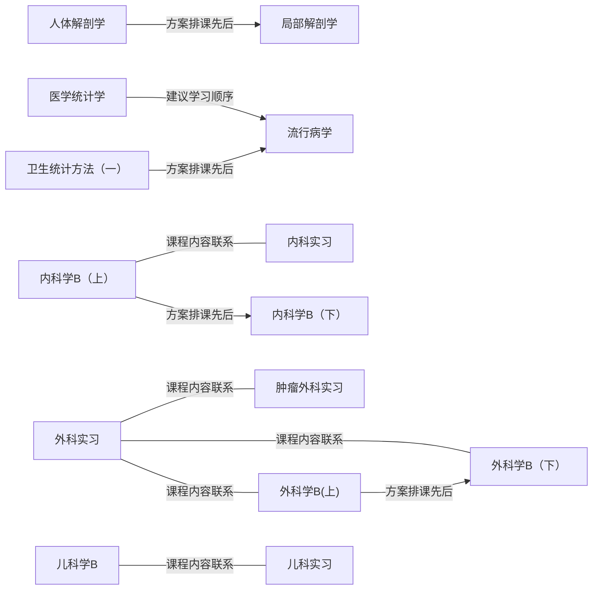

# 2025临床医学（五年制）-临床医学本硕融通培养方案

临床医学院 · 临床医学(五年制) · 方案 98488 · 78 个不同课程或科研条目。

[官方 Word](../originals/plan-98488.docx) · [教务详情](https://fdjwgl.fudan.edu.cn/manager/bizType/2/major-program-search/info/98488?skipAuth=1) · [方案快照](../raw/plan-98488.json.gz) · [年级目录](../README.md)

## 课程关系图

图中展示部分关系。下表保留全部已建立的课程对，来源位置使用本方案 JSON Pointer。

## 先修与内容联系

| 类型 | 起点 | 终点 | 依据 | 原表定位 |
| --- | --- | --- | --- | --- |
| 建议学习顺序 | 人体解剖学 (MED20070) | 局部解剖学 (MED20087) | 系统结构与位置关系可用于区域解剖学习。  | `/courseModules/6/planCourses/1`、`/courseModules/6/planCourses/8` |
| 建议学习顺序 | 内科学B（上） (MED30083) | 内科学B（下） (MED30084) | 同方案的课程题名具有连续分册或序号。  | `/courseModules/6/planCourses/18`、`/courseModules/6/planCourses/24` |
| 建议学习顺序 | 外科学B(上) (MED40072) | 外科学B（下） (MED40073) | 同方案的课程题名具有连续分册或序号。  | `/courseModules/6/planCourses/19`、`/courseModules/6/planCourses/25` |
| 建议学习顺序 | 卫生统计方法（一） (PHPM30022) | 流行病学 (PHPM30023) | 数据描述和群体比较的统计知识可为流行病学研究作准备。  | `/courseModules/6/planCourses/22`、`/courseModules/9/planCourses/4` |
| 建议学习顺序 | 医学统计学 (PHPM60094) | 流行病学 (PHPM30023) | 统计推断支持群体健康研究。  | `/courseModules/10/planCourses/0`、`/courseModules/9/planCourses/4` |
| 方案排课先后 | 人体解剖学 (MED20070) | 局部解剖学 (MED20087) | 同方案该课程全部明确数字学期均早于后者。  | `/courseModules/6/planCourses/1`、`/courseModules/6/planCourses/8` |
| 方案排课先后 | 内科学B（上） (MED30083) | 内科学B（下） (MED30084) | 同方案该课程全部明确数字学期均早于后者。  | `/courseModules/6/planCourses/18`、`/courseModules/6/planCourses/24` |
| 方案排课先后 | 外科学B(上) (MED40072) | 外科学B（下） (MED40073) | 同方案该课程全部明确数字学期均早于后者。  | `/courseModules/6/planCourses/19`、`/courseModules/6/planCourses/25` |
| 方案排课先后 | 卫生统计方法（一） (PHPM30022) | 流行病学 (PHPM30023) | 同方案该课程全部明确数字学期均早于后者。  | `/courseModules/6/planCourses/22`、`/courseModules/9/planCourses/4` |
| 课程内容联系 | 有机化学实验I (CHEM10006) | 有机化学C (CHEM10007) | 本方案两门课程的题名均含“有机化学”，可据此对照这一主题。  | `/courseModules/5/planCourses/6`、`/courseModules/5/planCourses/5` |
| 课程内容联系 | 生理学B (MED20008) | 病理生理学B (MED30009) | 本方案两门课程的题名均含“生理学”，可据此对照这一主题。  | `/courseModules/6/planCourses/4`、`/courseModules/6/planCourses/12` |
| 课程内容联系 | 人体解剖学 (MED20070) | 局部解剖学 (MED20087) | 本方案两门课程的题名均含“解剖”，可据此对照这一主题。  | `/courseModules/6/planCourses/1`、`/courseModules/6/planCourses/8` |
| 课程内容联系 | 人体解剖学 (MED20070) | 病理解剖学B (MED30007) | 本方案两门课程的题名均含“解剖”，可据此对照这一主题。  | `/courseModules/6/planCourses/1`、`/courseModules/6/planCourses/7` |
| 课程内容联系 | 人体分子与细胞 (MED20093) | 医学遗传学 (MED30117) | 基因、细胞与人体性状是共同知识背景。  | `/courseModules/6/planCourses/0`、`/courseModules/6/planCourses/9` |
| 课程内容联系 | 病理解剖学B (MED30007) | 病理生理学B (MED30009) | 本方案两门课程的题名均含“病理”，可据此对照这一主题。  | `/courseModules/6/planCourses/7`、`/courseModules/6/planCourses/12` |
| 课程内容联系 | 内科学B（上） (MED30083) | 内科实习 (MED40021) | 本方案两门课程的题名均含“内科”，可据此对照这一主题。  | `/courseModules/6/planCourses/18`、`/courseModules/17/planCourses/0` |
| 课程内容联系 | 内科学B（下） (MED30084) | 内科实习 (MED40021) | 本方案两门课程的题名均含“内科”，可据此对照这一主题。  | `/courseModules/6/planCourses/24`、`/courseModules/17/planCourses/0` |
| 课程内容联系 | 儿科学B (MED30085) | 儿科实习 (MED40074) | 本方案两门课程的题名均含“儿科”，可据此对照这一主题。  | `/courseModules/6/planCourses/27`、`/courseModules/17/planCourses/7` |
| 课程内容联系 | 外科实习 (MED40022) | 肿瘤外科实习 (MED40048) | 本方案两门课程的题名均含“外科”，可据此对照这一主题。  | `/courseModules/17/planCourses/3`、`/courseModules/17/planCourses/1` |
| 课程内容联系 | 外科实习 (MED40022) | 外科学B(上) (MED40072) | 本方案两门课程的题名均含“外科”，可据此对照这一主题。  | `/courseModules/17/planCourses/3`、`/courseModules/6/planCourses/19` |
| 课程内容联系 | 外科实习 (MED40022) | 外科学B（下） (MED40073) | 本方案两门课程的题名均含“外科”，可据此对照这一主题。  | `/courseModules/17/planCourses/3`、`/courseModules/6/planCourses/25` |
| 课程内容联系 | 流行病学 (PHPM30023) | 预防医学 (PHPM40025) | 群体疾病分布与预防决策具有共同问题。  | `/courseModules/9/planCourses/4`、`/courseModules/6/planCourses/34` |
| 课程内容联系 | 预防医学 (PHPM40025) | 预防医学实习 (PHPM40028) | 题名显示相同主题的课程与实验、实践或实习。  | `/courseModules/6/planCourses/34`、`/courseModules/17/planCourses/11` |

本次未从可定位的明确表述中确认课程对课程预修。学期安排、系列分册与编辑建议均保留各自的依据。

## 课程表

同一课程在不同模块分别出现时，按原表逐行列出。季节字段保留原值。

| 课程 | 代码 | 学分 | 学期 | 模块 |
| --- | --- | ---: | --- | --- |
| 高等数学C I | MATH10018 | 5.0 | 第1学期 | 培养方案 / 专业培养课程 / 学科基础课程 |
| 普通物理B | PHYS10002 | 3.0 | 第1学期 | 培养方案 / 专业培养课程 / 学科基础课程 |
| 基础物理实验 | PHYS10005 | 2.0 | 第1学期 | 培养方案 / 专业培养课程 / 学科基础课程 |
| 普通化学C | CHEM10008 | 3.0 | 第1学期 | 培养方案 / 专业培养课程 / 学科基础课程 |
| 普通化学实验I | CHEM10005 | 1.0 | 第2学期 | 培养方案 / 专业培养课程 / 学科基础课程 |
| 有机化学C | CHEM10007 | 3.0 | 第2学期 | 培养方案 / 专业培养课程 / 学科基础课程 |
| 有机化学实验I | CHEM10006 | 1.0 | 第2学期 | 培养方案 / 专业培养课程 / 学科基础课程 |
| 人体分子与细胞 | MED20093 | 4.5 | 第3学期 | 培养方案 / 专业培养课程 / 专业核心教育课程 |
| 人体解剖学 | MED20070 | 3.0 | 第3学期 | 培养方案 / 专业培养课程 / 专业核心教育课程 |
| 组织胚胎学B | MED20007 | 3.5 | 第3学期 | 培养方案 / 专业培养课程 / 专业核心教育课程 |
| 生物化学实验 | MED20066 | 1.0 | 第3学期 | 培养方案 / 专业培养课程 / 专业核心教育课程 |
| 生理学B | MED20008 | 4.0 | 第4学期 | 培养方案 / 专业培养课程 / 专业核心教育课程 |
| 免疫学B | MED20085 | 2.0 | 第4学期 | 培养方案 / 专业培养课程 / 专业核心教育课程 |
| 医学微生物学C | MED20086 | 2.0 | 第4学期 | 培养方案 / 专业培养课程 / 专业核心教育课程 |
| 病理解剖学B | MED30007 | 5.5 | 第4学期 | 培养方案 / 专业培养课程 / 专业核心教育课程 |
| 局部解剖学 | MED20087 | 2.0 | 第4学期 | 培养方案 / 专业培养课程 / 专业核心教育课程 |
| 医学遗传学 | MED30117 | 1.5 | 第5学期 | 培养方案 / 专业培养课程 / 专业核心教育课程 |
| 医学伦理与法规 | MED30087 | 1.0 | 第5学期 | 培养方案 / 专业培养课程 / 专业核心教育课程 |
| 寄生虫学C | MED30008 | 2.0 | 第5学期 | 培养方案 / 专业培养课程 / 专业核心教育课程 |
| 病理生理学B | MED30009 | 3.0 | 第5学期 | 培养方案 / 专业培养课程 / 专业核心教育课程 |
| 药理学C | MED20011 | 4.0 | 第5学期 | 培养方案 / 专业培养课程 / 专业核心教育课程 |
| 功能学科综合实验 | MED30103 | 2.0 | 第5学期 | 培养方案 / 专业培养课程 / 专业核心教育课程 |
| 中医学概论 | MED30104 | 2.0 | 第5学期 | 培养方案 / 专业培养课程 / 专业核心教育课程 |
| 诊断学 | MED30105 | 3.0 | 第5学期 | 培养方案 / 专业培养课程 / 专业核心教育课程 |
| 影像诊断学 | MED30109 | 3.0 | 第6学期 | 培养方案 / 专业培养课程 / 专业核心教育课程 |
| 内科学B（上） | MED30083 | 4.0 | 第6学期 | 培养方案 / 专业培养课程 / 专业核心教育课程 |
| 外科学B(上) | MED40072 | 4.0 | 第6学期 | 培养方案 / 专业培养课程 / 专业核心教育课程 |
| 眼科学 | MED30034 | 2.0 | 第6学期 | 培养方案 / 专业培养课程 / 专业核心教育课程 |
| 耳鼻喉科学 | MED30035 | 2.0 | 第6学期 | 培养方案 / 专业培养课程 / 专业核心教育课程 |
| 卫生统计方法（一） | PHPM30022 | 1.0 | 第6学期 | 培养方案 / 专业培养课程 / 专业核心教育课程 |
| 医学心理学 | MED30106 | 1.0 | 第6学期 | 培养方案 / 专业培养课程 / 专业核心教育课程 |
| 内科学B（下） | MED30084 | 4.0 | 第7学期 | 培养方案 / 专业培养课程 / 专业核心教育课程 |
| 外科学B（下） | MED40073 | 4.0 | 第7学期 | 培养方案 / 专业培养课程 / 专业核心教育课程 |
| 妇产科学B | MED40009 | 4.0 | 第7学期 | 培养方案 / 专业培养课程 / 专业核心教育课程 |
| 儿科学B | MED30085 | 4.0 | 第7学期 | 培养方案 / 专业培养课程 / 专业核心教育课程 |
| 传染病学B | MED30029 | 2.5 | 第7学期 | 培养方案 / 专业培养课程 / 专业核心教育课程 |
| 肿瘤学概论B | MED30081 | 1.0 | 第7学期 | 培养方案 / 专业培养课程 / 专业核心教育课程 |
| 神经病学 | MED30018 | 1.5 | 第8学期 | 培养方案 / 专业培养课程 / 专业核心教育课程 |
| 精神医学 | MED40011 | 1.5 | 第8学期 | 培养方案 / 专业培养课程 / 专业核心教育课程 |
| 循证医学 | MED30107 | 1.5 | 第8学期 | 培养方案 / 专业培养课程 / 专业核心教育课程 |
| 全科医学 | MED30108 | 1.5 | 第8学期 | 培养方案 / 专业培养课程 / 专业核心教育课程 |
| 预防医学 | PHPM40025 | 2.0 | 第8学期 | 培养方案 / 专业培养课程 / 专业核心教育课程 |
| 医学信息检索 | MED20094 | 1.0 | 第4学期 | 培养方案 / 专业进阶模块I |
| 高级医学微生物学 | MED20088 | 1.5 | 第4学期 | 培养方案 / 专业进阶模块I |
| 基于疾病的多学科教学I | MED30032 | 2.0 | 第5学期 | 培养方案 / 专业进阶模块I |
| 生物医学信息学概论 | MED20054 | 2.0 | 第5学期 | 培养方案 / 专业进阶模块I |
| 流行病学 | PHPM30023 | 1.0 | 第7学期 | 培养方案 / 专业进阶模块I |
| 法医学 | MED30004 | 1.0 | 第8学期 | 培养方案 / 专业进阶模块I |
| 走近临床Ⅰ | MED20064 | 1.0 | 第1学期、第2学期 | 培养方案 / 专业进阶模块I |
| 家庭、社区与人群健康 | PHPM30001 | 2.0 | 第6学期 | 培养方案 / 专业进阶模块I |
| 走进临床—从医之道 | MED30102 | 1.0 | 第4学期、第7学期 | 培养方案 / 专业进阶模块I |
| 口腔科学B | MED40010 | 1.0 | 第6学期 | 培养方案 / 专业进阶模块I |
| 中西医结合临床 | MED50002 | 1.0 | 第8学期 | 培养方案 / 专业进阶模块I |
| 皮肤病学B | MED30017 | 2.0 | 第8学期 | 培养方案 / 专业进阶模块I |
| 临床诊断基本技术操作 | MED30080 | 1.0 | 第8学期 | 培养方案 / 专业进阶模块I |
| 医学统计学 | PHPM60094 | 2.0 | SPRING、AUTUMN | 培养方案 / 专业进阶模块II |
| 临床思维与人际沟通 | MED50043 | 1.0 | SPRING、AUTUMN | 培养方案 / 专业进阶模块II |
| 预防医学与公共卫生 | MED50044 | 1.0 | SPRING、AUTUMN | 培养方案 / 专业进阶模块II |
| 卫生法律法规 | MED50045 | 1.0 | SPRING、AUTUMN | 培养方案 / 专业进阶模块II |
| 循证医学 | MED50046 | 1.0 | SPRING、AUTUMN | 培养方案 / 专业进阶模块II |
| 重点传染病防治知识 | MED50047 | 2.0 | SPRING、AUTUMN | 培养方案 / 专业进阶模块II |
| 临床科研方法与研究设计 | MED60077 | 2.0 | SPRING、AUTUMN | 培养方案 / 专业进阶模块II |
| 临床科研概论 | MED50041 | 2.0 | SPRING、AUTUMN | 培养方案 / 专业进阶模块II |
| 妇产科超声诊断学 | MED60079 | 2.0 | SPRING、AUTUMN | 培养方案 / 专业进阶模块II |
| 专业理论课1 | MED60105 | 2.0 | SPRING、AUTUMN | 培养方案 / 专业进阶模块II |
| 专业理论课2 | MED60106 | 2.0 | SPRING、AUTUMN | 培养方案 / 专业进阶模块II |
| 内科实习 | MED40021 | 12.0 | 第9学期、第10学期 | 融合创新能力 |
| 肿瘤外科实习 | MED40048 | 2.0 | 第9学期、第10学期 | 融合创新能力 |
| 眼科实习 | MED40049 | 2.0 | 第9学期、第10学期 | 融合创新能力 |
| 外科实习 | MED40022 | 12.0 | 第9学期、第10学期 | 融合创新能力 |
| 肿瘤放疗科实习 | MED40053 | 2.0 | 第9学期、第10学期 | 融合创新能力 |
| 耳鼻喉科实习 | MED40050 | 2.0 | 第9学期、第10学期 | 融合创新能力 |
| 妇产科实习 | MED40075 | 6.0 | 第9学期、第10学期 | 融合创新能力 |
| 儿科实习 | MED40074 | 6.0 | 第9学期、第10学期 | 融合创新能力 |
| 神经科实习 | MED40025 | 2.0 | 第9学期、第10学期 | 融合创新能力 |
| 精神科实习 | MED40026 | 2.0 | 第9学期、第10学期 | 融合创新能力 |
| 传染科实习 | MED40027 | 2.0 | 第9学期、第10学期 | 融合创新能力 |
| 预防医学实习 | PHPM40028 | 2.0 | 第9学期、第10学期 | 融合创新能力 |
