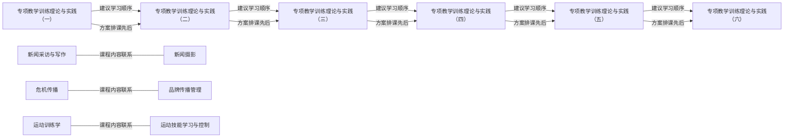

# 运动训练专业“2+X”教学培养方案

2024 年汇编印刷页 549–552。原表记录 67 个可配对的课程代码。

[本节原页](plan-549.pdf#page=1) · [逐行数据](plan-549.json) · [院系目录](README.md)

## 课程导读

想了解运动与训练的课程安排，可以在原表中找到《运动训练学》（`PEDU130007`）、《体能训练理论与方法》（`PEDU130010`）、《专项教学训练理论与实践（一）》（`PEDU130011`）。 [原书 PDF 第 563 页](plan-549.pdf#page=1)

图中把《运动训练学》（`PEDU130007`）和《运动技能学习与控制》（`PEDU130009`）列作内容联系。动作学习和技能训练涉及共同的运动表现问题。 [原书 PDF 第 563 页](plan-549.pdf#page=1)

## 课程关系图

图中展示最多 20 条关系。下表列出本节全部关系。建议学习顺序供规划课程使用，正式选课资格以教务规定为准。

| 课程 | 关联课程 | 关系 | 依据 |
| --- | --- | --- | --- |
| 专项教学训练理论与实践（一）（PEDU130011） | 专项教学训练理论与实践（二）（PEDU130012） | 建议学习顺序 | 同节课程题名标明连续分册或序号。 |
| 专项教学训练理论与实践（二）（PEDU130012） | 专项教学训练理论与实践（三）（PEDU130013） | 建议学习顺序 | 同节课程题名标明连续分册或序号。 |
| 专项教学训练理论与实践（三）（PEDU130013） | 专项教学训练理论与实践（四）（PEDU130014） | 建议学习顺序 | 同节课程题名标明连续分册或序号。 |
| 专项教学训练理论与实践（四）（PEDU130014） | 专项教学训练理论与实践（五）（PEDU130015） | 建议学习顺序 | 同节课程题名标明连续分册或序号。 |
| 专项教学训练理论与实践（五）（PEDU130015） | 专项教学训练理论与实践（六）（PEDU130016） | 建议学习顺序 | 同节课程题名标明连续分册或序号。 |
| 新闻采访与写作（JOUR130019） | 新闻摄影（JOUR130186） | 课程内容联系 | 本方案两门课程的题名均含“新闻”，可据此对照这一主题。 |
| 危机传播（JOUR130301） | 品牌传播管理（MANA130393） | 课程内容联系 | 本方案两门课程的题名均含“传播”，可据此对照这一主题。 |
| 运动训练学（PEDU130007） | 运动技能学习与控制（PEDU130009） | 课程内容联系 | 动作学习和技能训练涉及共同的运动表现问题。 |
| 专项教学训练理论与实践（一）（PEDU130011） | 专项教学训练理论与实践（二）（PEDU130012） | 方案排课先后 | 本节原表所列全部明确学期均早于后者。 |
| 专项教学训练理论与实践（二）（PEDU130012） | 专项教学训练理论与实践（三）（PEDU130013） | 方案排课先后 | 本节原表所列全部明确学期均早于后者。 |
| 专项教学训练理论与实践（三）（PEDU130013） | 专项教学训练理论与实践（四）（PEDU130014） | 方案排课先后 | 本节原表所列全部明确学期均早于后者。 |
| 专项教学训练理论与实践（四）（PEDU130014） | 专项教学训练理论与实践（五）（PEDU130015） | 方案排课先后 | 本节原表所列全部明确学期均早于后者。 |
| 专项教学训练理论与实践（五）（PEDU130015） | 专项教学训练理论与实践（六）（PEDU130016） | 方案排课先后 | 本节原表所列全部明确学期均早于后者。 |

## 课程

| 课程代码 | 名称 | 开课学期原文 | 来源（PDF 页） |
| --- | --- | --- | --- |
| EDU620016 | 青少年心理发展与教育 | 4 | 565 |
| EDU620021 | 教育学原理 | 4 | 565 |
| JOUR130019 | 新闻采访与写作 | 5 | 565 |
| JOUR130186 | 新闻摄影 | 5 | 565 |
| JOUR130195 | 媒介融合 | 5 | 565 |
| JOUR130205 | 视听技术与应用 | 5 | 565 |
| JOUR130267 | 广告创意与表现 | 6 | 565 |
| JOUR130282 | 口语表达 | 6 | 566 |
| JOUR130287 | 影像编辑 | 6 | 565 |
| JOUR130296 | 融合直播实务 | 6 | 566 |
| JOUR130299 | 品牌形象塑造 | 6 | 566 |
| JOUR130301 | 危机传播 | 6 | 566 |
| JOUR130303 | 纪实摄影工作室 | 5 | 565 |
| MANA130042 | 国际商务管理 | 5 | 565 |
| MANA130055 | 消费者行为学 | 5 | 565 |
| MANA130283 | 战略管理 | 5 | 565 |
| MANA130362 | 数字化营销 | 6 | 565 |
| MANA130393 | 品牌传播管理 | 6 | 565 |
| MANA130395 | 全球营销战略 | 6 | 565 |
| MED130474 | 临床运动医学 | 5 | 565 |
| PEDU130007 | 运动训练学 | 3 | 563 |
| PEDU130008 | 体育竞赛学 | 3 | 563 |
| PEDU130009 | 运动技能学习与控制 | 2 | 563 |
| PEDU130010 | 体能训练理论与方法 | 4 | 563 |
| PEDU130011 | 专项教学训练理论与实践（一） | 1 | 563 |
| PEDU130012 | 专项教学训练理论与实践（二） | 2 | 563 |
| PEDU130013 | 专项教学训练理论与实践（三） | 3 | 563 |
| PEDU130014 | 专项教学训练理论与实践（四） | 4 | 563 |
| PEDU130015 | 专项教学训练理论与实践（五） | 5 | 563 |
| PEDU130016 | 专项教学训练理论与实践（六） | 6 | 563 |
| PEDU130017 | 专项教学训练理论与实践（七） | 7 | 564 |
| PEDU130018 | 专业见习 | 7 | 564 |
| PEDU130019 | 专业实习 | 7 | 564 |
| PEDU130020 | 毕业论文 | 8 | 564 |
| PEDU130021 | 篮球 | 3 | 564 |
| PEDU130022 | 排球 | 3 | 564 |
| PEDU130023 | 足球 | 3 | 564 |
| PEDU130024 | 羽毛球 | 3 | 564 |
| PEDU130025 | 乒乓球 | 3 | 564 |
| PEDU130026 | 网球 | 4 | 564 |
| PEDU130027 | 慢投垒球 | 4 | 564 |
| PEDU130028 | 高尔夫 | 4 | 564 |
| PEDU130029 | 健美操 | 4 | 564 |
| PEDU130030 | 游泳 | 5 | 564 |
| PEDU130031 | 射艺 | 5 | 564 |
| PEDU130032 | 太极拳 | 5 | 564 |
| PEDU130033 | 龙狮运动 | 5 | 564 |
| PEDU130034 | 学校体育学 | 4 | 565 |
| PEDU130035 | 体育游戏 | 4 | 565 |
| PEDU130036 | 体育测量与评价 | 4 | 565 |
| PEDU130037 | 体育课程与教学论 | 5 | 565 |
| PEDU130038 | 器械健身指导 | 5 | 565 |
| PEDU130039 | 体育统计学 | 5 | 565 |
| PEDU130040 | 体育教材教法分析 | 5 | 565 |
| PEDU130041 | 运动损伤与运动康复 | 5 | 565 |
| PEDU130042 | 临床实用运动处方 | 5 | 565 |
| PEDU130043 | 运动营养学 | 5 | 565 |
| PEDU130044 | 体育保健学 | 6 | 565 |
| PEDU130045 | 运动医务与赛事保障 | 6 | 565 |
| PEDU130046 | 运动医学影像诊断学与前沿进展 | 6 | 565 |
| PHPM110063 | 健康促进与个体化干预 | 6 | 565 |
| TOUR130020 | 导游学 | 5 | 564 |
| TOUR130030 | 旅游管理专题 | 5 | 564 |
| TOUR130038 | 休闲学概论 | 6 | 564 |
| TOUR130069 | 旅游地产与度假区管理 | 6 | 564 |
| TOUR130079 | 游憩管理 | 6 | 564 |
| TOUR130080 | 主题公园管理 | 6 | 564 |
