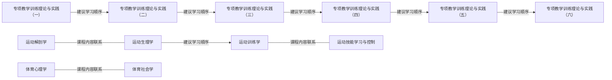

# 运动训练专业“2+X”修读建议

2024 年汇编印刷页 553–554。原表记录 26 个可配对的课程代码。

[本节原页](plan-549.pdf#page=5) · [逐行数据](plan-549.json) · [院系目录](README.md)

## 课程导读

想了解运动与训练的课程安排，可以在原表中找到《运动训练学》（`PEDU130007`）、《运动解剖学》（`PEDU130004`）、《体能训练理论与方法》（`PEDU130010`）。 [原书 PDF 第 567 页](plan-549.pdf#page=5)

图中把《运动解剖学》（`PEDU130004`）和《运动生理学》（`PEDU130005`）列作内容联系。共同关注人体运动，分别描述组织结构与功能。 [原书 PDF 第 567 页](plan-549.pdf#page=5)

## 课程关系图

图中展示最多 20 条关系。下表列出本节全部关系。建议学习顺序供规划课程使用，正式选课资格以教务规定为准。

| 课程 | 关联课程 | 关系 | 依据 |
| --- | --- | --- | --- |
| 运动生理学（PEDU130005） | 运动训练学（PEDU130007） | 建议学习顺序 | 对运动负荷与身体反应的认识可用于理解训练安排。 |
| 专项教学训练理论与实践（一）（PEDU130011） | 专项教学训练理论与实践（二）（PEDU130012） | 建议学习顺序 | 同节课程题名标明连续分册或序号。 |
| 专项教学训练理论与实践（二）（PEDU130012） | 专项教学训练理论与实践（三）（PEDU130013） | 建议学习顺序 | 同节课程题名标明连续分册或序号。 |
| 专项教学训练理论与实践（三）（PEDU130013） | 专项教学训练理论与实践（四）（PEDU130014） | 建议学习顺序 | 同节课程题名标明连续分册或序号。 |
| 专项教学训练理论与实践（四）（PEDU130014） | 专项教学训练理论与实践（五）（PEDU130015） | 建议学习顺序 | 同节课程题名标明连续分册或序号。 |
| 专项教学训练理论与实践（五）（PEDU130015） | 专项教学训练理论与实践（六）（PEDU130016） | 建议学习顺序 | 同节课程题名标明连续分册或序号。 |
| 体育心理学（PEDU130002） | 体育社会学（PEDU130003） | 课程内容联系 | 两课可围绕运动参与的社会条件和个体行为比较。 |
| 运动解剖学（PEDU130004） | 运动生理学（PEDU130005） | 课程内容联系 | 共同关注人体运动，分别描述组织结构与功能。 |
| 运动训练学（PEDU130007） | 运动技能学习与控制（PEDU130009） | 课程内容联系 | 动作学习和技能训练涉及共同的运动表现问题。 |

## 课程

| 课程代码 | 名称 | 开课学期原文 | 来源（PDF 页） |
| --- | --- | --- | --- |
| PEDU130001 | 体育概论 |  | 567 |
| PEDU130002 | 体育心理学 |  | 567 |
| PEDU130003 | 体育社会学 |  | 567 |
| PEDU130004 | 运动解剖学 |  | 567 |
| PEDU130005 | 运动生理学 |  | 567 |
| PEDU130006 | 体育科学研究方法 |  | 567 |
| PEDU130007 | 运动训练学 |  | 567 |
| PEDU130008 | 体育竞赛学 |  | 567 |
| PEDU130009 | 运动技能学习与控制 |  | 567 |
| PEDU130010 | 体能训练理论与方法 |  | 567 |
| PEDU130011 | 专项教学训练理论与实践（一） |  | 567 |
| PEDU130012 | 专项教学训练理论与实践（二） |  | 567 |
| PEDU130013 | 专项教学训练理论与实践（三） |  | 568 |
| PEDU130014 | 专项教学训练理论与实践（四） |  | 568 |
| PEDU130015 | 专项教学训练理论与实践（五） |  | 568 |
| PEDU130016 | 专项教学训练理论与实践（六） |  | 568 |
| PEDU130017 | 专项教学训练理论与实践（七） |  | 568 |
| PEDU130018 | 专业见习 |  | 568 |
| PEDU130019 | 专业实习 |  | 568 |
| PEDU130020 | 毕业论文 |  | 568 |
| PHPM130004 | 健康教育学 |  | 567 |
| PTSS110082 | 毛泽东思想和中国特色社会主义理论体系概论 |  | 567 |
| PTSS110087 | 马克思主义基本原理 |  | 567 |
| PTSS110088 | 中国近现代史纲要 |  | 567 |
| PTSS110089 | 思想道德与法治 |  | 567 |
| PTSS110090 | 习近平新时代中国特色社会主义思想概论 |  | 567 |
