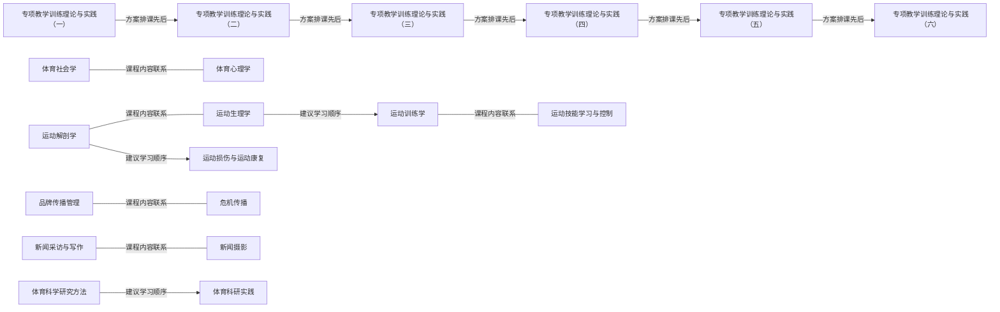

# 2025运动训练专业本科培养方案

体育教学部 · 运动训练 · 方案 96788 · 74 个不同课程或科研条目。

[官方 Word](../originals/plan-96788.docx) · [教务详情](https://fdjwgl.fudan.edu.cn/manager/bizType/2/major-program-search/info/96788?skipAuth=1) · [方案快照](../raw/plan-96788.json.gz) · [年级目录](../README.md)

## 修读导读

- **建议先学**　《运动生理学》（`SPORT20003`） → 《运动训练学》（`SPORT30001`）。对运动负荷与身体反应的认识可用于理解训练安排。方案分别列在第2、3学期。

- **可以对照着读**　《运动训练学》（`SPORT30001`）与《运动技能学习与控制》（`SPORT30003`）。动作学习和技能训练涉及共同的运动表现问题。

- **查模块选课**　《体育竞赛学》（`SPORT30002`）、《体能训练理论与方法》（`SPORT30004`）列在“专业核心教育课程”中。原表见 `/courseModules/6`。

## 课程关系图

图中展示部分关系。下表保留全部已建立的课程对，来源位置使用本方案 JSON Pointer。

## 先修与内容联系

| 类型 | 起点 | 终点 | 依据 | 原表定位 |
| --- | --- | --- | --- | --- |
| 建议学习顺序 | 运动解剖学 (SPORT20002) | 运动损伤与运动康复 (SPORT50009) | 运动系统结构为认识损伤部位与功能恢复提供基础。  | `/courseModules/5/planCourses/3`、`/courseModules/15/planCourses/0` |
| 建议学习顺序 | 运动生理学 (SPORT20003) | 运动训练学 (SPORT30001) | 对运动负荷与身体反应的认识可用于理解训练安排。  | `/courseModules/5/planCourses/4`、`/courseModules/6/planCourses/0` |
| 建议学习顺序 | 体育科学研究方法 (SPORT20004) | 体育科研实践 (PESS40001) | 研究问题、设计和资料分析可用于科研实践。  | `/courseModules/22/planCourses/0`、`/courseModules/22/planCourses/1` |
| 建议学习顺序 | 专项教学训练理论与实践（一） (SPORT50001) | 专项教学训练理论与实践（二） (SPORT50002) | 同方案的课程题名具有连续分册或序号。  | `/courseModules/6/planCourses/4`、`/courseModules/6/planCourses/5` |
| 建议学习顺序 | 专项教学训练理论与实践（二） (SPORT50002) | 专项教学训练理论与实践（三） (SPORT50003) | 同方案的课程题名具有连续分册或序号。  | `/courseModules/6/planCourses/5`、`/courseModules/6/planCourses/6` |
| 建议学习顺序 | 专项教学训练理论与实践（三） (SPORT50003) | 专项教学训练理论与实践（四） (SPORT50004) | 同方案的课程题名具有连续分册或序号。  | `/courseModules/6/planCourses/6`、`/courseModules/6/planCourses/7` |
| 建议学习顺序 | 专项教学训练理论与实践（四） (SPORT50004) | 专项教学训练理论与实践（五） (SPORT50005) | 同方案的课程题名具有连续分册或序号。  | `/courseModules/6/planCourses/7`、`/courseModules/6/planCourses/8` |
| 建议学习顺序 | 专项教学训练理论与实践（五） (SPORT50005) | 专项教学训练理论与实践（六） (SPORT50006) | 同方案的课程题名具有连续分册或序号。  | `/courseModules/6/planCourses/8`、`/courseModules/6/planCourses/9` |
| 方案排课先后 | 运动解剖学 (SPORT20002) | 运动损伤与运动康复 (SPORT50009) | 同方案该课程全部明确数字学期均早于后者。  | `/courseModules/5/planCourses/3`、`/courseModules/15/planCourses/0` |
| 方案排课先后 | 运动生理学 (SPORT20003) | 运动训练学 (SPORT30001) | 同方案该课程全部明确数字学期均早于后者。  | `/courseModules/5/planCourses/4`、`/courseModules/6/planCourses/0` |
| 方案排课先后 | 体育科学研究方法 (SPORT20004) | 体育科研实践 (PESS40001) | 同方案该课程全部明确数字学期均早于后者。  | `/courseModules/22/planCourses/0`、`/courseModules/22/planCourses/1` |
| 方案排课先后 | 专项教学训练理论与实践（一） (SPORT50001) | 专项教学训练理论与实践（二） (SPORT50002) | 同方案该课程全部明确数字学期均早于后者。  | `/courseModules/6/planCourses/4`、`/courseModules/6/planCourses/5` |
| 方案排课先后 | 专项教学训练理论与实践（二） (SPORT50002) | 专项教学训练理论与实践（三） (SPORT50003) | 同方案该课程全部明确数字学期均早于后者。  | `/courseModules/6/planCourses/5`、`/courseModules/6/planCourses/6` |
| 方案排课先后 | 专项教学训练理论与实践（三） (SPORT50003) | 专项教学训练理论与实践（四） (SPORT50004) | 同方案该课程全部明确数字学期均早于后者。  | `/courseModules/6/planCourses/6`、`/courseModules/6/planCourses/7` |
| 方案排课先后 | 专项教学训练理论与实践（四） (SPORT50004) | 专项教学训练理论与实践（五） (SPORT50005) | 同方案该课程全部明确数字学期均早于后者。  | `/courseModules/6/planCourses/7`、`/courseModules/6/planCourses/8` |
| 方案排课先后 | 专项教学训练理论与实践（五） (SPORT50005) | 专项教学训练理论与实践（六） (SPORT50006) | 同方案该课程全部明确数字学期均早于后者。  | `/courseModules/6/planCourses/8`、`/courseModules/6/planCourses/9` |
| 课程内容联系 | 品牌传播管理 (BA30051) | 危机传播 (JCM50081) | 本方案两门课程的题名均含“传播”，可据此对照这一主题。  | `/courseModules/12/planCourses/4`、`/courseModules/16/planCourses/9` |
| 课程内容联系 | 新闻采访与写作 (JCM20012) | 新闻摄影 (JCM20017) | 本方案两门课程的题名均含“新闻”，可据此对照这一主题。  | `/courseModules/16/planCourses/0`、`/courseModules/16/planCourses/2` |
| 课程内容联系 | 体育社会学 (SPORT10002) | 体育心理学 (SPORT20001) | 两课可围绕运动参与的社会条件和个体行为比较。  | `/courseModules/5/planCourses/2`、`/courseModules/5/planCourses/1` |
| 课程内容联系 | 运动解剖学 (SPORT20002) | 运动生理学 (SPORT20003) | 共同关注人体运动，分别描述组织结构与功能。  | `/courseModules/5/planCourses/3`、`/courseModules/5/planCourses/4` |
| 课程内容联系 | 运动训练学 (SPORT30001) | 运动技能学习与控制 (SPORT30003) | 动作学习和技能训练涉及共同的运动表现问题。  | `/courseModules/6/planCourses/0`、`/courseModules/6/planCourses/2` |

本次未从可定位的明确表述中确认课程对课程预修。学期安排、系列分册与编辑建议均保留各自的依据。

## 按原方案模块阅读

同一模块展示原表中的课程归属。模块内课程之间的先后仍须逐项查阅。

- **运动技能模块**　篮球、排球、足球、羽毛球、乒乓球、网球、慢投垒球、高尔夫、健美操、游泳、射艺、太极拳、龙狮运动（原表模块 10）
- **休闲体育与体育旅游模块**　导游学、旅游管理专题、休闲学概论、旅游地产与度假区管理、游憩管理、主题公园管理（原表模块 11）
- **体育管理与经营模块**　战略管理、消费者行为学、数字化营销、品牌传播管理、国际商务管理（原表模块 12）
- **学校体育模块**　青少年心理发展与教育、教育学原理、学校体育学、体育游戏、体育课程与教学论、器械健身指导、体育教材教法分析、体育测量与评价（原表模块 14）
- **体育保健与康复模块**　健康促进与个体化干预、临床运动医学、运动营养学、体育保健学、运动损伤与运动康复、临床实用运动处方、运动医务与赛事保障、运动医学影像诊断学与前沿进展（原表模块 15）
- **体育新闻与传播模块**　新闻采访与写作、新闻摄影、视听技术与应用、广告创意与表现、口语表达、影像编辑、媒介融合、融合直播实务、品牌形象塑造、危机传播、纪实摄影工作室（原表模块 16）

## 课程表

同一课程在不同模块分别出现时，按原表逐行列出。季节字段保留原值。

| 课程 | 代码 | 学分 | 学期 | 模块 |
| --- | --- | ---: | --- | --- |
| 体育概论 | SPORT10001 | 2.0 | 第1学期 | 培养方案 / 专业培养课程 / 学科基础课程 |
| 体育心理学 | SPORT20001 | 2.0 | 第1学期 | 培养方案 / 专业培养课程 / 学科基础课程 |
| 体育社会学 | SPORT10002 | 2.0 | 第2学期 | 培养方案 / 专业培养课程 / 学科基础课程 |
| 运动解剖学 | SPORT20002 | 3.0 | 第1学期 | 培养方案 / 专业培养课程 / 学科基础课程 |
| 运动生理学 | SPORT20003 | 3.0 | 第2学期 | 培养方案 / 专业培养课程 / 学科基础课程 |
| 健康教育学 | PHPM40002 | 2.0 | 第2学期 | 培养方案 / 专业培养课程 / 学科基础课程 |
| 运动训练学 | SPORT30001 | 2.0 | 第3学期 | 培养方案 / 专业培养课程 / 学科基础课程 / 专业核心教育课程 |
| 体育竞赛学 | SPORT30002 | 2.0 | 第3学期 | 培养方案 / 专业培养课程 / 学科基础课程 / 专业核心教育课程 |
| 运动技能学习与控制 | SPORT30003 | 2.0 | 第2学期 | 培养方案 / 专业培养课程 / 学科基础课程 / 专业核心教育课程 |
| 体能训练理论与方法 | SPORT30004 | 2.0 | 第4学期 | 培养方案 / 专业培养课程 / 学科基础课程 / 专业核心教育课程 |
| 专项教学训练理论与实践（一） | SPORT50001 | 5.0 | 第1学期 | 培养方案 / 专业培养课程 / 学科基础课程 / 专业核心教育课程 |
| 专项教学训练理论与实践（二） | SPORT50002 | 5.0 | 第2学期 | 培养方案 / 专业培养课程 / 学科基础课程 / 专业核心教育课程 |
| 专项教学训练理论与实践（三） | SPORT50003 | 4.0 | 第3学期 | 培养方案 / 专业培养课程 / 学科基础课程 / 专业核心教育课程 |
| 专项教学训练理论与实践（四） | SPORT50004 | 4.0 | 第4学期 | 培养方案 / 专业培养课程 / 学科基础课程 / 专业核心教育课程 |
| 专项教学训练理论与实践（五） | SPORT50005 | 4.0 | 第5学期 | 培养方案 / 专业培养课程 / 学科基础课程 / 专业核心教育课程 |
| 专项教学训练理论与实践（六） | SPORT50006 | 4.0 | 第6学期 | 培养方案 / 专业培养课程 / 学科基础课程 / 专业核心教育课程 |
| 专项教学训练理论与实践（七） | SPORT50007 | 4.0 | 第7学期 | 培养方案 / 专业培养课程 / 学科基础课程 / 专业核心教育课程 |
| 篮球 | SPORT40003 | 2.0 | 第3学期 | 培养方案 / 专业进阶Ⅰ组 / 运动技能模块 |
| 排球 | SPORT40004 | 2.0 | 第3学期 | 培养方案 / 专业进阶Ⅰ组 / 运动技能模块 |
| 足球 | SPORT40005 | 2.0 | 第3学期 | 培养方案 / 专业进阶Ⅰ组 / 运动技能模块 |
| 羽毛球 | SPORT40006 | 2.0 | 第3学期 | 培养方案 / 专业进阶Ⅰ组 / 运动技能模块 |
| 乒乓球 | SPORT40007 | 2.0 | 第3学期 | 培养方案 / 专业进阶Ⅰ组 / 运动技能模块 |
| 网球 | SPORT40008 | 2.0 | 第4学期 | 培养方案 / 专业进阶Ⅰ组 / 运动技能模块 |
| 慢投垒球 | SPORT40009 | 2.0 | 第4学期 | 培养方案 / 专业进阶Ⅰ组 / 运动技能模块 |
| 高尔夫 | SPORT40010 | 2.0 | 第4学期 | 培养方案 / 专业进阶Ⅰ组 / 运动技能模块 |
| 健美操 | SPORT40011 | 2.0 | 第4学期 | 培养方案 / 专业进阶Ⅰ组 / 运动技能模块 |
| 游泳 | SPORT40012 | 2.0 | 第5学期 | 培养方案 / 专业进阶Ⅰ组 / 运动技能模块 |
| 射艺 | SPORT40013 | 2.0 | 第5学期 | 培养方案 / 专业进阶Ⅰ组 / 运动技能模块 |
| 太极拳 | SPORT40014 | 2.0 | 第5学期 | 培养方案 / 专业进阶Ⅰ组 / 运动技能模块 |
| 龙狮运动 | SPORT40015 | 2.0 | 第5学期 | 培养方案 / 专业进阶Ⅰ组 / 运动技能模块 |
| 旅游管理专题 | BA30073 | 2.0 | 第5学期 | 培养方案 / 专业进阶Ⅰ组 / 休闲体育与体育旅游模块 |
| 导游学 | BA30070 | 2.0 | 第5学期 | 培养方案 / 专业进阶Ⅰ组 / 休闲体育与体育旅游模块 |
| 游憩管理 | BA30093 | 2.0 | 第6学期 | 培养方案 / 专业进阶Ⅰ组 / 休闲体育与体育旅游模块 |
| 主题公园管理 | BA30094 | 2.0 | 第6学期 | 培养方案 / 专业进阶Ⅰ组 / 休闲体育与体育旅游模块 |
| 旅游地产与度假区管理 | BA30088 | 2.0 | 第6学期 | 培养方案 / 专业进阶Ⅰ组 / 休闲体育与体育旅游模块 |
| 休闲学概论 | BA30076 | 2.0 | 第6学期 | 培养方案 / 专业进阶Ⅰ组 / 休闲体育与体育旅游模块 |
| 战略管理 | BA20012 | 2.0 | 第5学期 | 培养方案 / 专业进阶Ⅰ组 / 体育管理与经营模块 |
| 消费者行为学 | BA30019 | 3.0 | 第5学期 | 培养方案 / 专业进阶Ⅰ组 / 体育管理与经营模块 |
| 国际商务管理 | ECON30093 | 2.0 | 第5学期 | 培养方案 / 专业进阶Ⅰ组 / 体育管理与经营模块 |
| 数字化营销 | BA30038 | 3.0 | 第6学期 | 培养方案 / 专业进阶Ⅰ组 / 体育管理与经营模块 |
| 品牌传播管理 | BA30051 | 3.0 | 第6学期 | 培养方案 / 专业进阶Ⅰ组 / 体育管理与经营模块 |
| 教育学原理 | EDU50008 | 2.0 | 第4学期 | 培养方案 / 专业进阶II组 / 学校体育模块 |
| 青少年心理发展与教育 | EDU50004 | 2.0 | 第4学期 | 培养方案 / 专业进阶II组 / 学校体育模块 |
| 学校体育学 | SPORT30005 | 2.0 | 第4学期 | 培养方案 / 专业进阶II组 / 学校体育模块 |
| 体育游戏 | SPORT30006 | 2.0 | 第4学期 | 培养方案 / 专业进阶II组 / 学校体育模块 |
| 体育测量与评价 | SPORT40016 | 2.0 | 第4学期 | 培养方案 / 专业进阶II组 / 学校体育模块 |
| 体育课程与教学论 | SPORT30007 | 2.0 | 第5学期 | 培养方案 / 专业进阶II组 / 学校体育模块 |
| 器械健身指导 | SPORT30008 | 2.0 | 第5学期 | 培养方案 / 专业进阶II组 / 学校体育模块 |
| 体育教材教法分析 | SPORT30009 | 2.0 | 第5学期 | 培养方案 / 专业进阶II组 / 学校体育模块 |
| 运动损伤与运动康复 | SPORT50009 | 2.0 | 第5学期 | 培养方案 / 专业进阶II组 / 体育保健与康复模块 |
| 临床运动医学 | MED40080 | 2.0 | 第5学期 | 培养方案 / 专业进阶II组 / 体育保健与康复模块 |
| 临床实用运动处方 | SPORT50010 | 2.0 | 第5学期 | 培养方案 / 专业进阶II组 / 体育保健与康复模块 |
| 运动营养学 | SPORT40017 | 2.0 | 第5学期 | 培养方案 / 专业进阶II组 / 体育保健与康复模块 |
| 体育保健学 | SPORT40018 | 2.0 | 第6学期 | 培养方案 / 专业进阶II组 / 体育保健与康复模块 |
| 运动医务与赛事保障 | SPORT50011 | 2.0 | 第6学期 | 培养方案 / 专业进阶II组 / 体育保健与康复模块 |
| 运动医学影像诊断学与前沿进展 | SPORT50012 | 2.0 | 第6学期 | 培养方案 / 专业进阶II组 / 体育保健与康复模块 |
| 健康促进与个体化干预 | GEEC10364 | 3.0 | 第6学期 | 培养方案 / 专业进阶II组 / 体育保健与康复模块 |
| 新闻采访与写作 | JCM20012 | 3.0 | 第5学期 | 培养方案 / 专业进阶II组 / 体育新闻与传播模块 |
| 媒介融合 | JCM30020 | 3.0 | 第5学期 | 培养方案 / 专业进阶II组 / 体育新闻与传播模块 |
| 新闻摄影 | JCM20017 | 2.0 | 第5学期 | 培养方案 / 专业进阶II组 / 体育新闻与传播模块 |
| 视听技术与应用 | JCM20020 | 4.0 | 第5学期 | 培养方案 / 专业进阶II组 / 体育新闻与传播模块 |
| 纪实摄影工作室 | JCM50083 | 3.0 | 第5学期 | 培养方案 / 专业进阶II组 / 体育新闻与传播模块 |
| 影像编辑 | JCM20030 | 3.0 | 第6学期 | 培养方案 / 专业进阶II组 / 体育新闻与传播模块 |
| 广告创意与表现 | JCM20023 | 3.0 | 第6学期 | 培养方案 / 专业进阶II组 / 体育新闻与传播模块 |
| 融合直播实务 | JCM50077 | 3.0 | 第6学期 | 培养方案 / 专业进阶II组 / 体育新闻与传播模块 |
| 品牌形象塑造 | JCM50079 | 2.0 | 第6学期 | 培养方案 / 专业进阶II组 / 体育新闻与传播模块 |
| 危机传播 | JCM50081 | 2.0 | 第6学期 | 培养方案 / 专业进阶II组 / 体育新闻与传播模块 |
| 口语表达 | JCM20025 | 3.0 | 第6学期 | 培养方案 / 专业进阶II组 / 体育新闻与传播模块 |
| 体育科学研究方法 | SPORT20004 | 2.0 | 第4学期 | 融合创新能力 |
| 体育科研实践 | PESS40001 | 2.0 | 第6学期 | 融合创新能力 |
| 体育统计学 | SPORT50008 | 2.0 | 第5学期 | 融合创新能力 |
| 专业见习 | SPORT40001 | 1.0 | 第7学期 | 融合创新能力 |
| 专业实习 | SPORT40002 | 6.0 | 第7学期 | 融合创新能力 |
| 毕业论文 | SPORT40019 | 4.0 | 第8学期 | 融合创新能力 |
