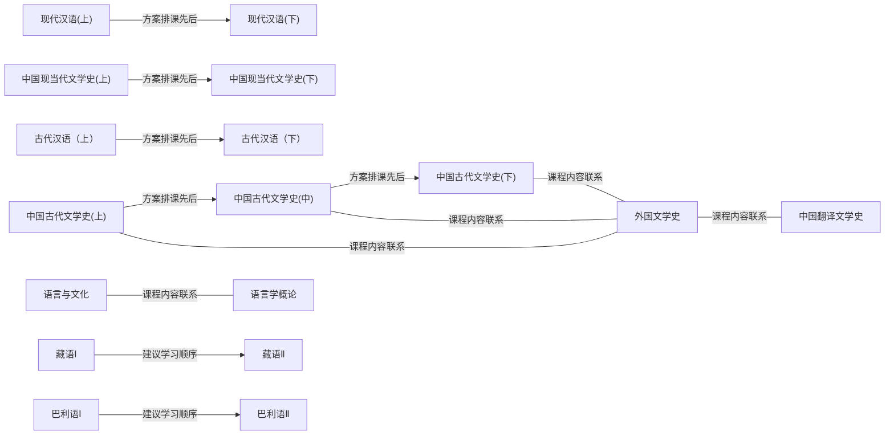

# 2024 汉语言文学专业“2+X”教学培养方案

中国语言文学系 · 汉语言文学 · 方案 72663 · 154 个不同课程或科研条目。

[官方 Word](../originals/plan-72663.docx) · [教务详情](https://fdjwgl.fudan.edu.cn/manager/bizType/2/major-program-search/info/72663?skipAuth=1) · [方案快照](../raw/plan-72663.json.gz) · [年级目录](../README.md)

## 修读导读

- **建议先学**　《现代汉语(上)》（`CHIN20001`） → 《现代汉语(下)》（`CHIN20002`）。题名列出连续册次或级别。前一册的语言例句可继续用作参照，读下一册时比较不同层次的分析。方案分别列在第1、2学期。

- **可以对照着读**　《语言与文化》（`CHIN10006`）与《语言学概论》（`CHIN20010`）。两课可从语言系统和文化语境共同观察语言现象。

- **查模块选课**　《专业英语(汉语言文学)》（`CHIN20013`）、《中国古代文学史(上)》（`CHIN20005`）列在“专业必修课程”中。原表见 `/courseModules/10`。

## 课程关系图

图中展示部分关系。下表保留全部已建立的课程对，来源位置使用本方案 JSON Pointer。

## 先修与内容联系

| 类型 | 起点 | 终点 | 依据 | 原表定位 |
| --- | --- | --- | --- | --- |
| 建议学习顺序 | 现代汉语(上) (CHIN20001) | 现代汉语(下) (CHIN20002) | 同方案的课程题名具有连续分册或序号。  | `/courseModules/10/planCourses/0`、`/courseModules/10/planCourses/2` |
| 建议学习顺序 | 中国现当代文学史(上) (CHIN20003) | 中国现当代文学史(下) (CHIN20004) | 同方案的课程题名具有连续分册或序号。  | `/courseModules/10/planCourses/4`、`/courseModules/10/planCourses/8` |
| 建议学习顺序 | 中国古代文学史(上) (CHIN20005) | 中国古代文学史(中) (CHIN20006) | 同方案的课程题名具有连续分册或序号。  | `/courseModules/10/planCourses/1`、`/courseModules/10/planCourses/3` |
| 建议学习顺序 | 中国古代文学史(中) (CHIN20006) | 中国古代文学史(下) (CHIN20007) | 同方案的课程题名具有连续分册或序号。  | `/courseModules/10/planCourses/3`、`/courseModules/10/planCourses/5` |
| 建议学习顺序 | 古代汉语（上） (CHIN20024) | 古代汉语（下） (CHIN20025) | 同方案的课程题名具有连续分册或序号。  | `/courseModules/10/planCourses/7`、`/courseModules/10/planCourses/9` |
| 建议学习顺序 | 藏语Ⅰ (PHIL40009) | 藏语Ⅱ (PHIL40010) | 同方案的课程题名具有连续分册或序号。  | `/courseModules/16/planCourses/15`、`/courseModules/16/planCourses/16` |
| 建议学习顺序 | 巴利语Ⅰ (PHIL40011) | 巴利语Ⅱ (PHIL40012) | 同方案的课程题名具有连续分册或序号。  | `/courseModules/16/planCourses/17`、`/courseModules/16/planCourses/18` |
| 方案排课先后 | 现代汉语(上) (CHIN20001) | 现代汉语(下) (CHIN20002) | 同方案该课程全部明确数字学期均早于后者。  | `/courseModules/10/planCourses/0`、`/courseModules/10/planCourses/2` |
| 方案排课先后 | 中国现当代文学史(上) (CHIN20003) | 中国现当代文学史(下) (CHIN20004) | 同方案该课程全部明确数字学期均早于后者。  | `/courseModules/10/planCourses/4`、`/courseModules/10/planCourses/8` |
| 方案排课先后 | 中国古代文学史(上) (CHIN20005) | 中国古代文学史(中) (CHIN20006) | 同方案该课程全部明确数字学期均早于后者。  | `/courseModules/10/planCourses/1`、`/courseModules/10/planCourses/3` |
| 方案排课先后 | 中国古代文学史(中) (CHIN20006) | 中国古代文学史(下) (CHIN20007) | 同方案该课程全部明确数字学期均早于后者。  | `/courseModules/10/planCourses/3`、`/courseModules/10/planCourses/5` |
| 方案排课先后 | 古代汉语（上） (CHIN20024) | 古代汉语（下） (CHIN20025) | 同方案该课程全部明确数字学期均早于后者。  | `/courseModules/10/planCourses/7`、`/courseModules/10/planCourses/9` |
| 课程内容联系 | 中国文学传统 (CHIN10001) | 中国文学经典 (CHIN10005) | 经典文本与文学传统可从作品接受与文学演变联系。  | `/courseModules/8/planCourses/0`、`/courseModules/7/planCourses/0` |
| 课程内容联系 | 语言与文化 (CHIN10006) | 语言学概论 (CHIN20010) | 两课可从语言系统和文化语境共同观察语言现象。  | `/courseModules/8/planCourses/2`、`/courseModules/10/planCourses/6` |
| 课程内容联系 | 中国古代文学史(上) (CHIN20005) | 外国文学史 (CHIN20008) | 本方案两门课程的题名均含“文学史”，可据此对照这一主题。  | `/courseModules/10/planCourses/1`、`/courseModules/10/planCourses/10` |
| 课程内容联系 | 中国古代文学史(上) (CHIN20005) | 中国古代文学研究史 (CHIN50002) | 本方案两门课程的题名均含“古代文学”，可据此对照这一主题。  | `/courseModules/10/planCourses/1`、`/courseModules/16/planCourses/25` |
| 课程内容联系 | 中国古代文学史(中) (CHIN20006) | 外国文学史 (CHIN20008) | 本方案两门课程的题名均含“文学史”，可据此对照这一主题。  | `/courseModules/10/planCourses/3`、`/courseModules/10/planCourses/10` |
| 课程内容联系 | 中国古代文学史(中) (CHIN20006) | 中国古代文学研究史 (CHIN50002) | 本方案两门课程的题名均含“古代文学”，可据此对照这一主题。  | `/courseModules/10/planCourses/3`、`/courseModules/16/planCourses/25` |
| 课程内容联系 | 中国古代文学史(下) (CHIN20007) | 外国文学史 (CHIN20008) | 本方案两门课程的题名均含“文学史”，可据此对照这一主题。  | `/courseModules/10/planCourses/5`、`/courseModules/10/planCourses/10` |
| 课程内容联系 | 中国古代文学史(下) (CHIN20007) | 中国古代文学研究史 (CHIN50002) | 本方案两门课程的题名均含“古代文学”，可据此对照这一主题。  | `/courseModules/10/planCourses/5`、`/courseModules/16/planCourses/25` |
| 课程内容联系 | 外国文学史 (CHIN20008) | 中国翻译文学史 (CHIN40054) | 本方案两门课程的题名均含“文学史”，可据此对照这一主题。  | `/courseModules/10/planCourses/10`、`/courseModules/15/planCourses/16` |
| 课程内容联系 | 马克思主义文论精读 (CHIN30028) | 现当代马克思主义美学与文论 (CHIN50070) | 本方案两门课程的题名均含“马克思主义”，可据此对照这一主题。  | `/courseModules/11/planCourses/3`、`/courseModules/16/planCourses/0` |
| 课程内容联系 | 马克思主义文论精读 (CHIN30028) | 马克思主义新闻思想 (JCM10001) | 本方案两门课程的题名均含“马克思主义”，可据此对照这一主题。  | `/courseModules/11/planCourses/3`、`/courseModules/8/planCourses/17` |
| 课程内容联系 | 当代大众文化研究：以人工智能为技术语境 (CHIN40012) | 人工智能美学 (CHIN50001) | 本方案两门课程的题名均含“人工智能”，可据此对照这一主题。  | `/courseModules/15/planCourses/34`、`/courseModules/16/planCourses/24` |
| 课程内容联系 | 文学翻译 (CHIN40050) | 中国翻译文学史 (CHIN40054) | 本方案两门课程的题名均含“翻译”，可据此对照这一主题。  | `/courseModules/16/planCourses/13`、`/courseModules/15/planCourses/16` |
| 课程内容联系 | 近现代中西侦探小说与电影专题研究 (CHIN40068) | 古代小说研究 (CHIN50059) | 本方案两门课程的题名均含“小说”，可据此对照这一主题。  | `/courseModules/16/planCourses/19`、`/courseModules/15/planCourses/12` |
| 课程内容联系 | 中国古代文学研究史 (CHIN50002) | 中国古代文学理论体系研究 (CHIN50004) | 本方案两门课程的题名均含“古代文学”，可据此对照这一主题。  | `/courseModules/16/planCourses/25`、`/courseModules/16/planCourses/27` |
| 课程内容联系 | 中国现代文学作品选读 (CHIN50008) | 中国现代文学专题 (CHIN50037) | 本方案两门课程的题名均含“现代文学”，可据此对照这一主题。  | `/courseModules/16/planCourses/30`、`/courseModules/15/planCourses/22` |
| 课程内容联系 | 中国艺术人类学导论 (CHIN50025) | 人类学美学与当代文化批评 (CHIN50026) | 本方案两门课程的题名均含“人类学”，可据此对照这一主题。  | `/courseModules/16/planCourses/42`、`/courseModules/16/planCourses/43` |
| 课程内容联系 | 马克思主义新闻思想 (JCM10001) | 新闻学概论 (JCM10002) | 本方案两门课程的题名均含“新闻”，可据此对照这一主题。  | `/courseModules/8/planCourses/17`、`/courseModules/8/planCourses/18` |
| 课程内容联系 | 哲学导论 (PHIL10002) | 逻辑学 (PHIL10003) | 论证与概念分析是哲学讨论的共同方法。  | `/courseModules/7/planCourses/2`、`/courseModules/7/planCourses/3` |

本次未从可定位的明确表述中确认课程对课程预修。学期安排、系列分册与编辑建议均保留各自的依据。

## 按原方案模块阅读

同一模块展示原表中的课程归属。模块内课程之间的先后仍须逐项查阅。

- **限定选修课**　中国古代五大名剧精读、《文选》精读、《诗论》精读、《山海经》精读、巴金精读、荷马史诗精读、古希腊戏剧精读、普鲁斯特精读、莎士比亚精读、《二十世纪西方文学理论》精读、诗骚精读、鲁迅精读、《文心雕龙》精读、《四库提要》精读、《文学理论》精读、《世说新语》精读、李杜精读、周作人散文精读等24项（原表模块 11）

## 课程表

同一课程在不同模块分别出现时，按原表逐行列出。季节字段保留原值。

| 课程 | 代码 | 学分 | 学期 | 模块 |
| --- | --- | ---: | --- | --- |
| 中国文学经典 | CHIN10005 | 3.0 | SPRING、AUTUMN | 培养方案 / 专业培养课程 / 大类基础课程 / 人文类基础课程 / 必修课程 |
| 中国古代文明 | HIST10006 | 3.0 | SPRING、AUTUMN | 培养方案 / 专业培养课程 / 大类基础课程 / 人文类基础课程 / 必修课程 |
| 哲学导论 | PHIL10002 | 3.0 | SPRING、AUTUMN | 培养方案 / 专业培养课程 / 大类基础课程 / 人文类基础课程 / 必修课程 |
| 逻辑学 | PHIL10003 | 3.0 | SPRING、AUTUMN | 培养方案 / 专业培养课程 / 大类基础课程 / 人文类基础课程 / 必修课程 |
| 中国文学传统 | CHIN10001 | 2.0 | SPRING、AUTUMN | 培养方案 / 专业培养课程 / 大类基础课程 / 人文类基础课程 / 选修课程 |
| 美学 | CHIN10002 | 2.0 | SPRING、AUTUMN | 培养方案 / 专业培养课程 / 大类基础课程 / 人文类基础课程 / 选修课程 |
| 语言与文化 | CHIN10006 | 2.0 | SPRING、AUTUMN | 培养方案 / 专业培养课程 / 大类基础课程 / 人文类基础课程 / 选修课程 |
| 汉语概论 | CHIN10004 | 2.0 | SPRING、AUTUMN | 培养方案 / 专业培养课程 / 大类基础课程 / 人文类基础课程 / 选修课程 |
| 现代文艺赏析 | CHIN10003 | 2.0 | SPRING、AUTUMN | 培养方案 / 专业培养课程 / 大类基础课程 / 人文类基础课程 / 选修课程 |
| 史学原典导读 | HIST10003 | 2.0 | SPRING、AUTUMN | 培养方案 / 专业培养课程 / 大类基础课程 / 人文类基础课程 / 选修课程 |
| 世界文明史通论 | HIST10004 | 2.0 | SPRING、AUTUMN | 培养方案 / 专业培养课程 / 大类基础课程 / 人文类基础课程 / 选修课程 |
| 近代中国社会研究 | HIST10005 | 2.0 | SPRING、AUTUMN | 培养方案 / 专业培养课程 / 大类基础课程 / 人文类基础课程 / 选修课程 |
| 考古学导论 | ARCH10001 | 2.0 | AUTUMN | 培养方案 / 专业培养课程 / 大类基础课程 / 人文类基础课程 / 选修课程 |
| 中国古代工艺美术 | CULT10001 | 2.0 | SPRING、AUTUMN | 培养方案 / 专业培养课程 / 大类基础课程 / 人文类基础课程 / 选修课程 |
| 中国文字源流 | CULT10002 | 2.0 | AUTUMN | 培养方案 / 专业培养课程 / 大类基础课程 / 人文类基础课程 / 选修课程 |
| 先秦哲学 | PHIL120014 | 2.0 | AUTUMN | 培养方案 / 专业培养课程 / 大类基础课程 / 人文类基础课程 / 选修课程 |
| 基督教哲学 | PHIL120005 | 2.0 | SPRING | 培养方案 / 专业培养课程 / 大类基础课程 / 人文类基础课程 / 选修课程 |
| 佛教哲学 | PHIL120006 | 2.0 | SPRING | 培养方案 / 专业培养课程 / 大类基础课程 / 人文类基础课程 / 选修课程 |
| 宗教学导论 | PHIL10004 | 2.0 | AUTUMN | 培养方案 / 专业培养课程 / 大类基础课程 / 人文类基础课程 / 选修课程 |
| 语言学导论 | FORE10005 | 2.0 | SPRING、AUTUMN | 培养方案 / 专业培养课程 / 大类基础课程 / 人文类基础课程 / 选修课程 |
| 世界文学导读 | FORE10006 | 2.0 | SPRING、AUTUMN | 培养方案 / 专业培养课程 / 大类基础课程 / 人文类基础课程 / 选修课程 |
| 马克思主义新闻思想 | JCM10001 | 2.0 | SPRING、AUTUMN | 培养方案 / 专业培养课程 / 大类基础课程 / 人文类基础课程 / 选修课程 |
| 新闻学概论 | JCM10002 | 2.0 | SPRING、AUTUMN | 培养方案 / 专业培养课程 / 大类基础课程 / 人文类基础课程 / 选修课程 |
| 传播学概论 | JCM10003 | 2.0 | SPRING、AUTUMN | 培养方案 / 专业培养课程 / 大类基础课程 / 人文类基础课程 / 选修课程 |
| 现代汉语(上) | CHIN20001 | 2.0 | 第1学期 | 培养方案 / 专业培养课程 / 专业核心教育课程 / 专业必修课程 |
| 中国古代文学史(上) | CHIN20005 | 2.0 | 第1学期 | 培养方案 / 专业培养课程 / 专业核心教育课程 / 专业必修课程 |
| 现代汉语(下) | CHIN20002 | 2.0 | 第2学期 | 培养方案 / 专业培养课程 / 专业核心教育课程 / 专业必修课程 |
| 中国古代文学史(中) | CHIN20006 | 2.0 | 第2学期 | 培养方案 / 专业培养课程 / 专业核心教育课程 / 专业必修课程 |
| 中国现当代文学史(上) | CHIN20003 | 2.0 | 第3学期 | 培养方案 / 专业培养课程 / 专业核心教育课程 / 专业必修课程 |
| 中国古代文学史(下) | CHIN20007 | 2.0 | 第3学期 | 培养方案 / 专业培养课程 / 专业核心教育课程 / 专业必修课程 |
| 语言学概论 | CHIN20010 | 2.0 | 第3学期 | 培养方案 / 专业培养课程 / 专业核心教育课程 / 专业必修课程 |
| 古代汉语（上） | CHIN20024 | 2.0 | 第3学期 | 培养方案 / 专业培养课程 / 专业核心教育课程 / 专业必修课程 |
| 中国现当代文学史(下) | CHIN20004 | 2.0 | 第4学期 | 培养方案 / 专业培养课程 / 专业核心教育课程 / 专业必修课程 |
| 古代汉语（下） | CHIN20025 | 2.0 | 第4学期 | 培养方案 / 专业培养课程 / 专业核心教育课程 / 专业必修课程 |
| 外国文学史 | CHIN20008 | 3.0 | 第5学期 | 培养方案 / 专业培养课程 / 专业核心教育课程 / 专业必修课程 |
| 文学概论 | CHIN20009 | 2.0 | 第5学期 | 培养方案 / 专业培养课程 / 专业核心教育课程 / 专业必修课程 |
| 古典文献学基础 | CHIN20023 | 2.0 | 第5学期 | 培养方案 / 专业培养课程 / 专业核心教育课程 / 专业必修课程 |
| 比较文学导论 | CHIN20011 | 2.0 | 第6学期 | 培养方案 / 专业培养课程 / 专业核心教育课程 / 专业必修课程 |
| 中国文学批评史 | CHIN20012 | 3.0 | 第7学期 | 培养方案 / 专业培养课程 / 专业核心教育课程 / 专业必修课程 |
| 专业英语(汉语言文学) | CHIN20013 | 3.0 | 第7学期 | 培养方案 / 专业培养课程 / 专业核心教育课程 / 专业必修课程 |
| 社会实践 | CHIN20028 | 3.0 | 第6学期 | 培养方案 / 专业培养课程 / 专业核心教育课程 / 专业必修课程 |
| 学年论文 | CHIN20022 | 2.0 | 第6学期 | 培养方案 / 专业培养课程 / 专业核心教育课程 / 专业必修课程 |
| 毕业论文 | CHIN40076 | 4.0 | 第8学期 | 培养方案 / 专业培养课程 / 专业核心教育课程 / 专业必修课程 |
| 诗骚精读 | CHIN30012 | 2.0 | 第3学期 | 培养方案 / 专业培养课程 / 专业核心教育课程 / 限定选修课 |
| 鲁迅精读 | CHIN30013 | 2.0 | 第3学期 | 培养方案 / 专业培养课程 / 专业核心教育课程 / 限定选修课 |
| 《世说新语》精读 | CHIN30019 | 2.0 | 第3学期 | 培养方案 / 专业培养课程 / 专业核心教育课程 / 限定选修课 |
| 马克思主义文论精读 | CHIN30028 | 2.0 | 第3学期 | 培养方案 / 专业培养课程 / 专业核心教育课程 / 限定选修课 |
| 李杜精读 | CHIN30020 | 2.0 | 第4学期 | 培养方案 / 专业培养课程 / 专业核心教育课程 / 限定选修课 |
| 庄子精读 | CHIN30024 | 2.0 | 第4学期 | 培养方案 / 专业培养课程 / 专业核心教育课程 / 限定选修课 |
| 论语精读 | CHIN30027 | 2.0 | 第4学期 | 培养方案 / 专业培养课程 / 专业核心教育课程 / 限定选修课 |
| 《文心雕龙》精读 | CHIN30014 | 2.0 | 第5学期 | 培养方案 / 专业培养课程 / 专业核心教育课程 / 限定选修课 |
| 《文学理论》精读 | CHIN30016 | 2.0 | 第5学期 | 培养方案 / 专业培养课程 / 专业核心教育课程 / 限定选修课 |
| 周作人散文精读 | CHIN30022 | 2.0 | 第5学期 | 培养方案 / 专业培养课程 / 专业核心教育课程 / 限定选修课 |
| 《四库提要》精读 | CHIN30015 | 2.0 | 第6学期 | 培养方案 / 专业培养课程 / 专业核心教育课程 / 限定选修课 |
| 苏轼精读 | CHIN30023 | 2.0 | 第6学期 | 培养方案 / 专业培养课程 / 专业核心教育课程 / 限定选修课 |
| 《乐府诗集》精读 | CHIN30030 | 2.0 | SPRING、AUTUMN | 培养方案 / 专业培养课程 / 专业核心教育课程 / 限定选修课 |
| 中国古代五大名剧精读 | CHIN30001 | 2.0 |  | 培养方案 / 专业培养课程 / 专业核心教育课程 / 限定选修课 |
| 《文选》精读 | CHIN30002 | 2.0 |  | 培养方案 / 专业培养课程 / 专业核心教育课程 / 限定选修课 |
| 《诗论》精读 | CHIN30003 | 2.0 |  | 培养方案 / 专业培养课程 / 专业核心教育课程 / 限定选修课 |
| 《山海经》精读 | CHIN30004 | 2.0 |  | 培养方案 / 专业培养课程 / 专业核心教育课程 / 限定选修课 |
| 巴金精读 | CHIN30005 | 2.0 |  | 培养方案 / 专业培养课程 / 专业核心教育课程 / 限定选修课 |
| 荷马史诗精读 | CHIN30006 | 2.0 |  | 培养方案 / 专业培养课程 / 专业核心教育课程 / 限定选修课 |
| 古希腊戏剧精读 | CHIN30007 | 2.0 |  | 培养方案 / 专业培养课程 / 专业核心教育课程 / 限定选修课 |
| 普鲁斯特精读 | CHIN30008 | 2.0 |  | 培养方案 / 专业培养课程 / 专业核心教育课程 / 限定选修课 |
| 莎士比亚精读 | CHIN30009 | 2.0 |  | 培养方案 / 专业培养课程 / 专业核心教育课程 / 限定选修课 |
| 《二十世纪西方文学理论》精读 | CHIN30010 | 2.0 |  | 培养方案 / 专业培养课程 / 专业核心教育课程 / 限定选修课 |
| 郁达夫精读 | CHIN30032 | 2.0 |  | 培养方案 / 专业培养课程 / 专业核心教育课程 / 限定选修课 |
| 《胡适文存》精读 | CHIN30021 | 2.0 | SPRING | 培养方案 / 专业进阶 / 专业进阶课程I |
| 佛教文化与文学 | CHIN40024 | 2.0 | AUTUMN | 培养方案 / 专业进阶 / 专业进阶课程I |
| 中国文学流派研究 | CHIN40026 | 2.0 | SPRING | 培养方案 / 专业进阶 / 专业进阶课程I |
| 中国文学文体研究 | CHIN50038 | 2.0 | AUTUMN | 培养方案 / 专业进阶 / 专业进阶课程I |
| 中国现代文论 | CHIN40027 | 2.0 | SPRING | 培养方案 / 专业进阶 / 专业进阶课程I |
| 中国新诗 | CHIN50040 | 2.0 | AUTUMN | 培养方案 / 专业进阶 / 专业进阶课程I |
| 现当代话剧专题研究 | CHIN40030 | 2.0 | AUTUMN | 培养方案 / 专业进阶 / 专业进阶课程I |
| 老舍精读 | CHIN30026 | 2.0 | AUTUMN | 培养方案 / 专业进阶 / 专业进阶课程I |
| 中国电影史研究 | CHIN50051 | 2.0 | SPRING | 培养方案 / 专业进阶 / 专业进阶课程I |
| 中国近代文学 | CHIN40043 | 2.0 | SPRING、AUTUMN | 培养方案 / 专业进阶 / 专业进阶课程I |
| 学术名著选读 | CHIN50055 | 2.0 | SPRING、AUTUMN | 培养方案 / 专业进阶 / 专业进阶课程I |
| 唐代社会与文学 | CHIN50056 | 2.0 | SPRING、AUTUMN | 培养方案 / 专业进阶 / 专业进阶课程I |
| 古代小说研究 | CHIN50059 | 2.0 | SPRING、AUTUMN | 培养方案 / 专业进阶 / 专业进阶课程I |
| 断代文学研究 | CHIN40049 | 2.0 | SPRING、AUTUMN | 培养方案 / 专业进阶 / 专业进阶课程I |
| 古籍校释实践 | CHIN50061 | 2.0 | SPRING、AUTUMN | 培养方案 / 专业进阶 / 专业进阶课程I |
| 唐代文史要籍导读 | CHIN50062 | 2.0 | SPRING、AUTUMN | 培养方案 / 专业进阶 / 专业进阶课程I |
| 中国翻译文学史 | CHIN40054 | 2.0 | SPRING、AUTUMN | 培养方案 / 专业进阶 / 专业进阶课程I |
| 先唐文史要籍导读 | CHIN50064 | 2.0 | SPRING、AUTUMN | 培养方案 / 专业进阶 / 专业进阶课程I |
| 六朝社会与文学 | CHIN50065 | 2.0 | SPRING、AUTUMN | 培养方案 / 专业进阶 / 专业进阶课程I |
| 敦煌文学概论 | CHIN40055 | 2.0 | SPRING、AUTUMN | 培养方案 / 专业进阶 / 专业进阶课程I |
| 宋代文史要籍导读 | CHIN50066 | 2.0 | SPRING、AUTUMN | 培养方案 / 专业进阶 / 专业进阶课程I |
| 中国古典美学 | CHIN40021 | 2.0 | SPRING | 培养方案 / 专业进阶 / 专业进阶课程I |
| 中国现代文学专题 | CHIN50037 | 2.0 | SPRING | 培养方案 / 专业进阶 / 专业进阶课程I |
| 中国古典诗学 | CHIN50071 | 2.0 | SPRING、AUTUMN | 培养方案 / 专业进阶 / 专业进阶课程I |
| 台港澳文学研究 | CHIN40023 | 2.0 | SPRING、AUTUMN | 培养方案 / 专业进阶 / 专业进阶课程I |
| 《史记》精读 | CHIN40001 | 2.0 |  | 培养方案 / 专业进阶 / 专业进阶课程I |
| 苏辛词精读 | CHIN40002 | 2.0 |  | 培养方案 / 专业进阶 / 专业进阶课程I |
| 明清诗文研究 | CHIN40003 | 2.0 |  | 培养方案 / 专业进阶 / 专业进阶课程I |
| 《红楼梦》与红学研究 | CHIN40004 | 2.0 |  | 培养方案 / 专业进阶 / 专业进阶课程I |
| 古代志怪神仙文学 | CHIN40005 | 2.0 |  | 培养方案 / 专业进阶 / 专业进阶课程I |
| 中国民间文学的跨文化研究 | CHIN40006 | 2.0 |  | 培养方案 / 专业进阶 / 专业进阶课程I |
| 美育理论与艺术审美 | CHIN40007 | 2.0 |  | 培养方案 / 专业进阶 / 专业进阶课程I |
| 现象学美学 | CHIN40008 | 2.0 |  | 培养方案 / 专业进阶 / 专业进阶课程I |
| 中古女性生活与文学 | CHIN40009 | 2.0 |  | 培养方案 / 专业进阶 / 专业进阶课程I |
| 当代大众文化研究：以人工智能为技术语境 | CHIN40012 | 2.0 |  | 培养方案 / 专业进阶 / 专业进阶课程I |
| 文学写作 | CHIN40013 | 2.0 |  | 培养方案 / 专业进阶 / 专业进阶课程I |
| 左翼文学专题 | CHIN40014 | 2.0 |  | 培养方案 / 专业进阶 / 专业进阶课程I |
| 文化研究导论 | CHIN40015 | 2.0 |  | 培养方案 / 专业进阶 / 专业进阶课程I |
| 古代戏曲专题 | CHIN40016 | 2.0 |  | 培养方案 / 专业进阶 / 专业进阶课程I |
| 现当代马克思主义美学与文论 | CHIN50070 | 2.0 | SPRING、AUTUMN | 培养方案 / 专业进阶 / 专业进阶课程II |
| 现当代西方美学 | CHIN50036 | 2.0 | AUTUMN | 培养方案 / 专业进阶 / 专业进阶课程II |
| 女性文学研究 | CHIN40022 | 2.0 | AUTUMN | 培养方案 / 专业进阶 / 专业进阶课程II |
| 世界文学名著精读 | CHIN40025 | 2.0 | AUTUMN | 培养方案 / 专业进阶 / 专业进阶课程II |
| 中外文学关系 | CHIN40028 | 2.0 | SPRING | 培养方案 / 专业进阶 / 专业进阶课程II |
| 西方古典美学 | CHIN40029 | 2.0 | SPRING | 培养方案 / 专业进阶 / 专业进阶课程II |
| 民间文学经典研究 | CHIN50039 | 2.0 | SPRING、AUTUMN | 培养方案 / 专业进阶 / 专业进阶课程II |
| 民间文学导论 | CHIN50041 | 2.0 | AUTUMN | 培养方案 / 专业进阶 / 专业进阶课程II |
| 西方美学经典导读 | CHIN50043 | 2.0 | AUTUMN | 培养方案 / 专业进阶 / 专业进阶课程II |
| 比较史诗研究 | CHIN40044 | 2.0 | AUTUMN | 培养方案 / 专业进阶 / 专业进阶课程II |
| 中西文艺学名著导读 | CHIN50053 | 2.0 | SPRING、AUTUMN | 培养方案 / 专业进阶 / 专业进阶课程II |
| 民间文学与民俗文化专题 | CHIN40048 | 2.0 | SPRING、AUTUMN | 培养方案 / 专业进阶 / 专业进阶课程II |
| 学术前沿专题 | CHIN50060 | 2.0 | SPRING、AUTUMN | 培养方案 / 专业进阶 / 专业进阶课程II |
| 文学翻译 | CHIN40050 | 2.0 | SPRING、AUTUMN | 培养方案 / 专业进阶 / 专业进阶课程II |
| 英诗经典导读 | CHIN40066 | 2.0 | SPRING、AUTUMN | 培养方案 / 专业进阶 / 专业进阶课程II |
| 藏语Ⅰ | PHIL40009 | 2.0 | AUTUMN | 培养方案 / 专业进阶 / 专业进阶课程II |
| 藏语Ⅱ | PHIL40010 | 2.0 | SPRING | 培养方案 / 专业进阶 / 专业进阶课程II |
| 巴利语Ⅰ | PHIL40011 | 2.0 | AUTUMN | 培养方案 / 专业进阶 / 专业进阶课程II |
| 巴利语Ⅱ | PHIL40012 | 2.0 | SPRING | 培养方案 / 专业进阶 / 专业进阶课程II |
| 近现代中西侦探小说与电影专题研究 | CHIN40068 | 2.0 | SPRING、AUTUMN | 培养方案 / 专业进阶 / 专业进阶课程II |
| 法国文学专题 | CHIN40051 | 2.0 | SPRING、AUTUMN | 培养方案 / 专业进阶 / 专业进阶课程II |
| 欧美文学批评概论 | CHIN50068 | 2.0 | SPRING、AUTUMN | 培养方案 / 专业进阶 / 专业进阶课程II |
| 20世纪抒情诗学 | CHIN40070 | 2.0 | SPRING、AUTUMN | 培养方案 / 专业进阶 / 专业进阶课程II |
| 诠释学与人文研究 | CHIN50069 | 2.0 | SPRING、AUTUMN | 培养方案 / 专业进阶 / 专业进阶课程II |
| 人工智能美学 | CHIN50001 | 2.0 |  | 培养方案 / 专业进阶 / 专业进阶课程II |
| 中国古代文学研究史 | CHIN50002 | 2.0 |  | 培养方案 / 专业进阶 / 专业进阶课程II |
| 中国近、现、当代文学研究前沿课题 | CHIN50003 | 2.0 |  | 培养方案 / 专业进阶 / 专业进阶课程II |
| 中国古代文学理论体系研究 | CHIN50004 | 2.0 |  | 培养方案 / 专业进阶 / 专业进阶课程II |
| 道教与中国文学 | CHIN50005 | 2.0 |  | 培养方案 / 专业进阶 / 专业进阶课程II |
| 中国当代文学作品选读 | CHIN50007 | 2.0 |  | 培养方案 / 专业进阶 / 专业进阶课程II |
| 中国现代文学作品选读 | CHIN50008 | 2.0 |  | 培养方案 / 专业进阶 / 专业进阶课程II |
| 敦煌文学和文献研究 | CHIN50009 | 2.0 |  | 培养方案 / 专业进阶 / 专业进阶课程II |
| 唐宋转型与文学演进 | CHIN50010 | 2.0 |  | 培养方案 / 专业进阶 / 专业进阶课程II |
| 佛教与中国文学 | CHIN50011 | 2.0 |  | 培养方案 / 专业进阶 / 专业进阶课程II |
| 版本目录学 | CHIN50012 | 2.0 |  | 培养方案 / 专业进阶 / 专业进阶课程II |
| 《谈艺录》《管锥编》选读 | CHIN50013 | 2.0 |  | 培养方案 / 专业进阶 / 专业进阶课程II |
| 中古佛教文献研究 | CHIN50014 | 2.0 |  | 培养方案 / 专业进阶 / 专业进阶课程II |
| 科幻文化导论 | CHIN50018 | 2.0 |  | 培养方案 / 专业进阶 / 专业进阶课程II |
| 中国台港地区电影研究 | CHIN50020 | 2.0 |  | 培养方案 / 专业进阶 / 专业进阶课程II |
| 中国易学与审美文化 | CHIN50021 | 2.0 |  | 培养方案 / 专业进阶 / 专业进阶课程II |
| 中国当代文学专题 | CHIN50023 | 2.0 |  | 培养方案 / 专业进阶 / 专业进阶课程II |
| 中国古代戏曲理论研究 | CHIN50024 | 2.0 |  | 培养方案 / 专业进阶 / 专业进阶课程II |
| 中国艺术人类学导论 | CHIN50025 | 3.0 |  | 培养方案 / 专业进阶 / 专业进阶课程II |
| 人类学美学与当代文化批评 | CHIN50026 | 2.0 |  | 培养方案 / 专业进阶 / 专业进阶课程II |
| 中国近代文学专题 | CHIN50027 | 2.0 |  | 培养方案 / 专业进阶 / 专业进阶课程II |
| 世界华文文学研究 | CHIN50028 | 2.0 |  | 培养方案 / 专业进阶 / 专业进阶课程II |
| 后现代主义美学 | CHIN50029 | 2.0 |  | 培养方案 / 专业进阶 / 专业进阶课程II |
| 明代社会思潮与文学 | CHIN50030 | 2.0 |  | 培养方案 / 专业进阶 / 专业进阶课程II |
| 中国古典诗学 | CHIN50071 | 2.0 | SPRING、AUTUMN | 培养方案 / 专业进阶-多元发展 |
| 现当代西方美学 | CHIN50036 | 2.0 | AUTUMN | 培养方案 / 专业进阶-多元发展 |
| 女性文学研究 | CHIN40022 | 2.0 | AUTUMN | 培养方案 / 专业进阶-多元发展 |
| 中国现代文学专题 | CHIN50037 | 2.0 | SPRING | 培养方案 / 专业进阶-多元发展 |
| 台港澳文学研究 | CHIN40023 | 2.0 | SPRING、AUTUMN | 培养方案 / 专业进阶-多元发展 |
| 《胡适文存》精读 | CHIN30021 | 2.0 | SPRING | 培养方案 / 专业进阶-多元发展 |
| 佛教文化与文学 | CHIN40024 | 2.0 | AUTUMN | 培养方案 / 专业进阶-多元发展 |
| 世界文学名著精读 | CHIN40025 | 2.0 | AUTUMN | 培养方案 / 专业进阶-多元发展 |
| 中国文学流派研究 | CHIN40026 | 2.0 | SPRING | 培养方案 / 专业进阶-多元发展 |
| 中国文学文体研究 | CHIN50038 | 2.0 | AUTUMN | 培养方案 / 专业进阶-多元发展 |
| 中国现代文论 | CHIN40027 | 2.0 | SPRING | 培养方案 / 专业进阶-多元发展 |
| 中外文学关系 | CHIN40028 | 2.0 | SPRING | 培养方案 / 专业进阶-多元发展 |
| 西方古典美学 | CHIN40029 | 2.0 | SPRING | 培养方案 / 专业进阶-多元发展 |
| 民间文学经典研究 | CHIN50039 | 2.0 | SPRING、AUTUMN | 培养方案 / 专业进阶-多元发展 |
| 中国新诗 | CHIN50040 | 2.0 | AUTUMN | 培养方案 / 专业进阶-多元发展 |
| 民间文学导论 | CHIN50041 | 2.0 | AUTUMN | 培养方案 / 专业进阶-多元发展 |
| 现当代话剧专题研究 | CHIN40030 | 2.0 | AUTUMN | 培养方案 / 专业进阶-多元发展 |
| 西方美学经典导读 | CHIN50043 | 2.0 | AUTUMN | 培养方案 / 专业进阶-多元发展 |
| 老舍精读 | CHIN30026 | 2.0 | AUTUMN | 培养方案 / 专业进阶-多元发展 |
| 中国电影史研究 | CHIN50051 | 2.0 | SPRING | 培养方案 / 专业进阶-多元发展 |
| 中国近代文学 | CHIN40043 | 2.0 | SPRING、AUTUMN | 培养方案 / 专业进阶-多元发展 |
| 比较史诗研究 | CHIN40044 | 2.0 | AUTUMN | 培养方案 / 专业进阶-多元发展 |
| 中西文艺学名著导读 | CHIN50053 | 2.0 | SPRING、AUTUMN | 培养方案 / 专业进阶-多元发展 |
| 学术名著选读 | CHIN50055 | 2.0 | SPRING、AUTUMN | 培养方案 / 专业进阶-多元发展 |
| 唐代社会与文学 | CHIN50056 | 2.0 | SPRING、AUTUMN | 培养方案 / 专业进阶-多元发展 |
| 民间文学与民俗文化专题 | CHIN40048 | 2.0 | SPRING、AUTUMN | 培养方案 / 专业进阶-多元发展 |
| 古代小说研究 | CHIN50059 | 2.0 | SPRING、AUTUMN | 培养方案 / 专业进阶-多元发展 |
| 断代文学研究 | CHIN40049 | 2.0 | SPRING、AUTUMN | 培养方案 / 专业进阶-多元发展 |
| 学术前沿专题 | CHIN50060 | 2.0 | SPRING、AUTUMN | 培养方案 / 专业进阶-多元发展 |
| 文学翻译 | CHIN40050 | 2.0 | SPRING、AUTUMN | 培养方案 / 专业进阶-多元发展 |
| 古籍校释实践 | CHIN50061 | 2.0 | SPRING、AUTUMN | 培养方案 / 专业进阶-多元发展 |
| 唐代文史要籍导读 | CHIN50062 | 2.0 | SPRING、AUTUMN | 培养方案 / 专业进阶-多元发展 |
| 中国翻译文学史 | CHIN40054 | 2.0 | SPRING、AUTUMN | 培养方案 / 专业进阶-多元发展 |
| 先唐文史要籍导读 | CHIN50064 | 2.0 | SPRING、AUTUMN | 培养方案 / 专业进阶-多元发展 |
| 六朝社会与文学 | CHIN50065 | 2.0 | SPRING、AUTUMN | 培养方案 / 专业进阶-多元发展 |
| 敦煌文学概论 | CHIN40055 | 2.0 | SPRING、AUTUMN | 培养方案 / 专业进阶-多元发展 |
| 宋代文史要籍导读 | CHIN50066 | 2.0 | SPRING、AUTUMN | 培养方案 / 专业进阶-多元发展 |
| 英诗经典导读 | CHIN40066 | 2.0 | SPRING、AUTUMN | 培养方案 / 专业进阶-多元发展 |
| 藏语Ⅰ | PHIL40009 | 2.0 | AUTUMN | 培养方案 / 专业进阶-多元发展 |
| 藏语Ⅱ | PHIL40010 | 2.0 | SPRING | 培养方案 / 专业进阶-多元发展 |
| 巴利语Ⅰ | PHIL40011 | 2.0 | AUTUMN | 培养方案 / 专业进阶-多元发展 |
| 巴利语Ⅱ | PHIL40012 | 2.0 | SPRING | 培养方案 / 专业进阶-多元发展 |
| 近现代中西侦探小说与电影专题研究 | CHIN40068 | 2.0 | SPRING、AUTUMN | 培养方案 / 专业进阶-多元发展 |
| 法国文学专题 | CHIN40051 | 2.0 | SPRING、AUTUMN | 培养方案 / 专业进阶-多元发展 |
| 欧美文学批评概论 | CHIN50068 | 2.0 | SPRING、AUTUMN | 培养方案 / 专业进阶-多元发展 |
| 诠释学与人文研究 | CHIN50069 | 2.0 | SPRING、AUTUMN | 培养方案 / 专业进阶-多元发展 |
| 现当代马克思主义美学与文论 | CHIN50070 | 2.0 | SPRING、AUTUMN | 培养方案 / 专业进阶-多元发展 |
| 20世纪抒情诗学 | CHIN40070 | 2.0 | SPRING、AUTUMN | 培养方案 / 专业进阶-多元发展 |
| 中国古典美学 | CHIN40021 | 2.0 | SPRING | 培养方案 / 专业进阶-多元发展 |
| 人工智能美学 | CHIN50001 | 2.0 |  | 培养方案 / 专业进阶-多元发展 |
| 中国古代文学研究史 | CHIN50002 | 2.0 |  | 培养方案 / 专业进阶-多元发展 |
| 中国近、现、当代文学研究前沿课题 | CHIN50003 | 2.0 |  | 培养方案 / 专业进阶-多元发展 |
| 中国古代文学理论体系研究 | CHIN50004 | 2.0 |  | 培养方案 / 专业进阶-多元发展 |
| 道教与中国文学 | CHIN50005 | 2.0 |  | 培养方案 / 专业进阶-多元发展 |
| 中国当代文学作品选读 | CHIN50007 | 2.0 |  | 培养方案 / 专业进阶-多元发展 |
| 中国现代文学作品选读 | CHIN50008 | 2.0 |  | 培养方案 / 专业进阶-多元发展 |
| 敦煌文学和文献研究 | CHIN50009 | 2.0 |  | 培养方案 / 专业进阶-多元发展 |
| 唐宋转型与文学演进 | CHIN50010 | 2.0 |  | 培养方案 / 专业进阶-多元发展 |
| 佛教与中国文学 | CHIN50011 | 2.0 |  | 培养方案 / 专业进阶-多元发展 |
| 版本目录学 | CHIN50012 | 2.0 |  | 培养方案 / 专业进阶-多元发展 |
| 《谈艺录》《管锥编》选读 | CHIN50013 | 2.0 |  | 培养方案 / 专业进阶-多元发展 |
| 中古佛教文献研究 | CHIN50014 | 2.0 |  | 培养方案 / 专业进阶-多元发展 |
| 科幻文化导论 | CHIN50018 | 2.0 |  | 培养方案 / 专业进阶-多元发展 |
| 中国台港地区电影研究 | CHIN50020 | 2.0 |  | 培养方案 / 专业进阶-多元发展 |
| 中国易学与审美文化 | CHIN50021 | 2.0 |  | 培养方案 / 专业进阶-多元发展 |
| 中国当代文学专题 | CHIN50023 | 2.0 |  | 培养方案 / 专业进阶-多元发展 |
| 中国古代戏曲理论研究 | CHIN50024 | 2.0 |  | 培养方案 / 专业进阶-多元发展 |
| 中国艺术人类学导论 | CHIN50025 | 3.0 |  | 培养方案 / 专业进阶-多元发展 |
| 人类学美学与当代文化批评 | CHIN50026 | 2.0 |  | 培养方案 / 专业进阶-多元发展 |
| 中国近代文学专题 | CHIN50027 | 2.0 |  | 培养方案 / 专业进阶-多元发展 |
| 世界华文文学研究 | CHIN50028 | 2.0 |  | 培养方案 / 专业进阶-多元发展 |
| 后现代主义美学 | CHIN50029 | 2.0 |  | 培养方案 / 专业进阶-多元发展 |
| 明代社会思潮与文学 | CHIN50030 | 2.0 |  | 培养方案 / 专业进阶-多元发展 |
| 《史记》精读 | CHIN40001 | 2.0 |  | 培养方案 / 专业进阶-多元发展 |
| 苏辛词精读 | CHIN40002 | 2.0 |  | 培养方案 / 专业进阶-多元发展 |
| 明清诗文研究 | CHIN40003 | 2.0 |  | 培养方案 / 专业进阶-多元发展 |
| 《红楼梦》与红学研究 | CHIN40004 | 2.0 |  | 培养方案 / 专业进阶-多元发展 |
| 古代志怪神仙文学 | CHIN40005 | 2.0 |  | 培养方案 / 专业进阶-多元发展 |
| 中国民间文学的跨文化研究 | CHIN40006 | 2.0 |  | 培养方案 / 专业进阶-多元发展 |
| 美育理论与艺术审美 | CHIN40007 | 2.0 |  | 培养方案 / 专业进阶-多元发展 |
| 现象学美学 | CHIN40008 | 2.0 |  | 培养方案 / 专业进阶-多元发展 |
| 中古女性生活与文学 | CHIN40009 | 2.0 |  | 培养方案 / 专业进阶-多元发展 |
| 当代大众文化研究：以人工智能为技术语境 | CHIN40012 | 2.0 |  | 培养方案 / 专业进阶-多元发展 |
| 文学写作 | CHIN40013 | 2.0 |  | 培养方案 / 专业进阶-多元发展 |
| 左翼文学专题 | CHIN40014 | 2.0 |  | 培养方案 / 专业进阶-多元发展 |
| 文化研究导论 | CHIN40015 | 2.0 |  | 培养方案 / 专业进阶-多元发展 |
| 古代戏曲专题 | CHIN40016 | 2.0 |  | 培养方案 / 专业进阶-多元发展 |
