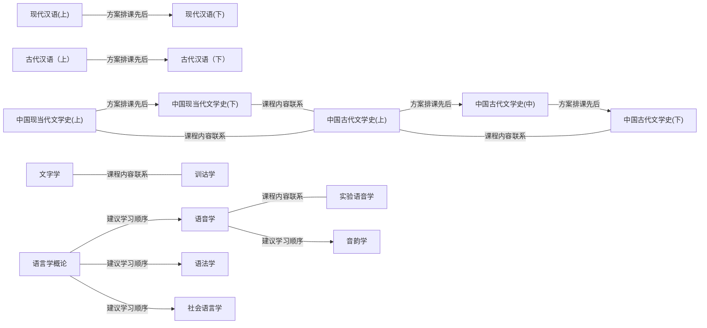

# 2025 汉语言专业本科培养方案（留学生适用）

中国语言文学系 · 汉语言 · 方案 96957 · 66 个不同课程或科研条目。

[官方 Word](../originals/plan-96957.docx) · [教务详情](https://fdjwgl.fudan.edu.cn/manager/bizType/2/major-program-search/info/96957?skipAuth=1) · [方案快照](../raw/plan-96957.json.gz) · [年级目录](../README.md)

## 修读导读

- **建议先学**　《语言学概论》（`CHIN20010`） → 《语法学》（`CHIN20026`）。语言结构与语法单位的概念可供语法分析使用。方案分别列在第3、4学期。

- **可以对照着读**　《文字学》（`CHIN20019`）与《训诂学》（`CHIN20020`）。文字形体与字词解释在古典文献阅读中联系紧密。

- **查模块选课**　《专业英语(汉语言)》（`CHIN20015`）、《现代汉语(上)》（`CHIN20001`）列在“专业必修课程”中。原表见 `/courseModules/7`。

## 课程关系图

图中展示部分关系。下表保留全部已建立的课程对，来源位置使用本方案 JSON Pointer。

## 先修与内容联系

| 类型 | 起点 | 终点 | 依据 | 原表定位 |
| --- | --- | --- | --- | --- |
| 建议学习顺序 | 现代汉语(上) (CHIN20001) | 现代汉语(下) (CHIN20002) | 同方案的课程题名具有连续分册或序号。  | `/courseModules/7/planCourses/0`、`/courseModules/7/planCourses/3` |
| 建议学习顺序 | 中国现当代文学史(上) (CHIN20003) | 中国现当代文学史(下) (CHIN20004) | 同方案的课程题名具有连续分册或序号。  | `/courseModules/7/planCourses/4`、`/courseModules/7/planCourses/9` |
| 建议学习顺序 | 中国古代文学史(上) (CHIN20005) | 中国古代文学史(中) (CHIN20006) | 同方案的课程题名具有连续分册或序号。  | `/courseModules/7/planCourses/1`、`/courseModules/7/planCourses/2` |
| 建议学习顺序 | 中国古代文学史(中) (CHIN20006) | 中国古代文学史(下) (CHIN20007) | 同方案的课程题名具有连续分册或序号。  | `/courseModules/7/planCourses/2`、`/courseModules/7/planCourses/5` |
| 建议学习顺序 | 语言学概论 (CHIN20010) | 语音学 (CHIN20021) | 一般语言学概念有助于进一步认识语音系统。  | `/courseModules/7/planCourses/6`、`/courseModules/7/planCourses/8` |
| 建议学习顺序 | 语言学概论 (CHIN20010) | 语法学 (CHIN20026) | 语言结构与语法单位的概念可供语法分析使用。  | `/courseModules/7/planCourses/6`、`/courseModules/7/planCourses/12` |
| 建议学习顺序 | 语言学概论 (CHIN20010) | 社会语言学 (CHIN50044) | 语言结构与语言变异概念可支持社会语言学学习。  | `/courseModules/7/planCourses/6`、`/courseModules/13/planCourses/12` |
| 建议学习顺序 | 语音学 (CHIN20021) | 音韵学 (CHIN20016) | 语音描述方法有助于理解历史音系。  | `/courseModules/7/planCourses/8`、`/courseModules/7/planCourses/13` |
| 建议学习顺序 | 古代汉语（上） (CHIN20024) | 古代汉语（下） (CHIN20025) | 同方案的课程题名具有连续分册或序号。  | `/courseModules/7/planCourses/7`、`/courseModules/7/planCourses/10` |
| 方案排课先后 | 现代汉语(上) (CHIN20001) | 现代汉语(下) (CHIN20002) | 同方案该课程全部明确数字学期均早于后者。  | `/courseModules/7/planCourses/0`、`/courseModules/7/planCourses/3` |
| 方案排课先后 | 中国现当代文学史(上) (CHIN20003) | 中国现当代文学史(下) (CHIN20004) | 同方案该课程全部明确数字学期均早于后者。  | `/courseModules/7/planCourses/4`、`/courseModules/7/planCourses/9` |
| 方案排课先后 | 中国古代文学史(上) (CHIN20005) | 中国古代文学史(中) (CHIN20006) | 同方案该课程全部明确数字学期均早于后者。  | `/courseModules/7/planCourses/1`、`/courseModules/7/planCourses/2` |
| 方案排课先后 | 中国古代文学史(中) (CHIN20006) | 中国古代文学史(下) (CHIN20007) | 同方案该课程全部明确数字学期均早于后者。  | `/courseModules/7/planCourses/2`、`/courseModules/7/planCourses/5` |
| 方案排课先后 | 语言学概论 (CHIN20010) | 语法学 (CHIN20026) | 同方案该课程全部明确数字学期均早于后者。  | `/courseModules/7/planCourses/6`、`/courseModules/7/planCourses/12` |
| 方案排课先后 | 语音学 (CHIN20021) | 音韵学 (CHIN20016) | 同方案该课程全部明确数字学期均早于后者。  | `/courseModules/7/planCourses/8`、`/courseModules/7/planCourses/13` |
| 方案排课先后 | 古代汉语（上） (CHIN20024) | 古代汉语（下） (CHIN20025) | 同方案该课程全部明确数字学期均早于后者。  | `/courseModules/7/planCourses/7`、`/courseModules/7/planCourses/10` |
| 课程内容联系 | 中国现当代文学史(上) (CHIN20003) | 中国古代文学史(上) (CHIN20005) | 本方案两门课程的题名均含“文学史”，可据此对照这一主题。  | `/courseModules/7/planCourses/4`、`/courseModules/7/planCourses/1` |
| 课程内容联系 | 中国现当代文学史(下) (CHIN20004) | 中国古代文学史(上) (CHIN20005) | 本方案两门课程的题名均含“文学史”，可据此对照这一主题。  | `/courseModules/7/planCourses/9`、`/courseModules/7/planCourses/1` |
| 课程内容联系 | 中国古代文学史(上) (CHIN20005) | 中国古代文学史(中) (CHIN20006) | 本方案两门课程的题名均含“文学史”，可据此对照这一主题。  | `/courseModules/7/planCourses/1`、`/courseModules/7/planCourses/2` |
| 课程内容联系 | 中国古代文学史(上) (CHIN20005) | 中国古代文学史(下) (CHIN20007) | 本方案两门课程的题名均含“文学史”，可据此对照这一主题。  | `/courseModules/7/planCourses/1`、`/courseModules/7/planCourses/5` |
| 课程内容联系 | 汉语方言学 (CHIN20017) | 汉语方言语法研究 (CHIN50016) | 本方案两门课程的题名均含“方言”，可据此对照这一主题。  | `/courseModules/7/planCourses/16`、`/courseModules/13/planCourses/9` |
| 课程内容联系 | 汉语方言学 (CHIN20017) | 方言语料的整理与分析 (CHIN50019) | 本方案两门课程的题名均含“方言”，可据此对照这一主题。  | `/courseModules/7/planCourses/16`、`/courseModules/13/planCourses/8` |
| 课程内容联系 | 文字学 (CHIN20019) | 训诂学 (CHIN20020) | 文字形体与字词解释在古典文献阅读中联系紧密。  | `/courseModules/7/planCourses/14`、`/courseModules/7/planCourses/17` |
| 课程内容联系 | 文字学 (CHIN20019) | 古文字学 (CHIN30025) | 本方案两门课程的题名均含“文字学”，可据此对照这一主题。  | `/courseModules/7/planCourses/14`、`/courseModules/13/planCourses/0` |
| 课程内容联系 | 语音学 (CHIN20021) | 实验语音学 (CHIN40039) | 均关注语音结构与声音特征。  | `/courseModules/7/planCourses/8`、`/courseModules/12/planCourses/12` |
| 课程内容联系 | 语音学 (CHIN20021) | 汉语语音史 (CHIN50050) | 本方案两门课程的题名均含“语音”，可据此对照这一主题。  | `/courseModules/7/planCourses/8`、`/courseModules/13/planCourses/1` |
| 课程内容联系 | 语法学 (CHIN20026) | 汉语方言语法研究 (CHIN50016) | 本方案两门课程的题名均含“语法”，可据此对照这一主题。  | `/courseModules/7/planCourses/12`、`/courseModules/13/planCourses/9` |
| 课程内容联系 | 语法学 (CHIN20026) | 汉语语法史 (CHIN50017) | 本方案两门课程的题名均含“语法”，可据此对照这一主题。  | `/courseModules/7/planCourses/12`、`/courseModules/13/planCourses/7` |
| 课程内容联系 | 语法学 (CHIN20026) | 现代汉语语法研究 (CHIN50046) | 本方案两门课程的题名均含“语法”，可据此对照这一主题。  | `/courseModules/7/planCourses/12`、`/courseModules/13/planCourses/2` |
| 课程内容联系 | 语义学 (CHIN40032) | 语用学 (CHIN40034) | 两课均研究意义，可比较语言表达和语境的作用。  | `/courseModules/12/planCourses/2`、`/courseModules/12/planCourses/3` |

本次未从可定位的明确表述中确认课程对课程预修。学期安排、系列分册与编辑建议均保留各自的依据。

## 按原方案模块阅读

同一模块展示原表中的课程归属。模块内课程之间的先后仍须逐项查阅。

- **限定选修课**　西方语言学史、中国语言学史（原表模块 8）

## 课程表

同一课程在不同模块分别出现时，按原表逐行列出。季节字段保留原值。

| 课程 | 代码 | 学分 | 学期 | 模块 |
| --- | --- | ---: | --- | --- |
| 现代汉语(上) | CHIN20001 | 2.0 | 第1学期 | 培养方案 / 专业培养课程 / 专业核心教育课程 / 专业必修课程 |
| 中国古代文学史(上) | CHIN20005 | 2.0 | 第1学期 | 培养方案 / 专业培养课程 / 专业核心教育课程 / 专业必修课程 |
| 中国古代文学史(中) | CHIN20006 | 2.0 | 第2学期 | 培养方案 / 专业培养课程 / 专业核心教育课程 / 专业必修课程 |
| 现代汉语(下) | CHIN20002 | 2.0 | 第2学期 | 培养方案 / 专业培养课程 / 专业核心教育课程 / 专业必修课程 |
| 中国现当代文学史(上) | CHIN20003 | 2.0 | 第3学期 | 培养方案 / 专业培养课程 / 专业核心教育课程 / 专业必修课程 |
| 中国古代文学史(下) | CHIN20007 | 2.0 | 第3学期 | 培养方案 / 专业培养课程 / 专业核心教育课程 / 专业必修课程 |
| 语言学概论 | CHIN20010 | 2.0 | 第3学期 | 培养方案 / 专业培养课程 / 专业核心教育课程 / 专业必修课程 |
| 古代汉语（上） | CHIN20024 | 2.0 | 第3学期 | 培养方案 / 专业培养课程 / 专业核心教育课程 / 专业必修课程 |
| 语音学 | CHIN20021 | 2.0 | 第3学期 | 培养方案 / 专业培养课程 / 专业核心教育课程 / 专业必修课程 |
| 中国现当代文学史(下) | CHIN20004 | 2.0 | 第4学期 | 培养方案 / 专业培养课程 / 专业核心教育课程 / 专业必修课程 |
| 古代汉语（下） | CHIN20025 | 2.0 | 第4学期 | 培养方案 / 专业培养课程 / 专业核心教育课程 / 专业必修课程 |
| 文学概论 | CHIN20009 | 2.0 | 第4学期 | 培养方案 / 专业培养课程 / 专业核心教育课程 / 专业必修课程 |
| 语法学 | CHIN20026 | 2.0 | 第4学期 | 培养方案 / 专业培养课程 / 专业核心教育课程 / 专业必修课程 |
| 音韵学 | CHIN20016 | 2.0 | 第5学期 | 培养方案 / 专业培养课程 / 专业核心教育课程 / 专业必修课程 |
| 文字学 | CHIN20019 | 2.0 | 第5学期 | 培养方案 / 专业培养课程 / 专业核心教育课程 / 专业必修课程 |
| 修辞学 | CHIN20027 | 2.0 | 第5学期 | 培养方案 / 专业培养课程 / 专业核心教育课程 / 专业必修课程 |
| 汉语方言学 | CHIN20017 | 2.0 | 第6学期 | 培养方案 / 专业培养课程 / 专业核心教育课程 / 专业必修课程 |
| 训诂学 | CHIN20020 | 2.0 | 第6学期 | 培养方案 / 专业培养课程 / 专业核心教育课程 / 专业必修课程 |
| 语言统计学 | CHIN20018 | 2.0 | 第6学期 | 培养方案 / 专业培养课程 / 专业核心教育课程 / 专业必修课程 |
| 专业英语(汉语言) | CHIN20015 | 3.0 | 第7学期 | 培养方案 / 专业培养课程 / 专业核心教育课程 / 专业必修课程 |
| 中国语言学史 | CHIN30018 | 2.0 | 第5学期 | 培养方案 / 专业培养课程 / 专业核心教育课程 / 限定选修课 |
| 西方语言学史 | CHIN30011 | 2.0 | 第5学期 | 培养方案 / 专业培养课程 / 专业核心教育课程 / 限定选修课 |
| 中国语言学论著选读 | CHIN40041 | 2.0 | SPRING、AUTUMN | 培养方案 / 专业进阶 / 专业进阶课程I |
| 近代汉语 | CHIN40031 | 2.0 | SPRING、AUTUMN | 培养方案 / 专业进阶 / 专业进阶课程I |
| 语义学 | CHIN40032 | 2.0 | SPRING、AUTUMN | 培养方案 / 专业进阶 / 专业进阶课程I |
| 语用学 | CHIN40034 | 2.0 | SPRING、AUTUMN | 培养方案 / 专业进阶 / 专业进阶课程I |
| 诗骚精读 | CHIN30012 | 2.0 | SPRING、AUTUMN | 培养方案 / 专业进阶 / 专业进阶课程I |
| 《说文解字》精读 | CHIN30017 | 2.0 | SPRING、AUTUMN | 培养方案 / 专业进阶 / 专业进阶课程I |
| 《马氏文通》精读 | CHIN40036 | 2.0 | SPRING、AUTUMN | 培养方案 / 专业进阶 / 专业进阶课程I |
| 《普通语言学教程》精读 | CHIN40019 | 2.0 | SPRING、AUTUMN | 培养方案 / 专业进阶 / 专业进阶课程I |
| 新媒体语言研究 | CHIN40047 | 2.0 | SPRING、AUTUMN | 培养方案 / 专业进阶 / 专业进阶课程I |
| 语篇语言学 | CHIN40053 | 2.0 | SPRING、AUTUMN | 培养方案 / 专业进阶 / 专业进阶课程I |
| 语言类型与共性 | CHIN40067 | 2.0 | SPRING、AUTUMN | 培养方案 / 专业进阶 / 专业进阶课程I |
| 汉语词汇学 | CHIN40038 | 2.0 | SPRING、AUTUMN | 培养方案 / 专业进阶 / 专业进阶课程I |
| 实验语音学 | CHIN40039 | 2.0 | SPRING、AUTUMN | 培养方案 / 专业进阶 / 专业进阶课程I |
| 应用语言学 | CHIN40035 | 2.0 | SPRING、AUTUMN | 培养方案 / 专业进阶 / 专业进阶课程I |
| 《语言论》精读 | CHIN40037 | 2.0 | SPRING、AUTUMN | 培养方案 / 专业进阶 / 专业进阶课程I |
| 语言发声和感知的解剖生理机制 | CHIN40052 | 2.0 | SPRING、AUTUMN | 培养方案 / 专业进阶 / 专业进阶课程I |
| 语言哲学 | CHIN50047 | 2.0 | SPRING、AUTUMN | 培养方案 / 专业进阶 / 专业进阶课程I |
| 语言大数据与统计建模 | AIS210007 | 2.0 | SPRING、AUTUMN | 培养方案 / 专业进阶 / 专业进阶课程I |
| 中国手语语言学 | CHIN40040 | 2.0 | SPRING、AUTUMN | 培养方案 / 专业进阶 / 专业进阶课程I |
| 中国境内语言概论 | CHIN40011 | 2.0 | SPRING、AUTUMN | 培养方案 / 专业进阶 / 专业进阶课程I |
| 音系学 | CHIN40010 | 2.0 | SPRING、AUTUMN | 培养方案 / 专业进阶 / 专业进阶课程I |
| 古文字学 | CHIN30025 | 2.0 | SPRING、AUTUMN | 培养方案 / 专业进阶 / 专业进阶课程II |
| 汉语语音史 | CHIN50050 | 2.0 | SPRING、AUTUMN | 培养方案 / 专业进阶 / 专业进阶课程II |
| 现代汉语语法研究 | CHIN50046 | 2.0 | SPRING、AUTUMN | 培养方案 / 专业进阶 / 专业进阶课程II |
| 汉语修辞学史 | CHIN50045 | 2.0 | SPRING、AUTUMN | 培养方案 / 专业进阶 / 专业进阶课程II |
| 《修辞学发凡》研究 | CHIN50052 | 2.0 | SPRING、AUTUMN | 培养方案 / 专业进阶 / 专业进阶课程II |
| 语言类型学 | CHIN50054 | 2.0 | SPRING、AUTUMN | 培养方案 / 专业进阶 / 专业进阶课程II |
| 汉语词汇史 | CHIN50022 | 2.0 | SPRING、AUTUMN | 培养方案 / 专业进阶 / 专业进阶课程II |
| 汉语语法史 | CHIN50017 | 2.0 | SPRING、AUTUMN | 培养方案 / 专业进阶 / 专业进阶课程II |
| 方言语料的整理与分析 | CHIN50019 | 2.0 | SPRING、AUTUMN | 培养方案 / 专业进阶 / 专业进阶课程II |
| 汉语方言语法研究 | CHIN50016 | 2.0 | SPRING、AUTUMN | 培养方案 / 专业进阶 / 专业进阶课程II |
| 汉语认知语言学 | CHIN50048 | 2.0 | SPRING、AUTUMN | 培养方案 / 专业进阶 / 专业进阶课程II |
| 历史比较语言学 | CHIN50058 | 2.0 | SPRING、AUTUMN | 培养方案 / 专业进阶 / 专业进阶课程II |
| 社会语言学 | CHIN50044 | 2.0 | SPRING、AUTUMN | 培养方案 / 专业进阶 / 专业进阶课程II |
| 神经语言学 | CHIN50057 | 2.0 | SPRING、AUTUMN | 培养方案 / 专业进阶 / 专业进阶课程II |
| 心理语言学 | CHIN50063 | 2.0 | SPRING、AUTUMN | 培养方案 / 专业进阶 / 专业进阶课程II |
| 生成语言学 | CHIN50049 | 2.0 | SPRING、AUTUMN | 培养方案 / 专业进阶 / 专业进阶课程II |
| 地理语言学入门 | CHIN50067 | 2.0 | SPRING、AUTUMN | 培养方案 / 专业进阶 / 专业进阶课程II |
| 病理语言学 | CHIN50006 | 2.0 | SPRING、AUTUMN | 培养方案 / 专业进阶 / 专业进阶课程II |
| 语言习得与发展 | CHIN50015 | 2.0 | SPRING、AUTUMN | 培养方案 / 专业进阶 / 专业进阶课程II |
| 语言调查实践 | CHIN50108 | 2.0 | SUMMER | 培养方案 / 专业进阶 / 专业进阶课程II |
| 学年论文 | CHIN20022 | 2.0 | 第6学期 | 融合创新能力 |
| 社会实践 | CHIN20028 | 3.0 | 第6学期 | 融合创新能力 |
| 毕业论文 | CHIN40076 | 4.0 | 第8学期 | 融合创新能力 |
