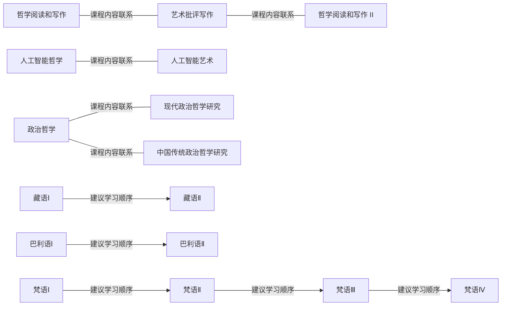

# 2023哲学(国学方向)专业(强基班学生适用)

哲学学院 · 哲学(国学方向)(强基计划) · 方案 67339 · 204 个不同课程或科研条目。

[官方 Word](../originals/plan-67339.docx) · [教务详情](https://fdjwgl.fudan.edu.cn/manager/bizType/2/major-program-search/info/67339?skipAuth=1) · [方案快照](../raw/plan-67339.json.gz) · [年级目录](../README.md)

## 修读导读

- **建议先学**　《巴利语Ⅰ》（`PHIL40011`） → 《巴利语Ⅱ》（`PHIL40012`）。题名列出连续册次或级别。可按序号安排阅读，用前一阶段的笔记回查后续材料中的概念。

- **可以对照着读**　《人工智能哲学》（`PHIL30047`）与《人工智能艺术》（`PHIL50052`）。两门课的题名都涉及人工智能。选一个应用案例，比较输入信息、希望完成的任务和判断效果的依据。

- **查模块选课**　《宗教哲学》（`PHIL30006`）、《历史哲学》（`PHIL30007`）列在“拓展进阶课程”中。原表见 `/courseModules/9`。

## 课程关系图

图中展示部分关系。下表保留全部已建立的课程对，来源位置使用本方案 JSON Pointer。

## 先修与内容联系

| 类型 | 起点 | 终点 | 依据 | 原表定位 |
| --- | --- | --- | --- | --- |
| 建议学习顺序 | 藏语Ⅰ (PHIL40009) | 藏语Ⅱ (PHIL40010) | 同方案的课程题名具有连续分册或序号。  | `/courseModules/9/planCourses/20`、`/courseModules/9/planCourses/21` |
| 建议学习顺序 | 巴利语Ⅰ (PHIL40011) | 巴利语Ⅱ (PHIL40012) | 同方案的课程题名具有连续分册或序号。  | `/courseModules/9/planCourses/22`、`/courseModules/9/planCourses/23` |
| 建议学习顺序 | 梵语Ⅰ (PHIL40019) | 梵语Ⅱ (PHIL40020) | 同方案的课程题名具有连续分册或序号。  | `/courseModules/9/planCourses/62`、`/courseModules/9/planCourses/63` |
| 建议学习顺序 | 梵语Ⅱ (PHIL40020) | 梵语Ⅲ (PHIL40021) | 同方案的课程题名具有连续分册或序号。  | `/courseModules/9/planCourses/63`、`/courseModules/9/planCourses/64` |
| 建议学习顺序 | 梵语Ⅲ (PHIL40021) | 梵语Ⅳ (PHIL40022) | 同方案的课程题名具有连续分册或序号。  | `/courseModules/9/planCourses/64`、`/courseModules/9/planCourses/65` |
| 课程内容联系 | 马克思主义哲学导论 (PHIL20003) | 国外马克思主义前沿 (PHIL50036) | 本方案两门课程的题名均含“马克思主义”，可据此对照这一主题。  | `/courseModules/7/planCourses/0`、`/courseModules/16/planCourses/29` |
| 课程内容联系 | 伦理学基础 (PHIL20012) | 元伦理学 (PHIL50048) | 本方案两门课程的题名均含“伦理学”，可据此对照这一主题。  | `/courseModules/7/planCourses/13`、`/courseModules/16/planCourses/39` |
| 课程内容联系 | 哲学阅读和写作 (PHIL20018) | 艺术批评写作 (PHIL30120) | 本方案两门课程的题名均含“写作”，可据此对照这一主题。  | `/courseModules/7/planCourses/18`、`/courseModules/9/planCourses/73` |
| 课程内容联系 | 宗教伦理学 (PHIL30015) | 元伦理学 (PHIL50048) | 本方案两门课程的题名均含“伦理学”，可据此对照这一主题。  | `/courseModules/9/planCourses/6`、`/courseModules/16/planCourses/39` |
| 课程内容联系 | 政治哲学 (PHIL30024) | 现代政治哲学研究 (PHIL50014) | 本方案两门课程的题名均含“政治哲学”，可据此对照这一主题。  | `/courseModules/9/planCourses/9`、`/courseModules/16/planCourses/6` |
| 课程内容联系 | 政治哲学 (PHIL30024) | 中国传统政治哲学研究 (PHIL50022) | 本方案两门课程的题名均含“政治哲学”，可据此对照这一主题。  | `/courseModules/9/planCourses/9`、`/courseModules/16/planCourses/14` |
| 课程内容联系 | 环境伦理学 (PHIL30045) | 元伦理学 (PHIL50048) | 本方案两门课程的题名均含“伦理学”，可据此对照这一主题。  | `/courseModules/9/planCourses/17`、`/courseModules/16/planCourses/39` |
| 课程内容联系 | 人工智能哲学 (PHIL30047) | 人工智能艺术 (PHIL50052) | 本方案两门课程的题名均含“人工智能”，可据此对照这一主题。  | `/courseModules/9/planCourses/19`、`/courseModules/9/planCourses/90` |
| 课程内容联系 | 西方马克思主义原著选读 (PHIL30057) | 国外马克思主义前沿 (PHIL50036) | 本方案两门课程的题名均含“马克思主义”，可据此对照这一主题。  | `/courseModules/9/planCourses/27`、`/courseModules/16/planCourses/29` |
| 课程内容联系 | 神经伦理学 (PHIL30115) | 元伦理学 (PHIL50048) | 本方案两门课程的题名均含“伦理学”，可据此对照这一主题。  | `/courseModules/9/planCourses/71`、`/courseModules/16/planCourses/39` |
| 课程内容联系 | 艺术批评写作 (PHIL30120) | 哲学阅读和写作 II (PHIL50049) | 本方案两门课程的题名均含“写作”，可据此对照这一主题。  | `/courseModules/9/planCourses/73`、`/courseModules/16/planCourses/43` |
| 课程内容联系 | 国外马克思主义前沿 (PHIL50036) | 西方马克思主义原著精读 (PHIL60095) | 本方案两门课程的题名均含“马克思主义”，可据此对照这一主题。  | `/courseModules/16/planCourses/29`、`/courseModules/16/planCourses/49` |

本次未从可定位的明确表述中确认课程对课程预修。学期安排、系列分册与编辑建议均保留各自的依据。

## 按原方案模块阅读

同一模块展示原表中的课程归属。模块内课程之间的先后仍须逐项查阅。

- **限定选修课**　《大学》与《中庸》、《礼记》、《周易》、形而上学、推理与论证（原表模块 8）
- **拓展进阶课程**　论证有效性分析、宗教哲学、历史哲学、康德哲学、基督教哲学、西方马克思学、佛教哲学、科学思想史、价值哲学、宗教伦理学、犹太教的理论与历史、现代法国哲学、政治哲学、教育哲学、数学哲学、印度佛教哲学、藏传佛教、宗教对话的理论和现状等94项（原表模块 9）
- **专业外语**　藏语Ⅰ、藏语Ⅱ、巴利语Ⅰ、拉丁语与罗马宗教、高阶拉丁语、哲学专业外语、国学专业外语、科逻专业外语、宗教学专业外语、梵语Ⅰ、梵语Ⅱ、梵语Ⅲ、梵语Ⅳ（原表模块 17）

## 课程表

同一课程在不同模块分别出现时，按原表逐行列出。季节字段保留原值。

| 课程 | 代码 | 学分 | 学期 | 模块 |
| --- | --- | ---: | --- | --- |
| 中国文学经典 | CHIN10005 | 3.0 | 第1学期 | 培养方案 / 专业培养课程 / 大类基础课程 |
| 中国古代文明 | HIST10006 | 3.0 | 第2学期 | 培养方案 / 专业培养课程 / 大类基础课程 |
| 哲学导论 | PHIL10002 | 3.0 | 第1学期 | 培养方案 / 专业培养课程 / 大类基础课程 |
| 宗教学导论 | PHIL10004 | 2.0 | 第1学期 | 培养方案 / 专业培养课程 / 大类基础课程 |
| 马克思主义哲学导论 | PHIL20003 | 2.0 | 第3学期 | 培养方案 / 专业培养课程 / 专业核心教育课程 / 必修课程 |
| 社会实践 | PHIL30003 | 2.0 | 第7学期 | 培养方案 / 专业培养课程 / 专业核心教育课程 / 必修课程 |
| 学年论文 | PHIL30004 | 1.0 | 第6学期 | 培养方案 / 专业培养课程 / 专业核心教育课程 / 必修课程 |
| 毕业论文 | PHIL40008 | 4.0 | 第8学期 | 培养方案 / 专业培养课程 / 专业核心教育课程 / 必修课程 |
| 国学通论 | PHIL20006 | 2.0 | 第4学期 | 培养方案 / 专业培养课程 / 专业核心教育课程 / 必修课程 |
| 小学基础 | PHIL20007 | 2.0 | 第3学期 | 培养方案 / 专业培养课程 / 专业核心教育课程 / 必修课程 |
| 中国哲学史料学 | PHIL30023 | 2.0 | 第5学期 | 培养方案 / 专业培养课程 / 专业核心教育课程 / 必修课程 |
| 《论语》 | PHIL20008 | 2.0 | 第4学期 | 培养方案 / 专业培养课程 / 专业核心教育课程 / 必修课程 |
| 《老子》 | PHIL30039 | 2.0 | 第5学期 | 培养方案 / 专业培养课程 / 专业核心教育课程 / 必修课程 |
| 《孟子》 | PHIL30042 | 2.0 | 第6学期 | 培养方案 / 专业培养课程 / 专业核心教育课程 / 必修课程 |
| 古希腊哲学 | PHIL20009 | 3.0 | 第1学期 | 培养方案 / 专业培养课程 / 专业核心教育课程 / 必修课程 |
| 西方近代哲学（含中世纪） | PHIL20010 | 3.0 | 第2学期 | 培养方案 / 专业培养课程 / 专业核心教育课程 / 必修课程 |
| 德国古典哲学 | PHIL20011 | 3.0 | 第3学期 | 培养方案 / 专业培养课程 / 专业核心教育课程 / 必修课程 |
| 伦理学基础 | PHIL20012 | 2.0 | 第2学期 | 培养方案 / 专业培养课程 / 专业核心教育课程 / 必修课程 |
| 先秦哲学 | PHIL20014 | 2.0 | 第1学期 | 培养方案 / 专业培养课程 / 专业核心教育课程 / 必修课程 |
| 汉晋隋唐哲学 | PHIL20015 | 2.0 | 第2学期 | 培养方案 / 专业培养课程 / 专业核心教育课程 / 必修课程 |
| 宋元明清哲学 | PHIL20016 | 2.0 | 第3学期 | 培养方案 / 专业培养课程 / 专业核心教育课程 / 必修课程 |
| 中国近现代哲学 | PHIL20017 | 2.0 | 第4学期 | 培养方案 / 专业培养课程 / 专业核心教育课程 / 必修课程 |
| 哲学阅读和写作 | PHIL20018 | 2.0 | 第4学期 | 培养方案 / 专业培养课程 / 专业核心教育课程 / 必修课程 |
| 《庄子》 | PHIL30083 | 2.0 | 第6学期 | 培养方案 / 专业培养课程 / 专业核心教育课程 / 必修课程 |
| 《大学》与《中庸》 | PHIL30018 | 2.0 | SPRING、AUTUMN | 培养方案 / 专业培养课程 / 专业核心教育课程 / 限定选修课 |
| 《礼记》 | PHIL30035 | 2.0 | SPRING、AUTUMN | 培养方案 / 专业培养课程 / 专业核心教育课程 / 限定选修课 |
| 《周易》 | PHIL30036 | 2.0 | SPRING、AUTUMN | 培养方案 / 专业培养课程 / 专业核心教育课程 / 限定选修课 |
| 形而上学 | PHIL30053 | 2.0 | SPRING、AUTUMN | 培养方案 / 专业培养课程 / 专业核心教育课程 / 限定选修课 |
| 推理与论证 | PHIL30112 | 2.0 | SPRING、AUTUMN | 培养方案 / 专业培养课程 / 专业核心教育课程 / 限定选修课 |
| 宗教哲学 | PHIL30006 | 2.0 | SPRING、AUTUMN | 培养方案 / 专业培养课程 / 专业核心教育课程 / 拓展进阶课程 |
| 历史哲学 | PHIL30007 | 2.0 | SPRING、AUTUMN | 培养方案 / 专业培养课程 / 专业核心教育课程 / 拓展进阶课程 |
| 康德哲学 | PHIL30008 | 2.0 | SPRING、AUTUMN | 培养方案 / 专业培养课程 / 专业核心教育课程 / 拓展进阶课程 |
| 西方马克思学 | PHIL30010 | 2.0 | SPRING、AUTUMN | 培养方案 / 专业培养课程 / 专业核心教育课程 / 拓展进阶课程 |
| 科学思想史 | PHIL30012 | 2.0 | SPRING、AUTUMN | 培养方案 / 专业培养课程 / 专业核心教育课程 / 拓展进阶课程 |
| 价值哲学 | PHIL30014 | 2.0 | SPRING、AUTUMN | 培养方案 / 专业培养课程 / 专业核心教育课程 / 拓展进阶课程 |
| 宗教伦理学 | PHIL30015 | 2.0 | SPRING、AUTUMN | 培养方案 / 专业培养课程 / 专业核心教育课程 / 拓展进阶课程 |
| 犹太教的理论与历史 | PHIL30016 | 2.0 | SPRING、AUTUMN | 培养方案 / 专业培养课程 / 专业核心教育课程 / 拓展进阶课程 |
| 现代法国哲学 | PHIL30021 | 2.0 | SPRING、AUTUMN | 培养方案 / 专业培养课程 / 专业核心教育课程 / 拓展进阶课程 |
| 政治哲学 | PHIL30024 | 2.0 | SPRING、AUTUMN | 培养方案 / 专业培养课程 / 专业核心教育课程 / 拓展进阶课程 |
| 教育哲学 | PHIL30026 | 2.0 | SPRING、AUTUMN | 培养方案 / 专业培养课程 / 专业核心教育课程 / 拓展进阶课程 |
| 数学哲学 | PHIL30027 | 2.0 | SPRING、AUTUMN | 培养方案 / 专业培养课程 / 专业核心教育课程 / 拓展进阶课程 |
| 印度佛教哲学 | PHIL30028 | 2.0 | SPRING、AUTUMN | 培养方案 / 专业培养课程 / 专业核心教育课程 / 拓展进阶课程 |
| 藏传佛教 | PHIL30030 | 2.0 | SPRING、AUTUMN | 培养方案 / 专业培养课程 / 专业核心教育课程 / 拓展进阶课程 |
| 宗教对话的理论和现状 | PHIL30031 | 2.0 | SPRING、AUTUMN | 培养方案 / 专业培养课程 / 专业核心教育课程 / 拓展进阶课程 |
| 比较宗教学 | PHIL30043 | 2.0 | SPRING、AUTUMN | 培养方案 / 专业培养课程 / 专业核心教育课程 / 拓展进阶课程 |
| 宗教人类学 | PHIL30044 | 2.0 | SPRING、AUTUMN | 培养方案 / 专业培养课程 / 专业核心教育课程 / 拓展进阶课程 |
| 环境伦理学 | PHIL30045 | 2.0 | SPRING、AUTUMN | 培养方案 / 专业培养课程 / 专业核心教育课程 / 拓展进阶课程 |
| 西方伦理学史 | PHIL30046 | 2.0 | SPRING、AUTUMN | 培养方案 / 专业培养课程 / 专业核心教育课程 / 拓展进阶课程 |
| 人工智能哲学 | PHIL30047 | 2.0 | SPRING、AUTUMN | 培养方案 / 专业培养课程 / 专业核心教育课程 / 拓展进阶课程 |
| 藏语Ⅰ | PHIL40009 | 2.0 | SPRING、AUTUMN | 培养方案 / 专业培养课程 / 专业核心教育课程 / 拓展进阶课程 |
| 藏语Ⅱ | PHIL40010 | 2.0 | SPRING、AUTUMN | 培养方案 / 专业培养课程 / 专业核心教育课程 / 拓展进阶课程 |
| 巴利语Ⅰ | PHIL40011 | 2.0 | SPRING、AUTUMN | 培养方案 / 专业培养课程 / 专业核心教育课程 / 拓展进阶课程 |
| 巴利语Ⅱ | PHIL40012 | 2.0 | SPRING、AUTUMN | 培养方案 / 专业培养课程 / 专业核心教育课程 / 拓展进阶课程 |
| 证明论 | PHIL30048 | 2.0 | SPRING、AUTUMN | 培养方案 / 专业培养课程 / 专业核心教育课程 / 拓展进阶课程 |
| 认识论 | PHIL30055 | 2.0 | SPRING、AUTUMN | 培养方案 / 专业培养课程 / 专业核心教育课程 / 拓展进阶课程 |
| 马克思恩格斯著作选读 | PHIL30056 | 2.0 | SPRING、AUTUMN | 培养方案 / 专业培养课程 / 专业核心教育课程 / 拓展进阶课程 |
| 西方马克思主义原著选读 | PHIL30057 | 2.0 | SPRING、AUTUMN | 培养方案 / 专业培养课程 / 专业核心教育课程 / 拓展进阶课程 |
| 社会批判理论 | PHIL30058 | 2.0 | SPRING、AUTUMN | 培养方案 / 专业培养课程 / 专业核心教育课程 / 拓展进阶课程 |
| 柏拉图哲学 | PHIL30059 | 2.0 | SPRING、AUTUMN | 培养方案 / 专业培养课程 / 专业核心教育课程 / 拓展进阶课程 |
| 亚里士多德哲学 | PHIL30060 | 2.0 | SPRING、AUTUMN | 培养方案 / 专业培养课程 / 专业核心教育课程 / 拓展进阶课程 |
| 笛卡尔哲学 | PHIL30061 | 2.0 | SPRING、AUTUMN | 培养方案 / 专业培养课程 / 专业核心教育课程 / 拓展进阶课程 |
| 休谟哲学 | PHIL30062 | 2.0 | SPRING、AUTUMN | 培养方案 / 专业培养课程 / 专业核心教育课程 / 拓展进阶课程 |
| 卢梭哲学 | PHIL30063 | 2.0 | SPRING、AUTUMN | 培养方案 / 专业培养课程 / 专业核心教育课程 / 拓展进阶课程 |
| 黑格尔哲学 | PHIL30064 | 2.0 | SPRING、AUTUMN | 培养方案 / 专业培养课程 / 专业核心教育课程 / 拓展进阶课程 |
| 中世纪哲学原著选读 | PHIL30065 | 2.0 | SPRING、AUTUMN | 培养方案 / 专业培养课程 / 专业核心教育课程 / 拓展进阶课程 |
| 分析哲学原著选读 | PHIL30066 | 2.0 | SPRING、AUTUMN | 培养方案 / 专业培养课程 / 专业核心教育课程 / 拓展进阶课程 |
| 现代欧陆哲学原著选读 | PHIL30067 | 2.0 | SPRING、AUTUMN | 培养方案 / 专业培养课程 / 专业核心教育课程 / 拓展进阶课程 |
| 现代德国哲学 | PHIL30068 | 2.0 | SPRING、AUTUMN | 培养方案 / 专业培养课程 / 专业核心教育课程 / 拓展进阶课程 |
| 维特根斯坦哲学 | PHIL30069 | 2.0 | SPRING、AUTUMN | 培养方案 / 专业培养课程 / 专业核心教育课程 / 拓展进阶课程 |
| 海德格尔哲学 | PHIL30070 | 2.0 | SPRING、AUTUMN | 培养方案 / 专业培养课程 / 专业核心教育课程 / 拓展进阶课程 |
| 古典实用主义哲学 | PHIL30071 | 2.0 | SPRING、AUTUMN | 培养方案 / 专业培养课程 / 专业核心教育课程 / 拓展进阶课程 |
| 社会科学哲学 | PHIL30072 | 2.0 | SPRING、AUTUMN | 培养方案 / 专业培养课程 / 专业核心教育课程 / 拓展进阶课程 |
| 艺术哲学原著选读 | PHIL30073 | 2.0 | SPRING、AUTUMN | 培养方案 / 专业培养课程 / 专业核心教育课程 / 拓展进阶课程 |
| 美学原著选读 | PHIL30074 | 2.0 | SPRING、AUTUMN | 培养方案 / 专业培养课程 / 专业核心教育课程 / 拓展进阶课程 |
| 伦理学原著选读 | PHIL30075 | 2.0 | SPRING、AUTUMN | 培养方案 / 专业培养课程 / 专业核心教育课程 / 拓展进阶课程 |
| 激进哲学 | PHIL30076 | 2.0 | SPRING、AUTUMN | 培养方案 / 专业培养课程 / 专业核心教育课程 / 拓展进阶课程 |
| 模态逻辑 | PHIL30085 | 2.0 | SPRING、AUTUMN | 培养方案 / 专业培养课程 / 专业核心教育课程 / 拓展进阶课程 |
| 逻辑史 | PHIL30086 | 2.0 | SPRING、AUTUMN | 培养方案 / 专业培养课程 / 专业核心教育课程 / 拓展进阶课程 |
| 高等逻辑 | PHIL30087 | 2.0 | SPRING、AUTUMN | 培养方案 / 专业培养课程 / 专业核心教育课程 / 拓展进阶课程 |
| 论证有效性分析 | PHIL130243 | 2.0 | SPRING、AUTUMN | 培养方案 / 专业培养课程 / 专业核心教育课程 / 拓展进阶课程 |
| 弗雷格原著选读 | PHIL30088 | 2.0 | SPRING、AUTUMN | 培养方案 / 专业培养课程 / 专业核心教育课程 / 拓展进阶课程 |
| 科学方法论 | PHIL30090 | 2.0 | SPRING、AUTUMN | 培养方案 / 专业培养课程 / 专业核心教育课程 / 拓展进阶课程 |
| 生态哲学 | PHIL30091 | 2.0 | SPRING、AUTUMN | 培养方案 / 专业培养课程 / 专业核心教育课程 / 拓展进阶课程 |
| 拉丁语与罗马宗教 | PHIL40013 | 2.0 | SPRING、AUTUMN | 培养方案 / 专业培养课程 / 专业核心教育课程 / 拓展进阶课程 |
| 高阶拉丁语 | PHIL40014 | 2.0 | SPRING、AUTUMN | 培养方案 / 专业培养课程 / 专业核心教育课程 / 拓展进阶课程 |
| 当代天主教 | PHIL30095 | 2.0 | SPRING、AUTUMN | 培养方案 / 专业培养课程 / 专业核心教育课程 / 拓展进阶课程 |
| 中国基督教 | PHIL30096 | 2.0 | SPRING、AUTUMN | 培养方案 / 专业培养课程 / 专业核心教育课程 / 拓展进阶课程 |
| 《新教伦理与资本主义精神》 | PHIL30097 | 2.0 | SPRING、AUTUMN | 培养方案 / 专业培养课程 / 专业核心教育课程 / 拓展进阶课程 |
| 《神圣与世俗》 | PHIL30098 | 2.0 | SPRING、AUTUMN | 培养方案 / 专业培养课程 / 专业核心教育课程 / 拓展进阶课程 |
| 哲学方法论导论 | PHIL30100 | 2.0 | SPRING、AUTUMN | 培养方案 / 专业培养课程 / 专业核心教育课程 / 拓展进阶课程 |
| 模型论导论 | PHIL30101 | 2.0 | SPRING、AUTUMN | 培养方案 / 专业培养课程 / 专业核心教育课程 / 拓展进阶课程 |
| 梵语Ⅰ | PHIL40019 | 2.0 | SPRING、AUTUMN | 培养方案 / 专业培养课程 / 专业核心教育课程 / 拓展进阶课程 |
| 梵语Ⅱ | PHIL40020 | 2.0 | SPRING、AUTUMN | 培养方案 / 专业培养课程 / 专业核心教育课程 / 拓展进阶课程 |
| 梵语Ⅲ | PHIL40021 | 2.0 | SPRING、AUTUMN | 培养方案 / 专业培养课程 / 专业核心教育课程 / 拓展进阶课程 |
| 梵语Ⅳ | PHIL40022 | 2.0 | SPRING、AUTUMN | 培养方案 / 专业培养课程 / 专业核心教育课程 / 拓展进阶课程 |
| 集合论 | PHIL30106 | 3.0 | SPRING、AUTUMN | 培养方案 / 专业培养课程 / 专业核心教育课程 / 拓展进阶课程 |
| 可计算性理论 | PHIL30107 | 3.0 | SPRING、AUTUMN | 培养方案 / 专业培养课程 / 专业核心教育课程 / 拓展进阶课程 |
| 社会哲学与社会理论 | PHIL30110 | 2.0 | SPRING、AUTUMN | 培养方案 / 专业培养课程 / 专业核心教育课程 / 拓展进阶课程 |
| 数学分析原理 | PHIL30113 | 4.0 | SPRING、AUTUMN | 培养方案 / 专业培养课程 / 专业核心教育课程 / 拓展进阶课程 |
| 心理学哲学 | PHIL30114 | 3.0 | SPRING、AUTUMN | 培养方案 / 专业培养课程 / 专业核心教育课程 / 拓展进阶课程 |
| 神经伦理学 | PHIL30115 | 2.0 | SPRING、AUTUMN | 培养方案 / 专业培养课程 / 专业核心教育课程 / 拓展进阶课程 |
| 非经典逻辑选讲 | PHIL30116 | 2.0 | SPRING、AUTUMN | 培养方案 / 专业培养课程 / 专业核心教育课程 / 拓展进阶课程 |
| 艺术批评写作 | PHIL30120 | 2.0 | SPRING、AUTUMN | 培养方案 / 专业培养课程 / 专业核心教育课程 / 拓展进阶课程 |
| 艺术与科技 | PHIL30122 | 2.0 | SPRING、AUTUMN | 培养方案 / 专业培养课程 / 专业核心教育课程 / 拓展进阶课程 |
| 音乐与哲学 | PHIL30127 | 2.0 | SPRING、AUTUMN | 培养方案 / 专业培养课程 / 专业核心教育课程 / 拓展进阶课程 |
| 摄影与哲学 | PHIL30128 | 2.0 | SPRING、AUTUMN | 培养方案 / 专业培养课程 / 专业核心教育课程 / 拓展进阶课程 |
| 建筑艺术导论 | PHIL30129 | 2.0 | SPRING、AUTUMN | 培养方案 / 专业培养课程 / 专业核心教育课程 / 拓展进阶课程 |
| 电影与哲学 | PHIL30130 | 2.0 | SPRING、AUTUMN | 培养方案 / 专业培养课程 / 专业核心教育课程 / 拓展进阶课程 |
| 艺术策展理论与实践 | PHIL30131 | 2.0 | SPRING、AUTUMN | 培养方案 / 专业培养课程 / 专业核心教育课程 / 拓展进阶课程 |
| 当代美术馆理论与实践 | PHIL30132 | 2.0 | SPRING、AUTUMN | 培养方案 / 专业培养课程 / 专业核心教育课程 / 拓展进阶课程 |
| 中国书法理论与实践 | PHIL30133 | 2.0 | SPRING、AUTUMN | 培养方案 / 专业培养课程 / 专业核心教育课程 / 拓展进阶课程 |
| 中国绘画与画论 | PHIL30134 | 2.0 | SPRING、AUTUMN | 培养方案 / 专业培养课程 / 专业核心教育课程 / 拓展进阶课程 |
| 图像与观念 | PHIL30135 | 2.0 | SPRING、AUTUMN | 培养方案 / 专业培养课程 / 专业核心教育课程 / 拓展进阶课程 |
| 视觉媒介研究 | PHIL30142 | 2.0 | SPRING、AUTUMN | 培养方案 / 专业培养课程 / 专业核心教育课程 / 拓展进阶课程 |
| 生物学哲学 | PHIL30144 | 2.0 | SPRING、AUTUMN | 培养方案 / 专业培养课程 / 专业核心教育课程 / 拓展进阶课程 |
| 悲剧与哲学 | PHIL30143 | 2.0 | SPRING、AUTUMN | 培养方案 / 专业培养课程 / 专业核心教育课程 / 拓展进阶课程 |
| 艺术批评与策展 | PHIL30146 | 2.0 | SPRING、AUTUMN | 培养方案 / 专业培养课程 / 专业核心教育课程 / 拓展进阶课程 |
| 犹太教历史、理论与实践 | PHIL30153 | 2.0 | SPRING、AUTUMN | 培养方案 / 专业培养课程 / 专业核心教育课程 / 拓展进阶课程 |
| 现代西方哲学原著 | PHIL40003 | 2.0 | SPRING、AUTUMN | 培养方案 / 专业培养课程 / 专业核心教育课程 / 拓展进阶课程 |
| 人工智能艺术 | PHIL50052 | 2.0 | SPRING、AUTUMN | 培养方案 / 专业培养课程 / 专业核心教育课程 / 拓展进阶课程 |
| 知觉哲学 | PHIL50050 | 2.0 | SPRING、AUTUMN | 培养方案 / 专业培养课程 / 专业核心教育课程 / 拓展进阶课程 |
| 佛教哲学 | PHIL30011 | 2.0 | SPRING、AUTUMN | 培养方案 / 专业培养课程 / 专业核心教育课程 / 拓展进阶课程 |
| 基督教哲学 | PHIL30009 | 2.0 | SPRING、AUTUMN | 培养方案 / 专业培养课程 / 专业核心教育课程 / 拓展进阶课程 |
| 《史记》精读 | CHIN130016 | 2.0 | SPRING、AUTUMN | 培养方案 / 专业培养课程 / 专业核心教育课程 / 拓展进阶课程 / A组 |
| 《文心雕龙》精读 | CHIN30014 | 2.0 | SPRING、AUTUMN | 培养方案 / 专业培养课程 / 专业核心教育课程 / 拓展进阶课程 / A组 |
| 《四库提要》精读 | CHIN30015 | 2.0 | SPRING、AUTUMN | 培养方案 / 专业培养课程 / 专业核心教育课程 / 拓展进阶课程 / A组 |
| 《说文解字》精读 | CHIN30017 | 2.0 | SPRING、AUTUMN | 培养方案 / 专业培养课程 / 专业核心教育课程 / 拓展进阶课程 / A组 |
| 《世说新语》精读 | CHIN30019 | 2.0 | SPRING、AUTUMN | 培养方案 / 专业培养课程 / 专业核心教育课程 / 拓展进阶课程 / A组 |
| 《资治通鉴》讲读 | HIST30048 | 2.0 | SPRING、AUTUMN | 培养方案 / 专业培养课程 / 专业核心教育课程 / 拓展进阶课程 / A组 |
| 校雠目录学 | PHIL30017 | 2.0 | SPRING、AUTUMN | 培养方案 / 专业培养课程 / 专业核心教育课程 / 拓展进阶课程 / A组 |
| 《文选》 | PHIL30040 | 2.0 | SPRING、AUTUMN | 培养方案 / 专业培养课程 / 专业核心教育课程 / 拓展进阶课程 / A组 |
| 秦汉哲学专题研究 | PHIL30077 | 2.0 | SPRING、AUTUMN | 培养方案 / 专业培养课程 / 专业核心教育课程 / 拓展进阶课程 / B组 |
| 魏晋玄学专题研究 | PHIL30078 | 2.0 | SPRING、AUTUMN | 培养方案 / 专业培养课程 / 专业核心教育课程 / 拓展进阶课程 / B组 |
| 宋明理学专题研究 | PHIL30079 | 2.0 | SPRING、AUTUMN | 培养方案 / 专业培养课程 / 专业核心教育课程 / 拓展进阶课程 / B组 |
| 清代思想专题研究 | PHIL30080 | 2.0 | SPRING、AUTUMN | 培养方案 / 专业培养课程 / 专业核心教育课程 / 拓展进阶课程 / B组 |
| 印度哲学选读 | PHIL30147 | 2.0 | SPRING、AUTUMN | 培养方案 / 专业培养课程 / 专业核心教育课程 / 拓展进阶课程 / B组 |
| 印度哲学与宗教 | PHIL30094 | 2.0 | SPRING、AUTUMN | 培养方案 / 专业培养课程 / 专业核心教育课程 / 拓展进阶课程 / B组 |
| 汉传佛教哲学 | PHIL30029 | 2.0 | SPRING、AUTUMN | 培养方案 / 专业培养课程 / 专业核心教育课程 / 拓展进阶课程 / C组 |
| 中国佛教史 | PHIL30082 | 2.0 | SPRING、AUTUMN | 培养方案 / 专业培养课程 / 专业核心教育课程 / 拓展进阶课程 / C组 |
| 佛教经典选读一 | PHIL30103 | 2.0 | SPRING、AUTUMN | 培养方案 / 专业培养课程 / 专业核心教育课程 / 拓展进阶课程 / C组 |
| 佛教经典选读二 | PHIL30104 | 2.0 | SPRING、AUTUMN | 培养方案 / 专业培养课程 / 专业核心教育课程 / 拓展进阶课程 / C组 |
| 民间宗教与道教 | PHIL30108 | 2.0 | SPRING、AUTUMN | 培养方案 / 专业培养课程 / 专业核心教育课程 / 拓展进阶课程 / C组 |
| 佛教经典选读 | PHIL30081 | 2.0 | SPRING、AUTUMN | 培养方案 / 专业培养课程 / 专业核心教育课程 / 拓展进阶课程 / C组 |
| 《韩非子》 | PHIL30032 | 2.0 | SPRING、AUTUMN | 培养方案 / 专业培养课程 / 专业核心教育课程 / 拓展进阶课程 / D组 |
| 《诗经》 | PHIL30033 | 2.0 | SPRING、AUTUMN | 培养方案 / 专业培养课程 / 专业核心教育课程 / 拓展进阶课程 / D组 |
| 《尚书》 | PHIL30034 | 2.0 | SPRING、AUTUMN | 培养方案 / 专业培养课程 / 专业核心教育课程 / 拓展进阶课程 / D组 |
| 《左传》 | PHIL30037 | 2.0 | SPRING、AUTUMN | 培养方案 / 专业培养课程 / 专业核心教育课程 / 拓展进阶课程 / D组 |
| 《公羊传》 | PHIL30038 | 2.0 | SPRING、AUTUMN | 培养方案 / 专业培养课程 / 专业核心教育课程 / 拓展进阶课程 / D组 |
| 《荀子》 | PHIL30041 | 2.0 | SPRING、AUTUMN | 培养方案 / 专业培养课程 / 专业核心教育课程 / 拓展进阶课程 / D组 |
| 《近思录》 | PHIL30084 | 2.0 | SPRING、AUTUMN | 培养方案 / 专业培养课程 / 专业核心教育课程 / 拓展进阶课程 / D组 |
| 新兴宗教概论 | PHIL50009 | 2.0 | SPRING、AUTUMN | 培养方案 / 专业进阶模块 / 专业进阶课程 |
| 当代佛教的公共议题 | PHIL130120 | 2.0 | SPRING、AUTUMN | 培养方案 / 专业进阶模块 / 专业进阶课程 |
| 《1844手稿》研究 | PHIL50010 | 2.0 | SPRING、AUTUMN | 培养方案 / 专业进阶模块 / 专业进阶课程 |
| 《资本论》及其手稿 | PHIL50011 | 2.0 | SPRING、AUTUMN | 培养方案 / 专业进阶模块 / 专业进阶课程 |
| 近代认识论研究 | PHIL50012 | 2.0 | SPRING、AUTUMN | 培养方案 / 专业进阶模块 / 专业进阶课程 |
| 德国古典美学专题研究 | PHIL50013 | 2.0 | SPRING、AUTUMN | 培养方案 / 专业进阶模块 / 专业进阶课程 |
| 现代政治哲学研究 | PHIL50014 | 2.0 | SPRING、AUTUMN | 培养方案 / 专业进阶模块 / 专业进阶课程 |
| 德国观念论 | PHIL50015 | 2.0 | SPRING、AUTUMN | 培养方案 / 专业进阶模块 / 专业进阶课程 |
| 福柯研究 | PHIL50016 | 2.0 | SPRING、AUTUMN | 培养方案 / 专业进阶模块 / 专业进阶课程 |
| 意识形态理论研究 | PHIL50017 | 2.0 | SPRING、AUTUMN | 培养方案 / 专业进阶模块 / 专业进阶课程 |
| 应用伦理学专题 | PHIL50018 | 2.0 | SPRING、AUTUMN | 培养方案 / 专业进阶模块 / 专业进阶课程 |
| 中国经学史专题研究 | PHIL50019 | 2.0 | SPRING、AUTUMN | 培养方案 / 专业进阶模块 / 专业进阶课程 |
| 朱子学与阳明学研究 | PHIL50020 | 2.0 | SPRING、AUTUMN | 培养方案 / 专业进阶模块 / 专业进阶课程 |
| 当代新儒家专题研究 | PHIL50021 | 2.0 | SPRING、AUTUMN | 培养方案 / 专业进阶模块 / 专业进阶课程 |
| 中国传统政治哲学研究 | PHIL50022 | 2.0 | SPRING、AUTUMN | 培养方案 / 专业进阶模块 / 专业进阶课程 |
| 中西比较哲学专题研究 | PHIL50023 | 2.0 | SPRING、AUTUMN | 培养方案 / 专业进阶模块 / 专业进阶课程 |
| 海外中国哲学研究专题 | PHIL50024 | 2.0 | SPRING、AUTUMN | 培养方案 / 专业进阶模块 / 专业进阶课程 |
| 东亚儒学探究 | PHIL50025 | 2.0 | SPRING、AUTUMN | 培养方案 / 专业进阶模块 / 专业进阶课程 |
| 力迫法 | PHIL50026 | 2.0 | SPRING、AUTUMN | 培养方案 / 专业进阶模块 / 专业进阶课程 |
| 意义理论研究 | PHIL50027 | 2.0 | SPRING、AUTUMN | 培养方案 / 专业进阶模块 / 专业进阶课程 |
| 科学实在论研究 | PHIL50028 | 2.0 | SPRING、AUTUMN | 培养方案 / 专业进阶模块 / 专业进阶课程 |
| 科学解释研究 | PHIL50029 | 2.0 | SPRING、AUTUMN | 培养方案 / 专业进阶模块 / 专业进阶课程 |
| 科学实践哲学 | PHIL50030 | 2.0 | SPRING、AUTUMN | 培养方案 / 专业进阶模块 / 专业进阶课程 |
| 亚伯拉罕宗教研究 | PHIL50031 | 2.0 | SPRING、AUTUMN | 培养方案 / 专业进阶模块 / 专业进阶课程 |
| 明清基督教研究 | PHIL50032 | 2.0 | SPRING、AUTUMN | 培养方案 / 专业进阶模块 / 专业进阶课程 |
| 启蒙哲学 | PHIL50033 | 2.0 | SPRING、AUTUMN | 培养方案 / 专业进阶模块 / 专业进阶课程 |
| 中西艺术专题 | PHIL50034 | 2.0 | SPRING、AUTUMN | 培养方案 / 专业进阶模块 / 专业进阶课程 |
| 中国宗教的田野研究 | PHIL30102 | 3.0 | SPRING、AUTUMN | 培养方案 / 专业进阶模块 / 专业进阶课程 |
| 思考与认知 | PHIL50035 | 2.0 | SPRING、AUTUMN | 培养方案 / 专业进阶模块 / 专业进阶课程 |
| 国外马克思主义前沿 | PHIL50036 | 2.0 | SPRING、AUTUMN | 培养方案 / 专业进阶模块 / 专业进阶课程 |
| 古希腊哲学专题 | PHIL50037 | 2.0 | SPRING、AUTUMN | 培养方案 / 专业进阶模块 / 专业进阶课程 |
| 模型论进阶 | PHIL50038 | 3.0 | SPRING、AUTUMN | 培养方案 / 专业进阶模块 / 专业进阶课程 |
| 可计算性理论进阶 | PHIL50039 | 3.0 | SPRING、AUTUMN | 培养方案 / 专业进阶模块 / 专业进阶课程 |
| 集合论进阶 | PHIL50040 | 3.0 | SPRING、AUTUMN | 培养方案 / 专业进阶模块 / 专业进阶课程 |
| 黑格尔美学思想 | PHIL50041 | 2.0 | SPRING、AUTUMN | 培养方案 / 专业进阶模块 / 专业进阶课程 |
| 中国古典美学专题 | PHIL50042 | 2.0 | SPRING、AUTUMN | 培养方案 / 专业进阶模块 / 专业进阶课程 |
| 艺术展览与艺术理论专题 | PHIL50043 | 3.0 | SPRING、AUTUMN | 培养方案 / 专业进阶模块 / 专业进阶课程 |
| 生命伦理学专题 | PHIL50044 | 2.0 | SPRING、AUTUMN | 培养方案 / 专业进阶模块 / 专业进阶课程 |
| 规范伦理学 | PHIL40028 | 2.0 | SPRING、AUTUMN | 培养方案 / 专业进阶模块 / 专业进阶课程 |
| 元伦理学 | PHIL50048 | 2.0 | SPRING、AUTUMN | 培养方案 / 专业进阶模块 / 专业进阶课程 |
| 政治思想专题：经典与当代 | PHIL40024 | 4.0 | SPRING、AUTUMN | 培养方案 / 专业进阶模块 / 专业进阶课程 |
| 佛教专题研究 | PHIL50047 | 2.0 | SPRING、AUTUMN | 培养方案 / 专业进阶模块 / 专业进阶课程 |
| 当代西方艺术哲学 | PHIL50046 | 3.0 | SPRING、AUTUMN | 培养方案 / 专业进阶模块 / 专业进阶课程 |
| 哲学阅读和写作 II | PHIL50049 | 2.0 | SPRING、AUTUMN | 培养方案 / 专业进阶模块 / 专业进阶课程 |
| 《资本论》与现代世界 | PHIL40025 | 4.0 | SPRING、AUTUMN | 培养方案 / 专业进阶模块 / 专业进阶课程 |
| 繁荣与贫困：历史视野下的经济发展 | PHIL40026 | 4.0 | SPRING、AUTUMN | 培养方案 / 专业进阶模块 / 专业进阶课程 |
| 帝国秩序与帝国主义 | PHIL40023 | 4.0 | SPRING、AUTUMN | 培养方案 / 专业进阶模块 / 专业进阶课程 |
| 基督教哲学专题 | PHIL20001 | 2.0 | SPRING、AUTUMN | 培养方案 / 专业进阶模块 / 专业进阶课程 |
| 批判理论专题 | PHIL70131 | 2.0 | SPRING、AUTUMN | 培养方案 / 专业进阶模块 / 专业进阶课程 |
| 西方马克思主义原著精读 | PHIL60095 | 3.0 | SPRING、AUTUMN | 培养方案 / 专业进阶模块 / 专业进阶课程 |
| 哲学专业外语 | PHIL40015 | 2.0 | SPRING、AUTUMN | 培养方案 / 专业进阶模块 / 专业进阶课程 / 专业外语 |
| 国学专业外语 | PHIL40016 | 2.0 | SPRING、AUTUMN | 培养方案 / 专业进阶模块 / 专业进阶课程 / 专业外语 |
| 科逻专业外语 | PHIL40017 | 2.0 | SPRING、AUTUMN | 培养方案 / 专业进阶模块 / 专业进阶课程 / 专业外语 |
| 宗教学专业外语 | PHIL40018 | 2.0 | SPRING、AUTUMN | 培养方案 / 专业进阶模块 / 专业进阶课程 / 专业外语 |
| 藏语Ⅰ | PHIL40009 | 2.0 | SPRING、AUTUMN | 培养方案 / 专业进阶模块 / 专业进阶课程 / 专业外语 |
| 藏语Ⅱ | PHIL40010 | 2.0 | SPRING、AUTUMN | 培养方案 / 专业进阶模块 / 专业进阶课程 / 专业外语 |
| 巴利语Ⅰ | PHIL40011 | 2.0 | SPRING、AUTUMN | 培养方案 / 专业进阶模块 / 专业进阶课程 / 专业外语 |
| 拉丁语与罗马宗教 | PHIL40013 | 2.0 | SPRING、AUTUMN | 培养方案 / 专业进阶模块 / 专业进阶课程 / 专业外语 |
| 高阶拉丁语 | PHIL40014 | 2.0 | SPRING、AUTUMN | 培养方案 / 专业进阶模块 / 专业进阶课程 / 专业外语 |
| 梵语Ⅰ | PHIL40019 | 2.0 | SPRING、AUTUMN | 培养方案 / 专业进阶模块 / 专业进阶课程 / 专业外语 |
| 梵语Ⅱ | PHIL40020 | 2.0 | SPRING、AUTUMN | 培养方案 / 专业进阶模块 / 专业进阶课程 / 专业外语 |
| 梵语Ⅲ | PHIL40021 | 2.0 | SPRING、AUTUMN | 培养方案 / 专业进阶模块 / 专业进阶课程 / 专业外语 |
| 梵语Ⅳ | PHIL40022 | 2.0 | SPRING、AUTUMN | 培养方案 / 专业进阶模块 / 专业进阶课程 / 专业外语 |
