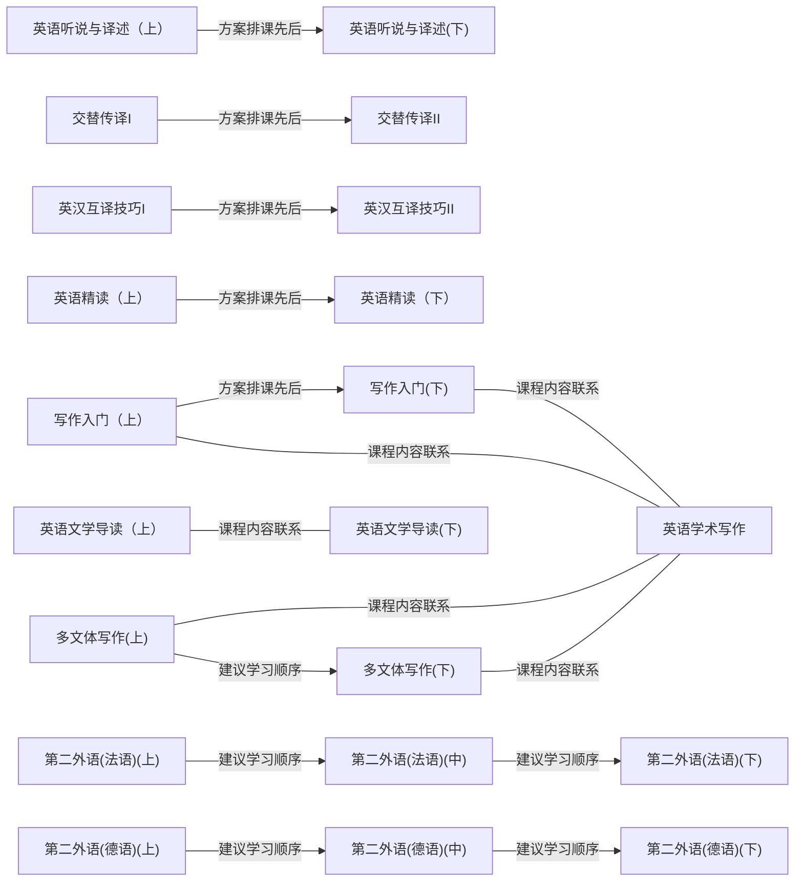

# 2023 翻译专业“2+X”教学培养方案

外国语言文学学院 · 翻译 · 方案 67573 · 72 个不同课程或科研条目。

[官方 Word](../originals/plan-67573.docx) · [教务详情](https://fdjwgl.fudan.edu.cn/manager/bizType/2/major-program-search/info/67573?skipAuth=1) · [方案快照](../raw/plan-67573.json.gz) · [年级目录](../README.md)

## 修读导读

- **建议先学**　《英语听说与译述（上）》（`FORE20022`） → 《英语听说与译述(下)》（`FORE20009`）。题名列出连续册次或级别。保留前一阶段的表达和听辨记录，在后续会话中复查同类问题。方案分别列在第3、4学期。

- **可以对照着读**　《文学翻译》（`FORE30042`）与《翻译与思辨》（`FORE50010`）。两门课的题名都涉及翻译。把同一句原文的两种译法并列，说明语境、语气或读者变化怎样影响取舍。

- **查模块选课**　《翻译理论与策略》（`FORE60003`）、《实习调查》（`FORE30001`）列在“专业必修课程”中。原表见 `/courseModules/7`。

## 课程关系图

图中展示部分关系。下表保留全部已建立的课程对，来源位置使用本方案 JSON Pointer。

## 先修与内容联系

| 类型 | 起点 | 终点 | 依据 | 原表定位 |
| --- | --- | --- | --- | --- |
| 建议学习顺序 | 第二外语(日语)(上) (FORE10007) | 第二外语(日语)(中) (FORE20011) | 同方案的课程题名具有连续分册或序号。  | `/courseModules/12/planCourses/0`、`/courseModules/12/planCourses/1` |
| 建议学习顺序 | 第二外语(法语)(上) (FORE10008) | 第二外语(法语)(中) (FORE20013) | 同方案的课程题名具有连续分册或序号。  | `/courseModules/9/planCourses/0`、`/courseModules/9/planCourses/1` |
| 建议学习顺序 | 第二外语(德语)(上) (FORE10009) | 第二外语(德语)(中) (FORE20015) | 同方案的课程题名具有连续分册或序号。  | `/courseModules/10/planCourses/0`、`/courseModules/10/planCourses/1` |
| 建议学习顺序 | 第二外语(俄语)(上) (FORE10010) | 第二外语(俄语)(中) (FORE20017) | 同方案的课程题名具有连续分册或序号。  | `/courseModules/11/planCourses/0`、`/courseModules/11/planCourses/1` |
| 建议学习顺序 | 英语精读（上） (FORE10013) | 英语精读（下） (FORE10016) | 同方案的课程题名具有连续分册或序号。  | `/courseModules/7/planCourses/11`、`/courseModules/7/planCourses/15` |
| 建议学习顺序 | 写作入门（上） (FORE10014) | 写作入门(下) (FORE10017) | 同方案的课程题名具有连续分册或序号。  | `/courseModules/7/planCourses/12`、`/courseModules/7/planCourses/16` |
| 建议学习顺序 | 英语文学导读（上） (FORE10015) | 英语文学导读(下) (FORE10018) | 同方案的课程题名具有连续分册或序号。  | `/courseModules/7/planCourses/13`、`/courseModules/7/planCourses/17` |
| 建议学习顺序 | 英汉互译技巧I (FORE20010) | 英汉互译技巧II (FORE30020) | 同方案的课程题名具有连续分册或序号。  | `/courseModules/7/planCourses/6`、`/courseModules/7/planCourses/7` |
| 建议学习顺序 | 第二外语(日语)(中) (FORE20011) | 第二外语(日语)(下) (FORE20012) | 同方案的课程题名具有连续分册或序号。  | `/courseModules/12/planCourses/1`、`/courseModules/12/planCourses/2` |
| 建议学习顺序 | 第二外语(法语)(中) (FORE20013) | 第二外语(法语)(下) (FORE20014) | 同方案的课程题名具有连续分册或序号。  | `/courseModules/9/planCourses/1`、`/courseModules/9/planCourses/2` |
| 建议学习顺序 | 第二外语(德语)(中) (FORE20015) | 第二外语(德语)(下) (FORE20016) | 同方案的课程题名具有连续分册或序号。  | `/courseModules/10/planCourses/1`、`/courseModules/10/planCourses/2` |
| 建议学习顺序 | 第二外语(俄语)(中) (FORE20017) | 第二外语(俄语)(下) (FORE20018) | 同方案的课程题名具有连续分册或序号。  | `/courseModules/11/planCourses/1`、`/courseModules/11/planCourses/2` |
| 建议学习顺序 | 英语听说与译述（上） (FORE20022) | 英语听说与译述(下) (FORE20009) | 同方案的课程题名具有连续分册或序号。  | `/courseModules/7/planCourses/9`、`/courseModules/7/planCourses/3` |
| 建议学习顺序 | 第二外语(西班牙语)上 (FORE20030) | 第二外语(西班牙语)下 (FORE20031) | 同方案的课程题名具有连续分册或序号。  | `/courseModules/13/planCourses/0`、`/courseModules/13/planCourses/1` |
| 建议学习顺序 | 多文体写作(上) (FORE20044) | 多文体写作(下) (FORE20046) | 同方案的课程题名具有连续分册或序号。  | `/courseModules/7/planCourses/20`、`/courseModules/7/planCourses/21` |
| 建议学习顺序 | 交替传译I (FORE30019) | 交替传译II (FORE40013) | 同方案的课程题名具有连续分册或序号。  | `/courseModules/7/planCourses/4`、`/courseModules/7/planCourses/5` |
| 方案排课先后 | 英语精读（上） (FORE10013) | 英语精读（下） (FORE10016) | 同方案该课程全部明确数字学期均早于后者。  | `/courseModules/7/planCourses/11`、`/courseModules/7/planCourses/15` |
| 方案排课先后 | 写作入门（上） (FORE10014) | 写作入门(下) (FORE10017) | 同方案该课程全部明确数字学期均早于后者。  | `/courseModules/7/planCourses/12`、`/courseModules/7/planCourses/16` |
| 方案排课先后 | 英语文学导读（上） (FORE10015) | 英语文学导读(下) (FORE10018) | 同方案该课程全部明确数字学期均早于后者。  | `/courseModules/7/planCourses/13`、`/courseModules/7/planCourses/17` |
| 方案排课先后 | 英汉互译技巧I (FORE20010) | 英汉互译技巧II (FORE30020) | 同方案该课程全部明确数字学期均早于后者。  | `/courseModules/7/planCourses/6`、`/courseModules/7/planCourses/7` |
| 方案排课先后 | 英语听说与译述（上） (FORE20022) | 英语听说与译述(下) (FORE20009) | 同方案该课程全部明确数字学期均早于后者。  | `/courseModules/7/planCourses/9`、`/courseModules/7/planCourses/3` |
| 方案排课先后 | 多文体写作(上) (FORE20044) | 多文体写作(下) (FORE20046) | 同方案该课程全部明确数字学期均早于后者。  | `/courseModules/7/planCourses/20`、`/courseModules/7/planCourses/21` |
| 方案排课先后 | 交替传译I (FORE30019) | 交替传译II (FORE40013) | 同方案该课程全部明确数字学期均早于后者。  | `/courseModules/7/planCourses/4`、`/courseModules/7/planCourses/5` |
| 课程内容联系 | 写作入门（上） (FORE10014) | 英语学术写作 (FORE40034) | 本方案两门课程的题名均含“写作”，可据此对照这一主题。  | `/courseModules/7/planCourses/12`、`/courseModules/7/planCourses/23` |
| 课程内容联系 | 英语文学导读（上） (FORE10015) | 英语文学导读(下) (FORE10018) | 本方案两门课程的题名均含“英语文学”，可据此对照这一主题。  | `/courseModules/7/planCourses/13`、`/courseModules/7/planCourses/17` |
| 课程内容联系 | 写作入门(下) (FORE10017) | 英语学术写作 (FORE40034) | 本方案两门课程的题名均含“写作”，可据此对照这一主题。  | `/courseModules/7/planCourses/16`、`/courseModules/7/planCourses/23` |
| 课程内容联系 | 多文体写作(上) (FORE20044) | 英语学术写作 (FORE40034) | 本方案两门课程的题名均含“写作”，可据此对照这一主题。  | `/courseModules/7/planCourses/20`、`/courseModules/7/planCourses/23` |
| 课程内容联系 | 多文体写作(下) (FORE20046) | 英语学术写作 (FORE40034) | 本方案两门课程的题名均含“写作”，可据此对照这一主题。  | `/courseModules/7/planCourses/21`、`/courseModules/7/planCourses/23` |
| 课程内容联系 | 科技翻译 (FORE30025) | 文学翻译 (FORE30042) | 本方案两门课程的题名均含“翻译”，可据此对照这一主题。  | `/courseModules/15/planCourses/7`、`/courseModules/15/planCourses/20` |
| 课程内容联系 | 商务口译 (FORE30030) | 口译实务 (FORE40038) | 本方案两门课程的题名均含“口译”，可据此对照这一主题。  | `/courseModules/15/planCourses/9`、`/courseModules/15/planCourses/21` |
| 课程内容联系 | 文学翻译 (FORE30042) | 翻译专题 (FORE40020) | 本方案两门课程的题名均含“翻译”，可据此对照这一主题。  | `/courseModules/15/planCourses/20`、`/courseModules/15/planCourses/5` |
| 课程内容联系 | 文学翻译 (FORE30042) | 翻译与思辨 (FORE50010) | 本方案两门课程的题名均含“翻译”，可据此对照这一主题。  | `/courseModules/15/planCourses/20`、`/courseModules/7/planCourses/2` |
| 课程内容联系 | 文学翻译 (FORE30042) | 本地化翻译 (FORE50113) | 本方案两门课程的题名均含“翻译”，可据此对照这一主题。  | `/courseModules/15/planCourses/20`、`/courseModules/15/planCourses/23` |
| 课程内容联系 | 口译实务 (FORE40038) | 联合国会议口译专题 (FORE50044) | 本方案两门课程的题名均含“口译”，可据此对照这一主题。  | `/courseModules/15/planCourses/21`、`/courseModules/15/planCourses/10` |
| 课程内容联系 | 口译实务 (FORE40038) | 口译工作坊 (FORE50053) | 本方案两门课程的题名均含“口译”，可据此对照这一主题。  | `/courseModules/15/planCourses/21`、`/courseModules/15/planCourses/12` |
| 课程内容联系 | 口译实务 (FORE40038) | 口译职业与伦理 (FORE70002) | 本方案两门课程的题名均含“口译”，可据此对照这一主题。  | `/courseModules/15/planCourses/21`、`/courseModules/15/planCourses/24` |
| 课程内容联系 | 哲学导论 (PHIL10002) | 逻辑学 (PHIL10003) | 论证与概念分析是哲学讨论的共同方法。  | `/courseModules/5/planCourses/0`、`/courseModules/5/planCourses/2` |

本次未从可定位的明确表述中确认课程对课程预修。学期安排、系列分册与编辑建议均保留各自的依据。

## 按原方案模块阅读

同一模块展示原表中的课程归属。模块内课程之间的先后仍须逐项查阅。

- **法语组**　第二外语(法语)(上)、第二外语(法语)(中)、第二外语(法语)(下)（原表模块 9）
- **德语组**　第二外语(德语)(上)、第二外语(德语)(中)、第二外语(德语)(下)（原表模块 10）
- **俄语组**　第二外语(俄语)(上)、第二外语(俄语)(中)、第二外语(俄语)(下)（原表模块 11）
- **日语组**　第二外语(日语)(上)、第二外语(日语)(中)、第二外语(日语)(下)（原表模块 12）
- **西班牙语组**　第二外语(西班牙语)上、第二外语(西班牙语)下（原表模块 13）

## 课程表

同一课程在不同模块分别出现时，按原表逐行列出。季节字段保留原值。

| 课程 | 代码 | 学分 | 学期 | 模块 |
| --- | --- | ---: | --- | --- |
| 哲学导论 | PHIL10002 | 3.0 | 第2学期 | 培养方案 / 专业培养课程 / 大类基础课程 |
| 中国文学经典 | CHIN10005 | 3.0 | 第1学期 | 培养方案 / 专业培养课程 / 大类基础课程 |
| 逻辑学 | PHIL10003 | 3.0 | 第2学期 | 培养方案 / 专业培养课程 / 大类基础课程 |
| 中国古代文明 | HIST10006 | 3.0 | 第1学期 | 培养方案 / 专业培养课程 / 大类基础课程 |
| 实习调查 | FORE30001 | 2.0 | 第6学期 | 培养方案 / 专业培养课程 / 专业核心教育课程 / 专业必修课程 |
| 毕业论文 | FORE40080 | 4.0 | 第8学期 | 培养方案 / 专业培养课程 / 专业核心教育课程 / 专业必修课程 |
| 翻译与思辨 | FORE50010 | 2.0 | 第6学期 | 培养方案 / 专业培养课程 / 专业核心教育课程 / 专业必修课程 |
| 英语听说与译述(下) | FORE20009 | 2.0 | 第4学期 | 培养方案 / 专业培养课程 / 专业核心教育课程 / 专业必修课程 |
| 交替传译I | FORE30019 | 2.0 | 第5学期 | 培养方案 / 专业培养课程 / 专业核心教育课程 / 专业必修课程 |
| 交替传译II | FORE40013 | 2.0 | 第6学期 | 培养方案 / 专业培养课程 / 专业核心教育课程 / 专业必修课程 |
| 英汉互译技巧I | FORE20010 | 2.0 | 第4学期 | 培养方案 / 专业培养课程 / 专业核心教育课程 / 专业必修课程 |
| 英汉互译技巧II | FORE30020 | 2.0 | 第5学期 | 培养方案 / 专业培养课程 / 专业核心教育课程 / 专业必修课程 |
| 翻译理论与策略 | FORE60003 | 2.0 | 第7学期 | 培养方案 / 专业培养课程 / 专业核心教育课程 / 专业必修课程 |
| 英语听说与译述（上） | FORE20022 | 2.0 | 第3学期 | 培养方案 / 专业培养课程 / 专业核心教育课程 / 专业必修课程 |
| 英语演讲 | FORE10012 | 2.0 | 第1学期 | 培养方案 / 专业培养课程 / 专业核心教育课程 / 专业必修课程 |
| 英语精读（上） | FORE10013 | 4.0 | 第1学期 | 培养方案 / 专业培养课程 / 专业核心教育课程 / 专业必修课程 |
| 写作入门（上） | FORE10014 | 2.0 | 第1学期 | 培养方案 / 专业培养课程 / 专业核心教育课程 / 专业必修课程 |
| 英语文学导读（上） | FORE10015 | 2.0 | 第1学期 | 培养方案 / 专业培养课程 / 专业核心教育课程 / 专业必修课程 |
| 英语辩论 | FORE20025 | 2.0 | 第2学期 | 培养方案 / 专业培养课程 / 专业核心教育课程 / 专业必修课程 |
| 英语精读（下） | FORE10016 | 4.0 | 第2学期 | 培养方案 / 专业培养课程 / 专业核心教育课程 / 专业必修课程 |
| 写作入门(下) | FORE10017 | 2.0 | 第2学期 | 培养方案 / 专业培养课程 / 专业核心教育课程 / 专业必修课程 |
| 英语文学导读(下) | FORE10018 | 2.0 | 第2学期 | 培养方案 / 专业培养课程 / 专业核心教育课程 / 专业必修课程 |
| 英语读译 | FORE20042 | 2.0 | 第3学期 | 培养方案 / 专业培养课程 / 专业核心教育课程 / 专业必修课程 |
| 古汉语选读 | FORE20043 | 2.0 | 第3学期 | 培养方案 / 专业培养课程 / 专业核心教育课程 / 专业必修课程 |
| 多文体写作(上) | FORE20044 | 2.0 | 第3学期 | 培养方案 / 专业培养课程 / 专业核心教育课程 / 专业必修课程 |
| 多文体写作(下) | FORE20046 | 2.0 | 第4学期 | 培养方案 / 专业培养课程 / 专业核心教育课程 / 专业必修课程 |
| 中西文化比较 | FORE40033 | 2.0 | 第5学期 | 培养方案 / 专业培养课程 / 专业核心教育课程 / 专业必修课程 |
| 英语学术写作 | FORE40034 | 2.0 | 第7学期 | 培养方案 / 专业培养课程 / 专业核心教育课程 / 专业必修课程 |
| 笔译实务 | FORE40036 | 2.0 | 第6学期 | 培养方案 / 专业培养课程 / 专业核心教育课程 / 专业必修课程 |
| 同声传译基础 | FORE40037 | 2.0 | 第7学期 | 培养方案 / 专业培养课程 / 专业核心教育课程 / 专业必修课程 |
| 多文体阅读 | FORE20051 | 2.0 | 第4学期 | 培养方案 / 专业培养课程 / 专业核心教育课程 / 专业必修课程 |
| 第二外语(法语)(上) | FORE10008 | 4.0 | AUTUMN | 培养方案 / 专业培养课程 / 专业核心教育课程 / 第二外语课程 / 法语组 |
| 第二外语(法语)(中) | FORE20013 | 4.0 | SPRING | 培养方案 / 专业培养课程 / 专业核心教育课程 / 第二外语课程 / 法语组 |
| 第二外语(法语)(下) | FORE20014 | 4.0 | SPRING、AUTUMN | 培养方案 / 专业培养课程 / 专业核心教育课程 / 第二外语课程 / 法语组 |
| 第二外语(德语)(上) | FORE10009 | 4.0 | AUTUMN | 培养方案 / 专业培养课程 / 专业核心教育课程 / 第二外语课程 / 德语组 |
| 第二外语(德语)(中) | FORE20015 | 4.0 | SPRING | 培养方案 / 专业培养课程 / 专业核心教育课程 / 第二外语课程 / 德语组 |
| 第二外语(德语)(下) | FORE20016 | 4.0 | SPRING | 培养方案 / 专业培养课程 / 专业核心教育课程 / 第二外语课程 / 德语组 |
| 第二外语(俄语)(上) | FORE10010 | 4.0 | AUTUMN | 培养方案 / 专业培养课程 / 专业核心教育课程 / 第二外语课程 / 俄语组 |
| 第二外语(俄语)(中) | FORE20017 | 4.0 | SPRING | 培养方案 / 专业培养课程 / 专业核心教育课程 / 第二外语课程 / 俄语组 |
| 第二外语(俄语)(下) | FORE20018 | 4.0 | SPRING | 培养方案 / 专业培养课程 / 专业核心教育课程 / 第二外语课程 / 俄语组 |
| 第二外语(日语)(上) | FORE10007 | 4.0 | AUTUMN | 培养方案 / 专业培养课程 / 专业核心教育课程 / 第二外语课程 / 日语组 |
| 第二外语(日语)(中) | FORE20011 | 4.0 | SPRING | 培养方案 / 专业培养课程 / 专业核心教育课程 / 第二外语课程 / 日语组 |
| 第二外语(日语)(下) | FORE20012 | 4.0 | SPRING | 培养方案 / 专业培养课程 / 专业核心教育课程 / 第二外语课程 / 日语组 |
| 第二外语(西班牙语)上 | FORE20030 | 6.0 | AUTUMN | 培养方案 / 专业培养课程 / 专业核心教育课程 / 第二外语课程 / 西班牙语组 |
| 第二外语(西班牙语)下 | FORE20031 | 6.0 | SPRING | 培养方案 / 专业培养课程 / 专业核心教育课程 / 第二外语课程 / 西班牙语组 |
| 英语文体学 | FORE50012 | 2.0 | SPRING、AUTUMN | 培养方案 / 专业进阶课程（双进阶） |
| 英美电影文学 | FORE50014 | 2.0 | 第5学期 | 培养方案 / 专业进阶课程（双进阶） |
| 莎士比亚选读 | FORE50015 | 2.0 | 第7学期 | 培养方案 / 专业进阶课程（双进阶） |
| 英语词汇学 | FORE50018 | 2.0 | 第7学期 | 培养方案 / 专业进阶课程（双进阶） |
| 译作比较与评判 | FORE50036 | 2.0 | SPRING、AUTUMN | 培养方案 / 专业进阶课程（双进阶） |
| 翻译专题 | FORE40020 | 2.0 | 第8学期 | 培养方案 / 专业进阶课程（双进阶） |
| 英汉语对比 | FORE30024 | 2.0 | 第5学期 | 培养方案 / 专业进阶课程（双进阶） |
| 科技翻译 | FORE30025 | 2.0 | 第5学期 | 培养方案 / 专业进阶课程（双进阶） |
| 典籍英译 | FORE40021 | 2.0 | 第7学期 | 培养方案 / 专业进阶课程（双进阶） |
| 商务口译 | FORE30030 | 2.0 | SPRING、AUTUMN | 培养方案 / 专业进阶课程（双进阶） |
| 联合国会议口译专题 | FORE50044 | 2.0 | 第8学期 | 培养方案 / 专业进阶课程（双进阶） |
| 听说沙龙 | FORE30033 | 2.0 | 第5学期 | 培养方案 / 专业进阶课程（双进阶） |
| 口译工作坊 | FORE50053 | 2.0 | 第6学期 | 培养方案 / 专业进阶课程（双进阶） |
| 跨文化交际 | FORE20028 | 2.0 | 第7学期 | 培养方案 / 专业进阶课程（双进阶） |
| 语言与逻辑 | FORE50063 | 2.0 | 第6学期 | 培养方案 / 专业进阶课程（双进阶） |
| 语言与社会 | FORE50066 | 2.0 | 第4学期 | 培养方案 / 专业进阶课程（双进阶） |
| 媒体英语 | FORE50068 | 2.0 | SPRING、AUTUMN | 培养方案 / 专业进阶课程（双进阶） |
| 西方文明专题 | FORE50074 | 2.0 | SPRING、AUTUMN | 培养方案 / 专业进阶课程（双进阶） |
| 视译基础 | FORE40035 | 2.0 | 第5学期 | 培养方案 / 专业进阶课程（双进阶） |
| 实用文体翻译 | FORE30041 | 2.0 | 第6学期 | 培养方案 / 专业进阶课程（双进阶） |
| 文学翻译 | FORE30042 | 2.0 | 第8学期 | 培养方案 / 专业进阶课程（双进阶） |
| 口译实务 | FORE40038 | 2.0 | 第7学期 | 培养方案 / 专业进阶课程（双进阶） |
| 翻译技术基础 | FORE30051 | 2.0 | 第6学期 | 培养方案 / 专业进阶课程（双进阶） |
| 本地化翻译 | FORE50113 | 2.0 | 第7学期 | 培养方案 / 专业进阶课程（双进阶） |
| 口译职业与伦理 | FORE70002 | 2.0 | 第8学期 | 培养方案 / 专业进阶课程（双进阶） |
| 《论语》英译 | FORE30052 | 2.0 | SPRING、AUTUMN | 培养方案 / 专业进阶课程（双进阶） |
| 英美影视剧字幕翻译 | FORE30055 | 2.0 | SPRING、AUTUMN | 培养方案 / 专业进阶课程（双进阶） |
| 英语文体学 | FORE50012 | 2.0 | SPRING、AUTUMN | 培养方案 / 专业进阶课程（单进阶） |
| 英美电影文学 | FORE50014 | 2.0 | 第5学期 | 培养方案 / 专业进阶课程（单进阶） |
| 莎士比亚选读 | FORE50015 | 2.0 | 第7学期 | 培养方案 / 专业进阶课程（单进阶） |
| 英语词汇学 | FORE50018 | 2.0 | 第7学期 | 培养方案 / 专业进阶课程（单进阶） |
| 译作比较与评判 | FORE50036 | 2.0 | SPRING、AUTUMN | 培养方案 / 专业进阶课程（单进阶） |
| 翻译专题 | FORE40020 | 2.0 | 第8学期 | 培养方案 / 专业进阶课程（单进阶） |
| 英汉语对比 | FORE30024 | 2.0 | 第5学期 | 培养方案 / 专业进阶课程（单进阶） |
| 科技翻译 | FORE30025 | 2.0 | 第5学期 | 培养方案 / 专业进阶课程（单进阶） |
| 典籍英译 | FORE40021 | 2.0 | 第7学期 | 培养方案 / 专业进阶课程（单进阶） |
| 商务口译 | FORE30030 | 2.0 | SPRING、AUTUMN | 培养方案 / 专业进阶课程（单进阶） |
| 联合国会议口译专题 | FORE50044 | 2.0 | 第8学期 | 培养方案 / 专业进阶课程（单进阶） |
| 听说沙龙 | FORE30033 | 2.0 | 第5学期 | 培养方案 / 专业进阶课程（单进阶） |
| 口译工作坊 | FORE50053 | 2.0 | 第6学期 | 培养方案 / 专业进阶课程（单进阶） |
| 跨文化交际 | FORE20028 | 2.0 | 第7学期 | 培养方案 / 专业进阶课程（单进阶） |
| 语言与逻辑 | FORE50063 | 2.0 | 第6学期 | 培养方案 / 专业进阶课程（单进阶） |
| 语言与社会 | FORE50066 | 2.0 | 第4学期 | 培养方案 / 专业进阶课程（单进阶） |
| 媒体英语 | FORE50068 | 2.0 | SPRING、AUTUMN | 培养方案 / 专业进阶课程（单进阶） |
| 西方文明专题 | FORE50074 | 2.0 | SPRING、AUTUMN | 培养方案 / 专业进阶课程（单进阶） |
| 视译基础 | FORE40035 | 2.0 | 第5学期 | 培养方案 / 专业进阶课程（单进阶） |
| 实用文体翻译 | FORE30041 | 2.0 | 第6学期 | 培养方案 / 专业进阶课程（单进阶） |
| 文学翻译 | FORE30042 | 2.0 | 第8学期 | 培养方案 / 专业进阶课程（单进阶） |
| 翻译技术基础 | FORE30051 | 2.0 | 第6学期 | 培养方案 / 专业进阶课程（单进阶） |
| 本地化翻译 | FORE50113 | 2.0 | 第7学期 | 培养方案 / 专业进阶课程（单进阶） |
| 口译职业与伦理 | FORE70002 | 2.0 | 第8学期 | 培养方案 / 专业进阶课程（单进阶） |
| 《论语》英译 | FORE30052 | 2.0 | SPRING、AUTUMN | 培养方案 / 专业进阶课程（单进阶） |
| 英美影视剧字幕翻译 | FORE30055 | 2.0 | SPRING、AUTUMN | 培养方案 / 专业进阶课程（单进阶） |
| 口译实务 | FORE40038 | 2.0 | 第1学期 | 培养方案 / 专业进阶课程（单进阶） |
