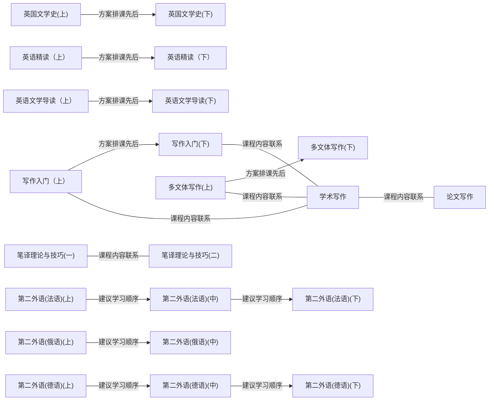

# 2023 英语专业“2+X”教学培养方案（港澳台侨生适用）

外国语言文学学院 · 英语 · 方案 73552 · 96 个不同课程或科研条目。

[官方 Word](../originals/plan-73552.docx) · [教务详情](https://fdjwgl.fudan.edu.cn/manager/bizType/2/major-program-search/info/73552?skipAuth=1) · [方案快照](../raw/plan-73552.json.gz) · [年级目录](../README.md)

## 修读导读

- **建议先学**　《英语精读（上）》（`FORE10013`） → 《英语精读（下）》（`FORE10016`）。题名列出连续册次或级别。按级别积累词汇和句式，后一阶段阅读新材料时可回查前一阶段的例句。方案分别列在第1、2学期。

- **可以对照着读**　《学术写作》（`FORE30054`）与《论文写作》（`FORE40023`）。两门课的题名都涉及写作。选同一材料分别拟提纲，比较两种写作的读者、证据和段落安排。

- **查模块选课**　《英语演讲》（`FORE10012`）、《英语文学导读（上）》（`FORE10015`）列在“专业必修课程”中。原表见 `/courseModules/7`。

## 课程关系图

图中展示部分关系。下表保留全部已建立的课程对，来源位置使用本方案 JSON Pointer。

## 先修与内容联系

| 类型 | 起点 | 终点 | 依据 | 原表定位 |
| --- | --- | --- | --- | --- |
| 建议学习顺序 | 第二外语(日语)(上) (FORE10007) | 第二外语(日语)(中) (FORE20011) | 同方案的课程题名具有连续分册或序号。  | `/courseModules/12/planCourses/0`、`/courseModules/12/planCourses/1` |
| 建议学习顺序 | 第二外语(法语)(上) (FORE10008) | 第二外语(法语)(中) (FORE20013) | 同方案的课程题名具有连续分册或序号。  | `/courseModules/9/planCourses/0`、`/courseModules/9/planCourses/1` |
| 建议学习顺序 | 第二外语(德语)(上) (FORE10009) | 第二外语(德语)(中) (FORE20015) | 同方案的课程题名具有连续分册或序号。  | `/courseModules/10/planCourses/0`、`/courseModules/10/planCourses/1` |
| 建议学习顺序 | 第二外语(俄语)(上) (FORE10010) | 第二外语(俄语)(中) (FORE20017) | 同方案的课程题名具有连续分册或序号。  | `/courseModules/11/planCourses/0`、`/courseModules/11/planCourses/1` |
| 建议学习顺序 | 英语精读（上） (FORE10013) | 英语精读（下） (FORE10016) | 同方案的课程题名具有连续分册或序号。  | `/courseModules/7/planCourses/9`、`/courseModules/7/planCourses/13` |
| 建议学习顺序 | 写作入门（上） (FORE10014) | 写作入门(下) (FORE10017) | 同方案的课程题名具有连续分册或序号。  | `/courseModules/7/planCourses/10`、`/courseModules/7/planCourses/14` |
| 建议学习顺序 | 英语文学导读（上） (FORE10015) | 英语文学导读(下) (FORE10018) | 同方案的课程题名具有连续分册或序号。  | `/courseModules/7/planCourses/11`、`/courseModules/7/planCourses/15` |
| 建议学习顺序 | 英国文学史(上) (FORE20003) | 英国文学史(下) (FORE20004) | 同方案的课程题名具有连续分册或序号。  | `/courseModules/7/planCourses/0`、`/courseModules/7/planCourses/1` |
| 建议学习顺序 | 第二外语(日语)(中) (FORE20011) | 第二外语(日语)(下) (FORE20012) | 同方案的课程题名具有连续分册或序号。  | `/courseModules/12/planCourses/1`、`/courseModules/12/planCourses/2` |
| 建议学习顺序 | 第二外语(法语)(中) (FORE20013) | 第二外语(法语)(下) (FORE20014) | 同方案的课程题名具有连续分册或序号。  | `/courseModules/9/planCourses/1`、`/courseModules/9/planCourses/2` |
| 建议学习顺序 | 第二外语(德语)(中) (FORE20015) | 第二外语(德语)(下) (FORE20016) | 同方案的课程题名具有连续分册或序号。  | `/courseModules/10/planCourses/1`、`/courseModules/10/planCourses/2` |
| 建议学习顺序 | 第二外语(俄语)(中) (FORE20017) | 第二外语(俄语)(下) (FORE20018) | 同方案的课程题名具有连续分册或序号。  | `/courseModules/11/planCourses/1`、`/courseModules/11/planCourses/2` |
| 建议学习顺序 | 多文体写作(上) (FORE20026) | 多文体写作(下) (FORE20027) | 同方案的课程题名具有连续分册或序号。  | `/courseModules/7/planCourses/16`、`/courseModules/7/planCourses/17` |
| 建议学习顺序 | 第二外语(西班牙语)上 (FORE20030) | 第二外语(西班牙语)下 (FORE20031) | 同方案的课程题名具有连续分册或序号。  | `/courseModules/13/planCourses/0`、`/courseModules/13/planCourses/1` |
| 建议学习顺序 | 笔译理论与技巧(一) (FORE30035) | 笔译理论与技巧(二) (FORE30037) | 同方案的课程题名具有连续分册或序号。  | `/courseModules/7/planCourses/19`、`/courseModules/7/planCourses/20` |
| 方案排课先后 | 英语精读（上） (FORE10013) | 英语精读（下） (FORE10016) | 同方案该课程全部明确数字学期均早于后者。  | `/courseModules/7/planCourses/9`、`/courseModules/7/planCourses/13` |
| 方案排课先后 | 写作入门（上） (FORE10014) | 写作入门(下) (FORE10017) | 同方案该课程全部明确数字学期均早于后者。  | `/courseModules/7/planCourses/10`、`/courseModules/7/planCourses/14` |
| 方案排课先后 | 英语文学导读（上） (FORE10015) | 英语文学导读(下) (FORE10018) | 同方案该课程全部明确数字学期均早于后者。  | `/courseModules/7/planCourses/11`、`/courseModules/7/planCourses/15` |
| 方案排课先后 | 英国文学史(上) (FORE20003) | 英国文学史(下) (FORE20004) | 同方案该课程全部明确数字学期均早于后者。  | `/courseModules/7/planCourses/0`、`/courseModules/7/planCourses/1` |
| 方案排课先后 | 多文体写作(上) (FORE20026) | 多文体写作(下) (FORE20027) | 同方案该课程全部明确数字学期均早于后者。  | `/courseModules/7/planCourses/16`、`/courseModules/7/planCourses/17` |
| 方案排课先后 | 笔译理论与技巧(一) (FORE30035) | 笔译理论与技巧(二) (FORE30037) | 同方案该课程全部明确数字学期均早于后者。  | `/courseModules/7/planCourses/19`、`/courseModules/7/planCourses/20` |
| 课程内容联系 | 写作入门（上） (FORE10014) | 学术写作 (FORE30054) | 本方案两门课程的题名均含“写作”，可据此对照这一主题。  | `/courseModules/7/planCourses/10`、`/courseModules/7/planCourses/26` |
| 课程内容联系 | 英语文学导读（上） (FORE10015) | 英语文学导读(下) (FORE10018) | 本方案两门课程的题名均含“英语文学”，可据此对照这一主题。  | `/courseModules/7/planCourses/11`、`/courseModules/7/planCourses/15` |
| 课程内容联系 | 写作入门(下) (FORE10017) | 学术写作 (FORE30054) | 本方案两门课程的题名均含“写作”，可据此对照这一主题。  | `/courseModules/7/planCourses/14`、`/courseModules/7/planCourses/26` |
| 课程内容联系 | 英国文学史(上) (FORE20003) | 美国文学史 (FORE20005) | 本方案两门课程的题名均含“文学史”，可据此对照这一主题。  | `/courseModules/7/planCourses/0`、`/courseModules/7/planCourses/2` |
| 课程内容联系 | 英国文学史(下) (FORE20004) | 美国文学史 (FORE20005) | 本方案两门课程的题名均含“文学史”，可据此对照这一主题。  | `/courseModules/7/planCourses/1`、`/courseModules/7/planCourses/2` |
| 课程内容联系 | 多文体写作(上) (FORE20026) | 学术写作 (FORE30054) | 本方案两门课程的题名均含“写作”，可据此对照这一主题。  | `/courseModules/7/planCourses/16`、`/courseModules/7/planCourses/26` |
| 课程内容联系 | 商务口译 (FORE30030) | 口译实务 (FORE40038) | 本方案两门课程的题名均含“口译”，可据此对照这一主题。  | `/courseModules/17/planCourses/2`、`/courseModules/17/planCourses/14` |
| 课程内容联系 | 笔译理论与技巧(一) (FORE30035) | 笔译理论与技巧(二) (FORE30037) | 本方案两门课程的题名均含“笔译”，可据此对照这一主题。  | `/courseModules/7/planCourses/19`、`/courseModules/7/planCourses/20` |
| 课程内容联系 | 学术写作 (FORE30054) | 论文写作 (FORE40023) | 本方案两门课程的题名均含“写作”，可据此对照这一主题。  | `/courseModules/7/planCourses/26`、`/courseModules/7/planCourses/21` |
| 课程内容联系 | 口译理论与实践 (FORE40024) | 口译实务 (FORE40038) | 本方案两门课程的题名均含“口译”，可据此对照这一主题。  | `/courseModules/7/planCourses/22`、`/courseModules/17/planCourses/14` |
| 课程内容联系 | 口译实务 (FORE40038) | 联合国会议口译专题 (FORE50044) | 本方案两门课程的题名均含“口译”，可据此对照这一主题。  | `/courseModules/17/planCourses/14`、`/courseModules/17/planCourses/3` |
| 课程内容联系 | 美国现代主义诗歌 (FORE50013) | 英语诗歌赏析 (FORE50107) | 本方案两门课程的题名均含“诗歌”，可据此对照这一主题。  | `/courseModules/16/planCourses/1`、`/courseModules/16/planCourses/17` |
| 课程内容联系 | 英美短篇小说 (FORE50016) | 英美小说面面观 (FORE50049) | 本方案两门课程的题名均含“小说”，可据此对照这一主题。  | `/courseModules/16/planCourses/4`、`/courseModules/16/planCourses/5` |
| 课程内容联系 | 英美短篇小说 (FORE50016) | 英语小说的崛起 (FORE50059) | 本方案两门课程的题名均含“小说”，可据此对照这一主题。  | `/courseModules/16/planCourses/4`、`/courseModules/16/planCourses/9` |
| 课程内容联系 | 英语戏剧表演 (FORE50056) | 英美戏剧 (FORE50092) | 本方案两门课程的题名均含“戏剧”，可据此对照这一主题。  | `/courseModules/16/planCourses/7`、`/courseModules/16/planCourses/13` |
| 课程内容联系 | 哲学导论 (PHIL10002) | 逻辑学 (PHIL10003) | 论证与概念分析是哲学讨论的共同方法。  | `/courseModules/5/planCourses/1`、`/courseModules/5/planCourses/2` |

本次未从可定位的明确表述中确认课程对课程预修。学期安排、系列分册与编辑建议均保留各自的依据。

## 按原方案模块阅读

同一模块展示原表中的课程归属。模块内课程之间的先后仍须逐项查阅。

- **法语组**　第二外语(法语)(上)、第二外语(法语)(中)、第二外语(法语)(下)（原表模块 9）
- **德语组**　第二外语(德语)(上)、第二外语(德语)(中)、第二外语(德语)(下)（原表模块 10）
- **俄语组**　第二外语(俄语)(上)、第二外语(俄语)(中)、第二外语(俄语)(下)（原表模块 11）
- **日语组**　第二外语(日语)(上)、第二外语(日语)(中)、第二外语(日语)(下)（原表模块 12）
- **西班牙语组**　第二外语(西班牙语)上、第二外语(西班牙语)下（原表模块 13）
- **英美文学研究**　英美文学专题、美国现代主义诗歌、英美电影文学、莎士比亚选读、英美短篇小说、英美小说面面观、英美经典文论选读、英语戏剧表演、英美散文、英语小说的崛起、维多利亚时期的文学、英美现代主义文学经典、英美戏剧、英国中世纪文学导读、美国文学中的自然与环境、17世纪英国文学、英语诗歌赏析、18世纪美国文学等23项（原表模块 16）
- **语言学与应用语言学研究**　商务口译、口译实务、英语文体学、英语词汇学、联合国会议口译专题、英语词典学导论、英语语音学、语言与逻辑、英语句法学导论、语言与社会、文学经典翻译、媒体英语、跨语言语法比较、话语分析、语言与意义：语义学基础、语言心理学、英语语用学（原表模块 17）
- **英美文化与跨文化研究**　中国文化思想、流行文化的批判性阅读、英美电影与文化、英语文化专题、人文传统：史前至文艺复兴、人文传统：科学革命至现代、西方文明专题、比较文化研究、全球化与中国文化、英国社会与文化、现代文化危机（原表模块 18）
- **英美文学研究**　英美文学专题、美国现代主义诗歌、英美电影文学、莎士比亚选读、英美短篇小说、英美小说面面观、英美经典文论选读、英语戏剧表演、英美散文、英语小说的崛起、维多利亚时期的文学、英美现代主义文学经典、英美戏剧、英国中世纪文学导读、美国文学中的自然与环境、17世纪英国文学、英语诗歌赏析、18世纪美国文学等23项（原表模块 20）
- **英美文化与跨文化研究**　中国文化思想、流行文化的批判性阅读、英美电影与文化、英语文化专题、人文传统：史前至文艺复兴、人文传统：科学革命至现代、西方文明专题、比较文化研究、全球化与中国文化、英国社会与文化、现代文化危机（原表模块 21）
- **语言学与应用语言学研究**　商务口译、口译实务、英语文体学、英语词汇学、联合国会议口译专题、英语词典学导论、英语语音学、语言与逻辑、英语句法学导论、语言与社会、文学经典翻译、媒体英语、跨语言语法比较、话语分析、语言与意义：语义学基础、语言心理学、英语语用学（原表模块 22）
- **英美文学研究**　英美文学专题、美国现代主义诗歌、英美电影文学、莎士比亚选读、英美短篇小说、英美小说面面观、英美经典文论选读、英语戏剧表演、英美散文、英语小说的崛起、维多利亚时期的文学、英美现代主义文学经典、英美戏剧、英国中世纪文学导读、美国文学中的自然与环境、17世纪英国文学、英语诗歌赏析、18世纪美国文学等23项（原表模块 24）
- **英美文化与跨文化研究**　中国文化思想、流行文化的批判性阅读、英美电影与文化、英语文化专题、人文传统：史前至文艺复兴、人文传统：科学革命至现代、西方文明专题、比较文化研究、全球化与中国文化、英国社会与文化、现代文化危机（原表模块 25）
- **语言学与应用语言学研究**　商务口译、口译实务、英语文体学、英语词汇学、联合国会议口译专题、英语词典学导论、英语语音学、语言与逻辑、英语句法学导论、语言与社会、文学经典翻译、媒体英语、跨语言语法比较、话语分析、语言与意义：语义学基础、语言心理学、英语语用学（原表模块 26）
- **语言学与应用语言学研究**　商务口译、口译实务、英语文体学、英语词汇学、联合国会议口译专题、英语词典学导论、英语语音学、语言与逻辑、英语句法学导论、语言与社会、文学经典翻译、媒体英语、跨语言语法比较、话语分析、语言与意义：语义学基础、语言心理学、英语语用学（原表模块 28）
- **英美文化与跨文化研究**　中国文化思想、流行文化的批判性阅读、英美电影与文化、英语文化专题、人文传统：史前至文艺复兴、人文传统：科学革命至现代、西方文明专题、比较文化研究、全球化与中国文化、英国社会与文化、现代文化危机（原表模块 29）
- **英美文学研究**　英美文学专题、美国现代主义诗歌、英美电影文学、莎士比亚选读、英美短篇小说、英美小说面面观、英美经典文论选读、英语戏剧表演、英美散文、英语小说的崛起、维多利亚时期的文学、英美现代主义文学经典、英美戏剧、英国中世纪文学导读、美国文学中的自然与环境、17世纪英国文学、英语诗歌赏析、18世纪美国文学等23项（原表模块 30）

## 课程表

同一课程在不同模块分别出现时，按原表逐行列出。季节字段保留原值。

| 课程 | 代码 | 学分 | 学期 | 模块 |
| --- | --- | ---: | --- | --- |
| 中国文学经典 | CHIN10005 | 3.0 | 第1学期 | 培养方案 / 专业培养课程 / 大类基础课程 |
| 哲学导论 | PHIL10002 | 3.0 | 第2学期 | 培养方案 / 专业培养课程 / 大类基础课程 |
| 逻辑学 | PHIL10003 | 3.0 | 第2学期 | 培养方案 / 专业培养课程 / 大类基础课程 |
| 中国古代文明 | HIST10006 | 3.0 | 第1学期 | 培养方案 / 专业培养课程 / 大类基础课程 |
| 英国文学史(上) | FORE20003 | 2.0 | 第3学期 | 培养方案 / 专业培养课程 / 专业核心教育课程 / 专业必修课程 |
| 英国文学史(下) | FORE20004 | 2.0 | 第4学期 | 培养方案 / 专业培养课程 / 专业核心教育课程 / 专业必修课程 |
| 美国文学史 | FORE20005 | 2.0 | 第4学期 | 培养方案 / 专业培养课程 / 专业核心教育课程 / 专业必修课程 |
| 实习调查 | FORE30001 | 2.0 | 第6学期 | 培养方案 / 专业培养课程 / 专业核心教育课程 / 专业必修课程 |
| 毕业论文 | FORE40080 | 4.0 | 第8学期 | 培养方案 / 专业培养课程 / 专业核心教育课程 / 专业必修课程 |
| 《圣经》与英国文学 | FORE60004 | 2.0 | 第6学期 | 培养方案 / 专业培养课程 / 专业核心教育课程 / 专业必修课程 |
| 文学研究方法论 | FORE30027 | 2.0 | 第5学期 | 培养方案 / 专业培养课程 / 专业核心教育课程 / 专业必修课程 |
| 应用语言学导论 | FORE20024 | 2.0 | 第4学期 | 培养方案 / 专业培养课程 / 专业核心教育课程 / 专业必修课程 |
| 英语演讲 | FORE10012 | 2.0 | 第1学期 | 培养方案 / 专业培养课程 / 专业核心教育课程 / 专业必修课程 |
| 英语精读（上） | FORE10013 | 4.0 | 第1学期 | 培养方案 / 专业培养课程 / 专业核心教育课程 / 专业必修课程 |
| 写作入门（上） | FORE10014 | 2.0 | 第1学期 | 培养方案 / 专业培养课程 / 专业核心教育课程 / 专业必修课程 |
| 英语文学导读（上） | FORE10015 | 2.0 | 第1学期 | 培养方案 / 专业培养课程 / 专业核心教育课程 / 专业必修课程 |
| 英语辩论 | FORE20025 | 2.0 | 第2学期 | 培养方案 / 专业培养课程 / 专业核心教育课程 / 专业必修课程 |
| 英语精读（下） | FORE10016 | 4.0 | 第2学期 | 培养方案 / 专业培养课程 / 专业核心教育课程 / 专业必修课程 |
| 写作入门(下) | FORE10017 | 2.0 | 第2学期 | 培养方案 / 专业培养课程 / 专业核心教育课程 / 专业必修课程 |
| 英语文学导读(下) | FORE10018 | 2.0 | 第2学期 | 培养方案 / 专业培养课程 / 专业核心教育课程 / 专业必修课程 |
| 多文体写作(上) | FORE20026 | 2.0 | 第3学期 | 培养方案 / 专业培养课程 / 专业核心教育课程 / 专业必修课程 |
| 多文体写作(下) | FORE20027 | 2.0 | 第4学期 | 培养方案 / 专业培养课程 / 专业核心教育课程 / 专业必修课程 |
| 跨文化交际 | FORE20028 | 2.0 | 第4学期 | 培养方案 / 专业培养课程 / 专业核心教育课程 / 专业必修课程 |
| 笔译理论与技巧(一) | FORE30035 | 2.0 | 第5学期 | 培养方案 / 专业培养课程 / 专业核心教育课程 / 专业必修课程 |
| 笔译理论与技巧(二) | FORE30037 | 2.0 | 第6学期 | 培养方案 / 专业培养课程 / 专业核心教育课程 / 专业必修课程 |
| 论文写作 | FORE40023 | 2.0 | 第7学期 | 培养方案 / 专业培养课程 / 专业核心教育课程 / 专业必修课程 |
| 口译理论与实践 | FORE40024 | 2.0 | 第7学期 | 培养方案 / 专业培养课程 / 专业核心教育课程 / 专业必修课程 |
| 英语语言史 | FORE20029 | 2.0 | SPRING、AUTUMN | 培养方案 / 专业培养课程 / 专业核心教育课程 / 专业必修课程 |
| 语言与教育 | FORE50064 | 2.0 | 第5学期 | 培养方案 / 专业培养课程 / 专业核心教育课程 / 专业必修课程 |
| 语言学概论 | FORE10029 | 2.0 | SPRING、AUTUMN | 培养方案 / 专业培养课程 / 专业核心教育课程 / 专业必修课程 |
| 学术写作 | FORE30054 | 2.0 | 第6学期 | 培养方案 / 专业培养课程 / 专业核心教育课程 / 专业必修课程 |
| 第二外语(法语)(上) | FORE10008 | 4.0 | AUTUMN | 培养方案 / 专业培养课程 / 专业核心教育课程 / 第二外语课程 / 法语组 |
| 第二外语(法语)(中) | FORE20013 | 4.0 | SPRING | 培养方案 / 专业培养课程 / 专业核心教育课程 / 第二外语课程 / 法语组 |
| 第二外语(法语)(下) | FORE20014 | 4.0 | SPRING、AUTUMN | 培养方案 / 专业培养课程 / 专业核心教育课程 / 第二外语课程 / 法语组 |
| 第二外语(德语)(上) | FORE10009 | 4.0 | AUTUMN | 培养方案 / 专业培养课程 / 专业核心教育课程 / 第二外语课程 / 德语组 |
| 第二外语(德语)(中) | FORE20015 | 4.0 | SPRING | 培养方案 / 专业培养课程 / 专业核心教育课程 / 第二外语课程 / 德语组 |
| 第二外语(德语)(下) | FORE20016 | 4.0 | SPRING | 培养方案 / 专业培养课程 / 专业核心教育课程 / 第二外语课程 / 德语组 |
| 第二外语(俄语)(上) | FORE10010 | 4.0 | AUTUMN | 培养方案 / 专业培养课程 / 专业核心教育课程 / 第二外语课程 / 俄语组 |
| 第二外语(俄语)(中) | FORE20017 | 4.0 | SPRING | 培养方案 / 专业培养课程 / 专业核心教育课程 / 第二外语课程 / 俄语组 |
| 第二外语(俄语)(下) | FORE20018 | 4.0 | SPRING | 培养方案 / 专业培养课程 / 专业核心教育课程 / 第二外语课程 / 俄语组 |
| 第二外语(日语)(上) | FORE10007 | 4.0 | AUTUMN | 培养方案 / 专业培养课程 / 专业核心教育课程 / 第二外语课程 / 日语组 |
| 第二外语(日语)(中) | FORE20011 | 4.0 | SPRING | 培养方案 / 专业培养课程 / 专业核心教育课程 / 第二外语课程 / 日语组 |
| 第二外语(日语)(下) | FORE20012 | 4.0 | SPRING | 培养方案 / 专业培养课程 / 专业核心教育课程 / 第二外语课程 / 日语组 |
| 第二外语(西班牙语)上 | FORE20030 | 6.0 | AUTUMN | 培养方案 / 专业培养课程 / 专业核心教育课程 / 第二外语课程 / 西班牙语组 |
| 第二外语(西班牙语)下 | FORE20031 | 6.0 | SPRING | 培养方案 / 专业培养课程 / 专业核心教育课程 / 第二外语课程 / 西班牙语组 |
| 英美文学专题 | FORE50011 | 2.0 | 第5学期 | 培养方案 / 专业进阶模块-双进阶 (文学方向） / 英美文学研究 |
| 美国现代主义诗歌 | FORE50013 | 2.0 | 第6学期 | 培养方案 / 专业进阶模块-双进阶 (文学方向） / 英美文学研究 |
| 英美电影文学 | FORE50014 | 2.0 | 第7学期 | 培养方案 / 专业进阶模块-双进阶 (文学方向） / 英美文学研究 |
| 莎士比亚选读 | FORE50015 | 2.0 | 第6学期 | 培养方案 / 专业进阶模块-双进阶 (文学方向） / 英美文学研究 |
| 英美短篇小说 | FORE50016 | 2.0 | 第4学期 | 培养方案 / 专业进阶模块-双进阶 (文学方向） / 英美文学研究 |
| 英美小说面面观 | FORE50049 | 2.0 | 第3学期 | 培养方案 / 专业进阶模块-双进阶 (文学方向） / 英美文学研究 |
| 英美经典文论选读 | FORE50051 | 2.0 | SPRING、AUTUMN | 培养方案 / 专业进阶模块-双进阶 (文学方向） / 英美文学研究 |
| 英语戏剧表演 | FORE50056 | 2.0 | SPRING、AUTUMN | 培养方案 / 专业进阶模块-双进阶 (文学方向） / 英美文学研究 |
| 英美散文 | FORE50057 | 2.0 | 第6学期 | 培养方案 / 专业进阶模块-双进阶 (文学方向） / 英美文学研究 |
| 英语小说的崛起 | FORE50059 | 2.0 | SPRING、AUTUMN | 培养方案 / 专业进阶模块-双进阶 (文学方向） / 英美文学研究 |
| 维多利亚时期的文学 | FORE50060 | 2.0 | SPRING、AUTUMN | 培养方案 / 专业进阶模块-双进阶 (文学方向） / 英美文学研究 |
| 女性主义文学 | FORE60005 | 2.0 | SPRING、AUTUMN | 培养方案 / 专业进阶模块-双进阶 (文学方向） / 英美文学研究 |
| 英美现代主义文学经典 | FORE50061 | 2.0 | SPRING、AUTUMN | 培养方案 / 专业进阶模块-双进阶 (文学方向） / 英美文学研究 |
| 英美戏剧 | FORE50092 | 2.0 | SPRING、AUTUMN | 培养方案 / 专业进阶模块-双进阶 (文学方向） / 英美文学研究 |
| 英国中世纪文学导读 | FORE50093 | 2.0 | SPRING、AUTUMN | 培养方案 / 专业进阶模块-双进阶 (文学方向） / 英美文学研究 |
| 美国文学中的自然与环境 | FORE50094 | 2.0 | SPRING、AUTUMN | 培养方案 / 专业进阶模块-双进阶 (文学方向） / 英美文学研究 |
| 17世纪英国文学 | FORE50106 | 2.0 | SPRING、AUTUMN | 培养方案 / 专业进阶模块-双进阶 (文学方向） / 英美文学研究 |
| 英语诗歌赏析 | FORE50107 | 2.0 | SPRING、AUTUMN | 培养方案 / 专业进阶模块-双进阶 (文学方向） / 英美文学研究 |
| 18世纪美国文学 | FORE50109 | 2.0 | SPRING、AUTUMN | 培养方案 / 专业进阶模块-双进阶 (文学方向） / 英美文学研究 |
| 18世纪英国文学 | FORE50110 | 2.0 | SPRING、AUTUMN | 培养方案 / 专业进阶模块-双进阶 (文学方向） / 英美文学研究 |
| 19世纪美国文学 | FORE50111 | 2.0 | SPRING、AUTUMN | 培养方案 / 专业进阶模块-双进阶 (文学方向） / 英美文学研究 |
| 英美科幻文学导论 | FORE50124 | 2.0 | SPRING、AUTUMN | 培养方案 / 专业进阶模块-双进阶 (文学方向） / 英美文学研究 |
| 英国儿童文学 | FORE50122 | 2.0 | SPRING、AUTUMN | 培养方案 / 专业进阶模块-双进阶 (文学方向） / 英美文学研究 |
| 英语文体学 | FORE50012 | 2.0 | SPRING、AUTUMN | 培养方案 / 专业进阶模块-双进阶 (文学方向） / 语言学与应用语言学研究 |
| 英语词汇学 | FORE50018 | 2.0 | SPRING、AUTUMN | 培养方案 / 专业进阶模块-双进阶 (文学方向） / 语言学与应用语言学研究 |
| 商务口译 | FORE30030 | 2.0 | SPRING、AUTUMN | 培养方案 / 专业进阶模块-双进阶 (文学方向） / 语言学与应用语言学研究 |
| 联合国会议口译专题 | FORE50044 | 2.0 | SPRING、AUTUMN | 培养方案 / 专业进阶模块-双进阶 (文学方向） / 语言学与应用语言学研究 |
| 英语词典学导论 | FORE50050 | 2.0 | 第3学期 | 培养方案 / 专业进阶模块-双进阶 (文学方向） / 语言学与应用语言学研究 |
| 英语语音学 | FORE50062 | 2.0 | 第3学期 | 培养方案 / 专业进阶模块-双进阶 (文学方向） / 语言学与应用语言学研究 |
| 语言与逻辑 | FORE50063 | 2.0 | 第4学期 | 培养方案 / 专业进阶模块-双进阶 (文学方向） / 语言学与应用语言学研究 |
| 语言与意义：语义学基础 | FORE60006 | 2.0 | SPRING、AUTUMN | 培养方案 / 专业进阶模块-双进阶 (文学方向） / 语言学与应用语言学研究 |
| 英语句法学导论 | FORE50065 | 2.0 | 第6学期 | 培养方案 / 专业进阶模块-双进阶 (文学方向） / 语言学与应用语言学研究 |
| 语言与社会 | FORE50066 | 2.0 | 第4学期 | 培养方案 / 专业进阶模块-双进阶 (文学方向） / 语言学与应用语言学研究 |
| 语言心理学 | FORE60007 | 2.0 | 第7学期 | 培养方案 / 专业进阶模块-双进阶 (文学方向） / 语言学与应用语言学研究 |
| 文学经典翻译 | FORE50067 | 2.0 | SPRING、AUTUMN | 培养方案 / 专业进阶模块-双进阶 (文学方向） / 语言学与应用语言学研究 |
| 媒体英语 | FORE50068 | 2.0 | SPRING、AUTUMN | 培养方案 / 专业进阶模块-双进阶 (文学方向） / 语言学与应用语言学研究 |
| 跨语言语法比较 | FORE50079 | 2.0 | 第4学期 | 培养方案 / 专业进阶模块-双进阶 (文学方向） / 语言学与应用语言学研究 |
| 口译实务 | FORE40038 | 2.0 | 第8学期 | 培养方案 / 专业进阶模块-双进阶 (文学方向） / 语言学与应用语言学研究 |
| 话语分析 | FORE50112 | 2.0 | 第6学期 | 培养方案 / 专业进阶模块-双进阶 (文学方向） / 语言学与应用语言学研究 |
| 英语语用学 | FORE60008 | 2.0 | 第7学期 | 培养方案 / 专业进阶模块-双进阶 (文学方向） / 语言学与应用语言学研究 |
| 中国文化思想 | FORE50017 | 2.0 | 第4学期 | 培养方案 / 专业进阶模块-双进阶 (文学方向） / 英美文化与跨文化研究 |
| 流行文化的批判性阅读 | FORE50069 | 2.0 | 第3学期 | 培养方案 / 专业进阶模块-双进阶 (文学方向） / 英美文化与跨文化研究 |
| 英美电影与文化 | FORE50070 | 2.0 | 第4学期 | 培养方案 / 专业进阶模块-双进阶 (文学方向） / 英美文化与跨文化研究 |
| 英语文化专题 | FORE50071 | 2.0 | 第4学期 | 培养方案 / 专业进阶模块-双进阶 (文学方向） / 英美文化与跨文化研究 |
| 人文传统：史前至文艺复兴 | FORE50072 | 2.0 | 第5学期 | 培养方案 / 专业进阶模块-双进阶 (文学方向） / 英美文化与跨文化研究 |
| 人文传统：科学革命至现代 | FORE50073 | 2.0 | 第6学期 | 培养方案 / 专业进阶模块-双进阶 (文学方向） / 英美文化与跨文化研究 |
| 西方文明专题 | FORE50074 | 2.0 | SPRING、AUTUMN | 培养方案 / 专业进阶模块-双进阶 (文学方向） / 英美文化与跨文化研究 |
| 比较文化研究 | FORE50075 | 2.0 | SPRING、AUTUMN | 培养方案 / 专业进阶模块-双进阶 (文学方向） / 英美文化与跨文化研究 |
| 全球化与中国文化 | FORE50076 | 2.0 | SPRING、AUTUMN | 培养方案 / 专业进阶模块-双进阶 (文学方向） / 英美文化与跨文化研究 |
| 英国社会与文化 | FORE50077 | 2.0 | SPRING、AUTUMN | 培养方案 / 专业进阶模块-双进阶 (文学方向） / 英美文化与跨文化研究 |
| 现代文化危机 | FORE50078 | 2.0 | SPRING、AUTUMN | 培养方案 / 专业进阶模块-双进阶 (文学方向） / 英美文化与跨文化研究 |
| 英美文学专题 | FORE50011 | 2.0 | 第5学期 | 培养方案 / 专业进阶模块-双进阶 (语言学方向） / 英美文学研究 |
| 美国现代主义诗歌 | FORE50013 | 2.0 | 第6学期 | 培养方案 / 专业进阶模块-双进阶 (语言学方向） / 英美文学研究 |
| 英美电影文学 | FORE50014 | 2.0 | 第7学期 | 培养方案 / 专业进阶模块-双进阶 (语言学方向） / 英美文学研究 |
| 莎士比亚选读 | FORE50015 | 2.0 | 第6学期 | 培养方案 / 专业进阶模块-双进阶 (语言学方向） / 英美文学研究 |
| 英美短篇小说 | FORE50016 | 2.0 | 第4学期 | 培养方案 / 专业进阶模块-双进阶 (语言学方向） / 英美文学研究 |
| 英美小说面面观 | FORE50049 | 2.0 | 第3学期 | 培养方案 / 专业进阶模块-双进阶 (语言学方向） / 英美文学研究 |
| 英美经典文论选读 | FORE50051 | 2.0 | SPRING、AUTUMN | 培养方案 / 专业进阶模块-双进阶 (语言学方向） / 英美文学研究 |
| 英语戏剧表演 | FORE50056 | 2.0 | SPRING、AUTUMN | 培养方案 / 专业进阶模块-双进阶 (语言学方向） / 英美文学研究 |
| 英美散文 | FORE50057 | 2.0 | 第6学期 | 培养方案 / 专业进阶模块-双进阶 (语言学方向） / 英美文学研究 |
| 英语小说的崛起 | FORE50059 | 2.0 | SPRING、AUTUMN | 培养方案 / 专业进阶模块-双进阶 (语言学方向） / 英美文学研究 |
| 维多利亚时期的文学 | FORE50060 | 2.0 | SPRING、AUTUMN | 培养方案 / 专业进阶模块-双进阶 (语言学方向） / 英美文学研究 |
| 女性主义文学 | FORE60005 | 2.0 | SPRING、AUTUMN | 培养方案 / 专业进阶模块-双进阶 (语言学方向） / 英美文学研究 |
| 英美现代主义文学经典 | FORE50061 | 2.0 | SPRING、AUTUMN | 培养方案 / 专业进阶模块-双进阶 (语言学方向） / 英美文学研究 |
| 英美戏剧 | FORE50092 | 2.0 | SPRING、AUTUMN | 培养方案 / 专业进阶模块-双进阶 (语言学方向） / 英美文学研究 |
| 英国中世纪文学导读 | FORE50093 | 2.0 | SPRING、AUTUMN | 培养方案 / 专业进阶模块-双进阶 (语言学方向） / 英美文学研究 |
| 美国文学中的自然与环境 | FORE50094 | 2.0 | SPRING、AUTUMN | 培养方案 / 专业进阶模块-双进阶 (语言学方向） / 英美文学研究 |
| 17世纪英国文学 | FORE50106 | 2.0 | SPRING、AUTUMN | 培养方案 / 专业进阶模块-双进阶 (语言学方向） / 英美文学研究 |
| 英语诗歌赏析 | FORE50107 | 2.0 | SPRING、AUTUMN | 培养方案 / 专业进阶模块-双进阶 (语言学方向） / 英美文学研究 |
| 18世纪美国文学 | FORE50109 | 2.0 | SPRING、AUTUMN | 培养方案 / 专业进阶模块-双进阶 (语言学方向） / 英美文学研究 |
| 18世纪英国文学 | FORE50110 | 2.0 | SPRING、AUTUMN | 培养方案 / 专业进阶模块-双进阶 (语言学方向） / 英美文学研究 |
| 19世纪美国文学 | FORE50111 | 2.0 | SPRING、AUTUMN | 培养方案 / 专业进阶模块-双进阶 (语言学方向） / 英美文学研究 |
| 英美科幻文学导论 | FORE50124 | 2.0 | SPRING、AUTUMN | 培养方案 / 专业进阶模块-双进阶 (语言学方向） / 英美文学研究 |
| 英国儿童文学 | FORE50122 | 2.0 | SPRING、AUTUMN | 培养方案 / 专业进阶模块-双进阶 (语言学方向） / 英美文学研究 |
| 中国文化思想 | FORE50017 | 2.0 | 第4学期 | 培养方案 / 专业进阶模块-双进阶 (语言学方向） / 英美文化与跨文化研究 |
| 流行文化的批判性阅读 | FORE50069 | 2.0 | 第3学期 | 培养方案 / 专业进阶模块-双进阶 (语言学方向） / 英美文化与跨文化研究 |
| 英美电影与文化 | FORE50070 | 2.0 | 第4学期 | 培养方案 / 专业进阶模块-双进阶 (语言学方向） / 英美文化与跨文化研究 |
| 英语文化专题 | FORE50071 | 2.0 | 第4学期 | 培养方案 / 专业进阶模块-双进阶 (语言学方向） / 英美文化与跨文化研究 |
| 人文传统：史前至文艺复兴 | FORE50072 | 2.0 | 第5学期 | 培养方案 / 专业进阶模块-双进阶 (语言学方向） / 英美文化与跨文化研究 |
| 人文传统：科学革命至现代 | FORE50073 | 2.0 | 第6学期 | 培养方案 / 专业进阶模块-双进阶 (语言学方向） / 英美文化与跨文化研究 |
| 西方文明专题 | FORE50074 | 2.0 | SPRING、AUTUMN | 培养方案 / 专业进阶模块-双进阶 (语言学方向） / 英美文化与跨文化研究 |
| 比较文化研究 | FORE50075 | 2.0 | SPRING、AUTUMN | 培养方案 / 专业进阶模块-双进阶 (语言学方向） / 英美文化与跨文化研究 |
| 全球化与中国文化 | FORE50076 | 2.0 | SPRING、AUTUMN | 培养方案 / 专业进阶模块-双进阶 (语言学方向） / 英美文化与跨文化研究 |
| 英国社会与文化 | FORE50077 | 2.0 | SPRING、AUTUMN | 培养方案 / 专业进阶模块-双进阶 (语言学方向） / 英美文化与跨文化研究 |
| 现代文化危机 | FORE50078 | 2.0 | SPRING、AUTUMN | 培养方案 / 专业进阶模块-双进阶 (语言学方向） / 英美文化与跨文化研究 |
| 英语文体学 | FORE50012 | 2.0 | SPRING、AUTUMN | 培养方案 / 专业进阶模块-双进阶 (语言学方向） / 语言学与应用语言学研究 |
| 英语词汇学 | FORE50018 | 2.0 | SPRING、AUTUMN | 培养方案 / 专业进阶模块-双进阶 (语言学方向） / 语言学与应用语言学研究 |
| 商务口译 | FORE30030 | 2.0 | SPRING、AUTUMN | 培养方案 / 专业进阶模块-双进阶 (语言学方向） / 语言学与应用语言学研究 |
| 联合国会议口译专题 | FORE50044 | 2.0 | SPRING、AUTUMN | 培养方案 / 专业进阶模块-双进阶 (语言学方向） / 语言学与应用语言学研究 |
| 英语词典学导论 | FORE50050 | 2.0 | 第3学期 | 培养方案 / 专业进阶模块-双进阶 (语言学方向） / 语言学与应用语言学研究 |
| 英语语音学 | FORE50062 | 2.0 | 第3学期 | 培养方案 / 专业进阶模块-双进阶 (语言学方向） / 语言学与应用语言学研究 |
| 语言与逻辑 | FORE50063 | 2.0 | 第4学期 | 培养方案 / 专业进阶模块-双进阶 (语言学方向） / 语言学与应用语言学研究 |
| 语言与意义：语义学基础 | FORE60006 | 2.0 | SPRING、AUTUMN | 培养方案 / 专业进阶模块-双进阶 (语言学方向） / 语言学与应用语言学研究 |
| 英语句法学导论 | FORE50065 | 2.0 | 第6学期 | 培养方案 / 专业进阶模块-双进阶 (语言学方向） / 语言学与应用语言学研究 |
| 语言与社会 | FORE50066 | 2.0 | 第4学期 | 培养方案 / 专业进阶模块-双进阶 (语言学方向） / 语言学与应用语言学研究 |
| 语言心理学 | FORE60007 | 2.0 | 第7学期 | 培养方案 / 专业进阶模块-双进阶 (语言学方向） / 语言学与应用语言学研究 |
| 文学经典翻译 | FORE50067 | 2.0 | SPRING、AUTUMN | 培养方案 / 专业进阶模块-双进阶 (语言学方向） / 语言学与应用语言学研究 |
| 媒体英语 | FORE50068 | 2.0 | SPRING、AUTUMN | 培养方案 / 专业进阶模块-双进阶 (语言学方向） / 语言学与应用语言学研究 |
| 跨语言语法比较 | FORE50079 | 2.0 | 第4学期 | 培养方案 / 专业进阶模块-双进阶 (语言学方向） / 语言学与应用语言学研究 |
| 口译实务 | FORE40038 | 2.0 | 第8学期 | 培养方案 / 专业进阶模块-双进阶 (语言学方向） / 语言学与应用语言学研究 |
| 话语分析 | FORE50112 | 2.0 | 第6学期 | 培养方案 / 专业进阶模块-双进阶 (语言学方向） / 语言学与应用语言学研究 |
| 英语语用学 | FORE60008 | 2.0 | 第7学期 | 培养方案 / 专业进阶模块-双进阶 (语言学方向） / 语言学与应用语言学研究 |
| 英美文学专题 | FORE50011 | 2.0 | 第5学期 | 培养方案 / 专业进阶模块-单进阶（文学方向） / 英美文学研究 |
| 美国现代主义诗歌 | FORE50013 | 2.0 | 第6学期 | 培养方案 / 专业进阶模块-单进阶（文学方向） / 英美文学研究 |
| 英美电影文学 | FORE50014 | 2.0 | 第7学期 | 培养方案 / 专业进阶模块-单进阶（文学方向） / 英美文学研究 |
| 莎士比亚选读 | FORE50015 | 2.0 | 第6学期 | 培养方案 / 专业进阶模块-单进阶（文学方向） / 英美文学研究 |
| 英美短篇小说 | FORE50016 | 2.0 | 第4学期 | 培养方案 / 专业进阶模块-单进阶（文学方向） / 英美文学研究 |
| 英美小说面面观 | FORE50049 | 2.0 | 第3学期 | 培养方案 / 专业进阶模块-单进阶（文学方向） / 英美文学研究 |
| 英美经典文论选读 | FORE50051 | 2.0 | SPRING、AUTUMN | 培养方案 / 专业进阶模块-单进阶（文学方向） / 英美文学研究 |
| 英语戏剧表演 | FORE50056 | 2.0 | SPRING、AUTUMN | 培养方案 / 专业进阶模块-单进阶（文学方向） / 英美文学研究 |
| 英美散文 | FORE50057 | 2.0 | 第6学期 | 培养方案 / 专业进阶模块-单进阶（文学方向） / 英美文学研究 |
| 英语小说的崛起 | FORE50059 | 2.0 | SPRING、AUTUMN | 培养方案 / 专业进阶模块-单进阶（文学方向） / 英美文学研究 |
| 维多利亚时期的文学 | FORE50060 | 2.0 | SPRING、AUTUMN | 培养方案 / 专业进阶模块-单进阶（文学方向） / 英美文学研究 |
| 女性主义文学 | FORE60005 | 2.0 | SPRING、AUTUMN | 培养方案 / 专业进阶模块-单进阶（文学方向） / 英美文学研究 |
| 英美现代主义文学经典 | FORE50061 | 2.0 | SPRING、AUTUMN | 培养方案 / 专业进阶模块-单进阶（文学方向） / 英美文学研究 |
| 英美戏剧 | FORE50092 | 2.0 | SPRING、AUTUMN | 培养方案 / 专业进阶模块-单进阶（文学方向） / 英美文学研究 |
| 英国中世纪文学导读 | FORE50093 | 2.0 | SPRING、AUTUMN | 培养方案 / 专业进阶模块-单进阶（文学方向） / 英美文学研究 |
| 美国文学中的自然与环境 | FORE50094 | 2.0 | SPRING、AUTUMN | 培养方案 / 专业进阶模块-单进阶（文学方向） / 英美文学研究 |
| 17世纪英国文学 | FORE50106 | 2.0 | SPRING、AUTUMN | 培养方案 / 专业进阶模块-单进阶（文学方向） / 英美文学研究 |
| 英语诗歌赏析 | FORE50107 | 2.0 | SPRING、AUTUMN | 培养方案 / 专业进阶模块-单进阶（文学方向） / 英美文学研究 |
| 18世纪美国文学 | FORE50109 | 2.0 | SPRING、AUTUMN | 培养方案 / 专业进阶模块-单进阶（文学方向） / 英美文学研究 |
| 18世纪英国文学 | FORE50110 | 2.0 | SPRING、AUTUMN | 培养方案 / 专业进阶模块-单进阶（文学方向） / 英美文学研究 |
| 19世纪美国文学 | FORE50111 | 2.0 | SPRING、AUTUMN | 培养方案 / 专业进阶模块-单进阶（文学方向） / 英美文学研究 |
| 英美科幻文学导论 | FORE50124 | 2.0 | SPRING、AUTUMN | 培养方案 / 专业进阶模块-单进阶（文学方向） / 英美文学研究 |
| 英国儿童文学 | FORE50122 | 2.0 | SPRING、AUTUMN | 培养方案 / 专业进阶模块-单进阶（文学方向） / 英美文学研究 |
| 中国文化思想 | FORE50017 | 2.0 | 第4学期 | 培养方案 / 专业进阶模块-单进阶（文学方向） / 英美文化与跨文化研究 |
| 流行文化的批判性阅读 | FORE50069 | 2.0 | 第3学期 | 培养方案 / 专业进阶模块-单进阶（文学方向） / 英美文化与跨文化研究 |
| 英美电影与文化 | FORE50070 | 2.0 | 第4学期 | 培养方案 / 专业进阶模块-单进阶（文学方向） / 英美文化与跨文化研究 |
| 英语文化专题 | FORE50071 | 2.0 | 第4学期 | 培养方案 / 专业进阶模块-单进阶（文学方向） / 英美文化与跨文化研究 |
| 人文传统：史前至文艺复兴 | FORE50072 | 2.0 | 第5学期 | 培养方案 / 专业进阶模块-单进阶（文学方向） / 英美文化与跨文化研究 |
| 人文传统：科学革命至现代 | FORE50073 | 2.0 | 第6学期 | 培养方案 / 专业进阶模块-单进阶（文学方向） / 英美文化与跨文化研究 |
| 西方文明专题 | FORE50074 | 2.0 | SPRING、AUTUMN | 培养方案 / 专业进阶模块-单进阶（文学方向） / 英美文化与跨文化研究 |
| 比较文化研究 | FORE50075 | 2.0 | SPRING、AUTUMN | 培养方案 / 专业进阶模块-单进阶（文学方向） / 英美文化与跨文化研究 |
| 全球化与中国文化 | FORE50076 | 2.0 | SPRING、AUTUMN | 培养方案 / 专业进阶模块-单进阶（文学方向） / 英美文化与跨文化研究 |
| 英国社会与文化 | FORE50077 | 2.0 | SPRING、AUTUMN | 培养方案 / 专业进阶模块-单进阶（文学方向） / 英美文化与跨文化研究 |
| 现代文化危机 | FORE50078 | 2.0 | SPRING、AUTUMN | 培养方案 / 专业进阶模块-单进阶（文学方向） / 英美文化与跨文化研究 |
| 英语文体学 | FORE50012 | 2.0 | SPRING、AUTUMN | 培养方案 / 专业进阶模块-单进阶（文学方向） / 语言学与应用语言学研究 |
| 英语词汇学 | FORE50018 | 2.0 | SPRING、AUTUMN | 培养方案 / 专业进阶模块-单进阶（文学方向） / 语言学与应用语言学研究 |
| 商务口译 | FORE30030 | 2.0 | SPRING、AUTUMN | 培养方案 / 专业进阶模块-单进阶（文学方向） / 语言学与应用语言学研究 |
| 联合国会议口译专题 | FORE50044 | 2.0 | SPRING、AUTUMN | 培养方案 / 专业进阶模块-单进阶（文学方向） / 语言学与应用语言学研究 |
| 英语词典学导论 | FORE50050 | 2.0 | 第3学期 | 培养方案 / 专业进阶模块-单进阶（文学方向） / 语言学与应用语言学研究 |
| 英语语音学 | FORE50062 | 2.0 | 第3学期 | 培养方案 / 专业进阶模块-单进阶（文学方向） / 语言学与应用语言学研究 |
| 语言与逻辑 | FORE50063 | 2.0 | 第4学期 | 培养方案 / 专业进阶模块-单进阶（文学方向） / 语言学与应用语言学研究 |
| 语言与意义：语义学基础 | FORE60006 | 2.0 | SPRING、AUTUMN | 培养方案 / 专业进阶模块-单进阶（文学方向） / 语言学与应用语言学研究 |
| 英语句法学导论 | FORE50065 | 2.0 | 第6学期 | 培养方案 / 专业进阶模块-单进阶（文学方向） / 语言学与应用语言学研究 |
| 语言与社会 | FORE50066 | 2.0 | 第4学期 | 培养方案 / 专业进阶模块-单进阶（文学方向） / 语言学与应用语言学研究 |
| 语言心理学 | FORE60007 | 2.0 | 第7学期 | 培养方案 / 专业进阶模块-单进阶（文学方向） / 语言学与应用语言学研究 |
| 文学经典翻译 | FORE50067 | 2.0 | SPRING、AUTUMN | 培养方案 / 专业进阶模块-单进阶（文学方向） / 语言学与应用语言学研究 |
| 媒体英语 | FORE50068 | 2.0 | SPRING、AUTUMN | 培养方案 / 专业进阶模块-单进阶（文学方向） / 语言学与应用语言学研究 |
| 跨语言语法比较 | FORE50079 | 2.0 | 第4学期 | 培养方案 / 专业进阶模块-单进阶（文学方向） / 语言学与应用语言学研究 |
| 口译实务 | FORE40038 | 2.0 | 第8学期 | 培养方案 / 专业进阶模块-单进阶（文学方向） / 语言学与应用语言学研究 |
| 话语分析 | FORE50112 | 2.0 | 第6学期 | 培养方案 / 专业进阶模块-单进阶（文学方向） / 语言学与应用语言学研究 |
| 英语语用学 | FORE60008 | 2.0 | 第7学期 | 培养方案 / 专业进阶模块-单进阶（文学方向） / 语言学与应用语言学研究 |
| 英语文体学 | FORE50012 | 2.0 | SPRING、AUTUMN | 培养方案 / 专业进阶模块-单进阶（语言学方向） / 语言学与应用语言学研究 |
| 英语词汇学 | FORE50018 | 2.0 | SPRING、AUTUMN | 培养方案 / 专业进阶模块-单进阶（语言学方向） / 语言学与应用语言学研究 |
| 商务口译 | FORE30030 | 2.0 | SPRING、AUTUMN | 培养方案 / 专业进阶模块-单进阶（语言学方向） / 语言学与应用语言学研究 |
| 联合国会议口译专题 | FORE50044 | 2.0 | SPRING、AUTUMN | 培养方案 / 专业进阶模块-单进阶（语言学方向） / 语言学与应用语言学研究 |
| 英语词典学导论 | FORE50050 | 2.0 | 第3学期 | 培养方案 / 专业进阶模块-单进阶（语言学方向） / 语言学与应用语言学研究 |
| 英语语音学 | FORE50062 | 2.0 | 第3学期 | 培养方案 / 专业进阶模块-单进阶（语言学方向） / 语言学与应用语言学研究 |
| 语言与逻辑 | FORE50063 | 2.0 | 第4学期 | 培养方案 / 专业进阶模块-单进阶（语言学方向） / 语言学与应用语言学研究 |
| 语言与意义：语义学基础 | FORE60006 | 2.0 | SPRING、AUTUMN | 培养方案 / 专业进阶模块-单进阶（语言学方向） / 语言学与应用语言学研究 |
| 英语句法学导论 | FORE50065 | 2.0 | 第6学期 | 培养方案 / 专业进阶模块-单进阶（语言学方向） / 语言学与应用语言学研究 |
| 语言与社会 | FORE50066 | 2.0 | 第4学期 | 培养方案 / 专业进阶模块-单进阶（语言学方向） / 语言学与应用语言学研究 |
| 语言心理学 | FORE60007 | 2.0 | 第7学期 | 培养方案 / 专业进阶模块-单进阶（语言学方向） / 语言学与应用语言学研究 |
| 文学经典翻译 | FORE50067 | 2.0 | SPRING、AUTUMN | 培养方案 / 专业进阶模块-单进阶（语言学方向） / 语言学与应用语言学研究 |
| 媒体英语 | FORE50068 | 2.0 | SPRING、AUTUMN | 培养方案 / 专业进阶模块-单进阶（语言学方向） / 语言学与应用语言学研究 |
| 跨语言语法比较 | FORE50079 | 2.0 | 第4学期 | 培养方案 / 专业进阶模块-单进阶（语言学方向） / 语言学与应用语言学研究 |
| 口译实务 | FORE40038 | 2.0 | 第8学期 | 培养方案 / 专业进阶模块-单进阶（语言学方向） / 语言学与应用语言学研究 |
| 话语分析 | FORE50112 | 2.0 | 第6学期 | 培养方案 / 专业进阶模块-单进阶（语言学方向） / 语言学与应用语言学研究 |
| 英语语用学 | FORE60008 | 2.0 | 第7学期 | 培养方案 / 专业进阶模块-单进阶（语言学方向） / 语言学与应用语言学研究 |
| 中国文化思想 | FORE50017 | 2.0 | 第4学期 | 培养方案 / 专业进阶模块-单进阶（语言学方向） / 英美文化与跨文化研究 |
| 流行文化的批判性阅读 | FORE50069 | 2.0 | 第3学期 | 培养方案 / 专业进阶模块-单进阶（语言学方向） / 英美文化与跨文化研究 |
| 英美电影与文化 | FORE50070 | 2.0 | 第4学期 | 培养方案 / 专业进阶模块-单进阶（语言学方向） / 英美文化与跨文化研究 |
| 英语文化专题 | FORE50071 | 2.0 | 第4学期 | 培养方案 / 专业进阶模块-单进阶（语言学方向） / 英美文化与跨文化研究 |
| 人文传统：史前至文艺复兴 | FORE50072 | 2.0 | 第5学期 | 培养方案 / 专业进阶模块-单进阶（语言学方向） / 英美文化与跨文化研究 |
| 人文传统：科学革命至现代 | FORE50073 | 2.0 | 第6学期 | 培养方案 / 专业进阶模块-单进阶（语言学方向） / 英美文化与跨文化研究 |
| 西方文明专题 | FORE50074 | 2.0 | SPRING、AUTUMN | 培养方案 / 专业进阶模块-单进阶（语言学方向） / 英美文化与跨文化研究 |
| 比较文化研究 | FORE50075 | 2.0 | SPRING、AUTUMN | 培养方案 / 专业进阶模块-单进阶（语言学方向） / 英美文化与跨文化研究 |
| 全球化与中国文化 | FORE50076 | 2.0 | SPRING、AUTUMN | 培养方案 / 专业进阶模块-单进阶（语言学方向） / 英美文化与跨文化研究 |
| 英国社会与文化 | FORE50077 | 2.0 | SPRING、AUTUMN | 培养方案 / 专业进阶模块-单进阶（语言学方向） / 英美文化与跨文化研究 |
| 现代文化危机 | FORE50078 | 2.0 | SPRING、AUTUMN | 培养方案 / 专业进阶模块-单进阶（语言学方向） / 英美文化与跨文化研究 |
| 英美文学专题 | FORE50011 | 2.0 | 第5学期 | 培养方案 / 专业进阶模块-单进阶（语言学方向） / 英美文学研究 |
| 美国现代主义诗歌 | FORE50013 | 2.0 | 第6学期 | 培养方案 / 专业进阶模块-单进阶（语言学方向） / 英美文学研究 |
| 英美电影文学 | FORE50014 | 2.0 | 第7学期 | 培养方案 / 专业进阶模块-单进阶（语言学方向） / 英美文学研究 |
| 莎士比亚选读 | FORE50015 | 2.0 | 第6学期 | 培养方案 / 专业进阶模块-单进阶（语言学方向） / 英美文学研究 |
| 英美短篇小说 | FORE50016 | 2.0 | 第4学期 | 培养方案 / 专业进阶模块-单进阶（语言学方向） / 英美文学研究 |
| 英美小说面面观 | FORE50049 | 2.0 | 第3学期 | 培养方案 / 专业进阶模块-单进阶（语言学方向） / 英美文学研究 |
| 英美经典文论选读 | FORE50051 | 2.0 | SPRING、AUTUMN | 培养方案 / 专业进阶模块-单进阶（语言学方向） / 英美文学研究 |
| 英语戏剧表演 | FORE50056 | 2.0 | SPRING、AUTUMN | 培养方案 / 专业进阶模块-单进阶（语言学方向） / 英美文学研究 |
| 英美散文 | FORE50057 | 2.0 | 第6学期 | 培养方案 / 专业进阶模块-单进阶（语言学方向） / 英美文学研究 |
| 英语小说的崛起 | FORE50059 | 2.0 | SPRING、AUTUMN | 培养方案 / 专业进阶模块-单进阶（语言学方向） / 英美文学研究 |
| 维多利亚时期的文学 | FORE50060 | 2.0 | SPRING、AUTUMN | 培养方案 / 专业进阶模块-单进阶（语言学方向） / 英美文学研究 |
| 女性主义文学 | FORE60005 | 2.0 | SPRING、AUTUMN | 培养方案 / 专业进阶模块-单进阶（语言学方向） / 英美文学研究 |
| 英美现代主义文学经典 | FORE50061 | 2.0 | SPRING、AUTUMN | 培养方案 / 专业进阶模块-单进阶（语言学方向） / 英美文学研究 |
| 英美戏剧 | FORE50092 | 2.0 | SPRING、AUTUMN | 培养方案 / 专业进阶模块-单进阶（语言学方向） / 英美文学研究 |
| 英国中世纪文学导读 | FORE50093 | 2.0 | SPRING、AUTUMN | 培养方案 / 专业进阶模块-单进阶（语言学方向） / 英美文学研究 |
| 美国文学中的自然与环境 | FORE50094 | 2.0 | SPRING、AUTUMN | 培养方案 / 专业进阶模块-单进阶（语言学方向） / 英美文学研究 |
| 17世纪英国文学 | FORE50106 | 2.0 | SPRING、AUTUMN | 培养方案 / 专业进阶模块-单进阶（语言学方向） / 英美文学研究 |
| 英语诗歌赏析 | FORE50107 | 2.0 | SPRING、AUTUMN | 培养方案 / 专业进阶模块-单进阶（语言学方向） / 英美文学研究 |
| 18世纪美国文学 | FORE50109 | 2.0 | SPRING、AUTUMN | 培养方案 / 专业进阶模块-单进阶（语言学方向） / 英美文学研究 |
| 18世纪英国文学 | FORE50110 | 2.0 | SPRING、AUTUMN | 培养方案 / 专业进阶模块-单进阶（语言学方向） / 英美文学研究 |
| 19世纪美国文学 | FORE50111 | 2.0 | SPRING、AUTUMN | 培养方案 / 专业进阶模块-单进阶（语言学方向） / 英美文学研究 |
| 英美科幻文学导论 | FORE50124 | 2.0 | SPRING、AUTUMN | 培养方案 / 专业进阶模块-单进阶（语言学方向） / 英美文学研究 |
| 英国儿童文学 | FORE50122 | 2.0 | SPRING、AUTUMN | 培养方案 / 专业进阶模块-单进阶（语言学方向） / 英美文学研究 |
