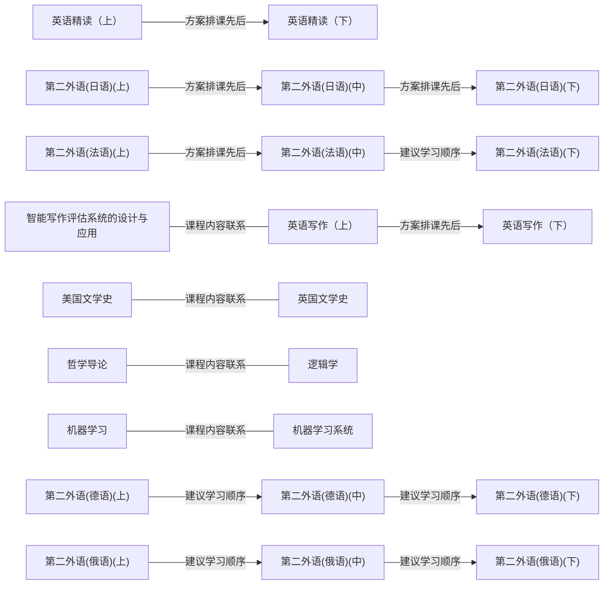

# 2024 英语-计算机科学与技术双学士学位项目教学培养方案

外国语言文学学院 · 英语-计算机科学与技术(双学士学位项目) · 方案 72769 · 84 个不同课程或科研条目。

[官方 Word](../originals/plan-72769.docx) · [教务详情](https://fdjwgl.fudan.edu.cn/manager/bizType/2/major-program-search/info/72769?skipAuth=1) · [方案快照](../raw/plan-72769.json.gz) · [年级目录](../README.md)

## 修读导读

- **建议先学**　《英语精读（上）》（`FORE10013`） → 《英语精读（下）》（`FORE10016`）。题名列出连续册次或级别。按级别积累词汇和句式，后一阶段阅读新材料时可回查前一阶段的例句。方案分别列在第1、2学期。

- **可以对照着读**　《美国文学史》（`FORE20005`）与《英国文学史》（`FORE20032`）。两门课的题名都涉及文学史。比较两份阅读书目如何分期，同一作家或作品在各自叙述中起什么作用。

- **查模块选课**　《英语写作（上）》（`FORE10046`）、《英语演讲》（`FORE10012`）列在“专业核心教育课程 / A组”中。原表见 `/courseModules/11`。

## 课程关系图

图中展示部分关系。下表保留全部已建立的课程对，来源位置使用本方案 JSON Pointer。

## 先修与内容联系

| 类型 | 起点 | 终点 | 依据 | 原表定位 |
| --- | --- | --- | --- | --- |
| 建议学习顺序 | 线性代数 (CS10003) | 机器学习 (CS30045) | 向量、矩阵及线性映射为理解学习模型提供数学准备。  | `/courseModules/9/planCourses/2`、`/courseModules/23/planCourses/2` |
| 建议学习顺序 | 第二外语(日语)(上) (FORE10007) | 第二外语(日语)(中) (FORE20011) | 同方案的课程题名具有连续分册或序号。  | `/courseModules/14/planCourses/0`、`/courseModules/14/planCourses/1` |
| 建议学习顺序 | 第二外语(法语)(上) (FORE10008) | 第二外语(法语)(中) (FORE20013) | 同方案的课程题名具有连续分册或序号。  | `/courseModules/15/planCourses/0`、`/courseModules/15/planCourses/1` |
| 建议学习顺序 | 第二外语(德语)(上) (FORE10009) | 第二外语(德语)(中) (FORE20015) | 同方案的课程题名具有连续分册或序号。  | `/courseModules/16/planCourses/0`、`/courseModules/16/planCourses/1` |
| 建议学习顺序 | 第二外语(俄语)(上) (FORE10010) | 第二外语(俄语)(中) (FORE20017) | 同方案的课程题名具有连续分册或序号。  | `/courseModules/17/planCourses/0`、`/courseModules/17/planCourses/1` |
| 建议学习顺序 | 英语精读（上） (FORE10013) | 英语精读（下） (FORE10016) | 同方案的课程题名具有连续分册或序号。  | `/courseModules/11/planCourses/0`、`/courseModules/11/planCourses/3` |
| 建议学习顺序 | 英语写作（上） (FORE10046) | 英语写作（下） (FORE10047) | 同方案的课程题名具有连续分册或序号。  | `/courseModules/11/planCourses/1`、`/courseModules/11/planCourses/4` |
| 建议学习顺序 | 第二外语(日语)(中) (FORE20011) | 第二外语(日语)(下) (FORE20012) | 同方案的课程题名具有连续分册或序号。  | `/courseModules/14/planCourses/1`、`/courseModules/14/planCourses/2` |
| 建议学习顺序 | 第二外语(法语)(中) (FORE20013) | 第二外语(法语)(下) (FORE20014) | 同方案的课程题名具有连续分册或序号。  | `/courseModules/15/planCourses/1`、`/courseModules/15/planCourses/2` |
| 建议学习顺序 | 第二外语(德语)(中) (FORE20015) | 第二外语(德语)(下) (FORE20016) | 同方案的课程题名具有连续分册或序号。  | `/courseModules/16/planCourses/1`、`/courseModules/16/planCourses/2` |
| 建议学习顺序 | 第二外语(俄语)(中) (FORE20017) | 第二外语(俄语)(下) (FORE20018) | 同方案的课程题名具有连续分册或序号。  | `/courseModules/17/planCourses/1`、`/courseModules/17/planCourses/2` |
| 建议学习顺序 | 第二外语(西班牙语)上 (FORE20030) | 第二外语(西班牙语)下 (FORE20031) | 同方案的课程题名具有连续分册或序号。  | `/courseModules/18/planCourses/0`、`/courseModules/18/planCourses/1` |
| 建议学习顺序 | 高等数学A(上） (MATH10015) | 高等数学A(下） (MATH10016) | 同方案的课程题名具有连续分册或序号。  | `/courseModules/9/planCourses/0`、`/courseModules/9/planCourses/1` |
| 方案排课先后 | 线性代数 (CS10003) | 机器学习 (CS30045) | 同方案该课程全部明确数字学期均早于后者。  | `/courseModules/9/planCourses/2`、`/courseModules/23/planCourses/2` |
| 方案排课先后 | 第二外语(日语)(上) (FORE10007) | 第二外语(日语)(中) (FORE20011) | 同方案该课程全部明确数字学期均早于后者。  | `/courseModules/14/planCourses/0`、`/courseModules/14/planCourses/1` |
| 方案排课先后 | 第二外语(法语)(上) (FORE10008) | 第二外语(法语)(中) (FORE20013) | 同方案该课程全部明确数字学期均早于后者。  | `/courseModules/15/planCourses/0`、`/courseModules/15/planCourses/1` |
| 方案排课先后 | 第二外语(德语)(上) (FORE10009) | 第二外语(德语)(中) (FORE20015) | 同方案该课程全部明确数字学期均早于后者。  | `/courseModules/16/planCourses/0`、`/courseModules/16/planCourses/1` |
| 方案排课先后 | 第二外语(俄语)(上) (FORE10010) | 第二外语(俄语)(中) (FORE20017) | 同方案该课程全部明确数字学期均早于后者。  | `/courseModules/17/planCourses/0`、`/courseModules/17/planCourses/1` |
| 方案排课先后 | 英语精读（上） (FORE10013) | 英语精读（下） (FORE10016) | 同方案该课程全部明确数字学期均早于后者。  | `/courseModules/11/planCourses/0`、`/courseModules/11/planCourses/3` |
| 方案排课先后 | 英语写作（上） (FORE10046) | 英语写作（下） (FORE10047) | 同方案该课程全部明确数字学期均早于后者。  | `/courseModules/11/planCourses/1`、`/courseModules/11/planCourses/4` |
| 方案排课先后 | 第二外语(日语)(中) (FORE20011) | 第二外语(日语)(下) (FORE20012) | 同方案该课程全部明确数字学期均早于后者。  | `/courseModules/14/planCourses/1`、`/courseModules/14/planCourses/2` |
| 方案排课先后 | 第二外语(法语)(中) (FORE20013) | 第二外语(法语)(下) (FORE20014) | 同方案该课程全部明确数字学期均早于后者。  | `/courseModules/15/planCourses/1`、`/courseModules/15/planCourses/2` |
| 方案排课先后 | 第二外语(德语)(中) (FORE20015) | 第二外语(德语)(下) (FORE20016) | 同方案该课程全部明确数字学期均早于后者。  | `/courseModules/16/planCourses/1`、`/courseModules/16/planCourses/2` |
| 方案排课先后 | 第二外语(俄语)(中) (FORE20017) | 第二外语(俄语)(下) (FORE20018) | 同方案该课程全部明确数字学期均早于后者。  | `/courseModules/17/planCourses/1`、`/courseModules/17/planCourses/2` |
| 方案排课先后 | 第二外语(西班牙语)上 (FORE20030) | 第二外语(西班牙语)下 (FORE20031) | 同方案该课程全部明确数字学期均早于后者。  | `/courseModules/18/planCourses/0`、`/courseModules/18/planCourses/1` |
| 方案排课先后 | 高等数学A(上） (MATH10015) | 高等数学A(下） (MATH10016) | 同方案该课程全部明确数字学期均早于后者。  | `/courseModules/9/planCourses/0`、`/courseModules/9/planCourses/1` |
| 课程内容联系 | 智能写作评估系统的设计与应用 (AIT531017) | 英语写作（上） (FORE10046) | 本方案两门课程的题名均含“写作”，可据此对照这一主题。  | `/courseModules/22/planCourses/10`、`/courseModules/11/planCourses/1` |
| 课程内容联系 | 机器学习 (CS30045) | 机器学习系统 (CS30058) | 本方案两门课程的题名均含“机器学习”，可据此对照这一主题。  | `/courseModules/23/planCourses/2`、`/courseModules/23/planCourses/14` |
| 课程内容联系 | 英语写作（上） (FORE10046) | 英语写作（下） (FORE10047) | 本方案两门课程的题名均含“写作”，可据此对照这一主题。  | `/courseModules/11/planCourses/1`、`/courseModules/11/planCourses/4` |
| 课程内容联系 | 美国文学史 (FORE20005) | 英国文学史 (FORE20032) | 本方案两门课程的题名均含“文学史”，可据此对照这一主题。  | `/courseModules/12/planCourses/5`、`/courseModules/12/planCourses/2` |
| 课程内容联系 | 哲学导论 (PHIL10002) | 逻辑学 (PHIL10003) | 论证与概念分析是哲学讨论的共同方法。  | `/courseModules/7/planCourses/2`、`/courseModules/7/planCourses/3` |

本次未从可定位的明确表述中确认课程对课程预修。学期安排、系列分册与编辑建议均保留各自的依据。

## 按原方案模块阅读

同一模块展示原表中的课程归属。模块内课程之间的先后仍须逐项查阅。

- **技术科学类基础课程（交叉科学类适用）**　线性代数、程序设计、高等数学A(上）、高等数学A(下）（原表模块 9）
- **日语组**　第二外语(日语)(上)、第二外语(日语)(中)、第二外语(日语)(下)（原表模块 14）
- **法语组**　第二外语(法语)(上)、第二外语(法语)(中)、第二外语(法语)(下)（原表模块 15）
- **德语组**　第二外语(德语)(上)、第二外语(德语)(中)、第二外语(德语)(下)（原表模块 16）
- **俄语组**　第二外语(俄语)(上)、第二外语(俄语)(中)、第二外语(俄语)(下)（原表模块 17）
- **西班牙语组**　第二外语(西班牙语)上、第二外语(西班牙语)下（原表模块 18）

## 课程表

同一课程在不同模块分别出现时，按原表逐行列出。季节字段保留原值。

| 课程 | 代码 | 学分 | 学期 | 模块 |
| --- | --- | ---: | --- | --- |
| 中国文学经典 | CHIN10005 | 3.0 | SPRING、AUTUMN | 培养方案 / 专业培养课程 / 大类基础课程 / 人文类基础课程 / 必修课程 |
| 中国古代文明 | HIST10006 | 3.0 | SPRING、AUTUMN | 培养方案 / 专业培养课程 / 大类基础课程 / 人文类基础课程 / 必修课程 |
| 哲学导论 | PHIL10002 | 3.0 | SPRING、AUTUMN | 培养方案 / 专业培养课程 / 大类基础课程 / 人文类基础课程 / 必修课程 |
| 逻辑学 | PHIL10003 | 3.0 | SPRING、AUTUMN | 培养方案 / 专业培养课程 / 大类基础课程 / 人文类基础课程 / 必修课程 |
| 高等数学A(上） | MATH10015 | 5.0 | 第1学期 | 培养方案 / 专业培养课程 / 大类基础课程 / 技术科学类基础课程 / 技术科学类基础课程（交叉科学类适用） |
| 高等数学A(下） | MATH10016 | 5.0 | 第2学期 | 培养方案 / 专业培养课程 / 大类基础课程 / 技术科学类基础课程 / 技术科学类基础课程（交叉科学类适用） |
| 线性代数 | CS10003 | 3.0 | 第1学期 | 培养方案 / 专业培养课程 / 大类基础课程 / 技术科学类基础课程 / 技术科学类基础课程（交叉科学类适用） |
| 程序设计 | CS10004 | 4.0 | 第1学期 | 培养方案 / 专业培养课程 / 大类基础课程 / 技术科学类基础课程 / 技术科学类基础课程（交叉科学类适用） |
| 英语精读（上） | FORE10013 | 4.0 | 第1学期 | 培养方案 / 专业培养课程 / 专业核心教育课程 / A组 |
| 英语写作（上） | FORE10046 | 2.0 | 第1学期 | 培养方案 / 专业培养课程 / 专业核心教育课程 / A组 |
| 英语演讲 | FORE10012 | 2.0 | 第2学期 | 培养方案 / 专业培养课程 / 专业核心教育课程 / A组 |
| 英语精读（下） | FORE10016 | 4.0 | 第2学期 | 培养方案 / 专业培养课程 / 专业核心教育课程 / A组 |
| 英语写作（下） | FORE10047 | 2.0 | 第2学期 | 培养方案 / 专业培养课程 / 专业核心教育课程 / A组 |
| 翻译理论基础 | FORE20065 | 2.0 | 第3学期 | 培养方案 / 专业培养课程 / 专业核心教育课程 / A组 |
| 跨文化交际 | FORE20028 | 2.0 | 第4学期 | 培养方案 / 专业培养课程 / 专业核心教育课程 / A组 |
| 口译理论与实践 | FORE40024 | 2.0 | 第7学期 | 培养方案 / 专业培养课程 / 专业核心教育课程 / A组 |
| 语言学概论 | FORE10029 | 2.0 | SPRING、AUTUMN | 培养方案 / 专业培养课程 / 专业核心教育课程 / B组 |
| 英语文学导读 | FORE10048 | 2.0 | 第2学期 | 培养方案 / 专业培养课程 / 专业核心教育课程 / B组 |
| 英国文学史 | FORE20032 | 2.0 | 第3学期 | 培养方案 / 专业培养课程 / 专业核心教育课程 / B组 |
| 英语语言史 | FORE20029 | 2.0 | SPRING、AUTUMN | 培养方案 / 专业培养课程 / 专业核心教育课程 / B组 |
| 语言与教育 | FORE50064 | 2.0 | 第5学期 | 培养方案 / 专业培养课程 / 专业核心教育课程 / B组 |
| 美国文学史 | FORE20005 | 2.0 | 第6学期 | 培养方案 / 专业培养课程 / 专业核心教育课程 / B组 |
| 面向对象程序设计 | CS20012 | 2.0 | 第2学期 | 培养方案 / 专业培养课程 / 专业核心教育课程 / B组 |
| 数字逻辑与部件设计 | CS20008 | 3.0 | 第3学期 | 培养方案 / 专业培养课程 / 专业核心教育课程 / B组 |
| 数据结构 | CS20009 | 4.0 | 第3学期 | 培养方案 / 专业培养课程 / 专业核心教育课程 / B组 |
| 数据结构 | AIE310007 | 4.0 | 第3学期 | 培养方案 / 专业培养课程 / 专业核心教育课程 / B组 |
| 集合与图论 | CS30043 | 3.0 | 第3学期 | 培养方案 / 专业培养课程 / 专业核心教育课程 / B组 |
| 计算机系统基础 | CS10005 | 3.0 | 第3学期 | 培养方案 / 专业培养课程 / 专业核心教育课程 / B组 |
| 计算机系统基础 | AIE210006 | 3.0 | 第3学期 | 培养方案 / 专业培养课程 / 专业核心教育课程 / B组 |
| 数据库引论 | CS20010 | 3.0 | 第4学期 | 培养方案 / 专业培养课程 / 专业核心教育课程 / B组 |
| 计算机组成与体系结构 | CS30052 | 4.0 | 第4学期 | 培养方案 / 专业培养课程 / 专业核心教育课程 / B组 |
| 算法设计与分析 | CS30016 | 3.0 | 第4学期 | 培养方案 / 专业培养课程 / 专业核心教育课程 / B组 |
| 操作系统 | CS30031 | 3.0 | 第5学期 | 培养方案 / 专业培养课程 / 专业核心教育课程 / B组 |
| 计算机网络 | CS30036 | 3.0 | 第5学期 | 培养方案 / 专业培养课程 / 专业核心教育课程 / B组 |
| 软件工程 | CS30018 | 3.0 | 第6学期 | 培养方案 / 专业培养课程 / 专业核心教育课程 / B组 |
| 编译 | CS30017 | 3.0 | 第6学期 | 培养方案 / 专业培养课程 / 专业核心教育课程 / B组 |
| 人工智能 | CS30057 | 3.0 | 第6学期 | 培养方案 / 专业培养课程 / 专业核心教育课程 / B组 |
| 自然语言处理与语言习得 | FORE20066 | 2.0 | 第4学期 | 培养方案 / 专业培养课程 / 专业核心教育课程 / B组 |
| 面向语言信息处理的语言逻辑理论 | FORE20067 | 2.0 | 第4学期 | 培养方案 / 专业培养课程 / 专业核心教育课程 / B组 |
| 面向语言信息处理的句法理论 | FORE30058 | 2.0 | 第6学期 | 培养方案 / 专业培养课程 / 专业核心教育课程 / B组 |
| 第二外语(日语)(上) | FORE10007 | 4.0 | 第5学期 | 培养方案 / 专业培养课程 / 专业核心教育课程 / C组 / 日语组 |
| 第二外语(日语)(中) | FORE20011 | 4.0 | 第6学期 | 培养方案 / 专业培养课程 / 专业核心教育课程 / C组 / 日语组 |
| 第二外语(日语)(下) | FORE20012 | 4.0 | 第7学期 | 培养方案 / 专业培养课程 / 专业核心教育课程 / C组 / 日语组 |
| 第二外语(法语)(上) | FORE10008 | 4.0 | 第5学期 | 培养方案 / 专业培养课程 / 专业核心教育课程 / C组 / 法语组 |
| 第二外语(法语)(中) | FORE20013 | 4.0 | 第6学期 | 培养方案 / 专业培养课程 / 专业核心教育课程 / C组 / 法语组 |
| 第二外语(法语)(下) | FORE20014 | 4.0 | 第7学期 | 培养方案 / 专业培养课程 / 专业核心教育课程 / C组 / 法语组 |
| 第二外语(德语)(上) | FORE10009 | 4.0 | 第5学期 | 培养方案 / 专业培养课程 / 专业核心教育课程 / C组 / 德语组 |
| 第二外语(德语)(中) | FORE20015 | 4.0 | 第6学期 | 培养方案 / 专业培养课程 / 专业核心教育课程 / C组 / 德语组 |
| 第二外语(德语)(下) | FORE20016 | 4.0 | 第7学期 | 培养方案 / 专业培养课程 / 专业核心教育课程 / C组 / 德语组 |
| 第二外语(俄语)(上) | FORE10010 | 4.0 | 第5学期 | 培养方案 / 专业培养课程 / 专业核心教育课程 / C组 / 俄语组 |
| 第二外语(俄语)(中) | FORE20017 | 4.0 | 第6学期 | 培养方案 / 专业培养课程 / 专业核心教育课程 / C组 / 俄语组 |
| 第二外语(俄语)(下) | FORE20018 | 4.0 | 第7学期 | 培养方案 / 专业培养课程 / 专业核心教育课程 / C组 / 俄语组 |
| 第二外语(西班牙语)上 | FORE20030 | 6.0 | 第3学期 | 培养方案 / 专业培养课程 / 专业核心教育课程 / C组 / 西班牙语组 |
| 第二外语(西班牙语)下 | FORE20031 | 6.0 | 第4学期 | 培养方案 / 专业培养课程 / 专业核心教育课程 / C组 / 西班牙语组 |
| 实习调查 | FORE30001 | 2.0 | 第6学期 | 培养方案 / 专业培养课程 / 专业核心教育课程 / D组 |
| 毕业论文 | FORE40080 | 4.0 | 第8学期 | 培养方案 / 专业培养课程 / 专业核心教育课程 / D组 |
| 英语语音学 | FORE50062 | 2.0 | 第3学期 | 培养方案 / 专业进阶课程 / A组 |
| 英语词典学导论 | FORE50050 | 2.0 | 第3学期 | 培养方案 / 专业进阶课程 / A组 |
| 跨语言语法比较 | FORE50079 | 2.0 | 第4学期 | 培养方案 / 专业进阶课程 / A组 |
| 语言与社会 | FORE50066 | 2.0 | 第4学期 | 培养方案 / 专业进阶课程 / A组 |
| 英语词汇学 | FORE50018 | 2.0 | SPRING、AUTUMN | 培养方案 / 专业进阶课程 / A组 |
| 文学研究方法论 | FORE30027 | 2.0 | 第5学期 | 培养方案 / 专业进阶课程 / A组 |
| 数字人文导论 | FORE50125 | 2.0 | 第6学期 | 培养方案 / 专业进阶课程 / A组 |
| 话语分析 | FORE50112 | 2.0 | 第6学期 | 培养方案 / 专业进阶课程 / A组 |
| 语言心理学 | FORE60007 | 2.0 | 第7学期 | 培养方案 / 专业进阶课程 / A组 |
| AI赋能的语言分析和语言习得 | AIS531002 | 2.0 | SPRING、AUTUMN | 培养方案 / 专业进阶课程 / A组 |
| 智能写作评估系统的设计与应用 | AIT531017 | 2.0 | SPRING、AUTUMN | 培养方案 / 专业进阶课程 / A组 |
| 以语言为中心的生成式AI | FORE30067 | 2.0 | 第5学期 | 培养方案 / 专业进阶课程 / A组 |
| 概率论与数理统计 | STAT30014 | 4.0 | 第5学期 | 培养方案 / 专业进阶课程 / B组 |
| 概率论与数理统计 | STAT30001 | 3.0 | 第5学期 | 培养方案 / 专业进阶课程 / B组 |
| 机器学习 | CS30045 | 3.0 | 第5学期 | 培养方案 / 专业进阶课程 / B组 |
| 数据挖掘技术 | CS30042 | 3.0 | 第6学期 | 培养方案 / 专业进阶课程 / B组 |
| 计算机可视化 | CS30047 | 2.0 | 第6学期 | 培养方案 / 专业进阶课程 / B组 |
| 人机交互 | CS30038 | 2.0 | 第6学期 | 培养方案 / 专业进阶课程 / B组 |
| 代数结构与数理逻辑 | CS30015 | 3.0 | 第4学期 | 培养方案 / 专业进阶课程 / B组 |
| 计算理论基础 | CS30021 | 3.0 | 第5学期 | 培养方案 / 专业进阶课程 / B组 |
| 自然语言处理与大语言模型 | AIE410002 | 3.0 | 第5学期 | 培养方案 / 专业进阶课程 / B组 |
| 计算机视觉 | CS30034 | 3.0 | 第5学期 | 培养方案 / 专业进阶课程 / B组 |
| 云计算与虚拟化技术 | CS30055 | 3.0 | 第6学期 | 培养方案 / 专业进阶课程 / B组 |
| 分布式系统 | CS30033 | 3.0 | 第7学期 | 培养方案 / 专业进阶课程 / B组 |
| 计算机安全原理与实践 | CSEC50002 | 4.0 | 第7学期 | 培养方案 / 专业进阶课程 / B组 |
| 机器人学导论 | CS70012 | 3.0 | 第8学期 | 培养方案 / 专业进阶课程 / B组 |
| 机器学习系统 | CS30058 | 3.0 | 第7学期、第8学期 | 培养方案 / 专业进阶课程 / B组 |
| 强化学习 | CS70027 | 3.0 | 第7学期、第8学期 | 培养方案 / 专业进阶课程 / B组 |
