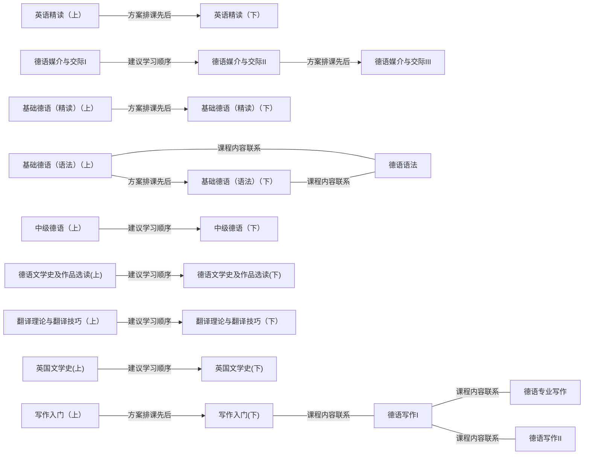

# 2024 德语（德语-英语复语试验班）专业“2+X”教学培养方案

外国语言文学学院 · 德语(德语-英语复语试验班) · 方案 73395 · 67 个不同课程或科研条目。

[官方 Word](../originals/plan-73395.docx) · [教务详情](https://fdjwgl.fudan.edu.cn/manager/bizType/2/major-program-search/info/73395?skipAuth=1) · [方案快照](../raw/plan-73395.json.gz) · [年级目录](../README.md)

## 修读导读

- **建议先学**　《基础德语（精读）（上）》（`FORE10040`） → 《基础德语（精读）（下）》（`FORE10041`）。题名列出连续册次或级别。按级别积累词汇和句式，后一阶段阅读新材料时可回查前一阶段的例句。方案分别列在第1、2学期。

- **可以对照着读**　《基础德语（语法）（上）》（`FORE10038`）与《德语语法》（`FORE20050`）。两门课的题名都涉及语法。选一个例句，分别标出两门课分析的语法单位，再比较分析能解释哪些用法。

- **查模块选课**　《德语媒介与交际I》（`FORE10021`）、《中级德语（上）》（`FORE20063`）列在“专业核心教育课程”中。原表见 `/courseModules/8`。

## 课程关系图

图中展示部分关系。下表保留全部已建立的课程对，来源位置使用本方案 JSON Pointer。

## 先修与内容联系

| 类型 | 起点 | 终点 | 依据 | 原表定位 |
| --- | --- | --- | --- | --- |
| 建议学习顺序 | 英语精读（上） (FORE10013) | 英语精读（下） (FORE10016) | 同方案的课程题名具有连续分册或序号。  | `/courseModules/8/planCourses/0`、`/courseModules/8/planCourses/1` |
| 建议学习顺序 | 写作入门（上） (FORE10014) | 写作入门(下) (FORE10017) | 同方案的课程题名具有连续分册或序号。  | `/courseModules/8/planCourses/2`、`/courseModules/8/planCourses/3` |
| 建议学习顺序 | 英语文学导读（上） (FORE10015) | 英语文学导读(下) (FORE10018) | 同方案的课程题名具有连续分册或序号。  | `/courseModules/13/planCourses/9`、`/courseModules/13/planCourses/10` |
| 建议学习顺序 | 德语媒介与交际I (FORE10021) | 德语媒介与交际II (FORE20033) | 同方案的课程题名具有连续分册或序号。  | `/courseModules/8/planCourses/13`、`/courseModules/8/planCourses/14` |
| 建议学习顺序 | 基础德语（语法）（上） (FORE10038) | 基础德语（语法）（下） (FORE10039) | 同方案的课程题名具有连续分册或序号。  | `/courseModules/8/planCourses/11`、`/courseModules/8/planCourses/26` |
| 建议学习顺序 | 基础德语（精读）（上） (FORE10040) | 基础德语（精读）（下） (FORE10041) | 同方案的课程题名具有连续分册或序号。  | `/courseModules/8/planCourses/10`、`/courseModules/8/planCourses/12` |
| 建议学习顺序 | 英国文学史(上) (FORE20003) | 英国文学史(下) (FORE20004) | 同方案的课程题名具有连续分册或序号。  | `/courseModules/13/planCourses/6`、`/courseModules/13/planCourses/13` |
| 建议学习顺序 | 德语媒介与交际II (FORE20033) | 德语媒介与交际III (FORE20034) | 同方案的课程题名具有连续分册或序号。  | `/courseModules/8/planCourses/14`、`/courseModules/8/planCourses/17` |
| 建议学习顺序 | 德语写作I (FORE20035) | 德语写作II (FORE20036) | 同方案的课程题名具有连续分册或序号。  | `/courseModules/8/planCourses/16`、`/courseModules/8/planCourses/20` |
| 建议学习顺序 | 中级德语（上） (FORE20063) | 中级德语（下） (FORE20064) | 同方案的课程题名具有连续分册或序号。  | `/courseModules/8/planCourses/15`、`/courseModules/8/planCourses/18` |
| 建议学习顺序 | 德语文学史及作品选读(上) (FORE30002) | 德语文学史及作品选读(下) (FORE30003) | 同方案的课程题名具有连续分册或序号。  | `/courseModules/8/planCourses/21`、`/courseModules/8/planCourses/23` |
| 建议学习顺序 | 翻译理论与翻译技巧（上） (FORE40046) | 翻译理论与翻译技巧（下） (FORE40047) | 同方案的课程题名具有连续分册或序号。  | `/courseModules/8/planCourses/22`、`/courseModules/8/planCourses/25` |
| 方案排课先后 | 英语精读（上） (FORE10013) | 英语精读（下） (FORE10016) | 同方案该课程全部明确数字学期均早于后者。  | `/courseModules/8/planCourses/0`、`/courseModules/8/planCourses/1` |
| 方案排课先后 | 写作入门（上） (FORE10014) | 写作入门(下) (FORE10017) | 同方案该课程全部明确数字学期均早于后者。  | `/courseModules/8/planCourses/2`、`/courseModules/8/planCourses/3` |
| 方案排课先后 | 英语文学导读（上） (FORE10015) | 英语文学导读(下) (FORE10018) | 同方案该课程全部明确数字学期均早于后者。  | `/courseModules/13/planCourses/9`、`/courseModules/13/planCourses/10` |
| 方案排课先后 | 基础德语（语法）（上） (FORE10038) | 基础德语（语法）（下） (FORE10039) | 同方案该课程全部明确数字学期均早于后者。  | `/courseModules/8/planCourses/11`、`/courseModules/8/planCourses/26` |
| 方案排课先后 | 基础德语（精读）（上） (FORE10040) | 基础德语（精读）（下） (FORE10041) | 同方案该课程全部明确数字学期均早于后者。  | `/courseModules/8/planCourses/10`、`/courseModules/8/planCourses/12` |
| 方案排课先后 | 英国文学史(上) (FORE20003) | 英国文学史(下) (FORE20004) | 同方案该课程全部明确数字学期均早于后者。  | `/courseModules/13/planCourses/6`、`/courseModules/13/planCourses/13` |
| 方案排课先后 | 德语媒介与交际II (FORE20033) | 德语媒介与交际III (FORE20034) | 同方案该课程全部明确数字学期均早于后者。  | `/courseModules/8/planCourses/14`、`/courseModules/8/planCourses/17` |
| 方案排课先后 | 德语写作I (FORE20035) | 德语写作II (FORE20036) | 同方案该课程全部明确数字学期均早于后者。  | `/courseModules/8/planCourses/16`、`/courseModules/8/planCourses/20` |
| 方案排课先后 | 中级德语（上） (FORE20063) | 中级德语（下） (FORE20064) | 同方案该课程全部明确数字学期均早于后者。  | `/courseModules/8/planCourses/15`、`/courseModules/8/planCourses/18` |
| 方案排课先后 | 德语文学史及作品选读(上) (FORE30002) | 德语文学史及作品选读(下) (FORE30003) | 同方案该课程全部明确数字学期均早于后者。  | `/courseModules/8/planCourses/21`、`/courseModules/8/planCourses/23` |
| 方案排课先后 | 翻译理论与翻译技巧（上） (FORE40046) | 翻译理论与翻译技巧（下） (FORE40047) | 同方案该课程全部明确数字学期均早于后者。  | `/courseModules/8/planCourses/22`、`/courseModules/8/planCourses/25` |
| 课程内容联系 | 写作入门（上） (FORE10014) | 德语写作I (FORE20035) | 本方案两门课程的题名均含“写作”，可据此对照这一主题。  | `/courseModules/8/planCourses/2`、`/courseModules/8/planCourses/16` |
| 课程内容联系 | 英语文学导读（上） (FORE10015) | 英语文学导读(下) (FORE10018) | 本方案两门课程的题名均含“英语文学”，可据此对照这一主题。  | `/courseModules/13/planCourses/9`、`/courseModules/13/planCourses/10` |
| 课程内容联系 | 写作入门(下) (FORE10017) | 德语写作I (FORE20035) | 本方案两门课程的题名均含“写作”，可据此对照这一主题。  | `/courseModules/8/planCourses/3`、`/courseModules/8/planCourses/16` |
| 课程内容联系 | 德语媒介与交际I (FORE10021) | 德语媒介与交际II (FORE20033) | 本方案两门课程的题名均含“媒介”，可据此对照这一主题。  | `/courseModules/8/planCourses/13`、`/courseModules/8/planCourses/14` |
| 课程内容联系 | 德语媒介与交际I (FORE10021) | 德语媒介与交际III (FORE20034) | 本方案两门课程的题名均含“媒介”，可据此对照这一主题。  | `/courseModules/8/planCourses/13`、`/courseModules/8/planCourses/17` |
| 课程内容联系 | 基础德语（语法）（上） (FORE10038) | 德语语法 (FORE20050) | 本方案两门课程的题名均含“语法”，可据此对照这一主题。  | `/courseModules/8/planCourses/11`、`/courseModules/8/planCourses/19` |
| 课程内容联系 | 基础德语（语法）（下） (FORE10039) | 德语语法 (FORE20050) | 本方案两门课程的题名均含“语法”，可据此对照这一主题。  | `/courseModules/8/planCourses/26`、`/courseModules/8/planCourses/19` |
| 课程内容联系 | 英国文学史(上) (FORE20003) | 美国文学史 (FORE20005) | 本方案两门课程的题名均含“文学史”，可据此对照这一主题。  | `/courseModules/13/planCourses/6`、`/courseModules/13/planCourses/7` |
| 课程内容联系 | 英国文学史(下) (FORE20004) | 美国文学史 (FORE20005) | 本方案两门课程的题名均含“文学史”，可据此对照这一主题。  | `/courseModules/13/planCourses/13`、`/courseModules/13/planCourses/7` |
| 课程内容联系 | 美国文学史 (FORE20005) | 德语文学史及作品选读(上) (FORE30002) | 本方案两门课程的题名均含“文学史”，可据此对照这一主题。  | `/courseModules/13/planCourses/7`、`/courseModules/8/planCourses/21` |
| 课程内容联系 | 美国文学史 (FORE20005) | 德语文学史及作品选读(下) (FORE30003) | 本方案两门课程的题名均含“文学史”，可据此对照这一主题。  | `/courseModules/13/planCourses/7`、`/courseModules/8/planCourses/23` |
| 课程内容联系 | 德语写作I (FORE20035) | 德语写作II (FORE20036) | 本方案两门课程的题名均含“写作”，可据此对照这一主题。  | `/courseModules/8/planCourses/16`、`/courseModules/8/planCourses/20` |
| 课程内容联系 | 德语写作I (FORE20035) | 德语专业写作 (FORE40022) | 本方案两门课程的题名均含“写作”，可据此对照这一主题。  | `/courseModules/8/planCourses/16`、`/courseModules/8/planCourses/24` |
| 课程内容联系 | 翻译理论与翻译技巧（上） (FORE40046) | 文学经典翻译 (FORE50067) | 本方案两门课程的题名均含“翻译”，可据此对照这一主题。  | `/courseModules/8/planCourses/22`、`/courseModules/13/planCourses/19` |
| 课程内容联系 | 翻译理论与翻译技巧（下） (FORE40047) | 文学经典翻译 (FORE50067) | 本方案两门课程的题名均含“翻译”，可据此对照这一主题。  | `/courseModules/8/planCourses/25`、`/courseModules/13/planCourses/19` |
| 课程内容联系 | 中国经典的德语翻译 (FORE50048) | 文学经典翻译 (FORE50067) | 本方案两门课程的题名均含“翻译”，可据此对照这一主题。  | `/courseModules/12/planCourses/12`、`/courseModules/13/planCourses/19` |
| 课程内容联系 | 哲学导论 (PHIL10002) | 逻辑学 (PHIL10003) | 论证与概念分析是哲学讨论的共同方法。  | `/courseModules/7/planCourses/2`、`/courseModules/7/planCourses/3` |

本次未从可定位的明确表述中确认课程对课程预修。学期安排、系列分册与编辑建议均保留各自的依据。

## 按原方案模块阅读

同一模块展示原表中的课程归属。模块内课程之间的先后仍须逐项查阅。

- **德语进阶课程**　西方现代主义文学潮流、德语语言学概论、德语影视、德语文学经典研究、奥地利文化、学术前沿专题、《浮士德》、跨文化交际、德国阐释哲学发展史概览、中国经典的德语翻译、德国浪漫主义——源头、影响及批判、德语文学与圣经传统、德国戏剧赏析、跟马克思学德语-《共产党宣言》研读、中德文化交流的历史与现状（原表模块 12）
- **英语进阶课程**　英语文学导读（上）、英语文学导读(下)、语言学概论、英国文学史(上)、英国文学史(下)、美国文学史、应用语言学导论、英语辩论、文学研究方法论、商务口译、英语文体学、英美电影文学、莎士比亚选读、英语词汇学、英美小说面面观、文学经典翻译、媒体英语、流行文化的批判性阅读等21项（原表模块 13）
- **德语进阶课程**　西方现代主义文学潮流、德语语言学概论、德语影视、德语文学经典研究、奥地利文化、学术前沿专题、《浮士德》、跨文化交际、德国阐释哲学发展史概览、中国经典的德语翻译、德国浪漫主义——源头、影响及批判、德语文学与圣经传统、德国戏剧赏析、跟马克思学德语-《共产党宣言》研读、中德文化交流的历史与现状（原表模块 15）
- **英语进阶课程**　英语文学导读（上）、英语文学导读(下)、语言学概论、英国文学史(上)、英国文学史(下)、美国文学史、应用语言学导论、英语辩论、文学研究方法论、商务口译、英语文体学、英美电影文学、莎士比亚选读、英语词汇学、英美小说面面观、文学经典翻译、媒体英语、流行文化的批判性阅读等21项（原表模块 16）

## 课程表

同一课程在不同模块分别出现时，按原表逐行列出。季节字段保留原值。

| 课程 | 代码 | 学分 | 学期 | 模块 |
| --- | --- | ---: | --- | --- |
| 中国文学经典 | CHIN10005 | 3.0 | SPRING、AUTUMN | 培养方案 / 专业培养课程 / 大类基础课程 / 人文类基础课程 / 必修课程 |
| 中国古代文明 | HIST10006 | 3.0 | SPRING、AUTUMN | 培养方案 / 专业培养课程 / 大类基础课程 / 人文类基础课程 / 必修课程 |
| 哲学导论 | PHIL10002 | 3.0 | SPRING、AUTUMN | 培养方案 / 专业培养课程 / 大类基础课程 / 人文类基础课程 / 必修课程 |
| 逻辑学 | PHIL10003 | 3.0 | SPRING、AUTUMN | 培养方案 / 专业培养课程 / 大类基础课程 / 人文类基础课程 / 必修课程 |
| 英语精读（上） | FORE10013 | 4.0 | 第3学期 | 培养方案 / 专业培养课程 / 专业核心教育课程 |
| 英语精读（下） | FORE10016 | 4.0 | 第4学期 | 培养方案 / 专业培养课程 / 专业核心教育课程 |
| 写作入门（上） | FORE10014 | 2.0 | 第3学期 | 培养方案 / 专业培养课程 / 专业核心教育课程 |
| 写作入门(下) | FORE10017 | 2.0 | 第4学期 | 培养方案 / 专业培养课程 / 专业核心教育课程 |
| 英语语言史 | FORE20029 | 2.0 | 第3学期 | 培养方案 / 专业培养课程 / 专业核心教育课程 |
| 全球化与中国文化 | FORE50076 | 2.0 | SPRING、AUTUMN | 培养方案 / 专业培养课程 / 专业核心教育课程 |
| 英语演讲 | FORE10012 | 2.0 | 第5学期 | 培养方案 / 专业培养课程 / 专业核心教育课程 |
| 实习调查 | FORE30001 | 2.0 | 第6学期 | 培养方案 / 专业培养课程 / 专业核心教育课程 |
| 毕业论文 | FORE40080 | 4.0 | 第8学期 | 培养方案 / 专业培养课程 / 专业核心教育课程 |
| 日耳曼学研究 | FORE10022 | 2.0 | 第1学期 | 培养方案 / 专业培养课程 / 专业核心教育课程 |
| 基础德语（精读）（上） | FORE10040 | 6.0 | 第1学期 | 培养方案 / 专业培养课程 / 专业核心教育课程 |
| 基础德语（语法）（上） | FORE10038 | 4.0 | 第1学期 | 培养方案 / 专业培养课程 / 专业核心教育课程 |
| 基础德语（精读）（下） | FORE10041 | 6.0 | 第2学期 | 培养方案 / 专业培养课程 / 专业核心教育课程 |
| 德语媒介与交际I | FORE10021 | 2.0 | 第2学期 | 培养方案 / 专业培养课程 / 专业核心教育课程 |
| 德语媒介与交际II | FORE20033 | 2.0 | 第2学期 | 培养方案 / 专业培养课程 / 专业核心教育课程 |
| 中级德语（上） | FORE20063 | 6.0 | 第3学期 | 培养方案 / 专业培养课程 / 专业核心教育课程 |
| 德语写作I | FORE20035 | 2.0 | 第3学期 | 培养方案 / 专业培养课程 / 专业核心教育课程 |
| 德语媒介与交际III | FORE20034 | 2.0 | 第3学期 | 培养方案 / 专业培养课程 / 专业核心教育课程 |
| 中级德语（下） | FORE20064 | 6.0 | 第4学期 | 培养方案 / 专业培养课程 / 专业核心教育课程 |
| 德语语法 | FORE20050 | 4.0 | 第4学期 | 培养方案 / 专业培养课程 / 专业核心教育课程 |
| 德语写作II | FORE20036 | 2.0 | 第4学期 | 培养方案 / 专业培养课程 / 专业核心教育课程 |
| 德语文学史及作品选读(上) | FORE30002 | 2.0 | 第6学期 | 培养方案 / 专业培养课程 / 专业核心教育课程 |
| 翻译理论与翻译技巧（上） | FORE40046 | 2.0 | 第6学期 | 培养方案 / 专业培养课程 / 专业核心教育课程 |
| 德语文学史及作品选读(下) | FORE30003 | 2.0 | 第7学期 | 培养方案 / 专业培养课程 / 专业核心教育课程 |
| 德语专业写作 | FORE40022 | 2.0 | 第7学期 | 培养方案 / 专业培养课程 / 专业核心教育课程 |
| 翻译理论与翻译技巧（下） | FORE40047 | 2.0 | 第8学期 | 培养方案 / 专业培养课程 / 专业核心教育课程 |
| 基础德语（语法）（下） | FORE10039 | 4.0 | 第2学期 | 培养方案 / 专业培养课程 / 专业核心教育课程 |
| 德语语言学概论 | FORE50021 | 2.0 | SPRING、AUTUMN | 培养方案 / 复语进阶（双进阶） / 德语进阶课程 |
| 德语影视 | FORE50022 | 2.0 | SPRING、AUTUMN | 培养方案 / 复语进阶（双进阶） / 德语进阶课程 |
| 中德文化交流的历史与现状 | FORE50121 | 2.0 | SPRING、AUTUMN | 培养方案 / 复语进阶（双进阶） / 德语进阶课程 |
| 奥地利文化 | FORE50041 | 2.0 | SPRING、AUTUMN | 培养方案 / 复语进阶（双进阶） / 德语进阶课程 |
| 《浮士德》 | FORE50045 | 2.0 | SPRING、AUTUMN | 培养方案 / 复语进阶（双进阶） / 德语进阶课程 |
| 德国阐释哲学发展史概览 | FORE50047 | 2.0 | SPRING、AUTUMN | 培养方案 / 复语进阶（双进阶） / 德语进阶课程 |
| 德国戏剧赏析 | FORE50108 | 2.0 | SPRING、AUTUMN | 培养方案 / 复语进阶（双进阶） / 德语进阶课程 |
| 德国浪漫主义——源头、影响及批判 | FORE50104 | 2.0 | SPRING、AUTUMN | 培养方案 / 复语进阶（双进阶） / 德语进阶课程 |
| 学术前沿专题 | FORE50043 | 2.0 | SPRING、AUTUMN | 培养方案 / 复语进阶（双进阶） / 德语进阶课程 |
| 西方现代主义文学潮流 | FORE50019 | 2.0 | SPRING、AUTUMN | 培养方案 / 复语进阶（双进阶） / 德语进阶课程 |
| 跨文化交际 | FORE50046 | 2.0 | SPRING、AUTUMN | 培养方案 / 复语进阶（双进阶） / 德语进阶课程 |
| 德语文学经典研究 | FORE50038 | 2.0 | SPRING、AUTUMN | 培养方案 / 复语进阶（双进阶） / 德语进阶课程 |
| 中国经典的德语翻译 | FORE50048 | 2.0 | SPRING、AUTUMN | 培养方案 / 复语进阶（双进阶） / 德语进阶课程 |
| 跟马克思学德语-《共产党宣言》研读 | FORE50114 | 2.0 | SPRING、AUTUMN | 培养方案 / 复语进阶（双进阶） / 德语进阶课程 |
| 德语文学与圣经传统 | FORE50105 | 2.0 | SPRING、AUTUMN | 培养方案 / 复语进阶（双进阶） / 德语进阶课程 |
| 英语词汇学 | FORE50018 | 2.0 | 第3学期 | 培养方案 / 复语进阶（双进阶） / 英语进阶课程 |
| 语言学概论 | FORE10029 | 2.0 | SPRING、AUTUMN | 培养方案 / 复语进阶（双进阶） / 英语进阶课程 |
| 应用语言学导论 | FORE20024 | 2.0 | 第5学期 | 培养方案 / 复语进阶（双进阶） / 英语进阶课程 |
| 英语文体学 | FORE50012 | 2.0 | 第5学期 | 培养方案 / 复语进阶（双进阶） / 英语进阶课程 |
| 英语辩论 | FORE20025 | 2.0 | SPRING、AUTUMN | 培养方案 / 复语进阶（双进阶） / 英语进阶课程 |
| 媒体英语 | FORE50068 | 2.0 | SPRING、AUTUMN | 培养方案 / 复语进阶（双进阶） / 英语进阶课程 |
| 英国文学史(上) | FORE20003 | 2.0 | 第3学期 | 培养方案 / 复语进阶（双进阶） / 英语进阶课程 |
| 美国文学史 | FORE20005 | 2.0 | 第4学期 | 培养方案 / 复语进阶（双进阶） / 英语进阶课程 |
| 英美小说面面观 | FORE50049 | 2.0 | 第3学期 | 培养方案 / 复语进阶（双进阶） / 英语进阶课程 |
| 英语文学导读（上） | FORE10015 | 2.0 | 第3学期 | 培养方案 / 复语进阶（双进阶） / 英语进阶课程 |
| 英语文学导读(下) | FORE10018 | 2.0 | 第4学期 | 培养方案 / 复语进阶（双进阶） / 英语进阶课程 |
| 文学研究方法论 | FORE30027 | 2.0 | 第5学期 | 培养方案 / 复语进阶（双进阶） / 英语进阶课程 |
| 莎士比亚选读 | FORE50015 | 2.0 | 第6学期 | 培养方案 / 复语进阶（双进阶） / 英语进阶课程 |
| 英国文学史(下) | FORE20004 | 2.0 | 第4学期 | 培养方案 / 复语进阶（双进阶） / 英语进阶课程 |
| 英美电影文学 | FORE50014 | 2.0 | 第7学期 | 培养方案 / 复语进阶（双进阶） / 英语进阶课程 |
| 英国中世纪文学导读 | FORE50093 | 2.0 | SPRING、AUTUMN | 培养方案 / 复语进阶（双进阶） / 英语进阶课程 |
| 18世纪美国文学 | FORE50109 | 2.0 | SPRING、AUTUMN | 培养方案 / 复语进阶（双进阶） / 英语进阶课程 |
| 英美电影与文化 | FORE50070 | 2.0 | 第4学期 | 培养方案 / 复语进阶（双进阶） / 英语进阶课程 |
| 流行文化的批判性阅读 | FORE50069 | 2.0 | 第5学期 | 培养方案 / 复语进阶（双进阶） / 英语进阶课程 |
| 文学经典翻译 | FORE50067 | 2.0 | SPRING、AUTUMN | 培养方案 / 复语进阶（双进阶） / 英语进阶课程 |
| 商务口译 | FORE30030 | 2.0 | SPRING、AUTUMN | 培养方案 / 复语进阶（双进阶） / 英语进阶课程 |
| 德语语言学概论 | FORE50021 | 2.0 | SPRING、AUTUMN | 培养方案 / 复语进阶（单进阶） / 德语进阶课程 |
| 德语影视 | FORE50022 | 2.0 | SPRING、AUTUMN | 培养方案 / 复语进阶（单进阶） / 德语进阶课程 |
| 中德文化交流的历史与现状 | FORE50121 | 2.0 | SPRING、AUTUMN | 培养方案 / 复语进阶（单进阶） / 德语进阶课程 |
| 奥地利文化 | FORE50041 | 2.0 | SPRING、AUTUMN | 培养方案 / 复语进阶（单进阶） / 德语进阶课程 |
| 《浮士德》 | FORE50045 | 2.0 | SPRING、AUTUMN | 培养方案 / 复语进阶（单进阶） / 德语进阶课程 |
| 德国阐释哲学发展史概览 | FORE50047 | 2.0 | SPRING、AUTUMN | 培养方案 / 复语进阶（单进阶） / 德语进阶课程 |
| 德国戏剧赏析 | FORE50108 | 2.0 | SPRING、AUTUMN | 培养方案 / 复语进阶（单进阶） / 德语进阶课程 |
| 德国浪漫主义——源头、影响及批判 | FORE50104 | 2.0 | SPRING、AUTUMN | 培养方案 / 复语进阶（单进阶） / 德语进阶课程 |
| 学术前沿专题 | FORE50043 | 2.0 | SPRING、AUTUMN | 培养方案 / 复语进阶（单进阶） / 德语进阶课程 |
| 西方现代主义文学潮流 | FORE50019 | 2.0 | SPRING、AUTUMN | 培养方案 / 复语进阶（单进阶） / 德语进阶课程 |
| 跨文化交际 | FORE50046 | 2.0 | SPRING、AUTUMN | 培养方案 / 复语进阶（单进阶） / 德语进阶课程 |
| 德语文学经典研究 | FORE50038 | 2.0 | SPRING、AUTUMN | 培养方案 / 复语进阶（单进阶） / 德语进阶课程 |
| 中国经典的德语翻译 | FORE50048 | 2.0 | SPRING、AUTUMN | 培养方案 / 复语进阶（单进阶） / 德语进阶课程 |
| 跟马克思学德语-《共产党宣言》研读 | FORE50114 | 2.0 | SPRING、AUTUMN | 培养方案 / 复语进阶（单进阶） / 德语进阶课程 |
| 德语文学与圣经传统 | FORE50105 | 2.0 | SPRING、AUTUMN | 培养方案 / 复语进阶（单进阶） / 德语进阶课程 |
| 英语词汇学 | FORE50018 | 2.0 | 第3学期 | 培养方案 / 复语进阶（单进阶） / 英语进阶课程 |
| 语言学概论 | FORE10029 | 2.0 | SPRING、AUTUMN | 培养方案 / 复语进阶（单进阶） / 英语进阶课程 |
| 应用语言学导论 | FORE20024 | 2.0 | 第5学期 | 培养方案 / 复语进阶（单进阶） / 英语进阶课程 |
| 英语文体学 | FORE50012 | 2.0 | 第5学期 | 培养方案 / 复语进阶（单进阶） / 英语进阶课程 |
| 英语辩论 | FORE20025 | 2.0 | SPRING、AUTUMN | 培养方案 / 复语进阶（单进阶） / 英语进阶课程 |
| 媒体英语 | FORE50068 | 2.0 | SPRING、AUTUMN | 培养方案 / 复语进阶（单进阶） / 英语进阶课程 |
| 英国文学史(上) | FORE20003 | 2.0 | 第3学期 | 培养方案 / 复语进阶（单进阶） / 英语进阶课程 |
| 美国文学史 | FORE20005 | 2.0 | 第4学期 | 培养方案 / 复语进阶（单进阶） / 英语进阶课程 |
| 英美小说面面观 | FORE50049 | 2.0 | 第3学期 | 培养方案 / 复语进阶（单进阶） / 英语进阶课程 |
| 英语文学导读（上） | FORE10015 | 2.0 | 第3学期 | 培养方案 / 复语进阶（单进阶） / 英语进阶课程 |
| 英语文学导读(下) | FORE10018 | 2.0 | 第4学期 | 培养方案 / 复语进阶（单进阶） / 英语进阶课程 |
| 文学研究方法论 | FORE30027 | 2.0 | 第5学期 | 培养方案 / 复语进阶（单进阶） / 英语进阶课程 |
| 莎士比亚选读 | FORE50015 | 2.0 | 第6学期 | 培养方案 / 复语进阶（单进阶） / 英语进阶课程 |
| 英国文学史(下) | FORE20004 | 2.0 | 第4学期 | 培养方案 / 复语进阶（单进阶） / 英语进阶课程 |
| 英美电影文学 | FORE50014 | 2.0 | 第7学期 | 培养方案 / 复语进阶（单进阶） / 英语进阶课程 |
| 英国中世纪文学导读 | FORE50093 | 2.0 | SPRING、AUTUMN | 培养方案 / 复语进阶（单进阶） / 英语进阶课程 |
| 18世纪美国文学 | FORE50109 | 2.0 | SPRING、AUTUMN | 培养方案 / 复语进阶（单进阶） / 英语进阶课程 |
| 英美电影与文化 | FORE50070 | 2.0 | 第4学期 | 培养方案 / 复语进阶（单进阶） / 英语进阶课程 |
| 流行文化的批判性阅读 | FORE50069 | 2.0 | 第5学期 | 培养方案 / 复语进阶（单进阶） / 英语进阶课程 |
| 文学经典翻译 | FORE50067 | 2.0 | SPRING、AUTUMN | 培养方案 / 复语进阶（单进阶） / 英语进阶课程 |
| 商务口译 | FORE30030 | 2.0 | SPRING、AUTUMN | 培养方案 / 复语进阶（单进阶） / 英语进阶课程 |
