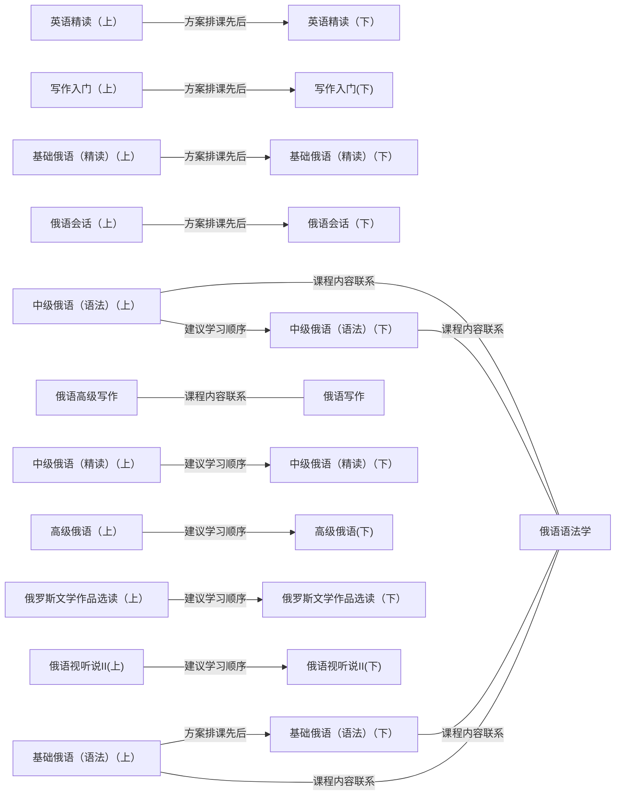

# 2024 俄语（俄语-英语复语试验班）专业“2+X”教学培养方案

外国语言文学学院 · 俄语(俄语-英语复语试验班) · 方案 73396 · 69 个不同课程或科研条目。

[官方 Word](../originals/plan-73396.docx) · [教务详情](https://fdjwgl.fudan.edu.cn/manager/bizType/2/major-program-search/info/73396?skipAuth=1) · [方案快照](../raw/plan-73396.json.gz) · [年级目录](../README.md)

## 课程关系图

图中展示部分关系。下表保留全部已建立的课程对，来源位置使用本方案 JSON Pointer。

## 先修与内容联系

| 类型 | 起点 | 终点 | 依据 | 原表定位 |
| --- | --- | --- | --- | --- |
| 建议学习顺序 | 英语精读（上） (FORE10013) | 英语精读（下） (FORE10016) | 同方案的课程题名具有连续分册或序号。  | `/courseModules/8/planCourses/0`、`/courseModules/8/planCourses/1` |
| 建议学习顺序 | 写作入门（上） (FORE10014) | 写作入门(下) (FORE10017) | 同方案的课程题名具有连续分册或序号。  | `/courseModules/8/planCourses/2`、`/courseModules/8/planCourses/3` |
| 建议学习顺序 | 英语文学导读（上） (FORE10015) | 英语文学导读(下) (FORE10018) | 同方案的课程题名具有连续分册或序号。  | `/courseModules/13/planCourses/9`、`/courseModules/13/planCourses/10` |
| 建议学习顺序 | 俄语会话（上） (FORE10019) | 俄语会话（下） (FORE10020) | 同方案的课程题名具有连续分册或序号。  | `/courseModules/8/planCourses/13`、`/courseModules/8/planCourses/14` |
| 建议学习顺序 | 基础俄语（精读）（上） (FORE10032) | 基础俄语（精读）（下） (FORE10033) | 同方案的课程题名具有连续分册或序号。  | `/courseModules/8/planCourses/9`、`/courseModules/8/planCourses/11` |
| 建议学习顺序 | 基础俄语（语法）（上） (FORE10034) | 基础俄语（语法）（下） (FORE10035) | 同方案的课程题名具有连续分册或序号。  | `/courseModules/8/planCourses/10`、`/courseModules/8/planCourses/12` |
| 建议学习顺序 | 英国文学史(上) (FORE20003) | 英国文学史(下) (FORE20004) | 同方案的课程题名具有连续分册或序号。  | `/courseModules/13/planCourses/6`、`/courseModules/13/planCourses/13` |
| 建议学习顺序 | 中级俄语（精读）（上） (FORE20055) | 中级俄语（精读）（下） (FORE20056) | 同方案的课程题名具有连续分册或序号。  | `/courseModules/8/planCourses/16`、`/courseModules/8/planCourses/18` |
| 建议学习顺序 | 中级俄语（语法）（上） (FORE20057) | 中级俄语（语法）（下） (FORE20058) | 同方案的课程题名具有连续分册或序号。  | `/courseModules/8/planCourses/17`、`/courseModules/8/planCourses/19` |
| 建议学习顺序 | 俄罗斯文学作品选读（上） (FORE30038) | 俄罗斯文学作品选读（下） (FORE40025) | 同方案的课程题名具有连续分册或序号。  | `/courseModules/8/planCourses/23`、`/courseModules/8/planCourses/24` |
| 建议学习顺序 | 高级俄语（上） (FORE30053) | 高级俄语(下) (FORE30014) | 同方案的课程题名具有连续分册或序号。  | `/courseModules/8/planCourses/20`、`/courseModules/8/planCourses/21` |
| 建议学习顺序 | 俄语视听说II(上) (FORE50005) | 俄语视听说II(下) (FORE50080) | 同方案的课程题名具有连续分册或序号。  | `/courseModules/12/planCourses/1`、`/courseModules/12/planCourses/3` |
| 方案排课先后 | 英语精读（上） (FORE10013) | 英语精读（下） (FORE10016) | 同方案该课程全部明确数字学期均早于后者。  | `/courseModules/8/planCourses/0`、`/courseModules/8/planCourses/1` |
| 方案排课先后 | 写作入门（上） (FORE10014) | 写作入门(下) (FORE10017) | 同方案该课程全部明确数字学期均早于后者。  | `/courseModules/8/planCourses/2`、`/courseModules/8/planCourses/3` |
| 方案排课先后 | 英语文学导读（上） (FORE10015) | 英语文学导读(下) (FORE10018) | 同方案该课程全部明确数字学期均早于后者。  | `/courseModules/13/planCourses/9`、`/courseModules/13/planCourses/10` |
| 方案排课先后 | 俄语会话（上） (FORE10019) | 俄语会话（下） (FORE10020) | 同方案该课程全部明确数字学期均早于后者。  | `/courseModules/8/planCourses/13`、`/courseModules/8/planCourses/14` |
| 方案排课先后 | 基础俄语（精读）（上） (FORE10032) | 基础俄语（精读）（下） (FORE10033) | 同方案该课程全部明确数字学期均早于后者。  | `/courseModules/8/planCourses/9`、`/courseModules/8/planCourses/11` |
| 方案排课先后 | 基础俄语（语法）（上） (FORE10034) | 基础俄语（语法）（下） (FORE10035) | 同方案该课程全部明确数字学期均早于后者。  | `/courseModules/8/planCourses/10`、`/courseModules/8/planCourses/12` |
| 方案排课先后 | 英国文学史(上) (FORE20003) | 英国文学史(下) (FORE20004) | 同方案该课程全部明确数字学期均早于后者。  | `/courseModules/13/planCourses/6`、`/courseModules/13/planCourses/13` |
| 方案排课先后 | 中级俄语（精读）（上） (FORE20055) | 中级俄语（精读）（下） (FORE20056) | 同方案该课程全部明确数字学期均早于后者。  | `/courseModules/8/planCourses/16`、`/courseModules/8/planCourses/18` |
| 方案排课先后 | 中级俄语（语法）（上） (FORE20057) | 中级俄语（语法）（下） (FORE20058) | 同方案该课程全部明确数字学期均早于后者。  | `/courseModules/8/planCourses/17`、`/courseModules/8/planCourses/19` |
| 方案排课先后 | 俄罗斯文学作品选读（上） (FORE30038) | 俄罗斯文学作品选读（下） (FORE40025) | 同方案该课程全部明确数字学期均早于后者。  | `/courseModules/8/planCourses/23`、`/courseModules/8/planCourses/24` |
| 方案排课先后 | 高级俄语（上） (FORE30053) | 高级俄语(下) (FORE30014) | 同方案该课程全部明确数字学期均早于后者。  | `/courseModules/8/planCourses/20`、`/courseModules/8/planCourses/21` |
| 方案排课先后 | 俄语视听说II(上) (FORE50005) | 俄语视听说II(下) (FORE50080) | 同方案该课程全部明确数字学期均早于后者。  | `/courseModules/12/planCourses/1`、`/courseModules/12/planCourses/3` |
| 课程内容联系 | 写作入门（上） (FORE10014) | 俄语写作 (FORE50116) | 本方案两门课程的题名均含“写作”，可据此对照这一主题。  | `/courseModules/8/planCourses/2`、`/courseModules/12/planCourses/4` |
| 课程内容联系 | 英语文学导读（上） (FORE10015) | 英语文学导读(下) (FORE10018) | 本方案两门课程的题名均含“英语文学”，可据此对照这一主题。  | `/courseModules/13/planCourses/9`、`/courseModules/13/planCourses/10` |
| 课程内容联系 | 写作入门(下) (FORE10017) | 俄语写作 (FORE50116) | 本方案两门课程的题名均含“写作”，可据此对照这一主题。  | `/courseModules/8/planCourses/3`、`/courseModules/12/planCourses/4` |
| 课程内容联系 | 基础俄语（语法）（上） (FORE10034) | 俄语语法学 (FORE50028) | 本方案两门课程的题名均含“语法”，可据此对照这一主题。  | `/courseModules/8/planCourses/10`、`/courseModules/12/planCourses/8` |
| 课程内容联系 | 基础俄语（语法）（下） (FORE10035) | 俄语语法学 (FORE50028) | 本方案两门课程的题名均含“语法”，可据此对照这一主题。  | `/courseModules/8/planCourses/12`、`/courseModules/12/planCourses/8` |
| 课程内容联系 | 英国文学史(上) (FORE20003) | 美国文学史 (FORE20005) | 本方案两门课程的题名均含“文学史”，可据此对照这一主题。  | `/courseModules/13/planCourses/6`、`/courseModules/13/planCourses/7` |
| 课程内容联系 | 英国文学史(下) (FORE20004) | 美国文学史 (FORE20005) | 本方案两门课程的题名均含“文学史”，可据此对照这一主题。  | `/courseModules/13/planCourses/13`、`/courseModules/13/planCourses/7` |
| 课程内容联系 | 美国文学史 (FORE20005) | 俄罗斯文学史 (FORE50091) | 本方案两门课程的题名均含“文学史”，可据此对照这一主题。  | `/courseModules/13/planCourses/7`、`/courseModules/8/planCourses/15` |
| 课程内容联系 | 中级俄语（语法）（上） (FORE20057) | 俄语语法学 (FORE50028) | 本方案两门课程的题名均含“语法”，可据此对照这一主题。  | `/courseModules/8/planCourses/17`、`/courseModules/12/planCourses/8` |
| 课程内容联系 | 中级俄语（语法）（下） (FORE20058) | 俄语语法学 (FORE50028) | 本方案两门课程的题名均含“语法”，可据此对照这一主题。  | `/courseModules/8/planCourses/19`、`/courseModules/12/planCourses/8` |
| 课程内容联系 | 翻译理论与技巧(俄语) (FORE30015) | 文学经典翻译 (FORE50067) | 本方案两门课程的题名均含“翻译”，可据此对照这一主题。  | `/courseModules/8/planCourses/22`、`/courseModules/13/planCourses/19` |
| 课程内容联系 | 俄语高级写作 (FORE40026) | 俄语写作 (FORE50116) | 本方案两门课程的题名均含“写作”，可据此对照这一主题。  | `/courseModules/8/planCourses/25`、`/courseModules/12/planCourses/4` |
| 课程内容联系 | 英美小说面面观 (FORE50049) | 俄罗斯小说 (FORE50082) | 本方案两门课程的题名均含“小说”，可据此对照这一主题。  | `/courseModules/13/planCourses/8`、`/courseModules/12/planCourses/16` |
| 课程内容联系 | 哲学导论 (PHIL10002) | 逻辑学 (PHIL10003) | 论证与概念分析是哲学讨论的共同方法。  | `/courseModules/7/planCourses/2`、`/courseModules/7/planCourses/3` |

本次未从可定位的明确表述中确认课程对课程预修。学期安排、系列分册与编辑建议均保留各自的依据。

## 按原方案模块阅读

同一模块展示原表中的课程归属。模块内课程之间的先后仍须逐项查阅。

- **俄语进阶课程**　俄罗斯概况、俄罗斯当代作家及作品、俄语视听说II(上)、俄语报刊、俄语词汇学、俄语语法学、外贸俄语、俄罗斯诗歌、俄语修辞学、俄语影视、俄语视听说Ⅰ、俄语视听说II(下)、俄罗斯文化、俄罗斯小说、俄语写作、俄语言语礼节、当代俄罗斯、俄国历史（原表模块 12）
- **英语进阶课程**　英语文学导读（上）、英语文学导读(下)、语言学概论、英国文学史(上)、英国文学史(下)、美国文学史、应用语言学导论、英语辩论、文学研究方法论、商务口译、英语文体学、英美电影文学、莎士比亚选读、英语词汇学、英美小说面面观、文学经典翻译、媒体英语、流行文化的批判性阅读等21项（原表模块 13）
- **俄语进阶课程**　俄罗斯概况、俄罗斯当代作家及作品、俄语视听说II(上)、俄语报刊、俄语词汇学、俄语语法学、外贸俄语、俄罗斯诗歌、俄语修辞学、俄语影视、俄语视听说Ⅰ、俄语视听说II(下)、俄罗斯文化、俄罗斯小说、俄语写作、俄语言语礼节、当代俄罗斯、俄国历史（原表模块 15）
- **英语进阶课程**　英语文学导读（上）、英语文学导读(下)、语言学概论、英国文学史(上)、英国文学史(下)、美国文学史、应用语言学导论、英语辩论、文学研究方法论、商务口译、英语文体学、英美电影文学、莎士比亚选读、英语词汇学、英美小说面面观、文学经典翻译、媒体英语、流行文化的批判性阅读等21项（原表模块 16）

## 课程表

同一课程在不同模块分别出现时，按原表逐行列出。季节字段保留原值。

| 课程 | 代码 | 学分 | 学期 | 模块 |
| --- | --- | ---: | --- | --- |
| 中国文学经典 | CHIN10005 | 3.0 | SPRING、AUTUMN | 培养方案 / 专业培养课程 / 大类基础课程 / 人文类基础课程 / 必修课程 |
| 中国古代文明 | HIST10006 | 3.0 | SPRING、AUTUMN | 培养方案 / 专业培养课程 / 大类基础课程 / 人文类基础课程 / 必修课程 |
| 哲学导论 | PHIL10002 | 3.0 | SPRING、AUTUMN | 培养方案 / 专业培养课程 / 大类基础课程 / 人文类基础课程 / 必修课程 |
| 逻辑学 | PHIL10003 | 3.0 | SPRING、AUTUMN | 培养方案 / 专业培养课程 / 大类基础课程 / 人文类基础课程 / 必修课程 |
| 英语精读（上） | FORE10013 | 4.0 | 第3学期 | 培养方案 / 专业培养课程 / 专业核心教育课程 |
| 英语精读（下） | FORE10016 | 4.0 | 第4学期 | 培养方案 / 专业培养课程 / 专业核心教育课程 |
| 写作入门（上） | FORE10014 | 2.0 | 第3学期 | 培养方案 / 专业培养课程 / 专业核心教育课程 |
| 写作入门(下) | FORE10017 | 2.0 | 第4学期 | 培养方案 / 专业培养课程 / 专业核心教育课程 |
| 英语语言史 | FORE20029 | 2.0 | 第3学期 | 培养方案 / 专业培养课程 / 专业核心教育课程 |
| 全球化与中国文化 | FORE50076 | 2.0 | SPRING、AUTUMN | 培养方案 / 专业培养课程 / 专业核心教育课程 |
| 英语演讲 | FORE10012 | 2.0 | 第5学期 | 培养方案 / 专业培养课程 / 专业核心教育课程 |
| 实习调查 | FORE30001 | 2.0 | 第6学期 | 培养方案 / 专业培养课程 / 专业核心教育课程 |
| 毕业论文 | FORE40080 | 4.0 | 第8学期 | 培养方案 / 专业培养课程 / 专业核心教育课程 |
| 基础俄语（精读）（上） | FORE10032 | 6.0 | 第1学期 | 培养方案 / 专业培养课程 / 专业核心教育课程 |
| 基础俄语（语法）（上） | FORE10034 | 4.0 | 第1学期 | 培养方案 / 专业培养课程 / 专业核心教育课程 |
| 基础俄语（精读）（下） | FORE10033 | 6.0 | 第2学期 | 培养方案 / 专业培养课程 / 专业核心教育课程 |
| 基础俄语（语法）（下） | FORE10035 | 4.0 | 第2学期 | 培养方案 / 专业培养课程 / 专业核心教育课程 |
| 俄语会话（上） | FORE10019 | 2.0 | 第1学期 | 培养方案 / 专业培养课程 / 专业核心教育课程 |
| 俄语会话（下） | FORE10020 | 2.0 | 第2学期 | 培养方案 / 专业培养课程 / 专业核心教育课程 |
| 俄罗斯文学史 | FORE50091 | 2.0 | 第2学期 | 培养方案 / 专业培养课程 / 专业核心教育课程 |
| 中级俄语（精读）（上） | FORE20055 | 4.0 | 第3学期 | 培养方案 / 专业培养课程 / 专业核心教育课程 |
| 中级俄语（语法）（上） | FORE20057 | 4.0 | 第3学期 | 培养方案 / 专业培养课程 / 专业核心教育课程 |
| 中级俄语（精读）（下） | FORE20056 | 4.0 | 第4学期 | 培养方案 / 专业培养课程 / 专业核心教育课程 |
| 中级俄语（语法）（下） | FORE20058 | 4.0 | 第4学期 | 培养方案 / 专业培养课程 / 专业核心教育课程 |
| 高级俄语（上） | FORE30053 | 4.0 | 第5学期 | 培养方案 / 专业培养课程 / 专业核心教育课程 |
| 高级俄语(下) | FORE30014 | 4.0 | 第6学期 | 培养方案 / 专业培养课程 / 专业核心教育课程 |
| 翻译理论与技巧(俄语) | FORE30015 | 2.0 | 第6学期 | 培养方案 / 专业培养课程 / 专业核心教育课程 |
| 俄罗斯文学作品选读（上） | FORE30038 | 2.0 | 第6学期 | 培养方案 / 专业培养课程 / 专业核心教育课程 |
| 俄罗斯文学作品选读（下） | FORE40025 | 2.0 | 第7学期 | 培养方案 / 专业培养课程 / 专业核心教育课程 |
| 俄语高级写作 | FORE40026 | 2.0 | 第7学期 | 培养方案 / 专业培养课程 / 专业核心教育课程 |
| 俄语视听说Ⅰ | FORE50042 | 2.0 | 第2学期 | 培养方案 / 复语进阶（双进阶） / 俄语进阶课程 |
| 俄语视听说II(上) | FORE50005 | 2.0 | 第3学期 | 培养方案 / 复语进阶（双进阶） / 俄语进阶课程 |
| 俄罗斯概况 | FORE20020 | 2.0 | 第3学期 | 培养方案 / 复语进阶（双进阶） / 俄语进阶课程 |
| 俄语视听说II(下) | FORE50080 | 2.0 | 第4学期 | 培养方案 / 复语进阶（双进阶） / 俄语进阶课程 |
| 俄语写作 | FORE50116 | 2.0 | SPRING、AUTUMN | 培养方案 / 复语进阶（双进阶） / 俄语进阶课程 |
| 俄语言语礼节 | FORE50117 | 2.0 | SPRING、AUTUMN | 培养方案 / 复语进阶（双进阶） / 俄语进阶课程 |
| 俄罗斯文化 | FORE50081 | 2.0 | 第4学期 | 培养方案 / 复语进阶（双进阶） / 俄语进阶课程 |
| 当代俄罗斯 | FORE50118 | 2.0 | SPRING、AUTUMN | 培养方案 / 复语进阶（双进阶） / 俄语进阶课程 |
| 俄语语法学 | FORE50028 | 2.0 | 第6学期 | 培养方案 / 复语进阶（双进阶） / 俄语进阶课程 |
| 俄语报刊 | FORE50006 | 2.0 | 第5学期 | 培养方案 / 复语进阶（双进阶） / 俄语进阶课程 |
| 外贸俄语 | FORE50029 | 2.0 | 第5学期 | 培养方案 / 复语进阶（双进阶） / 俄语进阶课程 |
| 俄罗斯诗歌 | FORE50030 | 2.0 | SPRING、AUTUMN | 培养方案 / 复语进阶（双进阶） / 俄语进阶课程 |
| 俄语影视 | FORE50032 | 2.0 | SPRING、AUTUMN | 培养方案 / 复语进阶（双进阶） / 俄语进阶课程 |
| 俄语词汇学 | FORE50027 | 2.0 | SPRING、AUTUMN | 培养方案 / 复语进阶（双进阶） / 俄语进阶课程 |
| 俄语修辞学 | FORE50031 | 2.0 | SPRING、AUTUMN | 培养方案 / 复语进阶（双进阶） / 俄语进阶课程 |
| 俄国历史 | FORE50119 | 2.0 | SPRING、AUTUMN | 培养方案 / 复语进阶（双进阶） / 俄语进阶课程 |
| 俄罗斯小说 | FORE50082 | 2.0 | SPRING、AUTUMN | 培养方案 / 复语进阶（双进阶） / 俄语进阶课程 |
| 俄罗斯当代作家及作品 | FORE30059 | 2.0 | SPRING、AUTUMN | 培养方案 / 复语进阶（双进阶） / 俄语进阶课程 |
| 英语词汇学 | FORE50018 | 2.0 | 第3学期 | 培养方案 / 复语进阶（双进阶） / 英语进阶课程 |
| 语言学概论 | FORE10029 | 2.0 | SPRING、AUTUMN | 培养方案 / 复语进阶（双进阶） / 英语进阶课程 |
| 应用语言学导论 | FORE20024 | 2.0 | 第5学期 | 培养方案 / 复语进阶（双进阶） / 英语进阶课程 |
| 英语文体学 | FORE50012 | 2.0 | 第5学期 | 培养方案 / 复语进阶（双进阶） / 英语进阶课程 |
| 英语辩论 | FORE20025 | 2.0 | SPRING、AUTUMN | 培养方案 / 复语进阶（双进阶） / 英语进阶课程 |
| 媒体英语 | FORE50068 | 2.0 | SPRING、AUTUMN | 培养方案 / 复语进阶（双进阶） / 英语进阶课程 |
| 英国文学史(上) | FORE20003 | 2.0 | 第3学期 | 培养方案 / 复语进阶（双进阶） / 英语进阶课程 |
| 美国文学史 | FORE20005 | 2.0 | 第4学期 | 培养方案 / 复语进阶（双进阶） / 英语进阶课程 |
| 英美小说面面观 | FORE50049 | 2.0 | 第3学期 | 培养方案 / 复语进阶（双进阶） / 英语进阶课程 |
| 英语文学导读（上） | FORE10015 | 2.0 | 第3学期 | 培养方案 / 复语进阶（双进阶） / 英语进阶课程 |
| 英语文学导读(下) | FORE10018 | 2.0 | 第4学期 | 培养方案 / 复语进阶（双进阶） / 英语进阶课程 |
| 文学研究方法论 | FORE30027 | 2.0 | 第5学期 | 培养方案 / 复语进阶（双进阶） / 英语进阶课程 |
| 莎士比亚选读 | FORE50015 | 2.0 | 第6学期 | 培养方案 / 复语进阶（双进阶） / 英语进阶课程 |
| 英国文学史(下) | FORE20004 | 2.0 | 第4学期 | 培养方案 / 复语进阶（双进阶） / 英语进阶课程 |
| 英美电影文学 | FORE50014 | 2.0 | 第7学期 | 培养方案 / 复语进阶（双进阶） / 英语进阶课程 |
| 英国中世纪文学导读 | FORE50093 | 2.0 | SPRING、AUTUMN | 培养方案 / 复语进阶（双进阶） / 英语进阶课程 |
| 18世纪美国文学 | FORE50109 | 2.0 | SPRING、AUTUMN | 培养方案 / 复语进阶（双进阶） / 英语进阶课程 |
| 英美电影与文化 | FORE50070 | 2.0 | 第4学期 | 培养方案 / 复语进阶（双进阶） / 英语进阶课程 |
| 流行文化的批判性阅读 | FORE50069 | 2.0 | 第5学期 | 培养方案 / 复语进阶（双进阶） / 英语进阶课程 |
| 文学经典翻译 | FORE50067 | 2.0 | SPRING、AUTUMN | 培养方案 / 复语进阶（双进阶） / 英语进阶课程 |
| 商务口译 | FORE30030 | 2.0 | SPRING、AUTUMN | 培养方案 / 复语进阶（双进阶） / 英语进阶课程 |
| 俄语视听说Ⅰ | FORE50042 | 2.0 | 第2学期 | 培养方案 / 复语进阶（单进阶） / 俄语进阶课程 |
| 俄语视听说II(上) | FORE50005 | 2.0 | 第3学期 | 培养方案 / 复语进阶（单进阶） / 俄语进阶课程 |
| 俄罗斯概况 | FORE20020 | 2.0 | 第3学期 | 培养方案 / 复语进阶（单进阶） / 俄语进阶课程 |
| 俄语视听说II(下) | FORE50080 | 2.0 | 第4学期 | 培养方案 / 复语进阶（单进阶） / 俄语进阶课程 |
| 俄语写作 | FORE50116 | 2.0 | SPRING、AUTUMN | 培养方案 / 复语进阶（单进阶） / 俄语进阶课程 |
| 俄语言语礼节 | FORE50117 | 2.0 | SPRING、AUTUMN | 培养方案 / 复语进阶（单进阶） / 俄语进阶课程 |
| 俄罗斯文化 | FORE50081 | 2.0 | 第4学期 | 培养方案 / 复语进阶（单进阶） / 俄语进阶课程 |
| 当代俄罗斯 | FORE50118 | 2.0 | SPRING、AUTUMN | 培养方案 / 复语进阶（单进阶） / 俄语进阶课程 |
| 俄语语法学 | FORE50028 | 2.0 | 第6学期 | 培养方案 / 复语进阶（单进阶） / 俄语进阶课程 |
| 俄语报刊 | FORE50006 | 2.0 | 第5学期 | 培养方案 / 复语进阶（单进阶） / 俄语进阶课程 |
| 外贸俄语 | FORE50029 | 2.0 | 第5学期 | 培养方案 / 复语进阶（单进阶） / 俄语进阶课程 |
| 俄罗斯诗歌 | FORE50030 | 2.0 | SPRING、AUTUMN | 培养方案 / 复语进阶（单进阶） / 俄语进阶课程 |
| 俄语影视 | FORE50032 | 2.0 | SPRING、AUTUMN | 培养方案 / 复语进阶（单进阶） / 俄语进阶课程 |
| 俄语词汇学 | FORE50027 | 2.0 | SPRING、AUTUMN | 培养方案 / 复语进阶（单进阶） / 俄语进阶课程 |
| 俄语修辞学 | FORE50031 | 2.0 | SPRING、AUTUMN | 培养方案 / 复语进阶（单进阶） / 俄语进阶课程 |
| 俄国历史 | FORE50119 | 2.0 | SPRING、AUTUMN | 培养方案 / 复语进阶（单进阶） / 俄语进阶课程 |
| 俄罗斯小说 | FORE50082 | 2.0 | SPRING、AUTUMN | 培养方案 / 复语进阶（单进阶） / 俄语进阶课程 |
| 俄罗斯当代作家及作品 | FORE30059 | 2.0 | SPRING、AUTUMN | 培养方案 / 复语进阶（单进阶） / 俄语进阶课程 |
| 英语词汇学 | FORE50018 | 2.0 | 第3学期 | 培养方案 / 复语进阶（单进阶） / 英语进阶课程 |
| 语言学概论 | FORE10029 | 2.0 | SPRING、AUTUMN | 培养方案 / 复语进阶（单进阶） / 英语进阶课程 |
| 应用语言学导论 | FORE20024 | 2.0 | 第5学期 | 培养方案 / 复语进阶（单进阶） / 英语进阶课程 |
| 英语文体学 | FORE50012 | 2.0 | 第5学期 | 培养方案 / 复语进阶（单进阶） / 英语进阶课程 |
| 英语辩论 | FORE20025 | 2.0 | SPRING、AUTUMN | 培养方案 / 复语进阶（单进阶） / 英语进阶课程 |
| 媒体英语 | FORE50068 | 2.0 | SPRING、AUTUMN | 培养方案 / 复语进阶（单进阶） / 英语进阶课程 |
| 英国文学史(上) | FORE20003 | 2.0 | 第3学期 | 培养方案 / 复语进阶（单进阶） / 英语进阶课程 |
| 美国文学史 | FORE20005 | 2.0 | 第4学期 | 培养方案 / 复语进阶（单进阶） / 英语进阶课程 |
| 英美小说面面观 | FORE50049 | 2.0 | 第3学期 | 培养方案 / 复语进阶（单进阶） / 英语进阶课程 |
| 英语文学导读（上） | FORE10015 | 2.0 | 第3学期 | 培养方案 / 复语进阶（单进阶） / 英语进阶课程 |
| 英语文学导读(下) | FORE10018 | 2.0 | 第4学期 | 培养方案 / 复语进阶（单进阶） / 英语进阶课程 |
| 文学研究方法论 | FORE30027 | 2.0 | 第5学期 | 培养方案 / 复语进阶（单进阶） / 英语进阶课程 |
| 莎士比亚选读 | FORE50015 | 2.0 | 第6学期 | 培养方案 / 复语进阶（单进阶） / 英语进阶课程 |
| 英国文学史(下) | FORE20004 | 2.0 | 第4学期 | 培养方案 / 复语进阶（单进阶） / 英语进阶课程 |
| 英美电影文学 | FORE50014 | 2.0 | 第7学期 | 培养方案 / 复语进阶（单进阶） / 英语进阶课程 |
| 英国中世纪文学导读 | FORE50093 | 2.0 | SPRING、AUTUMN | 培养方案 / 复语进阶（单进阶） / 英语进阶课程 |
| 18世纪美国文学 | FORE50109 | 2.0 | SPRING、AUTUMN | 培养方案 / 复语进阶（单进阶） / 英语进阶课程 |
| 英美电影与文化 | FORE50070 | 2.0 | 第4学期 | 培养方案 / 复语进阶（单进阶） / 英语进阶课程 |
| 流行文化的批判性阅读 | FORE50069 | 2.0 | 第5学期 | 培养方案 / 复语进阶（单进阶） / 英语进阶课程 |
| 文学经典翻译 | FORE50067 | 2.0 | SPRING、AUTUMN | 培养方案 / 复语进阶（单进阶） / 英语进阶课程 |
| 商务口译 | FORE30030 | 2.0 | SPRING、AUTUMN | 培养方案 / 复语进阶（单进阶） / 英语进阶课程 |
