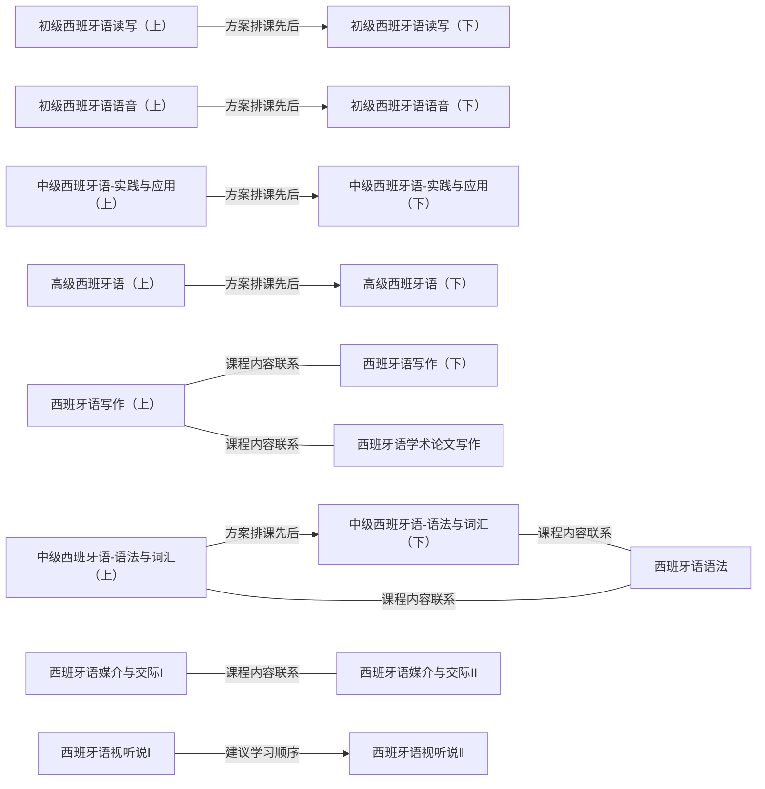

# 2024 西班牙语专业“2+X”教学培养方案（港澳台侨生适用）

外国语言文学学院 · 西班牙语 · 方案 73607 · 39 个不同课程或科研条目。

[官方 Word](../originals/plan-73607.docx) · [教务详情](https://fdjwgl.fudan.edu.cn/manager/bizType/2/major-program-search/info/73607?skipAuth=1) · [方案快照](../raw/plan-73607.json.gz) · [年级目录](../README.md)

## 课程关系图

图中展示部分关系。下表保留全部已建立的课程对，来源位置使用本方案 JSON Pointer。

## 先修与内容联系

| 类型 | 起点 | 终点 | 依据 | 原表定位 |
| --- | --- | --- | --- | --- |
| 建议学习顺序 | 西班牙语媒介与交际I (FORE10028) | 西班牙语媒介与交际II (FORE20049) | 同方案的课程题名具有连续分册或序号。  | `/courseModules/10/planCourses/14`、`/courseModules/10/planCourses/15` |
| 建议学习顺序 | 初级西班牙语语音（上） (FORE10030) | 初级西班牙语语音（下） (FORE10031) | 同方案的课程题名具有连续分册或序号。  | `/courseModules/8/planCourses/16`、`/courseModules/8/planCourses/3` |
| 建议学习顺序 | 初级西班牙语读写（上） (FORE10036) | 初级西班牙语读写（下） (FORE10037) | 同方案的课程题名具有连续分册或序号。  | `/courseModules/8/planCourses/0`、`/courseModules/8/planCourses/2` |
| 建议学习顺序 | 西班牙语视听说Ⅰ (FORE20047) | 西班牙语视听说Ⅱ (FORE20048) | 同方案的课程题名具有连续分册或序号。  | `/courseModules/8/planCourses/10`、`/courseModules/8/planCourses/11` |
| 建议学习顺序 | 中级西班牙语-实践与应用（上） (FORE20059) | 中级西班牙语-实践与应用（下） (FORE20060) | 同方案的课程题名具有连续分册或序号。  | `/courseModules/8/planCourses/4`、`/courseModules/8/planCourses/6` |
| 建议学习顺序 | 中级西班牙语-语法与词汇（上） (FORE20061) | 中级西班牙语-语法与词汇（下） (FORE20062) | 同方案的课程题名具有连续分册或序号。  | `/courseModules/8/planCourses/5`、`/courseModules/8/planCourses/7` |
| 建议学习顺序 | 高级西班牙语（上） (FORE30043) | 高级西班牙语（下） (FORE30044) | 同方案的课程题名具有连续分册或序号。  | `/courseModules/8/planCourses/8`、`/courseModules/8/planCourses/9` |
| 建议学习顺序 | 西班牙语写作（上） (FORE30046) | 西班牙语写作（下） (FORE40042) | 同方案的课程题名具有连续分册或序号。  | `/courseModules/8/planCourses/12`、`/courseModules/8/planCourses/13` |
| 方案排课先后 | 初级西班牙语语音（上） (FORE10030) | 初级西班牙语语音（下） (FORE10031) | 同方案该课程全部明确数字学期均早于后者。  | `/courseModules/8/planCourses/16`、`/courseModules/8/planCourses/3` |
| 方案排课先后 | 初级西班牙语读写（上） (FORE10036) | 初级西班牙语读写（下） (FORE10037) | 同方案该课程全部明确数字学期均早于后者。  | `/courseModules/8/planCourses/0`、`/courseModules/8/planCourses/2` |
| 方案排课先后 | 西班牙语视听说Ⅰ (FORE20047) | 西班牙语视听说Ⅱ (FORE20048) | 同方案该课程全部明确数字学期均早于后者。  | `/courseModules/8/planCourses/10`、`/courseModules/8/planCourses/11` |
| 方案排课先后 | 中级西班牙语-实践与应用（上） (FORE20059) | 中级西班牙语-实践与应用（下） (FORE20060) | 同方案该课程全部明确数字学期均早于后者。  | `/courseModules/8/planCourses/4`、`/courseModules/8/planCourses/6` |
| 方案排课先后 | 中级西班牙语-语法与词汇（上） (FORE20061) | 中级西班牙语-语法与词汇（下） (FORE20062) | 同方案该课程全部明确数字学期均早于后者。  | `/courseModules/8/planCourses/5`、`/courseModules/8/planCourses/7` |
| 方案排课先后 | 高级西班牙语（上） (FORE30043) | 高级西班牙语（下） (FORE30044) | 同方案该课程全部明确数字学期均早于后者。  | `/courseModules/8/planCourses/8`、`/courseModules/8/planCourses/9` |
| 方案排课先后 | 西班牙语写作（上） (FORE30046) | 西班牙语写作（下） (FORE40042) | 同方案该课程全部明确数字学期均早于后者。  | `/courseModules/8/planCourses/12`、`/courseModules/8/planCourses/13` |
| 课程内容联系 | 西班牙语媒介与交际I (FORE10028) | 西班牙语媒介与交际II (FORE20049) | 本方案两门课程的题名均含“媒介”，可据此对照这一主题。  | `/courseModules/10/planCourses/14`、`/courseModules/10/planCourses/15` |
| 课程内容联系 | 初级西班牙语语音（上） (FORE10030) | 初级西班牙语语音（下） (FORE10031) | 本方案两门课程的题名均含“语音”，可据此对照这一主题。  | `/courseModules/8/planCourses/16`、`/courseModules/8/planCourses/3` |
| 课程内容联系 | 中级西班牙语-语法与词汇（上） (FORE20061) | 西班牙语语法 (FORE30049) | 本方案两门课程的题名均含“语法”，可据此对照这一主题。  | `/courseModules/8/planCourses/5`、`/courseModules/10/planCourses/9` |
| 课程内容联系 | 中级西班牙语-语法与词汇（下） (FORE20062) | 西班牙语语法 (FORE30049) | 本方案两门课程的题名均含“语法”，可据此对照这一主题。  | `/courseModules/8/planCourses/7`、`/courseModules/10/planCourses/9` |
| 课程内容联系 | 西班牙语写作（上） (FORE30046) | 西班牙语写作（下） (FORE40042) | 本方案两门课程的题名均含“写作”，可据此对照这一主题。  | `/courseModules/8/planCourses/12`、`/courseModules/8/planCourses/13` |
| 课程内容联系 | 西班牙语写作（上） (FORE30046) | 西班牙语学术论文写作 (FORE50096) | 本方案两门课程的题名均含“写作”，可据此对照这一主题。  | `/courseModules/8/planCourses/12`、`/courseModules/8/planCourses/14` |
| 课程内容联系 | 哲学导论 (PHIL10002) | 逻辑学 (PHIL10003) | 论证与概念分析是哲学讨论的共同方法。  | `/courseModules/7/planCourses/2`、`/courseModules/7/planCourses/3` |

本次未从可定位的明确表述中确认课程对课程预修。学期安排、系列分册与编辑建议均保留各自的依据。

## 课程表

同一课程在不同模块分别出现时，按原表逐行列出。季节字段保留原值。

| 课程 | 代码 | 学分 | 学期 | 模块 |
| --- | --- | ---: | --- | --- |
| 中国文学经典 | CHIN10005 | 3.0 | SPRING、AUTUMN | 培养方案 / 专业培养课程 / 大类基础课程 / 人文类基础课程 / 必修课程 |
| 中国古代文明 | HIST10006 | 3.0 | SPRING、AUTUMN | 培养方案 / 专业培养课程 / 大类基础课程 / 人文类基础课程 / 必修课程 |
| 哲学导论 | PHIL10002 | 3.0 | SPRING、AUTUMN | 培养方案 / 专业培养课程 / 大类基础课程 / 人文类基础课程 / 必修课程 |
| 逻辑学 | PHIL10003 | 3.0 | SPRING、AUTUMN | 培养方案 / 专业培养课程 / 大类基础课程 / 人文类基础课程 / 必修课程 |
| 初级西班牙语读写（上） | FORE10036 | 6.0 | 第1学期 | 培养方案 / 专业培养课程 / 专业核心教育课程 |
| 毕业论文 | FORE40080 | 4.0 | 第8学期 | 培养方案 / 专业培养课程 / 专业核心教育课程 |
| 初级西班牙语读写（下） | FORE10037 | 6.0 | 第2学期 | 培养方案 / 专业培养课程 / 专业核心教育课程 |
| 初级西班牙语语音（下） | FORE10031 | 4.0 | 第2学期 | 培养方案 / 专业培养课程 / 专业核心教育课程 |
| 中级西班牙语-实践与应用（上） | FORE20059 | 4.0 | 第3学期 | 培养方案 / 专业培养课程 / 专业核心教育课程 |
| 中级西班牙语-语法与词汇（上） | FORE20061 | 4.0 | 第3学期 | 培养方案 / 专业培养课程 / 专业核心教育课程 |
| 中级西班牙语-实践与应用（下） | FORE20060 | 4.0 | 第4学期 | 培养方案 / 专业培养课程 / 专业核心教育课程 |
| 中级西班牙语-语法与词汇（下） | FORE20062 | 4.0 | 第4学期 | 培养方案 / 专业培养课程 / 专业核心教育课程 |
| 高级西班牙语（上） | FORE30043 | 4.0 | 第5学期 | 培养方案 / 专业培养课程 / 专业核心教育课程 |
| 高级西班牙语（下） | FORE30044 | 4.0 | 第6学期 | 培养方案 / 专业培养课程 / 专业核心教育课程 |
| 西班牙语视听说Ⅰ | FORE20047 | 2.0 | 第2学期 | 培养方案 / 专业培养课程 / 专业核心教育课程 |
| 西班牙语视听说Ⅱ | FORE20048 | 2.0 | 第3学期 | 培养方案 / 专业培养课程 / 专业核心教育课程 |
| 西班牙语写作（上） | FORE30046 | 2.0 | 第5学期 | 培养方案 / 专业培养课程 / 专业核心教育课程 |
| 西班牙语写作（下） | FORE40042 | 2.0 | 第6学期 | 培养方案 / 专业培养课程 / 专业核心教育课程 |
| 西班牙语学术论文写作 | FORE50096 | 2.0 | 第7学期 | 培养方案 / 专业培养课程 / 专业核心教育课程 |
| 实习调查 | FORE30001 | 2.0 | 第6学期 | 培养方案 / 专业培养课程 / 专业核心教育课程 |
| 初级西班牙语语音（上） | FORE10030 | 4.0 | 第1学期 | 培养方案 / 专业培养课程 / 专业核心教育课程 |
| 拉丁美洲历史文化与艺术 | FORE30048 | 2.0 | SPRING、AUTUMN | 培养方案 / 专业培养课程 / 专业核心教育课程 |
| 学术前沿专题 | FORE50043 | 2.0 | SPRING、AUTUMN | 培养方案 / 专业培养课程 / 专业核心教育课程 |
| 西班牙思想史 | FORE50101 | 2.0 | SPRING、AUTUMN | 培养方案 / 专业进阶课程（双进阶） |
| 西班牙语报刊选读 | FORE40044 | 2.0 | SPRING、AUTUMN | 培养方案 / 专业进阶课程（双进阶） |
| 中西跨文化交际 | FORE50100 | 2.0 | SPRING、AUTUMN | 培养方案 / 专业进阶课程（双进阶） |
| 西班牙历史与文化 | FORE30047 | 2.0 | SPRING、AUTUMN | 培养方案 / 专业进阶课程（双进阶） |
| 西班牙语世界文化研究 | FORE50099 | 2.0 | SPRING、AUTUMN | 培养方案 / 专业进阶课程（双进阶） |
| 西班牙语阅读 | FORE30045 | 2.0 | SPRING、AUTUMN | 培养方案 / 专业进阶课程（双进阶） |
| 西班牙文学及作品导读 | FORE40040 | 2.0 | SPRING、AUTUMN | 培养方案 / 专业进阶课程（双进阶） |
| 拉丁美洲文学及作品导读 | FORE40041 | 2.0 | SPRING、AUTUMN | 培养方案 / 专业进阶课程（双进阶） |
| 西班牙语翻译理论与实践 | FORE50095 | 2.0 | SPRING、AUTUMN | 培养方案 / 专业进阶课程（双进阶） |
| 西班牙语语法 | FORE30049 | 2.0 | SPRING、AUTUMN | 培养方案 / 专业进阶课程（双进阶） |
| 西班牙语语言学导论 | FORE40043 | 2.0 | SPRING、AUTUMN | 培养方案 / 专业进阶课程（双进阶） |
| 经贸西班牙语 | FORE50097 | 2.0 | SPRING、AUTUMN | 培养方案 / 专业进阶课程（双进阶） |
| 西班牙语口译 | FORE50098 | 2.0 | SPRING、AUTUMN | 培养方案 / 专业进阶课程（双进阶） |
| 西班牙语电影 | FORE30050 | 2.0 | SPRING、AUTUMN | 培养方案 / 专业进阶课程（双进阶） |
| 西班牙语媒介与交际I | FORE10028 | 2.0 | SPRING、AUTUMN | 培养方案 / 专业进阶课程（双进阶） |
| 西班牙语媒介与交际II | FORE20049 | 2.0 | SPRING、AUTUMN | 培养方案 / 专业进阶课程（双进阶） |
| 西班牙思想史 | FORE50101 | 2.0 | SPRING、AUTUMN | 培养方案 / 专业进阶课程（单进阶） |
| 西班牙语报刊选读 | FORE40044 | 2.0 | SPRING、AUTUMN | 培养方案 / 专业进阶课程（单进阶） |
| 中西跨文化交际 | FORE50100 | 2.0 | SPRING、AUTUMN | 培养方案 / 专业进阶课程（单进阶） |
| 西班牙历史与文化 | FORE30047 | 2.0 | SPRING、AUTUMN | 培养方案 / 专业进阶课程（单进阶） |
| 西班牙语世界文化研究 | FORE50099 | 2.0 | SPRING、AUTUMN | 培养方案 / 专业进阶课程（单进阶） |
| 西班牙语阅读 | FORE30045 | 2.0 | SPRING、AUTUMN | 培养方案 / 专业进阶课程（单进阶） |
| 西班牙文学及作品导读 | FORE40040 | 2.0 | SPRING、AUTUMN | 培养方案 / 专业进阶课程（单进阶） |
| 拉丁美洲文学及作品导读 | FORE40041 | 2.0 | SPRING、AUTUMN | 培养方案 / 专业进阶课程（单进阶） |
| 西班牙语翻译理论与实践 | FORE50095 | 2.0 | SPRING、AUTUMN | 培养方案 / 专业进阶课程（单进阶） |
| 西班牙语语法 | FORE30049 | 2.0 | SPRING、AUTUMN | 培养方案 / 专业进阶课程（单进阶） |
| 西班牙语语言学导论 | FORE40043 | 2.0 | SPRING、AUTUMN | 培养方案 / 专业进阶课程（单进阶） |
| 经贸西班牙语 | FORE50097 | 2.0 | SPRING、AUTUMN | 培养方案 / 专业进阶课程（单进阶） |
| 西班牙语口译 | FORE50098 | 2.0 | SPRING、AUTUMN | 培养方案 / 专业进阶课程（单进阶） |
| 西班牙语电影 | FORE30050 | 2.0 | SPRING、AUTUMN | 培养方案 / 专业进阶课程（单进阶） |
| 西班牙语媒介与交际I | FORE10028 | 2.0 | SPRING、AUTUMN | 培养方案 / 专业进阶课程（单进阶） |
| 西班牙语媒介与交际II | FORE20049 | 2.0 | SPRING、AUTUMN | 培养方案 / 专业进阶课程（单进阶） |
