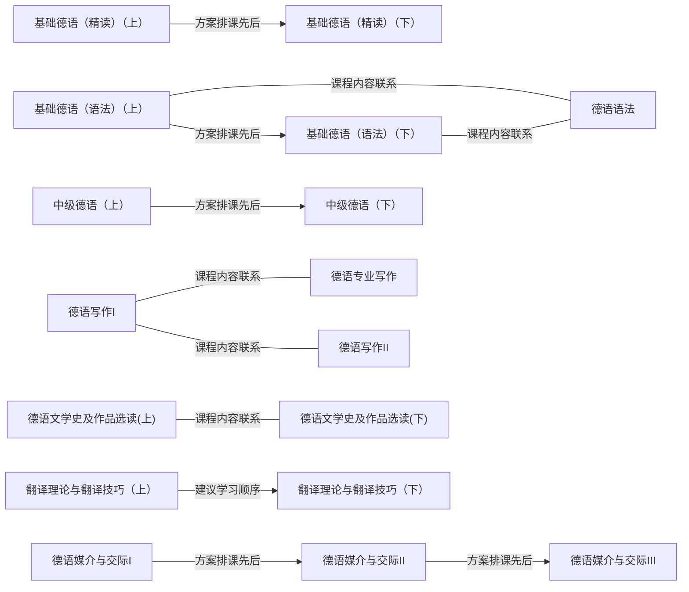

# 2025德语专业本科培养方案

外国语言文学学院 · 德语 · 方案 96973 · 44 个不同课程或科研条目。

[官方 Word](../originals/plan-96973.docx) · [教务详情](https://fdjwgl.fudan.edu.cn/manager/bizType/2/major-program-search/info/96973?skipAuth=1) · [方案快照](../raw/plan-96973.json.gz) · [年级目录](../README.md)

## 课程关系图

图中展示部分关系。下表保留全部已建立的课程对，来源位置使用本方案 JSON Pointer。

## 先修与内容联系

| 类型 | 起点 | 终点 | 依据 | 原表定位 |
| --- | --- | --- | --- | --- |
| 建议学习顺序 | 德语媒介与交际I (FORE10021) | 德语媒介与交际II (FORE20033) | 同方案的课程题名具有连续分册或序号。  | `/courseModules/8/planCourses/3`、`/courseModules/8/planCourses/6` |
| 建议学习顺序 | 基础德语（语法）（上） (FORE10038) | 基础德语（语法）（下） (FORE10039) | 同方案的课程题名具有连续分册或序号。  | `/courseModules/8/planCourses/2`、`/courseModules/8/planCourses/5` |
| 建议学习顺序 | 基础德语（精读）（上） (FORE10040) | 基础德语（精读）（下） (FORE10041) | 同方案的课程题名具有连续分册或序号。  | `/courseModules/8/planCourses/1`、`/courseModules/8/planCourses/4` |
| 建议学习顺序 | 德语媒介与交际II (FORE20033) | 德语媒介与交际III (FORE20034) | 同方案的课程题名具有连续分册或序号。  | `/courseModules/8/planCourses/6`、`/courseModules/8/planCourses/9` |
| 建议学习顺序 | 德语写作I (FORE20035) | 德语写作II (FORE20036) | 同方案的课程题名具有连续分册或序号。  | `/courseModules/8/planCourses/8`、`/courseModules/8/planCourses/12` |
| 建议学习顺序 | 中级德语（上） (FORE20063) | 中级德语（下） (FORE20064) | 同方案的课程题名具有连续分册或序号。  | `/courseModules/8/planCourses/7`、`/courseModules/8/planCourses/10` |
| 建议学习顺序 | 德语文学史及作品选读(上) (FORE30002) | 德语文学史及作品选读(下) (FORE30003) | 同方案的课程题名具有连续分册或序号。  | `/courseModules/8/planCourses/13`、`/courseModules/8/planCourses/15` |
| 建议学习顺序 | 翻译理论与翻译技巧（上） (FORE40046) | 翻译理论与翻译技巧（下） (FORE40047) | 同方案的课程题名具有连续分册或序号。  | `/courseModules/8/planCourses/14`、`/courseModules/8/planCourses/17` |
| 方案排课先后 | 德语媒介与交际I (FORE10021) | 德语媒介与交际II (FORE20033) | 同方案该课程全部明确数字学期均早于后者。  | `/courseModules/8/planCourses/3`、`/courseModules/8/planCourses/6` |
| 方案排课先后 | 基础德语（语法）（上） (FORE10038) | 基础德语（语法）（下） (FORE10039) | 同方案该课程全部明确数字学期均早于后者。  | `/courseModules/8/planCourses/2`、`/courseModules/8/planCourses/5` |
| 方案排课先后 | 基础德语（精读）（上） (FORE10040) | 基础德语（精读）（下） (FORE10041) | 同方案该课程全部明确数字学期均早于后者。  | `/courseModules/8/planCourses/1`、`/courseModules/8/planCourses/4` |
| 方案排课先后 | 德语媒介与交际II (FORE20033) | 德语媒介与交际III (FORE20034) | 同方案该课程全部明确数字学期均早于后者。  | `/courseModules/8/planCourses/6`、`/courseModules/8/planCourses/9` |
| 方案排课先后 | 德语写作I (FORE20035) | 德语写作II (FORE20036) | 同方案该课程全部明确数字学期均早于后者。  | `/courseModules/8/planCourses/8`、`/courseModules/8/planCourses/12` |
| 方案排课先后 | 中级德语（上） (FORE20063) | 中级德语（下） (FORE20064) | 同方案该课程全部明确数字学期均早于后者。  | `/courseModules/8/planCourses/7`、`/courseModules/8/planCourses/10` |
| 方案排课先后 | 德语文学史及作品选读(上) (FORE30002) | 德语文学史及作品选读(下) (FORE30003) | 同方案该课程全部明确数字学期均早于后者。  | `/courseModules/8/planCourses/13`、`/courseModules/8/planCourses/15` |
| 方案排课先后 | 翻译理论与翻译技巧（上） (FORE40046) | 翻译理论与翻译技巧（下） (FORE40047) | 同方案该课程全部明确数字学期均早于后者。  | `/courseModules/8/planCourses/14`、`/courseModules/8/planCourses/17` |
| 课程内容联系 | 德语媒介与交际I (FORE10021) | 德语媒介与交际II (FORE20033) | 本方案两门课程的题名均含“媒介”，可据此对照这一主题。  | `/courseModules/8/planCourses/3`、`/courseModules/8/planCourses/6` |
| 课程内容联系 | 德语媒介与交际I (FORE10021) | 德语媒介与交际III (FORE20034) | 本方案两门课程的题名均含“媒介”，可据此对照这一主题。  | `/courseModules/8/planCourses/3`、`/courseModules/8/planCourses/9` |
| 课程内容联系 | 基础德语（语法）（上） (FORE10038) | 德语语法 (FORE20050) | 本方案两门课程的题名均含“语法”，可据此对照这一主题。  | `/courseModules/8/planCourses/2`、`/courseModules/8/planCourses/11` |
| 课程内容联系 | 基础德语（语法）（下） (FORE10039) | 德语语法 (FORE20050) | 本方案两门课程的题名均含“语法”，可据此对照这一主题。  | `/courseModules/8/planCourses/5`、`/courseModules/8/planCourses/11` |
| 课程内容联系 | 德语写作I (FORE20035) | 德语写作II (FORE20036) | 本方案两门课程的题名均含“写作”，可据此对照这一主题。  | `/courseModules/8/planCourses/8`、`/courseModules/8/planCourses/12` |
| 课程内容联系 | 德语写作I (FORE20035) | 德语专业写作 (FORE40022) | 本方案两门课程的题名均含“写作”，可据此对照这一主题。  | `/courseModules/8/planCourses/8`、`/courseModules/8/planCourses/16` |
| 课程内容联系 | 德语文学史及作品选读(上) (FORE30002) | 德语文学史及作品选读(下) (FORE30003) | 本方案两门课程的题名均含“文学史”，可据此对照这一主题。  | `/courseModules/8/planCourses/13`、`/courseModules/8/planCourses/15` |
| 课程内容联系 | 翻译理论与翻译技巧（上） (FORE40046) | 中国经典的德语翻译 (FORE50048) | 本方案两门课程的题名均含“翻译”，可据此对照这一主题。  | `/courseModules/8/planCourses/14`、`/courseModules/11/planCourses/12` |
| 课程内容联系 | 翻译理论与翻译技巧（下） (FORE40047) | 中国经典的德语翻译 (FORE50048) | 本方案两门课程的题名均含“翻译”，可据此对照这一主题。  | `/courseModules/8/planCourses/17`、`/courseModules/11/planCourses/12` |
| 课程内容联系 | 哲学导论 (PHIL10002) | 逻辑学 (PHIL10003) | 论证与概念分析是哲学讨论的共同方法。  | `/courseModules/7/planCourses/2`、`/courseModules/7/planCourses/3` |

本次未从可定位的明确表述中确认课程对课程预修。学期安排、系列分册与编辑建议均保留各自的依据。

## 课程表

同一课程在不同模块分别出现时，按原表逐行列出。季节字段保留原值。

| 课程 | 代码 | 学分 | 学期 | 模块 |
| --- | --- | ---: | --- | --- |
| 中国文学经典 | CHIN10005 | 3.0 | SPRING、AUTUMN | 培养方案 / 专业培养课程 / 学科基础课程 / 人文基础课程 / 必修课程 |
| 中国古代文明 | HIST10006 | 3.0 | SPRING、AUTUMN | 培养方案 / 专业培养课程 / 学科基础课程 / 人文基础课程 / 必修课程 |
| 哲学导论 | PHIL10002 | 3.0 | SPRING、AUTUMN | 培养方案 / 专业培养课程 / 学科基础课程 / 人文基础课程 / 必修课程 |
| 逻辑学 | PHIL10003 | 3.0 | SPRING、AUTUMN | 培养方案 / 专业培养课程 / 学科基础课程 / 人文基础课程 / 必修课程 |
| 日耳曼学研究 | FORE10022 | 2.0 | 第1学期 | 培养方案 / 专业培养课程 / 专业核心教育课程 |
| 基础德语（精读）（上） | FORE10040 | 6.0 | 第1学期 | 培养方案 / 专业培养课程 / 专业核心教育课程 |
| 基础德语（语法）（上） | FORE10038 | 4.0 | 第1学期 | 培养方案 / 专业培养课程 / 专业核心教育课程 |
| 德语媒介与交际I | FORE10021 | 2.0 | 第2学期 | 培养方案 / 专业培养课程 / 专业核心教育课程 |
| 基础德语（精读）（下） | FORE10041 | 6.0 | 第2学期 | 培养方案 / 专业培养课程 / 专业核心教育课程 |
| 基础德语（语法）（下） | FORE10039 | 4.0 | 第2学期 | 培养方案 / 专业培养课程 / 专业核心教育课程 |
| 德语媒介与交际II | FORE20033 | 2.0 | 第3学期 | 培养方案 / 专业培养课程 / 专业核心教育课程 |
| 中级德语（上） | FORE20063 | 6.0 | 第3学期 | 培养方案 / 专业培养课程 / 专业核心教育课程 |
| 德语写作I | FORE20035 | 2.0 | 第4学期 | 培养方案 / 专业培养课程 / 专业核心教育课程 |
| 德语媒介与交际III | FORE20034 | 2.0 | 第4学期 | 培养方案 / 专业培养课程 / 专业核心教育课程 |
| 中级德语（下） | FORE20064 | 6.0 | 第4学期 | 培养方案 / 专业培养课程 / 专业核心教育课程 |
| 德语语法 | FORE20050 | 4.0 | 第4学期 | 培养方案 / 专业培养课程 / 专业核心教育课程 |
| 德语写作II | FORE20036 | 2.0 | 第6学期 | 培养方案 / 专业培养课程 / 专业核心教育课程 |
| 德语文学史及作品选读(上) | FORE30002 | 2.0 | 第6学期 | 培养方案 / 专业培养课程 / 专业核心教育课程 |
| 翻译理论与翻译技巧（上） | FORE40046 | 2.0 | 第7学期 | 培养方案 / 专业培养课程 / 专业核心教育课程 |
| 德语文学史及作品选读(下) | FORE30003 | 2.0 | 第7学期 | 培养方案 / 专业培养课程 / 专业核心教育课程 |
| 德语专业写作 | FORE40022 | 2.0 | 第7学期 | 培养方案 / 专业培养课程 / 专业核心教育课程 |
| 翻译理论与翻译技巧（下） | FORE40047 | 2.0 | 第8学期 | 培养方案 / 专业培养课程 / 专业核心教育课程 |
| 德语语言学概论 | FORE50021 | 2.0 | SPRING、AUTUMN | 培养方案 / 专业进阶课程（双进阶） |
| 德语专门语(经贸，科技) | FORE50023 | 2.0 | SPRING、AUTUMN | 培养方案 / 专业进阶课程（双进阶） |
| 德国思想史 | FORE50037 | 2.0 | SPRING、AUTUMN | 培养方案 / 专业进阶课程（双进阶） |
| 中德文化交流的历史与现状 | FORE50121 | 2.0 | SPRING、AUTUMN | 培养方案 / 专业进阶课程（双进阶） |
| 奥地利文化 | FORE50041 | 2.0 | SPRING、AUTUMN | 培养方案 / 专业进阶课程（双进阶） |
| 《浮士德》 | FORE50045 | 2.0 | SPRING、AUTUMN | 培养方案 / 专业进阶课程（双进阶） |
| 德国戏剧赏析 | FORE50108 | 2.0 | SPRING、AUTUMN | 培养方案 / 专业进阶课程（双进阶） |
| 德国阐释哲学发展史概览 | FORE50047 | 2.0 | SPRING、AUTUMN | 培养方案 / 专业进阶课程（双进阶） |
| 德国浪漫主义——源头、影响及批判 | FORE50104 | 2.0 | SPRING、AUTUMN | 培养方案 / 专业进阶课程（双进阶） |
| 西方现代主义文学潮流 | FORE50019 | 2.0 | SPRING、AUTUMN | 培养方案 / 专业进阶课程（双进阶） |
| 跨文化交际 | FORE50046 | 2.0 | SPRING、AUTUMN | 培养方案 / 专业进阶课程（双进阶） |
| 德语文学经典研究 | FORE50038 | 2.0 | SPRING、AUTUMN | 培养方案 / 专业进阶课程（双进阶） |
| 中国经典的德语翻译 | FORE50048 | 2.0 | SPRING、AUTUMN | 培养方案 / 专业进阶课程（双进阶） |
| 德语国家社会与文化 | FORE50052 | 2.0 | SPRING、AUTUMN | 培养方案 / 专业进阶课程（双进阶） |
| 学术前沿专题 | FORE50043 | 2.0 | SPRING、AUTUMN | 培养方案 / 专业进阶课程（双进阶） |
| 跟马克思学德语-《共产党宣言》研读 | FORE50114 | 2.0 | SPRING、AUTUMN | 培养方案 / 专业进阶课程（双进阶） |
| 德语文本结构与功能 | FORE130417 | 2.0 | SPRING、AUTUMN | 培养方案 / 专业进阶课程（双进阶） |
| 德语影视 | FORE50022 | 2.0 | SPRING、AUTUMN | 培养方案 / 专业进阶课程（双进阶） |
| 德语语言学概论 | FORE50021 | 2.0 | SPRING、AUTUMN | 培养方案 / 专业进阶模块（单进阶） |
| 德语影视 | FORE50022 | 2.0 | SPRING、AUTUMN | 培养方案 / 专业进阶模块（单进阶） |
| 德语专门语(经贸，科技) | FORE50023 | 2.0 | SPRING、AUTUMN | 培养方案 / 专业进阶模块（单进阶） |
| 德国思想史 | FORE50037 | 2.0 | SPRING、AUTUMN | 培养方案 / 专业进阶模块（单进阶） |
| 中德文化交流的历史与现状 | FORE50121 | 2.0 | SPRING、AUTUMN | 培养方案 / 专业进阶模块（单进阶） |
| 奥地利文化 | FORE50041 | 2.0 | SPRING、AUTUMN | 培养方案 / 专业进阶模块（单进阶） |
| 《浮士德》 | FORE50045 | 2.0 | SPRING、AUTUMN | 培养方案 / 专业进阶模块（单进阶） |
| 德国阐释哲学发展史概览 | FORE50047 | 2.0 | SPRING、AUTUMN | 培养方案 / 专业进阶模块（单进阶） |
| 德国戏剧赏析 | FORE50108 | 2.0 | SPRING、AUTUMN | 培养方案 / 专业进阶模块（单进阶） |
| 德国浪漫主义——源头、影响及批判 | FORE50104 | 2.0 | SPRING、AUTUMN | 培养方案 / 专业进阶模块（单进阶） |
| 西方现代主义文学潮流 | FORE50019 | 2.0 | SPRING、AUTUMN | 培养方案 / 专业进阶模块（单进阶） |
| 跨文化交际 | FORE50046 | 2.0 | SPRING、AUTUMN | 培养方案 / 专业进阶模块（单进阶） |
| 德语文学经典研究 | FORE50038 | 2.0 | SPRING、AUTUMN | 培养方案 / 专业进阶模块（单进阶） |
| 中国经典的德语翻译 | FORE50048 | 2.0 | SPRING、AUTUMN | 培养方案 / 专业进阶模块（单进阶） |
| 德语国家社会与文化 | FORE50052 | 2.0 | SPRING、AUTUMN | 培养方案 / 专业进阶模块（单进阶） |
| 学术前沿专题 | FORE50043 | 2.0 | SPRING、AUTUMN | 培养方案 / 专业进阶模块（单进阶） |
| 跟马克思学德语-《共产党宣言》研读 | FORE50114 | 2.0 | SPRING、AUTUMN | 培养方案 / 专业进阶模块（单进阶） |
| 德语文本结构与功能 | FORE130417 | 2.0 | SPRING、AUTUMN | 培养方案 / 专业进阶模块（单进阶） |
| 无学分讨论班 | 101 | 0.0 |  | 融合创新能力 |
| 复芏计划(FDUROP) | 102 | 0.0 |  | 融合创新能力 |
| 实习调查 | FORE30001 | 2.0 | 第6学期 | 融合创新能力 |
| 毕业论文 | FORE40080 | 4.0 | 第8学期 | 融合创新能力 |
