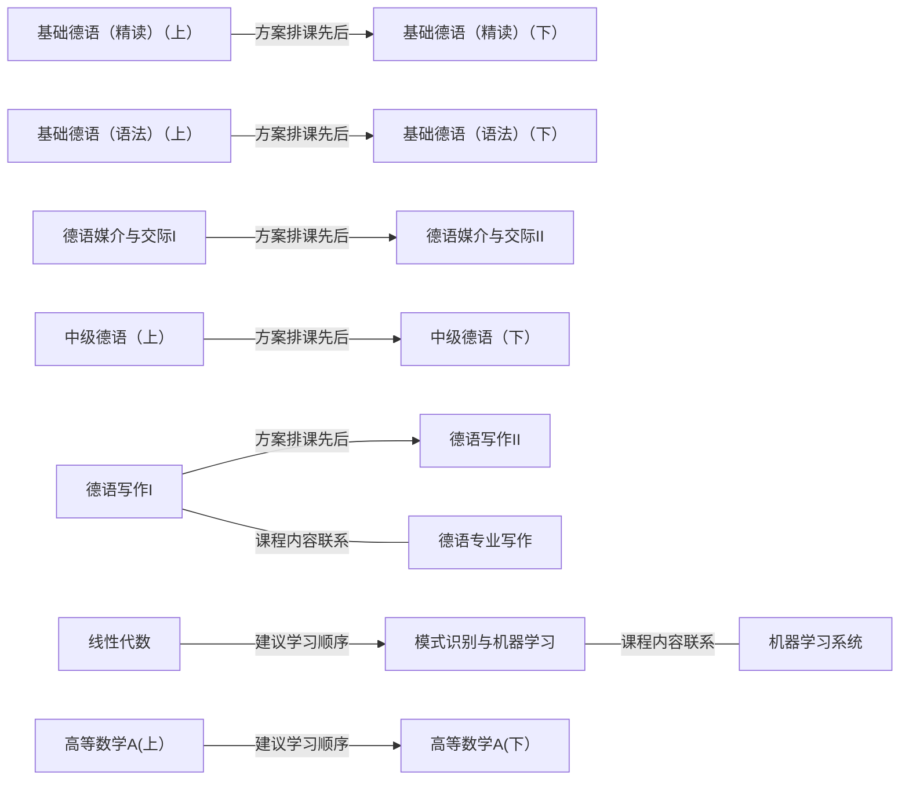

# 2025德语-计算机科学与技术双学士学位项目培养方案

外国语言文学学院 · 德语-计算机科学与技术(双学士学位项目) · 方案 96976 · 59 个不同课程或科研条目。

[官方 Word](../originals/plan-96976.docx) · [教务详情](https://fdjwgl.fudan.edu.cn/manager/bizType/2/major-program-search/info/96976?skipAuth=1) · [方案快照](../raw/plan-96976.json.gz) · [年级目录](../README.md)

## 课程关系图

图中展示部分关系。下表保留全部已建立的课程对，来源位置使用本方案 JSON Pointer。

## 先修与内容联系

| 类型 | 起点 | 终点 | 依据 | 原表定位 |
| --- | --- | --- | --- | --- |
| 建议学习顺序 | 线性代数 (CS10003) | 模式识别与机器学习 (CS30037) | 向量表示和矩阵运算支持理解分类、回归等模型。  | `/courseModules/5/planCourses/5`、`/courseModules/8/planCourses/13` |
| 建议学习顺序 | 德语媒介与交际I (FORE10021) | 德语媒介与交际II (FORE20033) | 同方案的课程题名具有连续分册或序号。  | `/courseModules/7/planCourses/4`、`/courseModules/7/planCourses/6` |
| 建议学习顺序 | 基础德语（语法）（上） (FORE10038) | 基础德语（语法）（下） (FORE10039) | 同方案的课程题名具有连续分册或序号。  | `/courseModules/7/planCourses/1`、`/courseModules/7/planCourses/3` |
| 建议学习顺序 | 基础德语（精读）（上） (FORE10040) | 基础德语（精读）（下） (FORE10041) | 同方案的课程题名具有连续分册或序号。  | `/courseModules/7/planCourses/0`、`/courseModules/7/planCourses/2` |
| 建议学习顺序 | 德语写作I (FORE20035) | 德语写作II (FORE20036) | 同方案的课程题名具有连续分册或序号。  | `/courseModules/7/planCourses/7`、`/courseModules/7/planCourses/9` |
| 建议学习顺序 | 中级德语（上） (FORE20063) | 中级德语（下） (FORE20064) | 同方案的课程题名具有连续分册或序号。  | `/courseModules/7/planCourses/5`、`/courseModules/7/planCourses/8` |
| 建议学习顺序 | 高等数学A(上） (MATH10015) | 高等数学A(下） (MATH10016) | 同方案的课程题名具有连续分册或序号。  | `/courseModules/5/planCourses/2`、`/courseModules/5/planCourses/3` |
| 方案排课先后 | 线性代数 (CS10003) | 模式识别与机器学习 (CS30037) | 同方案该课程全部明确数字学期均早于后者。  | `/courseModules/5/planCourses/5`、`/courseModules/8/planCourses/13` |
| 方案排课先后 | 德语媒介与交际I (FORE10021) | 德语媒介与交际II (FORE20033) | 同方案该课程全部明确数字学期均早于后者。  | `/courseModules/7/planCourses/4`、`/courseModules/7/planCourses/6` |
| 方案排课先后 | 基础德语（语法）（上） (FORE10038) | 基础德语（语法）（下） (FORE10039) | 同方案该课程全部明确数字学期均早于后者。  | `/courseModules/7/planCourses/1`、`/courseModules/7/planCourses/3` |
| 方案排课先后 | 基础德语（精读）（上） (FORE10040) | 基础德语（精读）（下） (FORE10041) | 同方案该课程全部明确数字学期均早于后者。  | `/courseModules/7/planCourses/0`、`/courseModules/7/planCourses/2` |
| 方案排课先后 | 德语写作I (FORE20035) | 德语写作II (FORE20036) | 同方案该课程全部明确数字学期均早于后者。  | `/courseModules/7/planCourses/7`、`/courseModules/7/planCourses/9` |
| 方案排课先后 | 中级德语（上） (FORE20063) | 中级德语（下） (FORE20064) | 同方案该课程全部明确数字学期均早于后者。  | `/courseModules/7/planCourses/5`、`/courseModules/7/planCourses/8` |
| 方案排课先后 | 高等数学A(上） (MATH10015) | 高等数学A(下） (MATH10016) | 同方案该课程全部明确数字学期均早于后者。  | `/courseModules/5/planCourses/2`、`/courseModules/5/planCourses/3` |
| 课程内容联系 | 模式识别与机器学习 (CS30037) | 机器学习系统 (CS30058) | 本方案两门课程的题名均含“机器学习”，可据此对照这一主题。  | `/courseModules/8/planCourses/13`、`/courseModules/12/planCourses/9` |
| 课程内容联系 | 德语媒介与交际I (FORE10021) | 德语媒介与交际II (FORE20033) | 本方案两门课程的题名均含“媒介”，可据此对照这一主题。  | `/courseModules/7/planCourses/4`、`/courseModules/7/planCourses/6` |
| 课程内容联系 | 基础德语（语法）（上） (FORE10038) | 基础德语（语法）（下） (FORE10039) | 本方案两门课程的题名均含“语法”，可据此对照这一主题。  | `/courseModules/7/planCourses/1`、`/courseModules/7/planCourses/3` |
| 课程内容联系 | 德语写作I (FORE20035) | 德语写作II (FORE20036) | 本方案两门课程的题名均含“写作”，可据此对照这一主题。  | `/courseModules/7/planCourses/7`、`/courseModules/7/planCourses/9` |
| 课程内容联系 | 德语写作I (FORE20035) | 德语专业写作 (FORE40022) | 本方案两门课程的题名均含“写作”，可据此对照这一主题。  | `/courseModules/7/planCourses/7`、`/courseModules/7/planCourses/12` |

本次未从可定位的明确表述中确认课程对课程预修。学期安排、系列分册与编辑建议均保留各自的依据。

## 课程表

同一课程在不同模块分别出现时，按原表逐行列出。季节字段保留原值。

| 课程 | 代码 | 学分 | 学期 | 模块 |
| --- | --- | ---: | --- | --- |
| 中国文学经典 | CHIN10005 | 3.0 | 第2学期 | 培养方案 / 专业培养课程 / 学科基础课程 |
| 中国古代文明 | HIST10006 | 3.0 | 第3学期 | 培养方案 / 专业培养课程 / 学科基础课程 |
| 高等数学A(上） | MATH10015 | 5.0 | 第1学期 | 培养方案 / 专业培养课程 / 学科基础课程 |
| 高等数学A(下） | MATH10016 | 5.0 | 第2学期 | 培养方案 / 专业培养课程 / 学科基础课程 |
| 程序设计 | CS10004 | 4.0 | 第1学期 | 培养方案 / 专业培养课程 / 学科基础课程 |
| 线性代数 | CS10003 | 3.0 | 第1学期 | 培养方案 / 专业培养课程 / 学科基础课程 |
| 基础德语（精读）（上） | FORE10040 | 6.0 | 第1学期 | 培养方案 / 专业培养课程 / 专业核心教育课程 / A组 |
| 基础德语（语法）（上） | FORE10038 | 4.0 | 第1学期 | 培养方案 / 专业培养课程 / 专业核心教育课程 / A组 |
| 基础德语（精读）（下） | FORE10041 | 6.0 | 第2学期 | 培养方案 / 专业培养课程 / 专业核心教育课程 / A组 |
| 基础德语（语法）（下） | FORE10039 | 4.0 | 第2学期 | 培养方案 / 专业培养课程 / 专业核心教育课程 / A组 |
| 德语媒介与交际I | FORE10021 | 2.0 | 第2学期 | 培养方案 / 专业培养课程 / 专业核心教育课程 / A组 |
| 中级德语（上） | FORE20063 | 6.0 | 第3学期 | 培养方案 / 专业培养课程 / 专业核心教育课程 / A组 |
| 德语媒介与交际II | FORE20033 | 2.0 | 第3学期 | 培养方案 / 专业培养课程 / 专业核心教育课程 / A组 |
| 德语写作I | FORE20035 | 2.0 | 第4学期 | 培养方案 / 专业培养课程 / 专业核心教育课程 / A组 |
| 中级德语（下） | FORE20064 | 6.0 | 第4学期 | 培养方案 / 专业培养课程 / 专业核心教育课程 / A组 |
| 德语写作II | FORE20036 | 2.0 | 第6学期 | 培养方案 / 专业培养课程 / 专业核心教育课程 / A组 |
| 翻译理论与翻译技巧（上） | FORE40046 | 2.0 | 第7学期 | 培养方案 / 专业培养课程 / 专业核心教育课程 / A组 |
| 德语文学史及作品选读(上) | FORE30002 | 2.0 | 第7学期 | 培养方案 / 专业培养课程 / 专业核心教育课程 / A组 |
| 德语专业写作 | FORE40022 | 2.0 | 第7学期 | 培养方案 / 专业培养课程 / 专业核心教育课程 / A组 |
| 数字人文导论 | FORE50125 | 2.0 | 第7学期 | 培养方案 / 专业培养课程 / 专业核心教育课程 / A组 |
| 数字逻辑与部件设计 | CS20008 | 3.0 | 第3学期 | 培养方案 / 专业培养课程 / 专业核心教育课程 / B组 |
| 数据结构 | CS20009 | 4.0 | 第3学期 | 培养方案 / 专业培养课程 / 专业核心教育课程 / B组 |
| 数据结构 | AIE310007 | 4.0 | 第3学期 | 培养方案 / 专业培养课程 / 专业核心教育课程 / B组 |
| 集合与图论 | CS30043 | 3.0 | 第3学期 | 培养方案 / 专业培养课程 / 专业核心教育课程 / B组 |
| 计算机系统基础 | CS10005 | 3.0 | 第3学期 | 培养方案 / 专业培养课程 / 专业核心教育课程 / B组 |
| 计算机系统基础 | AIE210006 | 3.0 | 第3学期 | 培养方案 / 专业培养课程 / 专业核心教育课程 / B组 |
| 计算机组成与体系结构 | CS30052 | 4.0 | 第4学期 | 培养方案 / 专业培养课程 / 专业核心教育课程 / B组 |
| 算法设计与分析 | CS30016 | 3.0 | 第4学期 | 培养方案 / 专业培养课程 / 专业核心教育课程 / B组 |
| 操作系统 | CS30031 | 3.0 | 第5学期 | 培养方案 / 专业培养课程 / 专业核心教育课程 / B组 |
| 计算机网络 | CS30036 | 3.0 | 第5学期 | 培养方案 / 专业培养课程 / 专业核心教育课程 / B组 |
| 软件工程 | CS30018 | 3.0 | 第6学期 | 培养方案 / 专业培养课程 / 专业核心教育课程 / B组 |
| 编译 | CS30017 | 3.0 | 第6学期 | 培养方案 / 专业培养课程 / 专业核心教育课程 / B组 |
| 数据库系统 | CS20001 | 3.0 | 第4学期 | 培养方案 / 专业培养课程 / 专业核心教育课程 / B组 |
| 模式识别与机器学习 | CS30037 | 3.0 | 第5学期 | 培养方案 / 专业培养课程 / 专业核心教育课程 / B组 |
| 德语语言学概论 | FORE50021 | 2.0 | SPRING、AUTUMN | 培养方案 / 专业进阶课程 / A组 |
| 德语国家社会与文化 | FORE50052 | 2.0 | SPRING、AUTUMN | 培养方案 / 专业进阶课程 / A组 |
| 奥地利文化 | FORE50041 | 2.0 | SPRING、AUTUMN | 培养方案 / 专业进阶课程 / A组 |
| 跨文化交际 | FORE50046 | 2.0 | SPRING、AUTUMN | 培养方案 / 专业进阶课程 / A组 |
| 中德文化交流的历史与现状 | FORE50121 | 2.0 | SPRING、AUTUMN | 培养方案 / 专业进阶课程 / A组 |
| 德语文学中的科技专题 | FORE50132 | 2.0 | SPRING、AUTUMN | 培养方案 / 专业进阶课程 / A组 |
| 德语影视 | FORE50022 | 2.0 | SPRING、AUTUMN | 培养方案 / 专业进阶课程 / A组 |
| 德语语言研究中的编程方法 | FORE50133 | 2.0 | SPRING、AUTUMN | 培养方案 / 专业进阶课程 / A组 |
| 德语语料库技术与应用基础 | FORE50131 | 2.0 | SPRING、AUTUMN | 培养方案 / 专业进阶课程 / A组 |
| 人工智能与德汉互译 | FORE50130 | 2.0 | SPRING、AUTUMN | 培养方案 / 专业进阶课程 / A组 |
| 概率论与数理统计 | STAT30001 | 3.0 | 第3学期 | 培养方案 / 专业进阶课程 / B组 |
| 代数结构与数理逻辑 | CS30015 | 3.0 | 第4学期 | 培养方案 / 专业进阶课程 / B组 |
| 计算理论基础 | CS30021 | 3.0 | 第5学期 | 培养方案 / 专业进阶课程 / B组 |
| 自然语言处理与大语言模型 | AIE410002 | 3.0 | 第5学期 | 培养方案 / 专业进阶课程 / B组 |
| 计算机视觉 | CS30034 | 3.0 | 第5学期 | 培养方案 / 专业进阶课程 / B组 |
| 云计算与虚拟化技术 | CS30055 | 3.0 | 第6学期 | 培养方案 / 专业进阶课程 / B组 |
| 分布式系统 | CS30033 | 3.0 | 第7学期 | 培养方案 / 专业进阶课程 / B组 |
| 计算机安全原理与实践 | CSEC50002 | 4.0 | 第7学期 | 培养方案 / 专业进阶课程 / B组 |
| 机器人学导论 | CS70012 | 3.0 | 第8学期 | 培养方案 / 专业进阶课程 / B组 |
| 机器学习系统 | CS30058 | 3.0 | 第7学期、第8学期 | 培养方案 / 专业进阶课程 / B组 |
| 强化学习 | CS70027 | 3.0 | 第7学期、第8学期 | 培养方案 / 专业进阶课程 / B组 |
| 无学分讨论班 | 101 | 0.0 |  | 融合创新能力 |
| 复芏计划(FDUROP) | 102 | 0.0 |  | 融合创新能力 |
| 实习调查 | FORE30001 | 2.0 | 第6学期 | 融合创新能力 |
| 毕业论文 | FORE40080 | 4.0 | 第8学期 | 融合创新能力 |
