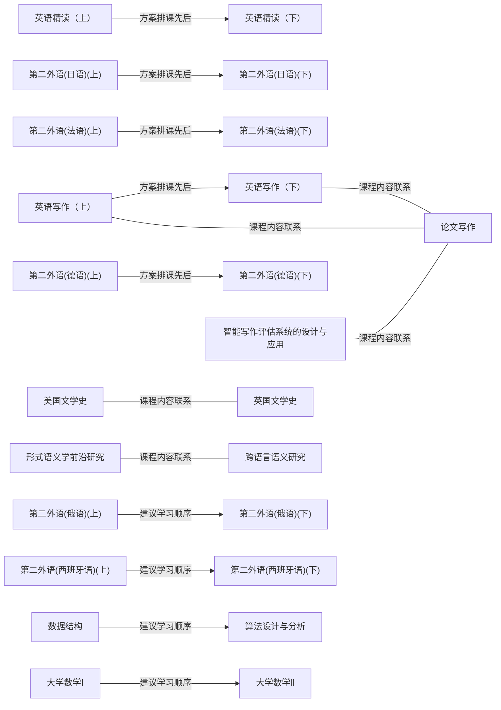

# 2025英语-外国语言文学本博融通培养方案（英语-数据语言学博雅班）

外国语言文学学院 · 英语 · 方案 96999 · 100 个不同课程或科研条目。

[官方 Word](../originals/plan-96999.docx) · [教务详情](https://fdjwgl.fudan.edu.cn/manager/bizType/2/major-program-search/info/96999?skipAuth=1) · [方案快照](../raw/plan-96999.json.gz) · [年级目录](../README.md)

## 修读导读

- **建议先学**　《英语精读（上）》（`FORE10013`） → 《英语精读（下）》（`FORE10016`）。题名列出连续册次或级别。按级别积累词汇和句式，后一阶段阅读新材料时可回查前一阶段的例句。方案分别列在第1、2学期。

- **可以对照着读**　《英语写作（上）》（`FORE10046`）与《论文写作》（`FORE40023`）。两门课的题名都涉及写作。选同一材料分别拟提纲，比较两种写作的读者、证据和段落安排。

- **查模块选课**　《英语演讲》（`FORE10012`）、《英语写作（下）》（`FORE10047`）列在“专业核心教育课程 / A组”中。原表见 `/courseModules/7`。

## 课程关系图

图中展示部分关系。下表保留全部已建立的课程对，来源位置使用本方案 JSON Pointer。

## 先修与内容联系

| 类型 | 起点 | 终点 | 依据 | 原表定位 |
| --- | --- | --- | --- | --- |
| 建议学习顺序 | 数据结构 (CS20009) | 算法设计与分析 (CS30016) | 数据组织与基本操作为算法设计提供基础。  | `/courseModules/16/planCourses/2`、`/courseModules/24/planCourses/1` |
| 建议学习顺序 | 第二外语(西班牙语)(上) (FORE10003) | 第二外语(西班牙语)(下) (FORE20001) | 同方案的课程题名具有连续分册或序号。  | `/courseModules/15/planCourses/0`、`/courseModules/15/planCourses/1` |
| 建议学习顺序 | 第二外语(日语)(上) (FORE10007) | 第二外语(日语)(下) (FORE20012) | 同方案的课程题名具有连续分册或序号。  | `/courseModules/11/planCourses/0`、`/courseModules/11/planCourses/1` |
| 建议学习顺序 | 第二外语(法语)(上) (FORE10008) | 第二外语(法语)(下) (FORE20014) | 同方案的课程题名具有连续分册或序号。  | `/courseModules/12/planCourses/0`、`/courseModules/12/planCourses/1` |
| 建议学习顺序 | 第二外语(德语)(上) (FORE10009) | 第二外语(德语)(下) (FORE20016) | 同方案的课程题名具有连续分册或序号。  | `/courseModules/13/planCourses/0`、`/courseModules/13/planCourses/1` |
| 建议学习顺序 | 第二外语(俄语)(上) (FORE10010) | 第二外语(俄语)(下) (FORE20018) | 同方案的课程题名具有连续分册或序号。  | `/courseModules/14/planCourses/0`、`/courseModules/14/planCourses/1` |
| 建议学习顺序 | 英语精读（上） (FORE10013) | 英语精读（下） (FORE10016) | 同方案的课程题名具有连续分册或序号。  | `/courseModules/7/planCourses/0`、`/courseModules/7/planCourses/4` |
| 建议学习顺序 | 英语写作（上） (FORE10046) | 英语写作（下） (FORE10047) | 同方案的课程题名具有连续分册或序号。  | `/courseModules/7/planCourses/1`、`/courseModules/7/planCourses/5` |
| 建议学习顺序 | 大学数学Ⅰ (MATH10029) | 大学数学Ⅱ (MATH10030) | 同方案的课程题名具有连续分册或序号。  | `/courseModules/5/planCourses/2`、`/courseModules/5/planCourses/3` |
| 方案排课先后 | 数据结构 (CS20009) | 算法设计与分析 (CS30016) | 同方案该课程全部明确数字学期均早于后者。  | `/courseModules/16/planCourses/2`、`/courseModules/24/planCourses/1` |
| 方案排课先后 | 第二外语(西班牙语)(上) (FORE10003) | 第二外语(西班牙语)(下) (FORE20001) | 同方案该课程全部明确数字学期均早于后者。  | `/courseModules/15/planCourses/0`、`/courseModules/15/planCourses/1` |
| 方案排课先后 | 第二外语(日语)(上) (FORE10007) | 第二外语(日语)(下) (FORE20012) | 同方案该课程全部明确数字学期均早于后者。  | `/courseModules/11/planCourses/0`、`/courseModules/11/planCourses/1` |
| 方案排课先后 | 第二外语(法语)(上) (FORE10008) | 第二外语(法语)(下) (FORE20014) | 同方案该课程全部明确数字学期均早于后者。  | `/courseModules/12/planCourses/0`、`/courseModules/12/planCourses/1` |
| 方案排课先后 | 第二外语(德语)(上) (FORE10009) | 第二外语(德语)(下) (FORE20016) | 同方案该课程全部明确数字学期均早于后者。  | `/courseModules/13/planCourses/0`、`/courseModules/13/planCourses/1` |
| 方案排课先后 | 第二外语(俄语)(上) (FORE10010) | 第二外语(俄语)(下) (FORE20018) | 同方案该课程全部明确数字学期均早于后者。  | `/courseModules/14/planCourses/0`、`/courseModules/14/planCourses/1` |
| 方案排课先后 | 英语精读（上） (FORE10013) | 英语精读（下） (FORE10016) | 同方案该课程全部明确数字学期均早于后者。  | `/courseModules/7/planCourses/0`、`/courseModules/7/planCourses/4` |
| 方案排课先后 | 英语写作（上） (FORE10046) | 英语写作（下） (FORE10047) | 同方案该课程全部明确数字学期均早于后者。  | `/courseModules/7/planCourses/1`、`/courseModules/7/planCourses/5` |
| 方案排课先后 | 大学数学Ⅰ (MATH10029) | 大学数学Ⅱ (MATH10030) | 同方案该课程全部明确数字学期均早于后者。  | `/courseModules/5/planCourses/2`、`/courseModules/5/planCourses/3` |
| 课程内容联系 | 智能写作评估系统的设计与应用 (AIT531017) | 论文写作 (FORE40023) | 本方案两门课程的题名均含“写作”，可据此对照这一主题。  | `/courseModules/23/planCourses/6`、`/courseModules/8/planCourses/5` |
| 课程内容联系 | 模式识别与机器学习 (CS30037) | 机器学习系统 (CS30058) | 本方案两门课程的题名均含“机器学习”，可据此对照这一主题。  | `/courseModules/24/planCourses/2`、`/courseModules/24/planCourses/4` |
| 课程内容联系 | 英语写作（上） (FORE10046) | 论文写作 (FORE40023) | 本方案两门课程的题名均含“写作”，可据此对照这一主题。  | `/courseModules/7/planCourses/1`、`/courseModules/8/planCourses/5` |
| 课程内容联系 | 英语写作（下） (FORE10047) | 论文写作 (FORE40023) | 本方案两门课程的题名均含“写作”，可据此对照这一主题。  | `/courseModules/7/planCourses/5`、`/courseModules/8/planCourses/5` |
| 课程内容联系 | 美国文学史 (FORE20005) | 英国文学史 (FORE20032) | 本方案两门课程的题名均含“文学史”，可据此对照这一主题。  | `/courseModules/9/planCourses/1`、`/courseModules/9/planCourses/0` |
| 课程内容联系 | 形式语义学前沿研究 (FORE50152) | 跨语言语义研究 (FORE60034) | 本方案两门课程的题名均含“语义”，可据此对照这一主题。  | `/courseModules/26/planCourses/3`、`/courseModules/26/planCourses/6` |
| 课程内容联系 | 语言与意义：语义学基础 (FORE60006) | 跨语言语义研究 (FORE60034) | 本方案两门课程的题名均含“语义”，可据此对照这一主题。  | `/courseModules/17/planCourses/12`、`/courseModules/26/planCourses/6` |

本次未从可定位的明确表述中确认课程对课程预修。学期安排、系列分册与编辑建议均保留各自的依据。

## 按原方案模块阅读

同一模块展示原表中的课程归属。模块内课程之间的先后仍须逐项查阅。

- **日语组**　第二外语(日语)(上)、第二外语(日语)(下)（原表模块 11）
- **法语组**　第二外语(法语)(上)、第二外语(法语)(下)（原表模块 12）
- **德语组**　第二外语(德语)(上)、第二外语(德语)(下)（原表模块 13）
- **俄语组**　第二外语(俄语)(上)、第二外语(俄语)(下)（原表模块 14）
- **西班牙语组**　第二外语(西班牙语)(上)、第二外语(西班牙语)(下)（原表模块 15）
- **语言学理论进阶**　普通语言学、西方语言学理论、功能语言学、计量语言学导论、第二语言习得前沿、语料库语言学、认知语言学、计算语言学概论（原表模块 22）
- **语言学方法与实践进阶**　AI赋能的语言分析和语言习得、智能写作评估系统的设计与应用、语言学质性研究方法、语言学量化研究方法、话语分析、语言测试与评估、外语教育研究与实践（原表模块 23）
- **数据科学与计算机技术进阶**　数据库系统、算法设计与分析、编译、模式识别与机器学习、机器学习系统、自然语言处理与语言习得（原表模块 24）
- **语言学专题研讨**　形式语义学前沿研究、认知语言学研究、跨语言语义研究、系统功能语言学专题研究、双语心理表征研究、双语词典编纂理论与实践、语言知识库研究（原表模块 26）

## 课程表

同一课程在不同模块分别出现时，按原表逐行列出。季节字段保留原值。

| 课程 | 代码 | 学分 | 学期 | 模块 |
| --- | --- | ---: | --- | --- |
| 中国文学经典 | CHIN10005 | 3.0 | 第1学期 | 培养方案 / 专业培养课程 / 学科基础课程 |
| 中国古代文明 | HIST10006 | 3.0 | 第2学期 | 培养方案 / 专业培养课程 / 学科基础课程 |
| 大学数学Ⅰ | MATH10029 | 3.0 | 第3学期 | 培养方案 / 专业培养课程 / 学科基础课程 |
| 大学数学Ⅱ | MATH10030 | 3.0 | 第4学期 | 培养方案 / 专业培养课程 / 学科基础课程 |
| 线性代数B | MATH10032 | 3.0 | 第5学期 | 培养方案 / 专业培养课程 / 学科基础课程 |
| 英语精读（上） | FORE10013 | 4.0 | 第1学期 | 培养方案 / 专业培养课程 / 专业核心教育课程 / A组 |
| 英语写作（上） | FORE10046 | 2.0 | 第1学期 | 培养方案 / 专业培养课程 / 专业核心教育课程 / A组 |
| 语言学概论 | FORE10029 | 2.0 | 第1学期 | 培养方案 / 专业培养课程 / 专业核心教育课程 / A组 |
| 英语演讲 | FORE10012 | 2.0 | 第2学期 | 培养方案 / 专业培养课程 / 专业核心教育课程 / A组 |
| 英语精读（下） | FORE10016 | 4.0 | 第2学期 | 培养方案 / 专业培养课程 / 专业核心教育课程 / A组 |
| 英语写作（下） | FORE10047 | 2.0 | 第2学期 | 培养方案 / 专业培养课程 / 专业核心教育课程 / A组 |
| 英语文学导读 | FORE10048 | 2.0 | 第2学期 | 培养方案 / 专业培养课程 / 专业核心教育课程 / A组 |
| 跨文化交际 | FORE20028 | 2.0 | 第3学期 | 培养方案 / 专业培养课程 / 专业核心教育课程 / A组 |
| 语音科学 | FORE40002 | 2.0 | 第3学期 | 培养方案 / 专业培养课程 / 专业核心教育课程 / B组 |
| 英语词汇学 | FORE50018 | 2.0 | 第3学期 | 培养方案 / 专业培养课程 / 专业核心教育课程 / B组 |
| 英语句法学导论 | FORE50065 | 2.0 | 第4学期 | 培养方案 / 专业培养课程 / 专业核心教育课程 / B组 |
| 应用语言学导论 | FORE20024 | 2.0 | 第4学期 | 培养方案 / 专业培养课程 / 专业核心教育课程 / B组 |
| 研究方法入门 | FORE40052 | 2.0 | 第5学期 | 培养方案 / 专业培养课程 / 专业核心教育课程 / B组 |
| 论文写作 | FORE40023 | 2.0 | 第5学期 | 培养方案 / 专业培养课程 / 专业核心教育课程 / B组 |
| 英国文学史 | FORE20032 | 2.0 | 第3学期 | 培养方案 / 专业培养课程 / 专业核心教育课程 / C组 |
| 美国文学史 | FORE20005 | 2.0 | 第4学期 | 培养方案 / 专业培养课程 / 专业核心教育课程 / C组 |
| 英语语言史 | FORE20029 | 2.0 | 第5学期 | 培养方案 / 专业培养课程 / 专业核心教育课程 / C组 |
| 数字人文导论 | FORE50125 | 2.0 | 第6学期 | 培养方案 / 专业培养课程 / 专业核心教育课程 / C组 |
| 翻译理论基础 | FORE20065 | 2.0 | 第4学期 | 培养方案 / 专业培养课程 / 专业核心教育课程 / C组 |
| 口译理论与实践 | FORE40024 | 2.0 | 第5学期 | 培养方案 / 专业培养课程 / 专业核心教育课程 / C组 |
| 第二外语(日语)(上) | FORE10007 | 4.0 | 第3学期 | 培养方案 / 专业培养课程 / 专业核心教育课程 / D组 / 日语组 |
| 第二外语(日语)(下) | FORE20012 | 4.0 | 第4学期 | 培养方案 / 专业培养课程 / 专业核心教育课程 / D组 / 日语组 |
| 第二外语(法语)(上) | FORE10008 | 4.0 | 第3学期 | 培养方案 / 专业培养课程 / 专业核心教育课程 / D组 / 法语组 |
| 第二外语(法语)(下) | FORE20014 | 4.0 | 第4学期 | 培养方案 / 专业培养课程 / 专业核心教育课程 / D组 / 法语组 |
| 第二外语(德语)(上) | FORE10009 | 4.0 | 第3学期 | 培养方案 / 专业培养课程 / 专业核心教育课程 / D组 / 德语组 |
| 第二外语(德语)(下) | FORE20016 | 4.0 | 第4学期 | 培养方案 / 专业培养课程 / 专业核心教育课程 / D组 / 德语组 |
| 第二外语(俄语)(上) | FORE10010 | 4.0 | 第3学期 | 培养方案 / 专业培养课程 / 专业核心教育课程 / D组 / 俄语组 |
| 第二外语(俄语)(下) | FORE20018 | 4.0 | 第4学期 | 培养方案 / 专业培养课程 / 专业核心教育课程 / D组 / 俄语组 |
| 第二外语(西班牙语)(上) | FORE10003 | 4.0 | 第3学期 | 培养方案 / 专业培养课程 / 专业核心教育课程 / D组 / 西班牙语组 |
| 第二外语(西班牙语)(下) | FORE20001 | 4.0 | 第4学期 | 培养方案 / 专业培养课程 / 专业核心教育课程 / D组 / 西班牙语组 |
| Python程序设计 | AIB110002 | 1.0 | 第2学期 | 培养方案 / 专业培养课程 / 专业核心教育课程 / E组 |
| 概率论与数理统计 | STAT30001 | 3.0 | 第3学期 | 培养方案 / 专业培养课程 / 专业核心教育课程 / E组 |
| 数据结构 | CS20009 | 4.0 | 第5学期 | 培养方案 / 专业培养课程 / 专业核心教育课程 / E组 |
| 自然语言处理与大语言模型 | AIE410002 | 3.0 | 第5学期 | 培养方案 / 专业培养课程 / 专业核心教育课程 / E组 |
| 从影视作品走近语言研究 | FORE10053 | 2.0 | 第2学期、第3学期 | 培养方案 / 专业培养课程 / 专业选修课程 |
| 媒体英语 | FORE50068 | 2.0 | 第3学期 | 培养方案 / 专业培养课程 / 专业选修课程 |
| 语言与逻辑 | FORE50063 | 2.0 | 第3学期 | 培养方案 / 专业培养课程 / 专业选修课程 |
| 跨语言语法比较 | FORE50079 | 2.0 | 第3学期 | 培养方案 / 专业培养课程 / 专业选修课程 |
| 英语词典学导论 | FORE50050 | 2.0 | 第3学期 | 培养方案 / 专业培养课程 / 专业选修课程 |
| 全球语境下的语言习得与发展 | FORE20075 | 2.0 | 第3学期、第4学期 | 培养方案 / 专业培养课程 / 专业选修课程 |
| 英国儿童文学 | FORE50122 | 2.0 | 第3学期、第4学期 | 培养方案 / 专业培养课程 / 专业选修课程 |
| 阿加莎·克里斯蒂的早期侦探小说 | FORE30075 | 2.0 | 第3学期、第4学期 | 培养方案 / 专业培养课程 / 专业选修课程 |
| 语言与社会 | FORE50066 | 2.0 | 第4学期 | 培养方案 / 专业培养课程 / 专业选修课程 |
| 18世纪英国文学 | FORE50110 | 2.0 | 第4学期 | 培养方案 / 专业培养课程 / 专业选修课程 |
| 语言与教育 | FORE50064 | 2.0 | 第5学期 | 培养方案 / 专业培养课程 / 专业选修课程 |
| 语言心理学 | FORE60007 | 2.0 | 第5学期 | 培养方案 / 专业培养课程 / 专业选修课程 |
| 语言与意义：语义学基础 | FORE60006 | 2.0 | 第5学期 | 培养方案 / 专业培养课程 / 专业选修课程 |
| 19世纪美国文学 | FORE50111 | 2.0 | 第5学期 | 培养方案 / 专业培养课程 / 专业选修课程 |
| 英美科幻文学导论 | FORE50124 | 2.0 | 第5学期 | 培养方案 / 专业培养课程 / 专业选修课程 |
| 以语言为中心的生成式AI | FORE30067 | 2.0 | 第5学期 | 培养方案 / 专业培养课程 / 专业选修课程 |
| 变革时代的语言教育：从双语走向人工智能 | FORE30074 | 2.0 | 第5学期、第6学期 | 培养方案 / 专业培养课程 / 专业选修课程 |
| 莎士比亚选读 | FORE50015 | 2.0 | 第6学期 | 培养方案 / 专业培养课程 / 专业选修课程 |
| 跨文化语境下的现代主义书写 | FORE30070 | 2.0 | 第6学期、第7学期 | 培养方案 / 专业培养课程 / 专业选修课程 |
| 近现代视域下的女性与书写 | FORE30072 | 2.0 | 第6学期、第7学期 | 培养方案 / 专业培养课程 / 专业选修课程 |
| 哈利波特的故事世界 | FORE20074 | 2.0 | 第3学期、第4学期 | 培养方案 / 专业培养课程 / 专业选修课程 |
| 莎士比亚改编与表演 | FORE30069 | 2.0 | 第5学期、第6学期 | 培养方案 / 专业培养课程 / 专业选修课程 |
| 普通语言学 | FORE40053 | 2.0 | 第7学期 | 培养方案 / 专业进阶 / 专业进阶I / 语言学理论进阶 |
| 功能语言学 | FORE40064 | 2.0 | 第7学期 | 培养方案 / 专业进阶 / 专业进阶I / 语言学理论进阶 |
| 计量语言学导论 | FORE50002 | 2.0 | 第8学期 | 培养方案 / 专业进阶 / 专业进阶I / 语言学理论进阶 |
| 语料库语言学 | FORE60002 | 2.0 | 第9学期 | 培养方案 / 专业进阶 / 专业进阶I / 语言学理论进阶 |
| 西方语言学理论 | FORE40056 | 2.0 | 第9学期 | 培养方案 / 专业进阶 / 专业进阶I / 语言学理论进阶 |
| 计算语言学概论 | FORE70071 | 2.0 | 第10学期 | 培养方案 / 专业进阶 / 专业进阶I / 语言学理论进阶 |
| 第二语言习得前沿 | FORE50155 | 2.0 | 第10学期 | 培养方案 / 专业进阶 / 专业进阶I / 语言学理论进阶 |
| 认知语言学 | FORE70018 | 2.0 | 第8学期 | 培养方案 / 专业进阶 / 专业进阶I / 语言学理论进阶 |
| 语言学量化研究方法 | FORE70001 | 2.0 | 第7学期 | 培养方案 / 专业进阶 / 专业进阶I / 语言学方法与实践进阶 |
| 语言学质性研究方法 | FORE50001 | 2.0 | 第8学期 | 培养方案 / 专业进阶 / 专业进阶I / 语言学方法与实践进阶 |
| 话语分析 | FORE70020 | 2.0 | 第9学期 | 培养方案 / 专业进阶 / 专业进阶I / 语言学方法与实践进阶 |
| 语言测试与评估 | FORE70060 | 2.0 | 第7学期 | 培养方案 / 专业进阶 / 专业进阶I / 语言学方法与实践进阶 |
| 外语教育研究与实践 | FORE70081 | 2.0 | 第8学期 | 培养方案 / 专业进阶 / 专业进阶I / 语言学方法与实践进阶 |
| AI赋能的语言分析和语言习得 | AIS531002 | 2.0 | 第9学期 | 培养方案 / 专业进阶 / 专业进阶I / 语言学方法与实践进阶 |
| 智能写作评估系统的设计与应用 | AIT531017 | 2.0 | 第10学期 | 培养方案 / 专业进阶 / 专业进阶I / 语言学方法与实践进阶 |
| 数据库系统 | CS20001 | 3.0 | 第6学期 | 培养方案 / 专业进阶 / 专业进阶I / 数据科学与计算机技术进阶 |
| 算法设计与分析 | CS30016 | 3.0 | 第6学期 | 培养方案 / 专业进阶 / 专业进阶I / 数据科学与计算机技术进阶 |
| 模式识别与机器学习 | CS30037 | 3.0 | 第7学期 | 培养方案 / 专业进阶 / 专业进阶I / 数据科学与计算机技术进阶 |
| 自然语言处理与语言习得 | FORE20066 | 2.0 | 第6学期 | 培养方案 / 专业进阶 / 专业进阶I / 数据科学与计算机技术进阶 |
| 机器学习系统 | CS30058 | 3.0 | 第9学期 | 培养方案 / 专业进阶 / 专业进阶I / 数据科学与计算机技术进阶 |
| 编译 | CS30017 | 3.0 | 第8学期 | 培养方案 / 专业进阶 / 专业进阶I / 数据科学与计算机技术进阶 |
| 语言知识库研究 | FORE70092 | 3.0 | SPRING、AUTUMN | 培养方案 / 专业进阶 / 专业进阶II / 语言学专题研讨 |
| 认知语言学研究 | FORE60027 | 3.0 | SPRING、AUTUMN | 培养方案 / 专业进阶 / 专业进阶II / 语言学专题研讨 |
| 双语心理表征研究 | FORE60049 | 3.0 | SPRING、AUTUMN | 培养方案 / 专业进阶 / 专业进阶II / 语言学专题研讨 |
| 形式语义学前沿研究 | FORE50152 | 2.0 | SPRING、AUTUMN | 培养方案 / 专业进阶 / 专业进阶II / 语言学专题研讨 |
| 双语词典编纂理论与实践 | FORE70091 | 3.0 | SPRING、AUTUMN | 培养方案 / 专业进阶 / 专业进阶II / 语言学专题研讨 |
| 系统功能语言学专题研究 | FORE60044 | 3.0 | SPRING、AUTUMN | 培养方案 / 专业进阶 / 专业进阶II / 语言学专题研讨 |
| 跨语言语义研究 | FORE60034 | 3.0 | SPRING、AUTUMN | 培养方案 / 专业进阶 / 专业进阶II / 语言学专题研讨 |
| 国际交流 | 7 | 0.0 |  | 融合创新能力 |
| 研究生学术活动 | 4 | 2.0 |  | 融合创新能力 |
| 研究生实践活动 | 5 | 2.0 |  | 融合创新能力 |
| 无学分讨论班 | 101 | 0.0 |  | 融合创新能力 |
| 博士生资格考核 | 2 | 1.0 |  | 融合创新能力 |
| 博士学位论文开题 | 1 | 0.0 |  | 融合创新能力 |
| 博士论文中期考核 | 3 | 0.0 |  | 融合创新能力 |
| 博士学位论文预审 | 6 | 0.0 |  | 融合创新能力 |
| 其他 | 107 | 0.0 |  | 融合创新能力 |
| 复芏计划(FDUROP) | 102 | 0.0 |  | 融合创新能力 |
| 毕业论文 | FORE40080 | 4.0 | 第8学期 | 融合创新能力 |
