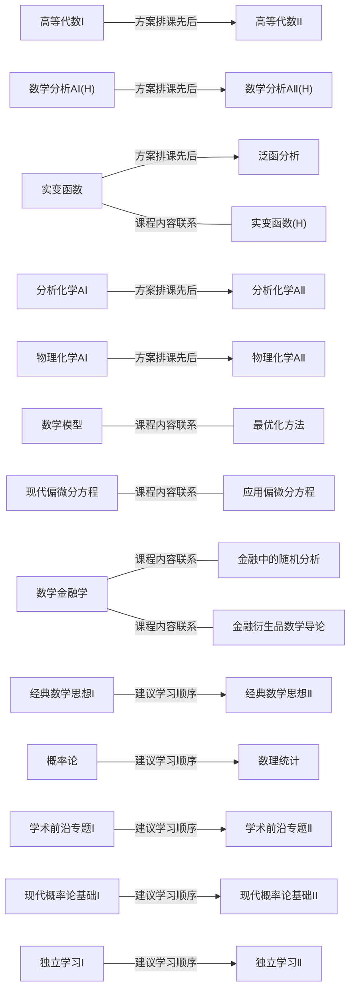

# 2024级数学与应用数学专业“2+X”教学培养方案（相辉计划适用）

数学科学学院 · 数学与应用数学(相辉计划) · 方案 72972 · 199 个不同课程或科研条目。

[官方 Word](../originals/plan-72972.docx) · [教务详情](https://fdjwgl.fudan.edu.cn/manager/bizType/2/major-program-search/info/72972?skipAuth=1) · [方案快照](../raw/plan-72972.json.gz) · [年级目录](../README.md)

## 修读导读

- **建议先学**　《实变函数》（`MATH20017`） → 《泛函分析》（`MATH30004`）。测度与积分有助于理解函数空间。

- **可以对照着读**　《数学模型》（`MATH20009`）与《最优化方法》（`MATH30020`）。共同主题为模型目标、决策变量与优化求解。

- **查模块选课**　《高等代数Ⅰ》（`MATH10009`）、《经典数学思想I》（`MATH10021`）列在“专业必修课程”中。原表见 `/courseModules/6`。

## 课程关系图

图中展示部分关系。下表保留全部已建立的课程对，来源位置使用本方案 JSON Pointer。

## 先修与内容联系

| 类型 | 起点 | 终点 | 依据 | 原表定位 |
| --- | --- | --- | --- | --- |
| 建议学习顺序 | 人工智能导论 (AIE310005) | 模式识别与机器学习 (AIE410001) | 人工智能问题与模型类别可为学习模式识别作准备。  | `/courseModules/25/planCourses/9`、`/courseModules/25/planCourses/3` |
| 建议学习顺序 | 生物化学A(上) (BIOL30002) | 生物化学A(下) (BIOL30021) | 同方案的课程题名具有连续分册或序号。  | `/courseModules/24/planCourses/4`、`/courseModules/24/planCourses/5` |
| 建议学习顺序 | 分析化学AⅠ (CHEM20001) | 分析化学AⅡ (CHEM20002) | 同方案的课程题名具有连续分册或序号。  | `/courseModules/23/planCourses/3`、`/courseModules/23/planCourses/4` |
| 建议学习顺序 | 物理化学AⅠ (CHEM20005) | 物理化学AⅡ (CHEM20006) | 同方案的课程题名具有连续分册或序号。  | `/courseModules/23/planCourses/5`、`/courseModules/23/planCourses/6` |
| 建议学习顺序 | 物理化学AⅡ (CHEM20006) | 物理化学AⅢ (CHEM30004) | 同方案的课程题名具有连续分册或序号。  | `/courseModules/23/planCourses/6`、`/courseModules/23/planCourses/7` |
| 建议学习顺序 | 有机化学A I (CHEM20013) | 有机化学A II (CHEM20014) | 同方案的课程题名具有连续分册或序号。  | `/courseModules/23/planCourses/8`、`/courseModules/23/planCourses/9` |
| 建议学习顺序 | 集成电路实验(上) (ICSE40008) | 集成电路实验(下) (ICSE40009) | 同方案的课程题名具有连续分册或序号。  | `/courseModules/26/planCourses/0`、`/courseModules/26/planCourses/1` |
| 建议学习顺序 | 高等代数Ⅰ (MATH10009) | 高等代数II (MATH10019) | 同方案的课程题名具有连续分册或序号。  | `/courseModules/6/planCourses/0`、`/courseModules/6/planCourses/2` |
| 建议学习顺序 | 数学分析AⅠ(H) (MATH10010h) | 数学分析AⅡ(H) (MATH10011h) | 同方案的课程题名具有连续分册或序号。  | `/courseModules/14/planCourses/11`、`/courseModules/14/planCourses/12` |
| 建议学习顺序 | 经典数学思想I (MATH10021) | 经典数学思想Ⅱ (MATH10022) | 同方案的课程题名具有连续分册或序号。  | `/courseModules/6/planCourses/1`、`/courseModules/6/planCourses/3` |
| 建议学习顺序 | 实变函数 (MATH20017) | 泛函分析 (MATH30004) | 测度与积分有助于理解函数空间。  | `/courseModules/6/planCourses/9`、`/courseModules/8/planCourses/0` |
| 建议学习顺序 | 概率论 (MATH30003) | 数理统计 (MATH30011) | 分布和期望为统计估计与检验提供基础。  | `/courseModules/12/planCourses/0`、`/courseModules/12/planCourses/2` |
| 建议学习顺序 | 学术前沿专题Ⅰ (MATH40001) | 学术前沿专题Ⅱ (MATH40002) | 同方案的课程题名具有连续分册或序号。  | `/courseModules/6/planCourses/12`、`/courseModules/20/planCourses/80` |
| 建议学习顺序 | 现代概率论基础I (MATH50027) | 现代概率论基础II (MATH50028) | 同方案的课程题名具有连续分册或序号。  | `/courseModules/20/planCourses/52`、`/courseModules/20/planCourses/53` |
| 建议学习顺序 | 独立学习I (MATH50029) | 独立学习Ⅱ (MATH50030) | 同方案的课程题名具有连续分册或序号。  | `/courseModules/20/planCourses/55`、`/courseModules/20/planCourses/56` |
| 方案排课先后 | 人工智能导论 (AIE310005) | 模式识别与机器学习 (AIE410001) | 同方案该课程全部明确数字学期均早于后者。  | `/courseModules/25/planCourses/9`、`/courseModules/25/planCourses/3` |
| 方案排课先后 | 生物化学A(上) (BIOL30002) | 生物化学A(下) (BIOL30021) | 同方案该课程全部明确数字学期均早于后者。  | `/courseModules/24/planCourses/4`、`/courseModules/24/planCourses/5` |
| 方案排课先后 | 分析化学AⅠ (CHEM20001) | 分析化学AⅡ (CHEM20002) | 同方案该课程全部明确数字学期均早于后者。  | `/courseModules/23/planCourses/3`、`/courseModules/23/planCourses/4` |
| 方案排课先后 | 物理化学AⅠ (CHEM20005) | 物理化学AⅡ (CHEM20006) | 同方案该课程全部明确数字学期均早于后者。  | `/courseModules/23/planCourses/5`、`/courseModules/23/planCourses/6` |
| 方案排课先后 | 物理化学AⅡ (CHEM20006) | 物理化学AⅢ (CHEM30004) | 同方案该课程全部明确数字学期均早于后者。  | `/courseModules/23/planCourses/6`、`/courseModules/23/planCourses/7` |
| 方案排课先后 | 有机化学A I (CHEM20013) | 有机化学A II (CHEM20014) | 同方案该课程全部明确数字学期均早于后者。  | `/courseModules/23/planCourses/8`、`/courseModules/23/planCourses/9` |
| 方案排课先后 | 集成电路实验(上) (ICSE40008) | 集成电路实验(下) (ICSE40009) | 同方案该课程全部明确数字学期均早于后者。  | `/courseModules/26/planCourses/0`、`/courseModules/26/planCourses/1` |
| 方案排课先后 | 高等代数Ⅰ (MATH10009) | 高等代数II (MATH10019) | 同方案该课程全部明确数字学期均早于后者。  | `/courseModules/6/planCourses/0`、`/courseModules/6/planCourses/2` |
| 方案排课先后 | 数学分析AⅠ(H) (MATH10010h) | 数学分析AⅡ(H) (MATH10011h) | 同方案该课程全部明确数字学期均早于后者。  | `/courseModules/14/planCourses/11`、`/courseModules/14/planCourses/12` |
| 方案排课先后 | 实变函数 (MATH20017) | 泛函分析 (MATH30004) | 同方案该课程全部明确数字学期均早于后者。  | `/courseModules/6/planCourses/9`、`/courseModules/8/planCourses/0` |
| 课程内容联系 | 人工智能导论 (AIE310005) | 人工智能 (CS50020) | 本方案两门课程的题名均含“人工智能”，可据此对照这一主题。  | `/courseModules/25/planCourses/9`、`/courseModules/20/planCourses/75` |
| 课程内容联系 | 人工智能的编程基础 (AIE310006) | 人工智能 (CS50020) | 本方案两门课程的题名均含“人工智能”，可据此对照这一主题。  | `/courseModules/25/planCourses/0`、`/courseModules/20/planCourses/75` |
| 课程内容联系 | 人工智能的数学基础 (AIE310009) | 模式识别与机器学习 (AIE410001) | 数学表达与学习模型的统计、优化工具可对照。  | `/courseModules/25/planCourses/7`、`/courseModules/25/planCourses/3` |
| 课程内容联系 | 人工智能的数学基础 (AIE310009) | 人工智能 (CS50020) | 本方案两门课程的题名均含“人工智能”，可据此对照这一主题。  | `/courseModules/25/planCourses/7`、`/courseModules/20/planCourses/75` |
| 课程内容联系 | 人工智能生物学 (AIS310017) | 人工智能 (CS50020) | 本方案两门课程的题名均含“人工智能”，可据此对照这一主题。  | `/courseModules/24/planCourses/16`、`/courseModules/20/planCourses/75` |
| 课程内容联系 | 数据科学的逼近论基础 (AIS631003) | 现代数据科学选讲 (MATH40042) | 本方案两门课程的题名均含“数据科学”，可据此对照这一主题。  | `/courseModules/20/planCourses/68`、`/courseModules/20/planCourses/65` |
| 课程内容联系 | 生物化学A(上) (BIOL30002) | 生物化学实验 (BIOL30003) | 本方案两门课程的题名均含“生物化学”，可据此对照这一主题。  | `/courseModules/24/planCourses/4`、`/courseModules/24/planCourses/6` |
| 课程内容联系 | 生物化学实验 (BIOL30003) | 生物化学A(下) (BIOL30021) | 本方案两门课程的题名均含“生物化学”，可据此对照这一主题。  | `/courseModules/24/planCourses/6`、`/courseModules/24/planCourses/5` |
| 课程内容联系 | 细胞生物学 (BIOL30004) | 细胞生物学实验 (BIOL30005) | 题名显示相同主题的课程与实验、实践或实习。  | `/courseModules/24/planCourses/7`、`/courseModules/24/planCourses/8` |
| 课程内容联系 | 微生物学 (BIOL30006) | 微生物学实验 (BIOL30007) | 题名显示相同主题的课程与实验、实践或实习。  | `/courseModules/24/planCourses/11`、`/courseModules/24/planCourses/12` |
| 课程内容联系 | 遗传学 (BIOL30008) | 遗传学实验 (BIOL30009) | 题名显示相同主题的课程与实验、实践或实习。  | `/courseModules/24/planCourses/13`、`/courseModules/24/planCourses/14` |
| 课程内容联系 | 生理学 (BIOL30010) | 生理学实验 (BIOL30020) | 题名显示相同主题的课程与实验、实践或实习。  | `/courseModules/24/planCourses/9`、`/courseModules/24/planCourses/10` |
| 课程内容联系 | 普通生物学 (BIOL30019) | 普通生物学实验 (GEEC10037) | 题名显示相同主题的课程与实验、实践或实习。  | `/courseModules/24/planCourses/2`、`/courseModules/24/planCourses/3` |
| 课程内容联系 | 分析化学AⅠ (CHEM20001) | 分析化学 (CHEM20015) | 本方案两门课程的题名均含“分析化学”，可据此对照这一主题。  | `/courseModules/23/planCourses/3`、`/courseModules/24/planCourses/21` |
| 课程内容联系 | 分析化学AⅡ (CHEM20002) | 分析化学 (CHEM20015) | 本方案两门课程的题名均含“分析化学”，可据此对照这一主题。  | `/courseModules/23/planCourses/4`、`/courseModules/24/planCourses/21` |
| 课程内容联系 | 物理化学AⅠ (CHEM20005) | 物理化学AⅡ (CHEM20006) | 本方案两门课程的题名均含“物理化学”，可据此对照这一主题。  | `/courseModules/23/planCourses/5`、`/courseModules/23/planCourses/6` |
| 课程内容联系 | 物理化学AⅠ (CHEM20005) | 物理化学AⅢ (CHEM30004) | 本方案两门课程的题名均含“物理化学”，可据此对照这一主题。  | `/courseModules/23/planCourses/5`、`/courseModules/23/planCourses/7` |
| 课程内容联系 | 有机化学 (CHEM20011) | 有机化学实验 (CHEM20012) | 题名显示相同主题的课程与实验、实践或实习。  | `/courseModules/24/planCourses/19`、`/courseModules/24/planCourses/20` |
| 课程内容联系 | 有机化学 (CHEM20011) | 有机化学A I (CHEM20013) | 本方案两门课程的题名均含“有机化学”，可据此对照这一主题。  | `/courseModules/24/planCourses/19`、`/courseModules/23/planCourses/8` |
| 课程内容联系 | 有机化学 (CHEM20011) | 有机化学A II (CHEM20014) | 本方案两门课程的题名均含“有机化学”，可据此对照这一主题。  | `/courseModules/24/planCourses/19`、`/courseModules/23/planCourses/9` |
| 课程内容联系 | 分析化学 (CHEM20015) | 分析化学实验 (CHEM20016) | 题名显示相同主题的课程与实验、实践或实习。  | `/courseModules/24/planCourses/21`、`/courseModules/24/planCourses/22` |
| 课程内容联系 | 集成电路实验(上) (ICSE40008) | 集成电路实验(下) (ICSE40009) | 本方案两门课程的题名均含“集成电路”，可据此对照这一主题。  | `/courseModules/26/planCourses/0`、`/courseModules/26/planCourses/1` |
| 课程内容联系 | 统计学习 (IST30007) | 统计学基础：原理、方法及R应用 (I) (STAT20010) | 本方案两门课程的题名均含“统计学”，可据此对照这一主题。  | `/courseModules/20/planCourses/78`、`/courseModules/20/planCourses/74` |
| 课程内容联系 | 数学模型 (MATH20009) | 最优化方法 (MATH30020) | 共同主题为模型目标、决策变量与优化求解。  | `/courseModules/11/planCourses/0`、`/courseModules/20/planCourses/43` |
| 课程内容联系 | 实变函数 (MATH20017) | 实变函数(H) (MATH20017h) | 本方案两门课程的题名均含“实变函数”，可据此对照这一主题。  | `/courseModules/6/planCourses/9`、`/courseModules/6/planCourses/10` |
| 课程内容联系 | 数学金融学 (MATH30006) | 金融中的随机分析 (MATH30021) | 本方案两门课程的题名均含“金融”，可据此对照这一主题。  | `/courseModules/20/planCourses/5`、`/courseModules/20/planCourses/47` |
| 课程内容联系 | 数学金融学 (MATH30006) | 金融衍生品数学导论 (MATH30023) | 本方案两门课程的题名均含“金融”，可据此对照这一主题。  | `/courseModules/20/planCourses/5`、`/courseModules/20/planCourses/66` |
| 课程内容联系 | 数据科学中的现代逼近方法 (MATH40025) | 现代数据科学选讲 (MATH40042) | 本方案两门课程的题名均含“数据科学”，可据此对照这一主题。  | `/courseModules/20/planCourses/26`、`/courseModules/20/planCourses/65` |
| 课程内容联系 | 现代偏微分方程 (MATH40030) | 应用偏微分方程 (MATH50016) | 本方案两门课程的题名均含“偏微分方程”，可据此对照这一主题。  | `/courseModules/11/planCourses/5`、`/courseModules/20/planCourses/2` |
| 课程内容联系 | 应用偏微分方程 (MATH50016) | 变分法与偏微分方程 (MATH50023) | 本方案两门课程的题名均含“偏微分方程”，可据此对照这一主题。  | `/courseModules/20/planCourses/2`、`/courseModules/20/planCourses/41` |

本次未从可定位的明确表述中确认课程对课程预修。学期安排、系列分册与编辑建议均保留各自的依据。

## 按原方案模块阅读

同一模块展示原表中的课程归属。模块内课程之间的先后仍须逐项查阅。

- **分析系列**　泛函分析、泛函分析(H)、动力系统、Fourier分析、多复变函数论、多复变函数论(H)（原表模块 8）
- **几何与拓扑系列**　同调论、微分流形、微分流形(H)、代数拓扑与微分形式(H)、黎曼几何初步(H)、代数拓扑（原表模块 9）
- **代数与数论系列**　数论基础、代数数论初步、表示论基础（H）、交换代数（H）、同调代数（H）（原表模块 10）
- **应用数学系列**　数学模型、数理方程、数理方程（H）、数学控制论(H)、现代偏微分方程、数值代数与优化(H)（原表模块 11）
- **概率与统计系列**　概率论、概率论(H)、数理统计、随机过程（原表模块 12）
- **数学物理系列**　数学广义相对论、经典物理选讲、量子力学I（原表模块 13）
- **物理组**　大学物理实验Ⅰ、热力学与统计物理I、量子力学I、复杂科学前沿与创新（原表模块 22）
- **化学组**　分析化学AⅠ、分析化学AⅡ、物理化学AⅠ、物理化学AⅡ、有机化学A I、有机化学A II、无机化学与化学分析实验、物理化学AⅢ、计算化学、纳米材料与功能器件、计算谱学原理（原表模块 23）
- **生物组**　人工智能生物学、人工智能结构生物学、AI在生物分子结构中的研究及应用、生物化学A(上)、生物化学实验、细胞生物学、细胞生物学实验、微生物学、微生物学实验、遗传学、遗传学实验、生理学、分子生物学、普通生物学、生理学实验、生物化学A(下)、生物物理学、生物信息学等23项（原表模块 24）
- **人工智能组**　计算机系统基础、计算机视觉、人工智能导论、人工智能的编程基础、数据结构、人工智能的数学基础、模式识别与机器学习、自然语言处理与大语言模型、人工智能前沿探索实践、人工智能的伦理与治理（原表模块 25）
- **微电子组**　模拟电子线路、数字逻辑基础、信号与系统概论、集成电路实验(上)、集成电路实验(下)（原表模块 26）
- **经济学组**　人工智能与应用经济学、创新经济学、国际贸易(H)、货币银行学、发展经济学(H)、博弈论(H)、微分方程、信息经济学、劳动经济学(H)、时间序列分析的方法、随机过程、截面与面板数据分析(H)、数量分析软件应用、资产定价、经济学前沿专题(H)、数字经济概论（原表模块 27）
- **物理组**　大学物理实验Ⅰ、热力学与统计物理I、量子力学I、复杂科学前沿与创新（原表模块 31）
- **化学组**　分析化学AⅠ、分析化学AⅡ、物理化学AⅠ、物理化学AⅡ、有机化学A I、有机化学A II、无机化学与化学分析实验、物理化学AⅢ、计算化学、纳米材料与功能器件、计算谱学原理（原表模块 32）
- **生物组**　人工智能生物学、人工智能结构生物学、AI在生物分子结构中的研究及应用、生物化学A(上)、生物化学实验、细胞生物学、细胞生物学实验、微生物学、微生物学实验、遗传学、遗传学实验、生理学、分子生物学、普通生物学、生理学实验、生物化学A(下)、生物物理学、生物信息学等23项（原表模块 33）
- **人工智能组**　计算机系统基础、计算机视觉、人工智能导论、人工智能的编程基础、数据结构、人工智能的数学基础、模式识别与机器学习、自然语言处理与大语言模型、人工智能前沿探索实践、人工智能的伦理与治理（原表模块 34）
- **微电子组**　模拟电子线路、数字逻辑基础、信号与系统概论、集成电路实验(上)、集成电路实验(下)（原表模块 35）
- **经济学组**　人工智能与应用经济学、创新经济学、国际贸易(H)、货币银行学、发展经济学(H)、博弈论(H)、微分方程、信息经济学、劳动经济学(H)、时间序列分析的方法、随机过程、截面与面板数据分析(H)、数量分析软件应用、资产定价、经济学前沿专题(H)、数字经济概论（原表模块 36）

## 课程表

同一课程在不同模块分别出现时，按原表逐行列出。季节字段保留原值。

| 课程 | 代码 | 学分 | 学期 | 模块 |
| --- | --- | ---: | --- | --- |
| 高等代数Ⅰ | MATH10009 | 5.0 | 第1学期 | 培养方案 / 专业培养课程 / 专业核心教育课程 / 专业必修课程 |
| 经典数学思想I | MATH10021 | 3.0 | 第1学期 | 培养方案 / 专业培养课程 / 专业核心教育课程 / 专业必修课程 |
| 高等代数II | MATH10019 | 5.0 | 第2学期 | 培养方案 / 专业培养课程 / 专业核心教育课程 / 专业必修课程 |
| 经典数学思想Ⅱ | MATH10022 | 3.0 | 第1学期 | 培养方案 / 专业培养课程 / 专业核心教育课程 / 专业必修课程 |
| 几何拓扑选讲 | MATH20019 | 4.0 | 第3学期 | 培养方案 / 专业培养课程 / 专业核心教育课程 / 专业必修课程 |
| 抽象代数 | MATH20015 | 4.0 | 第3学期 | 培养方案 / 专业培养课程 / 专业核心教育课程 / 专业必修课程 |
| 常微分方程 | MATH20014 | 4.0 | 第3学期 | 培养方案 / 专业培养课程 / 专业核心教育课程 / 专业必修课程 |
| 复变函数 | MATH20016 | 4.0 | 第3学期 | 培养方案 / 专业培养课程 / 专业核心教育课程 / 专业必修课程 |
| 复变函数(H) | MATH20016h | 4.0 | 第3学期 | 培养方案 / 专业培养课程 / 专业核心教育课程 / 专业必修课程 |
| 实变函数 | MATH20017 | 4.0 | 第4学期 | 培养方案 / 专业培养课程 / 专业核心教育课程 / 专业必修课程 |
| 实变函数(H) | MATH20017h | 4.0 | 第4学期 | 培养方案 / 专业培养课程 / 专业核心教育课程 / 专业必修课程 |
| 毕业论文(含专题讨论) | MATH40009 | 6.0 | 第8学期 | 培养方案 / 专业培养课程 / 专业核心教育课程 / 专业必修课程 |
| 学术前沿专题Ⅰ | MATH40001 | 1.0 | 第4学期 | 培养方案 / 专业培养课程 / 专业核心教育课程 / 专业必修课程 |
| 泛函分析 | MATH30004 | 3.0 | 第5学期、第7学期 | 培养方案 / 专业培养课程 / 专业核心教育课程 / 限定必修课程 / 分析系列 |
| 泛函分析(H) | MATH30004h | 4.0 | 第5学期、第7学期 | 培养方案 / 专业培养课程 / 专业核心教育课程 / 限定必修课程 / 分析系列 |
| Fourier分析 | MATH40018 | 3.0 | 第5学期、第7学期 | 培养方案 / 专业培养课程 / 专业核心教育课程 / 限定必修课程 / 分析系列 |
| 动力系统 | MATH40015 | 3.0 | SPRING、AUTUMN | 培养方案 / 专业培养课程 / 专业核心教育课程 / 限定必修课程 / 分析系列 |
| 多复变函数论 | MATH50017 | 3.0 | 第5学期、第7学期 | 培养方案 / 专业培养课程 / 专业核心教育课程 / 限定必修课程 / 分析系列 |
| 多复变函数论(H) | MATH50017h | 4.0 | 第5学期、第7学期 | 培养方案 / 专业培养课程 / 专业核心教育课程 / 限定必修课程 / 分析系列 |
| 微分流形 | MATH30024 | 4.0 | 第4学期 | 培养方案 / 专业培养课程 / 专业核心教育课程 / 限定必修课程 / 几何与拓扑系列 |
| 代数拓扑 | MATH50026 | 3.0 | 第5学期 | 培养方案 / 专业培养课程 / 专业核心教育课程 / 限定必修课程 / 几何与拓扑系列 |
| 代数拓扑与微分形式(H) | MATH40055h | 4.0 | 第6学期、第8学期 | 培养方案 / 专业培养课程 / 专业核心教育课程 / 限定必修课程 / 几何与拓扑系列 |
| 黎曼几何初步(H) | MATH40056h | 4.0 | 第5学期、第7学期 | 培养方案 / 专业培养课程 / 专业核心教育课程 / 限定必修课程 / 几何与拓扑系列 |
| 微分流形(H) | MATH30024h | 4.0 | 第4学期 | 培养方案 / 专业培养课程 / 专业核心教育课程 / 限定必修课程 / 几何与拓扑系列 |
| 同调论 | MATH30002 | 3.0 | 第5学期、第7学期 | 培养方案 / 专业培养课程 / 专业核心教育课程 / 限定必修课程 / 几何与拓扑系列 |
| 代数数论初步 | MATH30018 | 3.0 | 第6学期、第8学期 | 培养方案 / 专业培养课程 / 专业核心教育课程 / 限定必修课程 / 代数与数论系列 |
| 数论基础 | MATH20011 | 3.0 | 第5学期、第7学期 | 培养方案 / 专业培养课程 / 专业核心教育课程 / 限定必修课程 / 代数与数论系列 |
| 表示论基础（H） | MATH30030h | 4.0 | 第4学期、第6学期、第8学期 | 培养方案 / 专业培养课程 / 专业核心教育课程 / 限定必修课程 / 代数与数论系列 |
| 交换代数（H） | MATH30031h | 4.0 | 第5学期、第7学期 | 培养方案 / 专业培养课程 / 专业核心教育课程 / 限定必修课程 / 代数与数论系列 |
| 同调代数（H） | MATH30032h | 4.0 | 第6学期、第8学期 | 培养方案 / 专业培养课程 / 专业核心教育课程 / 限定必修课程 / 代数与数论系列 |
| 数学模型 | MATH20009 | 3.0 | 第4学期 | 培养方案 / 专业培养课程 / 专业核心教育课程 / 限定必修课程 / 应用数学系列 |
| 数理方程 | MATH30005 | 3.0 | 第5学期、第6学期、第7学期、第8学期 | 培养方案 / 专业培养课程 / 专业核心教育课程 / 限定必修课程 / 应用数学系列 |
| 数理方程（H） | MATH30005h | 4.0 | 第5学期、第6学期、第7学期、第8学期 | 培养方案 / 专业培养课程 / 专业核心教育课程 / 限定必修课程 / 应用数学系列 |
| 数学控制论(H) | MATH30029h | 4.0 | 第6学期、第8学期 | 培养方案 / 专业培养课程 / 专业核心教育课程 / 限定必修课程 / 应用数学系列 |
| 数值代数与优化(H) | MATH40057h | 4.0 | 第6学期、第8学期 | 培养方案 / 专业培养课程 / 专业核心教育课程 / 限定必修课程 / 应用数学系列 |
| 现代偏微分方程 | MATH40030 | 3.0 | SPRING、AUTUMN | 培养方案 / 专业培养课程 / 专业核心教育课程 / 限定必修课程 / 应用数学系列 |
| 概率论 | MATH30003 | 3.0 | 第5学期、第6学期、第7学期、第8学期 | 培养方案 / 专业培养课程 / 专业核心教育课程 / 限定必修课程 / 概率与统计系列 |
| 概率论(H) | MATH30003h | 4.0 | 第5学期、第6学期、第7学期、第8学期 | 培养方案 / 专业培养课程 / 专业核心教育课程 / 限定必修课程 / 概率与统计系列 |
| 数理统计 | MATH30011 | 3.0 | 第6学期、第8学期 | 培养方案 / 专业培养课程 / 专业核心教育课程 / 限定必修课程 / 概率与统计系列 |
| 随机过程 | MATH40017 | 3.0 | 第6学期、第8学期 | 培养方案 / 专业培养课程 / 专业核心教育课程 / 限定必修课程 / 概率与统计系列 |
| 经典物理选讲 | MATH50031 | 3.0 | 第3学期、第5学期、第7学期 | 培养方案 / 专业培养课程 / 专业核心教育课程 / 限定必修课程 / 数学物理系列 |
| 数学广义相对论 | MATH40039 | 3.0 | 第5学期、第7学期 | 培养方案 / 专业培养课程 / 专业核心教育课程 / 限定必修课程 / 数学物理系列 |
| 量子力学I | PHYS30010 | 4.0 | SPRING、AUTUMN | 培养方案 / 专业培养课程 / 专业核心教育课程 / 限定必修课程 / 数学物理系列 |
| 复变函数(H) | MATH20016h | 4.0 | 第4学期 | 培养方案 / 专业培养课程 / 专业核心教育课程 / 荣誉课程 |
| 泛函分析(H) | MATH30004h | 4.0 | 第5学期、第7学期 | 培养方案 / 专业培养课程 / 专业核心教育课程 / 荣誉课程 |
| 多复变函数论(H) | MATH50017h | 4.0 | 第6学期、第8学期 | 培养方案 / 专业培养课程 / 专业核心教育课程 / 荣誉课程 |
| 微分流形(H) | MATH30024h | 4.0 | 第5学期、第7学期 | 培养方案 / 专业培养课程 / 专业核心教育课程 / 荣誉课程 |
| 代数拓扑(H) | MATH30017h | 4.0 | 第5学期、第7学期 | 培养方案 / 专业培养课程 / 专业核心教育课程 / 荣誉课程 |
| 代数拓扑与微分形式(H) | MATH40055h | 4.0 | 第6学期、第8学期 | 培养方案 / 专业培养课程 / 专业核心教育课程 / 荣誉课程 |
| 黎曼几何初步(H) | MATH40056h | 4.0 | 第5学期、第7学期 | 培养方案 / 专业培养课程 / 专业核心教育课程 / 荣誉课程 |
| 数理方程（H） | MATH30005h | 4.0 | 第5学期、第7学期 | 培养方案 / 专业培养课程 / 专业核心教育课程 / 荣誉课程 |
| 数学控制论(H) | MATH30029h | 4.0 | 第6学期、第8学期 | 培养方案 / 专业培养课程 / 专业核心教育课程 / 荣誉课程 |
| 数值代数与优化(H) | MATH40057h | 4.0 | 第6学期、第8学期 | 培养方案 / 专业培养课程 / 专业核心教育课程 / 荣誉课程 |
| 概率论(H) | MATH30003h | 4.0 | 第5学期、第7学期 | 培养方案 / 专业培养课程 / 专业核心教育课程 / 荣誉课程 |
| 数学分析AⅠ(H) | MATH10010h | 6.0 | 第1学期 | 培养方案 / 专业培养课程 / 专业核心教育课程 / 荣誉课程 |
| 数学分析AⅡ(H) | MATH10011h | 6.0 | 第2学期 | 培养方案 / 专业培养课程 / 专业核心教育课程 / 荣誉课程 |
| 实变函数(H) | MATH20017h | 4.0 | 第3学期 | 培养方案 / 专业培养课程 / 专业核心教育课程 / 荣誉课程 |
| 表示论基础（H） | MATH30030h | 4.0 | 第4学期 | 培养方案 / 专业培养课程 / 专业核心教育课程 / 荣誉课程 |
| 交换代数（H） | MATH30031h | 4.0 | 第5学期 | 培养方案 / 专业培养课程 / 专业核心教育课程 / 荣誉课程 |
| 同调代数（H） | MATH30032h | 4.0 | 第6学期 | 培养方案 / 专业培养课程 / 专业核心教育课程 / 荣誉课程 |
| 数学分析I（英才班） | MATH130154 | 6.0 | 第1学期 | 培养方案 / 专业培养课程 / 大类基础课程 |
| 数学分析II（英才班） | MATH130155 | 6.0 | 第2学期 | 培养方案 / 专业培养课程 / 大类基础课程 |
| 数学模型 | MATH20009 | 3.0 | 第4学期 | 培养方案 / 专业进阶模块 / 限定必修课程 |
| 代数数论初步 | MATH30018 | 3.0 | 第6学期、第8学期 | 培养方案 / 专业进阶模块 / 限定必修课程 |
| 经典物理选讲 | MATH50031 | 3.0 | 第3学期、第5学期、第7学期 | 培养方案 / 专业进阶模块 / 限定必修课程 |
| 概率论 | MATH30003 | 3.0 | 第5学期、第6学期、第7学期、第8学期 | 培养方案 / 专业进阶模块 / 限定必修课程 |
| 微分流形 | MATH30024 | 4.0 | 第4学期 | 培养方案 / 专业进阶模块 / 限定必修课程 |
| 泛函分析 | MATH30004 | 3.0 | 第5学期、第7学期 | 培养方案 / 专业进阶模块 / 限定必修课程 |
| 概率论(H) | MATH30003h | 4.0 | 第5学期、第6学期、第7学期、第8学期 | 培养方案 / 专业进阶模块 / 限定必修课程 |
| 微分流形(H) | MATH30024h | 4.0 | 第4学期 | 培养方案 / 专业进阶模块 / 限定必修课程 |
| 泛函分析(H) | MATH30004h | 4.0 | 第5学期、第7学期 | 培养方案 / 专业进阶模块 / 限定必修课程 |
| 数理方程 | MATH30005 | 3.0 | 第5学期、第6学期、第7学期、第8学期 | 培养方案 / 专业进阶模块 / 限定必修课程 |
| 数论基础 | MATH20011 | 3.0 | 第5学期、第7学期 | 培养方案 / 专业进阶模块 / 限定必修课程 |
| 数学广义相对论 | MATH40039 | 3.0 | 第5学期、第7学期 | 培养方案 / 专业进阶模块 / 限定必修课程 |
| 数理统计 | MATH30011 | 3.0 | 第6学期、第8学期 | 培养方案 / 专业进阶模块 / 限定必修课程 |
| Fourier分析 | MATH40018 | 3.0 | 第5学期、第7学期 | 培养方案 / 专业进阶模块 / 限定必修课程 |
| 数理方程（H） | MATH30005h | 4.0 | 第5学期、第6学期、第7学期、第8学期 | 培养方案 / 专业进阶模块 / 限定必修课程 |
| 表示论基础（H） | MATH30030h | 4.0 | 第4学期、第6学期、第8学期 | 培养方案 / 专业进阶模块 / 限定必修课程 |
| 量子力学I | PHYS30010 | 4.0 | SPRING、AUTUMN | 培养方案 / 专业进阶模块 / 限定必修课程 |
| 代数拓扑 | MATH50026 | 3.0 | 第5学期 | 培养方案 / 专业进阶模块 / 限定必修课程 |
| 交换代数（H） | MATH30031h | 4.0 | 第5学期、第7学期 | 培养方案 / 专业进阶模块 / 限定必修课程 |
| 动力系统 | MATH40015 | 3.0 | SPRING、AUTUMN | 培养方案 / 专业进阶模块 / 限定必修课程 |
| 随机过程 | MATH40017 | 3.0 | 第6学期、第8学期 | 培养方案 / 专业进阶模块 / 限定必修课程 |
| 数学控制论(H) | MATH30029h | 4.0 | 第6学期、第8学期 | 培养方案 / 专业进阶模块 / 限定必修课程 |
| 同调论 | MATH30002 | 3.0 | 第5学期、第7学期 | 培养方案 / 专业进阶模块 / 限定必修课程 |
| 代数拓扑与微分形式(H) | MATH40055h | 4.0 | 第6学期、第8学期 | 培养方案 / 专业进阶模块 / 限定必修课程 |
| 多复变函数论 | MATH50017 | 3.0 | 第5学期、第7学期 | 培养方案 / 专业进阶模块 / 限定必修课程 |
| 同调代数（H） | MATH30032h | 4.0 | 第6学期、第8学期 | 培养方案 / 专业进阶模块 / 限定必修课程 |
| 数值代数与优化(H) | MATH40057h | 4.0 | 第6学期、第8学期 | 培养方案 / 专业进阶模块 / 限定必修课程 |
| 现代偏微分方程 | MATH40030 | 3.0 | SPRING、AUTUMN | 培养方案 / 专业进阶模块 / 限定必修课程 |
| 黎曼几何初步(H) | MATH40056h | 4.0 | 第5学期、第7学期 | 培养方案 / 专业进阶模块 / 限定必修课程 |
| 多复变函数论(H) | MATH50017h | 4.0 | 第5学期、第7学期 | 培养方案 / 专业进阶模块 / 限定必修课程 |
| 生产实习 | MATH40008 | 1.0 | 第7学期 | 培养方案 / 专业进阶模块 / 专业进阶其他课程 |
| 小波分析 | MATH40011 | 3.0 | SPRING、AUTUMN | 培养方案 / 专业进阶模块 / 专业进阶其他课程 |
| 应用偏微分方程 | MATH50016 | 3.0 | SPRING、AUTUMN | 培养方案 / 专业进阶模块 / 专业进阶其他课程 |
| 计算机辅助几何设计 | MATH40012 | 3.0 | SPRING、AUTUMN | 培养方案 / 专业进阶模块 / 专业进阶其他课程 |
| 生物数学 | MATH70010 | 3.0 | SPRING、AUTUMN | 培养方案 / 专业进阶模块 / 专业进阶其他课程 |
| 数学金融学 | MATH30006 | 3.0 | SPRING、AUTUMN | 培养方案 / 专业进阶模块 / 专业进阶其他课程 |
| 应用几何 | MATH40013 | 3.0 | SPRING、AUTUMN | 培养方案 / 专业进阶模块 / 专业进阶其他课程 |
| 专题讨论 | MATH40014 | 2.0 | SPRING、AUTUMN | 培养方案 / 专业进阶模块 / 专业进阶其他课程 |
| 动力系统 | MATH40015 | 3.0 | SPRING、AUTUMN | 培养方案 / 专业进阶模块 / 专业进阶其他课程 |
| 利息理论 | MATH30007 | 3.0 | SPRING、AUTUMN | 培养方案 / 专业进阶模块 / 专业进阶其他课程 |
| 计算方法 | MATH30008 | 3.0 | 第5学期 | 培养方案 / 专业进阶模块 / 专业进阶其他课程 |
| 最优控制理论 | MATH60031 | 3.0 | SPRING、AUTUMN | 培养方案 / 专业进阶模块 / 专业进阶其他课程 |
| 分形几何 | MATH40016 | 3.0 | SPRING、AUTUMN | 培养方案 / 专业进阶模块 / 专业进阶其他课程 |
| 多复变函数论 | MATH50017 | 3.0 | SPRING、AUTUMN | 培养方案 / 专业进阶模块 / 专业进阶其他课程 |
| 数论基础 | MATH20011 | 3.0 | SPRING、AUTUMN | 培养方案 / 专业进阶模块 / 专业进阶其他课程 |
| 随机过程 | MATH40017 | 3.0 | SPRING、AUTUMN | 培养方案 / 专业进阶模块 / 专业进阶其他课程 |
| 非寿险精算数学 | MATH30009 | 3.0 | SPRING、AUTUMN | 培养方案 / 专业进阶模块 / 专业进阶其他课程 |
| 复分析 | MATH40019 | 3.0 | SPRING、AUTUMN | 培养方案 / 专业进阶模块 / 专业进阶其他课程 |
| 控制理论基础 | MATH50018 | 3.0 | SPRING、AUTUMN | 培养方案 / 专业进阶模块 / 专业进阶其他课程 |
| 寿险精算数学 | MATH30010 | 3.0 | SPRING、AUTUMN | 培养方案 / 专业进阶模块 / 专业进阶其他课程 |
| 数字信号处理 | MATH40020 | 3.0 | SPRING、AUTUMN | 培养方案 / 专业进阶模块 / 专业进阶其他课程 |
| 时间序列分析 | MATH40021 | 3.0 | SPRING、AUTUMN | 培养方案 / 专业进阶模块 / 专业进阶其他课程 |
| 抽象代数续论 | MATH50019 | 3.0 | SPRING、AUTUMN | 培养方案 / 专业进阶模块 / 专业进阶其他课程 |
| 测度论 | MATH30012 | 3.0 | SPRING、AUTUMN | 培养方案 / 专业进阶模块 / 专业进阶其他课程 |
| 科学计算 | MATH40024 | 3.0 | SPRING、AUTUMN | 培养方案 / 专业进阶模块 / 专业进阶其他课程 |
| 数学分析原理 | MATH20012 | 5.0 | SPRING、AUTUMN | 培养方案 / 专业进阶模块 / 专业进阶其他课程 |
| 数据科学中的现代逼近方法 | MATH40025 | 3.0 | SPRING、AUTUMN | 培养方案 / 专业进阶模块 / 专业进阶其他课程 |
| 统计中的计算方法 | MATH40026 | 3.0 | SPRING、AUTUMN | 培养方案 / 专业进阶模块 / 专业进阶其他课程 |
| 对策论 | MATH30015 | 3.0 | SPRING、AUTUMN | 培养方案 / 专业进阶模块 / 专业进阶其他课程 |
| 统计方法选讲 | MATH40027 | 3.0 | SPRING、AUTUMN | 培养方案 / 专业进阶模块 / 专业进阶其他课程 |
| 反问题的正则化理论 | MATH60032 | 3.0 | SPRING、AUTUMN | 培养方案 / 专业进阶模块 / 专业进阶其他课程 |
| 流形的拓扑学 | MATH50020 | 3.0 | SPRING、AUTUMN | 培养方案 / 专业进阶模块 / 专业进阶其他课程 |
| 泛函分析续论 | MATH50021 | 3.0 | SPRING、AUTUMN | 培养方案 / 专业进阶模块 / 专业进阶其他课程 |
| 随机分析 | MATH60033 | 3.0 | SPRING、AUTUMN | 培养方案 / 专业进阶模块 / 专业进阶其他课程 |
| 统计推断 | MATH40028 | 3.0 | SPRING、AUTUMN | 培养方案 / 专业进阶模块 / 专业进阶其他课程 |
| 李群和李代数 | MATH40029 | 3.0 | SPRING、AUTUMN | 培养方案 / 专业进阶模块 / 专业进阶其他课程 |
| 现代偏微分方程 | MATH40030 | 3.0 | SPRING、AUTUMN | 培养方案 / 专业进阶模块 / 专业进阶其他课程 |
| 黎曼曲面 | MATH50022 | 3.0 | SPRING、AUTUMN | 培养方案 / 专业进阶模块 / 专业进阶其他课程 |
| 遍历论 | MATH60034 | 3.0 | SPRING、AUTUMN | 培养方案 / 专业进阶模块 / 专业进阶其他课程 |
| 代数数论初步 | MATH30018 | 3.0 | SPRING、AUTUMN | 培养方案 / 专业进阶模块 / 专业进阶其他课程 |
| 模形式初步 | MATH50024 | 3.0 | SPRING、AUTUMN | 培养方案 / 专业进阶模块 / 专业进阶其他课程 |
| 变分法与偏微分方程 | MATH50023 | 3.0 | SPRING、AUTUMN | 培养方案 / 专业进阶模块 / 专业进阶其他课程 |
| 线性与非线性规划 | MATH30019 | 3.0 | SPRING、AUTUMN | 培养方案 / 专业进阶模块 / 专业进阶其他课程 |
| 最优化方法 | MATH30020 | 3.0 | SPRING、AUTUMN | 培养方案 / 专业进阶模块 / 专业进阶其他课程 |
| 拓扑群 | MATH40031 | 3.0 | SPRING、AUTUMN | 培养方案 / 专业进阶模块 / 专业进阶其他课程 |
| 几何测度论 | MATH60035 | 3.0 | SPRING、AUTUMN | 培养方案 / 专业进阶模块 / 专业进阶其他课程 |
| 图论初步 | MATH50025 | 3.0 | SPRING、AUTUMN | 培养方案 / 专业进阶模块 / 专业进阶其他课程 |
| 金融中的随机分析 | MATH30021 | 3.0 | SPRING、AUTUMN | 培养方案 / 专业进阶模块 / 专业进阶其他课程 |
| 深度学习 | MATH40034 | 3.0 | SPRING、AUTUMN | 培养方案 / 专业进阶模块 / 专业进阶其他课程 |
| 微分几何续论 | MATH30022 | 3.0 | SPRING、AUTUMN | 培养方案 / 专业进阶模块 / 专业进阶其他课程 |
| 布朗运动 | MATH40035 | 3.0 | SPRING、AUTUMN | 培养方案 / 专业进阶模块 / 专业进阶其他课程 |
| 概率模型与随机计算选讲 | MATH40036 | 3.0 | SPRING、AUTUMN | 培养方案 / 专业进阶模块 / 专业进阶其他课程 |
| 现代概率论基础I | MATH50027 | 3.0 | SPRING、AUTUMN | 培养方案 / 专业进阶模块 / 专业进阶其他课程 |
| 现代概率论基础II | MATH50028 | 3.0 | SPRING、AUTUMN | 培养方案 / 专业进阶模块 / 专业进阶其他课程 |
| 概率极限理论及应用 | MATH60036 | 3.0 | SPRING、AUTUMN | 培养方案 / 专业进阶模块 / 专业进阶其他课程 |
| 独立学习I | MATH50029 | 4.0 | 第5学期、第6学期、第7学期、第8学期 | 培养方案 / 专业进阶模块 / 专业进阶其他课程 |
| 独立学习Ⅱ | MATH50030 | 4.0 | 第5学期、第6学期、第7学期、第8学期 | 培养方案 / 专业进阶模块 / 专业进阶其他课程 |
| Current理论 | MATH40037 | 3.0 | SPRING、AUTUMN | 培养方案 / 专业进阶模块 / 专业进阶其他课程 |
| 随机矩阵理论 | MATH50032 | 3.0 | SPRING、AUTUMN | 培养方案 / 专业进阶模块 / 专业进阶其他课程 |
| 微局部分析 | MATH40038 | 3.0 | SPRING、AUTUMN | 培养方案 / 专业进阶模块 / 专业进阶其他课程 |
| 现代调和分析 | MATH60037 | 3.0 | SPRING、AUTUMN | 培养方案 / 专业进阶模块 / 专业进阶其他课程 |
| 高维概率及其应用 | MATH40040 | 3.0 | SPRING、AUTUMN | 培养方案 / 专业进阶模块 / 专业进阶其他课程 |
| 规范场 | MATH80005 | 3.0 | SPRING、AUTUMN | 培养方案 / 专业进阶模块 / 专业进阶其他课程 |
| 非交换几何入门 | MATH40041 | 3.0 | SPRING、AUTUMN | 培养方案 / 专业进阶模块 / 专业进阶其他课程 |
| 数学建模及应用 | MATH50033 | 3.0 | SPRING、AUTUMN | 培养方案 / 专业进阶模块 / 专业进阶其他课程 |
| 现代数据科学选讲 | MATH40042 | 3.0 | SPRING、AUTUMN | 培养方案 / 专业进阶模块 / 专业进阶其他课程 |
| 金融衍生品数学导论 | MATH30023 | 3.0 | SPRING、AUTUMN | 培养方案 / 专业进阶模块 / 专业进阶其他课程 |
| 几何群论 | MATH40043 | 3.0 | SPRING、AUTUMN | 培养方案 / 专业进阶模块 / 专业进阶其他课程 |
| 数据科学的逼近论基础 | AIS631003 | 3.0 | SPRING、AUTUMN | 培养方案 / 专业进阶模块 / 专业进阶其他课程 |
| 新型算法 | AIS631004 | 3.0 | SPRING、AUTUMN | 培养方案 / 专业进阶模块 / 专业进阶其他课程 |
| 多元统计原理与基础 | STAT30012 | 3.0 | SPRING、AUTUMN | 培养方案 / 专业进阶模块 / 专业进阶其他课程 |
| 现代统计模型 | STAT30013 | 3.0 | SPRING、AUTUMN | 培养方案 / 专业进阶模块 / 专业进阶其他课程 |
| 谱理论基础 | MATH50007 | 3.0 | SPRING、AUTUMN | 培养方案 / 专业进阶模块 / 专业进阶其他课程 |
| 深度学习基础 | AIB310003 | 3.0 | AUTUMN | 培养方案 / 专业进阶模块 / 专业进阶其他课程 |
| 统计学基础：原理、方法及R应用 (I) | STAT20010 | 3.0 | SPRING | 培养方案 / 专业进阶模块 / 专业进阶其他课程 |
| 人工智能 | CS50020 | 3.0 | AUTUMN | 培养方案 / 专业进阶模块 / 专业进阶其他课程 |
| 时间序列与空间统计 | STAT50016 | 3.0 | SPRING | 培养方案 / 专业进阶模块 / 专业进阶其他课程 |
| 数据结构 | CS20017 | 4.0 | AUTUMN | 培养方案 / 专业进阶模块 / 专业进阶其他课程 |
| 统计学习 | IST30007 | 4.0 | AUTUMN | 培养方案 / 专业进阶模块 / 专业进阶其他课程 |
| 学术前沿专题Ⅰ | MATH40001 | 1.0 | SPRING、AUTUMN | 培养方案 / 专业进阶模块 / 专业进阶其他课程 |
| 学术前沿专题Ⅱ | MATH40002 | 1.0 | SPRING、AUTUMN | 培养方案 / 专业进阶模块 / 专业进阶其他课程 |
| 双曲几何 | MATH40006 | 3.0 | SPRING、AUTUMN | 培养方案 / 专业进阶模块 / 专业进阶其他课程 |
| 数理方程进阶 | MATH50008 | 3.0 | SPRING、AUTUMN | 培养方案 / 专业进阶模块 / 专业进阶其他课程 |
| 独立学习 | MATH50001 | 3.0 | SPRING、AUTUMN | 培养方案 / 专业进阶模块 / 专业进阶其他课程 |
| 科研实践 | MATH50002 | 3.0 | SPRING、AUTUMN | 培养方案 / 专业进阶模块 / 专业进阶其他课程 |
| 具身智能引论 | AIB310002 | 3.0 | SPRING、AUTUMN | 培养方案 / 专业进阶模块 / 专业进阶其他课程 |
| 复杂系统理论与仿真 | MATH50010 | 3.0 | SPRING、AUTUMN | 培养方案 / 专业进阶模块 / 专业进阶其他课程 |
| 强化学习算法与理论基础 | MATH50013 | 3.0 | SPRING、AUTUMN | 培养方案 / 专业进阶模块 / 专业进阶其他课程 |
| 离散数学 | MATH30001 | 3.0 | SPRING、AUTUMN | 培养方案 / 专业进阶模块 / 专业进阶其他课程 |
| 生成式软件开发 | AIB110005 | 3.0 | SPRING、AUTUMN | 培养方案 / 专业进阶模块 / 专业进阶其他课程 |
| 大学物理实验Ⅰ | PHYS10009 | 2.0 | 第1学期 | 培养方案 / 专业进阶模块 / 相辉课程池 / 物理组 |
| 热力学与统计物理I | PHYS20013 | 4.0 | 第4学期 | 培养方案 / 专业进阶模块 / 相辉课程池 / 物理组 |
| 量子力学I | PHYS30010 | 4.0 | 第5学期 | 培养方案 / 专业进阶模块 / 相辉课程池 / 物理组 |
| 复杂科学前沿与创新 | PHYS30024 | 3.0 | SPRING、AUTUMN | 培养方案 / 专业进阶模块 / 相辉课程池 / 物理组 |
| 计算化学 | CHEM30012 | 2.0 | AUTUMN | 培养方案 / 专业进阶模块 / 相辉课程池 / 化学组 |
| 计算谱学原理 | CHEM30033 | 2.0 | SPRING、AUTUMN | 培养方案 / 专业进阶模块 / 相辉课程池 / 化学组 |
| 纳米材料与功能器件 | CHEM30022 | 2.0 | AUTUMN | 培养方案 / 专业进阶模块 / 相辉课程池 / 化学组 |
| 分析化学AⅠ | CHEM20001 | 2.0 | 第3学期 | 培养方案 / 专业进阶模块 / 相辉课程池 / 化学组 |
| 分析化学AⅡ | CHEM20002 | 2.0 | 第4学期 | 培养方案 / 专业进阶模块 / 相辉课程池 / 化学组 |
| 物理化学AⅠ | CHEM20005 | 3.0 | 第3学期 | 培养方案 / 专业进阶模块 / 相辉课程池 / 化学组 |
| 物理化学AⅡ | CHEM20006 | 3.0 | 第4学期 | 培养方案 / 专业进阶模块 / 相辉课程池 / 化学组 |
| 物理化学AⅢ | CHEM30004 | 3.0 | 第5学期 | 培养方案 / 专业进阶模块 / 相辉课程池 / 化学组 |
| 有机化学A I | CHEM20013 | 4.0 | 第3学期 | 培养方案 / 专业进阶模块 / 相辉课程池 / 化学组 |
| 有机化学A II | CHEM20014 | 2.0 | 第4学期 | 培养方案 / 专业进阶模块 / 相辉课程池 / 化学组 |
| 无机化学与化学分析实验 | CHEM20021 | 4.0 | 第3学期 | 培养方案 / 专业进阶模块 / 相辉课程池 / 化学组 |
| 生物物理学 | BIOL50010 | 2.0 | AUTUMN | 培养方案 / 专业进阶模块 / 相辉课程池 / 生物组 |
| 生物信息学 | BIOL50012 | 3.0 | SPRING、AUTUMN | 培养方案 / 专业进阶模块 / 相辉课程池 / 生物组 |
| 普通生物学 | BIOL30019 | 3.0 | 第3学期 | 培养方案 / 专业进阶模块 / 相辉课程池 / 生物组 |
| 普通生物学实验 | GEEC10037 | 2.0 | 第3学期 | 培养方案 / 专业进阶模块 / 相辉课程池 / 生物组 |
| 生物化学A(上) | BIOL30002 | 3.0 | 第4学期 | 培养方案 / 专业进阶模块 / 相辉课程池 / 生物组 |
| 生物化学A(下) | BIOL30021 | 2.0 | 第5学期 | 培养方案 / 专业进阶模块 / 相辉课程池 / 生物组 |
| 生物化学实验 | BIOL30003 | 1.5 | 第4学期 | 培养方案 / 专业进阶模块 / 相辉课程池 / 生物组 |
| 细胞生物学 | BIOL30004 | 3.0 | 第4学期 | 培养方案 / 专业进阶模块 / 相辉课程池 / 生物组 |
| 细胞生物学实验 | BIOL30005 | 1.5 | 第4学期 | 培养方案 / 专业进阶模块 / 相辉课程池 / 生物组 |
| 生理学 | BIOL30010 | 3.0 | 第4学期 | 培养方案 / 专业进阶模块 / 相辉课程池 / 生物组 |
| 生理学实验 | BIOL30020 | 1.5 | 第4学期 | 培养方案 / 专业进阶模块 / 相辉课程池 / 生物组 |
| 微生物学 | BIOL30006 | 3.0 | 第5学期 | 培养方案 / 专业进阶模块 / 相辉课程池 / 生物组 |
| 微生物学实验 | BIOL30007 | 1.5 | 第5学期 | 培养方案 / 专业进阶模块 / 相辉课程池 / 生物组 |
| 遗传学 | BIOL30008 | 3.0 | 第5学期 | 培养方案 / 专业进阶模块 / 相辉课程池 / 生物组 |
| 遗传学实验 | BIOL30009 | 1.5 | 第5学期 | 培养方案 / 专业进阶模块 / 相辉课程池 / 生物组 |
| 分子生物学 | BIOL30014 | 2.0 | 第5学期 | 培养方案 / 专业进阶模块 / 相辉课程池 / 生物组 |
| 人工智能生物学 | AIS310017 | 2.0 | AUTUMN | 培养方案 / 专业进阶模块 / 相辉课程池 / 生物组 |
| 人工智能结构生物学 | AIS410006 | 2.0 | AUTUMN | 培养方案 / 专业进阶模块 / 相辉课程池 / 生物组 |
| AI在生物分子结构中的研究及应用 | AIS410014 | 2.0 | AUTUMN | 培养方案 / 专业进阶模块 / 相辉课程池 / 生物组 |
| 有机化学 | CHEM20011 | 4.0 | 第3学期 | 培养方案 / 专业进阶模块 / 相辉课程池 / 生物组 |
| 有机化学实验 | CHEM20012 | 2.0 | 第3学期 | 培养方案 / 专业进阶模块 / 相辉课程池 / 生物组 |
| 分析化学 | CHEM20015 | 2.0 | 第3学期 | 培养方案 / 专业进阶模块 / 相辉课程池 / 生物组 |
| 分析化学实验 | CHEM20016 | 2.0 | 第3学期 | 培养方案 / 专业进阶模块 / 相辉课程池 / 生物组 |
| 人工智能的编程基础 | AIE310006 | 2.0 | 第2学期 | 培养方案 / 专业进阶模块 / 相辉课程池 / 人工智能组 |
| 人工智能的伦理与治理 | PHIL50006 | 2.0 | SPRING、AUTUMN | 培养方案 / 专业进阶模块 / 相辉课程池 / 人工智能组 |
| 数据结构 | AIE310007 | 4.0 | 第3学期 | 培养方案 / 专业进阶模块 / 相辉课程池 / 人工智能组 |
| 模式识别与机器学习 | AIE410001 | 3.0 | 第5学期 | 培养方案 / 专业进阶模块 / 相辉课程池 / 人工智能组 |
| 自然语言处理与大语言模型 | AIE410002 | 3.0 | 第6学期 | 培养方案 / 专业进阶模块 / 相辉课程池 / 人工智能组 |
| 计算机视觉 | AIE310004 | 3.0 | 第7学期 | 培养方案 / 专业进阶模块 / 相辉课程池 / 人工智能组 |
| 人工智能前沿探索实践 | AIE531001 | 3.0 | 第7学期 | 培养方案 / 专业进阶模块 / 相辉课程池 / 人工智能组 |
| 人工智能的数学基础 | AIE310009 | 3.0 | 第3学期 | 培养方案 / 专业进阶模块 / 相辉课程池 / 人工智能组 |
| 计算机系统基础 | AIE210006 | 3.0 | 第3学期 | 培养方案 / 专业进阶模块 / 相辉课程池 / 人工智能组 |
| 人工智能导论 | AIE310005 | 3.0 | 第4学期 | 培养方案 / 专业进阶模块 / 相辉课程池 / 人工智能组 |
| 集成电路实验(上) | ICSE40008 | 3.0 | 第7学期 | 培养方案 / 专业进阶模块 / 相辉课程池 / 微电子组 |
| 集成电路实验(下) | ICSE40009 | 2.0 | 第8学期 | 培养方案 / 专业进阶模块 / 相辉课程池 / 微电子组 |
| 模拟电子线路 | ICSE20004 | 3.0 | 第3学期 | 培养方案 / 专业进阶模块 / 相辉课程池 / 微电子组 |
| 数字逻辑基础 | ICSE20005 | 4.0 | 第3学期 | 培养方案 / 专业进阶模块 / 相辉课程池 / 微电子组 |
| 信号与系统概论 | ICSE20006 | 3.0 | 第4学期 | 培养方案 / 专业进阶模块 / 相辉课程池 / 微电子组 |
| 随机过程 | ECON40006 | 3.0 | 第5学期 | 培养方案 / 专业进阶模块 / 相辉课程池 / 经济学组 |
| 信息经济学 | ECON30081 | 2.0 | 第5学期 | 培养方案 / 专业进阶模块 / 相辉课程池 / 经济学组 |
| 发展经济学(H) | ECON30026h | 4.0 | 第6学期 | 培养方案 / 专业进阶模块 / 相辉课程池 / 经济学组 |
| 数字经济概论 | MDE60003 | 3.0 | 第6学期 | 培养方案 / 专业进阶模块 / 相辉课程池 / 经济学组 |
| 经济学前沿专题(H) | ECON40032h | 4.0 | 第6学期 | 培养方案 / 专业进阶模块 / 相辉课程池 / 经济学组 |
| 国际贸易(H) | ECON30018h | 4.0 | 第5学期 | 培养方案 / 专业进阶模块 / 相辉课程池 / 经济学组 |
| 劳动经济学(H) | ECON30113h | 4.0 | 第5学期 | 培养方案 / 专业进阶模块 / 相辉课程池 / 经济学组 |
| 货币银行学 | ECON30021 | 3.0 | 第5学期 | 培养方案 / 专业进阶模块 / 相辉课程池 / 经济学组 |
| 创新经济学 | ECON30013 | 3.0 | 第6学期 | 培养方案 / 专业进阶模块 / 相辉课程池 / 经济学组 |
| 资产定价 | ECON40017 | 3.0 | 第6学期 | 培养方案 / 专业进阶模块 / 相辉课程池 / 经济学组 |
| 博弈论(H) | ECON30054h | 4.0 | 第3学期 | 培养方案 / 专业进阶模块 / 相辉课程池 / 经济学组 |
| 截面与面板数据分析(H) | ECON40012h | 4.0 | 第5学期 | 培养方案 / 专业进阶模块 / 相辉课程池 / 经济学组 |
| 微分方程 | ECON30067 | 3.0 | 第4学期 | 培养方案 / 专业进阶模块 / 相辉课程池 / 经济学组 |
| 时间序列分析的方法 | ECON40004 | 3.0 | SPRING、AUTUMN | 培养方案 / 专业进阶模块 / 相辉课程池 / 经济学组 |
| 数量分析软件应用 | ECON40013 | 3.0 | SPRING、AUTUMN | 培养方案 / 专业进阶模块 / 相辉课程池 / 经济学组 |
| 人工智能与应用经济学 | AIS410005 | 3.0 | 第6学期 | 培养方案 / 专业进阶模块 / 相辉课程池 / 经济学组 |
| 生产实习 | MATH40008 | 1.0 | 第7学期 | 培养方案 / 专业进阶——多元发展 |
| 小波分析 | MATH40011 | 3.0 | SPRING、AUTUMN | 培养方案 / 专业进阶——多元发展 |
| 应用偏微分方程 | MATH50016 | 3.0 | SPRING、AUTUMN | 培养方案 / 专业进阶——多元发展 |
| 计算机辅助几何设计 | MATH40012 | 3.0 | SPRING、AUTUMN | 培养方案 / 专业进阶——多元发展 |
| 生物数学 | MATH70010 | 3.0 | SPRING、AUTUMN | 培养方案 / 专业进阶——多元发展 |
| 数学金融学 | MATH30006 | 3.0 | SPRING、AUTUMN | 培养方案 / 专业进阶——多元发展 |
| 应用几何 | MATH40013 | 3.0 | SPRING、AUTUMN | 培养方案 / 专业进阶——多元发展 |
| 专题讨论 | MATH40014 | 2.0 | SPRING、AUTUMN | 培养方案 / 专业进阶——多元发展 |
| 动力系统 | MATH40015 | 3.0 | SPRING、AUTUMN | 培养方案 / 专业进阶——多元发展 |
| 利息理论 | MATH30007 | 3.0 | SPRING、AUTUMN | 培养方案 / 专业进阶——多元发展 |
| 计算方法 | MATH30008 | 3.0 | 第5学期 | 培养方案 / 专业进阶——多元发展 |
| 最优控制理论 | MATH60031 | 3.0 | SPRING、AUTUMN | 培养方案 / 专业进阶——多元发展 |
| 分形几何 | MATH40016 | 3.0 | SPRING、AUTUMN | 培养方案 / 专业进阶——多元发展 |
| 多复变函数论 | MATH50017 | 3.0 | SPRING、AUTUMN | 培养方案 / 专业进阶——多元发展 |
| 数论基础 | MATH20011 | 3.0 | SPRING、AUTUMN | 培养方案 / 专业进阶——多元发展 |
| 随机过程 | MATH40017 | 3.0 | SPRING、AUTUMN | 培养方案 / 专业进阶——多元发展 |
| 非寿险精算数学 | MATH30009 | 3.0 | SPRING、AUTUMN | 培养方案 / 专业进阶——多元发展 |
| 复分析 | MATH40019 | 3.0 | SPRING、AUTUMN | 培养方案 / 专业进阶——多元发展 |
| 控制理论基础 | MATH50018 | 3.0 | SPRING、AUTUMN | 培养方案 / 专业进阶——多元发展 |
| 寿险精算数学 | MATH30010 | 3.0 | SPRING、AUTUMN | 培养方案 / 专业进阶——多元发展 |
| 数字信号处理 | MATH40020 | 3.0 | SPRING、AUTUMN | 培养方案 / 专业进阶——多元发展 |
| 时间序列分析 | MATH40021 | 3.0 | SPRING、AUTUMN | 培养方案 / 专业进阶——多元发展 |
| 抽象代数续论 | MATH50019 | 3.0 | SPRING、AUTUMN | 培养方案 / 专业进阶——多元发展 |
| 测度论 | MATH30012 | 3.0 | SPRING、AUTUMN | 培养方案 / 专业进阶——多元发展 |
| 科学计算 | MATH40024 | 3.0 | SPRING、AUTUMN | 培养方案 / 专业进阶——多元发展 |
| 数学分析原理 | MATH20012 | 5.0 | SPRING、AUTUMN | 培养方案 / 专业进阶——多元发展 |
| 数据科学中的现代逼近方法 | MATH40025 | 3.0 | SPRING、AUTUMN | 培养方案 / 专业进阶——多元发展 |
| 统计中的计算方法 | MATH40026 | 3.0 | SPRING、AUTUMN | 培养方案 / 专业进阶——多元发展 |
| 对策论 | MATH30015 | 3.0 | SPRING、AUTUMN | 培养方案 / 专业进阶——多元发展 |
| 统计方法选讲 | MATH40027 | 3.0 | SPRING、AUTUMN | 培养方案 / 专业进阶——多元发展 |
| 反问题的正则化理论 | MATH60032 | 3.0 | SPRING、AUTUMN | 培养方案 / 专业进阶——多元发展 |
| 流形的拓扑学 | MATH50020 | 3.0 | SPRING、AUTUMN | 培养方案 / 专业进阶——多元发展 |
| 泛函分析续论 | MATH50021 | 3.0 | SPRING、AUTUMN | 培养方案 / 专业进阶——多元发展 |
| 随机分析 | MATH60033 | 3.0 | SPRING、AUTUMN | 培养方案 / 专业进阶——多元发展 |
| 统计推断 | MATH40028 | 3.0 | SPRING、AUTUMN | 培养方案 / 专业进阶——多元发展 |
| 李群和李代数 | MATH40029 | 3.0 | SPRING、AUTUMN | 培养方案 / 专业进阶——多元发展 |
| 现代偏微分方程 | MATH40030 | 3.0 | SPRING、AUTUMN | 培养方案 / 专业进阶——多元发展 |
| 黎曼曲面 | MATH50022 | 3.0 | SPRING、AUTUMN | 培养方案 / 专业进阶——多元发展 |
| 遍历论 | MATH60034 | 3.0 | SPRING、AUTUMN | 培养方案 / 专业进阶——多元发展 |
| 代数数论初步 | MATH30018 | 3.0 | SPRING、AUTUMN | 培养方案 / 专业进阶——多元发展 |
| 模形式初步 | MATH50024 | 3.0 | SPRING、AUTUMN | 培养方案 / 专业进阶——多元发展 |
| 变分法与偏微分方程 | MATH50023 | 3.0 | SPRING、AUTUMN | 培养方案 / 专业进阶——多元发展 |
| 线性与非线性规划 | MATH30019 | 3.0 | SPRING、AUTUMN | 培养方案 / 专业进阶——多元发展 |
| 最优化方法 | MATH30020 | 3.0 | SPRING、AUTUMN | 培养方案 / 专业进阶——多元发展 |
| 拓扑群 | MATH40031 | 3.0 | SPRING、AUTUMN | 培养方案 / 专业进阶——多元发展 |
| 几何测度论 | MATH60035 | 3.0 | SPRING、AUTUMN | 培养方案 / 专业进阶——多元发展 |
| 图论初步 | MATH50025 | 3.0 | SPRING、AUTUMN | 培养方案 / 专业进阶——多元发展 |
| 金融中的随机分析 | MATH30021 | 3.0 | SPRING、AUTUMN | 培养方案 / 专业进阶——多元发展 |
| 深度学习 | MATH40034 | 3.0 | SPRING、AUTUMN | 培养方案 / 专业进阶——多元发展 |
| 微分几何续论 | MATH30022 | 3.0 | SPRING、AUTUMN | 培养方案 / 专业进阶——多元发展 |
| 布朗运动 | MATH40035 | 3.0 | SPRING、AUTUMN | 培养方案 / 专业进阶——多元发展 |
| 概率模型与随机计算选讲 | MATH40036 | 3.0 | SPRING、AUTUMN | 培养方案 / 专业进阶——多元发展 |
| 现代概率论基础I | MATH50027 | 3.0 | SPRING、AUTUMN | 培养方案 / 专业进阶——多元发展 |
| 现代概率论基础II | MATH50028 | 3.0 | SPRING、AUTUMN | 培养方案 / 专业进阶——多元发展 |
| 概率极限理论及应用 | MATH60036 | 3.0 | SPRING、AUTUMN | 培养方案 / 专业进阶——多元发展 |
| 独立学习I | MATH50029 | 4.0 | 第5学期、第6学期、第7学期、第8学期 | 培养方案 / 专业进阶——多元发展 |
| 独立学习Ⅱ | MATH50030 | 4.0 | 第5学期、第6学期、第7学期、第8学期 | 培养方案 / 专业进阶——多元发展 |
| Current理论 | MATH40037 | 3.0 | SPRING、AUTUMN | 培养方案 / 专业进阶——多元发展 |
| 随机矩阵理论 | MATH50032 | 3.0 | SPRING、AUTUMN | 培养方案 / 专业进阶——多元发展 |
| 微局部分析 | MATH40038 | 3.0 | SPRING、AUTUMN | 培养方案 / 专业进阶——多元发展 |
| 现代调和分析 | MATH60037 | 3.0 | SPRING、AUTUMN | 培养方案 / 专业进阶——多元发展 |
| 高维概率及其应用 | MATH40040 | 3.0 | SPRING、AUTUMN | 培养方案 / 专业进阶——多元发展 |
| 规范场 | MATH80005 | 3.0 | SPRING、AUTUMN | 培养方案 / 专业进阶——多元发展 |
| 非交换几何入门 | MATH40041 | 3.0 | SPRING、AUTUMN | 培养方案 / 专业进阶——多元发展 |
| 数学建模及应用 | MATH50033 | 3.0 | SPRING、AUTUMN | 培养方案 / 专业进阶——多元发展 |
| 现代数据科学选讲 | MATH40042 | 3.0 | SPRING、AUTUMN | 培养方案 / 专业进阶——多元发展 |
| 金融衍生品数学导论 | MATH30023 | 3.0 | SPRING、AUTUMN | 培养方案 / 专业进阶——多元发展 |
| 几何群论 | MATH40043 | 3.0 | SPRING、AUTUMN | 培养方案 / 专业进阶——多元发展 |
| 数据科学的逼近论基础 | AIS631003 | 3.0 | SPRING、AUTUMN | 培养方案 / 专业进阶——多元发展 |
| 新型算法 | AIS631004 | 3.0 | SPRING、AUTUMN | 培养方案 / 专业进阶——多元发展 |
| 多元统计原理与基础 | STAT30012 | 3.0 | SPRING、AUTUMN | 培养方案 / 专业进阶——多元发展 |
| 现代统计模型 | STAT30013 | 3.0 | SPRING、AUTUMN | 培养方案 / 专业进阶——多元发展 |
| 谱理论基础 | MATH50007 | 3.0 | SPRING、AUTUMN | 培养方案 / 专业进阶——多元发展 |
| 深度学习基础 | AIB310003 | 3.0 | AUTUMN | 培养方案 / 专业进阶——多元发展 |
| 统计学基础：原理、方法及R应用 (I) | STAT20010 | 3.0 | SPRING | 培养方案 / 专业进阶——多元发展 |
| 人工智能 | CS50020 | 3.0 | AUTUMN | 培养方案 / 专业进阶——多元发展 |
| 时间序列与空间统计 | STAT50016 | 3.0 | SPRING | 培养方案 / 专业进阶——多元发展 |
| 数据结构 | CS20017 | 4.0 | AUTUMN | 培养方案 / 专业进阶——多元发展 |
| 统计学习 | IST30007 | 4.0 | AUTUMN | 培养方案 / 专业进阶——多元发展 |
| 学术前沿专题Ⅰ | MATH40001 | 1.0 | SPRING、AUTUMN | 培养方案 / 专业进阶——多元发展 |
| 学术前沿专题Ⅱ | MATH40002 | 1.0 | SPRING、AUTUMN | 培养方案 / 专业进阶——多元发展 |
| 双曲几何 | MATH40006 | 3.0 | SPRING、AUTUMN | 培养方案 / 专业进阶——多元发展 |
| 数理方程进阶 | MATH50008 | 3.0 | SPRING、AUTUMN | 培养方案 / 专业进阶——多元发展 |
| 独立学习 | MATH50001 | 3.0 | SPRING、AUTUMN | 培养方案 / 专业进阶——多元发展 |
| 科研实践 | MATH50002 | 3.0 | SPRING、AUTUMN | 培养方案 / 专业进阶——多元发展 |
| 具身智能引论 | AIB310002 | 3.0 | SPRING、AUTUMN | 培养方案 / 专业进阶——多元发展 |
| 复杂系统理论与仿真 | MATH50010 | 3.0 | SPRING、AUTUMN | 培养方案 / 专业进阶——多元发展 |
| 强化学习算法与理论基础 | MATH50013 | 3.0 | SPRING、AUTUMN | 培养方案 / 专业进阶——多元发展 |
| 离散数学 | MATH30001 | 3.0 | SPRING、AUTUMN | 培养方案 / 专业进阶——多元发展 |
| 生成式软件开发 | AIB110005 | 3.0 | SPRING、AUTUMN | 培养方案 / 专业进阶——多元发展 |
| 数学模型 | MATH20009 | 3.0 | 第4学期 | 培养方案 / 专业进阶——多元发展 / 限定必修课程 |
| 代数数论初步 | MATH30018 | 3.0 | 第6学期、第8学期 | 培养方案 / 专业进阶——多元发展 / 限定必修课程 |
| 经典物理选讲 | MATH50031 | 3.0 | 第3学期、第5学期、第7学期 | 培养方案 / 专业进阶——多元发展 / 限定必修课程 |
| 概率论 | MATH30003 | 3.0 | 第5学期、第6学期、第7学期、第8学期 | 培养方案 / 专业进阶——多元发展 / 限定必修课程 |
| 微分流形 | MATH30024 | 4.0 | 第4学期 | 培养方案 / 专业进阶——多元发展 / 限定必修课程 |
| 泛函分析 | MATH30004 | 3.0 | 第5学期、第7学期 | 培养方案 / 专业进阶——多元发展 / 限定必修课程 |
| 概率论(H) | MATH30003h | 4.0 | 第5学期、第6学期、第7学期、第8学期 | 培养方案 / 专业进阶——多元发展 / 限定必修课程 |
| 微分流形(H) | MATH30024h | 4.0 | 第4学期 | 培养方案 / 专业进阶——多元发展 / 限定必修课程 |
| 泛函分析(H) | MATH30004h | 4.0 | 第5学期、第7学期 | 培养方案 / 专业进阶——多元发展 / 限定必修课程 |
| 数理方程 | MATH30005 | 3.0 | 第5学期、第6学期、第7学期、第8学期 | 培养方案 / 专业进阶——多元发展 / 限定必修课程 |
| 数论基础 | MATH20011 | 3.0 | 第5学期、第7学期 | 培养方案 / 专业进阶——多元发展 / 限定必修课程 |
| 数学广义相对论 | MATH40039 | 3.0 | 第5学期、第7学期 | 培养方案 / 专业进阶——多元发展 / 限定必修课程 |
| 数理统计 | MATH30011 | 3.0 | 第6学期、第8学期 | 培养方案 / 专业进阶——多元发展 / 限定必修课程 |
| Fourier分析 | MATH40018 | 3.0 | 第5学期、第7学期 | 培养方案 / 专业进阶——多元发展 / 限定必修课程 |
| 数理方程（H） | MATH30005h | 4.0 | 第5学期、第6学期、第7学期、第8学期 | 培养方案 / 专业进阶——多元发展 / 限定必修课程 |
| 表示论基础（H） | MATH30030h | 4.0 | 第4学期、第6学期、第8学期 | 培养方案 / 专业进阶——多元发展 / 限定必修课程 |
| 量子力学I | PHYS30010 | 4.0 | SPRING、AUTUMN | 培养方案 / 专业进阶——多元发展 / 限定必修课程 |
| 代数拓扑 | MATH50026 | 3.0 | 第5学期 | 培养方案 / 专业进阶——多元发展 / 限定必修课程 |
| 交换代数（H） | MATH30031h | 4.0 | 第5学期、第7学期 | 培养方案 / 专业进阶——多元发展 / 限定必修课程 |
| 动力系统 | MATH40015 | 3.0 | SPRING、AUTUMN | 培养方案 / 专业进阶——多元发展 / 限定必修课程 |
| 随机过程 | MATH40017 | 3.0 | 第6学期、第8学期 | 培养方案 / 专业进阶——多元发展 / 限定必修课程 |
| 数学控制论(H) | MATH30029h | 4.0 | 第6学期、第8学期 | 培养方案 / 专业进阶——多元发展 / 限定必修课程 |
| 同调论 | MATH30002 | 3.0 | 第5学期、第7学期 | 培养方案 / 专业进阶——多元发展 / 限定必修课程 |
| 代数拓扑与微分形式(H) | MATH40055h | 4.0 | 第6学期、第8学期 | 培养方案 / 专业进阶——多元发展 / 限定必修课程 |
| 多复变函数论 | MATH50017 | 3.0 | 第5学期、第7学期 | 培养方案 / 专业进阶——多元发展 / 限定必修课程 |
| 同调代数（H） | MATH30032h | 4.0 | 第6学期、第8学期 | 培养方案 / 专业进阶——多元发展 / 限定必修课程 |
| 数值代数与优化(H) | MATH40057h | 4.0 | 第6学期、第8学期 | 培养方案 / 专业进阶——多元发展 / 限定必修课程 |
| 现代偏微分方程 | MATH40030 | 3.0 | SPRING、AUTUMN | 培养方案 / 专业进阶——多元发展 / 限定必修课程 |
| 黎曼几何初步(H) | MATH40056h | 4.0 | 第5学期、第7学期 | 培养方案 / 专业进阶——多元发展 / 限定必修课程 |
| 多复变函数论(H) | MATH50017h | 4.0 | 第5学期、第7学期 | 培养方案 / 专业进阶——多元发展 / 限定必修课程 |
| 大学物理实验Ⅰ | PHYS10009 | 2.0 | 第1学期 | 培养方案 / 专业进阶——多元发展 / 相辉课程池 / 物理组 |
| 热力学与统计物理I | PHYS20013 | 4.0 | 第4学期 | 培养方案 / 专业进阶——多元发展 / 相辉课程池 / 物理组 |
| 量子力学I | PHYS30010 | 4.0 | 第5学期 | 培养方案 / 专业进阶——多元发展 / 相辉课程池 / 物理组 |
| 复杂科学前沿与创新 | PHYS30024 | 3.0 | SPRING、AUTUMN | 培养方案 / 专业进阶——多元发展 / 相辉课程池 / 物理组 |
| 计算化学 | CHEM30012 | 2.0 | AUTUMN | 培养方案 / 专业进阶——多元发展 / 相辉课程池 / 化学组 |
| 计算谱学原理 | CHEM30033 | 2.0 | SPRING、AUTUMN | 培养方案 / 专业进阶——多元发展 / 相辉课程池 / 化学组 |
| 纳米材料与功能器件 | CHEM30022 | 2.0 | AUTUMN | 培养方案 / 专业进阶——多元发展 / 相辉课程池 / 化学组 |
| 分析化学AⅠ | CHEM20001 | 2.0 | 第3学期 | 培养方案 / 专业进阶——多元发展 / 相辉课程池 / 化学组 |
| 分析化学AⅡ | CHEM20002 | 2.0 | 第4学期 | 培养方案 / 专业进阶——多元发展 / 相辉课程池 / 化学组 |
| 物理化学AⅠ | CHEM20005 | 3.0 | 第3学期 | 培养方案 / 专业进阶——多元发展 / 相辉课程池 / 化学组 |
| 物理化学AⅡ | CHEM20006 | 3.0 | 第4学期 | 培养方案 / 专业进阶——多元发展 / 相辉课程池 / 化学组 |
| 物理化学AⅢ | CHEM30004 | 3.0 | 第5学期 | 培养方案 / 专业进阶——多元发展 / 相辉课程池 / 化学组 |
| 有机化学A I | CHEM20013 | 4.0 | 第3学期 | 培养方案 / 专业进阶——多元发展 / 相辉课程池 / 化学组 |
| 有机化学A II | CHEM20014 | 2.0 | 第4学期 | 培养方案 / 专业进阶——多元发展 / 相辉课程池 / 化学组 |
| 无机化学与化学分析实验 | CHEM20021 | 4.0 | 第3学期 | 培养方案 / 专业进阶——多元发展 / 相辉课程池 / 化学组 |
| 生物物理学 | BIOL50010 | 2.0 | AUTUMN | 培养方案 / 专业进阶——多元发展 / 相辉课程池 / 生物组 |
| 生物信息学 | BIOL50012 | 3.0 | SPRING、AUTUMN | 培养方案 / 专业进阶——多元发展 / 相辉课程池 / 生物组 |
| 普通生物学 | BIOL30019 | 3.0 | 第3学期 | 培养方案 / 专业进阶——多元发展 / 相辉课程池 / 生物组 |
| 普通生物学实验 | GEEC10037 | 2.0 | 第3学期 | 培养方案 / 专业进阶——多元发展 / 相辉课程池 / 生物组 |
| 生物化学A(上) | BIOL30002 | 3.0 | 第4学期 | 培养方案 / 专业进阶——多元发展 / 相辉课程池 / 生物组 |
| 生物化学A(下) | BIOL30021 | 2.0 | 第5学期 | 培养方案 / 专业进阶——多元发展 / 相辉课程池 / 生物组 |
| 生物化学实验 | BIOL30003 | 1.5 | 第4学期 | 培养方案 / 专业进阶——多元发展 / 相辉课程池 / 生物组 |
| 细胞生物学 | BIOL30004 | 3.0 | 第4学期 | 培养方案 / 专业进阶——多元发展 / 相辉课程池 / 生物组 |
| 细胞生物学实验 | BIOL30005 | 1.5 | 第4学期 | 培养方案 / 专业进阶——多元发展 / 相辉课程池 / 生物组 |
| 生理学 | BIOL30010 | 3.0 | 第4学期 | 培养方案 / 专业进阶——多元发展 / 相辉课程池 / 生物组 |
| 生理学实验 | BIOL30020 | 1.5 | 第4学期 | 培养方案 / 专业进阶——多元发展 / 相辉课程池 / 生物组 |
| 微生物学 | BIOL30006 | 3.0 | 第5学期 | 培养方案 / 专业进阶——多元发展 / 相辉课程池 / 生物组 |
| 微生物学实验 | BIOL30007 | 1.5 | 第5学期 | 培养方案 / 专业进阶——多元发展 / 相辉课程池 / 生物组 |
| 遗传学 | BIOL30008 | 3.0 | 第5学期 | 培养方案 / 专业进阶——多元发展 / 相辉课程池 / 生物组 |
| 遗传学实验 | BIOL30009 | 1.5 | 第5学期 | 培养方案 / 专业进阶——多元发展 / 相辉课程池 / 生物组 |
| 分子生物学 | BIOL30014 | 2.0 | 第5学期 | 培养方案 / 专业进阶——多元发展 / 相辉课程池 / 生物组 |
| 人工智能生物学 | AIS310017 | 2.0 | AUTUMN | 培养方案 / 专业进阶——多元发展 / 相辉课程池 / 生物组 |
| 人工智能结构生物学 | AIS410006 | 2.0 | AUTUMN | 培养方案 / 专业进阶——多元发展 / 相辉课程池 / 生物组 |
| AI在生物分子结构中的研究及应用 | AIS410014 | 2.0 | AUTUMN | 培养方案 / 专业进阶——多元发展 / 相辉课程池 / 生物组 |
| 有机化学 | CHEM20011 | 4.0 | 第3学期 | 培养方案 / 专业进阶——多元发展 / 相辉课程池 / 生物组 |
| 有机化学实验 | CHEM20012 | 2.0 | 第3学期 | 培养方案 / 专业进阶——多元发展 / 相辉课程池 / 生物组 |
| 分析化学 | CHEM20015 | 2.0 | 第3学期 | 培养方案 / 专业进阶——多元发展 / 相辉课程池 / 生物组 |
| 分析化学实验 | CHEM20016 | 2.0 | 第3学期 | 培养方案 / 专业进阶——多元发展 / 相辉课程池 / 生物组 |
| 人工智能的编程基础 | AIE310006 | 2.0 | 第2学期 | 培养方案 / 专业进阶——多元发展 / 相辉课程池 / 人工智能组 |
| 人工智能的伦理与治理 | PHIL50006 | 2.0 | SPRING、AUTUMN | 培养方案 / 专业进阶——多元发展 / 相辉课程池 / 人工智能组 |
| 数据结构 | AIE310007 | 4.0 | 第3学期 | 培养方案 / 专业进阶——多元发展 / 相辉课程池 / 人工智能组 |
| 模式识别与机器学习 | AIE410001 | 3.0 | 第5学期 | 培养方案 / 专业进阶——多元发展 / 相辉课程池 / 人工智能组 |
| 自然语言处理与大语言模型 | AIE410002 | 3.0 | 第6学期 | 培养方案 / 专业进阶——多元发展 / 相辉课程池 / 人工智能组 |
| 计算机视觉 | AIE310004 | 3.0 | 第7学期 | 培养方案 / 专业进阶——多元发展 / 相辉课程池 / 人工智能组 |
| 人工智能前沿探索实践 | AIE531001 | 3.0 | 第7学期 | 培养方案 / 专业进阶——多元发展 / 相辉课程池 / 人工智能组 |
| 人工智能的数学基础 | AIE310009 | 3.0 | 第3学期 | 培养方案 / 专业进阶——多元发展 / 相辉课程池 / 人工智能组 |
| 计算机系统基础 | AIE210006 | 3.0 | 第3学期 | 培养方案 / 专业进阶——多元发展 / 相辉课程池 / 人工智能组 |
| 人工智能导论 | AIE310005 | 3.0 | 第4学期 | 培养方案 / 专业进阶——多元发展 / 相辉课程池 / 人工智能组 |
| 集成电路实验(上) | ICSE40008 | 3.0 | 第7学期 | 培养方案 / 专业进阶——多元发展 / 相辉课程池 / 微电子组 |
| 集成电路实验(下) | ICSE40009 | 2.0 | 第8学期 | 培养方案 / 专业进阶——多元发展 / 相辉课程池 / 微电子组 |
| 模拟电子线路 | ICSE20004 | 3.0 | 第3学期 | 培养方案 / 专业进阶——多元发展 / 相辉课程池 / 微电子组 |
| 数字逻辑基础 | ICSE20005 | 4.0 | 第3学期 | 培养方案 / 专业进阶——多元发展 / 相辉课程池 / 微电子组 |
| 信号与系统概论 | ICSE20006 | 3.0 | 第4学期 | 培养方案 / 专业进阶——多元发展 / 相辉课程池 / 微电子组 |
| 随机过程 | ECON40006 | 3.0 | 第5学期 | 培养方案 / 专业进阶——多元发展 / 相辉课程池 / 经济学组 |
| 信息经济学 | ECON30081 | 2.0 | 第5学期 | 培养方案 / 专业进阶——多元发展 / 相辉课程池 / 经济学组 |
| 发展经济学(H) | ECON30026h | 4.0 | 第6学期 | 培养方案 / 专业进阶——多元发展 / 相辉课程池 / 经济学组 |
| 数字经济概论 | MDE60003 | 3.0 | 第6学期 | 培养方案 / 专业进阶——多元发展 / 相辉课程池 / 经济学组 |
| 经济学前沿专题(H) | ECON40032h | 4.0 | 第6学期 | 培养方案 / 专业进阶——多元发展 / 相辉课程池 / 经济学组 |
| 国际贸易(H) | ECON30018h | 4.0 | 第5学期 | 培养方案 / 专业进阶——多元发展 / 相辉课程池 / 经济学组 |
| 劳动经济学(H) | ECON30113h | 4.0 | 第5学期 | 培养方案 / 专业进阶——多元发展 / 相辉课程池 / 经济学组 |
| 货币银行学 | ECON30021 | 3.0 | 第5学期 | 培养方案 / 专业进阶——多元发展 / 相辉课程池 / 经济学组 |
| 创新经济学 | ECON30013 | 3.0 | 第6学期 | 培养方案 / 专业进阶——多元发展 / 相辉课程池 / 经济学组 |
| 资产定价 | ECON40017 | 3.0 | 第6学期 | 培养方案 / 专业进阶——多元发展 / 相辉课程池 / 经济学组 |
| 博弈论(H) | ECON30054h | 4.0 | 第3学期 | 培养方案 / 专业进阶——多元发展 / 相辉课程池 / 经济学组 |
| 截面与面板数据分析(H) | ECON40012h | 4.0 | 第5学期 | 培养方案 / 专业进阶——多元发展 / 相辉课程池 / 经济学组 |
| 微分方程 | ECON30067 | 3.0 | 第4学期 | 培养方案 / 专业进阶——多元发展 / 相辉课程池 / 经济学组 |
| 时间序列分析的方法 | ECON40004 | 3.0 | SPRING、AUTUMN | 培养方案 / 专业进阶——多元发展 / 相辉课程池 / 经济学组 |
| 数量分析软件应用 | ECON40013 | 3.0 | SPRING、AUTUMN | 培养方案 / 专业进阶——多元发展 / 相辉课程池 / 经济学组 |
| 人工智能与应用经济学 | AIS410005 | 3.0 | 第6学期 | 培养方案 / 专业进阶——多元发展 / 相辉课程池 / 经济学组 |
