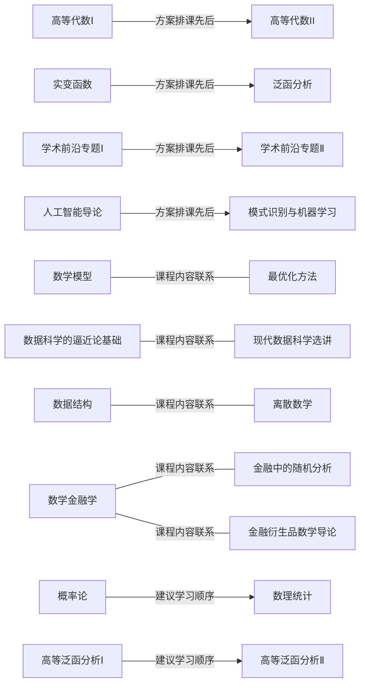

# 2025级数学与应用数学-人工智能双学士学位项目培养方案

数学科学学院 · 数学与应用数学-人工智能(双学士学位项目) · 方案 96721 · 111 个不同课程或科研条目。

[官方 Word](../originals/plan-96721.docx) · [教务详情](https://fdjwgl.fudan.edu.cn/manager/bizType/2/major-program-search/info/96721?skipAuth=1) · [方案快照](../raw/plan-96721.json.gz) · [年级目录](../README.md)

## 课程关系图

图中展示部分关系。下表保留全部已建立的课程对，来源位置使用本方案 JSON Pointer。

## 先修与内容联系

| 类型 | 起点 | 终点 | 依据 | 原表定位 |
| --- | --- | --- | --- | --- |
| 建议学习顺序 | 人工智能导论 (AIE310005) | 模式识别与机器学习 (AIE410001) | 人工智能问题与模型类别可为学习模式识别作准备。  | `/courseModules/8/planCourses/2`、`/courseModules/8/planCourses/4` |
| 建议学习顺序 | 高等代数Ⅰ (MATH10009) | 高等代数II (MATH10019) | 同方案的课程题名具有连续分册或序号。  | `/courseModules/7/planCourses/1`、`/courseModules/7/planCourses/2` |
| 建议学习顺序 | 实变函数 (MATH20017) | 泛函分析 (MATH30004) | 测度与积分有助于理解函数空间。  | `/courseModules/7/planCourses/7`、`/courseModules/9/planCourses/3` |
| 建议学习顺序 | 概率论 (MATH30003) | 数理统计 (MATH30011) | 分布和期望为统计估计与检验提供基础。  | `/courseModules/7/planCourses/8`、`/courseModules/8/planCourses/10` |
| 建议学习顺序 | 学术前沿专题Ⅰ (MATH40001) | 学术前沿专题Ⅱ (MATH40002) | 同方案的课程题名具有连续分册或序号。  | `/courseModules/12/planCourses/63`、`/courseModules/12/planCourses/64` |
| 建议学习顺序 | 高等泛函分析Ⅰ (MATH40005) | 高等泛函分析Ⅱ (MATH50005) | 同方案的课程题名具有连续分册或序号。  | `/courseModules/12/planCourses/59`、`/courseModules/12/planCourses/60` |
| 方案排课先后 | 人工智能导论 (AIE310005) | 模式识别与机器学习 (AIE410001) | 同方案该课程全部明确数字学期均早于后者。  | `/courseModules/8/planCourses/2`、`/courseModules/8/planCourses/4` |
| 方案排课先后 | 高等代数Ⅰ (MATH10009) | 高等代数II (MATH10019) | 同方案该课程全部明确数字学期均早于后者。  | `/courseModules/7/planCourses/1`、`/courseModules/7/planCourses/2` |
| 方案排课先后 | 实变函数 (MATH20017) | 泛函分析 (MATH30004) | 同方案该课程全部明确数字学期均早于后者。  | `/courseModules/7/planCourses/7`、`/courseModules/9/planCourses/3` |
| 方案排课先后 | 学术前沿专题Ⅰ (MATH40001) | 学术前沿专题Ⅱ (MATH40002) | 同方案该课程全部明确数字学期均早于后者。  | `/courseModules/12/planCourses/63`、`/courseModules/12/planCourses/64` |
| 课程内容联系 | 计算机系统基础 (AIE210006) | 计算机组成与体系结构 (CS30052) | 处理器、存储与系统执行模型具有共同内容。  | `/courseModules/8/planCourses/1`、`/courseModules/12/planCourses/67` |
| 课程内容联系 | 人工智能导论 (AIE310005) | 人工智能安全 (AIE831001) | 本方案两门课程的题名均含“人工智能”，可据此对照这一主题。  | `/courseModules/8/planCourses/2`、`/courseModules/8/planCourses/5` |
| 课程内容联系 | 数据结构 (AIE310007) | 离散数学 (MATH30001) | 共同主题为图、树与离散结构。  | `/courseModules/8/planCourses/0`、`/courseModules/8/planCourses/11` |
| 课程内容联系 | 人工智能的软件基础 (AIE310008) | 人工智能安全 (AIE831001) | 本方案两门课程的题名均含“人工智能”，可据此对照这一主题。  | `/courseModules/8/planCourses/3`、`/courseModules/8/planCourses/5` |
| 课程内容联系 | 模式识别与机器学习 (AIE410001) | 机器学习系统 (CS30058) | 本方案两门课程的题名均含“机器学习”，可据此对照这一主题。  | `/courseModules/8/planCourses/4`、`/courseModules/12/planCourses/71` |
| 课程内容联系 | 人工智能前沿探索实践 (AIE531001) | 人工智能安全 (AIE831001) | 本方案两门课程的题名均含“人工智能”，可据此对照这一主题。  | `/courseModules/8/planCourses/9`、`/courseModules/8/planCourses/5` |
| 课程内容联系 | 人工智能安全 (AIE831001) | 人工智能的伦理与治理 (PHIL50006) | 本方案两门课程的题名均含“人工智能”，可据此对照这一主题。  | `/courseModules/8/planCourses/5`、`/courseModules/8/planCourses/6` |
| 课程内容联系 | 数据科学的逼近论基础 (AIS631003) | 现代数据科学选讲 (MATH40042) | 本方案两门课程的题名均含“数据科学”，可据此对照这一主题。  | `/courseModules/9/planCourses/9`、`/courseModules/12/planCourses/36` |
| 课程内容联系 | 数学模型 (MATH20009) | 最优化方法 (MATH30020) | 共同主题为模型目标、决策变量与优化求解。  | `/courseModules/9/planCourses/0`、`/courseModules/12/planCourses/25` |
| 课程内容联系 | 数学金融学 (MATH30006) | 金融中的随机分析 (MATH30021) | 本方案两门课程的题名均含“金融”，可据此对照这一主题。  | `/courseModules/12/planCourses/4`、`/courseModules/12/planCourses/26` |
| 课程内容联系 | 数学金融学 (MATH30006) | 金融衍生品数学导论 (MATH30023) | 本方案两门课程的题名均含“金融”，可据此对照这一主题。  | `/courseModules/12/planCourses/4`、`/courseModules/12/planCourses/37` |
| 课程内容联系 | 数据科学中的现代逼近方法 (MATH40025) | 现代数据科学选讲 (MATH40042) | 本方案两门课程的题名均含“数据科学”，可据此对照这一主题。  | `/courseModules/12/planCourses/17`、`/courseModules/12/planCourses/36` |
| 课程内容联系 | 现代偏微分方程 (MATH40030) | 物理学与偏微分方程 (MATH40047) | 本方案两门课程的题名均含“偏微分方程”，可据此对照这一主题。  | `/courseModules/12/planCourses/44`、`/courseModules/12/planCourses/52` |
| 课程内容联系 | 现代偏微分方程 (MATH40030) | 变分法与偏微分方程 (MATH50023) | 本方案两门课程的题名均含“偏微分方程”，可据此对照这一主题。  | `/courseModules/12/planCourses/44`、`/courseModules/12/planCourses/22` |

本次未从可定位的明确表述中确认课程对课程预修。学期安排、系列分册与编辑建议均保留各自的依据。

## 按原方案模块阅读

同一模块展示原表中的课程归属。模块内课程之间的先后仍须逐项查阅。

- **双学位融合必修课程**　计算机系统基础、计算机视觉、人工智能导论、数据结构、人工智能的软件基础、模式识别与机器学习、自然语言处理与大语言模型、人工智能前沿探索实践、人工智能安全、离散数学、数理统计、人工智能的伦理与治理（原表模块 8）

## 课程表

同一课程在不同模块分别出现时，按原表逐行列出。季节字段保留原值。

| 课程 | 代码 | 学分 | 学期 | 模块 |
| --- | --- | ---: | --- | --- |
| 解析几何 | MATH10020 | 4.0 | 第1学期 | 培养方案 / 专业培养课程 / 专业核心教育课程 / 必修课程 |
| 高等代数Ⅰ | MATH10009 | 5.0 | 第1学期 | 培养方案 / 专业培养课程 / 专业核心教育课程 / 必修课程 |
| 高等代数II | MATH10019 | 5.0 | 第2学期 | 培养方案 / 专业培养课程 / 专业核心教育课程 / 必修课程 |
| 数学分析AⅢ | MATH20004 | 5.0 | 第3学期 | 培养方案 / 专业培养课程 / 专业核心教育课程 / 必修课程 |
| 常微分方程 | MATH20014 | 4.0 | 第3学期 | 培养方案 / 专业培养课程 / 专业核心教育课程 / 必修课程 |
| 抽象代数 | MATH20015 | 4.0 | 第3学期 | 培养方案 / 专业培养课程 / 专业核心教育课程 / 必修课程 |
| 复变函数 | MATH20016 | 4.0 | 第4学期 | 培养方案 / 专业培养课程 / 专业核心教育课程 / 必修课程 |
| 实变函数 | MATH20017 | 4.0 | 第4学期 | 培养方案 / 专业培养课程 / 专业核心教育课程 / 必修课程 |
| 概率论 | MATH30003 | 3.0 | 第5学期、第6学期、第7学期、第8学期 | 培养方案 / 专业培养课程 / 专业核心教育课程 / 必修课程 |
| 数据结构 | AIE310007 | 4.0 | 第3学期 | 培养方案 / 专业培养课程 / 专业核心教育课程 / 双学位融合必修课程 |
| 计算机系统基础 | AIE210006 | 3.0 | 第3学期 | 培养方案 / 专业培养课程 / 专业核心教育课程 / 双学位融合必修课程 |
| 人工智能导论 | AIE310005 | 3.0 | 第4学期 | 培养方案 / 专业培养课程 / 专业核心教育课程 / 双学位融合必修课程 |
| 人工智能的软件基础 | AIE310008 | 3.0 | 第4学期 | 培养方案 / 专业培养课程 / 专业核心教育课程 / 双学位融合必修课程 |
| 模式识别与机器学习 | AIE410001 | 3.0 | 第5学期 | 培养方案 / 专业培养课程 / 专业核心教育课程 / 双学位融合必修课程 |
| 人工智能安全 | AIE831001 | 3.0 | 第5学期 | 培养方案 / 专业培养课程 / 专业核心教育课程 / 双学位融合必修课程 |
| 人工智能的伦理与治理 | PHIL50006 | 2.0 | 第4学期、第6学期 | 培养方案 / 专业培养课程 / 专业核心教育课程 / 双学位融合必修课程 |
| 自然语言处理与大语言模型 | AIE410002 | 3.0 | 第6学期 | 培养方案 / 专业培养课程 / 专业核心教育课程 / 双学位融合必修课程 |
| 计算机视觉 | AIE310004 | 3.0 | 第7学期 | 培养方案 / 专业培养课程 / 专业核心教育课程 / 双学位融合必修课程 |
| 人工智能前沿探索实践 | AIE531001 | 3.0 | 第7学期 | 培养方案 / 专业培养课程 / 专业核心教育课程 / 双学位融合必修课程 |
| 数理统计 | MATH30011 | 3.0 | SPRING | 培养方案 / 专业培养课程 / 专业核心教育课程 / 双学位融合必修课程 |
| 离散数学 | MATH30001 | 3.0 | SPRING | 培养方案 / 专业培养课程 / 专业核心教育课程 / 双学位融合必修课程 |
| 数学模型 | MATH20009 | 3.0 | 第4学期 | 培养方案 / 专业培养课程 / 专业核心教育课程 / 限定必修课程 |
| 抽象代数II | MATH20013 | 3.0 | 第4学期 | 培养方案 / 专业培养课程 / 专业核心教育课程 / 限定必修课程 |
| 拓扑学 | MATH20018 | 4.0 | 第4学期 | 培养方案 / 专业培养课程 / 专业核心教育课程 / 限定必修课程 |
| 泛函分析 | MATH30004 | 3.0 | 第5学期、第7学期 | 培养方案 / 专业培养课程 / 专业核心教育课程 / 限定必修课程 |
| 微分几何 | MATH20010 | 3.0 | 第5学期、第7学期 | 培养方案 / 专业培养课程 / 专业核心教育课程 / 限定必修课程 |
| 同调论 | MATH30002 | 3.0 | 第5学期、第7学期 | 培养方案 / 专业培养课程 / 专业核心教育课程 / 限定必修课程 |
| 控制理论基础 | MATH50018 | 3.0 | 第5学期、第7学期 | 培养方案 / 专业培养课程 / 专业核心教育课程 / 限定必修课程 |
| 数论基础 | MATH20011 | 3.0 | 第5学期、第7学期 | 培养方案 / 专业培养课程 / 专业核心教育课程 / 限定必修课程 |
| 新型算法 | AIS631004 | 3.0 | 第5学期、第7学期 | 培养方案 / 专业培养课程 / 专业核心教育课程 / 限定必修课程 |
| 数据科学的逼近论基础 | AIS631003 | 3.0 | 第5学期、第7学期 | 培养方案 / 专业培养课程 / 专业核心教育课程 / 限定必修课程 |
| 神经网络的模型与应用 | MATH40054 | 3.0 | SPRING、AUTUMN | 培养方案 / 专业培养课程 / 专业核心教育课程 / 限定必修课程 |
| 数理方程 | MATH30005 | 3.0 | 第5学期、第6学期、第7学期、第8学期 | 培养方案 / 专业培养课程 / 专业核心教育课程 / 限定必修课程 |
| 微分方程数值解法 | MATH40010 | 3.0 | 第6学期、第8学期 | 培养方案 / 专业培养课程 / 专业核心教育课程 / 限定必修课程 |
| 基础力学 | MECH30005 | 3.0 | 第6学期、第8学期 | 培养方案 / 专业培养课程 / 专业核心教育课程 / 限定必修课程 |
| 科研实践 | MATH50002 | 3.0 | 第6学期、第7学期、第8学期 | 培养方案 / 专业进阶模块 |
| 生产实习 | MATH40008 | 1.0 | 第7学期 | 培养方案 / 专业进阶模块 |
| 小波分析 | MATH40011 | 3.0 | SPRING、AUTUMN | 培养方案 / 专业进阶模块 |
| 计算机辅助几何设计 | MATH40012 | 3.0 | SPRING、AUTUMN | 培养方案 / 专业进阶模块 |
| 数学金融学 | MATH30006 | 3.0 | SPRING、AUTUMN | 培养方案 / 专业进阶模块 |
| 应用几何 | MATH40013 | 3.0 | SPRING、AUTUMN | 培养方案 / 专业进阶模块 |
| 利息理论 | MATH30007 | 3.0 | SPRING、AUTUMN | 培养方案 / 专业进阶模块 |
| 计算方法 | MATH30008 | 3.0 | 第5学期 | 培养方案 / 专业进阶模块 |
| 分形几何 | MATH40016 | 3.0 | SPRING、AUTUMN | 培养方案 / 专业进阶模块 |
| 非寿险精算数学 | MATH30009 | 3.0 | SPRING、AUTUMN | 培养方案 / 专业进阶模块 |
| 寿险精算数学 | MATH30010 | 3.0 | SPRING、AUTUMN | 培养方案 / 专业进阶模块 |
| 数字信号处理 | MATH40020 | 3.0 | SPRING、AUTUMN | 培养方案 / 专业进阶模块 |
| 时间序列分析 | MATH40021 | 3.0 | SPRING、AUTUMN | 培养方案 / 专业进阶模块 |
| 测度论 | MATH30012 | 3.0 | SPRING、AUTUMN | 培养方案 / 专业进阶模块 |
| 非线性系统 | MATH40023 | 3.0 | SPRING、AUTUMN | 培养方案 / 专业进阶模块 |
| 科学计算 | MATH40024 | 3.0 | SPRING、AUTUMN | 培养方案 / 专业进阶模块 |
| 数学分析原理 | MATH20012 | 5.0 | SPRING、AUTUMN | 培养方案 / 专业进阶模块 |
| 数据科学中的现代逼近方法 | MATH40025 | 3.0 | SPRING、AUTUMN | 培养方案 / 专业进阶模块 |
| 统计方法选讲 | MATH40027 | 3.0 | SPRING、AUTUMN | 培养方案 / 专业进阶模块 |
| 应用随机过程 | MATH30016 | 3.0 | SPRING、AUTUMN | 培养方案 / 专业进阶模块 |
| 统计推断 | MATH40028 | 3.0 | SPRING、AUTUMN | 培养方案 / 专业进阶模块 |
| 遍历论 | MATH60034 | 3.0 | SPRING、AUTUMN | 培养方案 / 专业进阶模块 |
| 变分法与偏微分方程 | MATH50023 | 3.0 | SPRING、AUTUMN | 培养方案 / 专业进阶模块 |
| 拓扑群 | MATH40031 | 3.0 | SPRING、AUTUMN | 培养方案 / 专业进阶模块 |
| 线性与非线性规划 | MATH30019 | 3.0 | SPRING、AUTUMN | 培养方案 / 专业进阶模块 |
| 最优化方法 | MATH30020 | 3.0 | SPRING、AUTUMN | 培养方案 / 专业进阶模块 |
| 金融中的随机分析 | MATH30021 | 3.0 | SPRING、AUTUMN | 培养方案 / 专业进阶模块 |
| 深度学习 | MATH40034 | 3.0 | SPRING、AUTUMN | 培养方案 / 专业进阶模块 |
| 微分几何续论 | MATH30022 | 3.0 | SPRING、AUTUMN | 培养方案 / 专业进阶模块 |
| 布朗运动 | MATH40035 | 3.0 | SPRING、AUTUMN | 培养方案 / 专业进阶模块 |
| 概率模型与随机计算选讲 | MATH40036 | 3.0 | SPRING、AUTUMN | 培养方案 / 专业进阶模块 |
| Current理论 | MATH40037 | 3.0 | SPRING、AUTUMN | 培养方案 / 专业进阶模块 |
| 微局部分析 | MATH40038 | 3.0 | SPRING、AUTUMN | 培养方案 / 专业进阶模块 |
| 现代调和分析 | MATH60037 | 3.0 | SPRING、AUTUMN | 培养方案 / 专业进阶模块 |
| 高维概率及其应用 | MATH40040 | 3.0 | SPRING、AUTUMN | 培养方案 / 专业进阶模块 |
| 数学建模及应用 | MATH50033 | 3.0 | SPRING、AUTUMN | 培养方案 / 专业进阶模块 |
| 现代数据科学选讲 | MATH40042 | 3.0 | SPRING、AUTUMN | 培养方案 / 专业进阶模块 |
| 金融衍生品数学导论 | MATH30023 | 3.0 | SPRING、AUTUMN | 培养方案 / 专业进阶模块 |
| 几何群论 | MATH40043 | 3.0 | SPRING、AUTUMN | 培养方案 / 专业进阶模块 |
| 现代统计模型 | STAT30013 | 3.0 | SPRING、AUTUMN | 培养方案 / 专业进阶模块 |
| 多元统计原理与基础 | STAT30012 | 3.0 | SPRING、AUTUMN | 培养方案 / 专业进阶模块 |
| 双曲几何 | MATH40006 | 3.0 | SPRING、AUTUMN | 培养方案 / 专业进阶模块 |
| 数理方程进阶 | MATH50008 | 3.0 | SPRING、AUTUMN | 培养方案 / 专业进阶模块 |
| 谱理论基础 | MATH50007 | 3.0 | SPRING、AUTUMN | 培养方案 / 专业进阶模块 |
| 现代偏微分方程 | MATH40030 | 3.0 | SPRING、AUTUMN | 培养方案 / 专业进阶模块 |
| 复分析 | MATH40019 | 3.0 | SPRING、AUTUMN | 培养方案 / 专业进阶模块 |
| 代数拓扑基础 | MATH40044 | 3.0 | SPRING、AUTUMN | 培养方案 / 专业进阶模块 |
| 现代微分几何基础 | MATH50036 | 3.0 | SPRING、AUTUMN | 培养方案 / 专业进阶模块 |
| 李群和李代数 | MATH40029 | 3.0 | SPRING、AUTUMN | 培养方案 / 专业进阶模块 |
| 现代常微分方程 | MATH40045 | 3.0 | SPRING、AUTUMN | 培养方案 / 专业进阶模块 |
| 索伯列夫空间 | MATH40046 | 3.0 | SPRING、AUTUMN | 培养方案 / 专业进阶模块 |
| 随机分析 | MATH60033 | 3.0 | SPRING、AUTUMN | 培养方案 / 专业进阶模块 |
| 物理学与偏微分方程 | MATH40047 | 3.0 | SPRING、AUTUMN | 培养方案 / 专业进阶模块 |
| 代数几何 | MATH50038 | 3.0 | SPRING、AUTUMN | 培养方案 / 专业进阶模块 |
| 现代微分几何 | MATH50039 | 3.0 | SPRING、AUTUMN | 培养方案 / 专业进阶模块 |
| 代数拓扑 | MATH50026 | 3.0 | SPRING、AUTUMN | 培养方案 / 专业进阶模块 |
| 数值分析与科学计算 | MATH50041 | 3.0 | SPRING、AUTUMN | 培养方案 / 专业进阶模块 |
| 数值代数及其应用 | MATH50042 | 3.0 | SPRING、AUTUMN | 培养方案 / 专业进阶模块 |
| 应用分析中的科学计算 | MATH50043 | 3.0 | SPRING、AUTUMN | 培养方案 / 专业进阶模块 |
| 高等泛函分析Ⅰ | MATH40005 | 3.0 | SPRING、AUTUMN | 培养方案 / 专业进阶模块 |
| 高等泛函分析Ⅱ | MATH50005 | 3.0 | SPRING、AUTUMN | 培养方案 / 专业进阶模块 |
| 抽象代数续论 | MATH50019 | 3.0 | SPRING、AUTUMN | 培养方案 / 专业进阶模块 |
| 现代概率论基础I | MATH50027 | 3.0 | SPRING、AUTUMN | 培养方案 / 专业进阶模块 |
| 学术前沿专题Ⅰ | MATH40001 | 1.0 | 第3学期 | 培养方案 / 专业进阶模块 |
| 学术前沿专题Ⅱ | MATH40002 | 1.0 | 第4学期 | 培养方案 / 专业进阶模块 |
| 独立学习 | MATH50001 | 3.0 | 第5学期 | 培养方案 / 专业进阶模块 |
| 集合与图论 | CS30043 | 3.0 | 第3学期 | 培养方案 / 专业进阶模块 |
| 计算机组成与体系结构 | CS30052 | 4.0 | 第4学期 | 培养方案 / 专业进阶模块 |
| 数据库引论 | CS20010 | 3.0 | 第4学期 | 培养方案 / 专业进阶模块 |
| 计算机网络 | CS30036 | 3.0 | 第5学期 | 培养方案 / 专业进阶模块 |
| 软件工程 | CS30018 | 3.0 | 第6学期 | 培养方案 / 专业进阶模块 |
| 机器学习系统 | CS30058 | 3.0 | 第6学期 | 培养方案 / 专业进阶模块 |
| 计算机图形学A | CS30019 | 3.0 | 第6学期 | 培养方案 / 专业进阶模块 |
| 科研实践 | MATH50002 | 3.0 | 第6学期、第7学期、第8学期 | 培养方案 / 专业进阶模块-多元发展 |
| 生产实习 | MATH40008 | 1.0 | 第7学期 | 培养方案 / 专业进阶模块-多元发展 |
| 小波分析 | MATH40011 | 3.0 | SPRING、AUTUMN | 培养方案 / 专业进阶模块-多元发展 |
| 计算机辅助几何设计 | MATH40012 | 3.0 | SPRING、AUTUMN | 培养方案 / 专业进阶模块-多元发展 |
| 数学金融学 | MATH30006 | 3.0 | SPRING、AUTUMN | 培养方案 / 专业进阶模块-多元发展 |
| 应用几何 | MATH40013 | 3.0 | SPRING、AUTUMN | 培养方案 / 专业进阶模块-多元发展 |
| 利息理论 | MATH30007 | 3.0 | SPRING、AUTUMN | 培养方案 / 专业进阶模块-多元发展 |
| 计算方法 | MATH30008 | 3.0 | 第5学期 | 培养方案 / 专业进阶模块-多元发展 |
| 分形几何 | MATH40016 | 3.0 | SPRING、AUTUMN | 培养方案 / 专业进阶模块-多元发展 |
| 非寿险精算数学 | MATH30009 | 3.0 | SPRING、AUTUMN | 培养方案 / 专业进阶模块-多元发展 |
| 寿险精算数学 | MATH30010 | 3.0 | SPRING、AUTUMN | 培养方案 / 专业进阶模块-多元发展 |
| 数字信号处理 | MATH40020 | 3.0 | SPRING、AUTUMN | 培养方案 / 专业进阶模块-多元发展 |
| 时间序列分析 | MATH40021 | 3.0 | SPRING、AUTUMN | 培养方案 / 专业进阶模块-多元发展 |
| 测度论 | MATH30012 | 3.0 | SPRING、AUTUMN | 培养方案 / 专业进阶模块-多元发展 |
| 非线性系统 | MATH40023 | 3.0 | SPRING、AUTUMN | 培养方案 / 专业进阶模块-多元发展 |
| 科学计算 | MATH40024 | 3.0 | SPRING、AUTUMN | 培养方案 / 专业进阶模块-多元发展 |
| 数学分析原理 | MATH20012 | 5.0 | SPRING、AUTUMN | 培养方案 / 专业进阶模块-多元发展 |
| 数据科学中的现代逼近方法 | MATH40025 | 3.0 | SPRING、AUTUMN | 培养方案 / 专业进阶模块-多元发展 |
| 统计方法选讲 | MATH40027 | 3.0 | SPRING、AUTUMN | 培养方案 / 专业进阶模块-多元发展 |
| 应用随机过程 | MATH30016 | 3.0 | SPRING、AUTUMN | 培养方案 / 专业进阶模块-多元发展 |
| 统计推断 | MATH40028 | 3.0 | SPRING、AUTUMN | 培养方案 / 专业进阶模块-多元发展 |
| 遍历论 | MATH60034 | 3.0 | SPRING、AUTUMN | 培养方案 / 专业进阶模块-多元发展 |
| 变分法与偏微分方程 | MATH50023 | 3.0 | SPRING、AUTUMN | 培养方案 / 专业进阶模块-多元发展 |
| 拓扑群 | MATH40031 | 3.0 | SPRING、AUTUMN | 培养方案 / 专业进阶模块-多元发展 |
| 线性与非线性规划 | MATH30019 | 3.0 | SPRING、AUTUMN | 培养方案 / 专业进阶模块-多元发展 |
| 最优化方法 | MATH30020 | 3.0 | SPRING、AUTUMN | 培养方案 / 专业进阶模块-多元发展 |
| 金融中的随机分析 | MATH30021 | 3.0 | SPRING、AUTUMN | 培养方案 / 专业进阶模块-多元发展 |
| 深度学习 | MATH40034 | 3.0 | SPRING、AUTUMN | 培养方案 / 专业进阶模块-多元发展 |
| 微分几何续论 | MATH30022 | 3.0 | SPRING、AUTUMN | 培养方案 / 专业进阶模块-多元发展 |
| 布朗运动 | MATH40035 | 3.0 | SPRING、AUTUMN | 培养方案 / 专业进阶模块-多元发展 |
| 概率模型与随机计算选讲 | MATH40036 | 3.0 | SPRING、AUTUMN | 培养方案 / 专业进阶模块-多元发展 |
| Current理论 | MATH40037 | 3.0 | SPRING、AUTUMN | 培养方案 / 专业进阶模块-多元发展 |
| 微局部分析 | MATH40038 | 3.0 | SPRING、AUTUMN | 培养方案 / 专业进阶模块-多元发展 |
| 现代调和分析 | MATH60037 | 3.0 | SPRING、AUTUMN | 培养方案 / 专业进阶模块-多元发展 |
| 高维概率及其应用 | MATH40040 | 3.0 | SPRING、AUTUMN | 培养方案 / 专业进阶模块-多元发展 |
| 数学建模及应用 | MATH50033 | 3.0 | SPRING、AUTUMN | 培养方案 / 专业进阶模块-多元发展 |
| 现代数据科学选讲 | MATH40042 | 3.0 | SPRING、AUTUMN | 培养方案 / 专业进阶模块-多元发展 |
| 金融衍生品数学导论 | MATH30023 | 3.0 | SPRING、AUTUMN | 培养方案 / 专业进阶模块-多元发展 |
| 几何群论 | MATH40043 | 3.0 | SPRING、AUTUMN | 培养方案 / 专业进阶模块-多元发展 |
| 现代统计模型 | STAT30013 | 3.0 | SPRING、AUTUMN | 培养方案 / 专业进阶模块-多元发展 |
| 多元统计原理与基础 | STAT30012 | 3.0 | SPRING、AUTUMN | 培养方案 / 专业进阶模块-多元发展 |
| 双曲几何 | MATH40006 | 3.0 | SPRING、AUTUMN | 培养方案 / 专业进阶模块-多元发展 |
| 数理方程进阶 | MATH50008 | 3.0 | SPRING、AUTUMN | 培养方案 / 专业进阶模块-多元发展 |
| 谱理论基础 | MATH50007 | 3.0 | SPRING、AUTUMN | 培养方案 / 专业进阶模块-多元发展 |
| 现代偏微分方程 | MATH40030 | 3.0 | SPRING、AUTUMN | 培养方案 / 专业进阶模块-多元发展 |
| 复分析 | MATH40019 | 3.0 | SPRING、AUTUMN | 培养方案 / 专业进阶模块-多元发展 |
| 代数拓扑基础 | MATH40044 | 3.0 | SPRING、AUTUMN | 培养方案 / 专业进阶模块-多元发展 |
| 现代微分几何基础 | MATH50036 | 3.0 | SPRING、AUTUMN | 培养方案 / 专业进阶模块-多元发展 |
| 李群和李代数 | MATH40029 | 3.0 | SPRING、AUTUMN | 培养方案 / 专业进阶模块-多元发展 |
| 现代常微分方程 | MATH40045 | 3.0 | SPRING、AUTUMN | 培养方案 / 专业进阶模块-多元发展 |
| 索伯列夫空间 | MATH40046 | 3.0 | SPRING、AUTUMN | 培养方案 / 专业进阶模块-多元发展 |
| 随机分析 | MATH60033 | 3.0 | SPRING、AUTUMN | 培养方案 / 专业进阶模块-多元发展 |
| 物理学与偏微分方程 | MATH40047 | 3.0 | SPRING、AUTUMN | 培养方案 / 专业进阶模块-多元发展 |
| 代数几何 | MATH50038 | 3.0 | SPRING、AUTUMN | 培养方案 / 专业进阶模块-多元发展 |
| 现代微分几何 | MATH50039 | 3.0 | SPRING、AUTUMN | 培养方案 / 专业进阶模块-多元发展 |
| 代数拓扑 | MATH50026 | 3.0 | SPRING、AUTUMN | 培养方案 / 专业进阶模块-多元发展 |
| 数值分析与科学计算 | MATH50041 | 3.0 | SPRING、AUTUMN | 培养方案 / 专业进阶模块-多元发展 |
| 数值代数及其应用 | MATH50042 | 3.0 | SPRING、AUTUMN | 培养方案 / 专业进阶模块-多元发展 |
| 应用分析中的科学计算 | MATH50043 | 3.0 | SPRING、AUTUMN | 培养方案 / 专业进阶模块-多元发展 |
| 高等泛函分析Ⅰ | MATH40005 | 3.0 | SPRING、AUTUMN | 培养方案 / 专业进阶模块-多元发展 |
| 高等泛函分析Ⅱ | MATH50005 | 3.0 | SPRING、AUTUMN | 培养方案 / 专业进阶模块-多元发展 |
| 抽象代数续论 | MATH50019 | 3.0 | SPRING、AUTUMN | 培养方案 / 专业进阶模块-多元发展 |
| 现代概率论基础I | MATH50027 | 3.0 | SPRING、AUTUMN | 培养方案 / 专业进阶模块-多元发展 |
| 学术前沿专题Ⅰ | MATH40001 | 1.0 | 第3学期 | 培养方案 / 专业进阶模块-多元发展 |
| 学术前沿专题Ⅱ | MATH40002 | 1.0 | 第4学期 | 培养方案 / 专业进阶模块-多元发展 |
| 独立学习 | MATH50001 | 3.0 | 第5学期 | 培养方案 / 专业进阶模块-多元发展 |
| 集合与图论 | CS30043 | 3.0 | 第3学期 | 培养方案 / 专业进阶模块-多元发展 |
| 计算机组成与体系结构 | CS30052 | 4.0 | 第4学期 | 培养方案 / 专业进阶模块-多元发展 |
| 数据库引论 | CS20010 | 3.0 | 第4学期 | 培养方案 / 专业进阶模块-多元发展 |
| 计算机网络 | CS30036 | 3.0 | 第5学期 | 培养方案 / 专业进阶模块-多元发展 |
| 软件工程 | CS30018 | 3.0 | 第6学期 | 培养方案 / 专业进阶模块-多元发展 |
| 机器学习系统 | CS30058 | 3.0 | 第6学期 | 培养方案 / 专业进阶模块-多元发展 |
| 计算机图形学A | CS30019 | 3.0 | 第6学期 | 培养方案 / 专业进阶模块-多元发展 |
| 无学分讨论班 | 101 | 0.0 |  | 融合创新能力 |
| 复芏计划(FDUROP) | 102 | 0.0 |  | 融合创新能力 |
| 学术前沿专题Ⅰ | MATH40001 | 1.0 | 第3学期 | 融合创新能力 |
| 学术前沿专题Ⅱ | MATH40002 | 1.0 | 第4学期 | 融合创新能力 |
| 独立学习 | MATH50001 | 3.0 | 第5学期 | 融合创新能力 |
| 毕业论文(含专题讨论) | MATH40033 | 4.0 | 第8学期 | 融合创新能力 |
| 科研实践 | MATH50002 | 3.0 | 第6学期、第7学期、第8学期 | 融合创新能力 |
