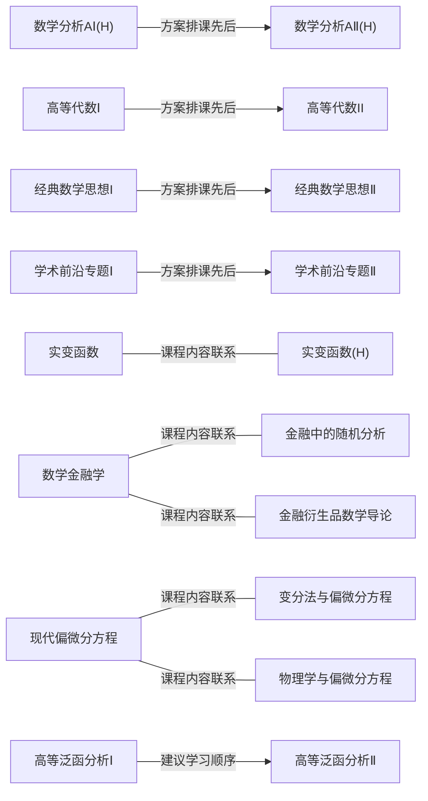

# 2025级数学与应用数学专业本科培养方案（相辉计划-英才班课程体系）

数学科学学院 · 数学与应用数学(相辉计划) · 方案 97106 · 98 个不同课程或科研条目。

[官方 Word](../originals/plan-97106.docx) · [教务详情](https://fdjwgl.fudan.edu.cn/manager/bizType/2/major-program-search/info/97106?skipAuth=1) · [方案快照](../raw/plan-97106.json.gz) · [年级目录](../README.md)

## 修读导读

- **建议先学**　《高等代数Ⅰ》（`MATH10009`） → 《高等代数II》（`MATH10019`）。题名列出连续册次或级别。将前一阶段的矩阵运算和证明整理成例题，便于读后续分册时回查。方案分别列在第1、2学期。

- **可以对照着读**　《数学金融学》（`MATH30006`）与《金融中的随机分析》（`MATH30021`）。两门课的题名都涉及金融。用同一个融资案例比较谁提供资金、谁承担风险，以及从哪个市场观察它。

- **查模块选课**　《常微分方程》（`MATH20014`）、《抽象代数》（`MATH20015`）列在“必修课程”中。原表见 `/courseModules/7`。

## 课程关系图

图中展示部分关系。下表保留全部已建立的课程对，来源位置使用本方案 JSON Pointer。

## 先修与内容联系

| 类型 | 起点 | 终点 | 依据 | 原表定位 |
| --- | --- | --- | --- | --- |
| 建议学习顺序 | 高等代数Ⅰ (MATH10009) | 高等代数II (MATH10019) | 同方案的课程题名具有连续分册或序号。  | `/courseModules/7/planCourses/0`、`/courseModules/7/planCourses/1` |
| 建议学习顺序 | 数学分析AⅠ(H) (MATH10010h) | 数学分析AⅡ(H) (MATH10011h) | 同方案的课程题名具有连续分册或序号。  | `/courseModules/5/planCourses/0`、`/courseModules/5/planCourses/1` |
| 建议学习顺序 | 经典数学思想I (MATH10021) | 经典数学思想Ⅱ (MATH10022) | 同方案的课程题名具有连续分册或序号。  | `/courseModules/7/planCourses/9`、`/courseModules/7/planCourses/10` |
| 建议学习顺序 | 学术前沿专题Ⅰ (MATH40001) | 学术前沿专题Ⅱ (MATH40002) | 同方案的课程题名具有连续分册或序号。  | `/courseModules/19/planCourses/3`、`/courseModules/19/planCourses/4` |
| 建议学习顺序 | 高等泛函分析Ⅰ (MATH40005) | 高等泛函分析Ⅱ (MATH50005) | 同方案的课程题名具有连续分册或序号。  | `/courseModules/12/planCourses/59`、`/courseModules/12/planCourses/60` |
| 方案排课先后 | 高等代数Ⅰ (MATH10009) | 高等代数II (MATH10019) | 同方案该课程全部明确数字学期均早于后者。  | `/courseModules/7/planCourses/0`、`/courseModules/7/planCourses/1` |
| 方案排课先后 | 数学分析AⅠ(H) (MATH10010h) | 数学分析AⅡ(H) (MATH10011h) | 同方案该课程全部明确数字学期均早于后者。  | `/courseModules/5/planCourses/0`、`/courseModules/5/planCourses/1` |
| 方案排课先后 | 经典数学思想I (MATH10021) | 经典数学思想Ⅱ (MATH10022) | 同方案该课程全部明确数字学期均早于后者。  | `/courseModules/7/planCourses/9`、`/courseModules/7/planCourses/10` |
| 方案排课先后 | 学术前沿专题Ⅰ (MATH40001) | 学术前沿专题Ⅱ (MATH40002) | 同方案该课程全部明确数字学期均早于后者。  | `/courseModules/19/planCourses/3`、`/courseModules/19/planCourses/4` |
| 课程内容联系 | 实变函数 (MATH20017) | 实变函数(H) (MATH20017h) | 本方案两门课程的题名均含“实变函数”，可据此对照这一主题。  | `/courseModules/7/planCourses/6`、`/courseModules/7/planCourses/7` |
| 课程内容联系 | 数学金融学 (MATH30006) | 金融中的随机分析 (MATH30021) | 本方案两门课程的题名均含“金融”，可据此对照这一主题。  | `/courseModules/12/planCourses/3`、`/courseModules/12/planCourses/25` |
| 课程内容联系 | 数学金融学 (MATH30006) | 金融衍生品数学导论 (MATH30023) | 本方案两门课程的题名均含“金融”，可据此对照这一主题。  | `/courseModules/12/planCourses/3`、`/courseModules/12/planCourses/36` |
| 课程内容联系 | 数据科学中的现代逼近方法 (MATH40025) | 现代数据科学选讲 (MATH40042) | 本方案两门课程的题名均含“数据科学”，可据此对照这一主题。  | `/courseModules/12/planCourses/16`、`/courseModules/12/planCourses/35` |
| 课程内容联系 | 现代偏微分方程 (MATH40030) | 物理学与偏微分方程 (MATH40047) | 本方案两门课程的题名均含“偏微分方程”，可据此对照这一主题。  | `/courseModules/12/planCourses/43`、`/courseModules/12/planCourses/51` |
| 课程内容联系 | 现代偏微分方程 (MATH40030) | 变分法与偏微分方程 (MATH50023) | 本方案两门课程的题名均含“偏微分方程”，可据此对照这一主题。  | `/courseModules/12/planCourses/43`、`/courseModules/12/planCourses/21` |

本次未从可定位的明确表述中确认课程对课程预修。学期安排、系列分册与编辑建议均保留各自的依据。

## 课程表

同一课程在不同模块分别出现时，按原表逐行列出。季节字段保留原值。

| 课程 | 代码 | 学分 | 学期 | 模块 |
| --- | --- | ---: | --- | --- |
| 数学分析AⅠ(H) | MATH10010h | 6.0 | 第1学期 | 培养方案 / 专业培养课程 / 学科基础课程 |
| 数学分析AⅡ(H) | MATH10011h | 6.0 | 第2学期 | 培养方案 / 专业培养课程 / 学科基础课程 |
| 高等代数Ⅰ | MATH10009 | 5.0 | 第1学期 | 培养方案 / 专业培养课程 / 专业核心教育课程 / 必修课程 |
| 高等代数II | MATH10019 | 5.0 | 第2学期 | 培养方案 / 专业培养课程 / 专业核心教育课程 / 必修课程 |
| 常微分方程 | MATH20014 | 4.0 | 第3学期 | 培养方案 / 专业培养课程 / 专业核心教育课程 / 必修课程 |
| 抽象代数 | MATH20015 | 4.0 | 第3学期 | 培养方案 / 专业培养课程 / 专业核心教育课程 / 必修课程 |
| 复变函数 | MATH20016 | 4.0 | 第3学期 | 培养方案 / 专业培养课程 / 专业核心教育课程 / 必修课程 |
| 复变函数(H) | MATH20016h | 4.0 | 第4学期 | 培养方案 / 专业培养课程 / 专业核心教育课程 / 必修课程 |
| 实变函数 | MATH20017 | 4.0 | 第4学期 | 培养方案 / 专业培养课程 / 专业核心教育课程 / 必修课程 |
| 实变函数(H) | MATH20017h | 4.0 | 第4学期 | 培养方案 / 专业培养课程 / 专业核心教育课程 / 必修课程 |
| 几何拓扑选讲 | MATH20019 | 4.0 | 第3学期 | 培养方案 / 专业培养课程 / 专业核心教育课程 / 必修课程 |
| 经典数学思想I | MATH10021 | 3.0 | 第1学期 | 培养方案 / 专业培养课程 / 专业核心教育课程 / 必修课程 |
| 经典数学思想Ⅱ | MATH10022 | 3.0 | 第2学期 | 培养方案 / 专业培养课程 / 专业核心教育课程 / 必修课程 |
| 数学分析AⅠ(H) | MATH10010h | 6.0 | 第1学期 | 培养方案 / 专业培养课程 / 专业核心教育课程 / 荣誉课程 |
| 数学分析AⅡ(H) | MATH10011h | 6.0 | 第2学期 | 培养方案 / 专业培养课程 / 专业核心教育课程 / 荣誉课程 |
| 复变函数(H) | MATH20016h | 4.0 | 第4学期 | 培养方案 / 专业培养课程 / 专业核心教育课程 / 荣誉课程 |
| 概率论(H) | MATH30003h | 4.0 | 第5学期、第7学期 | 培养方案 / 专业培养课程 / 专业核心教育课程 / 荣誉课程 |
| 泛函分析(H) | MATH30004h | 4.0 | 第5学期、第7学期 | 培养方案 / 专业培养课程 / 专业核心教育课程 / 荣誉课程 |
| 数理方程（H） | MATH30005h | 4.0 | 第5学期、第7学期 | 培养方案 / 专业培养课程 / 专业核心教育课程 / 荣誉课程 |
| 微分流形(H) | MATH30024h | 4.0 | 第5学期、第7学期 | 培养方案 / 专业培养课程 / 专业核心教育课程 / 荣誉课程 |
| 多复变函数论(H) | MATH50017h | 4.0 | 第6学期、第8学期 | 培养方案 / 专业培养课程 / 专业核心教育课程 / 荣誉课程 |
| 代数拓扑(H) | MATH30017h | 4.0 | 第5学期、第7学期 | 培养方案 / 专业培养课程 / 专业核心教育课程 / 荣誉课程 |
| 代数拓扑与微分形式(H) | MATH40055h | 4.0 | 第6学期、第8学期 | 培养方案 / 专业培养课程 / 专业核心教育课程 / 荣誉课程 |
| 黎曼几何初步(H) | MATH40056h | 4.0 | 第5学期、第7学期 | 培养方案 / 专业培养课程 / 专业核心教育课程 / 荣誉课程 |
| 数学控制论(H) | MATH30029h | 4.0 | 第6学期、第8学期 | 培养方案 / 专业培养课程 / 专业核心教育课程 / 荣誉课程 |
| 数值代数与优化(H) | MATH40057h | 4.0 | 第6学期、第8学期 | 培养方案 / 专业培养课程 / 专业核心教育课程 / 荣誉课程 |
| 实变函数(H) | MATH20017h | 4.0 | 第4学期 | 培养方案 / 专业培养课程 / 专业核心教育课程 / 荣誉课程 |
| 表示论基础（H） | MATH30030h | 4.0 | 第4学期、第6学期、第8学期 | 培养方案 / 专业培养课程 / 专业核心教育课程 / 荣誉课程 |
| 交换代数（H） | MATH30031h | 4.0 | 第5学期、第7学期 | 培养方案 / 专业培养课程 / 专业核心教育课程 / 荣誉课程 |
| 同调代数（H） | MATH30032h | 4.0 | 第6学期、第8学期 | 培养方案 / 专业培养课程 / 专业核心教育课程 / 荣誉课程 |
| 复解析几何初步(H) | MATH40060h | 4.0 | 第6学期 | 培养方案 / 专业培养课程 / 专业核心教育课程 / 荣誉课程 |
| 生产实习 | MATH40008 | 1.0 | 第7学期 | 培养方案 / 专业进阶模块 |
| 小波分析 | MATH40011 | 3.0 | SPRING、AUTUMN | 培养方案 / 专业进阶模块 |
| 计算机辅助几何设计 | MATH40012 | 3.0 | SPRING、AUTUMN | 培养方案 / 专业进阶模块 |
| 数学金融学 | MATH30006 | 3.0 | SPRING、AUTUMN | 培养方案 / 专业进阶模块 |
| 应用几何 | MATH40013 | 3.0 | SPRING、AUTUMN | 培养方案 / 专业进阶模块 |
| 利息理论 | MATH30007 | 3.0 | SPRING、AUTUMN | 培养方案 / 专业进阶模块 |
| 计算方法 | MATH30008 | 3.0 | 第5学期 | 培养方案 / 专业进阶模块 |
| 分形几何 | MATH40016 | 3.0 | SPRING、AUTUMN | 培养方案 / 专业进阶模块 |
| 非寿险精算数学 | MATH30009 | 3.0 | SPRING、AUTUMN | 培养方案 / 专业进阶模块 |
| 寿险精算数学 | MATH30010 | 3.0 | SPRING、AUTUMN | 培养方案 / 专业进阶模块 |
| 数字信号处理 | MATH40020 | 3.0 | SPRING、AUTUMN | 培养方案 / 专业进阶模块 |
| 时间序列分析 | MATH40021 | 3.0 | SPRING、AUTUMN | 培养方案 / 专业进阶模块 |
| 测度论 | MATH30012 | 3.0 | SPRING、AUTUMN | 培养方案 / 专业进阶模块 |
| 非线性系统 | MATH40023 | 3.0 | SPRING、AUTUMN | 培养方案 / 专业进阶模块 |
| 科学计算 | MATH40024 | 3.0 | SPRING、AUTUMN | 培养方案 / 专业进阶模块 |
| 数学分析原理 | MATH20012 | 5.0 | SPRING、AUTUMN | 培养方案 / 专业进阶模块 |
| 数据科学中的现代逼近方法 | MATH40025 | 3.0 | SPRING、AUTUMN | 培养方案 / 专业进阶模块 |
| 统计方法选讲 | MATH40027 | 3.0 | SPRING、AUTUMN | 培养方案 / 专业进阶模块 |
| 应用随机过程 | MATH30016 | 3.0 | SPRING、AUTUMN | 培养方案 / 专业进阶模块 |
| 统计推断 | MATH40028 | 3.0 | SPRING、AUTUMN | 培养方案 / 专业进阶模块 |
| 遍历论 | MATH60034 | 3.0 | SPRING、AUTUMN | 培养方案 / 专业进阶模块 |
| 变分法与偏微分方程 | MATH50023 | 3.0 | SPRING、AUTUMN | 培养方案 / 专业进阶模块 |
| 拓扑群 | MATH40031 | 3.0 | SPRING、AUTUMN | 培养方案 / 专业进阶模块 |
| 线性与非线性规划 | MATH30019 | 3.0 | SPRING、AUTUMN | 培养方案 / 专业进阶模块 |
| 最优化方法 | MATH30020 | 3.0 | SPRING、AUTUMN | 培养方案 / 专业进阶模块 |
| 金融中的随机分析 | MATH30021 | 3.0 | SPRING、AUTUMN | 培养方案 / 专业进阶模块 |
| 深度学习 | MATH40034 | 3.0 | SPRING、AUTUMN | 培养方案 / 专业进阶模块 |
| 微分几何续论 | MATH30022 | 3.0 | SPRING、AUTUMN | 培养方案 / 专业进阶模块 |
| 布朗运动 | MATH40035 | 3.0 | SPRING、AUTUMN | 培养方案 / 专业进阶模块 |
| 概率模型与随机计算选讲 | MATH40036 | 3.0 | SPRING、AUTUMN | 培养方案 / 专业进阶模块 |
| Current理论 | MATH40037 | 3.0 | SPRING、AUTUMN | 培养方案 / 专业进阶模块 |
| 微局部分析 | MATH40038 | 3.0 | SPRING、AUTUMN | 培养方案 / 专业进阶模块 |
| 现代调和分析 | MATH60037 | 3.0 | SPRING、AUTUMN | 培养方案 / 专业进阶模块 |
| 高维概率及其应用 | MATH40040 | 3.0 | SPRING、AUTUMN | 培养方案 / 专业进阶模块 |
| 数学建模及应用 | MATH50033 | 3.0 | SPRING、AUTUMN | 培养方案 / 专业进阶模块 |
| 现代数据科学选讲 | MATH40042 | 3.0 | SPRING、AUTUMN | 培养方案 / 专业进阶模块 |
| 金融衍生品数学导论 | MATH30023 | 3.0 | SPRING、AUTUMN | 培养方案 / 专业进阶模块 |
| 几何群论 | MATH40043 | 3.0 | SPRING、AUTUMN | 培养方案 / 专业进阶模块 |
| 现代统计模型 | STAT30013 | 3.0 | SPRING、AUTUMN | 培养方案 / 专业进阶模块 |
| 多元统计原理与基础 | STAT30012 | 3.0 | SPRING、AUTUMN | 培养方案 / 专业进阶模块 |
| 双曲几何 | MATH40006 | 3.0 | SPRING、AUTUMN | 培养方案 / 专业进阶模块 |
| 数理方程进阶 | MATH50008 | 3.0 | SPRING、AUTUMN | 培养方案 / 专业进阶模块 |
| 谱理论基础 | MATH50007 | 3.0 | SPRING、AUTUMN | 培养方案 / 专业进阶模块 |
| 现代偏微分方程 | MATH40030 | 3.0 | SPRING、AUTUMN | 培养方案 / 专业进阶模块 |
| 复分析 | MATH40019 | 3.0 | SPRING、AUTUMN | 培养方案 / 专业进阶模块 |
| 代数拓扑基础 | MATH40044 | 3.0 | SPRING、AUTUMN | 培养方案 / 专业进阶模块 |
| 现代微分几何基础 | MATH50036 | 3.0 | SPRING、AUTUMN | 培养方案 / 专业进阶模块 |
| 李群和李代数 | MATH40029 | 3.0 | SPRING、AUTUMN | 培养方案 / 专业进阶模块 |
| 现代常微分方程 | MATH40045 | 3.0 | SPRING、AUTUMN | 培养方案 / 专业进阶模块 |
| 索伯列夫空间 | MATH40046 | 3.0 | SPRING、AUTUMN | 培养方案 / 专业进阶模块 |
| 随机分析 | MATH60033 | 3.0 | SPRING、AUTUMN | 培养方案 / 专业进阶模块 |
| 物理学与偏微分方程 | MATH40047 | 3.0 | SPRING、AUTUMN | 培养方案 / 专业进阶模块 |
| 控制理论基础 | MATH50018 | 3.0 | SPRING、AUTUMN | 培养方案 / 专业进阶模块 |
| 代数几何 | MATH50038 | 3.0 | SPRING、AUTUMN | 培养方案 / 专业进阶模块 |
| 现代微分几何 | MATH50039 | 3.0 | SPRING、AUTUMN | 培养方案 / 专业进阶模块 |
| 代数拓扑 | MATH50026 | 3.0 | SPRING、AUTUMN | 培养方案 / 专业进阶模块 |
| 数值分析与科学计算 | MATH50041 | 3.0 | SPRING、AUTUMN | 培养方案 / 专业进阶模块 |
| 数值代数及其应用 | MATH50042 | 3.0 | SPRING、AUTUMN | 培养方案 / 专业进阶模块 |
| 应用分析中的科学计算 | MATH50043 | 3.0 | SPRING、AUTUMN | 培养方案 / 专业进阶模块 |
| 高等泛函分析Ⅰ | MATH40005 | 3.0 | SPRING、AUTUMN | 培养方案 / 专业进阶模块 |
| 高等泛函分析Ⅱ | MATH50005 | 3.0 | SPRING、AUTUMN | 培养方案 / 专业进阶模块 |
| 抽象代数续论 | MATH50019 | 3.0 | SPRING、AUTUMN | 培养方案 / 专业进阶模块 |
| 现代概率论基础I | MATH50027 | 3.0 | SPRING、AUTUMN | 培养方案 / 专业进阶模块 |
| 科研实践 | MATH50002 | 3.0 | 第6学期、第7学期、第8学期 | 培养方案 / 专业进阶模块 |
| 生产实习 | MATH40008 | 1.0 | 第7学期 | 培养方案 / 专业进阶模块-多元发展 |
| 小波分析 | MATH40011 | 3.0 | SPRING、AUTUMN | 培养方案 / 专业进阶模块-多元发展 |
| 计算机辅助几何设计 | MATH40012 | 3.0 | SPRING、AUTUMN | 培养方案 / 专业进阶模块-多元发展 |
| 数学金融学 | MATH30006 | 3.0 | SPRING、AUTUMN | 培养方案 / 专业进阶模块-多元发展 |
| 应用几何 | MATH40013 | 3.0 | SPRING、AUTUMN | 培养方案 / 专业进阶模块-多元发展 |
| 利息理论 | MATH30007 | 3.0 | SPRING、AUTUMN | 培养方案 / 专业进阶模块-多元发展 |
| 计算方法 | MATH30008 | 3.0 | 第5学期 | 培养方案 / 专业进阶模块-多元发展 |
| 分形几何 | MATH40016 | 3.0 | SPRING、AUTUMN | 培养方案 / 专业进阶模块-多元发展 |
| 非寿险精算数学 | MATH30009 | 3.0 | SPRING、AUTUMN | 培养方案 / 专业进阶模块-多元发展 |
| 复分析 | MATH40019 | 3.0 | SPRING、AUTUMN | 培养方案 / 专业进阶模块-多元发展 |
| 控制理论基础 | MATH50018 | 3.0 | SPRING、AUTUMN | 培养方案 / 专业进阶模块-多元发展 |
| 寿险精算数学 | MATH30010 | 3.0 | SPRING、AUTUMN | 培养方案 / 专业进阶模块-多元发展 |
| 数字信号处理 | MATH40020 | 3.0 | SPRING、AUTUMN | 培养方案 / 专业进阶模块-多元发展 |
| 时间序列分析 | MATH40021 | 3.0 | SPRING、AUTUMN | 培养方案 / 专业进阶模块-多元发展 |
| 抽象代数续论 | MATH50019 | 3.0 | SPRING、AUTUMN | 培养方案 / 专业进阶模块-多元发展 |
| 测度论 | MATH30012 | 3.0 | SPRING、AUTUMN | 培养方案 / 专业进阶模块-多元发展 |
| 非线性系统 | MATH40023 | 3.0 | SPRING、AUTUMN | 培养方案 / 专业进阶模块-多元发展 |
| 科学计算 | MATH40024 | 3.0 | SPRING、AUTUMN | 培养方案 / 专业进阶模块-多元发展 |
| 数学分析原理 | MATH20012 | 5.0 | SPRING、AUTUMN | 培养方案 / 专业进阶模块-多元发展 |
| 数据科学中的现代逼近方法 | MATH40025 | 3.0 | SPRING、AUTUMN | 培养方案 / 专业进阶模块-多元发展 |
| 统计方法选讲 | MATH40027 | 3.0 | SPRING、AUTUMN | 培养方案 / 专业进阶模块-多元发展 |
| 应用随机过程 | MATH30016 | 3.0 | SPRING、AUTUMN | 培养方案 / 专业进阶模块-多元发展 |
| 随机分析 | MATH60033 | 3.0 | SPRING、AUTUMN | 培养方案 / 专业进阶模块-多元发展 |
| 统计推断 | MATH40028 | 3.0 | SPRING、AUTUMN | 培养方案 / 专业进阶模块-多元发展 |
| 李群和李代数 | MATH40029 | 3.0 | SPRING、AUTUMN | 培养方案 / 专业进阶模块-多元发展 |
| 现代偏微分方程 | MATH40030 | 3.0 | SPRING、AUTUMN | 培养方案 / 专业进阶模块-多元发展 |
| 遍历论 | MATH60034 | 3.0 | SPRING、AUTUMN | 培养方案 / 专业进阶模块-多元发展 |
| 变分法与偏微分方程 | MATH50023 | 3.0 | SPRING、AUTUMN | 培养方案 / 专业进阶模块-多元发展 |
| 拓扑群 | MATH40031 | 3.0 | SPRING、AUTUMN | 培养方案 / 专业进阶模块-多元发展 |
| 线性与非线性规划 | MATH30019 | 3.0 | SPRING、AUTUMN | 培养方案 / 专业进阶模块-多元发展 |
| 最优化方法 | MATH30020 | 3.0 | SPRING、AUTUMN | 培养方案 / 专业进阶模块-多元发展 |
| 金融中的随机分析 | MATH30021 | 3.0 | SPRING、AUTUMN | 培养方案 / 专业进阶模块-多元发展 |
| 深度学习 | MATH40034 | 3.0 | SPRING、AUTUMN | 培养方案 / 专业进阶模块-多元发展 |
| 微分几何续论 | MATH30022 | 3.0 | SPRING、AUTUMN | 培养方案 / 专业进阶模块-多元发展 |
| 布朗运动 | MATH40035 | 3.0 | SPRING、AUTUMN | 培养方案 / 专业进阶模块-多元发展 |
| 代数拓扑 | MATH50026 | 3.0 | SPRING、AUTUMN | 培养方案 / 专业进阶模块-多元发展 |
| 概率模型与随机计算选讲 | MATH40036 | 3.0 | SPRING、AUTUMN | 培养方案 / 专业进阶模块-多元发展 |
| 现代概率论基础I | MATH50027 | 3.0 | SPRING、AUTUMN | 培养方案 / 专业进阶模块-多元发展 |
| Current理论 | MATH40037 | 3.0 | SPRING、AUTUMN | 培养方案 / 专业进阶模块-多元发展 |
| 微局部分析 | MATH40038 | 3.0 | SPRING、AUTUMN | 培养方案 / 专业进阶模块-多元发展 |
| 现代调和分析 | MATH60037 | 3.0 | SPRING、AUTUMN | 培养方案 / 专业进阶模块-多元发展 |
| 高维概率及其应用 | MATH40040 | 3.0 | SPRING、AUTUMN | 培养方案 / 专业进阶模块-多元发展 |
| 数学建模及应用 | MATH50033 | 3.0 | SPRING、AUTUMN | 培养方案 / 专业进阶模块-多元发展 |
| 现代数据科学选讲 | MATH40042 | 3.0 | SPRING、AUTUMN | 培养方案 / 专业进阶模块-多元发展 |
| 金融衍生品数学导论 | MATH30023 | 3.0 | SPRING、AUTUMN | 培养方案 / 专业进阶模块-多元发展 |
| 几何群论 | MATH40043 | 3.0 | SPRING、AUTUMN | 培养方案 / 专业进阶模块-多元发展 |
| 高等泛函分析Ⅰ | MATH40005 | 3.0 | SPRING、AUTUMN | 培养方案 / 专业进阶模块-多元发展 |
| 双曲几何 | MATH40006 | 3.0 | SPRING、AUTUMN | 培养方案 / 专业进阶模块-多元发展 |
| 高等泛函分析Ⅱ | MATH50005 | 3.0 | SPRING、AUTUMN | 培养方案 / 专业进阶模块-多元发展 |
| 谱理论基础 | MATH50007 | 3.0 | SPRING、AUTUMN | 培养方案 / 专业进阶模块-多元发展 |
| 数理方程进阶 | MATH50008 | 3.0 | SPRING、AUTUMN | 培养方案 / 专业进阶模块-多元发展 |
| 代数拓扑基础 | MATH40044 | 3.0 | SPRING、AUTUMN | 培养方案 / 专业进阶模块-多元发展 |
| 现代微分几何基础 | MATH50036 | 3.0 | SPRING、AUTUMN | 培养方案 / 专业进阶模块-多元发展 |
| 现代常微分方程 | MATH40045 | 3.0 | SPRING、AUTUMN | 培养方案 / 专业进阶模块-多元发展 |
| 索伯列夫空间 | MATH40046 | 3.0 | SPRING、AUTUMN | 培养方案 / 专业进阶模块-多元发展 |
| 物理学与偏微分方程 | MATH40047 | 3.0 | SPRING、AUTUMN | 培养方案 / 专业进阶模块-多元发展 |
| 代数几何 | MATH50038 | 3.0 | SPRING、AUTUMN | 培养方案 / 专业进阶模块-多元发展 |
| 现代微分几何 | MATH50039 | 3.0 | SPRING、AUTUMN | 培养方案 / 专业进阶模块-多元发展 |
| 数值分析与科学计算 | MATH50041 | 3.0 | SPRING、AUTUMN | 培养方案 / 专业进阶模块-多元发展 |
| 数值代数及其应用 | MATH50042 | 3.0 | SPRING、AUTUMN | 培养方案 / 专业进阶模块-多元发展 |
| 应用分析中的科学计算 | MATH50043 | 3.0 | SPRING、AUTUMN | 培养方案 / 专业进阶模块-多元发展 |
| 多元统计原理与基础 | STAT30012 | 3.0 | SPRING、AUTUMN | 培养方案 / 专业进阶模块-多元发展 |
| 现代统计模型 | STAT30013 | 3.0 | SPRING、AUTUMN | 培养方案 / 专业进阶模块-多元发展 |
| 毕业论文(含专题讨论) | MATH40033 | 4.0 | 第8学期 | 融合创新能力 |
| 无学分讨论班 | 101 | 0.0 |  | 融合创新能力 |
| 复芏计划(FDUROP) | 102 | 0.0 |  | 融合创新能力 |
| 学术前沿专题Ⅰ | MATH40001 | 1.0 | 第3学期 | 融合创新能力 |
| 学术前沿专题Ⅱ | MATH40002 | 1.0 | 第4学期 | 融合创新能力 |
| 独立学习 | MATH50001 | 3.0 | 第5学期 | 融合创新能力 |
| 科研实践 | MATH50002 | 3.0 | 第6学期、第7学期、第8学期 | 融合创新能力 |
| 相辉前沿专题 | MATH10025 | 2.0 | SPRING、AUTUMN | 融合创新能力 |
