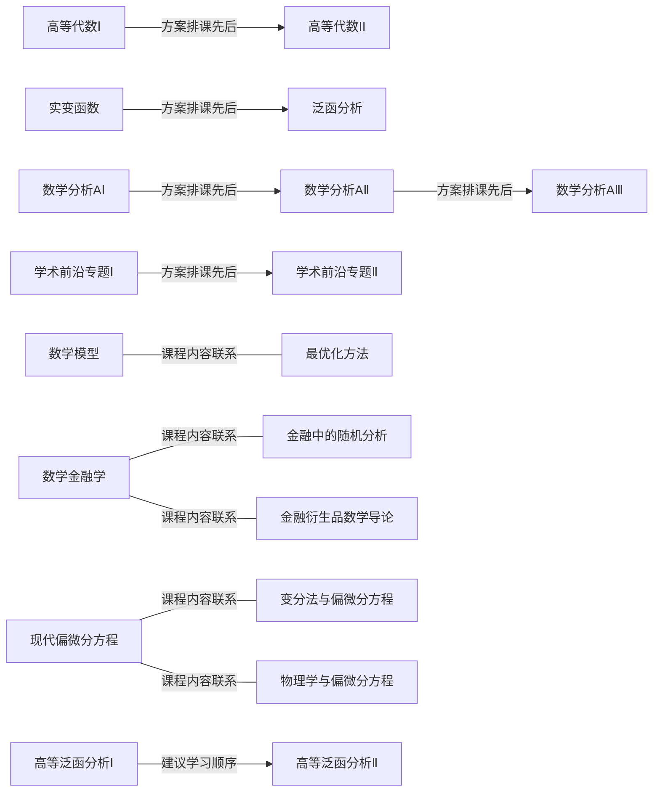

# 2025级数学与应用数学专业本科培养方案（港澳台侨生适用）

数学科学学院 · 数学与应用数学 · 方案 97418 · 207 个不同课程或科研条目。

[官方 Word](../originals/plan-97418.docx) · [教务详情](https://fdjwgl.fudan.edu.cn/manager/bizType/2/major-program-search/info/97418?skipAuth=1) · [方案快照](../raw/plan-97418.json.gz) · [年级目录](../README.md)

## 课程关系图

图中展示部分关系。下表保留全部已建立的课程对，来源位置使用本方案 JSON Pointer。

## 先修与内容联系

| 类型 | 起点 | 终点 | 依据 | 原表定位 |
| --- | --- | --- | --- | --- |
| 建议学习顺序 | 高等代数Ⅰ (MATH10009) | 高等代数II (MATH10019) | 同方案的课程题名具有连续分册或序号。  | `/courseModules/10/planCourses/1`、`/courseModules/10/planCourses/2` |
| 建议学习顺序 | 数学分析AⅠ (MATH10010) | 数学分析AⅡ (MATH10011) | 同方案的课程题名具有连续分册或序号。  | `/courseModules/7/planCourses/0`、`/courseModules/7/planCourses/1` |
| 建议学习顺序 | 数学分析AⅡ (MATH10011) | 数学分析AⅢ (MATH20004) | 同方案的课程题名具有连续分册或序号。  | `/courseModules/7/planCourses/1`、`/courseModules/10/planCourses/3` |
| 建议学习顺序 | 实变函数 (MATH20017) | 泛函分析 (MATH30004) | 测度与积分有助于理解函数空间。  | `/courseModules/10/planCourses/7`、`/courseModules/11/planCourses/3` |
| 建议学习顺序 | 学术前沿专题Ⅰ (MATH40001) | 学术前沿专题Ⅱ (MATH40002) | 同方案的课程题名具有连续分册或序号。  | `/courseModules/20/planCourses/2`、`/courseModules/20/planCourses/3` |
| 建议学习顺序 | 高等泛函分析Ⅰ (MATH40005) | 高等泛函分析Ⅱ (MATH50005) | 同方案的课程题名具有连续分册或序号。  | `/courseModules/14/planCourses/59`、`/courseModules/14/planCourses/60` |
| 方案排课先后 | 高等代数Ⅰ (MATH10009) | 高等代数II (MATH10019) | 同方案该课程全部明确数字学期均早于后者。  | `/courseModules/10/planCourses/1`、`/courseModules/10/planCourses/2` |
| 方案排课先后 | 数学分析AⅠ (MATH10010) | 数学分析AⅡ (MATH10011) | 同方案该课程全部明确数字学期均早于后者。  | `/courseModules/7/planCourses/0`、`/courseModules/7/planCourses/1` |
| 方案排课先后 | 数学分析AⅡ (MATH10011) | 数学分析AⅢ (MATH20004) | 同方案该课程全部明确数字学期均早于后者。  | `/courseModules/7/planCourses/1`、`/courseModules/10/planCourses/3` |
| 方案排课先后 | 实变函数 (MATH20017) | 泛函分析 (MATH30004) | 同方案该课程全部明确数字学期均早于后者。  | `/courseModules/10/planCourses/7`、`/courseModules/11/planCourses/3` |
| 方案排课先后 | 学术前沿专题Ⅰ (MATH40001) | 学术前沿专题Ⅱ (MATH40002) | 同方案该课程全部明确数字学期均早于后者。  | `/courseModules/20/planCourses/2`、`/courseModules/20/planCourses/3` |
| 课程内容联系 | 数学模型 (MATH20009) | 最优化方法 (MATH30020) | 共同主题为模型目标、决策变量与优化求解。  | `/courseModules/11/planCourses/1`、`/courseModules/14/planCourses/25` |
| 课程内容联系 | 数学金融学 (MATH30006) | 金融中的随机分析 (MATH30021) | 本方案两门课程的题名均含“金融”，可据此对照这一主题。  | `/courseModules/14/planCourses/4`、`/courseModules/14/planCourses/26` |
| 课程内容联系 | 数学金融学 (MATH30006) | 金融衍生品数学导论 (MATH30023) | 本方案两门课程的题名均含“金融”，可据此对照这一主题。  | `/courseModules/14/planCourses/4`、`/courseModules/14/planCourses/37` |
| 课程内容联系 | 数据科学中的现代逼近方法 (MATH40025) | 现代数据科学选讲 (MATH40042) | 本方案两门课程的题名均含“数据科学”，可据此对照这一主题。  | `/courseModules/14/planCourses/17`、`/courseModules/14/planCourses/36` |
| 课程内容联系 | 现代偏微分方程 (MATH40030) | 物理学与偏微分方程 (MATH40047) | 本方案两门课程的题名均含“偏微分方程”，可据此对照这一主题。  | `/courseModules/14/planCourses/44`、`/courseModules/14/planCourses/52` |
| 课程内容联系 | 现代偏微分方程 (MATH40030) | 变分法与偏微分方程 (MATH50023) | 本方案两门课程的题名均含“偏微分方程”，可据此对照这一主题。  | `/courseModules/14/planCourses/44`、`/courseModules/14/planCourses/22` |

本次未从可定位的明确表述中确认课程对课程预修。学期安排、系列分册与编辑建议均保留各自的依据。

## 课程表

同一课程在不同模块分别出现时，按原表逐行列出。季节字段保留原值。

| 课程 | 代码 | 学分 | 学期 | 模块 |
| --- | --- | ---: | --- | --- |
| 木兰拳 | GEPE10007 | 1.0 | AUTUMN | 培养方案 / 通识教育课程 / 通识教育专项教育课程 / 体育课程 |
| 木兰扇 | GEPE10008 | 1.0 | SPRING | 培养方案 / 通识教育课程 / 通识教育专项教育课程 / 体育课程 |
| 十六式太极拳 | GEPE10009 | 1.0 | AUTUMN | 培养方案 / 通识教育课程 / 通识教育专项教育课程 / 体育课程 |
| 陈式太极拳 | GEPE10010 | 1.0 | SPRING | 培养方案 / 通识教育课程 / 通识教育专项教育课程 / 体育课程 |
| 长拳二段 | GEPE10011 | 1.0 | AUTUMN | 培养方案 / 通识教育课程 / 通识教育专项教育课程 / 体育课程 |
| 长拳三段 | GEPE10012 | 1.0 | SPRING | 培养方案 / 通识教育课程 / 通识教育专项教育课程 / 体育课程 |
| 段位剑术二段 | GEPE10013 | 1.0 | AUTUMN | 培养方案 / 通识教育课程 / 通识教育专项教育课程 / 体育课程 |
| 段位剑术三段 | GEPE10014 | 1.0 | SPRING | 培养方案 / 通识教育课程 / 通识教育专项教育课程 / 体育课程 |
| 太极推手（一） | GEPE10015 | 1.0 | AUTUMN | 培养方案 / 通识教育课程 / 通识教育专项教育课程 / 体育课程 |
| 太极推手（二） | GEPE10016 | 1.0 | SPRING | 培养方案 / 通识教育课程 / 通识教育专项教育课程 / 体育课程 |
| 咏春拳（一） | GEPE10017 | 1.0 | AUTUMN | 培养方案 / 通识教育课程 / 通识教育专项教育课程 / 体育课程 |
| 咏春拳（二） | GEPE10018 | 1.0 | SPRING | 培养方案 / 通识教育课程 / 通识教育专项教育课程 / 体育课程 |
| 高尔夫（一） | GEPE10019 | 1.0 | AUTUMN | 培养方案 / 通识教育课程 / 通识教育专项教育课程 / 体育课程 |
| 高尔夫（二） | GEPE10020 | 1.0 | SPRING | 培养方案 / 通识教育课程 / 通识教育专项教育课程 / 体育课程 |
| 篮球（一） | GEPE10021 | 1.0 | AUTUMN | 培养方案 / 通识教育课程 / 通识教育专项教育课程 / 体育课程 |
| 篮球（二） | GEPE10022 | 1.0 | SPRING | 培养方案 / 通识教育课程 / 通识教育专项教育课程 / 体育课程 |
| 排球（一） | GEPE10023 | 1.0 | AUTUMN | 培养方案 / 通识教育课程 / 通识教育专项教育课程 / 体育课程 |
| 排球（二） | GEPE10024 | 1.0 | SPRING | 培养方案 / 通识教育课程 / 通识教育专项教育课程 / 体育课程 |
| 足球（一） | GEPE10025 | 1.0 | AUTUMN | 培养方案 / 通识教育课程 / 通识教育专项教育课程 / 体育课程 |
| 足球（二） | GEPE10026 | 1.0 | SPRING | 培养方案 / 通识教育课程 / 通识教育专项教育课程 / 体育课程 |
| 乒乓球（一） | GEPE10027 | 1.0 | AUTUMN | 培养方案 / 通识教育课程 / 通识教育专项教育课程 / 体育课程 |
| 乒乓球（二） | GEPE10028 | 1.0 | SPRING | 培养方案 / 通识教育课程 / 通识教育专项教育课程 / 体育课程 |
| 羽毛球（一） | GEPE10029 | 1.0 | AUTUMN | 培养方案 / 通识教育课程 / 通识教育专项教育课程 / 体育课程 |
| 羽毛球（二） | GEPE10030 | 1.0 | SPRING | 培养方案 / 通识教育课程 / 通识教育专项教育课程 / 体育课程 |
| 网球（一） | GEPE10031 | 1.0 | AUTUMN | 培养方案 / 通识教育课程 / 通识教育专项教育课程 / 体育课程 |
| 网球（二） | GEPE10032 | 1.0 | SPRING | 培养方案 / 通识教育课程 / 通识教育专项教育课程 / 体育课程 |
| 棒球（一） | GEPE10033 | 1.0 | AUTUMN | 培养方案 / 通识教育课程 / 通识教育专项教育课程 / 体育课程 |
| 棒球（二） | GEPE10034 | 1.0 | SPRING | 培养方案 / 通识教育课程 / 通识教育专项教育课程 / 体育课程 |
| 垒球（一） | GEPE10035 | 1.0 | AUTUMN | 培养方案 / 通识教育课程 / 通识教育专项教育课程 / 体育课程 |
| 垒球（二） | GEPE10036 | 1.0 | SPRING | 培养方案 / 通识教育课程 / 通识教育专项教育课程 / 体育课程 |
| 板球（一） | GEPE10037 | 1.0 | AUTUMN | 培养方案 / 通识教育课程 / 通识教育专项教育课程 / 体育课程 |
| 板球（二） | GEPE10038 | 1.0 | SPRING | 培养方案 / 通识教育课程 / 通识教育专项教育课程 / 体育课程 |
| 体育舞蹈（一） | GEPE10039 | 1.0 | AUTUMN | 培养方案 / 通识教育课程 / 通识教育专项教育课程 / 体育课程 |
| 体育舞蹈（二） | GEPE10040 | 1.0 | SPRING | 培养方案 / 通识教育课程 / 通识教育专项教育课程 / 体育课程 |
| 击剑（一） | GEPE10041 | 1.0 | AUTUMN | 培养方案 / 通识教育课程 / 通识教育专项教育课程 / 体育课程 |
| 击剑（二） | GEPE10042 | 1.0 | SPRING | 培养方案 / 通识教育课程 / 通识教育专项教育课程 / 体育课程 |
| 综合体育（一） | GEPE10043 | 1.0 | AUTUMN | 培养方案 / 通识教育课程 / 通识教育专项教育课程 / 体育课程 |
| 综合体育（二） | GEPE10044 | 1.0 | SPRING | 培养方案 / 通识教育课程 / 通识教育专项教育课程 / 体育课程 |
| 艺术体操（一） | GEPE10045 | 1.0 | AUTUMN | 培养方案 / 通识教育课程 / 通识教育专项教育课程 / 体育课程 |
| 艺术体操（二） | GEPE10046 | 1.0 | SPRING | 培养方案 / 通识教育课程 / 通识教育专项教育课程 / 体育课程 |
| 形体健美（一） | GEPE10047 | 1.0 | AUTUMN | 培养方案 / 通识教育课程 / 通识教育专项教育课程 / 体育课程 |
| 形体健美（二） | GEPE10048 | 1.0 | SPRING | 培养方案 / 通识教育课程 / 通识教育专项教育课程 / 体育课程 |
| 健美操（一） | GEPE10049 | 1.0 | AUTUMN | 培养方案 / 通识教育课程 / 通识教育专项教育课程 / 体育课程 |
| 健美操（二） | GEPE10050 | 1.0 | SPRING | 培养方案 / 通识教育课程 / 通识教育专项教育课程 / 体育课程 |
| 健美（一） | GEPE10051 | 1.0 | AUTUMN | 培养方案 / 通识教育课程 / 通识教育专项教育课程 / 体育课程 |
| 健美（二） | GEPE10052 | 1.0 | SPRING | 培养方案 / 通识教育课程 / 通识教育专项教育课程 / 体育课程 |
| 游泳（一） | GEPE10053 | 1.0 | AUTUMN | 培养方案 / 通识教育课程 / 通识教育专项教育课程 / 体育课程 |
| 游泳（二） | GEPE10054 | 1.0 | SPRING | 培养方案 / 通识教育课程 / 通识教育专项教育课程 / 体育课程 |
| 传统体育养生-八段锦 | GEPE10055 | 1.0 | SPRING | 培养方案 / 通识教育课程 / 通识教育专项教育课程 / 体育课程 |
| 传统体育养生-易筋经 | GEPE10056 | 1.0 | AUTUMN | 培养方案 / 通识教育课程 / 通识教育专项教育课程 / 体育课程 |
| 传统体育养生-五禽戏 | GEPE10057 | 1.0 | SPRING | 培养方案 / 通识教育课程 / 通识教育专项教育课程 / 体育课程 |
| 传统体育养生-六字诀 | GEPE10058 | 1.0 | AUTUMN | 培养方案 / 通识教育课程 / 通识教育专项教育课程 / 体育课程 |
| 手球（一） | GEPE10059 | 1.0 | AUTUMN | 培养方案 / 通识教育课程 / 通识教育专项教育课程 / 体育课程 |
| 手球（二） | GEPE10060 | 1.0 | SPRING | 培养方案 / 通识教育课程 / 通识教育专项教育课程 / 体育课程 |
| 气排球（一） | GEPE10061 | 1.0 | AUTUMN | 培养方案 / 通识教育课程 / 通识教育专项教育课程 / 体育课程 |
| 气排球（二） | GEPE10062 | 1.0 | SPRING | 培养方案 / 通识教育课程 / 通识教育专项教育课程 / 体育课程 |
| 有氧塑身（一） | GEPE10063 | 1.0 | AUTUMN | 培养方案 / 通识教育课程 / 通识教育专项教育课程 / 体育课程 |
| 有氧塑身（二） | GEPE10064 | 1.0 | SPRING | 培养方案 / 通识教育课程 / 通识教育专项教育课程 / 体育课程 |
| 游泳救生（一） | GEPE10065 | 1.0 | AUTUMN | 培养方案 / 通识教育课程 / 通识教育专项教育课程 / 体育课程 |
| 游泳救生（二） | GEPE10066 | 1.0 | SPRING | 培养方案 / 通识教育课程 / 通识教育专项教育课程 / 体育课程 |
| 龙狮运动（一） | GEPE10067 | 1.0 | AUTUMN | 培养方案 / 通识教育课程 / 通识教育专项教育课程 / 体育课程 |
| 龙狮运动（二） | GEPE10068 | 1.0 | SPRING | 培养方案 / 通识教育课程 / 通识教育专项教育课程 / 体育课程 |
| 射艺（一） | GEPE10069 | 1.0 | AUTUMN | 培养方案 / 通识教育课程 / 通识教育专项教育课程 / 体育课程 |
| 射艺（二） | GEPE10070 | 1.0 | SPRING | 培养方案 / 通识教育课程 / 通识教育专项教育课程 / 体育课程 |
| 导引养生（一） | GEPE10071 | 1.0 | AUTUMN | 培养方案 / 通识教育课程 / 通识教育专项教育课程 / 体育课程 |
| 导引养生（二） | GEPE10072 | 1.0 | SPRING | 培养方案 / 通识教育课程 / 通识教育专项教育课程 / 体育课程 |
| 防身术（一） | GEPE10073 | 1.0 | AUTUMN | 培养方案 / 通识教育课程 / 通识教育专项教育课程 / 体育课程 |
| 防身术（二） | GEPE10074 | 1.0 | SPRING | 培养方案 / 通识教育课程 / 通识教育专项教育课程 / 体育课程 |
| 篮球（提高一） | GEPE20003 | 1.0 | AUTUMN | 培养方案 / 通识教育课程 / 通识教育专项教育课程 / 体育课程 |
| 篮球（提高二） | GEPE20004 | 1.0 | SPRING | 培养方案 / 通识教育课程 / 通识教育专项教育课程 / 体育课程 |
| 排球（提高一） | GEPE20005 | 1.0 | AUTUMN | 培养方案 / 通识教育课程 / 通识教育专项教育课程 / 体育课程 |
| 排球（提高二） | GEPE20006 | 1.0 | SPRING | 培养方案 / 通识教育课程 / 通识教育专项教育课程 / 体育课程 |
| 足球（提高一） | GEPE20007 | 1.0 | AUTUMN | 培养方案 / 通识教育课程 / 通识教育专项教育课程 / 体育课程 |
| 足球（提高二） | GEPE20008 | 1.0 | SPRING | 培养方案 / 通识教育课程 / 通识教育专项教育课程 / 体育课程 |
| 网球（提高一） | GEPE20009 | 1.0 | AUTUMN | 培养方案 / 通识教育课程 / 通识教育专项教育课程 / 体育课程 |
| 网球（提高二） | GEPE20010 | 1.0 | SPRING | 培养方案 / 通识教育课程 / 通识教育专项教育课程 / 体育课程 |
| 羽毛球（提高一） | GEPE20011 | 1.0 | AUTUMN | 培养方案 / 通识教育课程 / 通识教育专项教育课程 / 体育课程 |
| 羽毛球（提高二） | GEPE20012 | 1.0 | SPRING | 培养方案 / 通识教育课程 / 通识教育专项教育课程 / 体育课程 |
| 乒乓球（提高一） | GEPE20013 | 1.0 | AUTUMN | 培养方案 / 通识教育课程 / 通识教育专项教育课程 / 体育课程 |
| 乒乓球（提高二） | GEPE20014 | 1.0 | SPRING | 培养方案 / 通识教育课程 / 通识教育专项教育课程 / 体育课程 |
| 健美操（提高一） | GEPE20015 | 1.0 | AUTUMN | 培养方案 / 通识教育课程 / 通识教育专项教育课程 / 体育课程 |
| 健美操（提高二） | GEPE20016 | 1.0 | SPRING | 培养方案 / 通识教育课程 / 通识教育专项教育课程 / 体育课程 |
| 旱地冰球（一） | GEPE10075 | 1.0 | AUTUMN | 培养方案 / 通识教育课程 / 通识教育专项教育课程 / 体育课程 |
| 旱地冰球（二） | GEPE10076 | 1.0 | SPRING | 培养方案 / 通识教育课程 / 通识教育专项教育课程 / 体育课程 |
| 健康体适能（一） | GEPE10077 | 1.0 | AUTUMN | 培养方案 / 通识教育课程 / 通识教育专项教育课程 / 体育课程 |
| 健康体适能（二） | GEPE10078 | 1.0 | SPRING | 培养方案 / 通识教育课程 / 通识教育专项教育课程 / 体育课程 |
| 瑜伽（一） | GEPE10079 | 1.0 | AUTUMN | 培养方案 / 通识教育课程 / 通识教育专项教育课程 / 体育课程 |
| 瑜伽（二） | GEPE10080 | 1.0 | SPRING | 培养方案 / 通识教育课程 / 通识教育专项教育课程 / 体育课程 |
| 极限飞盘（一） | GEPE10081 | 1.0 | AUTUMN | 培养方案 / 通识教育课程 / 通识教育专项教育课程 / 体育课程 |
| 极限飞盘（二） | GEPE10082 | 1.0 | SPRING | 培养方案 / 通识教育课程 / 通识教育专项教育课程 / 体育课程 |
| 武术兵道（一） | GEPE10083 | 1.0 | AUTUMN | 培养方案 / 通识教育课程 / 通识教育专项教育课程 / 体育课程 |
| 武术兵道（二） | GEPE10084 | 1.0 | SPRING | 培养方案 / 通识教育课程 / 通识教育专项教育课程 / 体育课程 |
| 毽球（一） | GEPE10085 | 1.0 | AUTUMN | 培养方案 / 通识教育课程 / 通识教育专项教育课程 / 体育课程 |
| 毽球（二） | GEPE10086 | 1.0 | SPRING | 培养方案 / 通识教育课程 / 通识教育专项教育课程 / 体育课程 |
| 高级体育训练（一） | GEPE40001 | 1.0 | AUTUMN | 培养方案 / 通识教育课程 / 通识教育专项教育课程 / 体育课程 |
| 高级体育训练（二） | GEPE40002 | 1.0 | SPRING | 培养方案 / 通识教育课程 / 通识教育专项教育课程 / 体育课程 |
| 高级体育训练（三） | GEPE40003 | 1.0 | AUTUMN | 培养方案 / 通识教育课程 / 通识教育专项教育课程 / 体育课程 |
| 高级体育训练（四） | GEPE40004 | 1.0 | SPRING | 培养方案 / 通识教育课程 / 通识教育专项教育课程 / 体育课程 |
| 花样跳绳（一） | GEPE10003 | 1.0 | AUTUMN | 培养方案 / 通识教育课程 / 通识教育专项教育课程 / 体育课程 |
| 花样跳绳（二） | GEPE10004 | 1.0 | SPRING | 培养方案 / 通识教育课程 / 通识教育专项教育课程 / 体育课程 |
| 花样跳绳-提高（一） | GEPE20001 | 1.0 | AUTUMN | 培养方案 / 通识教育课程 / 通识教育专项教育课程 / 体育课程 |
| 花样跳绳-提高（二） | GEPE20002 | 1.0 | SPRING | 培养方案 / 通识教育课程 / 通识教育专项教育课程 / 体育课程 |
| 跆拳道（一） | GEPE10005 | 1.0 | AUTUMN | 培养方案 / 通识教育课程 / 通识教育专项教育课程 / 体育课程 |
| 跆拳道（二） | GEPE10006 | 1.0 | SPRING | 培养方案 / 通识教育课程 / 通识教育专项教育课程 / 体育课程 |
| 射击（一） | GEPE10001 | 1.0 | AUTUMN | 培养方案 / 通识教育课程 / 通识教育专项教育课程 / 体育课程 |
| 射击（二） | GEPE10002 | 1.0 | SPRING | 培养方案 / 通识教育课程 / 通识教育专项教育课程 / 体育课程 |
| 中国传统舞蹈（一） | GEPE10087 | 1.0 |  | 培养方案 / 通识教育课程 / 通识教育专项教育课程 / 体育课程 |
| 中国传统舞蹈（二） | GEPE10088 | 1.0 |  | 培养方案 / 通识教育课程 / 通识教育专项教育课程 / 体育课程 |
| 中国传统舞蹈（提高一） | GEPE10089 | 1.0 |  | 培养方案 / 通识教育课程 / 通识教育专项教育课程 / 体育课程 |
| 中国传统舞蹈（提高二） | GEPE10090 | 1.0 |  | 培养方案 / 通识教育课程 / 通识教育专项教育课程 / 体育课程 |
| 匹克球（一） | GEPE10091 | 1.0 |  | 培养方案 / 通识教育课程 / 通识教育专项教育课程 / 体育课程 |
| 匹克球（二） | GEPE10092 | 1.0 |  | 培养方案 / 通识教育课程 / 通识教育专项教育课程 / 体育课程 |
| 武术短兵（一） | GEPE10093 | 1.0 |  | 培养方案 / 通识教育课程 / 通识教育专项教育课程 / 体育课程 |
| 武术短兵（二） | GEPE10094 | 1.0 |  | 培养方案 / 通识教育课程 / 通识教育专项教育课程 / 体育课程 |
| 中国传统舞蹈（提高一） | GEPE20017 | 1.0 |  | 培养方案 / 通识教育课程 / 通识教育专项教育课程 / 体育课程 |
| 中国传统舞蹈（提高二） | GEPE20018 | 1.0 |  | 培养方案 / 通识教育课程 / 通识教育专项教育课程 / 体育课程 |
| 数学分析AⅠ | MATH10010 | 5.0 | 第1学期 | 培养方案 / 专业培养课程 / 学科基础课程 / 必修课程 |
| 数学分析AⅡ | MATH10011 | 5.0 | 第2学期 | 培养方案 / 专业培养课程 / 学科基础课程 / 必修课程 |
| 解析几何 | MATH10020 | 4.0 | 第1学期 | 培养方案 / 专业培养课程 / 专业核心教育课程 / 必修课程 |
| 高等代数Ⅰ | MATH10009 | 5.0 | 第1学期 | 培养方案 / 专业培养课程 / 专业核心教育课程 / 必修课程 |
| 高等代数II | MATH10019 | 5.0 | 第2学期 | 培养方案 / 专业培养课程 / 专业核心教育课程 / 必修课程 |
| 数学分析AⅢ | MATH20004 | 5.0 | 第3学期 | 培养方案 / 专业培养课程 / 专业核心教育课程 / 必修课程 |
| 常微分方程 | MATH20014 | 4.0 | 第3学期 | 培养方案 / 专业培养课程 / 专业核心教育课程 / 必修课程 |
| 抽象代数 | MATH20015 | 4.0 | 第3学期 | 培养方案 / 专业培养课程 / 专业核心教育课程 / 必修课程 |
| 复变函数 | MATH20016 | 4.0 | 第4学期 | 培养方案 / 专业培养课程 / 专业核心教育课程 / 必修课程 |
| 实变函数 | MATH20017 | 4.0 | 第4学期 | 培养方案 / 专业培养课程 / 专业核心教育课程 / 必修课程 |
| 拓扑学 | MATH20018 | 4.0 | 第4学期 | 培养方案 / 专业培养课程 / 专业核心教育课程 / 必修课程 |
| 抽象代数II | MATH20013 | 3.0 | 第4学期 | 培养方案 / 专业培养课程 / 专业核心教育课程 / 限定必修课程 |
| 数学模型 | MATH20009 | 3.0 | 第4学期 | 培养方案 / 专业培养课程 / 专业核心教育课程 / 限定必修课程 |
| 概率论 | MATH30003 | 3.0 | 第5学期、第6学期、第7学期、第8学期 | 培养方案 / 专业培养课程 / 专业核心教育课程 / 限定必修课程 |
| 泛函分析 | MATH30004 | 3.0 | 第5学期、第7学期 | 培养方案 / 专业培养课程 / 专业核心教育课程 / 限定必修课程 |
| 微分几何 | MATH20010 | 3.0 | 第5学期、第7学期 | 培养方案 / 专业培养课程 / 专业核心教育课程 / 限定必修课程 |
| 同调论 | MATH30002 | 3.0 | 第5学期、第7学期 | 培养方案 / 专业培养课程 / 专业核心教育课程 / 限定必修课程 |
| 控制理论基础 | MATH50018 | 3.0 | 第5学期、第7学期 | 培养方案 / 专业培养课程 / 专业核心教育课程 / 限定必修课程 |
| 数论基础 | MATH20011 | 3.0 | 第5学期、第7学期 | 培养方案 / 专业培养课程 / 专业核心教育课程 / 限定必修课程 |
| 数理方程 | MATH30005 | 3.0 | 第5学期、第6学期、第7学期、第8学期 | 培养方案 / 专业培养课程 / 专业核心教育课程 / 限定必修课程 |
| 微分方程数值解法 | MATH40010 | 3.0 | 第6学期、第8学期 | 培养方案 / 专业培养课程 / 专业核心教育课程 / 限定必修课程 |
| 基础力学 | MECH30005 | 3.0 | 第6学期、第8学期 | 培养方案 / 专业培养课程 / 专业核心教育课程 / 限定必修课程 |
| 科研实践 | MATH50002 | 3.0 | 第6学期、第7学期、第8学期 | 培养方案 / 专业进阶模块 |
| 生产实习 | MATH40008 | 1.0 | 第7学期 | 培养方案 / 专业进阶模块 |
| 小波分析 | MATH40011 | 3.0 | SPRING、AUTUMN | 培养方案 / 专业进阶模块 |
| 计算机辅助几何设计 | MATH40012 | 3.0 | SPRING、AUTUMN | 培养方案 / 专业进阶模块 |
| 数学金融学 | MATH30006 | 3.0 | SPRING、AUTUMN | 培养方案 / 专业进阶模块 |
| 应用几何 | MATH40013 | 3.0 | SPRING、AUTUMN | 培养方案 / 专业进阶模块 |
| 利息理论 | MATH30007 | 3.0 | SPRING、AUTUMN | 培养方案 / 专业进阶模块 |
| 计算方法 | MATH30008 | 3.0 | 第5学期 | 培养方案 / 专业进阶模块 |
| 分形几何 | MATH40016 | 3.0 | SPRING、AUTUMN | 培养方案 / 专业进阶模块 |
| 非寿险精算数学 | MATH30009 | 3.0 | SPRING、AUTUMN | 培养方案 / 专业进阶模块 |
| 寿险精算数学 | MATH30010 | 3.0 | SPRING、AUTUMN | 培养方案 / 专业进阶模块 |
| 数字信号处理 | MATH40020 | 3.0 | SPRING、AUTUMN | 培养方案 / 专业进阶模块 |
| 时间序列分析 | MATH40021 | 3.0 | SPRING、AUTUMN | 培养方案 / 专业进阶模块 |
| 测度论 | MATH30012 | 3.0 | SPRING、AUTUMN | 培养方案 / 专业进阶模块 |
| 非线性系统 | MATH40023 | 3.0 | SPRING、AUTUMN | 培养方案 / 专业进阶模块 |
| 科学计算 | MATH40024 | 3.0 | SPRING、AUTUMN | 培养方案 / 专业进阶模块 |
| 数学分析原理 | MATH20012 | 5.0 | SPRING、AUTUMN | 培养方案 / 专业进阶模块 |
| 数据科学中的现代逼近方法 | MATH40025 | 3.0 | SPRING、AUTUMN | 培养方案 / 专业进阶模块 |
| 统计方法选讲 | MATH40027 | 3.0 | SPRING、AUTUMN | 培养方案 / 专业进阶模块 |
| 应用随机过程 | MATH30016 | 3.0 | SPRING、AUTUMN | 培养方案 / 专业进阶模块 |
| 统计推断 | MATH40028 | 3.0 | SPRING、AUTUMN | 培养方案 / 专业进阶模块 |
| 遍历论 | MATH60034 | 3.0 | SPRING、AUTUMN | 培养方案 / 专业进阶模块 |
| 变分法与偏微分方程 | MATH50023 | 3.0 | SPRING、AUTUMN | 培养方案 / 专业进阶模块 |
| 拓扑群 | MATH40031 | 3.0 | SPRING、AUTUMN | 培养方案 / 专业进阶模块 |
| 线性与非线性规划 | MATH30019 | 3.0 | SPRING、AUTUMN | 培养方案 / 专业进阶模块 |
| 最优化方法 | MATH30020 | 3.0 | SPRING、AUTUMN | 培养方案 / 专业进阶模块 |
| 金融中的随机分析 | MATH30021 | 3.0 | SPRING、AUTUMN | 培养方案 / 专业进阶模块 |
| 深度学习 | MATH40034 | 3.0 | SPRING、AUTUMN | 培养方案 / 专业进阶模块 |
| 微分几何续论 | MATH30022 | 3.0 | SPRING、AUTUMN | 培养方案 / 专业进阶模块 |
| 布朗运动 | MATH40035 | 3.0 | SPRING、AUTUMN | 培养方案 / 专业进阶模块 |
| 概率模型与随机计算选讲 | MATH40036 | 3.0 | SPRING、AUTUMN | 培养方案 / 专业进阶模块 |
| Current理论 | MATH40037 | 3.0 | SPRING、AUTUMN | 培养方案 / 专业进阶模块 |
| 微局部分析 | MATH40038 | 3.0 | SPRING、AUTUMN | 培养方案 / 专业进阶模块 |
| 现代调和分析 | MATH60037 | 3.0 | SPRING、AUTUMN | 培养方案 / 专业进阶模块 |
| 高维概率及其应用 | MATH40040 | 3.0 | SPRING、AUTUMN | 培养方案 / 专业进阶模块 |
| 数学建模及应用 | MATH50033 | 3.0 | SPRING、AUTUMN | 培养方案 / 专业进阶模块 |
| 现代数据科学选讲 | MATH40042 | 3.0 | SPRING、AUTUMN | 培养方案 / 专业进阶模块 |
| 金融衍生品数学导论 | MATH30023 | 3.0 | SPRING、AUTUMN | 培养方案 / 专业进阶模块 |
| 几何群论 | MATH40043 | 3.0 | SPRING、AUTUMN | 培养方案 / 专业进阶模块 |
| 现代统计模型 | STAT30013 | 3.0 | SPRING、AUTUMN | 培养方案 / 专业进阶模块 |
| 多元统计原理与基础 | STAT30012 | 3.0 | SPRING、AUTUMN | 培养方案 / 专业进阶模块 |
| 双曲几何 | MATH40006 | 3.0 | SPRING、AUTUMN | 培养方案 / 专业进阶模块 |
| 数理方程进阶 | MATH50008 | 3.0 | SPRING、AUTUMN | 培养方案 / 专业进阶模块 |
| 谱理论基础 | MATH50007 | 3.0 | SPRING、AUTUMN | 培养方案 / 专业进阶模块 |
| 现代偏微分方程 | MATH40030 | 3.0 | SPRING、AUTUMN | 培养方案 / 专业进阶模块 |
| 复分析 | MATH40019 | 3.0 | SPRING、AUTUMN | 培养方案 / 专业进阶模块 |
| 代数拓扑基础 | MATH40044 | 3.0 | SPRING、AUTUMN | 培养方案 / 专业进阶模块 |
| 现代微分几何基础 | MATH50036 | 3.0 | SPRING、AUTUMN | 培养方案 / 专业进阶模块 |
| 李群和李代数 | MATH40029 | 3.0 | SPRING、AUTUMN | 培养方案 / 专业进阶模块 |
| 现代常微分方程 | MATH40045 | 3.0 | SPRING、AUTUMN | 培养方案 / 专业进阶模块 |
| 索伯列夫空间 | MATH40046 | 3.0 | SPRING、AUTUMN | 培养方案 / 专业进阶模块 |
| 随机分析 | MATH60033 | 3.0 | SPRING、AUTUMN | 培养方案 / 专业进阶模块 |
| 物理学与偏微分方程 | MATH40047 | 3.0 | SPRING、AUTUMN | 培养方案 / 专业进阶模块 |
| 代数几何 | MATH50038 | 3.0 | SPRING、AUTUMN | 培养方案 / 专业进阶模块 |
| 现代微分几何 | MATH50039 | 3.0 | SPRING、AUTUMN | 培养方案 / 专业进阶模块 |
| 代数拓扑 | MATH50026 | 3.0 | SPRING、AUTUMN | 培养方案 / 专业进阶模块 |
| 数值分析与科学计算 | MATH50041 | 3.0 | SPRING、AUTUMN | 培养方案 / 专业进阶模块 |
| 数值代数及其应用 | MATH50042 | 3.0 | SPRING、AUTUMN | 培养方案 / 专业进阶模块 |
| 应用分析中的科学计算 | MATH50043 | 3.0 | SPRING、AUTUMN | 培养方案 / 专业进阶模块 |
| 高等泛函分析Ⅰ | MATH40005 | 3.0 | SPRING、AUTUMN | 培养方案 / 专业进阶模块 |
| 高等泛函分析Ⅱ | MATH50005 | 3.0 | SPRING、AUTUMN | 培养方案 / 专业进阶模块 |
| 抽象代数续论 | MATH50019 | 3.0 | SPRING、AUTUMN | 培养方案 / 专业进阶模块 |
| 现代概率论基础I | MATH50027 | 3.0 | SPRING、AUTUMN | 培养方案 / 专业进阶模块 |
| 无学分讨论班 | 101 | 0.0 |  | 融合创新能力 |
| 复芏计划(FDUROP) | 102 | 0.0 |  | 融合创新能力 |
| 学术前沿专题Ⅰ | MATH40001 | 1.0 | 第3学期 | 融合创新能力 |
| 学术前沿专题Ⅱ | MATH40002 | 1.0 | 第4学期 | 融合创新能力 |
| 独立学习 | MATH50001 | 3.0 | 第5学期 | 融合创新能力 |
| 毕业论文(含专题讨论) | MATH40033 | 4.0 | 第8学期 | 融合创新能力 |
| 科研实践 | MATH50002 | 3.0 | 第6学期、第7学期、第8学期 | 融合创新能力 |
