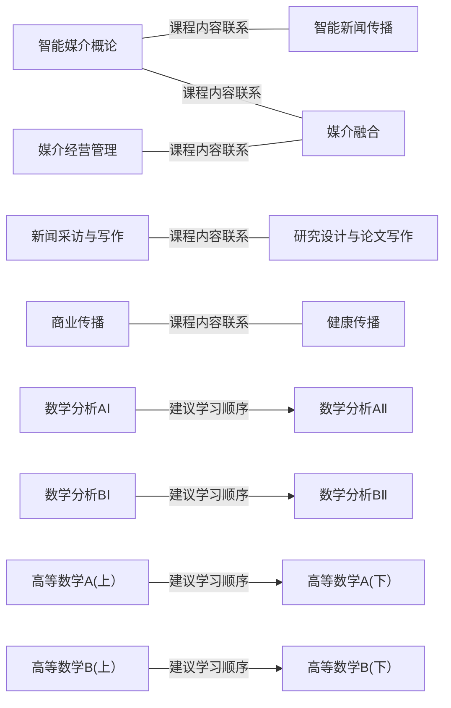

# 2024广播电视学“2+X”教学培养方案 留学生

新闻学院 · 广播电视学 · 方案 72828 · 122 个不同课程或科研条目。

[官方 Word](../originals/plan-72828.docx) · [教务详情](https://fdjwgl.fudan.edu.cn/manager/bizType/2/major-program-search/info/72828?skipAuth=1) · [方案快照](../raw/plan-72828.json.gz) · [年级目录](../README.md)

## 修读导读

- **建议先学**　《数学分析AⅠ》（`MATH10010`） → 《数学分析AⅡ》（`MATH10011`）。题名列出连续册次或级别。可把定义、定理的条件和典型例题保留下来，读后续分册时继续沿用。

- **可以对照着读**　《智能媒介概论》（`AIS210008`）与《智能新闻传播》（`AIS310010`）。智能媒介技术和新闻生产传播具有应用场景交集。

- **查模块选课**　《中国新闻传播史》（`JCM10004`）、《新闻采访与写作》（`JCM20012`）列在“专业基础课程”中。原表见 `/courseModules/9`。

## 课程关系图

图中展示部分关系。下表保留全部已建立的课程对，来源位置使用本方案 JSON Pointer。

## 先修与内容联系

| 类型 | 起点 | 终点 | 依据 | 原表定位 |
| --- | --- | --- | --- | --- |
| 建议学习顺序 | 高等数学B(上） (MATH10004) | 高等数学B(下） (MATH10005) | 同方案的课程题名具有连续分册或序号。  | `/courseModules/7/planCourses/13`、`/courseModules/7/planCourses/14` |
| 建议学习顺序 | 数学分析AⅠ (MATH10010) | 数学分析AⅡ (MATH10011) | 同方案的课程题名具有连续分册或序号。  | `/courseModules/7/planCourses/7`、`/courseModules/7/planCourses/8` |
| 建议学习顺序 | 数学分析BⅠ (MATH10012) | 数学分析BⅡ (MATH10013) | 同方案的课程题名具有连续分册或序号。  | `/courseModules/7/planCourses/9`、`/courseModules/7/planCourses/10` |
| 建议学习顺序 | 高等数学A(上） (MATH10015) | 高等数学A(下） (MATH10016) | 同方案的课程题名具有连续分册或序号。  | `/courseModules/7/planCourses/11`、`/courseModules/7/planCourses/12` |
| 课程内容联系 | 智能媒介概论 (AIS210008) | 智能新闻传播 (AIS310010) | 智能媒介技术和新闻生产传播具有应用场景交集。  | `/courseModules/9/planCourses/3`、`/courseModules/9/planCourses/4` |
| 课程内容联系 | 智能媒介概论 (AIS210008) | 媒介融合 (JCM30020) | 本方案两门课程的题名均含“媒介”，可据此对照这一主题。  | `/courseModules/9/planCourses/3`、`/courseModules/9/planCourses/9` |
| 课程内容联系 | 智能新闻传播 (AIS310010) | 新闻社会学 (JCM50064) | 本方案两门课程的题名均含“新闻”，可据此对照这一主题。  | `/courseModules/9/planCourses/4`、`/courseModules/12/planCourses/4` |
| 课程内容联系 | 新闻采访与写作 (JCM20012) | 研究设计与论文写作 (JCM50096) | 本方案两门课程的题名均含“写作”，可据此对照这一主题。  | `/courseModules/9/planCourses/1`、`/courseModules/12/planCourses/15` |
| 课程内容联系 | 商业传播 (JCM20026) | 健康传播 (JCM50041) | 本方案两门课程的题名均含“传播”，可据此对照这一主题。  | `/courseModules/9/planCourses/6`、`/courseModules/13/planCourses/0` |
| 课程内容联系 | 媒介经营管理 (JCM30009) | 媒介融合 (JCM30020) | 本方案两门课程的题名均含“媒介”，可据此对照这一主题。  | `/courseModules/9/planCourses/8`、`/courseModules/9/planCourses/9` |
| 课程内容联系 | 媒介融合 (JCM30020) | 媒介与社会 (JCM50063) | 本方案两门课程的题名均含“媒介”，可据此对照这一主题。  | `/courseModules/9/planCourses/9`、`/courseModules/12/planCourses/2` |
| 课程内容联系 | 媒介融合 (JCM30020) | 新媒介概论 (JCM50072) | 本方案两门课程的题名均含“媒介”，可据此对照这一主题。  | `/courseModules/9/planCourses/9`、`/courseModules/12/planCourses/0` |
| 课程内容联系 | 政治传播 (JCM50039) | 健康传播 (JCM50041) | 本方案两门课程的题名均含“传播”，可据此对照这一主题。  | `/courseModules/13/planCourses/2`、`/courseModules/13/planCourses/0` |
| 课程内容联系 | 健康传播 (JCM50041) | 环境传播 (JCM50043) | 本方案两门课程的题名均含“传播”，可据此对照这一主题。  | `/courseModules/13/planCourses/0`、`/courseModules/13/planCourses/1` |
| 课程内容联系 | 健康传播 (JCM50041) | 危机传播 (JCM50081) | 本方案两门课程的题名均含“传播”，可据此对照这一主题。  | `/courseModules/13/planCourses/0`、`/courseModules/13/planCourses/21` |
| 课程内容联系 | 新闻社会学 (JCM50064) | 新闻叙事分析 (JCM50069) | 本方案两门课程的题名均含“新闻”，可据此对照这一主题。  | `/courseModules/12/planCourses/4`、`/courseModules/12/planCourses/13` |
| 课程内容联系 | 新闻社会学 (JCM50064) | 新闻作品评析 (JCM50099) | 本方案两门课程的题名均含“新闻”，可据此对照这一主题。  | `/courseModules/12/planCourses/4`、`/courseModules/12/planCourses/8` |
| 课程内容联系 | 新闻社会学 (JCM50064) | 新闻与全球化 (JCM50103) | 本方案两门课程的题名均含“新闻”，可据此对照这一主题。  | `/courseModules/12/planCourses/4`、`/courseModules/12/planCourses/16` |
| 课程内容联系 | 新闻社会学 (JCM50064) | 社会学导论 (SOCI20001) | 本方案两门课程的题名均含“社会学”，可据此对照这一主题。  | `/courseModules/12/planCourses/4`、`/courseModules/7/planCourses/1` |
| 课程内容联系 | 视听广告创作 (JCM50084) | 广告与社会 (JCM50091) | 本方案两门课程的题名均含“广告”，可据此对照这一主题。  | `/courseModules/13/planCourses/18`、`/courseModules/13/planCourses/14` |
| 课程内容联系 | 近现代广告史 (JCM50090) | 广告与社会 (JCM50091) | 本方案两门课程的题名均含“广告”，可据此对照这一主题。  | `/courseModules/13/planCourses/13`、`/courseModules/13/planCourses/14` |
| 课程内容联系 | 广告与社会 (JCM50091) | 数字音频广告 (JCM50100) | 本方案两门课程的题名均含“广告”，可据此对照这一主题。  | `/courseModules/13/planCourses/14`、`/courseModules/13/planCourses/22` |
| 课程内容联系 | 法理学导论 (LAW10004) | 宪法 (LAW10005) | 两课均涉及权利与公共权力的规范依据。  | `/courseModules/7/planCourses/2`、`/courseModules/7/planCourses/26` |

本次未从可定位的明确表述中确认课程对课程预修。学期安排、系列分册与编辑建议均保留各自的依据。

## 按原方案模块阅读

同一模块展示原表中的课程归属。模块内课程之间的先后仍须逐项查阅。

- **社会科学类基础课程**　会计学、管理学导论、微观经济学、宏观经济学、经济学原理、政治经济学、微观经济学原理、宏观经济学原理、法理学导论、宪法、经济法、公共行政学、高等数学B(上）、高等数学B(下）、高等数学D、数学分析AⅠ、数学分析AⅡ、数学分析BⅠ等31项（原表模块 7）
- **专业基础课程**　智能媒介概论、智能新闻传播、中国新闻传播史、教学小实习、新闻采访与写作、口语表达、商业传播、视听传播、媒介经营管理、媒介融合、新闻传播法规与伦理、数据分析与信息可视化、教学大实习、毕业论文（原表模块 9）

## 课程表

同一课程在不同模块分别出现时，按原表逐行列出。季节字段保留原值。

| 课程 | 代码 | 学分 | 学期 | 模块 |
| --- | --- | ---: | --- | --- |
| 政治学原理 | POLI10007 | 3.0 | SPRING、AUTUMN | 培养方案 / 专业培养课程 / 大类基础课程 / 社会科学类基础课程 |
| 社会学导论 | SOCI20001 | 3.0 | SPRING、AUTUMN | 培养方案 / 专业培养课程 / 大类基础课程 / 社会科学类基础课程 |
| 法理学导论 | LAW10004 | 3.0 | SPRING、AUTUMN | 培养方案 / 专业培养课程 / 大类基础课程 / 社会科学类基础课程 |
| 微观经济学 | ECON20003 | 3.0 | 第2学期 | 培养方案 / 专业培养课程 / 大类基础课程 / 社会科学类基础课程 |
| 宏观经济学 | ECON20004 | 3.0 | 第3学期 | 培养方案 / 专业培养课程 / 大类基础课程 / 社会科学类基础课程 |
| 微观经济学原理 | ECON20007 | 5.0 | 第1学期 | 培养方案 / 专业培养课程 / 大类基础课程 / 社会科学类基础课程 |
| 宏观经济学原理 | ECON20008 | 5.0 | 第2学期 | 培养方案 / 专业培养课程 / 大类基础课程 / 社会科学类基础课程 |
| 数学分析AⅠ | MATH10010 | 5.0 | SPRING、AUTUMN | 培养方案 / 专业培养课程 / 大类基础课程 / 社会科学类基础课程 |
| 数学分析AⅡ | MATH10011 | 5.0 | SPRING、AUTUMN | 培养方案 / 专业培养课程 / 大类基础课程 / 社会科学类基础课程 |
| 数学分析BⅠ | MATH10012 | 5.0 | SPRING、AUTUMN | 培养方案 / 专业培养课程 / 大类基础课程 / 社会科学类基础课程 |
| 数学分析BⅡ | MATH10013 | 5.0 | SPRING、AUTUMN | 培养方案 / 专业培养课程 / 大类基础课程 / 社会科学类基础课程 |
| 高等数学A(上） | MATH10015 | 5.0 | SPRING、AUTUMN | 培养方案 / 专业培养课程 / 大类基础课程 / 社会科学类基础课程 |
| 高等数学A(下） | MATH10016 | 5.0 | SPRING、AUTUMN | 培养方案 / 专业培养课程 / 大类基础课程 / 社会科学类基础课程 |
| 高等数学B(上） | MATH10004 | 5.0 | SPRING、AUTUMN | 培养方案 / 专业培养课程 / 大类基础课程 / 社会科学类基础课程 |
| 高等数学B(下） | MATH10005 | 5.0 | SPRING、AUTUMN | 培养方案 / 专业培养课程 / 大类基础课程 / 社会科学类基础课程 |
| 线性代数 | MATH10017 | 3.0 | SPRING、AUTUMN | 培养方案 / 专业培养课程 / 大类基础课程 / 社会科学类基础课程 |
| 会计学 | BA10003 | 3.0 | SPRING、AUTUMN | 培养方案 / 专业培养课程 / 大类基础课程 / 社会科学类基础课程 |
| 高等数学D | MATH10008 | 4.0 | SPRING、AUTUMN | 培养方案 / 专业培养课程 / 大类基础课程 / 社会科学类基础课程 |
| 经济学原理 | ECON20005 | 3.0 | SPRING、AUTUMN | 培养方案 / 专业培养课程 / 大类基础课程 / 社会科学类基础课程 |
| 政治经济学 | ECON20006 | 3.0 | SPRING、AUTUMN | 培养方案 / 专业培养课程 / 大类基础课程 / 社会科学类基础课程 |
| 社会研究方法A | SOCI20002 | 3.0 | SPRING、AUTUMN | 培养方案 / 专业培养课程 / 大类基础课程 / 社会科学类基础课程 |
| 社会研究方法B | MSE30029 | 3.0 | SPRING、AUTUMN | 培养方案 / 专业培养课程 / 大类基础课程 / 社会科学类基础课程 |
| 国际关系导论 | POLI10008 | 3.0 | SPRING、AUTUMN | 培养方案 / 专业培养课程 / 大类基础课程 / 社会科学类基础课程 |
| 社会工作导论 | SWK20002 | 3.0 | SPRING、AUTUMN | 培养方案 / 专业培养课程 / 大类基础课程 / 社会科学类基础课程 |
| 心理学导论 | PSYC20001 | 3.0 | SPRING、AUTUMN | 培养方案 / 专业培养课程 / 大类基础课程 / 社会科学类基础课程 |
| 管理学导论 | BA10004 | 3.0 | SPRING、AUTUMN | 培养方案 / 专业培养课程 / 大类基础课程 / 社会科学类基础课程 |
| 宪法 | LAW10005 | 3.0 | SPRING、AUTUMN | 培养方案 / 专业培养课程 / 大类基础课程 / 社会科学类基础课程 |
| 经济法 | LAW20011 | 3.0 | SPRING、AUTUMN | 培养方案 / 专业培养课程 / 大类基础课程 / 社会科学类基础课程 |
| 统计学 | SOCI20003 | 3.0 | SPRING、AUTUMN | 培养方案 / 专业培养课程 / 大类基础课程 / 社会科学类基础课程 |
| 公共行政学 | MANA10002 | 3.0 | SPRING、AUTUMN | 培养方案 / 专业培养课程 / 大类基础课程 / 社会科学类基础课程 |
| 当代中国政治制度 | POLI10009 | 3.0 | SPRING、AUTUMN | 培养方案 / 专业培养课程 / 大类基础课程 / 社会科学类基础课程 |
| 中国新闻传播史 | JCM10004 | 3.0 | 第2学期、第3学期 | 培养方案 / 专业培养课程 / 专业核心教育课程 / 专业基础课程 |
| 新闻采访与写作 | JCM20012 | 3.0 | 第2学期、第3学期 | 培养方案 / 专业培养课程 / 专业核心教育课程 / 专业基础课程 |
| 视听传播 | JCM20032 | 3.0 | 第2学期、第3学期 | 培养方案 / 专业培养课程 / 专业核心教育课程 / 专业基础课程 |
| 智能媒介概论 | AIS210008 | 2.0 | 第3学期、第4学期 | 培养方案 / 专业培养课程 / 专业核心教育课程 / 专业基础课程 |
| 智能新闻传播 | AIS310010 | 2.0 | 第3学期、第4学期 | 培养方案 / 专业培养课程 / 专业核心教育课程 / 专业基础课程 |
| 口语表达 | JCM20025 | 3.0 | 第3学期、第4学期 | 培养方案 / 专业培养课程 / 专业核心教育课程 / 专业基础课程 |
| 商业传播 | JCM20026 | 3.0 | 第3学期、第4学期 | 培养方案 / 专业培养课程 / 专业核心教育课程 / 专业基础课程 |
| 新闻传播法规与伦理 | JCM30023 | 3.0 | 第5学期、第6学期 | 培养方案 / 专业培养课程 / 专业核心教育课程 / 专业基础课程 |
| 媒介经营管理 | JCM30009 | 2.0 | 第5学期、第6学期 | 培养方案 / 专业培养课程 / 专业核心教育课程 / 专业基础课程 |
| 媒介融合 | JCM30020 | 3.0 | 第5学期、第6学期 | 培养方案 / 专业培养课程 / 专业核心教育课程 / 专业基础课程 |
| 数据分析与信息可视化 | JCM30024 | 3.0 | 第5学期、第6学期 | 培养方案 / 专业培养课程 / 专业核心教育课程 / 专业基础课程 |
| 教学小实习 | JCM20011 | 2.0 | 第4学期 | 培养方案 / 专业培养课程 / 专业核心教育课程 / 专业基础课程 |
| 教学大实习 | JCM40002 | 4.0 | 第7学期 | 培养方案 / 专业培养课程 / 专业核心教育课程 / 专业基础课程 |
| 毕业论文 | JCM40003 | 4.0 | 第8学期 | 培养方案 / 专业培养课程 / 专业核心教育课程 / 专业基础课程 |
| 视听史论 | JCM20029 | 2.0 | 第4学期 | 培养方案 / 专业培养课程 / 专业核心教育课程 / 专业必修课程 |
| 视听技术与应用 | JCM20020 | 4.0 | 第3学期 | 培养方案 / 专业培养课程 / 专业核心教育课程 / 专业必修课程 |
| 影像编辑 | JCM20030 | 3.0 | 第4学期 | 培养方案 / 专业培养课程 / 专业核心教育课程 / 专业必修课程 |
| 视听新闻生产 | JCM20031 | 3.0 | 第3学期 | 培养方案 / 专业培养课程 / 专业核心教育课程 / 专业必修课程 |
| 纪录片理论与实践 | JCM30025 | 3.0 | 第6学期 | 培养方案 / 专业培养课程 / 专业核心教育课程 / 专业必修课程 |
| 视听节目构成 | JCM30027 | 3.0 | 第5学期 | 培养方案 / 专业培养课程 / 专业核心教育课程 / 专业必修课程 |
| 新媒介概论 | JCM50072 | 2.0 | SPRING、AUTUMN | 培养方案 / 专业进阶模块I |
| 新读写 | JCM50061 | 3.0 | SPRING、AUTUMN | 培养方案 / 专业进阶模块I |
| 媒介与社会 | JCM50063 | 2.0 | SPRING、AUTUMN | 培养方案 / 专业进阶模块I |
| 新闻传播理论经典导读 | JCM50045 | 2.0 | SPRING、AUTUMN | 培养方案 / 专业进阶模块I |
| 新闻社会学 | JCM50064 | 2.0 | SPRING、AUTUMN | 培养方案 / 专业进阶模块I |
| 移动媒介产品设计 | JCM50065 | 2.0 | SPRING、AUTUMN | 培养方案 / 专业进阶模块I |
| 新媒体与社会性别 | JCM50066 | 2.0 | SPRING、AUTUMN | 培养方案 / 专业进阶模块I |
| 英文报刊选读 | JCM50037 | 2.0 | SPRING、AUTUMN | 培养方案 / 专业进阶模块I |
| 新闻作品评析 | JCM50099 | 2.0 | SPRING、AUTUMN | 培养方案 / 专业进阶模块I |
| 数字城市传播 | JCM50067 | 2.0 | SPRING、AUTUMN | 培养方案 / 专业进阶模块I |
| 新闻传播民族志 | JCM50068 | 2.0 | SPRING、AUTUMN | 培养方案 / 专业进阶模块I |
| 数字出版 | JCM50102 | 3.0 | SPRING、AUTUMN | 培养方案 / 专业进阶模块I |
| 大众传媒与文化 | JCM50036 | 2.0 | SPRING、AUTUMN | 培养方案 / 专业进阶模块I |
| 新闻叙事分析 | JCM50069 | 2.0 | SPRING、AUTUMN | 培养方案 / 专业进阶模块I |
| 数据与财经新闻 | JCM50054 | 3.0 | SPRING、AUTUMN | 培养方案 / 专业进阶模块I |
| 研究设计与论文写作 | JCM50096 | 3.0 | SPRING、AUTUMN | 培养方案 / 专业进阶模块I |
| 新闻与全球化 | JCM50103 | 2.0 | SPRING、AUTUMN | 培养方案 / 专业进阶模块I |
| 视觉与审美通论 | JCM50070 | 3.0 | SPRING、AUTUMN | 培养方案 / 专业进阶模块I |
| 影视艺术 | JCM50033 | 2.0 | SPRING、AUTUMN | 培养方案 / 专业进阶模块I |
| 影视工作室 | JCM50058 | 3.0 | SPRING、AUTUMN | 培养方案 / 专业进阶模块I |
| 网络视听文化 | JCM50071 | 2.0 | SPRING、AUTUMN | 培养方案 / 专业进阶模块I |
| 计算机仿生传播 | JCM50055 | 2.0 | SPRING、AUTUMN | 培养方案 / 专业进阶模块I |
| 视听大数据计算传播 | JCM50075 | 2.0 | SPRING、AUTUMN | 培养方案 / 专业进阶模块I |
| 新媒体艺术与智能生成传播 | JCM50082 | 2.0 | SPRING、AUTUMN | 培养方案 / 专业进阶模块I |
| 纪实摄影工作室 | JCM50083 | 3.0 | SPRING、AUTUMN | 培养方案 / 专业进阶模块I |
| 视听节目策划 | JCM50051 | 3.0 | SPRING、AUTUMN | 培养方案 / 专业进阶模块I |
| 娱乐报道和娱乐节目 | JCM50050 | 2.0 | SPRING、AUTUMN | 培养方案 / 专业进阶模块I |
| 广电制度与政策法规 | JCM50038 | 2.0 | SPRING、AUTUMN | 培养方案 / 专业进阶模块I |
| 纪录片创作 | JCM50059 | 3.0 | SPRING、AUTUMN | 培养方案 / 专业进阶模块I |
| 出镜报道与新闻主持 | JCM50076 | 3.0 | SPRING、AUTUMN | 培养方案 / 专业进阶模块I |
| 剧本创作与视听实务评论 | JCM50087 | 3.0 | SPRING、AUTUMN | 培养方案 / 专业进阶模块I |
| 融合直播实务 | JCM50077 | 3.0 | SPRING、AUTUMN | 培养方案 / 专业进阶模块I |
| 智能视频制作实务 | JCM50110 | 1.0 | SPRING、AUTUMN | 培养方案 / 专业进阶模块I |
| 都市、田野调查与纪录 | JCM50062 | 4.0 | SPRING、AUTUMN | 培养方案 / 专业进阶模块I |
| 动画赏析 | JCM50042 | 2.0 | SPRING、AUTUMN | 培养方案 / 专业进阶模块I |
| 重大历史事件报道解析 | JCM50104 | 2.0 | SPRING、AUTUMN | 培养方案 / 专业进阶模块I |
| 记录中国——新闻学院学生暑期专业实践 | JCM50101 | 2.0 | SUMMER | 培养方案 / 专业进阶模块I |
| 视听实务工作坊 | JCM50078 | 1.0 | SPRING、AUTUMN | 培养方案 / 专业进阶模块I |
| 视听实务工作坊 | JCM50098 | 2.0 | SPRING、AUTUMN | 培养方案 / 专业进阶模块I |
| 观察中国：热点新闻解析 | JCM20035 | 2.0 | SPRING、AUTUMN | 培养方案 / 专业进阶模块I |
| 新时代中国共产党新闻工作理论 | JCM50109 | 2.0 | SPRING、AUTUMN | 培养方案 / 专业进阶模块I |
| 习近平文化思想概论 | JCM40005 | 2.0 | SPRING、AUTUMN | 培养方案 / 专业进阶模块I |
| 数字出版 | JCM50048 | 2.0 | SPRING、AUTUMN | 培养方案 / 专业进阶模块I |
| 对外报道 | JCM50031 | 2.0 | SPRING、AUTUMN | 培养方案 / 专业进阶模块I |
| 健康传播 | JCM50041 | 2.0 | SPRING、AUTUMN | 培养方案 / 专业进阶模块II |
| 环境传播 | JCM50043 | 2.0 | SPRING、AUTUMN | 培养方案 / 专业进阶模块II |
| 政治传播 | JCM50039 | 2.0 | SPRING、AUTUMN | 培养方案 / 专业进阶模块II |
| 中外传播思想 | JCM50052 | 2.0 | SPRING、AUTUMN | 培养方案 / 专业进阶模块II |
| 说服与传播运动设计 | JCM50044 | 2.0 | SPRING、AUTUMN | 培养方案 / 专业进阶模块II |
| 传播研究前沿文献选读 | JCM50088 | 2.0 | SPRING、AUTUMN | 培养方案 / 专业进阶模块II |
| 社交媒体传播分析 | JCM50060 | 2.0 | SPRING、AUTUMN | 培养方案 / 专业进阶模块II |
| 认知传播 | JCM50097 | 2.0 | SPRING、AUTUMN | 培养方案 / 专业进阶模块II |
| 计算与智能传播 | JCM50074 | 2.0 | SPRING、AUTUMN | 培养方案 / 专业进阶模块II |
| 新媒体技术与传播 | JCM50093 | 2.0 | SPRING、AUTUMN | 培养方案 / 专业进阶模块II |
| 数字媒介产品营销传播 | JCM50094 | 2.0 | SPRING、AUTUMN | 培养方案 / 专业进阶模块II |
| 传播理论与历史 | JCM50089 | 2.0 | SPRING、AUTUMN | 培养方案 / 专业进阶模块II |
| 大数据与国际舆论分析 | JCM50106 | 2.0 | SPRING、AUTUMN | 培养方案 / 专业进阶模块II |
| 近现代广告史 | JCM50090 | 2.0 | SPRING、AUTUMN | 培养方案 / 专业进阶模块II |
| 广告与社会 | JCM50091 | 2.0 | SPRING、AUTUMN | 培养方案 / 专业进阶模块II |
| 促销、宣传与表现 | JCM50053 | 2.0 | SPRING、AUTUMN | 培养方案 / 专业进阶模块II |
| 品牌形象塑造 | JCM50079 | 2.0 | SPRING、AUTUMN | 培养方案 / 专业进阶模块II |
| 商业摄影 | JCM50080 | 2.0 | SPRING、AUTUMN | 培养方案 / 专业进阶模块II |
| 视听广告创作 | JCM50084 | 2.0 | SPRING、AUTUMN | 培养方案 / 专业进阶模块II |
| 美术与插画工作室 | JCM50085 | 2.0 | SPRING、AUTUMN | 培养方案 / 专业进阶模块II |
| 市场营销学 | JCM50035 | 2.0 | SPRING、AUTUMN | 培养方案 / 专业进阶模块II |
| 危机传播 | JCM50081 | 2.0 | SPRING、AUTUMN | 培养方案 / 专业进阶模块II |
| 数字音频广告 | JCM50100 | 2.0 | SPRING、AUTUMN | 培养方案 / 专业进阶模块II |
| 信息互动设计 | JCM50095 | 2.0 | SPRING、AUTUMN | 培养方案 / 专业进阶模块II |
| 整合营销传播 | JCM50034 | 2.0 | SPRING、AUTUMN | 培养方案 / 专业进阶模块II |
| 智能商业洞察与创新 | JCM50108 | 2.0 | SPRING、AUTUMN | 培养方案 / 专业进阶模块II |
| 品牌策略传播 | JCM50086 | 2.0 | SPRING、AUTUMN | 培养方案 / 专业进阶模块II |
