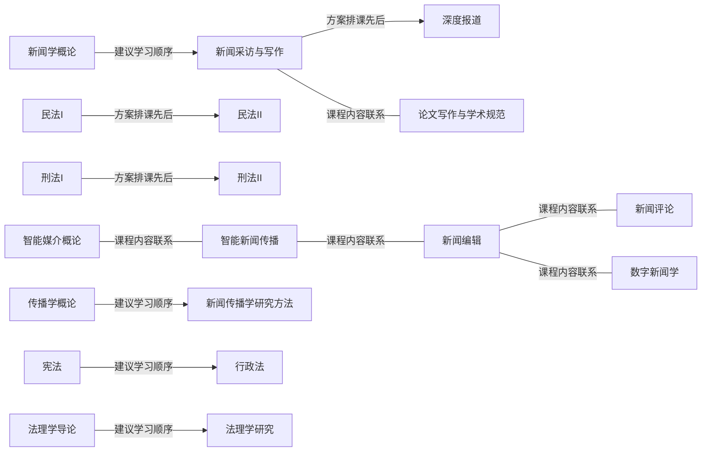

# 2025新闻学（望道新闻卓越班）-法学双学士学位项目本硕融通方案

新闻学院 · 新闻学(望道新闻卓越班)-法学(双学士学位项目) · 方案 130371 · 83 个不同课程或科研条目。

[官方 Word](../originals/plan-130371.docx) · [教务详情](https://fdjwgl.fudan.edu.cn/manager/bizType/2/major-program-search/info/130371?skipAuth=1) · [方案快照](../raw/plan-130371.json.gz) · [年级目录](../README.md)

## 修读导读

- **建议先学**　《新闻学概论》（`JCM10002`） → 《新闻采访与写作》（`JCM20012`） → 《深度报道》（`JCM30018`）。新闻价值、事实核验与体裁概念可用于采访和写作。采访与材料组织训练可用于展开和核查深度报道。

- **可以对照着读**　《新闻编辑》（`JCM20018`）与《新闻评论》（`JCM20019`）。两课可围绕新闻判断、受众与公共表达比较。

- **查模块选课**　《数字新闻学》（`JCM70003`）、《中国新闻传播史》（`JCM20006`）列在“专业核心教育课程”中。原表见 `/courseModules/8`。

## 课程关系图

图中展示部分关系。下表保留全部已建立的课程对，来源位置使用本方案 JSON Pointer。

## 先修与内容联系

| 类型 | 起点 | 终点 | 依据 | 原表定位 |
| --- | --- | --- | --- | --- |
| 建议学习顺序 | 新闻学概论 (JCM10002) | 新闻采访与写作 (JCM20012) | 新闻价值、事实核验与体裁概念可用于采访和写作。  | `/courseModules/6/planCourses/1`、`/courseModules/8/planCourses/6` |
| 建议学习顺序 | 传播学概论 (JCM10003) | 新闻传播学研究方法 (JCM20001) | 传播概念和模型可帮助提出具体研究问题。  | `/courseModules/6/planCourses/2`、`/courseModules/8/planCourses/2` |
| 建议学习顺序 | 新闻采访与写作 (JCM20012) | 深度报道 (JCM30018) | 采访与材料组织训练可用于展开和核查深度报道。  | `/courseModules/8/planCourses/6`、`/courseModules/8/planCourses/10` |
| 建议学习顺序 | 民法I (LAW10001) | 民法II (LAW20007) | 同方案的课程题名具有连续分册或序号。  | `/courseModules/8/planCourses/14`、`/courseModules/8/planCourses/21` |
| 建议学习顺序 | 刑法I (LAW10002) | 刑法II (LAW20004) | 同方案的课程题名具有连续分册或序号。  | `/courseModules/8/planCourses/15`、`/courseModules/8/planCourses/18` |
| 建议学习顺序 | 法理学导论 (LAW10004) | 法理学研究 (LAW50016) | 法理学中的基本概念可支持进一步专题研究。  | `/courseModules/7/planCourses/0`、`/courseModules/12/planCourses/0` |
| 建议学习顺序 | 宪法 (LAW10005) | 行政法 (LAW10003) | 对国家机构与公权力结构的认识可帮助理解行政法律关系。  | `/courseModules/7/planCourses/1`、`/courseModules/8/planCourses/16` |
| 方案排课先后 | 新闻采访与写作 (JCM20012) | 深度报道 (JCM30018) | 同方案该课程全部明确数字学期均早于后者。  | `/courseModules/8/planCourses/6`、`/courseModules/8/planCourses/10` |
| 方案排课先后 | 民法I (LAW10001) | 民法II (LAW20007) | 同方案该课程全部明确数字学期均早于后者。  | `/courseModules/8/planCourses/14`、`/courseModules/8/planCourses/21` |
| 方案排课先后 | 刑法I (LAW10002) | 刑法II (LAW20004) | 同方案该课程全部明确数字学期均早于后者。  | `/courseModules/8/planCourses/15`、`/courseModules/8/planCourses/18` |
| 课程内容联系 | 智能媒介概论 (AIS210008) | 智能新闻传播 (AIS310010) | 智能媒介技术和新闻生产传播具有应用场景交集。  | `/courseModules/8/planCourses/1`、`/courseModules/8/planCourses/11` |
| 课程内容联系 | 智能媒介概论 (AIS210008) | 媒介经营管理 (JCM30009) | 本方案两门课程的题名均含“媒介”，可据此对照这一主题。  | `/courseModules/8/planCourses/1`、`/courseModules/8/planCourses/12` |
| 课程内容联系 | 智能新闻传播 (AIS310010) | 传播学概论 (JCM10003) | 本方案两门课程的题名均含“传播”，可据此对照这一主题。  | `/courseModules/8/planCourses/11`、`/courseModules/6/planCourses/2` |
| 课程内容联系 | 智能新闻传播 (AIS310010) | 新闻编辑 (JCM20018) | 本方案两门课程的题名均含“新闻”，可据此对照这一主题。  | `/courseModules/8/planCourses/11`、`/courseModules/8/planCourses/7` |
| 课程内容联系 | 新闻学概论 (JCM10002) | 新闻编辑 (JCM20018) | 本方案两门课程的题名均含“新闻”，可据此对照这一主题。  | `/courseModules/6/planCourses/1`、`/courseModules/8/planCourses/7` |
| 课程内容联系 | 传播学概论 (JCM10003) | 新闻传播学研究方法 (JCM20001) | 本方案两门课程的题名均含“传播”，可据此对照这一主题。  | `/courseModules/6/planCourses/2`、`/courseModules/8/planCourses/2` |
| 课程内容联系 | 传播学概论 (JCM10003) | 中国新闻传播史 (JCM20006) | 本方案两门课程的题名均含“传播”，可据此对照这一主题。  | `/courseModules/6/planCourses/2`、`/courseModules/8/planCourses/0` |
| 课程内容联系 | 传播学概论 (JCM10003) | 传播学研究 (JCM60028) | 本方案两门课程的题名均含“传播”，可据此对照这一主题。  | `/courseModules/6/planCourses/2`、`/courseModules/8/planCourses/30` |
| 课程内容联系 | 新闻采访与写作 (JCM20012) | 论文写作与学术规范 (JCM60016) | 本方案两门课程的题名均含“写作”，可据此对照这一主题。  | `/courseModules/8/planCourses/6`、`/courseModules/8/planCourses/33` |
| 课程内容联系 | 新闻编辑 (JCM20018) | 新闻评论 (JCM20019) | 两课可围绕新闻判断、受众与公共表达比较。  | `/courseModules/8/planCourses/7`、`/courseModules/8/planCourses/8` |
| 课程内容联系 | 新闻编辑 (JCM20018) | 数字新闻学 (JCM70003) | 本方案两门课程的题名均含“新闻”，可据此对照这一主题。  | `/courseModules/8/planCourses/7`、`/courseModules/8/planCourses/32` |
| 课程内容联系 | 新闻传播法规与伦理 (JCM30016) | 马克思主义新闻思想 (JCM40004) | 两课均涉及新闻责任和公共传播价值。  | `/courseModules/8/planCourses/4`、`/courseModules/6/planCourses/0` |
| 课程内容联系 | 民法I (LAW10001) | 民事诉讼法 (LAW20003) | 民事权利义务与其程序救济可对照学习。  | `/courseModules/8/planCourses/14`、`/courseModules/8/planCourses/23` |
| 课程内容联系 | 民法I (LAW10001) | 民法II (LAW20007) | 本方案两门课程的题名均含“民法”，可据此对照这一主题。  | `/courseModules/8/planCourses/14`、`/courseModules/8/planCourses/21` |
| 课程内容联系 | 刑法I (LAW10002) | 刑事诉讼法 (LAW20002) | 犯罪与刑责的实体规则和程序规则可相互参照。  | `/courseModules/8/planCourses/15`、`/courseModules/8/planCourses/22` |
| 课程内容联系 | 刑法I (LAW10002) | 刑法II (LAW20004) | 本方案两门课程的题名均含“刑法”，可据此对照这一主题。  | `/courseModules/8/planCourses/15`、`/courseModules/8/planCourses/18` |
| 课程内容联系 | 刑法I (LAW10002) | 国际刑法 (LAW50036) | 本方案两门课程的题名均含“刑法”，可据此对照这一主题。  | `/courseModules/8/planCourses/15`、`/courseModules/12/planCourses/18` |
| 课程内容联系 | 法理学导论 (LAW10004) | 宪法 (LAW10005) | 两课均涉及权利与公共权力的规范依据。  | `/courseModules/7/planCourses/0`、`/courseModules/7/planCourses/1` |
| 课程内容联系 | 行政诉讼法 (LAW20001) | 刑事诉讼法 (LAW20002) | 本方案两门课程的题名均含“诉讼”，可据此对照这一主题。  | `/courseModules/8/planCourses/17`、`/courseModules/8/planCourses/22` |
| 课程内容联系 | 刑事诉讼法 (LAW20002) | 民事诉讼法 (LAW20003) | 本方案两门课程的题名均含“诉讼”，可据此对照这一主题。  | `/courseModules/8/planCourses/22`、`/courseModules/8/planCourses/23` |
| 课程内容联系 | 国际经济法导论 (LAW30005) | 国际经济合同 (LAW50034) | 本方案两门课程的题名均含“国际经济”，可据此对照这一主题。  | `/courseModules/8/planCourses/29`、`/courseModules/12/planCourses/14` |

本次未从可定位的明确表述中确认课程对课程预修。学期安排、系列分册与编辑建议均保留各自的依据。

## 按原方案模块阅读

同一模块展示原表中的课程归属。模块内课程之间的先后仍须逐项查阅。

- **人文基础课程**　新闻学概论、传播学概论、马克思主义新闻思想（原表模块 6）
- **社会科学基础课程**　法理学导论、宪法、经济法（原表模块 7）

## 课程表

同一课程在不同模块分别出现时，按原表逐行列出。季节字段保留原值。

| 课程 | 代码 | 学分 | 学期 | 模块 |
| --- | --- | ---: | --- | --- |
| 马克思主义新闻思想 | JCM40004 | 2.0 | SPRING、AUTUMN | 培养方案 / 专业培养课程 / 学科基础课程 / 人文基础课程 |
| 新闻学概论 | JCM10002 | 2.0 | SPRING、AUTUMN | 培养方案 / 专业培养课程 / 学科基础课程 / 人文基础课程 |
| 传播学概论 | JCM10003 | 2.0 | SPRING、AUTUMN | 培养方案 / 专业培养课程 / 学科基础课程 / 人文基础课程 |
| 法理学导论 | LAW10004 | 3.0 | SPRING、AUTUMN | 培养方案 / 专业培养课程 / 学科基础课程 / 社会科学基础课程 |
| 宪法 | LAW10005 | 3.0 | SPRING、AUTUMN | 培养方案 / 专业培养课程 / 学科基础课程 / 社会科学基础课程 |
| 经济法 | LAW20011 | 3.0 | SPRING、AUTUMN | 培养方案 / 专业培养课程 / 学科基础课程 / 社会科学基础课程 |
| 中国新闻传播史 | JCM20006 | 2.0 | 第2学期、第3学期 | 培养方案 / 专业培养课程 / 专业核心教育课程 |
| 智能媒介概论 | AIS210008 | 2.0 | 第3学期、第4学期 | 培养方案 / 专业培养课程 / 专业核心教育课程 |
| 新闻传播学研究方法 | JCM20001 | 2.0 | 第3学期、第4学期 | 培养方案 / 专业培养课程 / 专业核心教育课程 |
| 数据分析与信息可视化 | JCM30002 | 4.0 | 第5学期、第6学期 | 培养方案 / 专业培养课程 / 专业核心教育课程 |
| 新闻传播法规与伦理 | JCM30016 | 2.0 | 第6学期 | 培养方案 / 专业培养课程 / 专业核心教育课程 |
| 观察中国：热点新闻解析 | JCM20004 | 3.0 | 第2学期 | 培养方案 / 专业培养课程 / 专业核心教育课程 |
| 新闻采访与写作 | JCM20012 | 3.0 | 第2学期、第3学期 | 培养方案 / 专业培养课程 / 专业核心教育课程 |
| 新闻编辑 | JCM20018 | 2.0 | 第3学期 | 培养方案 / 专业培养课程 / 专业核心教育课程 |
| 新闻评论 | JCM20019 | 2.0 | 第4学期 | 培养方案 / 专业培养课程 / 专业核心教育课程 |
| 影像编辑 | JCM20030 | 3.0 | 第4学期 | 培养方案 / 专业培养课程 / 专业核心教育课程 |
| 深度报道 | JCM30018 | 3.0 | 第5学期 | 培养方案 / 专业培养课程 / 专业核心教育课程 |
| 智能新闻传播 | AIS310010 | 2.0 | 第6学期 | 培养方案 / 专业培养课程 / 专业核心教育课程 |
| 媒介经营管理 | JCM30009 | 2.0 | 第6学期 | 培养方案 / 专业培养课程 / 专业核心教育课程 |
| 习近平法治思想概论 | LAW20010 | 2.0 | 第3学期 | 培养方案 / 专业培养课程 / 专业核心教育课程 |
| 民法I | LAW10001 | 3.0 | 第2学期 | 培养方案 / 专业培养课程 / 专业核心教育课程 |
| 刑法I | LAW10002 | 3.0 | 第2学期 | 培养方案 / 专业培养课程 / 专业核心教育课程 |
| 行政法 | LAW10003 | 2.0 | 第2学期 | 培养方案 / 专业培养课程 / 专业核心教育课程 |
| 行政诉讼法 | LAW20001 | 2.0 | 第3学期 | 培养方案 / 专业培养课程 / 专业核心教育课程 |
| 刑法II | LAW20004 | 3.0 | 第3学期 | 培养方案 / 专业培养课程 / 专业核心教育课程 |
| 国际法 | LAW20005 | 3.0 | 第3学期 | 培养方案 / 专业培养课程 / 专业核心教育课程 |
| 中国法律史 | LAW20006 | 3.0 | 第3学期 | 培养方案 / 专业培养课程 / 专业核心教育课程 |
| 民法II | LAW20007 | 3.0 | 第3学期 | 培养方案 / 专业培养课程 / 专业核心教育课程 |
| 刑事诉讼法 | LAW20002 | 3.0 | 第4学期 | 培养方案 / 专业培养课程 / 专业核心教育课程 |
| 民事诉讼法 | LAW20003 | 3.0 | 第4学期 | 培养方案 / 专业培养课程 / 专业核心教育课程 |
| 法律职业伦理 | LAW40003 | 2.0 | 第5学期 | 培养方案 / 专业培养课程 / 专业核心教育课程 |
| 自然资源和环境保护法 | LAW30003 | 2.0 | 第5学期 | 培养方案 / 专业培养课程 / 专业核心教育课程 |
| 商法 | LAW20008 | 2.0 | 第4学期 | 培养方案 / 专业培养课程 / 专业核心教育课程 |
| 知识产权法 | LAW30004 | 2.0 | 第4学期 | 培养方案 / 专业培养课程 / 专业核心教育课程 |
| 国际私法 | LAW20009 | 2.0 | 第4学期 | 培养方案 / 专业培养课程 / 专业核心教育课程 |
| 国际经济法导论 | LAW30005 | 2.0 | 第5学期 | 培养方案 / 专业培养课程 / 专业核心教育课程 |
| 传播学研究 | JCM60028 | 2.0 | 第9学期 | 培养方案 / 专业培养课程 / 专业核心教育课程 |
| 新媒体研究 | JCM60008 | 2.0 | 第9学期 | 培养方案 / 专业培养课程 / 专业核心教育课程 |
| 数字新闻学 | JCM70003 | 2.0 | 第9学期 | 培养方案 / 专业培养课程 / 专业核心教育课程 |
| 论文写作与学术规范 | JCM60016 | 2.0 | 第10学期 | 培养方案 / 专业培养课程 / 专业核心教育课程 |
| 法理学研究 | LAW50016 | 2.0 | SPRING、AUTUMN | 培养方案 / 专业进阶模块II |
| 比较法 | LAW50017 | 2.0 | SPRING、AUTUMN | 培养方案 / 专业进阶模块II |
| 英美法 | LAW50018 | 2.0 | SPRING、AUTUMN | 培养方案 / 专业进阶模块II |
| 欧陆法 | LAW50019 | 2.0 | SPRING、AUTUMN | 培养方案 / 专业进阶模块II |
| 台港澳法 | LAW50008 | 2.0 | SPRING、AUTUMN | 培养方案 / 专业进阶模块II |
| 外国法律史 | LAW50020 | 2.0 | SPRING、AUTUMN | 培养方案 / 专业进阶模块II |
| 西方法律思想史 | LAW50012 | 2.0 | SPRING、AUTUMN | 培养方案 / 专业进阶模块II |
| 人权法 | LAW50021 | 2.0 | SPRING、AUTUMN | 培养方案 / 专业进阶模块II |
| 专业英语II（法律） | LAW50015 | 2.0 | SPRING、AUTUMN | 培养方案 / 专业进阶模块II |
| 专业英语III（法律） | LAW50042 | 2.0 | SPRING、AUTUMN | 培养方案 / 专业进阶模块II |
| 国际投资法 | LAW50030 | 2.0 | SPRING、AUTUMN | 培养方案 / 专业进阶模块II |
| 国际税法 | LAW50031 | 2.0 | SPRING、AUTUMN | 培养方案 / 专业进阶模块II |
| 国际金融法 | LAW50032 | 2.0 | SPRING、AUTUMN | 培养方案 / 专业进阶模块II |
| 国际贸易法 | LAW50033 | 2.0 | SPRING、AUTUMN | 培养方案 / 专业进阶模块II |
| 国际经济合同 | LAW50034 | 2.0 | SPRING、AUTUMN | 培养方案 / 专业进阶模块II |
| 国际商事仲裁法 | LAW50009 | 2.0 | SPRING、AUTUMN | 培养方案 / 专业进阶模块II |
| 国际商法 | LAW50035 | 2.0 | SPRING、AUTUMN | 培养方案 / 专业进阶模块II |
| 海商法 | LAW50010 | 2.0 | SPRING、AUTUMN | 培养方案 / 专业进阶模块II |
| 国际刑法 | LAW50036 | 2.0 | SPRING、AUTUMN | 培养方案 / 专业进阶模块II |
| 物权法 | LAW50023 | 2.0 | SPRING、AUTUMN | 培养方案 / 专业进阶模块II |
| 侵权责任法 | LAW50024 | 2.0 | SPRING、AUTUMN | 培养方案 / 专业进阶模块II |
| 婚姻家庭法 | LAW50025 | 2.0 | SPRING、AUTUMN | 培养方案 / 专业进阶模块II |
| 医事法 | LAW50029 | 2.0 | SPRING、AUTUMN | 培养方案 / 专业进阶模块II |
| 证据法 | LAW50037 | 2.0 | SPRING、AUTUMN | 培养方案 / 专业进阶模块II |
| 刑事政策 | LAW50011 | 2.0 | SPRING、AUTUMN | 培养方案 / 专业进阶模块II |
| 法律检索 | LAW50038 | 2.0 | SPRING、AUTUMN | 培养方案 / 专业进阶模块II |
| 法律谈判 | LAW50041 | 2.0 | SPRING、AUTUMN | 培养方案 / 专业进阶模块II |
| 犯罪学 | LAW50022 | 2.0 | SPRING、AUTUMN | 培养方案 / 专业进阶模块II |
| 校园媒体实践(本科阶段) | 1071 | 1.0 |  | 融合创新能力 |
| 复芏计划(FDUROP) | 102 | 1.0 |  | 融合创新能力 |
| 专业竞赛(本科阶段) | 106 | 1.0 |  | 融合创新能力 |
| 专业竞赛(硕士阶段) | 1068 | 1.0 |  | 融合创新能力 |
| 国际交流 | 7 | 2.0 |  | 融合创新能力 |
| 研究生学术活动 | 4 | 1.0 |  | 融合创新能力 |
| 校园媒体实践(硕士阶段) | 1072 | 1.0 |  | 融合创新能力 |
| 研究生实践活动 | 5 | 2.0 |  | 融合创新能力 |
| 硕士学位论文开题 | 11 | 0.0 |  | 融合创新能力 |
| 硕士学位论文预审 | 61 | 0.0 |  | 融合创新能力 |
| 教学实习 | JCM40001 | 4.0 | 第7学期 | 融合创新能力 |
| 毕业论文 | JCM40003 | 4.0 | 第8学期 | 融合创新能力 |
| 记录中国（专业实践） | JCM50029 | 2.0 | SUMMER | 融合创新能力 |
| 大江东—复旦融媒体创新工作室 | JCM50004 | 2.0 | SPRING、AUTUMN | 融合创新能力 |
| 新闻实务工作坊 | JCM50003 | 2.0 | SPRING、AUTUMN | 融合创新能力 |
