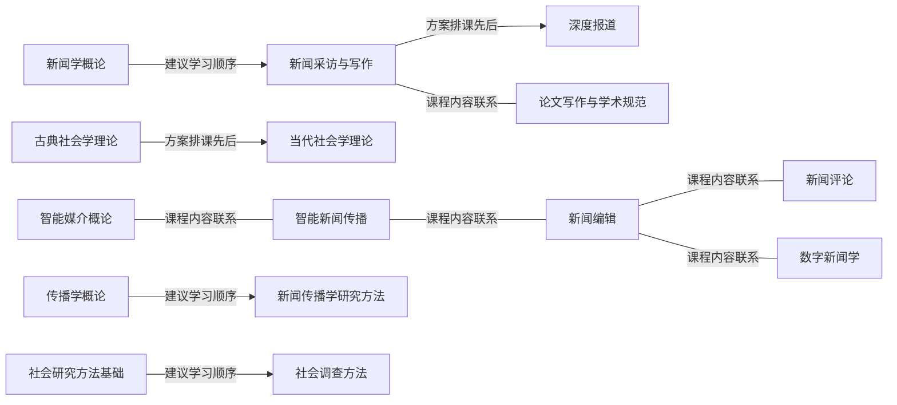

# 2025新闻学（望道新闻卓越班）-社会学双学士学位项目本硕融通方案

新闻学院 · 新闻学(望道新闻卓越班)-社会学(双学士学位项目) · 方案 147552 · 66 个不同课程或科研条目。

[官方 Word](../originals/plan-147552.docx) · [教务详情](https://fdjwgl.fudan.edu.cn/manager/bizType/2/major-program-search/info/147552?skipAuth=1) · [方案快照](../raw/plan-147552.json.gz) · [年级目录](../README.md)

## 课程关系图

图中展示部分关系。下表保留全部已建立的课程对，来源位置使用本方案 JSON Pointer。

## 先修与内容联系

| 类型 | 起点 | 终点 | 依据 | 原表定位 |
| --- | --- | --- | --- | --- |
| 建议学习顺序 | 新闻学概论 (JCM10002) | 新闻采访与写作 (JCM20012) | 新闻价值、事实核验与体裁概念可用于采访和写作。  | `/courseModules/6/planCourses/1`、`/courseModules/8/planCourses/6` |
| 建议学习顺序 | 传播学概论 (JCM10003) | 新闻传播学研究方法 (JCM20001) | 传播概念和模型可帮助提出具体研究问题。  | `/courseModules/6/planCourses/2`、`/courseModules/8/planCourses/2` |
| 建议学习顺序 | 新闻采访与写作 (JCM20012) | 深度报道 (JCM30018) | 采访与材料组织训练可用于展开和核查深度报道。  | `/courseModules/8/planCourses/6`、`/courseModules/8/planCourses/10` |
| 建议学习顺序 | 社会研究方法基础 (SOCI10003) | 社会调查方法 (SOCI30034) | 研究设计和资料收集可用于调查方法学习。  | `/courseModules/7/planCourses/2`、`/courseModules/8/planCourses/24` |
| 建议学习顺序 | 古典社会学理论 (SOCI30020) | 当代社会学理论 (SOCI30021) | 熟悉经典社会学的问题意识有助于阅读后续理论。  | `/courseModules/8/planCourses/17`、`/courseModules/8/planCourses/20` |
| 方案排课先后 | 新闻采访与写作 (JCM20012) | 深度报道 (JCM30018) | 同方案该课程全部明确数字学期均早于后者。  | `/courseModules/8/planCourses/6`、`/courseModules/8/planCourses/10` |
| 方案排课先后 | 古典社会学理论 (SOCI30020) | 当代社会学理论 (SOCI30021) | 同方案该课程全部明确数字学期均早于后者。  | `/courseModules/8/planCourses/17`、`/courseModules/8/planCourses/20` |
| 课程内容联系 | 智能媒介概论 (AIS210008) | 智能新闻传播 (AIS310010) | 智能媒介技术和新闻生产传播具有应用场景交集。  | `/courseModules/8/planCourses/1`、`/courseModules/8/planCourses/11` |
| 课程内容联系 | 智能媒介概论 (AIS210008) | 媒介经营管理 (JCM30009) | 本方案两门课程的题名均含“媒介”，可据此对照这一主题。  | `/courseModules/8/planCourses/1`、`/courseModules/8/planCourses/12` |
| 课程内容联系 | 智能新闻传播 (AIS310010) | 传播学概论 (JCM10003) | 本方案两门课程的题名均含“传播”，可据此对照这一主题。  | `/courseModules/8/planCourses/11`、`/courseModules/6/planCourses/2` |
| 课程内容联系 | 智能新闻传播 (AIS310010) | 新闻编辑 (JCM20018) | 本方案两门课程的题名均含“新闻”，可据此对照这一主题。  | `/courseModules/8/planCourses/11`、`/courseModules/8/planCourses/7` |
| 课程内容联系 | 新闻学概论 (JCM10002) | 新闻编辑 (JCM20018) | 本方案两门课程的题名均含“新闻”，可据此对照这一主题。  | `/courseModules/6/planCourses/1`、`/courseModules/8/planCourses/7` |
| 课程内容联系 | 传播学概论 (JCM10003) | 新闻传播学研究方法 (JCM20001) | 本方案两门课程的题名均含“传播”，可据此对照这一主题。  | `/courseModules/6/planCourses/2`、`/courseModules/8/planCourses/2` |
| 课程内容联系 | 传播学概论 (JCM10003) | 中国新闻传播史 (JCM20006) | 本方案两门课程的题名均含“传播”，可据此对照这一主题。  | `/courseModules/6/planCourses/2`、`/courseModules/8/planCourses/0` |
| 课程内容联系 | 传播学概论 (JCM10003) | 传播学研究 (JCM60028) | 本方案两门课程的题名均含“传播”，可据此对照这一主题。  | `/courseModules/6/planCourses/2`、`/courseModules/8/planCourses/13` |
| 课程内容联系 | 新闻采访与写作 (JCM20012) | 论文写作与学术规范 (JCM60016) | 本方案两门课程的题名均含“写作”，可据此对照这一主题。  | `/courseModules/8/planCourses/6`、`/courseModules/8/planCourses/16` |
| 课程内容联系 | 新闻编辑 (JCM20018) | 新闻评论 (JCM20019) | 两课可围绕新闻判断、受众与公共表达比较。  | `/courseModules/8/planCourses/7`、`/courseModules/8/planCourses/8` |
| 课程内容联系 | 新闻编辑 (JCM20018) | 数字新闻学 (JCM70003) | 本方案两门课程的题名均含“新闻”，可据此对照这一主题。  | `/courseModules/8/planCourses/7`、`/courseModules/8/planCourses/15` |
| 课程内容联系 | 新闻传播法规与伦理 (JCM30016) | 马克思主义新闻思想 (JCM40004) | 两课均涉及新闻责任和公共传播价值。  | `/courseModules/8/planCourses/4`、`/courseModules/6/planCourses/0` |
| 课程内容联系 | 政治社会学 (SOCI30005) | 人口社会学 (SOCI30008) | 本方案两门课程的题名均含“社会学”，可据此对照这一主题。  | `/courseModules/12/planCourses/13`、`/courseModules/12/planCourses/3` |
| 课程内容联系 | 社会统计学 (SOCI30006) | 统计软件应用 (SOCI30037) | 社会调查数据的整理、估计与解释可以结合软件学习。  | `/courseModules/8/planCourses/19`、`/courseModules/8/planCourses/22` |
| 课程内容联系 | 人口社会学 (SOCI30008) | 农村社会学 (SOCI30012) | 本方案两门课程的题名均含“社会学”，可据此对照这一主题。  | `/courseModules/12/planCourses/3`、`/courseModules/12/planCourses/2` |
| 课程内容联系 | 人口社会学 (SOCI30008) | 城市社会学 (SOCI30013) | 本方案两门课程的题名均含“社会学”，可据此对照这一主题。  | `/courseModules/12/planCourses/3`、`/courseModules/12/planCourses/0` |
| 课程内容联系 | 人口社会学 (SOCI30008) | 宗教社会学 (SOCI30015) | 本方案两门课程的题名均含“社会学”，可据此对照这一主题。  | `/courseModules/12/planCourses/3`、`/courseModules/12/planCourses/12` |

本次未从可定位的明确表述中确认课程对课程预修。学期安排、系列分册与编辑建议均保留各自的依据。

## 按原方案模块阅读

同一模块展示原表中的课程归属。模块内课程之间的先后仍须逐项查阅。

- **人文基础课程**　新闻学概论、传播学概论、马克思主义新闻思想（原表模块 6）
- **社会科学基础课程**　心理学导论、社会研究方法基础、社会学导论（原表模块 7）

## 课程表

同一课程在不同模块分别出现时，按原表逐行列出。季节字段保留原值。

| 课程 | 代码 | 学分 | 学期 | 模块 |
| --- | --- | ---: | --- | --- |
| 马克思主义新闻思想 | JCM40004 | 2.0 | SPRING、AUTUMN | 培养方案 / 专业培养课程 / 学科基础课程 / 人文基础课程 |
| 新闻学概论 | JCM10002 | 2.0 | SPRING、AUTUMN | 培养方案 / 专业培养课程 / 学科基础课程 / 人文基础课程 |
| 传播学概论 | JCM10003 | 2.0 | SPRING、AUTUMN | 培养方案 / 专业培养课程 / 学科基础课程 / 人文基础课程 |
| 社会学导论 | SOCI20001 | 3.0 | SPRING、AUTUMN | 培养方案 / 专业培养课程 / 学科基础课程 / 社会科学基础课程 |
| 心理学导论 | PSYC20001 | 3.0 | SPRING、AUTUMN | 培养方案 / 专业培养课程 / 学科基础课程 / 社会科学基础课程 |
| 社会研究方法基础 | SOCI10003 | 3.0 | SPRING、AUTUMN | 培养方案 / 专业培养课程 / 学科基础课程 / 社会科学基础课程 |
| 中国新闻传播史 | JCM20006 | 2.0 | 第2学期、第3学期 | 培养方案 / 专业培养课程 / 专业核心教育课程 |
| 智能媒介概论 | AIS210008 | 2.0 | 第3学期、第4学期 | 培养方案 / 专业培养课程 / 专业核心教育课程 |
| 新闻传播学研究方法 | JCM20001 | 2.0 | 第3学期、第4学期 | 培养方案 / 专业培养课程 / 专业核心教育课程 |
| 数据分析与信息可视化 | JCM30002 | 4.0 | 第5学期、第6学期 | 培养方案 / 专业培养课程 / 专业核心教育课程 |
| 新闻传播法规与伦理 | JCM30016 | 2.0 | 第6学期 | 培养方案 / 专业培养课程 / 专业核心教育课程 |
| 观察中国：热点新闻解析 | JCM20004 | 3.0 | 第2学期 | 培养方案 / 专业培养课程 / 专业核心教育课程 |
| 新闻采访与写作 | JCM20012 | 3.0 | 第2学期、第3学期 | 培养方案 / 专业培养课程 / 专业核心教育课程 |
| 新闻编辑 | JCM20018 | 2.0 | 第3学期 | 培养方案 / 专业培养课程 / 专业核心教育课程 |
| 新闻评论 | JCM20019 | 2.0 | 第4学期 | 培养方案 / 专业培养课程 / 专业核心教育课程 |
| 影像编辑 | JCM20030 | 3.0 | 第4学期 | 培养方案 / 专业培养课程 / 专业核心教育课程 |
| 深度报道 | JCM30018 | 3.0 | 第5学期 | 培养方案 / 专业培养课程 / 专业核心教育课程 |
| 智能新闻传播 | AIS310010 | 2.0 | 第6学期 | 培养方案 / 专业培养课程 / 专业核心教育课程 |
| 媒介经营管理 | JCM30009 | 2.0 | 第6学期 | 培养方案 / 专业培养课程 / 专业核心教育课程 |
| 传播学研究 | JCM60028 | 2.0 | 第9学期 | 培养方案 / 专业培养课程 / 专业核心教育课程 |
| 新媒体研究 | JCM60008 | 2.0 | 第9学期 | 培养方案 / 专业培养课程 / 专业核心教育课程 |
| 数字新闻学 | JCM70003 | 2.0 | 第9学期 | 培养方案 / 专业培养课程 / 专业核心教育课程 |
| 论文写作与学术规范 | JCM60016 | 2.0 | 第10学期 | 培养方案 / 专业培养课程 / 专业核心教育课程 |
| 古典社会学理论 | SOCI30020 | 3.0 | 第3学期 | 培养方案 / 专业培养课程 / 专业核心教育课程 |
| 西方社会思想史 | SOCI30022 | 2.0 | 第3学期 | 培养方案 / 专业培养课程 / 专业核心教育课程 |
| 社会统计学 | SOCI30006 | 3.0 | 第3学期 | 培养方案 / 专业培养课程 / 专业核心教育课程 |
| 当代社会学理论 | SOCI30021 | 3.0 | 第4学期 | 培养方案 / 专业培养课程 / 专业核心教育课程 |
| 质性研究方法 | SOCI30035 | 3.0 | 第4学期 | 培养方案 / 专业培养课程 / 专业核心教育课程 |
| 统计软件应用 | SOCI30037 | 3.0 | 第4学期 | 培养方案 / 专业培养课程 / 专业核心教育课程 |
| 经济社会学 | SOCI30004 | 2.0 | 第5学期 | 培养方案 / 专业培养课程 / 专业核心教育课程 |
| 社会调查方法 | SOCI30034 | 3.0 | 第5学期 | 培养方案 / 专业培养课程 / 专业核心教育课程 |
| 组织社会学 | SOCI30009 | 2.0 | 第5学期 | 培养方案 / 专业培养课程 / 专业核心教育课程 |
| 中国社会 | SOCI30025 | 2.0 | 第6学期 | 培养方案 / 专业培养课程 / 专业核心教育课程 |
| 社会分层与流动 | SOCI30026 | 3.0 | 第6学期 | 培养方案 / 专业培养课程 / 专业核心教育课程 |
| 婚姻与家庭 | SOCI30030 | 2.0 | 第6学期 | 培养方案 / 专业培养课程 / 专业核心教育课程 |
| 城市社会学 | SOCI30013 | 2.0 | 第4学期 | 培养方案 / 专业进阶模块II |
| 社会政策 | SWK30006 | 3.0 | 第4学期 | 培养方案 / 专业进阶模块II |
| 农村社会学 | SOCI30012 | 2.0 | 第5学期 | 培养方案 / 专业进阶模块II |
| 人口社会学 | SOCI30008 | 2.0 | 第5学期 | 培养方案 / 专业进阶模块II |
| 社区研究 | SOCI30003 | 2.0 | 第5学期 | 培养方案 / 专业进阶模块II |
| 环境社会学 | SOCI30011 | 2.0 | 第5学期 | 培养方案 / 专业进阶模块II |
| 社会心理学 | PSYC30006 | 3.0 | 第5学期 | 培养方案 / 专业进阶模块II |
| 文化社会学 | SOCI30023 | 2.0 | 第5学期 | 培养方案 / 专业进阶模块II |
| 人类行为与社会环境 | SWK30005 | 3.0 | 第5学期 | 培养方案 / 专业进阶模块II |
| 社会变迁 | SOCI30010 | 2.0 | 第5学期 | 培养方案 / 专业进阶模块II |
| 医疗和健康社会学 | SOCI30014 | 2.0 | 第5学期 | 培养方案 / 专业进阶模块II |
| 互联网与社会研究 | SOCI30033 | 4.0 | 第6学期 | 培养方案 / 专业进阶模块II |
| 宗教社会学 | SOCI30015 | 2.0 | 第6学期 | 培养方案 / 专业进阶模块II |
| 政治社会学 | SOCI30005 | 2.0 | 第6学期 | 培养方案 / 专业进阶模块II |
| 文化人类学 | SOCI30002 | 2.0 | 第6学期 | 培养方案 / 专业进阶模块II |
| 现代化和中国社会 | GEEC10400 | 2.0 | 第6学期 | 培养方案 / 专业进阶模块II |
| 复芏计划(FDUROP) | 102 | 1.0 |  | 融合创新能力 |
| 专业竞赛(本科阶段) | 106 | 1.0 |  | 融合创新能力 |
| 校园媒体实践(本科阶段) | 1071 | 1.0 |  | 融合创新能力 |
| 专业竞赛(硕士阶段) | 1068 | 1.0 |  | 融合创新能力 |
| 校园媒体实践(硕士阶段) | 1072 | 1.0 |  | 融合创新能力 |
| 研究生学术活动 | 4 | 1.0 |  | 融合创新能力 |
| 国际交流 | 7 | 2.0 |  | 融合创新能力 |
| 研究生实践活动 | 5 | 2.0 |  | 融合创新能力 |
| 硕士学位论文开题 | 11 | 0.0 |  | 融合创新能力 |
| 硕士学位论文预审 | 61 | 0.0 |  | 融合创新能力 |
| 教学实习 | JCM40001 | 4.0 | 第7学期 | 融合创新能力 |
| 毕业论文 | JCM40003 | 4.0 | 第8学期 | 融合创新能力 |
| 记录中国（专业实践） | JCM50029 | 2.0 | SUMMER | 融合创新能力 |
| 大江东—复旦融媒体创新工作室 | JCM50004 | 2.0 | SPRING、AUTUMN | 融合创新能力 |
| 新闻实务工作坊 | JCM50003 | 2.0 | SPRING、AUTUMN | 融合创新能力 |
