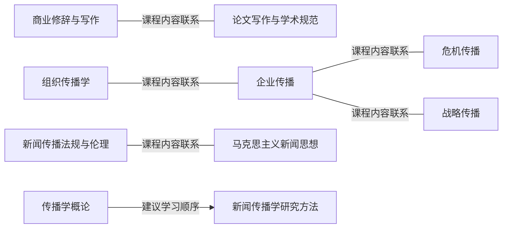

# 2025广告学--新闻传播学本硕融通培养方案（战略传播菁英班）

新闻学院 · 广告学 · 方案 97001 · 79 个不同课程或科研条目。

[官方 Word](../originals/plan-97001.docx) · [教务详情](https://fdjwgl.fudan.edu.cn/manager/bizType/2/major-program-search/info/97001?skipAuth=1) · [方案快照](../raw/plan-97001.json.gz) · [年级目录](../README.md)

## 课程关系图

图中展示部分关系。下表保留全部已建立的课程对，来源位置使用本方案 JSON Pointer。

## 先修与内容联系

| 类型 | 起点 | 终点 | 依据 | 原表定位 |
| --- | --- | --- | --- | --- |
| 建议学习顺序 | 传播学概论 (JCM10003) | 新闻传播学研究方法 (JCM20001) | 传播概念和模型可帮助提出具体研究问题。  | `/courseModules/7/planCourses/2`、`/courseModules/10/planCourses/2` |
| 课程内容联系 | 智能媒介概论 (AIS210008) | 全球媒介数据观察 (MJC60001) | 本方案两门课程的题名均含“媒介”，可据此对照这一主题。  | `/courseModules/10/planCourses/1`、`/courseModules/13/planCourses/13` |
| 课程内容联系 | 新闻学概论 (JCM10002) | 新闻传播学研究方法 (JCM20001) | 本方案两门课程的题名均含“新闻”，可据此对照这一主题。  | `/courseModules/7/planCourses/1`、`/courseModules/10/planCourses/2` |
| 课程内容联系 | 新闻学概论 (JCM10002) | 中国新闻传播史 (JCM20006) | 本方案两门课程的题名均含“新闻”，可据此对照这一主题。  | `/courseModules/7/planCourses/1`、`/courseModules/10/planCourses/0` |
| 课程内容联系 | 新闻学概论 (JCM10002) | 新闻传播法规与伦理 (JCM30016) | 本方案两门课程的题名均含“新闻”，可据此对照这一主题。  | `/courseModules/7/planCourses/1`、`/courseModules/10/planCourses/4` |
| 课程内容联系 | 新闻学概论 (JCM10002) | 马克思主义新闻思想 (JCM40004) | 本方案两门课程的题名均含“新闻”，可据此对照这一主题。  | `/courseModules/7/planCourses/1`、`/courseModules/7/planCourses/0` |
| 课程内容联系 | 传播学概论 (JCM10003) | 企业传播 (JCM30022) | 本方案两门课程的题名均含“传播”，可据此对照这一主题。  | `/courseModules/7/planCourses/2`、`/courseModules/10/planCourses/12` |
| 课程内容联系 | 商业修辞与写作 (JCM20005) | 论文写作与学术规范 (JCM60016) | 本方案两门课程的题名均含“写作”，可据此对照这一主题。  | `/courseModules/10/planCourses/9`、`/courseModules/10/planCourses/15` |
| 课程内容联系 | 公共关系学 (JCM30012) | 公共关系专题 (MJC60015) | 本方案两门课程的题名均含“公共关系”，可据此对照这一主题。  | `/courseModules/10/planCourses/10`、`/courseModules/14/planCourses/11` |
| 课程内容联系 | 组织传播学 (JCM30014) | 企业传播 (JCM30022) | 本方案两门课程的题名均含“传播”，可据此对照这一主题。  | `/courseModules/10/planCourses/13`、`/courseModules/10/planCourses/12` |
| 课程内容联系 | 新闻传播法规与伦理 (JCM30016) | 马克思主义新闻思想 (JCM40004) | 两课均涉及新闻责任和公共传播价值。  | `/courseModules/10/planCourses/4`、`/courseModules/7/planCourses/0` |
| 课程内容联系 | 企业传播 (JCM30022) | 危机传播 (JCM50081) | 本方案两门课程的题名均含“传播”，可据此对照这一主题。  | `/courseModules/10/planCourses/12`、`/courseModules/10/planCourses/14` |
| 课程内容联系 | 企业传播 (JCM30022) | 战略传播 (MJC60017) | 本方案两门课程的题名均含“传播”，可据此对照这一主题。  | `/courseModules/10/planCourses/12`、`/courseModules/10/planCourses/17` |
| 课程内容联系 | 广告文化研究 (JCM50007) | 国际广告前沿 (MJC70005) | 本方案两门课程的题名均含“广告”，可据此对照这一主题。  | `/courseModules/14/planCourses/3`、`/courseModules/13/planCourses/11` |
| 课程内容联系 | 视听广告创作 (JCM50084) | 国际广告前沿 (MJC70005) | 本方案两门课程的题名均含“广告”，可据此对照这一主题。  | `/courseModules/13/planCourses/2`、`/courseModules/13/planCourses/11` |
| 课程内容联系 | 哲学导论 (PHIL10002) | 逻辑学 (PHIL10003) | 论证与概念分析是哲学讨论的共同方法。  | `/courseModules/8/planCourses/2`、`/courseModules/8/planCourses/3` |

本次未从可定位的明确表述中确认课程对课程预修。学期安排、系列分册与编辑建议均保留各自的依据。

## 按原方案模块阅读

同一模块展示原表中的课程归属。模块内课程之间的先后仍须逐项查阅。

- **社会科学基础课程**　会计学、经济学原理、法理学导论、政治学原理、社会学导论、统计学（原表模块 9）

## 课程表

同一课程在不同模块分别出现时，按原表逐行列出。季节字段保留原值。

| 课程 | 代码 | 学分 | 学期 | 模块 |
| --- | --- | ---: | --- | --- |
| 马克思主义新闻思想 | JCM40004 | 2.0 | SPRING、AUTUMN | 培养方案 / 专业培养课程 / 学科基础课程 / 人文基础课程 / 必修课程 |
| 新闻学概论 | JCM10002 | 2.0 | SPRING、AUTUMN | 培养方案 / 专业培养课程 / 学科基础课程 / 人文基础课程 / 必修课程 |
| 传播学概论 | JCM10003 | 2.0 | SPRING、AUTUMN | 培养方案 / 专业培养课程 / 学科基础课程 / 人文基础课程 / 必修课程 |
| 中国文学经典 | CHIN10005 | 3.0 | SPRING、AUTUMN | 培养方案 / 专业培养课程 / 学科基础课程 / 人文基础课程 / 选修课程 |
| 中国古代文明 | HIST10006 | 3.0 | SPRING、AUTUMN | 培养方案 / 专业培养课程 / 学科基础课程 / 人文基础课程 / 选修课程 |
| 哲学导论 | PHIL10002 | 3.0 | SPRING、AUTUMN | 培养方案 / 专业培养课程 / 学科基础课程 / 人文基础课程 / 选修课程 |
| 逻辑学 | PHIL10003 | 3.0 | SPRING、AUTUMN | 培养方案 / 专业培养课程 / 学科基础课程 / 人文基础课程 / 选修课程 |
| 美学 | CHIN10002 | 2.0 | SPRING、AUTUMN | 培养方案 / 专业培养课程 / 学科基础课程 / 人文基础课程 / 选修课程 |
| 史学原典导读 | HIST10003 | 2.0 | SPRING、AUTUMN | 培养方案 / 专业培养课程 / 学科基础课程 / 人文基础课程 / 选修课程 |
| 世界文明史通论 | HIST10004 | 2.0 | SPRING、AUTUMN | 培养方案 / 专业培养课程 / 学科基础课程 / 人文基础课程 / 选修课程 |
| 近代中国社会研究 | HIST10005 | 2.0 | SPRING、AUTUMN | 培养方案 / 专业培养课程 / 学科基础课程 / 人文基础课程 / 选修课程 |
| 语言学导论 | FORE10005 | 2.0 | SPRING、AUTUMN | 培养方案 / 专业培养课程 / 学科基础课程 / 人文基础课程 / 选修课程 |
| 世界文学导读 | FORE10006 | 2.0 | SPRING、AUTUMN | 培养方案 / 专业培养课程 / 学科基础课程 / 人文基础课程 / 选修课程 |
| 社会学导论 | SOCI20001 | 3.0 | SPRING、AUTUMN | 培养方案 / 专业培养课程 / 学科基础课程 / 社会科学基础课程 |
| 法理学导论 | LAW10004 | 3.0 | SPRING、AUTUMN | 培养方案 / 专业培养课程 / 学科基础课程 / 社会科学基础课程 |
| 经济学原理 | ECON20005 | 3.0 | SPRING、AUTUMN | 培养方案 / 专业培养课程 / 学科基础课程 / 社会科学基础课程 |
| 会计学 | BA10003 | 3.0 | SPRING、AUTUMN | 培养方案 / 专业培养课程 / 学科基础课程 / 社会科学基础课程 |
| 统计学 | SOCI20003 | 3.0 | SPRING、AUTUMN | 培养方案 / 专业培养课程 / 学科基础课程 / 社会科学基础课程 |
| 政治学原理 | POLI10004 | 4.0 | SPRING、AUTUMN | 培养方案 / 专业培养课程 / 学科基础课程 / 社会科学基础课程 |
| 中国新闻传播史 | JCM20006 | 2.0 | 第2学期、第3学期 | 培养方案 / 专业培养课程 / 专业核心教育课程 |
| 智能媒介概论 | AIS210008 | 2.0 | 第3学期、第4学期 | 培养方案 / 专业培养课程 / 专业核心教育课程 |
| 新闻传播学研究方法 | JCM20001 | 2.0 | 第3学期、第4学期 | 培养方案 / 专业培养课程 / 专业核心教育课程 |
| 数据分析与信息可视化 | JCM30002 | 4.0 | 第5学期、第6学期 | 培养方案 / 专业培养课程 / 专业核心教育课程 |
| 新闻传播法规与伦理 | JCM30016 | 2.0 | 第6学期 | 培养方案 / 专业培养课程 / 专业核心教育课程 |
| 商业传播导论 | JCM20002 | 2.0 | 第3学期 | 培养方案 / 专业培养课程 / 专业核心教育课程 |
| 智能市场研究 | AIS410003 | 3.0 | 第3学期 | 培养方案 / 专业培养课程 / 专业核心教育课程 |
| 消费心理与消费行为 | JCM30015 | 2.0 | 第3学期 | 培养方案 / 专业培养课程 / 专业核心教育课程 |
| 智能创意与表现 | JCM20003 | 3.0 | 第4学期 | 培养方案 / 专业培养课程 / 专业核心教育课程 |
| 商业修辞与写作 | JCM20005 | 2.0 | 第4学期 | 培养方案 / 专业培养课程 / 专业核心教育课程 |
| 公共关系学 | JCM30012 | 2.0 | 第4学期 | 培养方案 / 专业培养课程 / 专业核心教育课程 |
| 营销传播策划 | JCM30003 | 2.0 | 第5学期 | 培养方案 / 专业培养课程 / 专业核心教育课程 |
| 企业传播 | JCM30022 | 2.0 | 第5学期 | 培养方案 / 专业培养课程 / 专业核心教育课程 |
| 组织传播学 | JCM30014 | 2.0 | 第5学期 | 培养方案 / 专业培养课程 / 专业核心教育课程 |
| 危机传播 | JCM50081 | 2.0 | 第6学期 | 培养方案 / 专业培养课程 / 专业核心教育课程 |
| 论文写作与学术规范 | JCM60016 | 2.0 | 第6学期 | 培养方案 / 专业培养课程 / 专业核心教育课程 |
| 公共外交与策略传播 | MJC70006 | 2.0 | 第9学期 | 培养方案 / 专业培养课程 / 专业核心教育课程 |
| 战略传播 | MJC60017 | 3.0 | 第9学期 | 培养方案 / 专业培养课程 / 专业核心教育课程 |
| 战略管理 | MJC60018 | 2.0 | 第10学期 | 培养方案 / 专业培养课程 / 专业核心教育课程 |
| 用户体验设计 | JCM50025 | 2.0 | SPRING、AUTUMN | 培养方案 / 专业进阶模块I |
| 品牌策略传播 | JCM50086 | 2.0 | SPRING、AUTUMN | 培养方案 / 专业进阶模块I |
| 视听广告创作 | JCM50084 | 2.0 | SPRING、AUTUMN | 培养方案 / 专业进阶模块I |
| 美术与插画工作室 | JCM50085 | 2.0 | SPRING、AUTUMN | 培养方案 / 专业进阶模块I |
| 商业摄影 | JCM50080 | 2.0 | SPRING、AUTUMN | 培养方案 / 专业进阶模块I |
| 纪实摄影工作室 | JCM50083 | 3.0 | SPRING、AUTUMN | 培养方案 / 专业进阶模块I |
| 促销、宣传与表现 | JCM50053 | 2.0 | SPRING、AUTUMN | 培养方案 / 专业进阶模块I |
| 智慧传播与人机交互智能 | MJC70008 | 2.0 | SPRING、AUTUMN | 培养方案 / 专业进阶模块I |
| 品牌创新策略 | MJC70004 | 2.0 | SPRING、AUTUMN | 培养方案 / 专业进阶模块I |
| 社会责任与公共事务沟通 | MJC70009 | 2.0 | SPRING、AUTUMN | 培养方案 / 专业进阶模块I |
| 洞察与创新 | MJC70007 | 2.0 | SPRING、AUTUMN | 培养方案 / 专业进阶模块I |
| 国际广告前沿 | MJC70005 | 2.0 | SPRING、AUTUMN | 培养方案 / 专业进阶模块I |
| 数字营销 | MJC70025 | 2.0 | SPRING、AUTUMN | 培养方案 / 专业进阶模块I |
| 全球媒介数据观察 | MJC60001 | 2.0 | SPRING、AUTUMN | 培养方案 / 专业进阶模块I |
| 整合营销传播 | JCM50034 | 2.0 | SPRING、AUTUMN | 培养方案 / 专业进阶模块II |
| 商业文明史 | JCM50009 | 2.0 | SPRING、AUTUMN | 培养方案 / 专业进阶模块II |
| 商业、传播与社会 | JCM50023 | 2.0 | SPRING、AUTUMN | 培养方案 / 专业进阶模块II |
| 广告文化研究 | JCM50007 | 2.0 | SPRING、AUTUMN | 培养方案 / 专业进阶模块II |
| 青年文化与品牌传播 | JCM50014 | 2.0 | SPRING、AUTUMN | 培养方案 / 专业进阶模块II |
| 商业法律 | JCM50008 | 2.0 | SPRING、AUTUMN | 培养方案 / 专业进阶模块II |
| 企业责任与全球可持续发展 | JCM50024 | 2.0 | SPRING、AUTUMN | 培养方案 / 专业进阶模块II |
| 海派商业文化专题研究 | JCM50016 | 1.0 | SPRING、AUTUMN | 培养方案 / 专业进阶模块II |
| 战略传播专题研究 | MJC70011 | 2.0 | SPRING、AUTUMN | 培养方案 / 专业进阶模块II |
| 战略传播前沿讲座 | MJC60016 | 2.0 | SPRING、AUTUMN | 培养方案 / 专业进阶模块II |
| 组织传播与组织变革 | MJC70003 | 2.0 | SPRING、AUTUMN | 培养方案 / 专业进阶模块II |
| 公共关系专题 | MJC60015 | 2.0 | SPRING、AUTUMN | 培养方案 / 专业进阶模块II |
| 专业英语（商务英语） | MJC50002 | 3.0 | SPRING、AUTUMN | 培养方案 / 专业进阶模块II |
| 公司财务概论 | MJC70031 | 2.0 | SPRING、AUTUMN | 培养方案 / 专业进阶模块II |
| 经济学原理 | MJC70012 | 2.0 | SPRING、AUTUMN | 培养方案 / 专业进阶模块II |
| 专业竞赛(本科阶段) | 106 | 1.0 |  | 融合创新能力 |
| 专业竞赛(硕士阶段) | 1068 | 1.0 |  | 融合创新能力 |
| 复芏计划(FDUROP) | 102 | 1.0 |  | 融合创新能力 |
| 国际交流 | 7 | 2.0 |  | 融合创新能力 |
| 研究生实践活动 | 5 | 4.0 |  | 融合创新能力 |
| 硕士学位论文开题 | 11 | 0.0 |  | 融合创新能力 |
| 硕士学位论文预审 | 61 | 0.0 |  | 融合创新能力 |
| 教学实习 | JCM40001 | 4.0 | 第7学期 | 融合创新能力 |
| 毕业论文 | JCM40003 | 4.0 | 第8学期 | 融合创新能力 |
| 记录中国（专业实践） | JCM50029 | 2.0 | SUMMER | 融合创新能力 |
| 公益传播工作坊 | JCM50006 | 1.0 | SPRING、AUTUMN | 融合创新能力 |
| 商业传播工作坊 | JCM50005 | 1.0 | SPRING、AUTUMN | 融合创新能力 |
