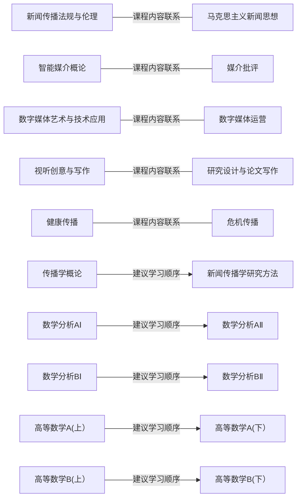

# 2025广播电视学（数字视听）专业本科培养方案（港澳台侨生）

新闻学院 · 广播电视学 · 方案 97156 · 144 个不同课程或科研条目。

[官方 Word](../originals/plan-97156.docx) · [教务详情](https://fdjwgl.fudan.edu.cn/manager/bizType/2/major-program-search/info/97156?skipAuth=1) · [方案快照](../raw/plan-97156.json.gz) · [年级目录](../README.md)

## 课程关系图

图中展示部分关系。下表保留全部已建立的课程对，来源位置使用本方案 JSON Pointer。

## 先修与内容联系

| 类型 | 起点 | 终点 | 依据 | 原表定位 |
| --- | --- | --- | --- | --- |
| 建议学习顺序 | 传播学概论 (JCM10003) | 新闻传播学研究方法 (JCM20001) | 传播概念和模型可帮助提出具体研究问题。  | `/courseModules/7/planCourses/2`、`/courseModules/11/planCourses/2` |
| 建议学习顺序 | 高等数学B(上） (MATH10004) | 高等数学B(下） (MATH10005) | 同方案的课程题名具有连续分册或序号。  | `/courseModules/9/planCourses/15`、`/courseModules/9/planCourses/16` |
| 建议学习顺序 | 数学分析AⅠ (MATH10010) | 数学分析AⅡ (MATH10011) | 同方案的课程题名具有连续分册或序号。  | `/courseModules/9/planCourses/9`、`/courseModules/9/planCourses/10` |
| 建议学习顺序 | 数学分析BⅠ (MATH10012) | 数学分析BⅡ (MATH10013) | 同方案的课程题名具有连续分册或序号。  | `/courseModules/9/planCourses/11`、`/courseModules/9/planCourses/12` |
| 建议学习顺序 | 高等数学A(上） (MATH10015) | 高等数学A(下） (MATH10016) | 同方案的课程题名具有连续分册或序号。  | `/courseModules/9/planCourses/13`、`/courseModules/9/planCourses/14` |
| 课程内容联系 | 智能媒介概论 (AIS210008) | 媒介批评 (JCM30008) | 本方案两门课程的题名均含“媒介”，可据此对照这一主题。  | `/courseModules/11/planCourses/1`、`/courseModules/15/planCourses/0` |
| 课程内容联系 | 中国文学传统 (CHIN10001) | 中国文学经典 (CHIN10005) | 经典文本与文学传统可从作品接受与文学演变联系。  | `/courseModules/8/planCourses/0`、`/courseModules/8/planCourses/1` |
| 课程内容联系 | 新闻学概论 (JCM10002) | 视听新闻生产 (JCM20031) | 本方案两门课程的题名均含“新闻”，可据此对照这一主题。  | `/courseModules/7/planCourses/1`、`/courseModules/16/planCourses/0` |
| 课程内容联系 | 新闻学概论 (JCM10002) | 新闻社会学 (JCM50064) | 本方案两门课程的题名均含“新闻”，可据此对照这一主题。  | `/courseModules/7/planCourses/1`、`/courseModules/15/planCourses/2` |
| 课程内容联系 | 新闻学概论 (JCM10002) | 新闻叙事分析 (JCM50069) | 本方案两门课程的题名均含“新闻”，可据此对照这一主题。  | `/courseModules/7/planCourses/1`、`/courseModules/15/planCourses/14` |
| 课程内容联系 | 新闻学概论 (JCM10002) | 新闻与全球化 (JCM50103) | 本方案两门课程的题名均含“新闻”，可据此对照这一主题。  | `/courseModules/7/planCourses/1`、`/courseModules/15/planCourses/4` |
| 课程内容联系 | 数字媒体艺术与技术应用 (JCM30006) | 数字媒体运营 (JCM50001) | 本方案两门课程的题名均含“数字媒体”，可据此对照这一主题。  | `/courseModules/12/planCourses/5`、`/courseModules/15/planCourses/15` |
| 课程内容联系 | 媒介批评 (JCM30008) | 媒介与社会 (JCM50063) | 本方案两门课程的题名均含“媒介”，可据此对照这一主题。  | `/courseModules/15/planCourses/0`、`/courseModules/15/planCourses/1` |
| 课程内容联系 | 媒介批评 (JCM30008) | 移动媒介产品设计 (JCM50065) | 本方案两门课程的题名均含“媒介”，可据此对照这一主题。  | `/courseModules/15/planCourses/0`、`/courseModules/15/planCourses/13` |
| 课程内容联系 | 媒介批评 (JCM30008) | 新媒介概论 (JCM50072) | 本方案两门课程的题名均含“媒介”，可据此对照这一主题。  | `/courseModules/15/planCourses/0`、`/courseModules/15/planCourses/3` |
| 课程内容联系 | 新闻传播法规与伦理 (JCM30016) | 马克思主义新闻思想 (JCM40004) | 两课均涉及新闻责任和公共传播价值。  | `/courseModules/11/planCourses/4`、`/courseModules/7/planCourses/0` |
| 课程内容联系 | 广告文化研究 (JCM50007) | 视听广告创作 (JCM50084) | 本方案两门课程的题名均含“广告”，可据此对照这一主题。  | `/courseModules/16/planCourses/33`、`/courseModules/16/planCourses/25` |
| 课程内容联系 | 广告文化研究 (JCM50007) | 数字音频广告 (JCM50100) | 本方案两门课程的题名均含“广告”，可据此对照这一主题。  | `/courseModules/16/planCourses/33`、`/courseModules/16/planCourses/26` |
| 课程内容联系 | 城市传播 (JCM50011) | 健康传播 (JCM50041) | 本方案两门课程的题名均含“传播”，可据此对照这一主题。  | `/courseModules/15/planCourses/21`、`/courseModules/15/planCourses/18` |
| 课程内容联系 | 视听创意与写作 (JCM50012) | 研究设计与论文写作 (JCM50096) | 本方案两门课程的题名均含“写作”，可据此对照这一主题。  | `/courseModules/16/planCourses/14`、`/courseModules/15/planCourses/6` |
| 课程内容联系 | 政治传播 (JCM50039) | 健康传播 (JCM50041) | 本方案两门课程的题名均含“传播”，可据此对照这一主题。  | `/courseModules/15/planCourses/17`、`/courseModules/15/planCourses/18` |
| 课程内容联系 | 健康传播 (JCM50041) | 环境传播 (JCM50043) | 本方案两门课程的题名均含“传播”，可据此对照这一主题。  | `/courseModules/15/planCourses/18`、`/courseModules/15/planCourses/19` |
| 课程内容联系 | 健康传播 (JCM50041) | 危机传播 (JCM50081) | 本方案两门课程的题名均含“传播”，可据此对照这一主题。  | `/courseModules/15/planCourses/18`、`/courseModules/16/planCourses/31` |
| 课程内容联系 | 新闻社会学 (JCM50064) | 社会学导论 (SOCI20001) | 本方案两门课程的题名均含“社会学”，可据此对照这一主题。  | `/courseModules/15/planCourses/2`、`/courseModules/9/planCourses/0` |
| 课程内容联系 | 法理学导论 (LAW10004) | 宪法 (LAW10005) | 两课均涉及权利与公共权力的规范依据。  | `/courseModules/9/planCourses/1`、`/courseModules/9/planCourses/27` |
| 课程内容联系 | 哲学导论 (PHIL10002) | 逻辑学 (PHIL10003) | 论证与概念分析是哲学讨论的共同方法。  | `/courseModules/8/planCourses/7`、`/courseModules/8/planCourses/5` |

本次未从可定位的明确表述中确认课程对课程预修。学期安排、系列分册与编辑建议均保留各自的依据。

## 按原方案模块阅读

同一模块展示原表中的课程归属。模块内课程之间的先后仍须逐项查阅。

- **社会科学基础课程**　会计学、管理学导论、微观经济学、宏观经济学、经济学原理、政治经济学、微观经济学原理、宏观经济学原理、法理学导论、宪法、经济法、公共行政学、高等数学B(上）、高等数学B(下）、高等数学D、数学分析AⅠ、数学分析AⅡ、数学分析BⅠ等31项（原表模块 9）

## 课程表

同一课程在不同模块分别出现时，按原表逐行列出。季节字段保留原值。

| 课程 | 代码 | 学分 | 学期 | 模块 |
| --- | --- | ---: | --- | --- |
| 马克思主义新闻思想 | JCM40004 | 2.0 | SPRING、AUTUMN | 培养方案 / 专业培养课程 / 学科基础课程 / 人文基础课程 / 必修课程 |
| 新闻学概论 | JCM10002 | 2.0 | SPRING、AUTUMN | 培养方案 / 专业培养课程 / 学科基础课程 / 人文基础课程 / 必修课程 |
| 传播学概论 | JCM10003 | 2.0 | SPRING、AUTUMN | 培养方案 / 专业培养课程 / 学科基础课程 / 人文基础课程 / 必修课程 |
| 中国文学传统 | CHIN10001 | 2.0 | SPRING、AUTUMN | 培养方案 / 专业培养课程 / 学科基础课程 / 人文基础课程 / 选修课程 |
| 中国文学经典 | CHIN10005 | 3.0 | SPRING、AUTUMN | 培养方案 / 专业培养课程 / 学科基础课程 / 人文基础课程 / 选修课程 |
| 美学 | CHIN10002 | 2.0 | SPRING、AUTUMN | 培养方案 / 专业培养课程 / 学科基础课程 / 人文基础课程 / 选修课程 |
| 中国古代文明 | HIST10006 | 3.0 | SPRING、AUTUMN | 培养方案 / 专业培养课程 / 学科基础课程 / 人文基础课程 / 选修课程 |
| 语言与文化 | CHIN10006 | 2.0 | SPRING、AUTUMN | 培养方案 / 专业培养课程 / 学科基础课程 / 人文基础课程 / 选修课程 |
| 逻辑学 | PHIL10003 | 3.0 | SPRING、AUTUMN | 培养方案 / 专业培养课程 / 学科基础课程 / 人文基础课程 / 选修课程 |
| 汉语概论 | CHIN10004 | 2.0 | SPRING、AUTUMN | 培养方案 / 专业培养课程 / 学科基础课程 / 人文基础课程 / 选修课程 |
| 哲学导论 | PHIL10002 | 3.0 | SPRING、AUTUMN | 培养方案 / 专业培养课程 / 学科基础课程 / 人文基础课程 / 选修课程 |
| 现代文艺赏析 | CHIN10003 | 2.0 | SPRING、AUTUMN | 培养方案 / 专业培养课程 / 学科基础课程 / 人文基础课程 / 选修课程 |
| 史学原典导读 | HIST10003 | 2.0 | SPRING、AUTUMN | 培养方案 / 专业培养课程 / 学科基础课程 / 人文基础课程 / 选修课程 |
| 世界文明史通论 | HIST10004 | 2.0 | SPRING、AUTUMN | 培养方案 / 专业培养课程 / 学科基础课程 / 人文基础课程 / 选修课程 |
| 近代中国社会研究 | HIST10005 | 2.0 | SPRING、AUTUMN | 培养方案 / 专业培养课程 / 学科基础课程 / 人文基础课程 / 选修课程 |
| 考古学导论 | ARCH10001 | 2.0 | AUTUMN | 培养方案 / 专业培养课程 / 学科基础课程 / 人文基础课程 / 选修课程 |
| 中国古代工艺美术 | CULT10001 | 2.0 | SPRING、AUTUMN | 培养方案 / 专业培养课程 / 学科基础课程 / 人文基础课程 / 选修课程 |
| 中国文字源流 | CULT10002 | 2.0 | AUTUMN | 培养方案 / 专业培养课程 / 学科基础课程 / 人文基础课程 / 选修课程 |
| 宗教学导论 | PHIL10004 | 2.0 | AUTUMN | 培养方案 / 专业培养课程 / 学科基础课程 / 人文基础课程 / 选修课程 |
| 语言学导论 | FORE10005 | 2.0 | SPRING、AUTUMN | 培养方案 / 专业培养课程 / 学科基础课程 / 人文基础课程 / 选修课程 |
| 世界文学导读 | FORE10006 | 2.0 | SPRING、AUTUMN | 培养方案 / 专业培养课程 / 学科基础课程 / 人文基础课程 / 选修课程 |
| 社会学导论 | SOCI20001 | 3.0 | SPRING、AUTUMN | 培养方案 / 专业培养课程 / 学科基础课程 / 社会科学基础课程 |
| 法理学导论 | LAW10004 | 3.0 | SPRING、AUTUMN | 培养方案 / 专业培养课程 / 学科基础课程 / 社会科学基础课程 |
| 微观经济学 | ECON20003 | 3.0 | 第2学期 | 培养方案 / 专业培养课程 / 学科基础课程 / 社会科学基础课程 |
| 政治学原理 | POLI10004 | 4.0 | SPRING、AUTUMN | 培养方案 / 专业培养课程 / 学科基础课程 / 社会科学基础课程 |
| 宏观经济学 | ECON20004 | 3.0 | 第3学期 | 培养方案 / 专业培养课程 / 学科基础课程 / 社会科学基础课程 |
| 公共行政学 | MANA10001 | 4.0 | SPRING、AUTUMN | 培养方案 / 专业培养课程 / 学科基础课程 / 社会科学基础课程 |
| 微观经济学原理 | ECON20007 | 5.0 | 第1学期 | 培养方案 / 专业培养课程 / 学科基础课程 / 社会科学基础课程 |
| 国际关系导论 | POLI10003 | 4.0 | SPRING、AUTUMN | 培养方案 / 专业培养课程 / 学科基础课程 / 社会科学基础课程 |
| 宏观经济学原理 | ECON20008 | 5.0 | 第2学期 | 培养方案 / 专业培养课程 / 学科基础课程 / 社会科学基础课程 |
| 数学分析AⅠ | MATH10010 | 5.0 | SPRING、AUTUMN | 培养方案 / 专业培养课程 / 学科基础课程 / 社会科学基础课程 |
| 数学分析AⅡ | MATH10011 | 5.0 | SPRING、AUTUMN | 培养方案 / 专业培养课程 / 学科基础课程 / 社会科学基础课程 |
| 数学分析BⅠ | MATH10012 | 5.0 | SPRING、AUTUMN | 培养方案 / 专业培养课程 / 学科基础课程 / 社会科学基础课程 |
| 数学分析BⅡ | MATH10013 | 5.0 | SPRING、AUTUMN | 培养方案 / 专业培养课程 / 学科基础课程 / 社会科学基础课程 |
| 高等数学A(上） | MATH10015 | 5.0 | SPRING、AUTUMN | 培养方案 / 专业培养课程 / 学科基础课程 / 社会科学基础课程 |
| 高等数学A(下） | MATH10016 | 5.0 | SPRING、AUTUMN | 培养方案 / 专业培养课程 / 学科基础课程 / 社会科学基础课程 |
| 高等数学B(上） | MATH10004 | 5.0 | SPRING、AUTUMN | 培养方案 / 专业培养课程 / 学科基础课程 / 社会科学基础课程 |
| 高等数学B(下） | MATH10005 | 5.0 | SPRING、AUTUMN | 培养方案 / 专业培养课程 / 学科基础课程 / 社会科学基础课程 |
| 线性代数 | MATH10017 | 3.0 | SPRING、AUTUMN | 培养方案 / 专业培养课程 / 学科基础课程 / 社会科学基础课程 |
| 会计学 | BA10003 | 3.0 | SPRING、AUTUMN | 培养方案 / 专业培养课程 / 学科基础课程 / 社会科学基础课程 |
| 高等数学D | MATH10008 | 4.0 | SPRING、AUTUMN | 培养方案 / 专业培养课程 / 学科基础课程 / 社会科学基础课程 |
| 经济学原理 | ECON20005 | 3.0 | SPRING、AUTUMN | 培养方案 / 专业培养课程 / 学科基础课程 / 社会科学基础课程 |
| 政治经济学 | ECON20006 | 3.0 | SPRING、AUTUMN | 培养方案 / 专业培养课程 / 学科基础课程 / 社会科学基础课程 |
| 社会研究方法A | SOCI20002 | 3.0 | SPRING、AUTUMN | 培养方案 / 专业培养课程 / 学科基础课程 / 社会科学基础课程 |
| 社会研究方法B | MSE30029 | 3.0 | SPRING、AUTUMN | 培养方案 / 专业培养课程 / 学科基础课程 / 社会科学基础课程 |
| 社会工作导论 | SWK20002 | 3.0 | SPRING、AUTUMN | 培养方案 / 专业培养课程 / 学科基础课程 / 社会科学基础课程 |
| 心理学导论 | PSYC20001 | 3.0 | SPRING、AUTUMN | 培养方案 / 专业培养课程 / 学科基础课程 / 社会科学基础课程 |
| 管理学导论 | BA10004 | 3.0 | SPRING、AUTUMN | 培养方案 / 专业培养课程 / 学科基础课程 / 社会科学基础课程 |
| 宪法 | LAW10005 | 3.0 | SPRING、AUTUMN | 培养方案 / 专业培养课程 / 学科基础课程 / 社会科学基础课程 |
| 经济法 | LAW20011 | 3.0 | SPRING、AUTUMN | 培养方案 / 专业培养课程 / 学科基础课程 / 社会科学基础课程 |
| 统计学 | SOCI20003 | 3.0 | SPRING、AUTUMN | 培养方案 / 专业培养课程 / 学科基础课程 / 社会科学基础课程 |
| 当代中国政治制度 | POLI10009 | 3.0 | SPRING、AUTUMN | 培养方案 / 专业培养课程 / 学科基础课程 / 社会科学基础课程 |
| 中国新闻传播史 | JCM20006 | 2.0 | 第2学期、第3学期 | 培养方案 / 专业培养课程 / 专业核心教育课程 / 专业培养课程 |
| 智能媒介概论 | AIS210008 | 2.0 | 第3学期、第4学期 | 培养方案 / 专业培养课程 / 专业核心教育课程 / 专业培养课程 |
| 新闻传播学研究方法 | JCM20001 | 2.0 | 第3学期、第4学期 | 培养方案 / 专业培养课程 / 专业核心教育课程 / 专业培养课程 |
| 数据分析与信息可视化 | JCM30002 | 4.0 | 第5学期、第6学期 | 培养方案 / 专业培养课程 / 专业核心教育课程 / 专业培养课程 |
| 新闻传播法规与伦理 | JCM30016 | 2.0 | 第6学期 | 培养方案 / 专业培养课程 / 专业核心教育课程 / 专业培养课程 |
| 视听史论 | JCM20029 | 2.0 | 第3学期 | 培养方案 / 专业培养课程 / 专业核心教育课程 / 专业必修课程 |
| 视听语言和审美 | JCM20007 | 3.0 | 第3学期 | 培养方案 / 专业培养课程 / 专业核心教育课程 / 专业必修课程 |
| 视听技术与应用 | JCM20008 | 3.0 | 第3学期 | 培养方案 / 专业培养课程 / 专业核心教育课程 / 专业必修课程 |
| 影像编辑 | JCM20030 | 3.0 | 第4学期 | 培养方案 / 专业培养课程 / 专业核心教育课程 / 专业必修课程 |
| 视听节目构成 | JCM30027 | 3.0 | 第5学期 | 培养方案 / 专业培养课程 / 专业核心教育课程 / 专业必修课程 |
| 数字媒体艺术与技术应用 | JCM30006 | 3.0 | 第5学期 | 培养方案 / 专业培养课程 / 专业核心教育课程 / 专业必修课程 |
| 数字互动叙事 | JCM30005 | 3.0 | 第6学期 | 培养方案 / 专业培养课程 / 专业核心教育课程 / 专业必修课程 |
| 媒介批评 | JCM30008 | 2.0 | SPRING、AUTUMN | 培养方案 / 专业进阶模块I |
| 媒介与社会 | JCM50063 | 2.0 | SPRING、AUTUMN | 培养方案 / 专业进阶模块I |
| 新闻社会学 | JCM50064 | 2.0 | SPRING、AUTUMN | 培养方案 / 专业进阶模块I |
| 新媒介概论 | JCM50072 | 2.0 | SPRING、AUTUMN | 培养方案 / 专业进阶模块I |
| 新闻与全球化 | JCM50103 | 2.0 | SPRING、AUTUMN | 培养方案 / 专业进阶模块I |
| 新时代中国共产党新闻工作理论 | JCM50109 | 2.0 | SPRING、AUTUMN | 培养方案 / 专业进阶模块I |
| 研究设计与论文写作 | JCM50096 | 3.0 | SPRING、AUTUMN | 培养方案 / 专业进阶模块I |
| 中国新闻口述史 | JCM50105 | 3.0 | SPRING、AUTUMN | 培养方案 / 专业进阶模块I |
| 都市、田野调查与纪录 | JCM50062 | 4.0 | SPRING、AUTUMN | 培养方案 / 专业进阶模块I |
| 重大历史事件报道解析 | JCM50104 | 2.0 | SPRING、AUTUMN | 培养方案 / 专业进阶模块I |
| 事实与事实核查 | JCM50092 | 3.0 | SPRING、AUTUMN | 培养方案 / 专业进阶模块I |
| 数据与财经新闻 | JCM50054 | 3.0 | SPRING、AUTUMN | 培养方案 / 专业进阶模块I |
| 对外报道 | JCM50031 | 2.0 | SPRING、AUTUMN | 培养方案 / 专业进阶模块I |
| 移动媒介产品设计 | JCM50065 | 2.0 | SPRING、AUTUMN | 培养方案 / 专业进阶模块I |
| 新闻叙事分析 | JCM50069 | 2.0 | SPRING、AUTUMN | 培养方案 / 专业进阶模块I |
| 数字媒体运营 | JCM50001 | 2.0 | SPRING、AUTUMN | 培养方案 / 专业进阶模块I |
| 说服理论 | JCM50010 | 2.0 | SPRING、AUTUMN | 培养方案 / 专业进阶模块I |
| 政治传播 | JCM50039 | 2.0 | SPRING、AUTUMN | 培养方案 / 专业进阶模块I |
| 健康传播 | JCM50041 | 2.0 | SPRING、AUTUMN | 培养方案 / 专业进阶模块I |
| 环境传播 | JCM50043 | 2.0 | SPRING、AUTUMN | 培养方案 / 专业进阶模块I |
| 认知传播 | JCM50097 | 2.0 | SPRING、AUTUMN | 培养方案 / 专业进阶模块I |
| 城市传播 | JCM50011 | 2.0 | SPRING、AUTUMN | 培养方案 / 专业进阶模块I |
| 数字出版 | JCM50102 | 3.0 | SPRING、AUTUMN | 培养方案 / 专业进阶模块I |
| 人际传播学 | JCM30013 | 2.0 | SPRING、AUTUMN | 培养方案 / 专业进阶模块I |
| 传播政治经济学 | JCM30017 | 2.0 | SPRING、AUTUMN | 培养方案 / 专业进阶模块I |
| 社交媒体传播分析 | JCM50060 | 2.0 | SPRING、AUTUMN | 培养方案 / 专业进阶模块I |
| 新媒体技术与传播 | JCM50093 | 2.0 | SPRING、AUTUMN | 培养方案 / 专业进阶模块I |
| 数字媒介产品营销传播 | JCM50094 | 2.0 | SPRING、AUTUMN | 培养方案 / 专业进阶模块I |
| 传播学专题研究 | JCM50015 | 2.0 | SPRING、AUTUMN | 培养方案 / 专业进阶模块I |
| 习近平文化思想概论 | JCM40005 | 2.0 | SPRING、AUTUMN | 培养方案 / 专业进阶模块I |
| 视听新闻生产 | JCM20031 | 3.0 | SPRING、AUTUMN | 培养方案 / 专业进阶模块II |
| 视听节目策划 | JCM50051 | 3.0 | SPRING、AUTUMN | 培养方案 / 专业进阶模块II |
| 融合直播实务 | JCM50077 | 3.0 | SPRING、AUTUMN | 培养方案 / 专业进阶模块II |
| 智能视频制作实务 | JCM50110 | 1.0 | SPRING、AUTUMN | 培养方案 / 专业进阶模块II |
| 聆听流行音乐 | JCM50022 | 2.0 | SPRING、AUTUMN | 培养方案 / 专业进阶模块II |
| 网络视听文化 | JCM50071 | 2.0 | SPRING、AUTUMN | 培养方案 / 专业进阶模块II |
| 视听传播规制与版权 | JCM50026 | 3.0 | SPRING、AUTUMN | 培养方案 / 专业进阶模块II |
| 数字文娱市场与产品运营 | JCM30001 | 2.0 | 第6学期 | 培养方案 / 专业进阶模块II |
| 影视艺术 | JCM50033 | 2.0 | SPRING、AUTUMN | 培养方案 / 专业进阶模块II |
| 口语表达 | JCM20025 | 3.0 | SPRING、AUTUMN | 培养方案 / 专业进阶模块II |
| 数字游戏案例分析 | JCM50028 | 2.0 | SPRING、AUTUMN | 培养方案 / 专业进阶模块II |
| 视听大数据计算传播 | JCM50075 | 2.0 | SPRING、AUTUMN | 培养方案 / 专业进阶模块II |
| 新媒体艺术与智能生成传播 | JCM50082 | 2.0 | SPRING、AUTUMN | 培养方案 / 专业进阶模块II |
| 计算机仿生传播 | JCM50055 | 2.0 | SPRING、AUTUMN | 培养方案 / 专业进阶模块II |
| 视听创意与写作 | JCM50012 | 3.0 | SPRING、AUTUMN | 培养方案 / 专业进阶模块II |
| 数字音频市场与在线播客 | JCM50017 | 2.0 | SPRING、AUTUMN | 培养方案 / 专业进阶模块II |
| 娱乐节目与娱乐产业 | JCM50027 | 3.0 | SPRING、AUTUMN | 培养方案 / 专业进阶模块II |
| 动漫艺术与产业 | JCM50013 | 2.0 | SPRING、AUTUMN | 培养方案 / 专业进阶模块II |
| 镜前创作与训练 | JCM50018 | 2.0 | SPRING、AUTUMN | 培养方案 / 专业进阶模块II |
| 微纪录工作室 | JCM50020 | 2.0 | SPRING、AUTUMN | 培养方案 / 专业进阶模块II |
| 微视听工作室 | JCM50019 | 2.0 | SPRING、AUTUMN | 培养方案 / 专业进阶模块II |
| 商业、传播与社会 | JCM50023 | 2.0 | SPRING、AUTUMN | 培养方案 / 专业进阶模块II |
| 用户体验设计 | JCM50025 | 2.0 | SPRING、AUTUMN | 培养方案 / 专业进阶模块II |
| 纪实摄影工作室 | JCM50083 | 3.0 | SPRING、AUTUMN | 培养方案 / 专业进阶模块II |
| 商业摄影 | JCM50080 | 2.0 | SPRING、AUTUMN | 培养方案 / 专业进阶模块II |
| 视听广告创作 | JCM50084 | 2.0 | SPRING、AUTUMN | 培养方案 / 专业进阶模块II |
| 数字音频广告 | JCM50100 | 2.0 | SPRING、AUTUMN | 培养方案 / 专业进阶模块II |
| 美术与插画工作室 | JCM50085 | 2.0 | SPRING、AUTUMN | 培养方案 / 专业进阶模块II |
| 品牌策略传播 | JCM50086 | 2.0 | SPRING、AUTUMN | 培养方案 / 专业进阶模块II |
| 促销、宣传与表现 | JCM50053 | 2.0 | SPRING、AUTUMN | 培养方案 / 专业进阶模块II |
| 组织传播学 | JCM30014 | 2.0 | SPRING、AUTUMN | 培养方案 / 专业进阶模块II |
| 危机传播 | JCM50081 | 2.0 | SPRING、AUTUMN | 培养方案 / 专业进阶模块II |
| 整合营销传播 | JCM50034 | 2.0 | SPRING、AUTUMN | 培养方案 / 专业进阶模块II |
| 广告文化研究 | JCM50007 | 2.0 | SPRING、AUTUMN | 培养方案 / 专业进阶模块II |
| 青年文化与品牌传播 | JCM50014 | 2.0 | SPRING、AUTUMN | 培养方案 / 专业进阶模块II |
| 企业责任与全球可持续发展 | JCM50024 | 2.0 | SPRING、AUTUMN | 培养方案 / 专业进阶模块II |
| 商业法律 | JCM50008 | 2.0 | SPRING、AUTUMN | 培养方案 / 专业进阶模块II |
| 海派商业文化专题研究 | JCM50016 | 1.0 | SPRING、AUTUMN | 培养方案 / 专业进阶模块II |
| 复芏计划(FDUROP) | 102 | 1.0 |  | 融合创新能力 |
| 专业竞赛(本科阶段) | 106 | 1.0 |  | 融合创新能力 |
| 校园媒体实践(本科阶段) | 1071 | 1.0 |  | 融合创新能力 |
| 教学实习 | JCM40001 | 4.0 | 第7学期 | 融合创新能力 |
| 毕业论文 | JCM40003 | 4.0 | 第8学期 | 融合创新能力 |
| 记录中国（专业实践） | JCM50029 | 2.0 | SUMMER | 融合创新能力 |
| 大江东—复旦融媒体创新工作室 | JCM50004 | 2.0 | SPRING、AUTUMN | 融合创新能力 |
| 新闻实务工作坊 | JCM50003 | 2.0 | SPRING、AUTUMN | 融合创新能力 |
| 视听实务工作坊 | JCM50078 | 1.0 | SPRING、AUTUMN | 融合创新能力 |
| 视听实务工作坊 | JCM50098 | 2.0 | SPRING、AUTUMN | 融合创新能力 |
| 公益传播工作坊 | JCM50006 | 1.0 | SPRING、AUTUMN | 融合创新能力 |
| 商业传播工作坊 | JCM50005 | 1.0 | SPRING、AUTUMN | 融合创新能力 |
