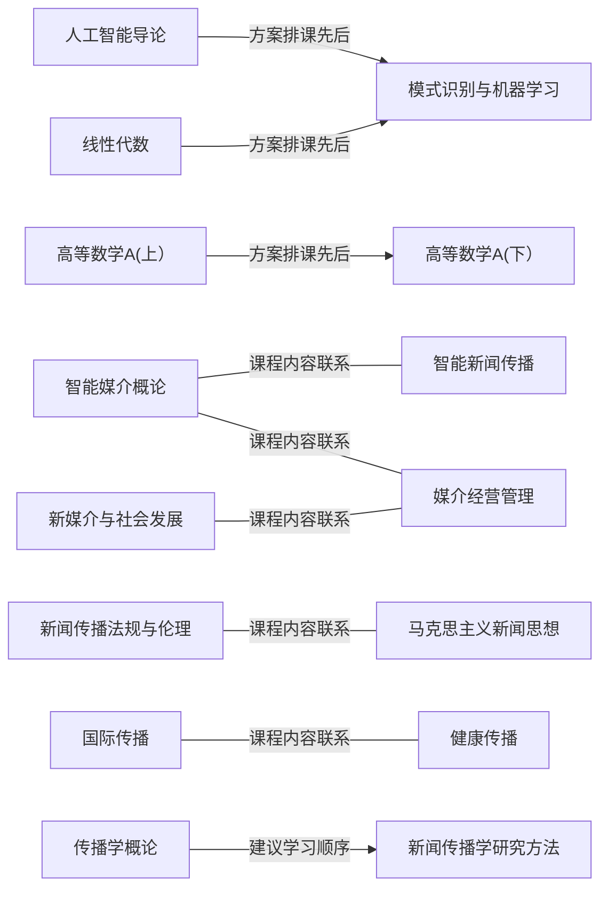

# 2025传播学-人工智能双学士学位项目本科培养方案

新闻学院 · 传播学-人工智能(双学士学位项目) · 方案 97168 · 62 个不同课程或科研条目。

[官方 Word](../originals/plan-97168.docx) · [教务详情](https://fdjwgl.fudan.edu.cn/manager/bizType/2/major-program-search/info/97168?skipAuth=1) · [方案快照](../raw/plan-97168.json.gz) · [年级目录](../README.md)

## 修读导读

- **建议先学**　《传播学概论》（`JCM10003`） → 《新闻传播学研究方法》（`JCM20001`）。传播概念和模型可帮助提出具体研究问题。

- **可以对照着读**　《智能媒介概论》（`AIS210008`）与《智能新闻传播》（`AIS310010`）。智能媒介技术和新闻生产传播具有应用场景交集。

- **查模块选课**　《组织传播学》（`JCM30014`）、《中国新闻传播史》（`JCM20006`）列在“专业核心教育课程”中。原表见 `/courseModules/8`。

## 课程关系图

图中展示部分关系。下表保留全部已建立的课程对，来源位置使用本方案 JSON Pointer。

## 先修与内容联系

| 类型 | 起点 | 终点 | 依据 | 原表定位 |
| --- | --- | --- | --- | --- |
| 建议学习顺序 | 人工智能导论 (AIE310005) | 模式识别与机器学习 (AIE410001) | 人工智能问题与模型类别可为学习模式识别作准备。  | `/courseModules/8/planCourses/19`、`/courseModules/8/planCourses/21` |
| 建议学习顺序 | 线性代数 (CS10003) | 模式识别与机器学习 (AIE410001) | 向量表示和矩阵运算支持理解分类、回归等模型。  | `/courseModules/7/planCourses/2`、`/courseModules/8/planCourses/21` |
| 建议学习顺序 | 传播学概论 (JCM10003) | 新闻传播学研究方法 (JCM20001) | 传播概念和模型可帮助提出具体研究问题。  | `/courseModules/6/planCourses/2`、`/courseModules/8/planCourses/2` |
| 建议学习顺序 | 高等数学A(上） (MATH10015) | 高等数学A(下） (MATH10016) | 同方案的课程题名具有连续分册或序号。  | `/courseModules/7/planCourses/0`、`/courseModules/7/planCourses/1` |
| 方案排课先后 | 人工智能导论 (AIE310005) | 模式识别与机器学习 (AIE410001) | 同方案该课程全部明确数字学期均早于后者。  | `/courseModules/8/planCourses/19`、`/courseModules/8/planCourses/21` |
| 方案排课先后 | 线性代数 (CS10003) | 模式识别与机器学习 (AIE410001) | 同方案该课程全部明确数字学期均早于后者。  | `/courseModules/7/planCourses/2`、`/courseModules/8/planCourses/21` |
| 方案排课先后 | 高等数学A(上） (MATH10015) | 高等数学A(下） (MATH10016) | 同方案该课程全部明确数字学期均早于后者。  | `/courseModules/7/planCourses/0`、`/courseModules/7/planCourses/1` |
| 课程内容联系 | 计算机系统基础 (AIE210006) | 计算机组成与体系结构 (CS30052) | 处理器、存储与系统执行模型具有共同内容。  | `/courseModules/8/planCourses/18`、`/courseModules/12/planCourses/1` |
| 课程内容联系 | 人工智能导论 (AIE310005) | 人工智能安全 (AIE831001) | 本方案两门课程的题名均含“人工智能”，可据此对照这一主题。  | `/courseModules/8/planCourses/19`、`/courseModules/8/planCourses/22` |
| 课程内容联系 | 人工智能的编程基础 (AIE310006) | 人工智能安全 (AIE831001) | 本方案两门课程的题名均含“人工智能”，可据此对照这一主题。  | `/courseModules/8/planCourses/15`、`/courseModules/8/planCourses/22` |
| 课程内容联系 | 人工智能的软件基础 (AIE310008) | 人工智能安全 (AIE831001) | 本方案两门课程的题名均含“人工智能”，可据此对照这一主题。  | `/courseModules/8/planCourses/20`、`/courseModules/8/planCourses/22` |
| 课程内容联系 | 人工智能的数学基础 (AIE310009) | 模式识别与机器学习 (AIE410001) | 数学表达与学习模型的统计、优化工具可对照。  | `/courseModules/8/planCourses/17`、`/courseModules/8/planCourses/21` |
| 课程内容联系 | 人工智能的数学基础 (AIE310009) | 人工智能安全 (AIE831001) | 本方案两门课程的题名均含“人工智能”，可据此对照这一主题。  | `/courseModules/8/planCourses/17`、`/courseModules/8/planCourses/22` |
| 课程内容联系 | 模式识别与机器学习 (AIE410001) | 机器学习系统 (CS30058) | 本方案两门课程的题名均含“机器学习”，可据此对照这一主题。  | `/courseModules/8/planCourses/21`、`/courseModules/12/planCourses/5` |
| 课程内容联系 | 智能媒介概论 (AIS210008) | 智能新闻传播 (AIS310010) | 智能媒介技术和新闻生产传播具有应用场景交集。  | `/courseModules/8/planCourses/1`、`/courseModules/8/planCourses/14` |
| 课程内容联系 | 智能媒介概论 (AIS210008) | 媒介经营管理 (JCM30009) | 本方案两门课程的题名均含“媒介”，可据此对照这一主题。  | `/courseModules/8/planCourses/1`、`/courseModules/8/planCourses/9` |
| 课程内容联系 | 智能新闻传播 (AIS310010) | 新闻学概论 (JCM10002) | 本方案两门课程的题名均含“新闻”，可据此对照这一主题。  | `/courseModules/8/planCourses/14`、`/courseModules/6/planCourses/1` |
| 课程内容联系 | 新闻学概论 (JCM10002) | 新闻传播学研究方法 (JCM20001) | 本方案两门课程的题名均含“新闻”，可据此对照这一主题。  | `/courseModules/6/planCourses/1`、`/courseModules/8/planCourses/2` |
| 课程内容联系 | 新闻学概论 (JCM10002) | 中国新闻传播史 (JCM20006) | 本方案两门课程的题名均含“新闻”，可据此对照这一主题。  | `/courseModules/6/planCourses/1`、`/courseModules/8/planCourses/0` |
| 课程内容联系 | 新闻学概论 (JCM10002) | 新闻实务工作坊 (JCM50003) | 本方案两门课程的题名均含“新闻”，可据此对照这一主题。  | `/courseModules/6/planCourses/1`、`/courseModules/18/planCourses/7` |
| 课程内容联系 | 新媒介与社会发展 (JCM30004) | 媒介经营管理 (JCM30009) | 本方案两门课程的题名均含“媒介”，可据此对照这一主题。  | `/courseModules/8/planCourses/11`、`/courseModules/8/planCourses/9` |
| 课程内容联系 | 媒介经营管理 (JCM30009) | 数字媒介产品营销传播 (JCM50094) | 本方案两门课程的题名均含“媒介”，可据此对照这一主题。  | `/courseModules/8/planCourses/9`、`/courseModules/11/planCourses/11` |
| 课程内容联系 | 新闻传播法规与伦理 (JCM30016) | 马克思主义新闻思想 (JCM40004) | 两课均涉及新闻责任和公共传播价值。  | `/courseModules/8/planCourses/4`、`/courseModules/6/planCourses/0` |
| 课程内容联系 | 国际传播 (JCM30019) | 健康传播 (JCM50041) | 本方案两门课程的题名均含“传播”，可据此对照这一主题。  | `/courseModules/8/planCourses/7`、`/courseModules/11/planCourses/2` |
| 课程内容联系 | 城市传播 (JCM50011) | 健康传播 (JCM50041) | 本方案两门课程的题名均含“传播”，可据此对照这一主题。  | `/courseModules/11/planCourses/5`、`/courseModules/11/planCourses/2` |
| 课程内容联系 | 政治传播 (JCM50039) | 健康传播 (JCM50041) | 本方案两门课程的题名均含“传播”，可据此对照这一主题。  | `/courseModules/11/planCourses/1`、`/courseModules/11/planCourses/2` |
| 课程内容联系 | 健康传播 (JCM50041) | 环境传播 (JCM50043) | 本方案两门课程的题名均含“传播”，可据此对照这一主题。  | `/courseModules/11/planCourses/2`、`/courseModules/11/planCourses/3` |

本次未从可定位的明确表述中确认课程对课程预修。学期安排、系列分册与编辑建议均保留各自的依据。

## 按原方案模块阅读

同一模块展示原表中的课程归属。模块内课程之间的先后仍须逐项查阅。

- **人文基础课程**　新闻学概论、传播学概论、马克思主义新闻思想（原表模块 6）
- **技术科学类基础课程（交叉科学类适用）**　线性代数、程序设计、高等数学A(上）、高等数学A(下）（原表模块 7）

## 课程表

同一课程在不同模块分别出现时，按原表逐行列出。季节字段保留原值。

| 课程 | 代码 | 学分 | 学期 | 模块 |
| --- | --- | ---: | --- | --- |
| 马克思主义新闻思想 | JCM40004 | 2.0 | SPRING、AUTUMN | 培养方案 / 专业培养课程 / 学科基础课程 / 人文基础课程 |
| 新闻学概论 | JCM10002 | 2.0 | SPRING、AUTUMN | 培养方案 / 专业培养课程 / 学科基础课程 / 人文基础课程 |
| 传播学概论 | JCM10003 | 2.0 | SPRING、AUTUMN | 培养方案 / 专业培养课程 / 学科基础课程 / 人文基础课程 |
| 高等数学A(上） | MATH10015 | 5.0 | 第1学期 | 培养方案 / 专业培养课程 / 学科基础课程 / 技术科学类基础课程（交叉科学类适用） |
| 高等数学A(下） | MATH10016 | 5.0 | 第2学期 | 培养方案 / 专业培养课程 / 学科基础课程 / 技术科学类基础课程（交叉科学类适用） |
| 线性代数 | CS10003 | 3.0 | 第1学期 | 培养方案 / 专业培养课程 / 学科基础课程 / 技术科学类基础课程（交叉科学类适用） |
| 程序设计 | CS10004 | 4.0 | 第1学期 | 培养方案 / 专业培养课程 / 学科基础课程 / 技术科学类基础课程（交叉科学类适用） |
| 中国新闻传播史 | JCM20006 | 2.0 | 第2学期、第3学期 | 培养方案 / 专业培养课程 / 专业核心教育课程 |
| 智能媒介概论 | AIS210008 | 2.0 | 第3学期、第4学期 | 培养方案 / 专业培养课程 / 专业核心教育课程 |
| 新闻传播学研究方法 | JCM20001 | 2.0 | 第3学期、第4学期 | 培养方案 / 专业培养课程 / 专业核心教育课程 |
| 数据分析与信息可视化 | JCM30002 | 4.0 | 第5学期、第6学期 | 培养方案 / 专业培养课程 / 专业核心教育课程 |
| 新闻传播法规与伦理 | JCM30016 | 2.0 | 第6学期 | 培养方案 / 专业培养课程 / 专业核心教育课程 |
| 政府公共关系 | JCM20016 | 2.0 | 第3学期 | 培养方案 / 专业培养课程 / 专业核心教育课程 |
| 组织传播学 | JCM30014 | 2.0 | 第3学期 | 培养方案 / 专业培养课程 / 专业核心教育课程 |
| 国际传播 | JCM30019 | 2.0 | 第4学期 | 培养方案 / 专业培养课程 / 专业核心教育课程 |
| 公共舆论 | JCM20009 | 2.0 | 第4学期 | 培养方案 / 专业培养课程 / 专业核心教育课程 |
| 媒介经营管理 | JCM30009 | 2.0 | 第4学期 | 培养方案 / 专业培养课程 / 专业核心教育课程 |
| 舆论分析方法 | JCM30007 | 2.0 | 第5学期 | 培养方案 / 专业培养课程 / 专业核心教育课程 |
| 新媒介与社会发展 | JCM30004 | 2.0 | 第5学期 | 培养方案 / 专业培养课程 / 专业核心教育课程 |
| 跨文化传播 | JCM30011 | 2.0 | 第6学期 | 培养方案 / 专业培养课程 / 专业核心教育课程 |
| 受众分析 | JCM30021 | 2.0 | 第6学期 | 培养方案 / 专业培养课程 / 专业核心教育课程 |
| 智能新闻传播 | AIS310010 | 2.0 | 第6学期 | 培养方案 / 专业培养课程 / 专业核心教育课程 |
| 人工智能的编程基础 | AIE310006 | 2.0 | 第2学期 | 培养方案 / 专业培养课程 / 专业核心教育课程 |
| 数据结构 | AIE310007 | 4.0 | 第3学期 | 培养方案 / 专业培养课程 / 专业核心教育课程 |
| 人工智能的数学基础 | AIE310009 | 3.0 | 第3学期 | 培养方案 / 专业培养课程 / 专业核心教育课程 |
| 计算机系统基础 | AIE210006 | 3.0 | 第3学期 | 培养方案 / 专业培养课程 / 专业核心教育课程 |
| 人工智能导论 | AIE310005 | 3.0 | 第4学期 | 培养方案 / 专业培养课程 / 专业核心教育课程 |
| 人工智能的软件基础 | AIE310008 | 3.0 | 第4学期 | 培养方案 / 专业培养课程 / 专业核心教育课程 |
| 模式识别与机器学习 | AIE410001 | 3.0 | 第5学期 | 培养方案 / 专业培养课程 / 专业核心教育课程 |
| 人工智能安全 | AIE831001 | 3.0 | 第5学期 | 培养方案 / 专业培养课程 / 专业核心教育课程 |
| 人工智能的伦理与治理 | PHIL50006 | 2.0 | 第4学期、第6学期 | 培养方案 / 专业培养课程 / 专业核心教育课程 |
| 自然语言处理与大语言模型 | AIE410002 | 3.0 | 第6学期 | 培养方案 / 专业培养课程 / 专业核心教育课程 |
| 计算机视觉 | AIE310004 | 3.0 | 第7学期 | 培养方案 / 专业培养课程 / 专业核心教育课程 |
| 人工智能前沿探索实践 | AIE531001 | 3.0 | 第7学期 | 培养方案 / 专业培养课程 / 专业核心教育课程 |
| 说服理论 | JCM50010 | 2.0 | SPRING、AUTUMN | 培养方案 / 专业进阶模块I |
| 政治传播 | JCM50039 | 2.0 | SPRING、AUTUMN | 培养方案 / 专业进阶模块I |
| 健康传播 | JCM50041 | 2.0 | SPRING、AUTUMN | 培养方案 / 专业进阶模块I |
| 环境传播 | JCM50043 | 2.0 | SPRING、AUTUMN | 培养方案 / 专业进阶模块I |
| 认知传播 | JCM50097 | 2.0 | SPRING、AUTUMN | 培养方案 / 专业进阶模块I |
| 城市传播 | JCM50011 | 2.0 | SPRING、AUTUMN | 培养方案 / 专业进阶模块I |
| 数字出版 | JCM50102 | 3.0 | SPRING、AUTUMN | 培养方案 / 专业进阶模块I |
| 人际传播学 | JCM30013 | 2.0 | SPRING、AUTUMN | 培养方案 / 专业进阶模块I |
| 传播政治经济学 | JCM30017 | 2.0 | SPRING、AUTUMN | 培养方案 / 专业进阶模块I |
| 社交媒体传播分析 | JCM50060 | 2.0 | SPRING、AUTUMN | 培养方案 / 专业进阶模块I |
| 新媒体技术与传播 | JCM50093 | 2.0 | SPRING、AUTUMN | 培养方案 / 专业进阶模块I |
| 数字媒介产品营销传播 | JCM50094 | 2.0 | SPRING、AUTUMN | 培养方案 / 专业进阶模块I |
| 传播学专题研究 | JCM50015 | 2.0 | SPRING、AUTUMN | 培养方案 / 专业进阶模块I |
| 集合与图论 | CS30043 | 3.0 | 第3学期 | 培养方案 / 专业进阶模块II |
| 计算机组成与体系结构 | CS30052 | 4.0 | 第4学期 | 培养方案 / 专业进阶模块II |
| 数据库引论 | CS20010 | 3.0 | 第4学期 | 培养方案 / 专业进阶模块II |
| 计算机网络 | CS30036 | 3.0 | 第5学期 | 培养方案 / 专业进阶模块II |
| 软件工程 | CS30018 | 3.0 | 第6学期 | 培养方案 / 专业进阶模块II |
| 机器学习系统 | CS30058 | 3.0 | 第6学期 | 培养方案 / 专业进阶模块II |
| 计算机图形学A | CS30019 | 3.0 | 第6学期 | 培养方案 / 专业进阶模块II |
| 教学实习 | JCM40001 | 4.0 | 第7学期 | 融合创新能力 |
| 复芏计划(FDUROP) | 102 | 1.0 |  | 融合创新能力 |
| 校园媒体实践(本科阶段) | 1071 | 1.0 |  | 融合创新能力 |
| 专业竞赛(本科阶段) | 106 | 1.0 |  | 融合创新能力 |
| 毕业论文 | JCM40003 | 4.0 | 第8学期 | 融合创新能力 |
| 记录中国（专业实践） | JCM50029 | 2.0 | SUMMER | 融合创新能力 |
| 大江东—复旦融媒体创新工作室 | JCM50004 | 2.0 | SPRING、AUTUMN | 融合创新能力 |
| 新闻实务工作坊 | JCM50003 | 2.0 | SPRING、AUTUMN | 融合创新能力 |
