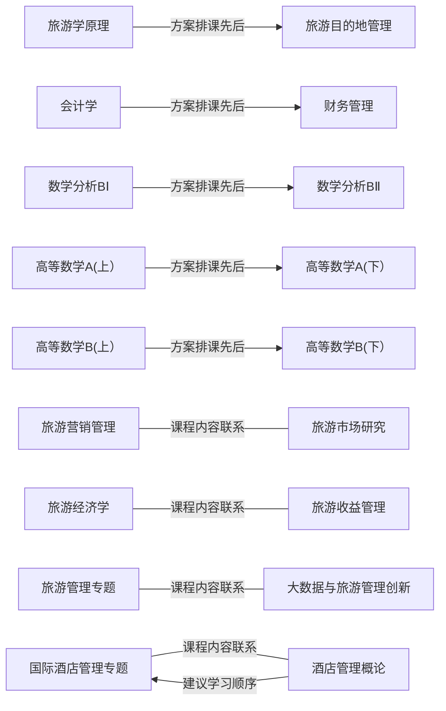

# 2023 旅游管理专业“2+X”教学培养方案

旅游学系 · 旅游管理 · 方案 67418 · 73 个不同课程或科研条目。

[官方 Word](../originals/plan-67418.docx) · [教务详情](https://fdjwgl.fudan.edu.cn/manager/bizType/2/major-program-search/info/67418?skipAuth=1) · [方案快照](../raw/plan-67418.json.gz) · [年级目录](../README.md)

## 课程关系图

图中展示部分关系。下表保留全部已建立的课程对，来源位置使用本方案 JSON Pointer。

## 先修与内容联系

| 类型 | 起点 | 终点 | 依据 | 原表定位 |
| --- | --- | --- | --- | --- |
| 建议学习顺序 | 会计学 (BA10003) | 财务管理 (BA30063) | 会计报表和核算概念可用于理解财务决策。  | `/courseModules/10/planCourses/0`、`/courseModules/11/planCourses/5` |
| 建议学习顺序 | 酒店管理概论 (BA30085) | 国际酒店管理专题 (BA30084) | “酒店管理概论”题名标明基础层次，前置阅读可帮助了解“国际酒店管理专题”中的酒店管理主题。  | `/courseModules/14/planCourses/5`、`/courseModules/14/planCourses/4` |
| 建议学习顺序 | 高等数学B(上） (MATH10004) | 高等数学B(下） (MATH10005) | 同方案的课程题名具有连续分册或序号。  | `/courseModules/9/planCourses/0`、`/courseModules/9/planCourses/1` |
| 建议学习顺序 | 数学分析BⅠ (MATH10012) | 数学分析BⅡ (MATH10013) | 同方案的课程题名具有连续分册或序号。  | `/courseModules/7/planCourses/0`、`/courseModules/7/planCourses/1` |
| 建议学习顺序 | 高等数学A(上） (MATH10015) | 高等数学A(下） (MATH10016) | 同方案的课程题名具有连续分册或序号。  | `/courseModules/8/planCourses/0`、`/courseModules/8/planCourses/1` |
| 建议学习顺序 | 旅游学原理 (TOUR130004) | 旅游目的地管理 (BA30083) | 旅游系统与游客行为的概念可用于理解目的地管理。  | `/courseModules/11/planCourses/13`、`/courseModules/11/planCourses/11` |
| 方案排课先后 | 会计学 (BA10003) | 财务管理 (BA30063) | 同方案该课程全部明确数字学期均早于后者。  | `/courseModules/10/planCourses/0`、`/courseModules/11/planCourses/5` |
| 方案排课先后 | 高等数学B(上） (MATH10004) | 高等数学B(下） (MATH10005) | 同方案该课程全部明确数字学期均早于后者。  | `/courseModules/9/planCourses/0`、`/courseModules/9/planCourses/1` |
| 方案排课先后 | 数学分析BⅠ (MATH10012) | 数学分析BⅡ (MATH10013) | 同方案该课程全部明确数字学期均早于后者。  | `/courseModules/7/planCourses/0`、`/courseModules/7/planCourses/1` |
| 方案排课先后 | 高等数学A(上） (MATH10015) | 高等数学A(下） (MATH10016) | 同方案该课程全部明确数字学期均早于后者。  | `/courseModules/8/planCourses/0`、`/courseModules/8/planCourses/1` |
| 方案排课先后 | 旅游学原理 (TOUR130004) | 旅游目的地管理 (BA30083) | 同方案该课程全部明确数字学期均早于后者。  | `/courseModules/11/planCourses/13`、`/courseModules/11/planCourses/11` |
| 课程内容联系 | 会计学 (BA10003) | 财务管理 (BA30063) | 会计信息与企业融资、投资决策存在应用联系。  | `/courseModules/10/planCourses/0`、`/courseModules/11/planCourses/5` |
| 课程内容联系 | 旅游营销管理 (BA30064) | 旅游市场研究 (BA30075) | 游客需求和市场调查可用于营销问题。  | `/courseModules/11/planCourses/6`、`/courseModules/14/planCourses/2` |
| 课程内容联系 | 旅游经济学 (BA30067) | 旅游收益管理 (BA30087) | 游客需求与收益决策共享价格、需求等问题。  | `/courseModules/11/planCourses/8`、`/courseModules/14/planCourses/6` |
| 课程内容联系 | 旅游管理专题 (BA30073) | 大数据与旅游管理创新 (TOUR130084) | 本方案两门课程的题名均含“旅游管理”，可据此对照这一主题。  | `/courseModules/14/planCourses/1`、`/courseModules/14/planCourses/11` |
| 课程内容联系 | 国际酒店管理专题 (BA30084) | 酒店管理概论 (BA30085) | 本方案两门课程的题名均含“酒店管理”，可据此对照这一主题。  | `/courseModules/14/planCourses/4`、`/courseModules/14/planCourses/5` |

本次未从可定位的明确表述中确认课程对课程预修。学期安排、系列分册与编辑建议均保留各自的依据。

## 按原方案模块阅读

同一模块展示原表中的课程归属。模块内课程之间的先后仍须逐项查阅。

- **数学分析B**　数学分析BⅠ、数学分析BⅡ（原表模块 7）
- **高等数学A**　高等数学A(上）、高等数学A(下）（原表模块 8）
- **高等数学B**　高等数学B(上）、高等数学B(下）（原表模块 9）
- **旅游管理大类基础课（必修）**　会计学、管理学导论、微观经济学、宏观经济学、政治经济学、经济法、线性代数、社会研究方法B、统计学（原表模块 10）
- **旅游企业管理**　旅行社经营管理、旅游管理专题、旅游市场研究、会展管理、国际酒店管理专题、酒店管理概论、旅游收益管理、旅游信息系统、邮轮产业与服务管理、旅游人力资源管理、商务旅行管理、大数据与旅游管理创新（原表模块 14）
- **旅游目的地管理**　导游学、中国民俗旅游、旅游发展规划、遗产旅游、旅游地产与度假区管理、旅游广告、游憩管理、主题公园管理、旅游业投资学、活动策划与组织、国际旅游服务贸易、旅游项目管理（原表模块 15）
- **文旅融合与服务创新**　旅游文化学、休闲学概论、服务管理、文化创意产业引论、文化遗产管理、旅游与跨文化沟通、中国古代乡村社会、中国古代城市史、口述历史、博物馆学概论、展览形式设计、展览内容策划、旅游实践与社会服务（原表模块 16）
- **文献与理论、方法**　旅游心理学、旅游社会学、旅游伦理学、旅游研究方法、旅游文献阅读、旅游人类学（原表模块 17）
- **旅游企业管理**　旅行社经营管理、旅游管理专题、旅游市场研究、会展管理、国际酒店管理专题、酒店管理概论、旅游收益管理、旅游信息系统、邮轮产业与服务管理、旅游人力资源管理、商务旅行管理、大数据与旅游管理创新（原表模块 19）
- **旅游目的地管理**　导游学、中国民俗旅游、旅游发展规划、遗产旅游、旅游地产与度假区管理、旅游广告、游憩管理、主题公园管理、旅游业投资学、活动策划与组织、国际旅游服务贸易、旅游项目管理（原表模块 20）
- **文旅融合与服务创新**　旅游文化学、休闲学概论、服务管理、文化创意产业引论、文化遗产管理、旅游与跨文化沟通、中国古代乡村社会、中国古代城市史、口述历史、博物馆学概论、展览形式设计、展览内容策划、旅游实践与社会服务（原表模块 21）
- **文献与理论、方法**　旅游心理学、旅游社会学、旅游伦理学、旅游研究方法、旅游文献阅读、旅游人类学（原表模块 22）

## 课程表

同一课程在不同模块分别出现时，按原表逐行列出。季节字段保留原值。

| 课程 | 代码 | 学分 | 学期 | 模块 |
| --- | --- | ---: | --- | --- |
| 数学分析BⅠ | MATH10012 | 5.0 | 第1学期 | 培养方案 / 专业培养课程 / 大类基础课程 / 旅游管理大类基础课（三选一） / 数学分析B |
| 数学分析BⅡ | MATH10013 | 5.0 | 第2学期 | 培养方案 / 专业培养课程 / 大类基础课程 / 旅游管理大类基础课（三选一） / 数学分析B |
| 高等数学A(上） | MATH10015 | 5.0 | 第1学期 | 培养方案 / 专业培养课程 / 大类基础课程 / 旅游管理大类基础课（三选一） / 高等数学A |
| 高等数学A(下） | MATH10016 | 5.0 | 第2学期 | 培养方案 / 专业培养课程 / 大类基础课程 / 旅游管理大类基础课（三选一） / 高等数学A |
| 高等数学B(上） | MATH10004 | 5.0 | 第1学期 | 培养方案 / 专业培养课程 / 大类基础课程 / 旅游管理大类基础课（三选一） / 高等数学B |
| 高等数学B(下） | MATH10005 | 5.0 | 第2学期 | 培养方案 / 专业培养课程 / 大类基础课程 / 旅游管理大类基础课（三选一） / 高等数学B |
| 会计学 | BA10003 | 3.0 | 第3学期 | 培养方案 / 专业培养课程 / 大类基础课程 / 旅游管理大类基础课（必修） |
| 管理学导论 | BA10004 | 3.0 | 第1学期 | 培养方案 / 专业培养课程 / 大类基础课程 / 旅游管理大类基础课（必修） |
| 微观经济学 | ECON20003 | 3.0 | 第2学期 | 培养方案 / 专业培养课程 / 大类基础课程 / 旅游管理大类基础课（必修） |
| 宏观经济学 | ECON20004 | 3.0 | 第3学期 | 培养方案 / 专业培养课程 / 大类基础课程 / 旅游管理大类基础课（必修） |
| 政治经济学 | ECON20006 | 3.0 | 第1学期 | 培养方案 / 专业培养课程 / 大类基础课程 / 旅游管理大类基础课（必修） |
| 经济法 | LAW20011 | 3.0 | 第4学期 | 培养方案 / 专业培养课程 / 大类基础课程 / 旅游管理大类基础课（必修） |
| 线性代数 | MATH10017 | 3.0 | 第1学期 | 培养方案 / 专业培养课程 / 大类基础课程 / 旅游管理大类基础课（必修） |
| 社会研究方法B | MSE30029 | 3.0 | 第7学期 | 培养方案 / 专业培养课程 / 大类基础课程 / 旅游管理大类基础课（必修） |
| 统计学 | SOCI20003 | 3.0 | 第4学期 | 培养方案 / 专业培养课程 / 大类基础课程 / 旅游管理大类基础课（必修） |
| 旅游法规 | BA20015 | 2.0 | 第5学期 | 培养方案 / 专业培养课程 / 专业核心教育课程 |
| 旅游景观考察 | BA20016 | 1.0 | SUMMER | 培养方案 / 专业培养课程 / 专业核心教育课程 |
| 旅游消费者行为 | BA20017 | 2.0 | 第4学期 | 培养方案 / 专业培养课程 / 专业核心教育课程 |
| 旅游英语 | BA20018 | 2.0 | 第4学期 | 培养方案 / 专业培养课程 / 专业核心教育课程 |
| 旅游接待业 | BA20019 | 2.0 | 第4学期 | 培养方案 / 专业培养课程 / 专业核心教育课程 |
| 财务管理 | BA30063 | 3.0 | 第4学期 | 培养方案 / 专业培养课程 / 专业核心教育课程 |
| 旅游营销管理 | BA30064 | 3.0 | 第5学期 | 培养方案 / 专业培养课程 / 专业核心教育课程 |
| 学年论文 | BA30066 | 1.0 | 第6学期 | 培养方案 / 专业培养课程 / 专业核心教育课程 |
| 旅游经济学 | BA30067 | 2.0 | 第5学期 | 培养方案 / 专业培养课程 / 专业核心教育课程 |
| 旅游策划学 | BA30071 | 2.0 | 第5学期 | 培养方案 / 专业培养课程 / 专业核心教育课程 |
| 教学实习 | BA30079 | 5.0 | 第6学期 | 培养方案 / 专业培养课程 / 专业核心教育课程 |
| 旅游目的地管理 | BA30083 | 2.0 | 第5学期 | 培养方案 / 专业培养课程 / 专业核心教育课程 |
| 毕业论文 | BA40004 | 4.0 | 第8学期 | 培养方案 / 专业培养课程 / 专业核心教育课程 |
| 旅游学原理 | TOUR130004 | 3.0 | 第3学期 | 培养方案 / 专业培养课程 / 专业核心教育课程 |
| 旅游资源学 | TOUR130045 | 3.0 | 第3学期 | 培养方案 / 专业培养课程 / 专业核心教育课程 |
| 旅行社经营管理 | BA30069 | 2.0 | SPRING、AUTUMN | 培养方案 / 多元发展路径模块 / 旅游企业管理 |
| 旅游管理专题 | BA30073 | 2.0 | SPRING、AUTUMN | 培养方案 / 多元发展路径模块 / 旅游企业管理 |
| 旅游市场研究 | BA30075 | 2.0 | SPRING、AUTUMN | 培养方案 / 多元发展路径模块 / 旅游企业管理 |
| 会展管理 | BA30078 | 2.0 | SPRING、AUTUMN | 培养方案 / 多元发展路径模块 / 旅游企业管理 |
| 国际酒店管理专题 | BA30084 | 2.0 | SPRING、AUTUMN | 培养方案 / 多元发展路径模块 / 旅游企业管理 |
| 酒店管理概论 | BA30085 | 2.0 | SPRING、AUTUMN | 培养方案 / 多元发展路径模块 / 旅游企业管理 |
| 旅游收益管理 | BA30087 | 2.0 | SPRING、AUTUMN | 培养方案 / 多元发展路径模块 / 旅游企业管理 |
| 旅游信息系统 | BA30090 | 2.0 | SPRING、AUTUMN | 培养方案 / 多元发展路径模块 / 旅游企业管理 |
| 邮轮产业与服务管理 | BA30096 | 2.0 | SPRING、AUTUMN | 培养方案 / 多元发展路径模块 / 旅游企业管理 |
| 旅游人力资源管理 | TOUR130073 | 2.0 | SPRING、AUTUMN | 培养方案 / 多元发展路径模块 / 旅游企业管理 |
| 商务旅行管理 | TOUR130075 | 2.0 | SPRING、AUTUMN | 培养方案 / 多元发展路径模块 / 旅游企业管理 |
| 大数据与旅游管理创新 | TOUR130084 | 2.0 | SPRING、AUTUMN | 培养方案 / 多元发展路径模块 / 旅游企业管理 |
| 导游学 | BA30070 | 2.0 | SPRING、AUTUMN | 培养方案 / 多元发展路径模块 / 旅游目的地管理 |
| 中国民俗旅游 | BA30074 | 2.0 | SPRING、AUTUMN | 培养方案 / 多元发展路径模块 / 旅游目的地管理 |
| 旅游发展规划 | BA30077 | 2.0 | SPRING、AUTUMN | 培养方案 / 多元发展路径模块 / 旅游目的地管理 |
| 遗产旅游 | BA30082 | 2.0 | SPRING、AUTUMN | 培养方案 / 多元发展路径模块 / 旅游目的地管理 |
| 旅游地产与度假区管理 | BA30088 | 2.0 | SPRING、AUTUMN | 培养方案 / 多元发展路径模块 / 旅游目的地管理 |
| 旅游广告 | BA30089 | 2.0 | SPRING、AUTUMN | 培养方案 / 多元发展路径模块 / 旅游目的地管理 |
| 游憩管理 | BA30093 | 2.0 | SPRING、AUTUMN | 培养方案 / 多元发展路径模块 / 旅游目的地管理 |
| 主题公园管理 | BA30094 | 2.0 | SPRING、AUTUMN | 培养方案 / 多元发展路径模块 / 旅游目的地管理 |
| 旅游业投资学 | BA30095 | 2.0 | SPRING、AUTUMN | 培养方案 / 多元发展路径模块 / 旅游目的地管理 |
| 活动策划与组织 | BA30100 | 2.0 | SPRING、AUTUMN | 培养方案 / 多元发展路径模块 / 旅游目的地管理 |
| 国际旅游服务贸易 | BA30101 | 2.0 | SPRING、AUTUMN | 培养方案 / 多元发展路径模块 / 旅游目的地管理 |
| 旅游项目管理 | TOUR130074 | 2.0 | SPRING、AUTUMN | 培养方案 / 多元发展路径模块 / 旅游目的地管理 |
| 旅游文化学 | BA30065 | 2.0 | SPRING、AUTUMN | 培养方案 / 多元发展路径模块 / 文旅融合与服务创新 |
| 休闲学概论 | BA30076 | 2.0 | SPRING、AUTUMN | 培养方案 / 多元发展路径模块 / 文旅融合与服务创新 |
| 服务管理 | BA30086 | 2.0 | SPRING、AUTUMN | 培养方案 / 多元发展路径模块 / 文旅融合与服务创新 |
| 文化创意产业引论 | BA30091 | 2.0 | SPRING、AUTUMN | 培养方案 / 多元发展路径模块 / 文旅融合与服务创新 |
| 文化遗产管理 | BA30092 | 2.0 | SPRING、AUTUMN | 培养方案 / 多元发展路径模块 / 文旅融合与服务创新 |
| 旅游与跨文化沟通 | BA30097 | 2.0 | SPRING、AUTUMN | 培养方案 / 多元发展路径模块 / 文旅融合与服务创新 |
| 中国古代乡村社会 | HIST130263 | 2.0 | SPRING、AUTUMN | 培养方案 / 多元发展路径模块 / 文旅融合与服务创新 |
| 中国古代城市史 | HIST30020 | 2.0 | SPRING、AUTUMN | 培养方案 / 多元发展路径模块 / 文旅融合与服务创新 |
| 口述历史 | HIST30035 | 2.0 | SPRING、AUTUMN | 培养方案 / 多元发展路径模块 / 文旅融合与服务创新 |
| 博物馆学概论 | MUSE20001 | 2.0 | SPRING、AUTUMN | 培养方案 / 多元发展路径模块 / 文旅融合与服务创新 |
| 展览形式设计 | MUSE30002 | 2.0 | SPRING、AUTUMN | 培养方案 / 多元发展路径模块 / 文旅融合与服务创新 |
| 展览内容策划 | MUSE30003 | 2.0 | SPRING、AUTUMN | 培养方案 / 多元发展路径模块 / 文旅融合与服务创新 |
| 旅游实践与社会服务 | TOUR130085 | 2.0 | SPRING、AUTUMN | 培养方案 / 多元发展路径模块 / 文旅融合与服务创新 |
| 旅游心理学 | BA30068 | 2.0 | SPRING、AUTUMN | 培养方案 / 多元发展路径模块 / 文献与理论、方法 |
| 旅游社会学 | BA30072 | 2.0 | SPRING、AUTUMN | 培养方案 / 多元发展路径模块 / 文献与理论、方法 |
| 旅游伦理学 | BA30080 | 2.0 | SPRING、AUTUMN | 培养方案 / 多元发展路径模块 / 文献与理论、方法 |
| 旅游研究方法 | BA30081 | 2.0 | SPRING、AUTUMN | 培养方案 / 多元发展路径模块 / 文献与理论、方法 |
| 旅游文献阅读 | BA30098 | 2.0 | SPRING、AUTUMN | 培养方案 / 多元发展路径模块 / 文献与理论、方法 |
| 旅游人类学 | BA30099 | 2.0 | SPRING、AUTUMN | 培养方案 / 多元发展路径模块 / 文献与理论、方法 |
| 旅行社经营管理 | BA30069 | 2.0 | SPRING、AUTUMN | 培养方案 / 专业进阶路径模块 / 旅游企业管理 |
| 旅游管理专题 | BA30073 | 2.0 | SPRING、AUTUMN | 培养方案 / 专业进阶路径模块 / 旅游企业管理 |
| 旅游市场研究 | BA30075 | 2.0 | SPRING、AUTUMN | 培养方案 / 专业进阶路径模块 / 旅游企业管理 |
| 会展管理 | BA30078 | 2.0 | SPRING、AUTUMN | 培养方案 / 专业进阶路径模块 / 旅游企业管理 |
| 国际酒店管理专题 | BA30084 | 2.0 | SPRING、AUTUMN | 培养方案 / 专业进阶路径模块 / 旅游企业管理 |
| 酒店管理概论 | BA30085 | 2.0 | SPRING、AUTUMN | 培养方案 / 专业进阶路径模块 / 旅游企业管理 |
| 旅游收益管理 | BA30087 | 2.0 | SPRING、AUTUMN | 培养方案 / 专业进阶路径模块 / 旅游企业管理 |
| 旅游信息系统 | BA30090 | 2.0 | SPRING、AUTUMN | 培养方案 / 专业进阶路径模块 / 旅游企业管理 |
| 邮轮产业与服务管理 | BA30096 | 2.0 | SPRING、AUTUMN | 培养方案 / 专业进阶路径模块 / 旅游企业管理 |
| 旅游人力资源管理 | TOUR130073 | 2.0 | SPRING、AUTUMN | 培养方案 / 专业进阶路径模块 / 旅游企业管理 |
| 商务旅行管理 | TOUR130075 | 2.0 | SPRING、AUTUMN | 培养方案 / 专业进阶路径模块 / 旅游企业管理 |
| 大数据与旅游管理创新 | TOUR130084 | 2.0 | SPRING、AUTUMN | 培养方案 / 专业进阶路径模块 / 旅游企业管理 |
| 导游学 | BA30070 | 2.0 | SPRING、AUTUMN | 培养方案 / 专业进阶路径模块 / 旅游目的地管理 |
| 中国民俗旅游 | BA30074 | 2.0 | SPRING、AUTUMN | 培养方案 / 专业进阶路径模块 / 旅游目的地管理 |
| 旅游发展规划 | BA30077 | 2.0 | SPRING、AUTUMN | 培养方案 / 专业进阶路径模块 / 旅游目的地管理 |
| 遗产旅游 | BA30082 | 2.0 | SPRING、AUTUMN | 培养方案 / 专业进阶路径模块 / 旅游目的地管理 |
| 旅游地产与度假区管理 | BA30088 | 2.0 | SPRING、AUTUMN | 培养方案 / 专业进阶路径模块 / 旅游目的地管理 |
| 旅游广告 | BA30089 | 2.0 | SPRING、AUTUMN | 培养方案 / 专业进阶路径模块 / 旅游目的地管理 |
| 游憩管理 | BA30093 | 2.0 | SPRING、AUTUMN | 培养方案 / 专业进阶路径模块 / 旅游目的地管理 |
| 主题公园管理 | BA30094 | 2.0 | SPRING、AUTUMN | 培养方案 / 专业进阶路径模块 / 旅游目的地管理 |
| 旅游业投资学 | BA30095 | 2.0 | SPRING、AUTUMN | 培养方案 / 专业进阶路径模块 / 旅游目的地管理 |
| 活动策划与组织 | BA30100 | 2.0 | SPRING、AUTUMN | 培养方案 / 专业进阶路径模块 / 旅游目的地管理 |
| 国际旅游服务贸易 | BA30101 | 2.0 | SPRING、AUTUMN | 培养方案 / 专业进阶路径模块 / 旅游目的地管理 |
| 旅游项目管理 | TOUR130074 | 2.0 | SPRING、AUTUMN | 培养方案 / 专业进阶路径模块 / 旅游目的地管理 |
| 旅游文化学 | BA30065 | 2.0 | SPRING、AUTUMN | 培养方案 / 专业进阶路径模块 / 文旅融合与服务创新 |
| 休闲学概论 | BA30076 | 2.0 | SPRING、AUTUMN | 培养方案 / 专业进阶路径模块 / 文旅融合与服务创新 |
| 服务管理 | BA30086 | 2.0 | SPRING、AUTUMN | 培养方案 / 专业进阶路径模块 / 文旅融合与服务创新 |
| 文化创意产业引论 | BA30091 | 2.0 | SPRING、AUTUMN | 培养方案 / 专业进阶路径模块 / 文旅融合与服务创新 |
| 文化遗产管理 | BA30092 | 2.0 | SPRING、AUTUMN | 培养方案 / 专业进阶路径模块 / 文旅融合与服务创新 |
| 旅游与跨文化沟通 | BA30097 | 2.0 | SPRING、AUTUMN | 培养方案 / 专业进阶路径模块 / 文旅融合与服务创新 |
| 中国古代乡村社会 | HIST130263 | 2.0 | SPRING、AUTUMN | 培养方案 / 专业进阶路径模块 / 文旅融合与服务创新 |
| 中国古代城市史 | HIST30020 | 2.0 | SPRING、AUTUMN | 培养方案 / 专业进阶路径模块 / 文旅融合与服务创新 |
| 口述历史 | HIST30035 | 2.0 | SPRING、AUTUMN | 培养方案 / 专业进阶路径模块 / 文旅融合与服务创新 |
| 博物馆学概论 | MUSE20001 | 2.0 | SPRING、AUTUMN | 培养方案 / 专业进阶路径模块 / 文旅融合与服务创新 |
| 展览形式设计 | MUSE30002 | 2.0 | SPRING、AUTUMN | 培养方案 / 专业进阶路径模块 / 文旅融合与服务创新 |
| 展览内容策划 | MUSE30003 | 2.0 | SPRING、AUTUMN | 培养方案 / 专业进阶路径模块 / 文旅融合与服务创新 |
| 旅游实践与社会服务 | TOUR130085 | 2.0 | SPRING、AUTUMN | 培养方案 / 专业进阶路径模块 / 文旅融合与服务创新 |
| 旅游心理学 | BA30068 | 2.0 | SPRING、AUTUMN | 培养方案 / 专业进阶路径模块 / 文献与理论、方法 |
| 旅游社会学 | BA30072 | 2.0 | SPRING、AUTUMN | 培养方案 / 专业进阶路径模块 / 文献与理论、方法 |
| 旅游伦理学 | BA30080 | 2.0 | SPRING、AUTUMN | 培养方案 / 专业进阶路径模块 / 文献与理论、方法 |
| 旅游研究方法 | BA30081 | 2.0 | SPRING、AUTUMN | 培养方案 / 专业进阶路径模块 / 文献与理论、方法 |
| 旅游文献阅读 | BA30098 | 2.0 | SPRING、AUTUMN | 培养方案 / 专业进阶路径模块 / 文献与理论、方法 |
| 旅游人类学 | BA30099 | 2.0 | SPRING、AUTUMN | 培养方案 / 专业进阶路径模块 / 文献与理论、方法 |
