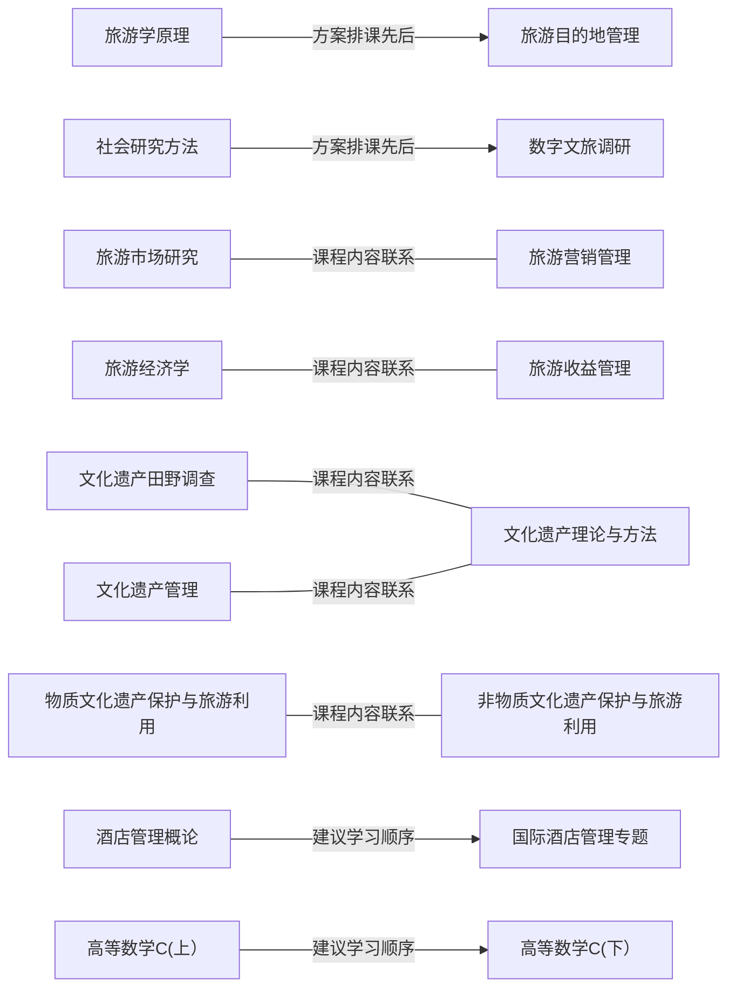

# 2025旅游管理专业本科培养方案

旅游学系 · 旅游管理 · 方案 138082 · 57 个不同课程或科研条目。

[官方 Word](../originals/plan-138082.docx) · [教务详情](https://fdjwgl.fudan.edu.cn/manager/bizType/2/major-program-search/info/138082?skipAuth=1) · [方案快照](../raw/plan-138082.json.gz) · [年级目录](../README.md)

## 修读导读

- **建议先学**　《旅游学原理》（`BA10005`） → 《旅游目的地管理》（`BA30083`）。旅游系统与游客行为的概念可用于理解目的地管理。方案分别列在第2、3学期。

- **可以对照着读**　《旅游市场研究》（`BA30075`）与《旅游营销管理》（`BA30103`）。游客需求和市场调查可用于营销问题。

- **查模块选课**　《文化遗产理论与方法》（`HIST10001`）、《物质文化遗产保护与旅游利用》（`BA20004`）列在“专业核心教育课程 / A组”中。原表见 `/courseModules/8`。

## 课程关系图

图中展示部分关系。下表保留全部已建立的课程对，来源位置使用本方案 JSON Pointer。

## 先修与内容联系

| 类型 | 起点 | 终点 | 依据 | 原表定位 |
| --- | --- | --- | --- | --- |
| 建议学习顺序 | 旅游学原理 (BA10005) | 旅游目的地管理 (BA30083) | 旅游系统与游客行为的概念可用于理解目的地管理。  | `/courseModules/9/planCourses/0`、`/courseModules/9/planCourses/4` |
| 建议学习顺序 | 社会研究方法 (BA20008) | 数字文旅调研 (BA30008) | 问题设计和资料采集方法可用于文旅调研。  | `/courseModules/8/planCourses/3`、`/courseModules/11/planCourses/10` |
| 建议学习顺序 | 酒店管理概论 (BA30085) | 国际酒店管理专题 (BA30084) | “酒店管理概论”题名标明基础层次，前置阅读可帮助了解“国际酒店管理专题”中的酒店管理主题。  | `/courseModules/11/planCourses/0`、`/courseModules/11/planCourses/1` |
| 建议学习顺序 | 高等数学C(上） (MATH10006) | 高等数学C(下） (MATH10007) | 同方案的课程题名具有连续分册或序号。  | `/courseModules/6/planCourses/4`、`/courseModules/6/planCourses/5` |
| 方案排课先后 | 旅游学原理 (BA10005) | 旅游目的地管理 (BA30083) | 同方案该课程全部明确数字学期均早于后者。  | `/courseModules/9/planCourses/0`、`/courseModules/9/planCourses/4` |
| 方案排课先后 | 社会研究方法 (BA20008) | 数字文旅调研 (BA30008) | 同方案该课程全部明确数字学期均早于后者。  | `/courseModules/8/planCourses/3`、`/courseModules/11/planCourses/10` |
| 课程内容联系 | 物质文化遗产保护与旅游利用 (BA20004) | 非物质文化遗产保护与旅游利用 (BA30006) | 本方案两门课程的题名均含“遗产保护”，可据此对照这一主题。  | `/courseModules/8/planCourses/1`、`/courseModules/11/planCourses/27` |
| 课程内容联系 | 文化遗产与城市旅游 (BA20006) | 文化遗产管理 (BA30092) | 本方案两门课程的题名均含“文化遗产”，可据此对照这一主题。  | `/courseModules/11/planCourses/8`、`/courseModules/11/planCourses/24` |
| 课程内容联系 | 文化遗产田野调查 (BA30007) | 文化遗产管理 (BA30092) | 本方案两门课程的题名均含“文化遗产”，可据此对照这一主题。  | `/courseModules/14/planCourses/1`、`/courseModules/11/planCourses/24` |
| 课程内容联系 | 文化遗产田野调查 (BA30007) | 文化遗产理论与方法 (HIST10001) | 遗产研究问题与实地调查可围绕同一观察对象衔接。  | `/courseModules/14/planCourses/1`、`/courseModules/8/planCourses/0` |
| 课程内容联系 | 文化遗产与乡村旅游 (BA30011) | 文化遗产管理 (BA30092) | 本方案两门课程的题名均含“文化遗产”，可据此对照这一主题。  | `/courseModules/11/planCourses/9`、`/courseModules/11/planCourses/24` |
| 课程内容联系 | 旅游经济学 (BA30067) | 旅游收益管理 (BA30087) | 游客需求与收益决策共享价格、需求等问题。  | `/courseModules/9/planCourses/6`、`/courseModules/11/planCourses/11` |
| 课程内容联系 | 旅游市场研究 (BA30075) | 旅游营销管理 (BA30103) | 游客需求和市场调查可用于营销问题。  | `/courseModules/11/planCourses/4`、`/courseModules/9/planCourses/2` |
| 课程内容联系 | 国际酒店管理专题 (BA30084) | 酒店管理概论 (BA30085) | 本方案两门课程的题名均含“酒店管理”，可据此对照这一主题。  | `/courseModules/11/planCourses/1`、`/courseModules/11/planCourses/0` |
| 课程内容联系 | 文化遗产管理 (BA30092) | 文化遗产理论与方法 (HIST10001) | 本方案两门课程的题名均含“文化遗产”，可据此对照这一主题。  | `/courseModules/11/planCourses/24`、`/courseModules/8/planCourses/0` |

本次未从可定位的明确表述中确认课程对课程预修。学期安排、系列分册与编辑建议均保留各自的依据。

## 按原方案模块阅读

同一模块展示原表中的课程归属。模块内课程之间的先后仍须逐项查阅。

- **社会科学基础课程**　会计学、管理学导论、微观经济学、宏观经济学、高等数学C(上）、高等数学C(下）（原表模块 6）
- **多元发展**　文化遗产与城市旅游、旅游运营商经营与管理、旅游接待业、非物质文化遗产保护与旅游利用、数字文旅调研、文化遗产与旅游发展伦理专题、旅游与文化遗产文献阅读、文化遗产与乡村旅游、旅游文化学、旅游心理学、旅游策划学、旅游社会学、旅游管理专题、旅游市场研究、休闲学概论、旅游发展规划、会展管理、遗产旅游等32项（原表模块 12）

## 课程表

同一课程在不同模块分别出现时，按原表逐行列出。季节字段保留原值。

| 课程 | 代码 | 学分 | 学期 | 模块 |
| --- | --- | ---: | --- | --- |
| 微观经济学 | ECON20003 | 3.0 | 第2学期 | 培养方案 / 专业培养课程 / 学科基础课程 / 社会科学基础课程 |
| 宏观经济学 | ECON20004 | 3.0 | 第3学期 | 培养方案 / 专业培养课程 / 学科基础课程 / 社会科学基础课程 |
| 会计学 | BA10003 | 3.0 | SPRING、AUTUMN | 培养方案 / 专业培养课程 / 学科基础课程 / 社会科学基础课程 |
| 管理学导论 | BA10004 | 3.0 | SPRING、AUTUMN | 培养方案 / 专业培养课程 / 学科基础课程 / 社会科学基础课程 |
| 高等数学C(上） | MATH10006 | 4.0 | AUTUMN | 培养方案 / 专业培养课程 / 学科基础课程 / 社会科学基础课程 |
| 高等数学C(下） | MATH10007 | 4.0 | SPRING | 培养方案 / 专业培养课程 / 学科基础课程 / 社会科学基础课程 |
| 文化遗产理论与方法 | HIST10001 | 2.0 | 第1学期 | 培养方案 / 专业培养课程 / 专业核心教育课程 / A组 |
| 物质文化遗产保护与旅游利用 | BA20004 | 2.0 | 第3学期 | 培养方案 / 专业培养课程 / 专业核心教育课程 / A组 |
| 文化遗产活化利用案例研究 | BA20002 | 2.0 | 第4学期 | 培养方案 / 专业培养课程 / 专业核心教育课程 / A组 |
| 社会研究方法 | BA20008 | 2.0 | 第3学期 | 培养方案 / 专业培养课程 / 专业核心教育课程 / A组 |
| 数字化与智慧旅游 | BA20003 | 2.0 | 第4学期 | 培养方案 / 专业培养课程 / 专业核心教育课程 / A组 |
| 旅游人类学 | BA30099 | 2.0 | 第4学期 | 培养方案 / 专业培养课程 / 专业核心教育课程 / A组 |
| 文化与旅游地理学 | BA20005 | 2.0 | 第3学期 | 培养方案 / 专业培养课程 / 专业核心教育课程 / A组 |
| 旅游学原理 | BA10005 | 2.0 | 第2学期 | 培养方案 / 专业培养课程 / 专业核心教育课程 / B组 |
| 旅游业投资学 | BA30095 | 2.0 | 第5学期 | 培养方案 / 专业培养课程 / 专业核心教育课程 / B组 |
| 旅游营销管理 | BA30103 | 2.0 | 第5学期 | 培养方案 / 专业培养课程 / 专业核心教育课程 / B组 |
| 活动策划与组织 | BA30100 | 2.0 | 第5学期 | 培养方案 / 专业培养课程 / 专业核心教育课程 / B组 |
| 旅游目的地管理 | BA30083 | 2.0 | 第3学期 | 培养方案 / 专业培养课程 / 专业核心教育课程 / B组 |
| 旅游消费者行为 | BA20017 | 2.0 | 第4学期 | 培养方案 / 专业培养课程 / 专业核心教育课程 / B组 |
| 旅游经济学 | BA30067 | 2.0 | 第3学期 | 培养方案 / 专业培养课程 / 专业核心教育课程 / B组 |
| 旅游英语 | BA20018 | 2.0 | 第4学期 | 培养方案 / 专业培养课程 / 专业核心教育课程 / B组 |
| 酒店管理概论 | BA30085 | 2.0 | SPRING、AUTUMN | 培养方案 / 专业进阶 |
| 国际酒店管理专题 | BA30084 | 2.0 | SPRING、AUTUMN | 培养方案 / 专业进阶 |
| 商务旅行管理 | TOUR130075 | 2.0 | SPRING、AUTUMN | 培养方案 / 专业进阶 |
| 邮轮产业与服务管理 | BA30096 | 2.0 | SPRING、AUTUMN | 培养方案 / 专业进阶 |
| 旅游市场研究 | BA30075 | 2.0 | SPRING、AUTUMN | 培养方案 / 专业进阶 |
| 旅游管理专题 | BA30073 | 2.0 | SPRING、AUTUMN | 培养方案 / 专业进阶 |
| 会展管理 | BA30078 | 2.0 | SPRING、AUTUMN | 培养方案 / 专业进阶 |
| 旅游运营商经营与管理 | BA20007 | 2.0 | SPRING | 培养方案 / 专业进阶 |
| 文化遗产与城市旅游 | BA20006 | 2.0 | 第2学期 | 培养方案 / 专业进阶 |
| 文化遗产与乡村旅游 | BA30011 | 2.0 | 第3学期 | 培养方案 / 专业进阶 |
| 数字文旅调研 | BA30008 | 2.0 | 第5学期 | 培养方案 / 专业进阶 |
| 旅游收益管理 | BA30087 | 2.0 | SPRING | 培养方案 / 专业进阶 |
| 旅游发展规划 | BA30077 | 2.0 | SPRING、AUTUMN | 培养方案 / 专业进阶 |
| 旅游地产与度假区管理 | BA30088 | 2.0 | SPRING | 培养方案 / 专业进阶 |
| 旅游广告 | BA30089 | 2.0 | SPRING | 培养方案 / 专业进阶 |
| 游憩管理 | BA30093 | 2.0 | SPRING | 培养方案 / 专业进阶 |
| 主题公园管理 | BA30094 | 2.0 | SPRING、AUTUMN | 培养方案 / 专业进阶 |
| 旅游接待业 | BA20019 | 2.0 | 第3学期 | 培养方案 / 专业进阶 |
| 国际旅游服务贸易 | BA30101 | 2.0 | SPRING、AUTUMN | 培养方案 / 专业进阶 |
| 服务管理 | BA30086 | 2.0 | SPRING | 培养方案 / 专业进阶 |
| 休闲学概论 | BA30076 | 2.0 | SPRING | 培养方案 / 专业进阶 |
| 旅游策划学 | BA30071 | 2.0 | 第5学期 | 培养方案 / 专业进阶 |
| 旅游心理学 | BA30068 | 2.0 | SPRING | 培养方案 / 专业进阶 |
| 旅游社会学 | BA30072 | 2.0 | SPRING | 培养方案 / 专业进阶 |
| 文化遗产管理 | BA30092 | 2.0 | 第3学期 | 培养方案 / 专业进阶 |
| 旅游与文化遗产文献阅读 | BA30010 | 2.0 | SPRING、AUTUMN | 培养方案 / 专业进阶 |
| 文化遗产与旅游发展伦理专题 | BA30009 | 2.0 | SPRING、AUTUMN | 培养方案 / 专业进阶 |
| 非物质文化遗产保护与旅游利用 | BA30006 | 2.0 | SPRING、AUTUMN | 培养方案 / 专业进阶 |
| 文化创意产业引论 | BA30091 | 2.0 | SPRING、AUTUMN | 培养方案 / 专业进阶 |
| 旅游文化学 | BA30065 | 2.0 | SPRING、AUTUMN | 培养方案 / 专业进阶 |
| 旅游与跨文化沟通 | BA30097 | 2.0 | SPRING、AUTUMN | 培养方案 / 专业进阶 |
| 遗产旅游 | BA30082 | 2.0 | SPRING、AUTUMN | 培养方案 / 专业进阶 |
| 酒店管理概论 | BA30085 | 2.0 | SPRING、AUTUMN | 培养方案 / 多元发展 |
| 国际酒店管理专题 | BA30084 | 2.0 | SPRING、AUTUMN | 培养方案 / 多元发展 |
| 商务旅行管理 | TOUR130075 | 2.0 | SPRING、AUTUMN | 培养方案 / 多元发展 |
| 邮轮产业与服务管理 | BA30096 | 2.0 | SPRING、AUTUMN | 培养方案 / 多元发展 |
| 旅游市场研究 | BA30075 | 2.0 | SPRING、AUTUMN | 培养方案 / 多元发展 |
| 旅游管理专题 | BA30073 | 2.0 | SPRING、AUTUMN | 培养方案 / 多元发展 |
| 会展管理 | BA30078 | 2.0 | SPRING、AUTUMN | 培养方案 / 多元发展 |
| 旅游运营商经营与管理 | BA20007 | 2.0 | SPRING | 培养方案 / 多元发展 |
| 文化遗产与城市旅游 | BA20006 | 2.0 | 第2学期 | 培养方案 / 多元发展 |
| 文化遗产与乡村旅游 | BA30011 | 2.0 | 第3学期 | 培养方案 / 多元发展 |
| 数字文旅调研 | BA30008 | 2.0 | 第5学期 | 培养方案 / 多元发展 |
| 旅游收益管理 | BA30087 | 2.0 | SPRING | 培养方案 / 多元发展 |
| 旅游发展规划 | BA30077 | 2.0 | SPRING、AUTUMN | 培养方案 / 多元发展 |
| 旅游地产与度假区管理 | BA30088 | 2.0 | SPRING | 培养方案 / 多元发展 |
| 旅游广告 | BA30089 | 2.0 | SPRING | 培养方案 / 多元发展 |
| 游憩管理 | BA30093 | 2.0 | SPRING | 培养方案 / 多元发展 |
| 主题公园管理 | BA30094 | 2.0 | SPRING、AUTUMN | 培养方案 / 多元发展 |
| 旅游接待业 | BA20019 | 2.0 | 第3学期 | 培养方案 / 多元发展 |
| 国际旅游服务贸易 | BA30101 | 2.0 | SPRING、AUTUMN | 培养方案 / 多元发展 |
| 服务管理 | BA30086 | 2.0 | SPRING | 培养方案 / 多元发展 |
| 休闲学概论 | BA30076 | 2.0 | SPRING | 培养方案 / 多元发展 |
| 旅游策划学 | BA30071 | 2.0 | 第5学期 | 培养方案 / 多元发展 |
| 旅游心理学 | BA30068 | 2.0 | SPRING | 培养方案 / 多元发展 |
| 旅游社会学 | BA30072 | 2.0 | SPRING | 培养方案 / 多元发展 |
| 文化遗产管理 | BA30092 | 2.0 | 第3学期 | 培养方案 / 多元发展 |
| 旅游与文化遗产文献阅读 | BA30010 | 2.0 | SPRING、AUTUMN | 培养方案 / 多元发展 |
| 文化遗产与旅游发展伦理专题 | BA30009 | 2.0 | SPRING、AUTUMN | 培养方案 / 多元发展 |
| 非物质文化遗产保护与旅游利用 | BA30006 | 2.0 | SPRING、AUTUMN | 培养方案 / 多元发展 |
| 文化创意产业引论 | BA30091 | 2.0 | SPRING、AUTUMN | 培养方案 / 多元发展 |
| 旅游文化学 | BA30065 | 2.0 | SPRING、AUTUMN | 培养方案 / 多元发展 |
| 旅游与跨文化沟通 | BA30097 | 2.0 | SPRING、AUTUMN | 培养方案 / 多元发展 |
| 遗产旅游 | BA30082 | 2.0 | SPRING、AUTUMN | 培养方案 / 多元发展 |
| 复芏计划(FDUROP) | 102 | 0.0 |  | 融合创新能力 |
| 文化遗产田野调查 | BA30007 | 2.0 | SUMMER | 融合创新能力 |
| 毕业论文 | BA40004 | 4.0 | 第8学期 | 融合创新能力 |
| 学年论文 | BA30066 | 1.0 | 第6学期 | 融合创新能力 |
