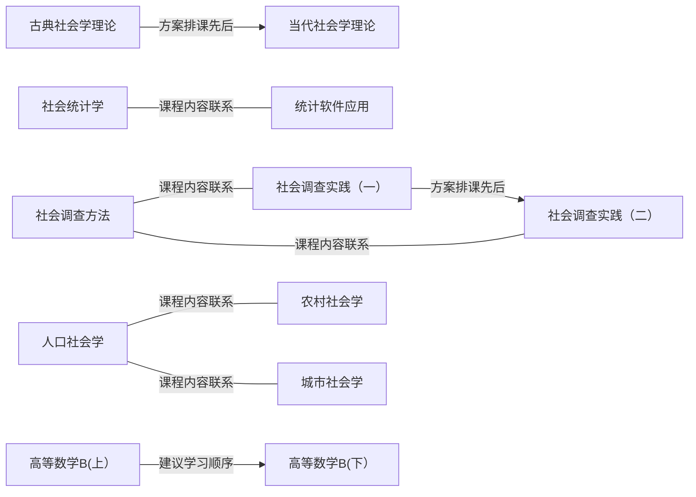

# 2023 社会学留学生方案

社会发展与公共政策学院 · 社会学 · 方案 67674 · 70 个不同课程或科研条目。

[官方 Word](../originals/plan-67674.docx) · [教务详情](https://fdjwgl.fudan.edu.cn/manager/bizType/2/major-program-search/info/67674?skipAuth=1) · [方案快照](../raw/plan-67674.json.gz) · [年级目录](../README.md)

## 修读导读

- **建议先学**　《古典社会学理论》（`SOCI30020`） → 《当代社会学理论》（`SOCI30021`）。熟悉经典社会学的问题意识有助于阅读后续理论。方案分别列在第3、4学期。

- **可以对照着读**　《社会统计学》（`SOCI30006`）与《统计软件应用》（`SOCI30037`）。社会调查数据的整理、估计与解释可以结合软件学习。

- **查模块选课**　《经济社会学》（`SOCI30004`）、《组织社会学》（`SOCI30009`）列在“专业核心教育课程”中。原表见 `/courseModules/7`。

## 课程关系图

图中展示部分关系。下表保留全部已建立的课程对，来源位置使用本方案 JSON Pointer。

## 先修与内容联系

| 类型 | 起点 | 终点 | 依据 | 原表定位 |
| --- | --- | --- | --- | --- |
| 建议学习顺序 | 高等数学B(上） (MATH10004) | 高等数学B(下） (MATH10005) | 同方案的课程题名具有连续分册或序号。  | `/courseModules/6/planCourses/0`、`/courseModules/6/planCourses/1` |
| 建议学习顺序 | 古典社会学理论 (SOCI30020) | 当代社会学理论 (SOCI30021) | 熟悉经典社会学的问题意识有助于阅读后续理论。  | `/courseModules/7/planCourses/4`、`/courseModules/7/planCourses/5` |
| 建议学习顺序 | 社会调查实践（一） (SOCI40004) | 社会调查实践（二） (SOCI40005) | 同方案的课程题名具有连续分册或序号。  | `/courseModules/7/planCourses/10`、`/courseModules/7/planCourses/11` |
| 方案排课先后 | 古典社会学理论 (SOCI30020) | 当代社会学理论 (SOCI30021) | 同方案该课程全部明确数字学期均早于后者。  | `/courseModules/7/planCourses/4`、`/courseModules/7/planCourses/5` |
| 方案排课先后 | 社会调查实践（一） (SOCI40004) | 社会调查实践（二） (SOCI40005) | 同方案该课程全部明确数字学期均早于后者。  | `/courseModules/7/planCourses/10`、`/courseModules/7/planCourses/11` |
| 课程内容联系 | 文化人类学 (SOCI30002) | 医学人类学 (SOCI30038) | 本方案两门课程的题名均含“人类学”，可据此对照这一主题。  | `/courseModules/11/planCourses/0`、`/courseModules/9/planCourses/17` |
| 课程内容联系 | 社会统计学 (SOCI30006) | 统计软件应用 (SOCI30037) | 社会调查数据的整理、估计与解释可以结合软件学习。  | `/courseModules/7/planCourses/1`、`/courseModules/7/planCourses/15` |
| 课程内容联系 | 人口社会学 (SOCI30008) | 农村社会学 (SOCI30012) | 本方案两门课程的题名均含“社会学”，可据此对照这一主题。  | `/courseModules/10/planCourses/4`、`/courseModules/10/planCourses/6` |
| 课程内容联系 | 人口社会学 (SOCI30008) | 城市社会学 (SOCI30013) | 本方案两门课程的题名均含“社会学”，可据此对照这一主题。  | `/courseModules/10/planCourses/4`、`/courseModules/10/planCourses/7` |
| 课程内容联系 | 人口社会学 (SOCI30008) | 宗教社会学 (SOCI30015) | 本方案两门课程的题名均含“社会学”，可据此对照这一主题。  | `/courseModules/10/planCourses/4`、`/courseModules/11/planCourses/4` |
| 课程内容联系 | 人口社会学 (SOCI30008) | 情感社会学 (SOCI30040) | 本方案两门课程的题名均含“社会学”，可据此对照这一主题。  | `/courseModules/10/planCourses/4`、`/courseModules/9/planCourses/19` |
| 课程内容联系 | 饮食人类学 (SOCI30024) | 医学人类学 (SOCI30038) | 本方案两门课程的题名均含“人类学”，可据此对照这一主题。  | `/courseModules/9/planCourses/8`、`/courseModules/9/planCourses/17` |
| 课程内容联系 | 社会调查方法 (SOCI30034) | 社会调查实践（一） (SOCI40004) | 本方案两门课程的题名均含“社会调查”，可据此对照这一主题。  | `/courseModules/7/planCourses/12`、`/courseModules/7/planCourses/10` |
| 课程内容联系 | 社会调查方法 (SOCI30034) | 社会调查实践（二） (SOCI40005) | 本方案两门课程的题名均含“社会调查”，可据此对照这一主题。  | `/courseModules/7/planCourses/12`、`/courseModules/7/planCourses/11` |
| 课程内容联系 | 医学人类学 (SOCI30038) | 人类学研究方法 (SOCI30039) | 本方案两门课程的题名均含“人类学”，可据此对照这一主题。  | `/courseModules/9/planCourses/17`、`/courseModules/9/planCourses/18` |

本次未从可定位的明确表述中确认课程对课程预修。学期安排、系列分册与编辑建议均保留各自的依据。

## 按原方案模块阅读

同一模块展示原表中的课程归属。模块内课程之间的先后仍须逐项查阅。

- **社会科学类基础课程**　管理学导论、微观经济学、宏观经济学、经济学原理、政治经济学、法理学导论、公共行政学、高等数学B(上）、高等数学B(下）、高等数学D、线性代数、政治学原理、当代中国政治制度、心理学导论、社会学导论、社会研究方法A、社会工作导论（原表模块 6）

## 课程表

同一课程在不同模块分别出现时，按原表逐行列出。季节字段保留原值。

| 课程 | 代码 | 学分 | 学期 | 模块 |
| --- | --- | ---: | --- | --- |
| 高等数学B(上） | MATH10004 | 5.0 | SPRING、AUTUMN | 培养方案 / 专业培养课程 / 大类基础课程 / 社会科学类基础课程 |
| 高等数学B(下） | MATH10005 | 5.0 | SPRING、AUTUMN | 培养方案 / 专业培养课程 / 大类基础课程 / 社会科学类基础课程 |
| 高等数学D | MATH10008 | 4.0 | AUTUMN | 培养方案 / 专业培养课程 / 大类基础课程 / 社会科学类基础课程 |
| 线性代数 | MATH10017 | 3.0 | SPRING、AUTUMN | 培养方案 / 专业培养课程 / 大类基础课程 / 社会科学类基础课程 |
| 政治学原理 | POLI10007 | 3.0 | SPRING、AUTUMN | 培养方案 / 专业培养课程 / 大类基础课程 / 社会科学类基础课程 |
| 社会学导论 | SOCI20001 | 3.0 | SPRING、AUTUMN | 培养方案 / 专业培养课程 / 大类基础课程 / 社会科学类基础课程 |
| 法理学导论 | LAW10004 | 3.0 | SPRING、AUTUMN | 培养方案 / 专业培养课程 / 大类基础课程 / 社会科学类基础课程 |
| 微观经济学 | ECON20003 | 3.0 | 第2学期 | 培养方案 / 专业培养课程 / 大类基础课程 / 社会科学类基础课程 |
| 宏观经济学 | ECON20004 | 3.0 | 第3学期 | 培养方案 / 专业培养课程 / 大类基础课程 / 社会科学类基础课程 |
| 经济学原理 | ECON20005 | 3.0 | SPRING、AUTUMN | 培养方案 / 专业培养课程 / 大类基础课程 / 社会科学类基础课程 |
| 政治经济学 | ECON20006 | 3.0 | SPRING、AUTUMN | 培养方案 / 专业培养课程 / 大类基础课程 / 社会科学类基础课程 |
| 社会研究方法A | SOCI20002 | 3.0 | SPRING、AUTUMN | 培养方案 / 专业培养课程 / 大类基础课程 / 社会科学类基础课程 |
| 社会工作导论 | SWK20002 | 3.0 | SPRING、AUTUMN | 培养方案 / 专业培养课程 / 大类基础课程 / 社会科学类基础课程 |
| 心理学导论 | PSYC20001 | 3.0 | SPRING、AUTUMN | 培养方案 / 专业培养课程 / 大类基础课程 / 社会科学类基础课程 |
| 管理学导论 | BA10004 | 3.0 | SPRING、AUTUMN | 培养方案 / 专业培养课程 / 大类基础课程 / 社会科学类基础课程 |
| 公共行政学 | MANA10002 | 3.0 | SPRING、AUTUMN | 培养方案 / 专业培养课程 / 大类基础课程 / 社会科学类基础课程 |
| 当代中国政治制度 | POLI10009 | 3.0 | SPRING、AUTUMN | 培养方案 / 专业培养课程 / 大类基础课程 / 社会科学类基础课程 |
| 经济社会学 | SOCI30004 | 2.0 | 第5学期 | 培养方案 / 专业培养课程 / 专业核心教育课程 |
| 社会统计学 | SOCI30006 | 3.0 | 第3学期 | 培养方案 / 专业培养课程 / 专业核心教育课程 |
| 学年论文 | SOCI40003 | 1.0 | 第7学期 | 培养方案 / 专业培养课程 / 专业核心教育课程 |
| 组织社会学 | SOCI30009 | 2.0 | 第5学期 | 培养方案 / 专业培养课程 / 专业核心教育课程 |
| 古典社会学理论 | SOCI30020 | 3.0 | 第3学期 | 培养方案 / 专业培养课程 / 专业核心教育课程 |
| 当代社会学理论 | SOCI30021 | 3.0 | 第4学期 | 培养方案 / 专业培养课程 / 专业核心教育课程 |
| 西方社会思想史 | SOCI30022 | 2.0 | 第3学期 | 培养方案 / 专业培养课程 / 专业核心教育课程 |
| 中国社会 | SOCI30025 | 2.0 | 第6学期 | 培养方案 / 专业培养课程 / 专业核心教育课程 |
| 社会分层与流动 | SOCI30026 | 3.0 | 第6学期 | 培养方案 / 专业培养课程 / 专业核心教育课程 |
| 婚姻与家庭 | SOCI30030 | 2.0 | 第6学期 | 培养方案 / 专业培养课程 / 专业核心教育课程 |
| 社会调查实践（一） | SOCI40004 | 2.0 | 第5学期 | 培养方案 / 专业培养课程 / 专业核心教育课程 |
| 社会调查实践（二） | SOCI40005 | 2.0 | 第6学期 | 培养方案 / 专业培养课程 / 专业核心教育课程 |
| 社会调查方法 | SOCI30034 | 3.0 | 第5学期 | 培养方案 / 专业培养课程 / 专业核心教育课程 |
| 质性研究方法 | SOCI30035 | 3.0 | 第4学期 | 培养方案 / 专业培养课程 / 专业核心教育课程 |
| 毕业论文 | SOCI40006 | 6.0 | 第8学期 | 培养方案 / 专业培养课程 / 专业核心教育课程 |
| 统计软件应用 | SOCI30037 | 3.0 | 第4学期 | 培养方案 / 专业培养课程 / 专业核心教育课程 |
| 社会科学经典导读 | GECC10114 | 2.0 | 第4学期 | 培养方案 / 专业进阶路径 |
| 马克思主义社会理论 | SOCI130001 | 3.0 | 第6学期 | 培养方案 / 专业进阶路径 |
| 中国的政治经济状况 | SOCI30007 | 2.0 | SPRING、AUTUMN | 培养方案 / 专业进阶路径 |
| 全球化研究 | SOCI130064 | 2.0 | SPRING、AUTUMN | 培养方案 / 专业进阶路径 |
| 发展研究 | SOCI30016 | 2.0 | SPRING、AUTUMN | 培养方案 / 专业进阶路径 |
| 社会性别研究 | SOCI30017 | 2.0 | 第5学期 | 培养方案 / 专业进阶路径 |
| 人口分析 | SOCI30018 | 2.0 | 第6学期 | 培养方案 / 专业进阶路径 |
| 中国文化与商业实践 | SOCI30019 | 2.0 | SPRING、AUTUMN | 培养方案 / 专业进阶路径 |
| 饮食人类学 | SOCI30024 | 2.0 | 第6学期 | 培养方案 / 专业进阶路径 |
| 全球化争议 | SOCI130134 | 2.0 | SPRING、AUTUMN | 培养方案 / 专业进阶路径 |
| 上海：城市研究 | SOCI130135 | 2.0 | SPRING、AUTUMN | 培养方案 / 专业进阶路径 |
| 中国社会与宗教 | SOCI30027 | 2.0 | SPRING、AUTUMN | 培养方案 / 专业进阶路径 |
| 全球化下的中国文化与社会 | SOCI30028 | 2.0 | SPRING、AUTUMN | 培养方案 / 专业进阶路径 |
| 社会网络分析导论 | SOCI30031 | 2.0 | 第4学期 | 培养方案 / 专业进阶路径 |
| 论文写作 | SOCI30032 | 2.0 | 第5学期 | 培养方案 / 专业进阶路径 |
| 社会运动 | SOCI130154 | 2.0 | SPRING、AUTUMN | 培养方案 / 专业进阶路径 |
| 经济发展研究 | SOCI30036 | 2.0 | SPRING、AUTUMN | 培养方案 / 专业进阶路径 |
| 医学人类学 | SOCI30038 | 3.0 | SPRING | 培养方案 / 专业进阶路径 |
| 人类学研究方法 | SOCI30039 | 3.0 | AUTUMN | 培养方案 / 专业进阶路径 |
| 情感社会学 | SOCI30040 | 2.0 | SPRING、AUTUMN | 培养方案 / 专业进阶路径 |
| 实地调查实践 | SOCI30041 | 3.0 | SPRING、AUTUMN | 培养方案 / 专业进阶路径 |
| 现代化和中国社会 | GEEC10400 | 2.0 | 第6学期 | 培养方案 / 专业进阶路径 / 专业进阶模块Ⅰ |
| 政治社会学 | SOCI30005 | 2.0 | 第4学期 | 培养方案 / 专业进阶路径 / 专业进阶模块Ⅰ |
| 人类行为与社会环境 | SWK30005 | 3.0 | 第5学期 | 培养方案 / 专业进阶路径 / 专业进阶模块Ⅰ |
| 社会政策 | SWK30006 | 3.0 | 第4学期 | 培养方案 / 专业进阶路径 / 专业进阶模块Ⅰ |
| 人口社会学 | SOCI30008 | 2.0 | 第5学期 | 培养方案 / 专业进阶路径 / 专业进阶模块Ⅰ |
| 环境社会学 | SOCI30011 | 2.0 | 第5学期 | 培养方案 / 专业进阶路径 / 专业进阶模块Ⅰ |
| 农村社会学 | SOCI30012 | 2.0 | 第5学期 | 培养方案 / 专业进阶路径 / 专业进阶模块Ⅰ |
| 城市社会学 | SOCI30013 | 2.0 | 第4学期 | 培养方案 / 专业进阶路径 / 专业进阶模块Ⅰ |
| 医疗和健康社会学 | SOCI30014 | 2.0 | 第5学期 | 培养方案 / 专业进阶路径 / 专业进阶模块Ⅰ |
| 文化人类学 | SOCI30002 | 2.0 | 第6学期 | 培养方案 / 专业进阶路径 / 专业进阶模块Ⅱ |
| 社区研究 | SOCI30003 | 2.0 | 第5学期 | 培养方案 / 专业进阶路径 / 专业进阶模块Ⅱ |
| 社会心理学 | PSYC30006 | 3.0 | 第5学期 | 培养方案 / 专业进阶路径 / 专业进阶模块Ⅱ |
| 社会变迁 | SOCI30010 | 2.0 | 第5学期 | 培养方案 / 专业进阶路径 / 专业进阶模块Ⅱ |
| 宗教社会学 | SOCI30015 | 2.0 | 第6学期 | 培养方案 / 专业进阶路径 / 专业进阶模块Ⅱ |
| 文化社会学 | SOCI30023 | 2.0 | 第5学期 | 培养方案 / 专业进阶路径 / 专业进阶模块Ⅱ |
| 互联网与社会研究 | SOCI30033 | 4.0 | 第6学期 | 培养方案 / 专业进阶路径 / 专业进阶模块Ⅱ |
| 现代化和中国社会 | GEEC10400 | 2.0 | 第6学期 | 培养方案 / 专业进阶模块（多元路径） / 专业进阶模块Ⅰ（多元路径） |
| 政治社会学 | SOCI30005 | 2.0 | 第4学期 | 培养方案 / 专业进阶模块（多元路径） / 专业进阶模块Ⅰ（多元路径） |
| 人类行为与社会环境 | SWK30005 | 3.0 | 第5学期 | 培养方案 / 专业进阶模块（多元路径） / 专业进阶模块Ⅰ（多元路径） |
| 社会政策 | SWK30006 | 3.0 | 第4学期 | 培养方案 / 专业进阶模块（多元路径） / 专业进阶模块Ⅰ（多元路径） |
| 人口社会学 | SOCI30008 | 2.0 | 第5学期 | 培养方案 / 专业进阶模块（多元路径） / 专业进阶模块Ⅰ（多元路径） |
| 环境社会学 | SOCI30011 | 2.0 | 第5学期 | 培养方案 / 专业进阶模块（多元路径） / 专业进阶模块Ⅰ（多元路径） |
| 农村社会学 | SOCI30012 | 2.0 | 第5学期 | 培养方案 / 专业进阶模块（多元路径） / 专业进阶模块Ⅰ（多元路径） |
| 城市社会学 | SOCI30013 | 2.0 | 第4学期 | 培养方案 / 专业进阶模块（多元路径） / 专业进阶模块Ⅰ（多元路径） |
| 医疗和健康社会学 | SOCI30014 | 2.0 | 第5学期 | 培养方案 / 专业进阶模块（多元路径） / 专业进阶模块Ⅰ（多元路径） |
| 文化人类学 | SOCI30002 | 2.0 | 第6学期 | 培养方案 / 专业进阶模块（多元路径） / 专业进阶模块Ⅱ（多元路径） |
| 社区研究 | SOCI30003 | 2.0 | 第5学期 | 培养方案 / 专业进阶模块（多元路径） / 专业进阶模块Ⅱ（多元路径） |
| 社会心理学 | PSYC30006 | 3.0 | 第5学期 | 培养方案 / 专业进阶模块（多元路径） / 专业进阶模块Ⅱ（多元路径） |
| 社会变迁 | SOCI30010 | 2.0 | 第5学期 | 培养方案 / 专业进阶模块（多元路径） / 专业进阶模块Ⅱ（多元路径） |
| 宗教社会学 | SOCI30015 | 2.0 | 第6学期 | 培养方案 / 专业进阶模块（多元路径） / 专业进阶模块Ⅱ（多元路径） |
| 文化社会学 | SOCI30023 | 2.0 | 第5学期 | 培养方案 / 专业进阶模块（多元路径） / 专业进阶模块Ⅱ（多元路径） |
| 互联网与社会研究 | SOCI30033 | 4.0 | 第6学期 | 培养方案 / 专业进阶模块（多元路径） / 专业进阶模块Ⅱ（多元路径） |
