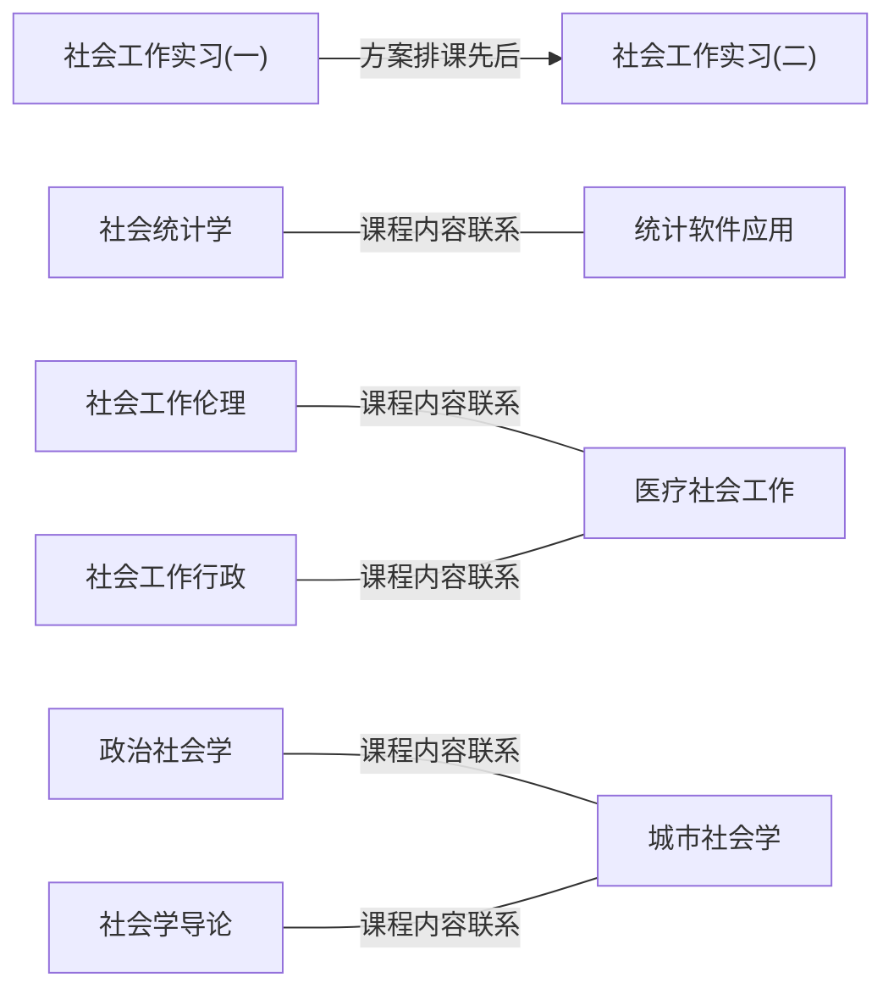

# 2023 社会工作留学生方案

社会发展与公共政策学院 · 社会工作 · 方案 67895 · 55 个不同课程或科研条目。

[官方 Word](../originals/plan-67895.docx) · [教务详情](https://fdjwgl.fudan.edu.cn/manager/bizType/2/major-program-search/info/67895?skipAuth=1) · [方案快照](../raw/plan-67895.json.gz) · [年级目录](../README.md)

## 课程关系图

图中展示部分关系。下表保留全部已建立的课程对，来源位置使用本方案 JSON Pointer。

## 先修与内容联系

| 类型 | 起点 | 终点 | 依据 | 原表定位 |
| --- | --- | --- | --- | --- |
| 建议学习顺序 | 社会工作实习(一) (SWK40002) | 社会工作实习(二) (SWK40003) | 同方案的课程题名具有连续分册或序号。  | `/courseModules/6/planCourses/10`、`/courseModules/6/planCourses/11` |
| 方案排课先后 | 社会工作实习(一) (SWK40002) | 社会工作实习(二) (SWK40003) | 同方案该课程全部明确数字学期均早于后者。  | `/courseModules/6/planCourses/10`、`/courseModules/6/planCourses/11` |
| 课程内容联系 | 法理学导论 (LAW10004) | 宪法 (LAW10005) | 两课均涉及权利与公共权力的规范依据。  | `/courseModules/5/planCourses/3`、`/courseModules/5/planCourses/10` |
| 课程内容联系 | 社会学导论 (SOCI20001) | 城市社会学 (SOCI30013) | 本方案两门课程的题名均含“社会学”，可据此对照这一主题。  | `/courseModules/5/planCourses/2`、`/courseModules/9/planCourses/3` |
| 课程内容联系 | 政治社会学 (SOCI30005) | 城市社会学 (SOCI30013) | 本方案两门课程的题名均含“社会学”，可据此对照这一主题。  | `/courseModules/9/planCourses/1`、`/courseModules/9/planCourses/3` |
| 课程内容联系 | 社会统计学 (SOCI30006) | 统计软件应用 (SOCI30037) | 社会调查数据的整理、估计与解释可以结合软件学习。  | `/courseModules/6/planCourses/0`、`/courseModules/6/planCourses/17` |
| 课程内容联系 | 社会工作导论 (SWK20002) | 医疗社会工作 (SWK30008) | 本方案两门课程的题名均含“社会工作”，可据此对照这一主题。  | `/courseModules/5/planCourses/7`、`/courseModules/10/planCourses/1` |
| 课程内容联系 | 社会工作行政 (SWK30004) | 医疗社会工作 (SWK30008) | 本方案两门课程的题名均含“社会工作”，可据此对照这一主题。  | `/courseModules/6/planCourses/6`、`/courseModules/10/planCourses/1` |
| 课程内容联系 | 社会工作伦理 (SWK30007) | 医疗社会工作 (SWK30008) | 本方案两门课程的题名均含“社会工作”，可据此对照这一主题。  | `/courseModules/6/planCourses/9`、`/courseModules/10/planCourses/1` |
| 课程内容联系 | 医疗社会工作 (SWK30008) | 社会工作评估 (SWK30015) | 本方案两门课程的题名均含“社会工作”，可据此对照这一主题。  | `/courseModules/10/planCourses/1`、`/courseModules/9/planCourses/7` |

本次未从可定位的明确表述中确认课程对课程预修。学期安排、系列分册与编辑建议均保留各自的依据。

## 课程表

同一课程在不同模块分别出现时，按原表逐行列出。季节字段保留原值。

| 课程 | 代码 | 学分 | 学期 | 模块 |
| --- | --- | ---: | --- | --- |
| 高等数学D | MATH10008 | 4.0 | AUTUMN | 培养方案 / 专业培养课程 / 大类基础课程 |
| 政治学原理 | POLI10007 | 3.0 | SPRING、AUTUMN | 培养方案 / 专业培养课程 / 大类基础课程 |
| 社会学导论 | SOCI20001 | 3.0 | SPRING、AUTUMN | 培养方案 / 专业培养课程 / 大类基础课程 |
| 法理学导论 | LAW10004 | 3.0 | SPRING、AUTUMN | 培养方案 / 专业培养课程 / 大类基础课程 |
| 经济学原理 | ECON20005 | 3.0 | SPRING、AUTUMN | 培养方案 / 专业培养课程 / 大类基础课程 |
| 政治经济学 | ECON20006 | 3.0 | SPRING、AUTUMN | 培养方案 / 专业培养课程 / 大类基础课程 |
| 社会研究方法A | SOCI20002 | 3.0 | SPRING、AUTUMN | 培养方案 / 专业培养课程 / 大类基础课程 |
| 社会工作导论 | SWK20002 | 3.0 | SPRING、AUTUMN | 培养方案 / 专业培养课程 / 大类基础课程 |
| 心理学导论 | PSYC20001 | 3.0 | SPRING、AUTUMN | 培养方案 / 专业培养课程 / 大类基础课程 |
| 管理学导论 | BA10004 | 3.0 | SPRING、AUTUMN | 培养方案 / 专业培养课程 / 大类基础课程 |
| 宪法 | LAW10005 | 3.0 | SPRING、AUTUMN | 培养方案 / 专业培养课程 / 大类基础课程 |
| 公共行政学 | MANA10002 | 3.0 | SPRING、AUTUMN | 培养方案 / 专业培养课程 / 大类基础课程 |
| 当代中国政治制度 | POLI10009 | 3.0 | SPRING、AUTUMN | 培养方案 / 专业培养课程 / 大类基础课程 |
| 社会统计学 | SOCI30006 | 3.0 | 第3学期 | 培养方案 / 专业培养课程 / 专业核心教育课程 |
| 学年论文 | SOCI40003 | 1.0 | 第7学期 | 培养方案 / 专业培养课程 / 专业核心教育课程 |
| 毕业论文 | SWK40001 | 4.0 | 第8学期 | 培养方案 / 专业培养课程 / 专业核心教育课程 |
| 个案工作 | SWK30001 | 3.0 | 第3学期 | 培养方案 / 专业培养课程 / 专业核心教育课程 |
| 小组工作 | SWK30002 | 3.0 | 第4学期 | 培养方案 / 专业培养课程 / 专业核心教育课程 |
| 社区工作 | SWK30003 | 3.0 | 第4学期 | 培养方案 / 专业培养课程 / 专业核心教育课程 |
| 社会工作行政 | SWK30004 | 3.0 | 第6学期 | 培养方案 / 专业培养课程 / 专业核心教育课程 |
| 人类行为与社会环境 | SWK30005 | 3.0 | 第3学期 | 培养方案 / 专业培养课程 / 专业核心教育课程 |
| 社会政策 | SWK30006 | 3.0 | 第4学期 | 培养方案 / 专业培养课程 / 专业核心教育课程 |
| 社会工作伦理 | SWK30007 | 3.0 | 第3学期 | 培养方案 / 专业培养课程 / 专业核心教育课程 |
| 社会工作实习(一) | SWK40002 | 4.0 | 第5学期 | 培养方案 / 专业培养课程 / 专业核心教育课程 |
| 社会工作实习(二) | SWK40003 | 4.0 | 第6学期 | 培养方案 / 专业培养课程 / 专业核心教育课程 |
| 社会福利理论与制度 | SWK30014 | 3.0 | 第3学期 | 培养方案 / 专业培养课程 / 专业核心教育课程 |
| 质性研究方法 | SWK30017 | 2.0 | 第5学期 | 培养方案 / 专业培养课程 / 专业核心教育课程 |
| 社会工作技巧实验 | SWK40004 | 2.0 | 第5学期 | 培养方案 / 专业培养课程 / 专业核心教育课程 |
| 社会工作理论基础 | SWK30019 | 3.0 | 第4学期 | 培养方案 / 专业培养课程 / 专业核心教育课程 |
| 社会工作实务研究 | SWK30020 | 2.0 | 第5学期 | 培养方案 / 专业培养课程 / 专业核心教育课程 |
| 统计软件应用 | SOCI30037 | 3.0 | 第4学期 | 培养方案 / 专业培养课程 / 专业核心教育课程 |
| 法律与社会工作 | SWK30010 | 2.0 | 第5学期 | 培养方案 / 专业进阶路径 |
| 论文写作 | SOCI30032 | 2.0 | 第7学期 | 培养方案 / 专业进阶路径 |
| 社会工作专业英语 | SWK40005 | 2.0 | 第7学期 | 培养方案 / 专业进阶路径 |
| 文化人类学 | SOCI30002 | 2.0 | 第6学期 | 培养方案 / 专业进阶路径 / 专业进阶模块2 |
| 政治社会学 | SOCI30005 | 2.0 | 第6学期 | 培养方案 / 专业进阶路径 / 专业进阶模块2 |
| 社会心理学 | PSYC30006 | 3.0 | 第5学期 | 培养方案 / 专业进阶路径 / 专业进阶模块2 |
| 城市社会学 | SOCI30013 | 2.0 | 第4学期 | 培养方案 / 专业进阶路径 / 专业进阶模块2 |
| 法律与社会工作 | SWK30010 | 2.0 | 第5学期 | 培养方案 / 专业进阶路径 / 专业进阶模块2 |
| 非营利组织管理 | SWK30013 | 2.0 | 第4学期 | 培养方案 / 专业进阶路径 / 专业进阶模块2 |
| 西方社会思想史 | SOCI30022 | 2.0 | 第3学期 | 培养方案 / 专业进阶路径 / 专业进阶模块2 |
| 社会工作评估 | SWK30015 | 2.0 | 第5学期 | 培养方案 / 专业进阶路径 / 专业进阶模块2 |
| 贫穷与社会发展 | SOCI130144 | 2.0 | 第4学期 | 培养方案 / 专业进阶路径 / 专业进阶模块2 |
| 婚姻与家庭 | SOCI30030 | 2.0 | 第6学期 | 培养方案 / 专业进阶路径 / 专业进阶模块2 |
| 论文写作 | SOCI30032 | 2.0 | 第5学期 | 培养方案 / 专业进阶路径 / 专业进阶模块2 |
| 互联网与社会研究 | SOCI30033 | 4.0 | 第6学期 | 培养方案 / 专业进阶路径 / 专业进阶模块2 |
| 经济发展研究 | SOCI30036 | 2.0 | SPRING | 培养方案 / 专业进阶路径 / 专业进阶模块2 |
| 发展心理学 | PSYC30003 | 3.0 | 第4学期 | 培养方案 / 专业进阶路径 / 专业进阶模块1 |
| 医疗社会工作 | SWK30008 | 2.0 | 第6学期 | 培养方案 / 专业进阶路径 / 专业进阶模块1 |
| 老年社会工作 | SWK30009 | 2.0 | 第6学期 | 培养方案 / 专业进阶路径 / 专业进阶模块1 |
| 变态心理学 | SWK30011 | 2.0 | 第4学期 | 培养方案 / 专业进阶路径 / 专业进阶模块1 |
| 家庭治疗 | SWK30012 | 2.0 | SPRING | 培养方案 / 专业进阶路径 / 专业进阶模块1 |
| 艺术治疗 | PSYC30015 | 2.0 | 第6学期 | 培养方案 / 专业进阶路径 / 专业进阶模块1 |
| 青少年社会工作 | SWK30016 | 2.0 | 第6学期 | 培养方案 / 专业进阶路径 / 专业进阶模块1 |
| 社会工作专业英语 | SWK40005 | 2.0 | 第5学期 | 培养方案 / 专业进阶路径 / 专业进阶模块1 |
| 精神健康社会工作 | SWK40006 | 2.0 | 第6学期 | 培养方案 / 专业进阶路径 / 专业进阶模块1 |
| 儿童社会工作理论与实务 | SWK30021 | 2.0 | 第5学期 | 培养方案 / 专业进阶路径 / 专业进阶模块1 |
| 自我认知与成长 | SWK20001 | 3.0 | 第3学期 | 培养方案 / 专业进阶路径 / 专业进阶模块1 |
| 文化人类学 | SOCI30002 | 2.0 | 第6学期 | 培养方案 / 多元路径-专业进阶模块 / 专业进阶模块2(多元路径) |
| 政治社会学 | SOCI30005 | 2.0 | 第6学期 | 培养方案 / 多元路径-专业进阶模块 / 专业进阶模块2(多元路径) |
| 社会心理学 | PSYC30006 | 3.0 | 第5学期 | 培养方案 / 多元路径-专业进阶模块 / 专业进阶模块2(多元路径) |
| 城市社会学 | SOCI30013 | 2.0 | 第4学期 | 培养方案 / 多元路径-专业进阶模块 / 专业进阶模块2(多元路径) |
| 法律与社会工作 | SWK30010 | 2.0 | 第5学期 | 培养方案 / 多元路径-专业进阶模块 / 专业进阶模块2(多元路径) |
| 非营利组织管理 | SWK30013 | 2.0 | 第4学期 | 培养方案 / 多元路径-专业进阶模块 / 专业进阶模块2(多元路径) |
| 西方社会思想史 | SOCI30022 | 2.0 | 第3学期 | 培养方案 / 多元路径-专业进阶模块 / 专业进阶模块2(多元路径) |
| 社会工作评估 | SWK30015 | 2.0 | 第5学期 | 培养方案 / 多元路径-专业进阶模块 / 专业进阶模块2(多元路径) |
| 贫穷与社会发展 | SOCI130144 | 2.0 | 第4学期 | 培养方案 / 多元路径-专业进阶模块 / 专业进阶模块2(多元路径) |
| 婚姻与家庭 | SOCI30030 | 2.0 | 第6学期 | 培养方案 / 多元路径-专业进阶模块 / 专业进阶模块2(多元路径) |
| 论文写作 | SOCI30032 | 2.0 | 第5学期 | 培养方案 / 多元路径-专业进阶模块 / 专业进阶模块2(多元路径) |
| 互联网与社会研究 | SOCI30033 | 4.0 | 第6学期 | 培养方案 / 多元路径-专业进阶模块 / 专业进阶模块2(多元路径) |
| 经济发展研究 | SOCI30036 | 2.0 | SPRING | 培养方案 / 多元路径-专业进阶模块 / 专业进阶模块2(多元路径) |
| 发展心理学 | PSYC30003 | 3.0 | 第4学期 | 培养方案 / 多元路径-专业进阶模块 / 专业进阶模块1(多元路径) |
| 医疗社会工作 | SWK30008 | 2.0 | 第6学期 | 培养方案 / 多元路径-专业进阶模块 / 专业进阶模块1(多元路径) |
| 老年社会工作 | SWK30009 | 2.0 | 第6学期 | 培养方案 / 多元路径-专业进阶模块 / 专业进阶模块1(多元路径) |
| 变态心理学 | SWK30011 | 2.0 | 第4学期 | 培养方案 / 多元路径-专业进阶模块 / 专业进阶模块1(多元路径) |
| 家庭治疗 | SWK30012 | 2.0 | SPRING | 培养方案 / 多元路径-专业进阶模块 / 专业进阶模块1(多元路径) |
| 艺术治疗 | PSYC30015 | 2.0 | 第6学期 | 培养方案 / 多元路径-专业进阶模块 / 专业进阶模块1(多元路径) |
| 青少年社会工作 | SWK30016 | 2.0 | 第6学期 | 培养方案 / 多元路径-专业进阶模块 / 专业进阶模块1(多元路径) |
| 社会工作专业英语 | SWK40005 | 2.0 | 第5学期 | 培养方案 / 多元路径-专业进阶模块 / 专业进阶模块1(多元路径) |
| 精神健康社会工作 | SWK40006 | 2.0 | 第6学期 | 培养方案 / 多元路径-专业进阶模块 / 专业进阶模块1(多元路径) |
| 儿童社会工作理论与实务 | SWK30021 | 2.0 | 第5学期 | 培养方案 / 多元路径-专业进阶模块 / 专业进阶模块1(多元路径) |
| 自我认知与成长 | SWK20001 | 3.0 | 第3学期 | 培养方案 / 多元路径-专业进阶模块 / 专业进阶模块1(多元路径) |
