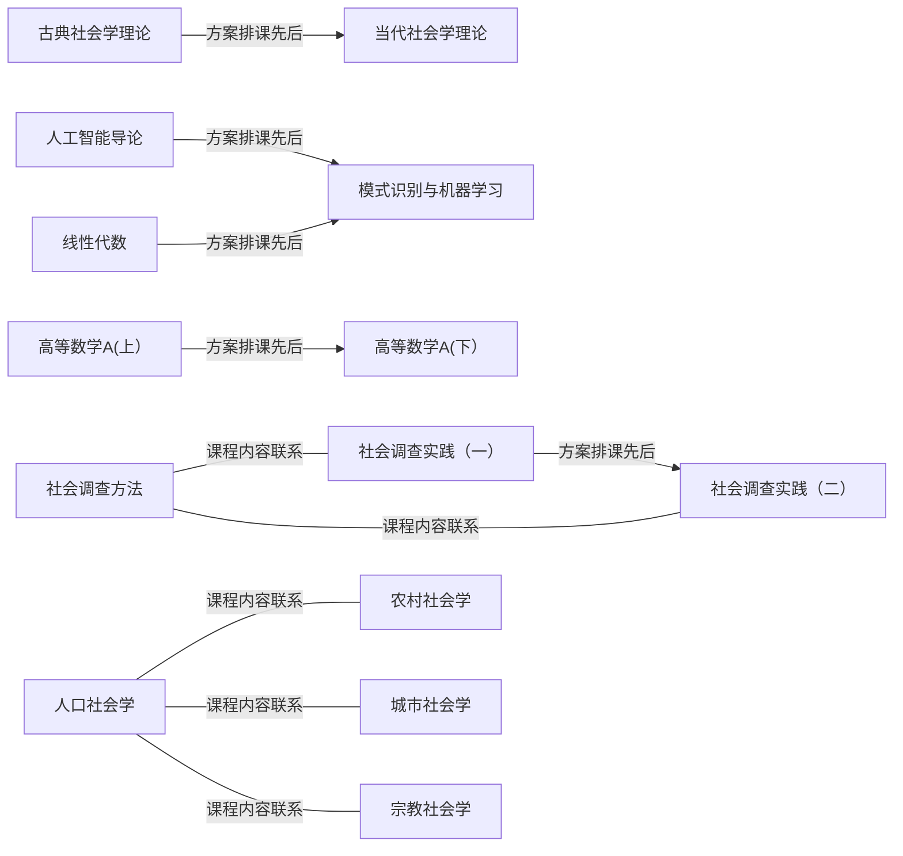

# 2024社会学+人工智能双学士学位项目培养方案

社会发展与公共政策学院 · 社会学-人工智能(双学士学位项目) · 方案 73013 · 70 个不同课程或科研条目。

[官方 Word](../originals/plan-73013.docx) · [教务详情](https://fdjwgl.fudan.edu.cn/manager/bizType/2/major-program-search/info/73013?skipAuth=1) · [方案快照](../raw/plan-73013.json.gz) · [年级目录](../README.md)

## 课程关系图

图中展示部分关系。下表保留全部已建立的课程对，来源位置使用本方案 JSON Pointer。

## 先修与内容联系

| 类型 | 起点 | 终点 | 依据 | 原表定位 |
| --- | --- | --- | --- | --- |
| 建议学习顺序 | 人工智能导论 (AIE310005) | 模式识别与机器学习 (AIE410001) | 人工智能问题与模型类别可为学习模式识别作准备。  | `/courseModules/8/planCourses/14`、`/courseModules/8/planCourses/16` |
| 建议学习顺序 | 高等数学A(上） (MATH10015) | 高等数学A(下） (MATH10016) | 同方案的课程题名具有连续分册或序号。  | `/courseModules/6/planCourses/2`、`/courseModules/6/planCourses/3` |
| 建议学习顺序 | 线性代数 (MATH10017) | 模式识别与机器学习 (AIE410001) | 向量表示和矩阵运算支持理解分类、回归等模型。  | `/courseModules/6/planCourses/4`、`/courseModules/8/planCourses/16` |
| 建议学习顺序 | 古典社会学理论 (SOCI30020) | 当代社会学理论 (SOCI30021) | 熟悉经典社会学的问题意识有助于阅读后续理论。  | `/courseModules/8/planCourses/0`、`/courseModules/8/planCourses/2` |
| 建议学习顺序 | 社会调查实践（一） (SOCI40004) | 社会调查实践（二） (SOCI40005) | 同方案的课程题名具有连续分册或序号。  | `/courseModules/8/planCourses/21`、`/courseModules/8/planCourses/22` |
| 方案排课先后 | 人工智能导论 (AIE310005) | 模式识别与机器学习 (AIE410001) | 同方案该课程全部明确数字学期均早于后者。  | `/courseModules/8/planCourses/14`、`/courseModules/8/planCourses/16` |
| 方案排课先后 | 高等数学A(上） (MATH10015) | 高等数学A(下） (MATH10016) | 同方案该课程全部明确数字学期均早于后者。  | `/courseModules/6/planCourses/2`、`/courseModules/6/planCourses/3` |
| 方案排课先后 | 线性代数 (MATH10017) | 模式识别与机器学习 (AIE410001) | 同方案该课程全部明确数字学期均早于后者。  | `/courseModules/6/planCourses/4`、`/courseModules/8/planCourses/16` |
| 方案排课先后 | 古典社会学理论 (SOCI30020) | 当代社会学理论 (SOCI30021) | 同方案该课程全部明确数字学期均早于后者。  | `/courseModules/8/planCourses/0`、`/courseModules/8/planCourses/2` |
| 方案排课先后 | 社会调查实践（一） (SOCI40004) | 社会调查实践（二） (SOCI40005) | 同方案该课程全部明确数字学期均早于后者。  | `/courseModules/8/planCourses/21`、`/courseModules/8/planCourses/22` |
| 课程内容联系 | 计算机系统基础 (AIE210006) | 计算机组成与体系结构 (CS30052) | 处理器、存储与系统执行模型具有共同内容。  | `/courseModules/8/planCourses/13`、`/courseModules/12/planCourses/1` |
| 课程内容联系 | 人工智能导论 (AIE310005) | 人工智能安全 (AIE831001) | 本方案两门课程的题名均含“人工智能”，可据此对照这一主题。  | `/courseModules/8/planCourses/14`、`/courseModules/8/planCourses/17` |
| 课程内容联系 | 人工智能的编程基础 (AIE310006) | 人工智能安全 (AIE831001) | 本方案两门课程的题名均含“人工智能”，可据此对照这一主题。  | `/courseModules/8/planCourses/10`、`/courseModules/8/planCourses/17` |
| 课程内容联系 | 人工智能的软件基础 (AIE310008) | 人工智能安全 (AIE831001) | 本方案两门课程的题名均含“人工智能”，可据此对照这一主题。  | `/courseModules/8/planCourses/15`、`/courseModules/8/planCourses/17` |
| 课程内容联系 | 人工智能的数学基础 (AIE310009) | 模式识别与机器学习 (AIE410001) | 数学表达与学习模型的统计、优化工具可对照。  | `/courseModules/8/planCourses/12`、`/courseModules/8/planCourses/16` |
| 课程内容联系 | 人工智能的数学基础 (AIE310009) | 人工智能安全 (AIE831001) | 本方案两门课程的题名均含“人工智能”，可据此对照这一主题。  | `/courseModules/8/planCourses/12`、`/courseModules/8/planCourses/17` |
| 课程内容联系 | 模式识别与机器学习 (AIE410001) | 机器学习系统 (CS30058) | 本方案两门课程的题名均含“机器学习”，可据此对照这一主题。  | `/courseModules/8/planCourses/16`、`/courseModules/12/planCourses/5` |
| 课程内容联系 | 机器学习系统 (CS30058) | 机器学习与社会科学研究 (SOCI30046) | 本方案两门课程的题名均含“机器学习”，可据此对照这一主题。  | `/courseModules/12/planCourses/5`、`/courseModules/12/planCourses/9` |
| 课程内容联系 | 政治社会学 (SOCI30005) | 人口社会学 (SOCI30008) | 本方案两门课程的题名均含“社会学”，可据此对照这一主题。  | `/courseModules/11/planCourses/12`、`/courseModules/11/planCourses/3` |
| 课程内容联系 | 人口社会学 (SOCI30008) | 农村社会学 (SOCI30012) | 本方案两门课程的题名均含“社会学”，可据此对照这一主题。  | `/courseModules/11/planCourses/3`、`/courseModules/11/planCourses/2` |
| 课程内容联系 | 人口社会学 (SOCI30008) | 城市社会学 (SOCI30013) | 本方案两门课程的题名均含“社会学”，可据此对照这一主题。  | `/courseModules/11/planCourses/3`、`/courseModules/11/planCourses/0` |
| 课程内容联系 | 人口社会学 (SOCI30008) | 宗教社会学 (SOCI30015) | 本方案两门课程的题名均含“社会学”，可据此对照这一主题。  | `/courseModules/11/planCourses/3`、`/courseModules/11/planCourses/11` |
| 课程内容联系 | 社会调查方法 (SOCI30034) | 社会调查实践（一） (SOCI40004) | 本方案两门课程的题名均含“社会调查”，可据此对照这一主题。  | `/courseModules/8/planCourses/4`、`/courseModules/8/planCourses/21` |
| 课程内容联系 | 社会调查方法 (SOCI30034) | 社会调查实践（二） (SOCI40005) | 本方案两门课程的题名均含“社会调查”，可据此对照这一主题。  | `/courseModules/8/planCourses/4`、`/courseModules/8/planCourses/22` |

本次未从可定位的明确表述中确认课程对课程预修。学期安排、系列分册与编辑建议均保留各自的依据。

## 按原方案模块阅读

同一模块展示原表中的课程归属。模块内课程之间的先后仍须逐项查阅。

- **社会学专业进阶模块**　现代化和中国社会、社会心理学、文化人类学、社区研究、政治社会学、人口社会学、社会变迁、环境社会学、农村社会学、城市社会学、医疗和健康社会学、宗教社会学、文化社会学、人类行为与社会环境、社会政策（原表模块 11）
- **人工智能与学科融合专业进阶模块**　大数据与社会计算、人工智能、数据挖掘与算法：社会研究方法的新范式、数据库引论、软件工程、计算机图形学A、计算机网络、集合与图论、计算机组成与体系结构、机器学习系统、社会网络分析导论、互联网与社会研究、机器学习与社会科学研究（原表模块 12）

## 课程表

同一课程在不同模块分别出现时，按原表逐行列出。季节字段保留原值。

| 课程 | 代码 | 学分 | 学期 | 模块 |
| --- | --- | ---: | --- | --- |
| 社会学导论 | SOCI20001 | 3.0 | 第1学期 | 培养方案 / 专业培养课程 / 大类基础课程 / 必修课程 |
| 社会研究方法A | SOCI20002 | 3.0 | 第2学期 | 培养方案 / 专业培养课程 / 大类基础课程 / 必修课程 |
| 高等数学A(上） | MATH10015 | 5.0 | 第1学期 | 培养方案 / 专业培养课程 / 大类基础课程 / 必修课程 |
| 高等数学A(下） | MATH10016 | 5.0 | 第2学期 | 培养方案 / 专业培养课程 / 大类基础课程 / 必修课程 |
| 线性代数 | MATH10017 | 3.0 | 第1学期 | 培养方案 / 专业培养课程 / 大类基础课程 / 必修课程 |
| 程序设计 | CS10004 | 4.0 | 第1学期 | 培养方案 / 专业培养课程 / 大类基础课程 / 必修课程 |
| 经济学原理 | ECON20005 | 3.0 | 第2学期 | 培养方案 / 专业培养课程 / 大类基础课程 / 必修课程 |
| 政治学原理 | POLI10007 | 3.0 | 第1学期 | 培养方案 / 专业培养课程 / 大类基础课程 / 必修课程 |
| 法理学导论 | LAW10004 | 3.0 | 第2学期 | 培养方案 / 专业培养课程 / 大类基础课程 / 必修课程 |
| 心理学导论 | PSYC20001 | 3.0 | 第1学期 | 培养方案 / 专业培养课程 / 大类基础课程 / 选修课程 |
| 社会工作导论 | SWK20002 | 3.0 | 第1学期 | 培养方案 / 专业培养课程 / 大类基础课程 / 选修课程 |
| 微观经济学 | ECON20003 | 3.0 | 第2学期 | 培养方案 / 专业培养课程 / 大类基础课程 / 选修课程 |
| 宏观经济学 | ECON20004 | 3.0 | 第3学期 | 培养方案 / 专业培养课程 / 大类基础课程 / 选修课程 |
| 政治经济学 | ECON20006 | 3.0 | 第2学期 | 培养方案 / 专业培养课程 / 大类基础课程 / 选修课程 |
| 管理学导论 | BA10004 | 3.0 | 第2学期 | 培养方案 / 专业培养课程 / 大类基础课程 / 选修课程 |
| 公共行政学 | MANA10002 | 3.0 | 第2学期 | 培养方案 / 专业培养课程 / 大类基础课程 / 选修课程 |
| 当代中国政治制度 | POLI10009 | 3.0 | 第1学期 | 培养方案 / 专业培养课程 / 大类基础课程 / 选修课程 |
| 古典社会学理论 | SOCI30020 | 3.0 | 第3学期 | 培养方案 / 专业培养课程 / 专业核心教育课程 |
| 西方社会思想史 | SOCI30022 | 2.0 | 第3学期 | 培养方案 / 专业培养课程 / 专业核心教育课程 |
| 当代社会学理论 | SOCI30021 | 3.0 | 第4学期 | 培养方案 / 专业培养课程 / 专业核心教育课程 |
| 质性研究方法 | SOCI30035 | 3.0 | 第4学期 | 培养方案 / 专业培养课程 / 专业核心教育课程 |
| 社会调查方法 | SOCI30034 | 3.0 | 第5学期 | 培养方案 / 专业培养课程 / 专业核心教育课程 |
| 经济社会学 | SOCI30004 | 2.0 | 第5学期 | 培养方案 / 专业培养课程 / 专业核心教育课程 |
| 组织社会学 | SOCI30009 | 2.0 | 第5学期 | 培养方案 / 专业培养课程 / 专业核心教育课程 |
| 婚姻与家庭 | SOCI30030 | 2.0 | 第6学期 | 培养方案 / 专业培养课程 / 专业核心教育课程 |
| 社会分层与流动 | SOCI30026 | 3.0 | 第6学期 | 培养方案 / 专业培养课程 / 专业核心教育课程 |
| 中国社会 | SOCI30025 | 2.0 | 第6学期 | 培养方案 / 专业培养课程 / 专业核心教育课程 |
| 人工智能的编程基础 | AIE310006 | 2.0 | 第2学期 | 培养方案 / 专业培养课程 / 专业核心教育课程 |
| 数据结构 | AIE310007 | 4.0 | 第3学期 | 培养方案 / 专业培养课程 / 专业核心教育课程 |
| 人工智能的数学基础 | AIE310009 | 3.0 | 第3学期 | 培养方案 / 专业培养课程 / 专业核心教育课程 |
| 计算机系统基础 | AIE210006 | 3.0 | 第3学期 | 培养方案 / 专业培养课程 / 专业核心教育课程 |
| 人工智能导论 | AIE310005 | 3.0 | 第4学期 | 培养方案 / 专业培养课程 / 专业核心教育课程 |
| 人工智能的软件基础 | AIE310008 | 3.0 | 第4学期 | 培养方案 / 专业培养课程 / 专业核心教育课程 |
| 模式识别与机器学习 | AIE410001 | 3.0 | 第5学期 | 培养方案 / 专业培养课程 / 专业核心教育课程 |
| 人工智能安全 | AIE831001 | 3.0 | 第5学期 | 培养方案 / 专业培养课程 / 专业核心教育课程 |
| 人工智能的伦理与治理 | PHIL50006 | 2.0 | 第4学期、第6学期 | 培养方案 / 专业培养课程 / 专业核心教育课程 |
| 计算机视觉 | AIE310004 | 3.0 | 第7学期 | 培养方案 / 专业培养课程 / 专业核心教育课程 |
| 人工智能前沿探索实践 | AIE531001 | 3.0 | 第7学期 | 培养方案 / 专业培养课程 / 专业核心教育课程 |
| 社会调查实践（一） | SOCI40004 | 2.0 | 第5学期 | 培养方案 / 专业培养课程 / 专业核心教育课程 |
| 社会调查实践（二） | SOCI40005 | 2.0 | 第6学期 | 培养方案 / 专业培养课程 / 专业核心教育课程 |
| 学年论文 | SOCI40003 | 1.0 | 第7学期 | 培养方案 / 专业培养课程 / 专业核心教育课程 |
| 毕业论文 | SOCI40006 | 6.0 | 第8学期 | 培养方案 / 专业培养课程 / 专业核心教育课程 |
| 自然语言处理与大语言模型 | AIE410002 | 3.0 | 第6学期 | 培养方案 / 专业培养课程 / 专业核心教育课程 |
| 城市社会学 | SOCI30013 | 2.0 | 第4学期 | 培养方案 / 专业进阶路径 / 社会学专业进阶模块 |
| 社会政策 | SWK30006 | 3.0 | 第4学期 | 培养方案 / 专业进阶路径 / 社会学专业进阶模块 |
| 农村社会学 | SOCI30012 | 2.0 | 第5学期 | 培养方案 / 专业进阶路径 / 社会学专业进阶模块 |
| 人口社会学 | SOCI30008 | 2.0 | 第5学期 | 培养方案 / 专业进阶路径 / 社会学专业进阶模块 |
| 社区研究 | SOCI30003 | 2.0 | 第5学期 | 培养方案 / 专业进阶路径 / 社会学专业进阶模块 |
| 环境社会学 | SOCI30011 | 2.0 | 第5学期 | 培养方案 / 专业进阶路径 / 社会学专业进阶模块 |
| 社会心理学 | PSYC30006 | 3.0 | 第5学期 | 培养方案 / 专业进阶路径 / 社会学专业进阶模块 |
| 文化社会学 | SOCI30023 | 2.0 | 第5学期 | 培养方案 / 专业进阶路径 / 社会学专业进阶模块 |
| 人类行为与社会环境 | SWK30005 | 3.0 | 第5学期 | 培养方案 / 专业进阶路径 / 社会学专业进阶模块 |
| 社会变迁 | SOCI30010 | 2.0 | 第5学期 | 培养方案 / 专业进阶路径 / 社会学专业进阶模块 |
| 医疗和健康社会学 | SOCI30014 | 2.0 | 第5学期 | 培养方案 / 专业进阶路径 / 社会学专业进阶模块 |
| 宗教社会学 | SOCI30015 | 2.0 | 第6学期 | 培养方案 / 专业进阶路径 / 社会学专业进阶模块 |
| 政治社会学 | SOCI30005 | 2.0 | 第6学期 | 培养方案 / 专业进阶路径 / 社会学专业进阶模块 |
| 文化人类学 | SOCI30002 | 2.0 | 第6学期 | 培养方案 / 专业进阶路径 / 社会学专业进阶模块 |
| 现代化和中国社会 | GEEC10400 | 2.0 | 第6学期 | 培养方案 / 专业进阶路径 / 社会学专业进阶模块 |
| 集合与图论 | CS30043 | 3.0 | 第5学期 | 培养方案 / 专业进阶路径 / 人工智能与学科融合专业进阶模块 |
| 计算机组成与体系结构 | CS30052 | 4.0 | 第5学期 | 培养方案 / 专业进阶路径 / 人工智能与学科融合专业进阶模块 |
| 数据库引论 | CS20010 | 3.0 | 第6学期 | 培养方案 / 专业进阶路径 / 人工智能与学科融合专业进阶模块 |
| 计算机网络 | CS30036 | 3.0 | 第6学期 | 培养方案 / 专业进阶路径 / 人工智能与学科融合专业进阶模块 |
| 软件工程 | CS30018 | 3.0 | 第5学期 | 培养方案 / 专业进阶路径 / 人工智能与学科融合专业进阶模块 |
| 机器学习系统 | CS30058 | 3.0 | 第6学期 | 培养方案 / 专业进阶路径 / 人工智能与学科融合专业进阶模块 |
| 计算机图形学A | CS30019 | 3.0 | 第6学期 | 培养方案 / 专业进阶路径 / 人工智能与学科融合专业进阶模块 |
| 互联网与社会研究 | SOCI30033 | 4.0 | 第6学期 | 培养方案 / 专业进阶路径 / 人工智能与学科融合专业进阶模块 |
| 社会网络分析导论 | SOCI30031 | 2.0 | 第3学期 | 培养方案 / 专业进阶路径 / 人工智能与学科融合专业进阶模块 |
| 机器学习与社会科学研究 | SOCI30046 | 3.0 | 第5学期 | 培养方案 / 专业进阶路径 / 人工智能与学科融合专业进阶模块 |
| 大数据与社会计算 | AIS631008 | 2.0 | 第5学期 | 培养方案 / 专业进阶路径 / 人工智能与学科融合专业进阶模块 |
| 人工智能、数据挖掘与算法：社会研究方法的新范式 | AIS631009 | 3.0 | 第5学期 | 培养方案 / 专业进阶路径 / 人工智能与学科融合专业进阶模块 |
