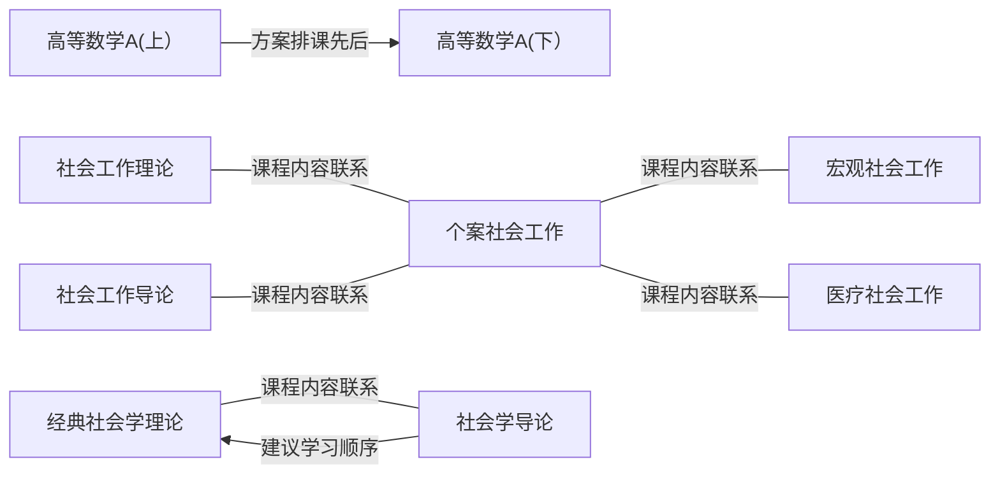

# 2025社会工作专业本科培养方案（港澳台侨生）

社会发展与公共政策学院 · 社会工作 · 方案 100255 · 56 个不同课程或科研条目。

[官方 Word](../originals/plan-100255.docx) · [教务详情](https://fdjwgl.fudan.edu.cn/manager/bizType/2/major-program-search/info/100255?skipAuth=1) · [方案快照](../raw/plan-100255.json.gz) · [年级目录](../README.md)

## 课程关系图

图中展示部分关系。下表保留全部已建立的课程对，来源位置使用本方案 JSON Pointer。

## 先修与内容联系

| 类型 | 起点 | 终点 | 依据 | 原表定位 |
| --- | --- | --- | --- | --- |
| 建议学习顺序 | 高等数学A(上） (MATH10015) | 高等数学A(下） (MATH10016) | 同方案的课程题名具有连续分册或序号。  | `/courseModules/7/planCourses/0`、`/courseModules/7/planCourses/1` |
| 建议学习顺序 | 社会学导论 (SOCI20001) | 经典社会学理论 (SOCI10004) | “社会学导论”题名标明基础层次，前置阅读可帮助了解“经典社会学理论”中的社会学主题。  | `/courseModules/6/planCourses/1`、`/courseModules/13/planCourses/4` |
| 方案排课先后 | 高等数学A(上） (MATH10015) | 高等数学A(下） (MATH10016) | 同方案该课程全部明确数字学期均早于后者。  | `/courseModules/7/planCourses/0`、`/courseModules/7/planCourses/1` |
| 课程内容联系 | 经典社会学理论 (SOCI10004) | 社会学导论 (SOCI20001) | 本方案两门课程的题名均含“社会学”，可据此对照这一主题。  | `/courseModules/13/planCourses/4`、`/courseModules/6/planCourses/1` |
| 课程内容联系 | 社会工作理论 (SOCI50041) | 个案社会工作 (SWK20003) | 本方案两门课程的题名均含“社会工作”，可据此对照这一主题。  | `/courseModules/8/planCourses/15`、`/courseModules/8/planCourses/9` |
| 课程内容联系 | 社会工作导论 (SWK20002) | 个案社会工作 (SWK20003) | 本方案两门课程的题名均含“社会工作”，可据此对照这一主题。  | `/courseModules/6/planCourses/0`、`/courseModules/8/planCourses/9` |
| 课程内容联系 | 个案社会工作 (SWK20003) | 医疗社会工作 (SWK30008) | 本方案两门课程的题名均含“社会工作”，可据此对照这一主题。  | `/courseModules/8/planCourses/9`、`/courseModules/12/planCourses/9` |
| 课程内容联系 | 个案社会工作 (SWK20003) | 宏观社会工作 (SWK50003) | 本方案两门课程的题名均含“社会工作”，可据此对照这一主题。  | `/courseModules/8/planCourses/9`、`/courseModules/8/planCourses/7` |

本次未从可定位的明确表述中确认课程对课程预修。学期安排、系列分册与编辑建议均保留各自的依据。

## 课程表

同一课程在不同模块分别出现时，按原表逐行列出。季节字段保留原值。

| 课程 | 代码 | 学分 | 学期 | 模块 |
| --- | --- | ---: | --- | --- |
| 社会工作导论 | SWK20002 | 3.0 | 第1学期 | 培养方案 / 专业培养课程 / 学科基础课程 / 必修课程 |
| 社会学导论 | SOCI20001 | 3.0 | 第1学期 | 培养方案 / 专业培养课程 / 学科基础课程 / 必修课程 |
| 高等数学D | MATH10008 | 4.0 | 第2学期 | 培养方案 / 专业培养课程 / 学科基础课程 / 必修课程 |
| 社会研究方法基础 | SOCI10003 | 3.0 | 第2学期 | 培养方案 / 专业培养课程 / 学科基础课程 / 必修课程 |
| 高等数学A(上） | MATH10015 | 5.0 | 第1学期 | 培养方案 / 专业培养课程 / 学科基础课程 / 选修课程 |
| 高等数学A(下） | MATH10016 | 5.0 | 第2学期 | 培养方案 / 专业培养课程 / 学科基础课程 / 选修课程 |
| 线性代数 | MATH10017 | 3.0 | 第2学期 | 培养方案 / 专业培养课程 / 学科基础课程 / 选修课程 |
| 程序设计 | CS10004 | 4.0 | 第1学期 | 培养方案 / 专业培养课程 / 学科基础课程 / 选修课程 |
| 心理学导论 | PSYC20001 | 3.0 | 第1学期、第2学期 | 培养方案 / 专业培养课程 / 学科基础课程 / 选修课程 |
| 人工智能程序设计 | AIB210001 | 1.0 | 第1学期、第2学期 | 培养方案 / 专业培养课程 / 学科基础课程 / 选修课程 |
| Python程序设计 | AIB110002 | 1.0 | 第1学期、第2学期 | 培养方案 / 专业培养课程 / 学科基础课程 / 选修课程 |
| 当代中国政治制度 | POLI10009 | 3.0 | SPRING、AUTUMN | 培养方案 / 专业培养课程 / 学科基础课程 / 选修课程 |
| 经济学原理 | ECON20005 | 3.0 | 第1学期、第2学期 | 培养方案 / 专业培养课程 / 学科基础课程 / 选修课程 |
| 人类行为与社会环境 | SWK30005 | 3.0 | 第3学期 | 培养方案 / 专业培养课程 / 专业核心教育课程 |
| 社会工作理论基础 | SWK30019 | 3.0 | 第4学期 | 培养方案 / 专业培养课程 / 专业核心教育课程 |
| 社会福利理论与制度 | SWK30014 | 3.0 | 第3学期 | 培养方案 / 专业培养课程 / 专业核心教育课程 |
| 社会政策 | SWK30006 | 3.0 | 第4学期 | 培养方案 / 专业培养课程 / 专业核心教育课程 |
| 统计软件应用 | SOCI30037 | 3.0 | 第4学期 | 培养方案 / 专业培养课程 / 专业核心教育课程 |
| 社会工作实务研究 | SWK30020 | 2.0 | 第5学期 | 培养方案 / 专业培养课程 / 专业核心教育课程 |
| 高级临床社会工作 | SWK50004 | 3.0 | 第9学期 | 培养方案 / 专业培养课程 / 专业核心教育课程 |
| 宏观社会工作 | SWK50003 | 3.0 | 第9学期、AUTUMN | 培养方案 / 专业培养课程 / 专业核心教育课程 |
| 社会工作研究方法 | SWK60002 | 3.0 | 第9学期 | 培养方案 / 专业培养课程 / 专业核心教育课程 |
| 个案社会工作 | SWK20003 | 3.0 | 第3学期 | 培养方案 / 专业培养课程 / 专业核心教育课程 |
| 小组工作 | SWK30002 | 3.0 | 第4学期 | 培养方案 / 专业培养课程 / 专业核心教育课程 |
| 社区社会工作 | SOCI30049 | 3.0 | 第5学期 | 培养方案 / 专业培养课程 / 专业核心教育课程 |
| 社会工作行政管理 | SWK30023 | 3.0 | 第5学期 | 培养方案 / 专业培养课程 / 专业核心教育课程 |
| 社会统计学基础 | SWK10001 | 3.0 | 第3学期 | 培养方案 / 专业培养课程 / 专业核心教育课程 |
| 社会工作价值与伦理 | SOCI20006 | 3.0 | 第3学期 | 培养方案 / 专业培养课程 / 专业核心教育课程 |
| 社会工作理论 | SOCI50041 | 2.0 | 第9学期、AUTUMN | 培养方案 / 专业培养课程 / 专业核心教育课程 |
| 老年社会工作 | SWK30009 | 2.0 | 第6学期 | 培养方案 / 专业进阶课程 / 专业进阶模块I |
| 变态心理学 | SWK30011 | 2.0 | 第4学期 | 培养方案 / 专业进阶课程 / 专业进阶模块I |
| 发展心理学 | PSYC30003 | 3.0 | 第4学期 | 培养方案 / 专业进阶课程 / 专业进阶模块I |
| 家庭治疗 | SWK30012 | 2.0 | 第6学期 | 培养方案 / 专业进阶课程 / 专业进阶模块I |
| 艺术治疗 | PSYC30015 | 2.0 | 第6学期 | 培养方案 / 专业进阶课程 / 专业进阶模块I |
| 自我认知与成长 | SWK20001 | 3.0 | 第3学期 | 培养方案 / 专业进阶课程 / 专业进阶模块I |
| 社会工作技巧实验 | SWK40004 | 2.0 | 第6学期 | 培养方案 / 专业进阶课程 / 专业进阶模块I |
| 证据为本的社会工作实务 | SWK60010 | 2.0 | 第10学期、SPRING | 培养方案 / 专业进阶课程 / 专业进阶模块I |
| 社会工作视域下的健康管理 | SWK70002 | 2.0 | 第9学期、AUTUMN | 培养方案 / 专业进阶课程 / 专业进阶模块I |
| 医疗社会工作 | SWK30008 | 2.0 | 第5学期 | 培养方案 / 专业进阶课程 / 专业进阶模块I |
| 婚姻与家庭 | SOCI30030 | 2.0 | 第5学期 | 培养方案 / 专业进阶课程 / 专业进阶模块II |
| 公益慈善与社会发展 | SOCI30001 | 2.0 | 第4学期 | 培养方案 / 专业进阶课程 / 专业进阶模块II |
| 社会心理学 | PSYC30006 | 3.0 | 第5学期 | 培养方案 / 专业进阶课程 / 专业进阶模块II |
| 文化人类学 | SOCI30002 | 2.0 | 第5学期 | 培养方案 / 专业进阶课程 / 专业进阶模块II |
| 经典社会学理论 | SOCI10004 | 3.0 | SPRING | 培养方案 / 专业进阶课程 / 专业进阶模块II |
| 西方社会思想史 | SOCI30022 | 2.0 | SPRING | 培养方案 / 专业进阶课程 / 专业进阶模块II |
| 互联网与社会研究 | SOCI30033 | 4.0 | 第6学期 | 培养方案 / 专业进阶课程 / 专业进阶模块II |
| 法律与社会工作 | SWK30010 | 2.0 | 第5学期 | 培养方案 / 专业进阶课程 / 专业进阶模块II |
| 数字化与长寿时代 | GEEC10416 | 2.0 | AUTUMN | 培养方案 / 专业进阶课程 / 专业进阶模块II |
| 大数据与社会科学 | AIT410018 | 2.0 | AUTUMN | 培养方案 / 专业进阶课程 / 专业进阶模块II |
| 质性研究方法 | SWK60009 | 2.0 | 第4学期 | 培养方案 / 专业进阶课程 / 专业进阶模块II |
| 非营利组织管理 | SWK30013 | 2.0 | 第4学期 | 培养方案 / 专业进阶课程 / 专业进阶模块II |
| 复芏计划(FDUROP) | 102 | 0.0 |  | 融合创新能力 |
| 学年论文 | SOCI40003 | 1.0 | 第7学期 | 融合创新能力 |
| 毕业论文 | SWK40001 | 4.0 | 第8学期 | 融合创新能力 |
| 论文写作 | SOCI30032 | 2.0 | 第5学期 | 融合创新能力 |
| 社会工作实习(一) | SWK40002 | 4.0 | 第6学期 | 融合创新能力 |
