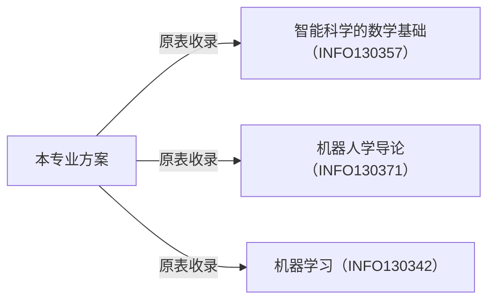

# 智能科学与技术（智能信息处理方向、智能系统与接口方向）专业“2+X”教学培养方案

2023 年度汇编，方案正文印刷页 752–754。本页附上原书 PDF 第 764–768 页，其中含本专业紧随正文的各版修读建议。逐行数据覆盖可可靠对应课号和名称的原表记录。[方案原页](original-pages.pdf) · [完整原版](https://jwc.fudan.edu.cn/_upload/article/files/83/6c/8a3c080c4f8991024f4b59ad4f1b/64d23c13-0465-4619-bd18-9e491594f850.pdf#page=764) · [逐行数据与来源](record.json)

## 课程导读

想了解智能系统的课程安排，可以在原表中找到《智能科学的数学基础》（`INFO130357`）、《机器人学导论》（`INFO130371`）、《机器学习》（`INFO130342`）。 [原书 PDF 第 764 页](original-pages.pdf#page=1) · [原书 PDF 第 765 页](original-pages.pdf#page=2)

原表把 `INFO130357` 列在第 4 学期，把 `INFO130371` 列在第 5 学期。图中箭头表示本节原表收录该课，图上各课之间没有先修连线。

| 课号 | 课程名称 | 开课学期原文 | PDF 页 |
|---|---|---|---|
| COMP130141 | 自然语言处理 | 6 | 765 |
| INFO130016 | 毕业论文 | 8 | 765 |
| INFO130020 | 生物医学工程学基础 | 春秋 | 765 |
| INFO130073 | 多媒体技术 | 春秋 | 765 |
| INFO130079 | 科技英语 | 春秋 | 765 |
| INFO130080 | 可编程器件与硬件描述语言 | 春秋 | 765 |
| INFO130092 | 医学信号处理 | 春秋 | 765 |
| INFO130135 | 数字图像处理B | 春秋 | 765 |
| INFO130138 | 信号检测与估计基础 | 春秋 | 765 |
| INFO130302 | 概率、数理统计与随机过程 | 3 | 764 |
| INFO130305 | 数据结构与算法设计 | 3 | 764 |
| INFO130306 | 信号与系统 | 4 | 764 |
| INFO130310 | 自动控制原理 | 5 | 765 |
| INFO130311 | 计算机原理与体系结构 | 4 | 764 |
| INFO130342 | 机器学习 | 春秋 | 765 |
| INFO130346 | 脑科学导论 | 3 | 764 |
| INFO130348 | 模拟与数字电路实验 | 春秋 | 765 |
| INFO130357 | 智能科学的数学基础 | 4 | 764 |
| INFO130358 | 人工智能导论 | 4 | 764 |
| INFO130359 | 统计学习 | 5 | 765 |
| INFO130360 | 智能系统设计 | 7 | 765 |
| INFO130361 | 群体智能 | 春秋 | 765 |
| INFO130367 | 本科生科研实践 | 7 | 765 |
| INFO130369 | 模拟与数字电路 | 3 | 764 |
| INFO130370 | 机械设计 | 6 | 765 |
| INFO130371 | 机器人学导论 | 5 | 765 |
| INFO130372 | 图像处理与机器视觉 | 6 | 765 |
| INFO130373 | 数据库与数据仓库 | 5 | 765 |
| INFO130374 | 智能SoC 设计 | 春秋 | 765 |
| INFO130378 | 计算神经学 | 春秋 | 766 |
| INFO130398 | 先进机器人与自动化 | 春秋 | 766 |
| INFO130399 | 随机过程 | 春秋 | 766 |
| SOCI130032 | 认知心理学 | 春秋 | 766 |

可定位的课程对暂无明确先修记录，原课程表及备注见上方 PDF。
