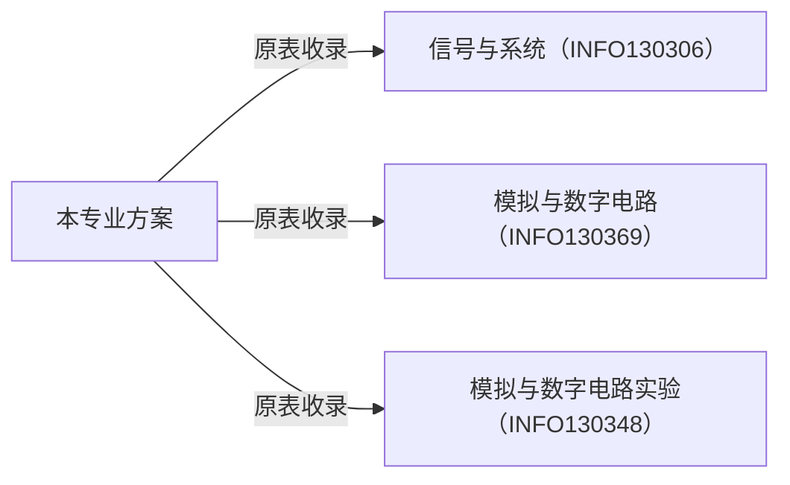

# 电子信息科学与技术（智能科学与技术方向）（第二学士学位）专业教学培养方案

2023 年度汇编，方案正文印刷页 935–935。本页附上原书 PDF 第 947–948 页，其中含本专业紧随正文的各版修读建议。逐行数据覆盖可可靠对应课号和名称的原表记录。[方案原页](original-pages.pdf) · [完整原版](https://jwc.fudan.edu.cn/_upload/article/files/83/6c/8a3c080c4f8991024f4b59ad4f1b/64d23c13-0465-4619-bd18-9e491594f850.pdf#page=947) · [逐行数据与来源](record.json)

## 课程导读

想了解电子线路与信号的课程安排，可以在原表中找到《信号与系统》（`INFO130306`）、《模拟与数字电路》（`INFO130369`）、《模拟与数字电路实验》（`INFO130348`）。 [原书 PDF 第 947 页](original-pages.pdf#page=1)

原表把 `INFO130306` 列在第 2 学期，把 `INFO130369` 列在第 1 学期。图中箭头表示本节原表收录该课，图上各课之间没有先修连线。

| 课号 | 课程名称 | 开课学期原文 | PDF 页 |
|---|---|---|---|
| INFO130016 | 毕业论文 | 4 | 947 |
| INFO130302 | 概率、数理统计与随机过程 | 1 | 947 |
| INFO130305 | 数据结构与算法设计 | 1 | 947 |
| INFO130306 | 信号与系统 | 2 | 947 |
| INFO130310 | 自动控制原理 | 3 | 947 |
| INFO130311 | 计算机原理与体系结构 | 2 | 947 |
| INFO130330 | 微机原理与接口实验 | 3 | 947 |
| INFO130346 | 脑科学导论 | 1 | 947 |
| INFO130348 | 模拟与数字电路实验 | 2 | 947 |
| INFO130358 | 人工智能导论 | 2 | 947 |
| INFO130359 | 统计学习 | 3 | 947 |
| INFO130360 | 智能系统设计 | 3 | 947 |
| INFO130369 | 模拟与数字电路 | 1 | 947 |
| INFO130371 | 机器人学导论 | 3 | 947 |
| INFO130372 | 图像处理与机器视觉 | 4 | 947 |

可定位的课程对暂无明确先修记录，原课程表及备注见上方 PDF。
