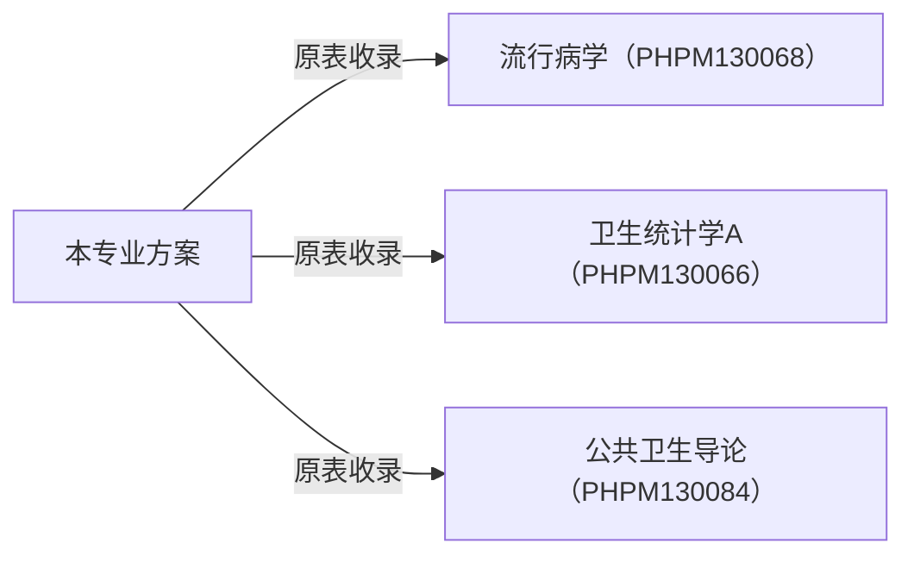

# 预防医学专业“2+X”教学培养方案

2023 年度汇编，方案正文印刷页 839–842。本页附上原书 PDF 第 851–857 页，其中含本专业紧随正文的各版修读建议。逐行数据覆盖可可靠对应课号和名称的原表记录。[方案原页](original-pages.pdf) · [完整原版](https://jwc.fudan.edu.cn/_upload/article/files/83/6c/8a3c080c4f8991024f4b59ad4f1b/64d23c13-0465-4619-bd18-9e491594f850.pdf#page=851) · [逐行数据与来源](record.json)

## 课程导读

想了解公共卫生与人群研究的课程安排，可以在原表中找到《流行病学》（`PHPM130068`）、《卫生统计学A》（`PHPM130066`）、《公共卫生导论》（`PHPM130084`）。 [原书 PDF 第 852 页](original-pages.pdf#page=2)

原表把 `PHPM130068` 列在第 8 学期，把 `PHPM130066` 列在第 5 学期。图中箭头表示本节原表收录该课，图上各课之间没有先修连线。

| 课号 | 课程名称 | 开课学期原文 | PDF 页 |
|---|---|---|---|
| MED130002 | 系统解剖学B | 3 | 851 |
| MED130003 | 组织胚胎学B | 3 | 851 |
| MED130005 | 生理学B | 4 | 851 |
| MED130006 | 免疫学C | 4 | 851 |
| MED130012 | 寄生虫学C | 5 | 851 |
| MED130013 | 病理生理学B | 5 | 851 |
| MED130014 | 药理学C | 5 | 851 |
| MED130015 | 功能学科综合实验 | 5 | 851 |
| MED130049 | 诊断学B | 5 | 852 |
| MED130050 | 影像诊断学C | 6 | 852 |
| MED130056 | 内科学C | 6 | 852 |
| MED130057 | 外科学C | 6 | 852 |
| MED130087 | 医学文献检索与利用B | 春 | 853 |
| MED130109 | 传染病学B | 6 | 852 |
| MED130184 | 医学细胞与遗传学 | 3 | 851 |
| MED130242 | 生物化学 | 3 | 851 |
| MED130266 | 从生物学和统计学视角看人类疾病 | 暑期 | 853 |
| MED130267 | 病理学 | 5 | 852 |
| MED130283 | 人体的社交网络：共生微生物 | 暑期 | 853 |
| MED130343 | 医学微生物学C | 4 | 851 |
| PHPM130002 | 基础毒理 | 8 | 852 |
| PHPM130003 | 社会医学 | 3 | 852 |
| PHPM130004 | 健康教育学 | 8 | 852 |
| PHPM130006 | 卫生化学 | 4 | 852 |
| PHPM130007 | 卫生事业管理学 | 8 | 852 |
| PHPM130009 | 卫生法学 | 4 | 852 |
| PHPM130014 | 儿少卫生学 | 8 | 852 |
| PHPM130019 | 毕业论文 | 10 | 852 |
| PHPM130020 | 健康心理学 | 春, 秋 | 853 |
| PHPM130021 | 医院获得性感染 | 春, 秋 | 853 |
| PHPM130022 | 管理与沟通技巧 | 春 | 853 |
| PHPM130023 | 妇幼卫生学概论 | 春, 秋 | 853 |
| PHPM130028 | 医学人口统计学 | 春 | 853 |
| PHPM130029 | 公共卫生监督学 | 春, 秋 | 853 |
| PHPM130033 | 卫生人力规划 | 秋 | 853 |
| PHPM130034 | 仪器分析的应用 | 春, 秋 | 853 |
| PHPM130064 | 全球卫生导论 | 秋 | 853 |
| PHPM130066 | 卫生统计学A | 5 | 852 |
| PHPM130068 | 流行病学 | 8 | 852 |
| PHPM130069 | 流行病学实践 | 8 | 852 |
| PHPM130070 | 职业卫生与职业医学 | 8 | 852 |
| PHPM130071 | 职业卫生与职业医学实验 | 9 | 852 |
| PHPM130072 | 环境卫生学 | 8 | 852 |
| PHPM130073 | 环境卫生学实验 | 9 | 852 |
| PHPM130074 | 营养与食品卫生学 | 8 | 852 |
| PHPM130075 | 营养与食品卫生学实验 | 9 | 852 |
| PHPM130079 | 放射卫生学与放射防护 | 春, 秋 | 853 |
| PHPM130084 | 公共卫生导论 | 2 | 852 |
| PHPM130085 | 卫生经济评价方法 | 秋 | 853 |
| PHPM130087 | 学术前沿专题 | 春, 秋 | 853 |
| PHPM130089 | 色谱分析新技术 | 秋 | 853 |
| PHPM130095 | 医学生职业生涯规划 | 春, 秋 | 853 |
| PHPM130105 | 生产实习 | 9 | 852 |
| PHPM130110 | 卫生经济学概论 | 秋 | 853 |
| PHPM130113 | 食品免疫学 | 春 | 853 |
| PHPM130114 | 卫生管理预测与决策分析 | 秋 | 853 |
| PHPM130115 | 科学写作：聚焦群医学 | 秋 | 853 |
| PHPM130116 | 行为经济学与公众健康 | 秋 | 853 |

可定位的课程对暂无明确先修记录，原课程表及备注见上方 PDF。
