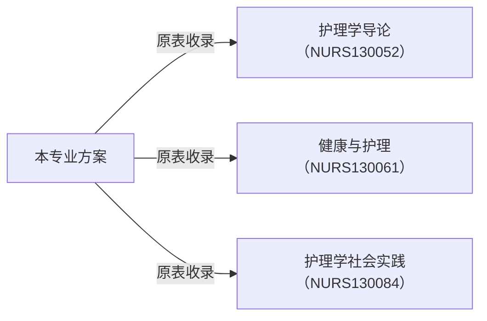

# 护理学专业“2+X”教学培养方案

2023 年度汇编，方案正文印刷页 867–870。本页附上原书 PDF 第 879–885 页，其中含本专业紧随正文的各版修读建议。逐行数据覆盖可可靠对应课号和名称的原表记录。[方案原页](original-pages.pdf) · [完整原版](https://jwc.fudan.edu.cn/_upload/article/files/83/6c/8a3c080c4f8991024f4b59ad4f1b/64d23c13-0465-4619-bd18-9e491594f850.pdf#page=879) · [逐行数据与来源](record.json)

## 课程导读

想了解护理评估与实践的课程安排，可以在原表中找到《护理学导论》（`NURS130052`）、《健康与护理》（`NURS130061`）、《护理学社会实践》（`NURS130084`）。 [原书 PDF 第 881 页](original-pages.pdf#page=3)

原表把 `NURS130052` 列在第 1 学期，把 `NURS130061` 列在第 2 学期。图中箭头表示本节原表收录该课，图上各课之间没有先修连线。

| 课号 | 课程名称 | 开课学期原文 | PDF 页 |
|---|---|---|---|
| MED130085 | 针灸与推拿学 | 春秋 | 881 |
| MED130115 | 中医护理学 | 8、春季 | 881 |
| MED130137 | 新发传染病 | 春秋 | 881 |
| MED130185 | 医患交流技巧 | 秋季 | 881 |
| MED130197 | 医学与生物安全 | 春秋 | 881 |
| NURS130012 | 护理教育学 | 秋季 | 881 |
| NURS130013 | 护理管理学 | 春季 | 881 |
| NURS130020 | 肿瘤护理 | 春秋 | 881 |
| NURS130022 | 老年护理 | 6、春季 | 881 |
| NURS130023 | 疼痛护理 | 春秋 | 881 |
| NURS130031 | 护理美学 | 春秋 | 881 |
| NURS130042 | 循证护理概论 | 春秋 | 881 |
| NURS130043 | 学术前沿专题 | 6 | 881 |
| NURS130052 | 护理学导论 | 1 | 881 |
| NURS130054 | 传染病护理学 | 5 | 881 |
| NURS130061 | 健康与护理 | 2 | 881 |
| NURS130063 | 妇科护理学 | 6 | 881 |
| NURS130065 | 胚胎与遗传咨询 | 4 | 881 |
| NURS130075 | 安宁疗护概论 | 春秋 | 881 |
| NURS130076 | 患者报告结局导论 | 春秋 | 881 |
| NURS130077 | 护理创新设计理论与实践 | 5、秋季 | 881 |
| NURS130079 | 传染病护理学的理论及实践（上） | 5 | 881 |
| NURS130084 | 护理学社会实践 | 3,4 | 881 |
| PHPM130052 | 医学营养学 | 4 | 881 |

可定位的课程对暂无明确先修记录，原课程表及备注见上方 PDF。
