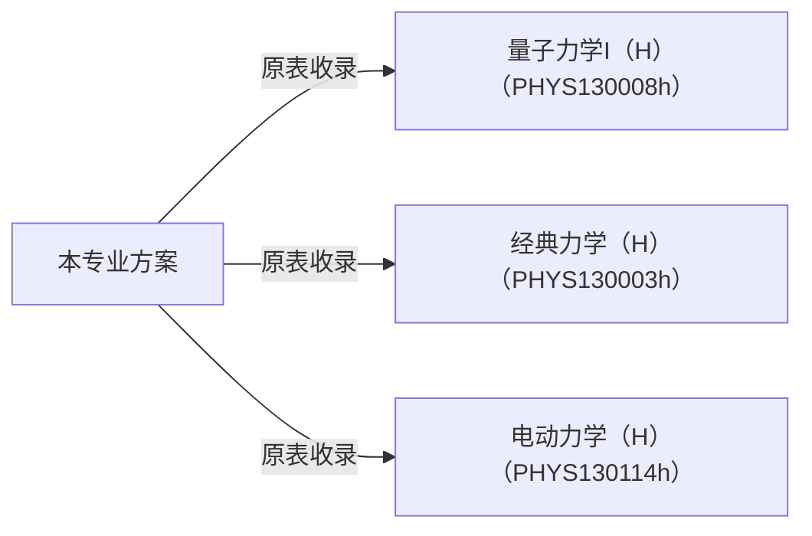

# 物理学专业教学培养方案（英才班适用）

2023 年度汇编，方案正文印刷页 521–521。本页附上原书 PDF 第 533–535 页，其中含本专业紧随正文的各版修读建议。逐行数据覆盖可可靠对应课号和名称的原表记录。[方案原页](original-pages.pdf) · [完整原版](https://jwc.fudan.edu.cn/_upload/article/files/83/6c/8a3c080c4f8991024f4b59ad4f1b/64d23c13-0465-4619-bd18-9e491594f850.pdf#page=533) · [逐行数据与来源](record.json)

## 课程导读

想了解物理理论与实验的课程安排，可以在原表中找到《量子力学I（H）》（`PHYS130008h`）、《经典力学（H）》（`PHYS130003h`）、《电动力学（H）》（`PHYS130114h`）。 [原书 PDF 第 535 页](original-pages.pdf#page=3)

图中箭头表示本节原表收录该课，图上各课之间没有先修连线。

| 课号 | 课程名称 | 开课学期原文 | PDF 页 |
|---|---|---|---|
| BIOL120002 | 现代生物科学导论A |  | 535 |
| BIOL120005 | 现代生物科学实验 |  | 535 |
| CHEM120005 | 普通化学A（上） |  | 535 |
| CHEM120006 | 普通化学A（下） |  | 535 |
| CHEM120009 | 普通化学实验I |  | 535 |
| INFO120002 | 模拟电子学基础 |  | 535 |
| MATH120021 | 高等数学A（上） |  | 534 |
| MATH120022 | 高等数学A（下） |  | 534 |
| PHYS120015 | 基础物理实验 |  | 534 |
| PHYS120016h | 大学物理A：力学（H） |  | 534 |
| PHYS120017h | 大学物理A：热学（H） |  | 534 |
| PHYS120018h | 大学物理A：电磁学（H） |  | 534 |
| PHYS130003h | 经典力学（H） |  | 535 |
| PHYS130004 | 物理实验（上） |  | 535 |
| PHYS130005 | 物理实验（下） |  | 535 |
| PHYS130006h | 数学物理方法A（H） |  | 535 |
| PHYS130008h | 量子力学I（H） |  | 535 |
| PHYS130010h | 固体物理（H） |  | 535 |
| PHYS130013 | 毕业论文 |  | 535 |
| PHYS130058h | 近代物理实验I（H） |  | 535 |
| PHYS130092h | 大学物理A：光学（H） |  | 535 |
| PHYS130093h | 大学物理A：原子物理（H） |  | 535 |
| PHYS130113h | 热力学与统计物理I（H） |  | 535 |
| PHYS130114h | 电动力学（H） |  | 535 |
| PHYS130119 | 概率论与数理统计 |  | 535 |
| PHYS130120 | 线性代数 |  | 535 |
| PTSS110082 | 毛泽东思想和中国特色社会主义理论体系概论 |  | 534 |
| PTSS110087 | 马克思主义基本原理 |  | 534 |
| PTSS110088 | 中国近现代史纲要 |  | 534 |
| PTSS110089 | 思想道德与法治 |  | 534 |
| PTSS110090 | 习近平新时代中国特色社会主义思想概论 |  | 534 |

可定位的课程对暂无明确先修记录，原课程表及备注见上方 PDF。
