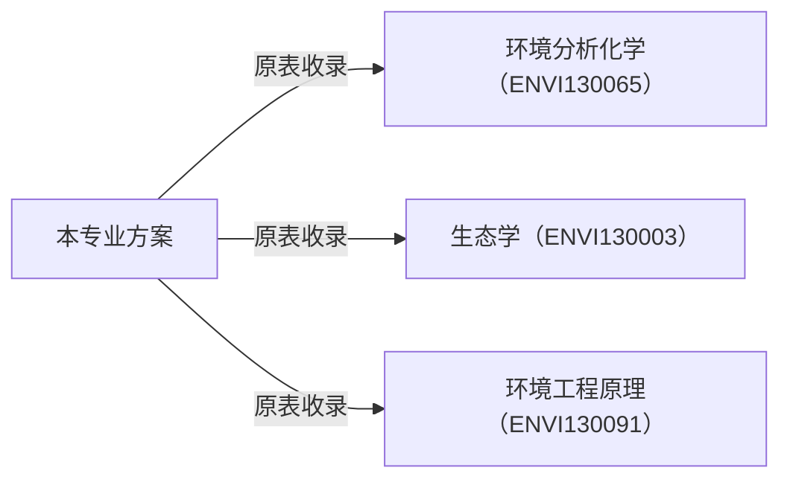

# 环境科学专业“2+X”教学培养方案

2023 年度汇编，方案正文印刷页 597–603。本页附上原书 PDF 第 609–619 页，其中含本专业紧随正文的各版修读建议。逐行数据覆盖可可靠对应课号和名称的原表记录。[方案原页](original-pages.pdf) · [完整原版](https://jwc.fudan.edu.cn/_upload/article/files/83/6c/8a3c080c4f8991024f4b59ad4f1b/64d23c13-0465-4619-bd18-9e491594f850.pdf#page=609) · [逐行数据与来源](record.json)

## 课程导读

想了解环境科学的课程安排，可以在原表中找到《环境分析化学》（`ENVI130065`）、《生态学》（`ENVI130003`）、《环境工程原理》（`ENVI130091`）。 [原书 PDF 第 609 页](original-pages.pdf#page=1)

其中 `ENVI130065` 的开课时间标为第 3 学期。图中箭头表示本节原表收录该课，图上各课之间没有先修连线。

| 课号 | 课程名称 | 开课学期原文 | PDF 页 |
|---|---|---|---|
| BIOL130062 | 环境生物学实验 | 4 | 609 |
| CHEM130050 | 有机化学实验 | 5 | 612, 613, 614 |
| ENVI130002 | 环境科学前沿 | 4 | 609 |
| ENVI130003 | 生态学 | 3 | 609 |
| ENVI130004 | 生态学实验 | 4 | 609 |
| ENVI130005 | 环境生物学 | 3 | 609 |
| ENVI130006 | 环境监测A | 4 | 609 |
| ENVI130008 | 环境工程学A | 5 | 610 |
| ENVI130011 | 环境化学A | 5 | 610 |
| ENVI130013 | 环境信息系统 | 6 | 612 |
| ENVI130016 | 生产实习 | 暑期 | 610 |
| ENVI130017 | 毕业论文 | 8 | 610 |
| ENVI130020 | 有机化学 | 3、5 | 610, 614 |
| ENVI130025 | 大气污染与控制 | 5 | 610 |
| ENVI130026 | 水污染与控制 | 5 | 613 |
| ENVI130027 | 固体废物处理与资源化 | 5 | 613 |
| ENVI130030 | 环境地学基础 | 5 | 610 |
| ENVI130031 | 专业文献查阅 | 7 | 613, 614 |
| ENVI130033 | 环境材料导论 | 5 | 613, 614 |
| ENVI130038 | 环境物理化学 | 4 | 610, 614 |
| ENVI130040 | 环境与贸易 | 5 | 612, 613, 614 |
| ENVI130041 | 环境设备基础 | 6 | 612 |
| ENVI130042 | 环境经济学 | 4 | 609 |
| ENVI130044 | 全球环境变化 | 7 | 610 |
| ENVI130046 | 生物地球化学 | 6 | 610 |
| ENVI130047 | 城市规划原理 | 5 | 612, 613 |
| ENVI130049 | 城市生态学 | 7 | 610, 613, 614 |
| ENVI130051 | 自然资源经济学 | 5 | 612, 613 |
| ENVI130052 | 田野调查方法 | 5 | 612, 613 |
| ENVI130056 | 环境法 | 5 | 612, 613, 614 |
| ENVI130057 | 环境核算与审计 | 7 | 613, 614 |
| ENVI130058 | 环境遥感 | 6 | 610, 612, 614 |
| ENVI130060 | 生态工程 | 7 | 610, 613, 614 |
| ENVI130063 | 环境水文学基础 | 7 | 612, 613, 614 |
| ENVI130065 | 环境分析化学 | 3 | 609, 614 |
| ENVI130066 | 环境信息技术实验 | 6 | 612, 613 |
| ENVI130067 | 环境管理 | 3 | 609 |
| ENVI130069 | 野外实习 | 5 | 610 |
| ENVI130071 | 仪器分析 | 5 | 612 |
| ENVI130073 | 环境规划原理 | 7 | 612, 613, 614 |
| ENVI130075 | 环境评价 | 7 | 610 |
| ENVI130078 | 环境流体力学 | 4 | 610, 614 |
| ENVI130080 | 环境工程设计 | 7 | 613, 614 |
| ENVI130081 | 环境工程制图 | 6 | 612, 613 |
| ENVI130082 | 环境纳米技术 | 7 | 614 |
| ENVI130083 | 工业废水处理 | 6 | 613 |
| ENVI130084 | 概率论与环境数理统计 | 5 | 612, 613, 614 |
| ENVI130085 | 环境遥感实验 | 6 | 613, 614 |
| ENVI130087 | 环境物理学导论 | 5 | 613 |
| ENVI130091 | 环境工程原理 | 3 | 609 |
| ENVI130092 | 环境监测实验 | 4 | 609 |
| ENVI130093 | 环境化学实验A | 6 | 610, 614 |
| ENVI130094 | 大气化学 | 6 | 610, 611, 614 |
| ENVI130095 | 地理信息系统及其应用 | 6 | 610 |
| ENVI130096 | 水环境化学 | 6 | 611, 613, 614 |
| ENVI130097 | 污染控制化学 | 6 | 611, 613 |
| ENVI130098 | 固体废物处理与资源化 | 5 | 611, 614 |
| ENVI130100 | 产业生态学 | 5 | 612, 613 |
| ENVI130103 | 大气气溶胶与全球环境效应 | 6 | 613 |
| ENVI130104 | 土壤环境化学 | 6 | 611, 613, 614 |
| ENVI130105 | 环境工程学实验 | 6 | 610 |
| ENVI130107 | 城市绿地规划与设计 | 6 | 610 |
| ENVI130109 | 城市气候导论 | 6 | 612, 613, 614 |
| ENVI130110 | 碳中和技术概论 | 6 | 613, 614 |
| MATH120020 | 线性代数（理工类） | 3 | 613, 614 |

可定位的课程对暂无明确先修记录，原课程表及备注见上方 PDF。
