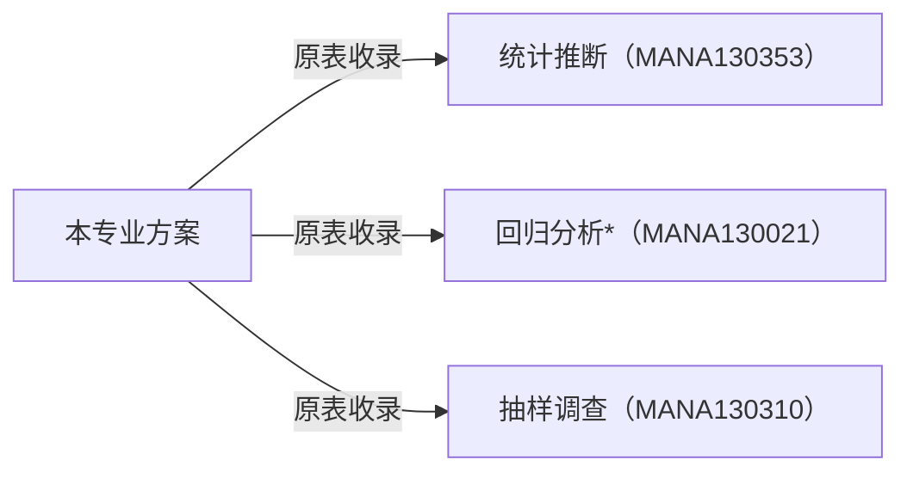

# 统计学（统计与数据科学）专业“2+X”教学培养方案

2023 年度汇编，方案正文印刷页 423–427。本页附上原书 PDF 第 435–443 页，其中含本专业紧随正文的各版修读建议。逐行数据覆盖可可靠对应课号和名称的原表记录。[方案原页](original-pages.pdf) · [完整原版](https://jwc.fudan.edu.cn/_upload/article/files/83/6c/8a3c080c4f8991024f4b59ad4f1b/64d23c13-0465-4619-bd18-9e491594f850.pdf#page=435) · [逐行数据与来源](record.json)

## 课程导读

想了解统计方法与数据分析的课程安排，可以在原表中找到《统计推断》（`MANA130353`）、《回归分析\*》（`MANA130021`）、《抽样调查》（`MANA130310`）。 [原书 PDF 第 436 页](original-pages.pdf#page=2)

原表把 `MANA130353` 列在第 5 学期，把 `MANA130310` 列在第 6 学期。图中箭头表示本节原表收录该课，图上各课之间没有先修连线。

| 课号 | 课程名称 | 开课学期原文 | PDF 页 |
|---|---|---|---|
| MANA130001 | 概率论与数理统计 | 3 | 435 |
| MANA130004 | 财务管理* | 3 | 435 |
| MANA130005 | 运筹学* | 3 | 435 |
| MANA130006 | 营销管理* | 4 | 435 |
| MANA130007 | 管理信息系统* | 3 | 435 |
| MANA130008 | 运营管理* | 5,6 | 437 |
| MANA130010 | 随机运筹学 | 5 | 437 |
| MANA130013 | 物流管理 | 5,6 | 437 |
| MANA130017 | 毕业论文 | 8 | 436 |
| MANA130021 | 回归分析* | 5 | 436 |
| MANA130022 | 时间序列分析 | 5 | 436 |
| MANA130023 | 多元分析 | 6 | 436 |
| MANA130024 | 随机过程 | 6 | 436 |
| MANA130029 | 投资学 | 5 | 436 |
| MANA130031 | 国际财务管理 | 5,6 | 437 |
| MANA130036 | 成本管理会计 | 5 | 436 |
| MANA130037 | 税法 | 5,6 | 437 |
| MANA130038 | 审计学* | 6 | 436 |
| MANA130041 | 国际会计 | 5,6 | 437 |
| MANA130046 | 组织行为学* | 4 | 435 |
| MANA130055 | 消费者行为学 | 5 | 437 |
| MANA130056 | 营销研究 | 5 | 437 |
| MANA130059 | 营销渠道管理 | 5,6 | 437 |
| MANA130062 | 服务营销* | 5 | 437 |
| MANA130073 | 供应链管理 | 4 | 437 |
| MANA130076 | 统计软件 | 4 | 435 |
| MANA130083 | 非参数统计 | 6 | 436 |
| MANA130085 | 金融工程 | 6 | 437 |
| MANA130097 | 属性数据分析 | 7 | 436 |
| MANA130114 | 中国金融市场 | 5,6 | 438 |
| MANA130121 | 计量经济学 | 5 | 435 |
| MANA130121h | 计量经济学（H） | 5,6 | 437 |
| MANA130152 | 国别经营环境* | 5 | 437 |
| MANA130153 | 人力资源管理 | 5 | 437 |
| MANA130306 | 东方管理 | 6 | 437 |
| MANA130310 | 抽样调查 | 6 | 436 |
| MANA130311 | 最优化方法及应用* | 5 | 437 |
| MANA130313 | 衍生证券 | 6 | 436 |
| MANA130314 | 公司财务理论与实务 | 6 | 436 |
| MANA130315 | 公司治理 | 6 | 437 |
| MANA130320 | 商业伦理学* | 1 | 435 |
| MANA130327 | 金融市场与金融机构* | 5 | 436 |
| MANA130328h | 高级微观经济学（H） | 5,6 | 437 |
| MANA130331 | 仿真与模拟 | 5,6 | 437 |
| MANA130341 | 信息技术创新应用 | 5,6 | 438 |
| MANA130343 | 博弈论* | 5,6 | 437 |
| MANA130344 | 产业经济学 | 5,6 | 438 |
| MANA130345 | 规制经济学 | 5,6 | 438 |
| MANA130346 | 产业组织与企业战略 | 5,6 | 438 |
| MANA130349 | 基金管理* | 5,6 | 438 |
| MANA130350 | 经济与金融中的统计方法 | 5,6 | 438 |
| MANA130353 | 统计推断 | 5 | 436 |
| MANA130357 | 财务报表分析 | 5,6 | 438 |
| MANA130358 | 会计专题研究 | 5,6 | 438 |
| MANA130360 | 毕业实习 | 4,8 | 436 |
| MANA130362 | 数字化营销 | 6 | 437 |
| MANA130363 | 行为金融学 | 5,6 | 438 |
| MANA130366 | 高级财务会计 | 6 | 436 |
| MANA130367 | 财务报表与资本市场 | 5,6 | 438 |
| MANA130368 | 统计计算 | 5,6 | 438 |
| MANA130369 | 高等概率论 | 5,6 | 437 |
| MANA130370 | 高等数理统计（一） | 5,6 | 437 |
| MANA130371 | 企业应用系统与管理决策 | 5,6 | 438 |
| MANA130372 | 电子商务与移动商务 | 5,6 | 438 |
| MANA130373 | 数据库与企业数据管理 | 5 | 437 |
| MANA130374 | 数据挖掘原理与技术 | 5 | 437 |
| MANA130375 | 互联网应用分析与设计 | 6 | 437 |
| MANA130376 | 大数据商务分析与应用 | 6 | 437 |
| MANA130377 | 程序设计与数据可视化 | 5,6 | 437 |
| MANA130378 | 社会化媒体分析 | 5,6 | 438 |
| MANA130380 | 互联网经济学 | 5,6 | 438 |
| MANA130382 | 国际金融 | 5,6 | 438 |
| MANA130383 | 金融科技导论 | 5,6 | 438 |
| MANA130384 | 产品创新管理 | 5,6 | 438 |
| MANA130385 | 中国对外贸易发展* | 5,6 | 439 |
| MANA130386 | 中国资本市场研究* | 5,6 | 439 |
| MANA130387 | 中国商业物流* | 5,6 | 439 |
| MANA130389 | 供应链管理导论* | 5,6 | 439 |
| MANA130390 | 金融风险管理* | 5,6 | 439 |
| MANA130391 | 国际财务管理* | 5,6 | 439 |
| MANA130393 | 品牌传播管理 | 5,6 | 438 |
| MANA130394 | 营销工程 | 5,6 | 438 |
| MANA130396 | 价值投资实务 | 5,6 | 438 |
| MANA130397 | 资本资产定价 | 5,6 | 438 |
| MANA130398 | 数据科学编程基础 | 5,6 | 438 |
| MANA130399 | 社会调查 | 5 | 436 |
| MANA130401 | 经济学原理* | 1 | 435 |
| MANA130402 | 房地产金融* | 5,6 | 438 |
| MANA130404 | 数据结构与算法导论 | 5,6 | 438 |
| MANA130405 | 财务报告 | 5 | 436 |
| MANA130406 | 中级财务会计 | 4 | 436 |
| MANA130407 | 会计与人工智能 | 5,6 | 438 |
| MANA130408 | 营销科技与决策系统 | 5,6 | 438 |
| MANA130409 | 中美金融市场* | 5,6 | 439 |
| MANA130410 | 职业规划与发展 | 4 | 436 |
| MANA130411h | 现代企业理论（H） | 5,6 | 437 |
| MANA130412 | 营销创意思维 | 5,6 | 438 |
| MANA130413 | 数字平台经济学* | 5,6 | 438 |

可定位的课程对暂无明确先修记录，原课程表及备注见上方 PDF。
