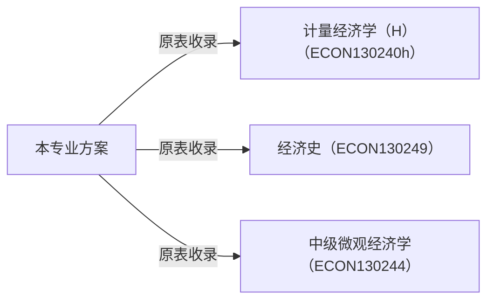

# 经济学专业（国际项目）“2+X”本科教学培养方案

2023 年度汇编，方案正文印刷页 354–357。本页附上原书 PDF 第 366–369 页，其中含本专业紧随正文的各版修读建议。逐行数据覆盖可可靠对应课号和名称的原表记录。[方案原页](original-pages.pdf) · [完整原版](https://jwc.fudan.edu.cn/_upload/article/files/83/6c/8a3c080c4f8991024f4b59ad4f1b/64d23c13-0465-4619-bd18-9e491594f850.pdf#page=366) · [逐行数据与来源](record.json)

## 课程导读

想了解经济理论与分析方法的课程安排，可以在原表中找到《计量经济学（H）》（`ECON130240h`）、《经济史》（`ECON130249`）、《中级微观经济学》（`ECON130244`）。 [原书 PDF 第 366 页](original-pages.pdf#page=1) · [原书 PDF 第 367 页](original-pages.pdf#page=2)

其中 `ECON130240h` 的开课时间标为第 3 学期。图中箭头表示本节原表收录该课，图上各课之间没有先修连线。

| 课号 | 课程名称 | 开课学期原文 | PDF 页 |
|---|---|---|---|
| ECON130211 | 毕业论文② | 8 | 367 |
| ECON130240h | 计量经济学（H） | 3 | 366 |
| ECON130243 | 国际经济学 | 4 | 367 |
| ECON130244 | 中级微观经济学 | 3 | 366 |
| ECON130245 | 中级宏观经济学 | 4 | 367 |
| ECON130246 | 当代中国经济 | 6 | 367 |
| ECON130248h | 公司金融（H） | 3 | 366 |
| ECON130249 | 经济史 | 3 | 367 |
| ECON130253h | 发展经济学（H） | 5 | 367 |
| ECON130256 | 货币银行学 | 4 | 367 |
| ECON130260 | 学术实习 | 4 | 367 |
| ECON130261 | 社会实习 | 7 | 367 |
| ECON130277h | 截面与面板数据分析（H） | 4 | 367 |
| ECON130283 | I 组至少选修20 个学分 | 4 | 367 |

可定位的课程对暂无明确先修记录，原课程表及备注见上方 PDF。
