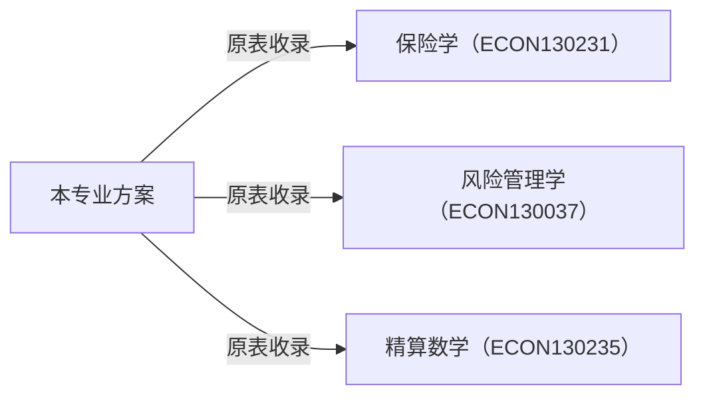

# 保险学专业“2+X”教学培养方案

2023 年度汇编，方案正文印刷页 382–384。本页附上原书 PDF 第 394–400 页，其中含本专业紧随正文的各版修读建议。逐行数据覆盖可可靠对应课号和名称的原表记录。[方案原页](original-pages.pdf) · [完整原版](https://jwc.fudan.edu.cn/_upload/article/files/83/6c/8a3c080c4f8991024f4b59ad4f1b/64d23c13-0465-4619-bd18-9e491594f850.pdf#page=394) · [逐行数据与来源](record.json)

## 课程导读

想了解保险与风险的课程安排，可以在原表中找到《保险学》（`ECON130231`）、《风险管理学》（`ECON130037`）、《精算数学》（`ECON130235`）。 [原书 PDF 第 395 页](original-pages.pdf#page=2)

原表把 `ECON130231` 列在第 3 学期，把 `ECON130037` 列在第 4 学期。图中箭头表示本节原表收录该课，图上各课之间没有先修连线。

| 课号 | 课程名称 | 开课学期原文 | PDF 页 |
|---|---|---|---|
| ECON130001 | 概率论与数理统计 | 3 | 394 |
| ECON130003 | 国际金融 | 5 | 395 |
| ECON130005 | 财政学 | 4 | 394 |
| ECON130010 | 当代中国经济 | 5 | 394 |
| ECON130011 | 产业经济学 | 6 | 394 |
| ECON130016 | 社会实践 | 6 | 395 |
| ECON130017 | 毕业论文 | 8 | 395 |
| ECON130019 | 国际经济学 | 4 | 394 |
| ECON130037 | 风险管理学 | 4 | 395 |
| ECON130083 | 时间序列分析方法 | 春秋 | 395 |
| ECON130091 | 海上保险 | 3 | 395 |
| ECON130092 | 再保险 | 6 | 395 |
| ECON130094 | 保险法 | 5 | 395 |
| ECON130122 | 人寿与健康保险 | 5 | 395 |
| ECON130167 | 保险公司财务管理 | 5 | 395 |
| ECON130188 | 截面与面板数据分析 | 春秋 | 395 |
| ECON130189 | 数量分析软件应用 | 春秋 | 395 |
| ECON130208 | 保险经济学 | 6 | 395 |
| ECON130212 | 经济史 | 3 | 394 |
| ECON130213 | 计量经济学 | 4 | 394 |
| ECON130217 | 公司金融 | 3 | 394 |
| ECON130231 | 保险学 | 3 | 395 |
| ECON130232 | 保险学经典文献选读与写作 | 7 | 395 |
| ECON130233 | 风险理论与精算建模 | 6 | 395 |
| ECON130234 | 财产与责任保险 | 5 | 395 |
| ECON130235 | 精算数学 | 5 | 395 |
| ECON130236 | 企业风险管理 | 7 | 395 |
| ECON130237 | 国际风险与保险研究 | 7 | 395 |
| ECON130238 | 金融工程与损失准备金 | 7 | 395 |
| ECON130261 | 社会实习 | 6 | 395 |
| ECON130278 | 精算统计学 | 4 | 395 |
| ECON130281 | 社会保险比较研究 | 6 | 395 |
| ECON130282 | 保险科技 | 3 | 395 |

可定位的课程对暂无明确先修记录，原课程表及备注见上方 PDF。
