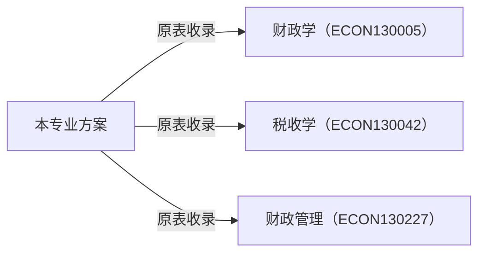

# 财政学专业“2+X”教学培养方案

2023 年度汇编，方案正文印刷页 389–391。本页附上原书 PDF 第 401–407 页，其中含本专业紧随正文的各版修读建议。逐行数据覆盖可可靠对应课号和名称的原表记录。[方案原页](original-pages.pdf) · [完整原版](https://jwc.fudan.edu.cn/_upload/article/files/83/6c/8a3c080c4f8991024f4b59ad4f1b/64d23c13-0465-4619-bd18-9e491594f850.pdf#page=401) · [逐行数据与来源](record.json)

## 课程导读

想了解财政与税收的课程安排，可以在原表中找到《财政学》（`ECON130005`）、《税收学》（`ECON130042`）、《财政管理》（`ECON130227`）。 [原书 PDF 第 401 页](original-pages.pdf#page=1) · [原书 PDF 第 402 页](original-pages.pdf#page=2)

原表把 `ECON130005` 列在第 4 学期，把 `ECON130042` 列在第 3 学期。图中箭头表示本节原表收录该课，图上各课之间没有先修连线。

| 课号 | 课程名称 | 开课学期原文 | PDF 页 |
|---|---|---|---|
| ECON130001 | 概率论与数理统计 | 3 | 401 |
| ECON130003 | 国际金融 | 5 | 402 |
| ECON130004 | 国际贸易 | 6 | 402 |
| ECON130005 | 财政学 | 4 | 401 |
| ECON130010 | 当代中国经济 | 5 | 401 |
| ECON130011 | 产业经济学 | 6 | 401 |
| ECON130012 | 发展经济学 | 7 | 402 |
| ECON130016 | 社会实践 | 6 | 402 |
| ECON130017 | 毕业论文 | 8 | 402 |
| ECON130019 | 国际经济学 | 4 | 401 |
| ECON130042 | 税收学 | 3 | 402 |
| ECON130043 | 国际税收 | 6 | 402 |
| ECON130045 | 国家预算 | 4 | 402 |
| ECON130046 | 财务管理 | 4 | 402 |
| ECON130073 | 公司财务分析 | 6 | 402 |
| ECON130083 | 时间序列分析方法 | 春秋 | 402 |
| ECON130117 | 税收筹划 | 5 | 402 |
| ECON130119 | 比较财政学 | 6 | 402 |
| ECON130128 | 制度经济学 | 7 | 402 |
| ECON130139 | 中级财务会计 | 7 | 402 |
| ECON130166 | 社会保障 | 5 | 402 |
| ECON130188 | 截面与面板数据分析 | 春秋 | 402 |
| ECON130189 | 数量分析软件应用 | 春秋 | 402 |
| ECON130197 | 税收管理 | 8 | 402 |
| ECON130198 | 税法 | 4 | 402 |
| ECON130212 | 经济史 | 3 | 401 |
| ECON130213 | 计量经济学 | 4 | 401 |
| ECON130217 | 公司金融 | 3 | 401 |
| ECON130227 | 财政管理 | 5 | 402 |
| ECON130228 | 财政学经典文献选读与写作 | 7 | 402 |
| ECON130229 | 公共支出分析 | 5 | 402 |
| ECON130230 | 公共财政政策分析 | 6 | 402 |
| ECON130261 | 社会实习 | 6 | 402 |
| SOSC120016 | 经济法 | 3 | 402 |

可定位的课程对暂无明确先修记录，原课程表及备注见上方 PDF。
