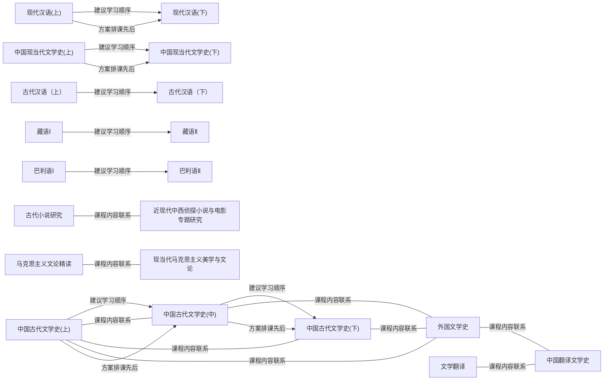

# 汉语言文学专业“2+X”教学培养方案

2024 年汇编印刷页 64–67。原表记录 81 个可配对的课程代码。

[本节原页](plan-64.pdf#page=1) · [逐行数据](plan-64.json) · [院系目录](README.md)

## 课程导读

想了解文学史与文本阅读的课程安排，可以在原表中找到《中国古代文学史(上)》（`CHIN130006`）、“《文学理论》精读”（`CHIN130019`）、《中国古代文学史(中)》（`CHIN130007`）。 [原书 PDF 第 78 页](plan-64.pdf#page=1) · [原书 PDF 第 79 页](plan-64.pdf#page=2)

图中连接《中国古代文学史(上)》（`CHIN130006`）和《中国古代文学史(中)》（`CHIN130007`），两门课都从课程题名标出的“古代文学”切入，可沿这一主题对照阅读。 [原书 PDF 第 78 页](plan-64.pdf#page=1)

## 课程关系图

图中展示最多 20 条关系。下表列出本节全部关系。建议学习顺序供规划课程使用，正式选课资格以教务规定为准。

| 课程 | 关联课程 | 关系 | 依据 |
| --- | --- | --- | --- |
| 现代汉语(上)（CHIN130002） | 现代汉语(下)（CHIN130003） | 建议学习顺序 | 同节课程题名标明连续分册或序号。 |
| 中国现当代文学史(上)（CHIN130004） | 中国现当代文学史(下)（CHIN130005） | 建议学习顺序 | 同节课程题名标明连续分册或序号。 |
| 中国古代文学史(上)（CHIN130006） | 中国古代文学史(中)（CHIN130007） | 建议学习顺序 | 同节课程题名标明连续分册或序号。 |
| 中国古代文学史(中)（CHIN130007） | 中国古代文学史(下)（CHIN130008） | 建议学习顺序 | 同节课程题名标明连续分册或序号。 |
| 古代汉语（上）（CHIN130226） | 古代汉语（下）（CHIN130227） | 建议学习顺序 | 同节课程题名标明连续分册或序号。 |
| 藏语Ⅰ（PHIL130165） | 藏语Ⅱ（PHIL130166） | 建议学习顺序 | 同节课程题名标明连续分册或序号。 |
| 巴利语Ⅰ（PHIL130167） | 巴利语Ⅱ（PHIL130168） | 建议学习顺序 | 同节课程题名标明连续分册或序号。 |
| 中国古代文学史(上)（CHIN130006） | 中国古代文学史(中)（CHIN130007） | 课程内容联系 | 本方案两门课程的题名均含“古代文学”，可据此对照这一主题。 |
| 中国古代文学史(上)（CHIN130006） | 中国古代文学史(下)（CHIN130008） | 课程内容联系 | 本方案两门课程的题名均含“古代文学”，可据此对照这一主题。 |
| 中国古代文学史(上)（CHIN130006） | 外国文学史（CHIN130009） | 课程内容联系 | 本方案两门课程的题名均含“文学史”，可据此对照这一主题。 |
| 中国古代文学史(中)（CHIN130007） | 外国文学史（CHIN130009） | 课程内容联系 | 本方案两门课程的题名均含“文学史”，可据此对照这一主题。 |
| 中国古代文学史(下)（CHIN130008） | 外国文学史（CHIN130009） | 课程内容联系 | 本方案两门课程的题名均含“文学史”，可据此对照这一主题。 |
| 外国文学史（CHIN130009） | 中国翻译文学史（CHIN130247） | 课程内容联系 | 本方案两门课程的题名均含“文学史”，可据此对照这一主题。 |
| 古代小说研究（CHIN130222） | 近现代中西侦探小说与电影专题研究（CHIN130274） | 课程内容联系 | 本方案两门课程的题名均含“小说”，可据此对照这一主题。 |
| 马克思主义文论精读（CHIN130231） | 现当代马克思主义美学与文论（CHIN130279） | 课程内容联系 | 本方案两门课程的题名均含“马克思主义”，可据此对照这一主题。 |
| 文学翻译（CHIN130232） | 中国翻译文学史（CHIN130247） | 课程内容联系 | 本方案两门课程的题名均含“翻译”，可据此对照这一主题。 |
| 现代汉语(上)（CHIN130002） | 现代汉语(下)（CHIN130003） | 方案排课先后 | 本节原表所列全部明确学期均早于后者。 |
| 中国现当代文学史(上)（CHIN130004） | 中国现当代文学史(下)（CHIN130005） | 方案排课先后 | 本节原表所列全部明确学期均早于后者。 |
| 中国古代文学史(上)（CHIN130006） | 中国古代文学史(中)（CHIN130007） | 方案排课先后 | 本节原表所列全部明确学期均早于后者。 |
| 中国古代文学史(中)（CHIN130007） | 中国古代文学史(下)（CHIN130008） | 方案排课先后 | 本节原表所列全部明确学期均早于后者。 |
| 古代汉语（上）（CHIN130226） | 古代汉语（下）（CHIN130227） | 方案排课先后 | 本节原表所列全部明确学期均早于后者。 |

## 课程

| 课程代码 | 名称 | 开课学期原文 | 来源（PDF 页） |
| --- | --- | --- | --- |
| CHIN130002 | 现代汉语(上) | 1 | 78 |
| CHIN130003 | 现代汉语(下) | 2 | 78 |
| CHIN130004 | 中国现当代文学史(上) | 3 | 78 |
| CHIN130005 | 中国现当代文学史(下) | 4 | 78 |
| CHIN130006 | 中国古代文学史(上) | 1 | 78 |
| CHIN130007 | 中国古代文学史(中) | 2 | 78 |
| CHIN130008 | 中国古代文学史(下) | 3 | 78 |
| CHIN130009 | 外国文学史 | 5 | 79 |
| CHIN130010 | 文学概论 | 5 | 79 |
| CHIN130011 | 语言学概论 | 3 | 78 |
| CHIN130012 | 比较文学导论 | 6 | 79 |
| CHIN130013 | 中国文学批评史 | 7 | 79 |
| CHIN130014 | 诗骚精读 | 3 | 79 |
| CHIN130015 | 鲁迅精读 | 3 | 79 |
| CHIN130017 | 《文心雕龙》精读 | 5 | 79 |
| CHIN130018 | 《四库提要》精读 | 6 | 79 |
| CHIN130019 | 《文学理论》精读 | 5 | 79 |
| CHIN130020 | 专业英语(汉语言文学) | 7 | 79 |
| CHIN130023 | 毕业论文 | 8 | 79 |
| CHIN130037 | 中国古典美学 | 春 | 80 |
| CHIN130038 | 现当代西方美学 | 秋 | 80 |
| CHIN130049 | 女性文学研究 | 秋 | 80 |
| CHIN130052 | 中国现代文学专题 | 春 | 80 |
| CHIN130054 | 台港澳文学研究 | 春，秋 | 80 |
| CHIN130056 | 《世说新语》精读 | 3 | 79 |
| CHIN130057 | 李杜精读 | 4 | 79 |
| CHIN130058 | 《胡适文存》精读 | 春 | 80 |
| CHIN130065 | 佛教文化与文学 | 秋 | 80 |
| CHIN130075 | 世界文学名著精读 | 秋 | 80 |
| CHIN130083 | 中国文学流派研究 | 春 | 80 |
| CHIN130084 | 中国文学文体研究 | 秋 | 80 |
| CHIN130085 | 中国现代文论 | 春 | 80 |
| CHIN130088 | 中外文学关系 | 春 | 80 |
| CHIN130090 | 周作人散文精读 | 5 | 79 |
| CHIN130093 | 西方古典美学 | 春 | 80 |
| CHIN130100 | 民间文学经典研究 | 春，秋 | 81 |
| CHIN130110 | 中国新诗 | 秋 | 80 |
| CHIN130115 | 苏轼精读 | 6 | 79 |
| CHIN130120 | 民间文学导论 | 秋 | 81 |
| CHIN130126 | 现当代话剧专题研究 | 秋 | 80 |
| CHIN130129 | 西方美学经典导读 | 秋 | 81 |
| CHIN130130 | 庄子精读 | 4 | 79 |
| CHIN130181 | 老舍精读 | 秋 | 80 |
| CHIN130184 | 中国电影史研究 | 春 | 80 |
| CHIN130191 | 中国近代文学 | 春，秋 | 80 |
| CHIN130197 | 比较史诗研究 | 秋 | 81 |
| CHIN130206 | 学年论文 | 6 | 79 |
| CHIN130211 | 中西文艺学名著导读 | 春，秋 | 81 |
| CHIN130212 | 论语精读 | 4 | 79 |
| CHIN130214 | 学术名著选读 | 春，秋 | 80 |
| CHIN130216 | 唐代社会与文学 | 春，秋 | 80 |
| CHIN130218 | 民间文学与民俗文化专题 | 春，秋 | 81 |
| CHIN130221 | 古典文献学基础 | 5 | 79 |
| CHIN130222 | 古代小说研究 | 春，秋 | 80 |
| CHIN130224 | 断代文学研究 | 春，秋 | 80 |
| CHIN130226 | 古代汉语（上） | 3 | 78 |
| CHIN130227 | 古代汉语（下） | 4 | 79 |
| CHIN130229 | 学术前沿专题 | 春，秋 | 81 |
| CHIN130231 | 马克思主义文论精读 | 3 | 79 |
| CHIN130232 | 文学翻译 | 春，秋 | 81 |
| CHIN130233 | 古籍校释实践 | 春，秋 | 80 |
| CHIN130234 | 唐代文史要籍导读 | 春，秋 | 80 |
| CHIN130235 | 法国文学专题 | 春，秋 | 81 |
| CHIN130247 | 中国翻译文学史 | 春，秋 | 80 |
| CHIN130250 | 先唐文史要籍导读 | 春，秋 | 80 |
| CHIN130252 | 六朝社会与文学 | 春，秋 | 80 |
| CHIN130253 | 敦煌文学概论 | 春，秋 | 80 |
| CHIN130254 | 宋代文史要籍导读 | 春，秋 | 80 |
| CHIN130267 | 社会实践 | 6 | 79 |
| CHIN130270 | 《乐府诗集》精读 | 春，秋 | 79 |
| CHIN130272 | 英诗经典导读 | 春，秋 | 81 |
| CHIN130274 | 近现代中西侦探小说与电影专题研究 | 春，秋 | 81 |
| CHIN130277 | 欧美文学批评概论 | 春，秋 | 81 |
| CHIN130278 | 诠释学与人文研究 | 春，秋 | 81 |
| CHIN130279 | 现当代马克思主义美学与文论 | 春，秋 | 81 |
| CHIN130280 | 20世纪抒情诗学 | 春，秋 | 81 |
| CHIN130281 | 中国古典诗学 | 春，秋 | 80 |
| PHIL130165 | 藏语Ⅰ | 秋 | 81 |
| PHIL130166 | 藏语Ⅱ | 春 | 81 |
| PHIL130167 | 巴利语Ⅰ | 秋 | 81 |
| PHIL130168 | 巴利语Ⅱ | 春 | 81 |
