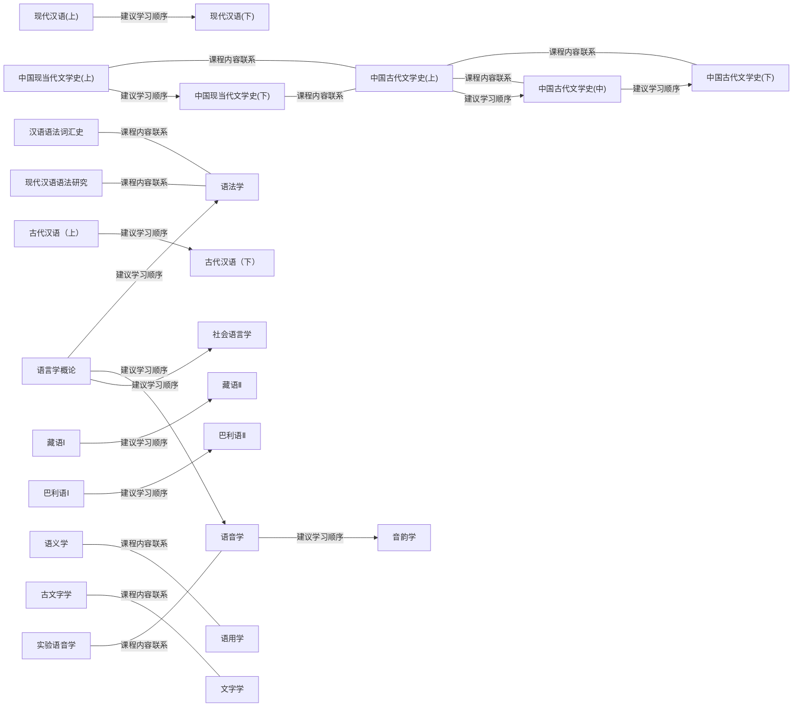

# 汉语言专业“2+X”教学培养方案

2024 年汇编印刷页 72–75。原表记录 68 个可配对的课程代码。

[本节原页](plan-72.pdf#page=1) · [逐行数据](plan-72.json) · [院系目录](README.md)

## 课程导读

想了解汉语研究的课程安排，可以在原表中找到《现代汉语(上)》（`CHIN130002`）、《语言学概论》（`CHIN130011`）、《语法学》（`CHIN130239`）。 [原书 PDF 第 86 页](plan-72.pdf#page=1) · [原书 PDF 第 87 页](plan-72.pdf#page=2)

图中连接《现代汉语语法研究》（`CHIN130140`）和《语法学》（`CHIN130239`），两门课都从课程题名标出的“语法”切入，可沿这一主题对照阅读。 [原书 PDF 第 87 页](plan-72.pdf#page=2) · [原书 PDF 第 88 页](plan-72.pdf#page=3)

## 课程关系图

图中展示最多 20 条关系。下表列出本节全部关系。建议学习顺序供规划课程使用，正式选课资格以教务规定为准。

| 课程 | 关联课程 | 关系 | 依据 |
| --- | --- | --- | --- |
| 现代汉语(上)（CHIN130002） | 现代汉语(下)（CHIN130003） | 建议学习顺序 | 同节课程题名标明连续分册或序号。 |
| 中国现当代文学史(上)（CHIN130004） | 中国现当代文学史(下)（CHIN130005） | 建议学习顺序 | 同节课程题名标明连续分册或序号。 |
| 中国古代文学史(上)（CHIN130006） | 中国古代文学史(中)（CHIN130007） | 建议学习顺序 | 同节课程题名标明连续分册或序号。 |
| 中国古代文学史(中)（CHIN130007） | 中国古代文学史(下)（CHIN130008） | 建议学习顺序 | 同节课程题名标明连续分册或序号。 |
| 语言学概论（CHIN130011） | 社会语言学（CHIN130137） | 建议学习顺序 | 语言结构与语言变异概念可支持社会语言学学习。 |
| 语言学概论（CHIN130011） | 语音学（CHIN130187） | 建议学习顺序 | 一般语言学概念有助于进一步认识语音系统。 |
| 语言学概论（CHIN130011） | 语法学（CHIN130239） | 建议学习顺序 | 语言结构与语法单位的概念可供语法分析使用。 |
| 语音学（CHIN130187） | 音韵学（CHIN130133） | 建议学习顺序 | 语音描述方法有助于理解历史音系。 |
| 古代汉语（上）（CHIN130226） | 古代汉语（下）（CHIN130227） | 建议学习顺序 | 同节课程题名标明连续分册或序号。 |
| 藏语Ⅰ（PHIL130165） | 藏语Ⅱ（PHIL130166） | 建议学习顺序 | 同节课程题名标明连续分册或序号。 |
| 巴利语Ⅰ（PHIL130167） | 巴利语Ⅱ（PHIL130168） | 建议学习顺序 | 同节课程题名标明连续分册或序号。 |
| 中国现当代文学史(上)（CHIN130004） | 中国古代文学史(上)（CHIN130006） | 课程内容联系 | 本方案两门课程的题名均含“文学史”，可据此对照这一主题。 |
| 中国现当代文学史(下)（CHIN130005） | 中国古代文学史(上)（CHIN130006） | 课程内容联系 | 本方案两门课程的题名均含“文学史”，可据此对照这一主题。 |
| 中国古代文学史(上)（CHIN130006） | 中国古代文学史(中)（CHIN130007） | 课程内容联系 | 本方案两门课程的题名均含“文学史”，可据此对照这一主题。 |
| 中国古代文学史(上)（CHIN130006） | 中国古代文学史(下)（CHIN130008） | 课程内容联系 | 本方案两门课程的题名均含“文学史”，可据此对照这一主题。 |
| 语义学（CHIN130138） | 语用学（CHIN130147） | 课程内容联系 | 两课均研究意义，可比较语言表达和语境的作用。 |
| 现代汉语语法研究（CHIN130140） | 语法学（CHIN130239） | 课程内容联系 | 本方案两门课程的题名均含“语法”，可据此对照这一主题。 |
| 古文字学（CHIN130153） | 文字学（CHIN130185） | 课程内容联系 | 本方案两门课程的题名均含“文字学”，可据此对照这一主题。 |
| 实验语音学（CHIN130164） | 语音学（CHIN130187） | 课程内容联系 | 均关注语音结构与声音特征。 |
| 汉语语法词汇史（CHIN130177） | 语法学（CHIN130239） | 课程内容联系 | 本方案两门课程的题名均含“语法”，可据此对照这一主题。 |
| 汉语语音史（CHIN130178） | 语音学（CHIN130187） | 课程内容联系 | 本方案两门课程的题名均含“语音”，可据此对照这一主题。 |
| 文字学（CHIN130185） | 训诂学（CHIN130186） | 课程内容联系 | 文字形体与字词解释在古典文献阅读中联系紧密。 |
| 语音学（CHIN130187） | 语音学与音系学概论（CHIN130200） | 课程内容联系 | 本方案两门课程的题名均含“语音”，可据此对照这一主题。 |
| 现代汉语(上)（CHIN130002） | 现代汉语(下)（CHIN130003） | 方案排课先后 | 本节原表所列全部明确学期均早于后者。 |
| 中国现当代文学史(上)（CHIN130004） | 中国现当代文学史(下)（CHIN130005） | 方案排课先后 | 本节原表所列全部明确学期均早于后者。 |
| 中国古代文学史(上)（CHIN130006） | 中国古代文学史(中)（CHIN130007） | 方案排课先后 | 本节原表所列全部明确学期均早于后者。 |
| 中国古代文学史(中)（CHIN130007） | 中国古代文学史(下)（CHIN130008） | 方案排课先后 | 本节原表所列全部明确学期均早于后者。 |
| 语言学概论（CHIN130011） | 语音学（CHIN130187） | 方案排课先后 | 本节原表所列全部明确学期均早于后者。 |
| 语言学概论（CHIN130011） | 语法学（CHIN130239） | 方案排课先后 | 本节原表所列全部明确学期均早于后者。 |
| 语音学（CHIN130187） | 音韵学（CHIN130133） | 方案排课先后 | 本节原表所列全部明确学期均早于后者。 |
| 古代汉语（上）（CHIN130226） | 古代汉语（下）（CHIN130227） | 方案排课先后 | 本节原表所列全部明确学期均早于后者。 |

## 课程

| 课程代码 | 名称 | 开课学期原文 | 来源（PDF 页） |
| --- | --- | --- | --- |
| CHIN130002 | 现代汉语(上) | 1 | 86 |
| CHIN130003 | 现代汉语(下) | 2 | 86 |
| CHIN130004 | 中国现当代文学史(上) | 3 | 86 |
| CHIN130005 | 中国现当代文学史(下) | 4 | 86 |
| CHIN130006 | 中国古代文学史(上) | 1 | 86 |
| CHIN130007 | 中国古代文学史(中) | 2 | 86 |
| CHIN130008 | 中国古代文学史(下) | 3 | 86 |
| CHIN130010 | 文学概论 | 5 | 87 |
| CHIN130011 | 语言学概论 | 3 | 86 |
| CHIN130014 | 诗骚精读 | 5 | 87 |
| CHIN130023 | 毕业论文 | 8 | 87 |
| CHIN130024 | 《普通语言学教程》精读 | 5 | 87 |
| CHIN130026 | 《说文解字》精读 | 6 | 87 |
| CHIN130030 | 西方语言学 | 春，秋 | 87 |
| CHIN130031 | 专业英语(汉语言) | 7 | 87 |
| CHIN130133 | 音韵学 | 5 | 87 |
| CHIN130134 | 近代汉语 | 春 | 88 |
| CHIN130137 | 社会语言学 | 秋 | 87 |
| CHIN130138 | 语义学 | 春 | 87 |
| CHIN130139 | 汉语修辞学史 | 秋 | 88 |
| CHIN130140 | 现代汉语语法研究 | 春 | 88 |
| CHIN130143 | 汉语史 | 春 | 88 |
| CHIN130147 | 语用学 | 春 | 87 |
| CHIN130149 | 应用语言学 | 秋 | 88 |
| CHIN130150 | 语言哲学 | 春，秋 | 88 |
| CHIN130153 | 古文字学 | 秋 | 88 |
| CHIN130154 | 《马氏文通》精读 | 春，秋 | 88 |
| CHIN130155 | 计算语言学 | 秋 | 88 |
| CHIN130156 | 《语言论》精读 | 6 | 87 |
| CHIN130159 | 汉语词汇学 | 春 | 88 |
| CHIN130160 | 汉语方言学 | 6 | 87 |
| CHIN130161 | 汉语认知语言学 | 春，秋 | 88 |
| CHIN130163 | 生成语言学 | 春 | 88 |
| CHIN130164 | 实验语音学 | 秋 | 88 |
| CHIN130168 | 语言统计学 | 春 | 88 |
| CHIN130173 | 中国手语语言学 | 春 | 88 |
| CHIN130176 | 中国语言学论著选读 | 春，秋 | 88 |
| CHIN130177 | 汉语语法词汇史 | 春，秋 | 88 |
| CHIN130178 | 汉语语音史 | 春 | 89 |
| CHIN130185 | 文字学 | 5 | 87 |
| CHIN130186 | 训诂学 | 6 | 87 |
| CHIN130187 | 语音学 | 4 | 87 |
| CHIN130200 | 语音学与音系学概论 | 春，秋 | 88 |
| CHIN130201 | 《修辞学发凡》研究 | 春，秋 | 89 |
| CHIN130206 | 学年论文 | 6 | 87 |
| CHIN130209 | 现代语言学 | 春，秋 | 88 |
| CHIN130213 | 语言类型学 | 春，秋 | 88 |
| CHIN130215 | 新媒体语言研究 | 春，秋 | 89 |
| CHIN130217 | 神经语言学 | 春，秋 | 88 |
| CHIN130219 | 历史比较语言学 | 春，秋 | 88 |
| CHIN130226 | 古代汉语（上） | 3 | 86 |
| CHIN130227 | 古代汉语（下） | 4 | 87 |
| CHIN130229 | 学术前沿专题 | 春，秋 | 88 |
| CHIN130236 | 语言发声和感知的解剖生理机制 | 春，秋 | 88 |
| CHIN130237 | 语篇语言学 | 春，秋 | 89 |
| CHIN130239 | 语法学 | 5 | 87 |
| CHIN130240 | 修辞学 | 6 | 87 |
| CHIN130241 | 语言学史 | 7 | 87 |
| CHIN130244 | 心理语言学 | 春，秋 | 88 |
| CHIN130267 | 社会实践 | 6 | 87 |
| CHIN130268 | 地理语言学入门 | 春，秋 | 88 |
| CHIN130273 | 语言类型与共性 | 春，秋 | 89 |
| CHIN130275 | 汉字源流与中国传统文化 | 春，秋 | 89 |
| CHIN130276 | 老子精读 | 6 | 87 |
| PHIL130165 | 藏语Ⅰ | 秋 | 88 |
| PHIL130166 | 藏语Ⅱ | 春 | 88 |
| PHIL130167 | 巴利语Ⅰ | 秋 | 88 |
| PHIL130168 | 巴利语Ⅱ | 春 | 88 |
