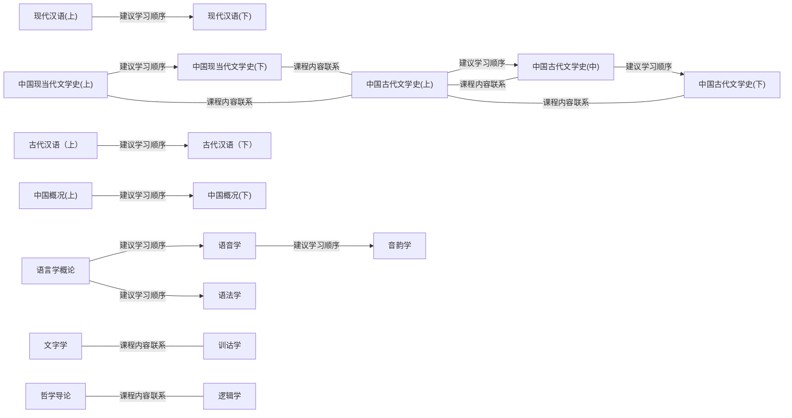

# 汉语言专业“2+X”修读建议（留学生适用）

2024 年汇编印刷页 78–79。原表记录 29 个可配对的课程代码。

[本节原页](plan-72.pdf#page=7) · [逐行数据](plan-72.json) · [院系目录](README.md)

## 课程导读

想了解汉语研究的课程安排，可以在原表中找到《现代汉语(上)》（`CHIN130002`）、《语言学概论》（`CHIN130011`）、《语法学》（`CHIN130239`）。 [原书 PDF 第 92 页](plan-72.pdf#page=7)

《现代汉语(上)》（`CHIN130002`）和《现代汉语(下)》（`CHIN130003`）是同一系列，图中的箭头按题名标出的分册顺序排列。 [原书 PDF 第 92 页](plan-72.pdf#page=7)

## 课程关系图

图中展示最多 20 条关系。下表列出本节全部关系。建议学习顺序供规划课程使用，正式选课资格以教务规定为准。

| 课程 | 关联课程 | 关系 | 依据 |
| --- | --- | --- | --- |
| 现代汉语(上)（CHIN130002） | 现代汉语(下)（CHIN130003） | 建议学习顺序 | 同节课程题名标明连续分册或序号。 |
| 中国现当代文学史(上)（CHIN130004） | 中国现当代文学史(下)（CHIN130005） | 建议学习顺序 | 同节课程题名标明连续分册或序号。 |
| 中国古代文学史(上)（CHIN130006） | 中国古代文学史(中)（CHIN130007） | 建议学习顺序 | 同节课程题名标明连续分册或序号。 |
| 中国古代文学史(中)（CHIN130007） | 中国古代文学史(下)（CHIN130008） | 建议学习顺序 | 同节课程题名标明连续分册或序号。 |
| 语言学概论（CHIN130011） | 语音学（CHIN130187） | 建议学习顺序 | 一般语言学概念有助于进一步认识语音系统。 |
| 语言学概论（CHIN130011） | 语法学（CHIN130239） | 建议学习顺序 | 语言结构与语法单位的概念可供语法分析使用。 |
| 语音学（CHIN130187） | 音韵学（CHIN130133） | 建议学习顺序 | 语音描述方法有助于理解历史音系。 |
| 古代汉语（上）（CHIN130226） | 古代汉语（下）（CHIN130227） | 建议学习顺序 | 同节课程题名标明连续分册或序号。 |
| 中国概况(上)（ICES110012） | 中国概况(下)（ICES110013） | 建议学习顺序 | 同节课程题名标明连续分册或序号。 |
| 中国现当代文学史(上)（CHIN130004） | 中国古代文学史(上)（CHIN130006） | 课程内容联系 | 本方案两门课程的题名均含“文学史”，可据此对照这一主题。 |
| 中国现当代文学史(下)（CHIN130005） | 中国古代文学史(上)（CHIN130006） | 课程内容联系 | 本方案两门课程的题名均含“文学史”，可据此对照这一主题。 |
| 中国古代文学史(上)（CHIN130006） | 中国古代文学史(中)（CHIN130007） | 课程内容联系 | 本方案两门课程的题名均含“文学史”，可据此对照这一主题。 |
| 中国古代文学史(上)（CHIN130006） | 中国古代文学史(下)（CHIN130008） | 课程内容联系 | 本方案两门课程的题名均含“文学史”，可据此对照这一主题。 |
| 文字学（CHIN130185） | 训诂学（CHIN130186） | 课程内容联系 | 文字形体与字词解释在古典文献阅读中联系紧密。 |
| 哲学导论（PHIL120012） | 逻辑学（PHIL120013） | 课程内容联系 | 论证与概念分析是哲学讨论的共同方法。 |

## 课程

| 课程代码 | 名称 | 开课学期原文 | 来源（PDF 页） |
| --- | --- | --- | --- |
| CHIN120012 | 中国文学经典 |  | 92 |
| CHIN130002 | 现代汉语(上) |  | 92 |
| CHIN130003 | 现代汉语(下) |  | 92 |
| CHIN130004 | 中国现当代文学史(上) |  | 92 |
| CHIN130005 | 中国现当代文学史(下) |  | 92 |
| CHIN130006 | 中国古代文学史(上) |  | 92 |
| CHIN130007 | 中国古代文学史(中) |  | 92 |
| CHIN130008 | 中国古代文学史(下) |  | 92 |
| CHIN130010 | 文学概论 |  | 92 |
| CHIN130011 | 语言学概论 |  | 92 |
| CHIN130023 | 毕业论文 |  | 93 |
| CHIN130031 | 专业英语(汉语言) |  | 92 |
| CHIN130133 | 音韵学 |  | 92 |
| CHIN130160 | 汉语方言学 |  | 92 |
| CHIN130185 | 文字学 |  | 92 |
| CHIN130186 | 训诂学 |  | 92 |
| CHIN130187 | 语音学 |  | 92 |
| CHIN130206 | 学年论文 |  | 93 |
| CHIN130226 | 古代汉语（上） |  | 92 |
| CHIN130227 | 古代汉语（下） |  | 92 |
| CHIN130239 | 语法学 |  | 92 |
| CHIN130240 | 修辞学 |  | 92 |
| CHIN130241 | 语言学史 |  | 93 |
| CHIN130267 | 社会实践 |  | 93 |
| HIST120012 | 中国古代文明 |  | 92 |
| ICES110012 | 中国概况(上) |  | 92 |
| ICES110013 | 中国概况(下) |  | 92 |
| PHIL120012 | 哲学导论 |  | 92 |
| PHIL120013 | 逻辑学 |  | 92 |
